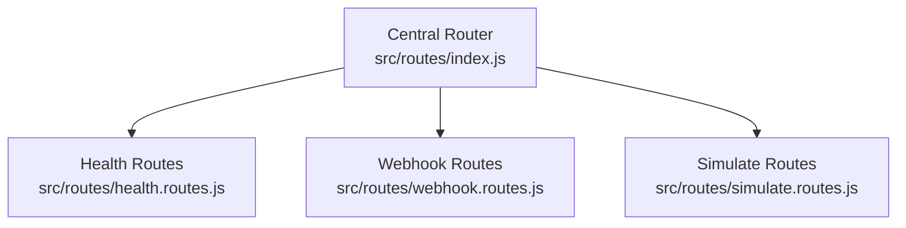
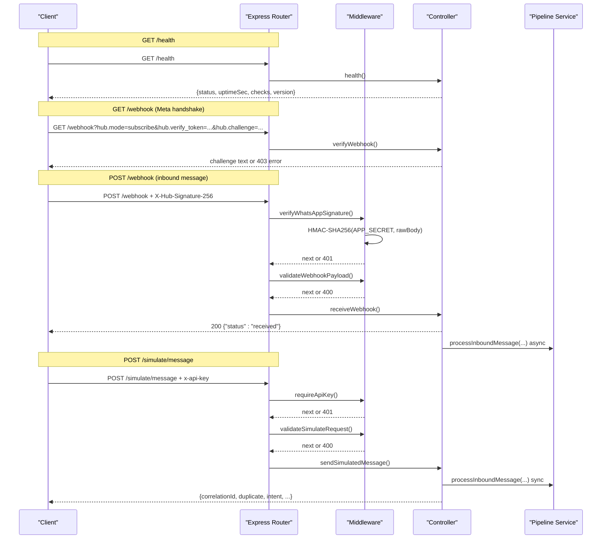
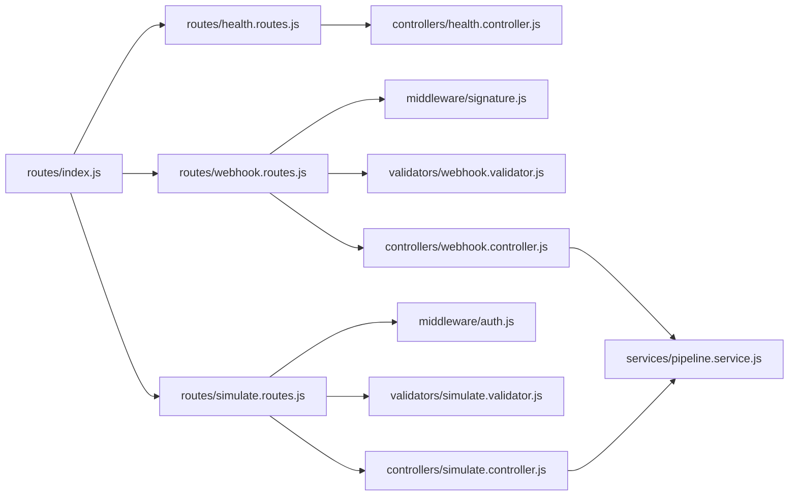

# API Reference

<cite>
**Referenced Files in This Document**
- [index.js](file://src/routes/index.js)
- [health.routes.js](file://src/routes/health.routes.js)
- [webhook.routes.js](file://src/routes/webhook.routes.js)
- [simulate.routes.js](file://src/routes/simulate.routes.js)
- [health.controller.js](file://src/controllers/health.controller.js)
- [webhook.controller.js](file://src/controllers/webhook.controller.js)
- [simulate.controller.js](file://src/controllers/simulate.controller.js)
- [signature.js](file://src/middleware/signature.js)
- [auth.js](file://src/middleware/auth.js)
- [webhook.validator.js](file://src/validators/webhook.validator.js)
- [simulate.validator.js](file://src/validators/simulate.validator.js)
- [httpError.js](file://src/utils/httpError.js)
- [env.js](file://src/config/env.js)
- [README.md](file://README.md)
</cite>

## Table of Contents
1. [Introduction](#introduction)
2. [Project Structure](#project-structure)
3. [Core Components](#core-components)
4. [Architecture Overview](#architecture-overview)
5. [Detailed Component Analysis](#detailed-component-analysis)
6. [Dependency Analysis](#dependency-analysis)
7. [Performance Considerations](#performance-considerations)
8. [Troubleshooting Guide](#troubleshooting-guide)
9. [Conclusion](#conclusion)

## Introduction
This document provides the operational API reference for the WhatsApp retail automation backend. It covers:
- System monitoring via `GET /health`.
- Meta webhook verification handshake via `GET /webhook`.
- Inbound WhatsApp message processing via `POST /webhook`, including HMAC-SHA256 signature verification and payload validation.
- Development testing via `POST /simulate/message`, protected by a staff API key and disabled in production.

The API uses standard JSON responses, structured error bodies, correlation IDs, and audit logging for security-relevant events.

## Project Structure
The routing layer mounts three route groups under a central router:
- `/health`
- `/webhook`
- `/simulate`



**Diagram sources**
- [index.js:12-14](file://src/routes/index.js#L12-L14)
- [health.routes.js:6-6](file://src/routes/health.routes.js#L6-L6)
- [webhook.routes.js:9-13](file://src/routes/webhook.routes.js#L9-L13)
- [simulate.routes.js:18-18](file://src/routes/simulate.routes.js#L18-L18)

**Section sources**
- [index.js:1-17](file://src/routes/index.js#L1-L17)

## Core Components
- Health controller reports system status based on MongoDB, LLM provider configuration, and notifier configuration.
- Webhook controller handles Meta’s verification handshake and inbound messages with immediate acknowledgment and asynchronous processing.
- Simulate controller drives the same pipeline as webhooks but synchronously returns results for development and demos.
- Middleware enforces HMAC-SHA256 signature verification for webhooks and staff API key authentication for simulate endpoints.
- Validators normalize and validate incoming payloads using Zod schemas.

**Section sources**
- [health.controller.js:8-50](file://src/controllers/health.controller.js#L8-L50)
- [webhook.controller.js:5-55](file://src/controllers/webhook.controller.js#L5-L55)
- [simulate.controller.js:4-34](file://src/controllers/simulate.controller.js#L4-L34)
- [signature.js:7-50](file://src/middleware/signature.js#L7-L50)
- [auth.js:11-22](file://src/middleware/auth.js#L11-L22)
- [webhook.validator.js:7-123](file://src/validators/webhook.validator.js#L7-L123)
- [simulate.validator.js:6-54](file://src/validators/simulate.validator.js#L6-L54)

## Architecture Overview
The request flow differs by endpoint:
- Health is a simple status check.
- Webhook GET performs a token-based handshake.
- Webhook POST verifies signature, validates payload, acknowledges immediately, and processes messages asynchronously.
- Simulate POST authenticates the caller, validates input, and returns synchronous pipeline results.



**Diagram sources**
- [health.routes.js:6-6](file://src/routes/health.routes.js#L6-L6)
- [webhook.routes.js:9-13](file://src/routes/webhook.routes.js#L9-L13)
- [simulate.routes.js:18-18](file://src/routes/simulate.routes.js#L18-L18)
- [health.controller.js:19-50](file://src/controllers/health.controller.js#L19-L50)
- [webhook.controller.js:10-55](file://src/controllers/webhook.controller.js#L10-L55)
- [simulate.controller.js:12-34](file://src/controllers/simulate.controller.js#L12-L34)
- [signature.js:19-50](file://src/middleware/signature.js#L19-L50)
- [auth.js:16-22](file://src/middleware/auth.js#L16-L22)

## Detailed Component Analysis

### GET /health
Purpose: System monitoring and readiness/liveness indicator.

- Method: `GET`
- URL pattern: `/health`
- Authentication: None
- Query parameters: None
- Request body: None
- Success response:
  - Status code: `200` when healthy or degraded; `503` when down.
  - Body fields:
    - `status`: `ok`, `degraded`, or `down`.
    - `uptimeSec`: integer seconds since process start.
    - `checks`: object with keys `mongo`, `llm`, `notifier`.
    - `version`: application version string.
- Error responses:
  - `503` with standard error body when MongoDB is down.
- Correlation ID: Included in every response.

Example curl:
```bash
curl http://localhost:3000/health
```

Expected success response format:
```json
{
  "status": "ok",
  "uptimeSec": 12,
  "checks": {
    "mongo": "up",
    "llm": "disabled",
    "notifier": "up"
  },
  "version": "1.0.0"
}
```

Status logic summary:
- If MongoDB is not up, status is `down` and HTTP status is `503`.
- If LLM or notifier is down, status is `degraded` and HTTP status is `200`.
- Otherwise, status is `ok` and HTTP status is `200`.

**Section sources**
- [health.routes.js:6-6](file://src/routes/health.routes.js#L6-L6)
- [health.controller.js:8-50](file://src/controllers/health.controller.js#L8-L50)

### GET /webhook (Meta Verification Handshake)
Purpose: Complete Meta’s webhook subscription verification by echoing back the challenge when the verify token matches.

- Method: `GET`
- URL pattern: `/webhook`
- Authentication: Verify token query parameter matching server-side configuration.
- Query parameters:
  - `hub.mode`: must be `subscribe`.
  - `hub.verify_token`: must match configured value.
  - `hub.challenge`: echoed back on success.
- Request body: None
- Success response:
  - Status code: `200`
  - Content-Type: `text/plain`
  - Body: the exact `hub.challenge` value.
- Failure response:
  - Status code: `403`
  - Body: standard error structure with `error.code = UNAUTHORIZED`.

Example curl:
```bash
curl "http://localhost:3000/webhook?hub.mode=subscribe&hub.verify_token=YOUR_VERIFY_TOKEN&hub.challenge=ping123"
```

Expected success response:
```
ping123
```

Expected failure response:
```json
{
  "error": {
    "code": "UNAUTHORIZED",
    "message": "Verify token mismatch",
    "details": []
  },
  "correlationId": "uuid-string"
}
```

Security notes:
- The verify token must match the configured value exactly.
- Do not log secrets or tokens in logs.

**Section sources**
- [webhook.routes.js:9-9](file://src/routes/webhook.routes.js#L9-L9)
- [webhook.controller.js:5-25](file://src/controllers/webhook.controller.js#L5-L25)

### POST /webhook (Inbound WhatsApp Message Processing)
Purpose: Receive inbound WhatsApp messages from Meta, verify authenticity, validate payload, acknowledge quickly, and process messages asynchronously.

- Method: `POST`
- URL pattern: `/webhook`
- Authentication: HMAC-SHA256 signature verification using `X-Hub-Signature-256` header and configured app secret.
- Required headers:
  - `Content-Type: application/json`
  - `X-Hub-Signature-256: sha256=<hex-signature>`
- Request body: Meta Cloud API webhook payload containing at least one entry with changes and messages.
- Success response:
  - Status code: `200`
  - Body: `{"status": "received"}`
  - Processing continues asynchronously after the response is sent.
- Failure responses:
  - `401` if signature is missing or invalid; audited as `WEBHOOK_REJECTED`.
  - `400` if payload schema validation fails; audited as `PAYLOAD_INVALID`.

Example curl using a signed payload script:
```bash
node scripts/send-webhook.js
node scripts/send-webhook.js --text "Do you have rice?"
node scripts/send-webhook.js --bad-signature
```

Expected success response:
```json
{
  "status": "received"
}
```

Expected signature failure response:
```json
{
  "error": {
    "code": "UNAUTHORIZED",
    "message": "Invalid webhook signature",
    "details": []
  },
  "correlationId": "uuid-string"
}
```

Expected payload validation failure response:
```json
{
  "error": {
    "code": "VALIDATION_ERROR",
    "message": "Invalid webhook payload",
    "details": [
      {"path": "entry[0].changes[0].value.messages[0].from", "message": "Required"}
    ]
  },
  "correlationId": "uuid-string"
}
```

Processing behavior:
- The controller responds with `200` immediately to avoid retry storms.
- Each extracted message is processed asynchronously through the pipeline service.
- Errors during async processing are logged with correlation ID and provider message ID.

Security and validation:
- Signature verification uses timing-safe comparison against the raw request body.
- Payload is validated with a permissive schema that preserves unknown fields while requiring essential structures.
- Non-text messages are normalized with `text: null`; only text messages carry a body.

Rate limiting:
- Rate limiting is enabled outside tests via middleware; consult application-level configuration for exact limits.

Correlation ID:
- Every response includes `correlationId`, enabling end-to-end tracing across logs and audit events.

**Section sources**
- [webhook.routes.js:11-13](file://src/routes/webhook.routes.js#L11-L13)
- [signature.js:7-50](file://src/middleware/signature.js#L7-L50)
- [webhook.validator.js:7-123](file://src/validators/webhook.validator.js#L7-L123)
- [webhook.controller.js:27-55](file://src/controllers/webhook.controller.js#L27-L55)
- [README.md:386-407](file://README.md#L386-L407)

### POST /simulate/message (Development Testing)
Purpose: Drive the full message pipeline without Meta, returning synchronous results for manual testing and demos. Disabled in production.

- Method: `POST`
- URL pattern: `/simulate/message`
- Authentication: Staff API key via `x-api-key` header.
- Production behavior: Returns `404 NOT_FOUND` regardless of other inputs.
- Request body:
  - `from`: required, valid Nigerian phone number in E.164-like format.
  - `name`: optional, string length 1–100.
  - `text`: required, string length 1–1000.
  - `messageId`: optional, string length 1–100; used to exercise dedupe paths.
  - `forceLlmFailure`: optional boolean defaulting to false.
- Success response:
  - Status code: `200`
  - Body fields:
    - `correlationId`: unique request identifier.
    - `duplicate`: boolean indicating whether the message was a duplicate.
    - `intent`: classification result (may be null until classifier features are implemented).
    - `confidence`: numeric confidence score (may be null).
    - `classifierSource`: source of classification (may be null).
    - `replies`: array of replies generated (may be empty).
    - `conversation`: conversation state (may be null).
    - `ticketId`: ticket identifier (may be null).
    - `orderId`: order identifier (may be null).
- Failure responses:
  - `401` if `x-api-key` is missing or invalid.
  - `400` if request body fails validation.
  - `404` in production environment.

Example curl:
```bash
curl -X POST http://localhost:3000/simulate/message \
  -H "content-type: application/json" \
  -H "x-api-key: YOUR_STAFF_API_KEY" \
  -d '{"from":"+2348012345678","name":"Ada","text":"I want to buy 2 bags of rice","messageId":"sim-1"}'
```

Expected success response format:
```json
{
  "correlationId": "uuid-string",
  "duplicate": false,
  "intent": null,
  "confidence": null,
  "classifierSource": null,
  "replies": [],
  "conversation": null,
  "ticketId": null,
  "orderId": null
}
```

Validation rules:
- Phone number must pass Nigerian phone validation.
- Text length must be between 1 and 1000 characters.
- Name length must be between 1 and 100 characters when provided.
- Unknown fields are rejected due to strict parsing.

Integration patterns:
- Use this endpoint to test pipeline behavior without configuring Meta.
- Supply `messageId` to reproduce duplicate scenarios.
- Use `forceLlmFailure` to exercise fallback paths.

**Section sources**
- [simulate.routes.js:10-18](file://src/routes/simulate.routes.js#L10-L18)
- [auth.js:11-22](file://src/middleware/auth.js#L11-L22)
- [simulate.validator.js:6-54](file://src/validators/simulate.validator.js#L6-L54)
- [simulate.controller.js:4-34](file://src/controllers/simulate.controller.js#L4-L34)
- [README.md:319-344](file://README.md#L319-L344)

## Dependency Analysis
The following diagram shows how routes connect controllers, middleware, validators, and services.



**Diagram sources**
- [index.js:12-14](file://src/routes/index.js#L12-L14)
- [health.routes.js:6-6](file://src/routes/health.routes.js#L6-L6)
- [webhook.routes.js:9-13](file://src/routes/webhook.routes.js#L9-L13)
- [simulate.routes.js:18-18](file://src/routes/simulate.routes.js#L18-L18)
- [health.controller.js:19-50](file://src/controllers/health.controller.js#L19-L50)
- [webhook.controller.js:35-55](file://src/controllers/webhook.controller.js#L35-L55)
- [simulate.controller.js:12-34](file://src/controllers/simulate.controller.js#L12-L34)
- [signature.js:19-50](file://src/middleware/signature.js#L19-L50)
- [auth.js:16-22](file://src/middleware/auth.js#L16-L22)
- [webhook.validator.js:103-123](file://src/validators/webhook.validator.js#L103-L123)
- [simulate.validator.js:28-54](file://src/validators/simulate.validator.js#L28-L54)

**Section sources**
- [index.js:1-17](file://src/routes/index.js#L1-L17)
- [webhook.routes.js:1-16](file://src/routes/webhook.routes.js#L1-L16)
- [simulate.routes.js:1-21](file://src/routes/simulate.routes.js#L1-L21)

## Performance Considerations
- Webhook POST returns `200` immediately to prevent Meta retry storms; actual processing is asynchronous.
- Asynchronous processing errors are caught and logged rather than propagated to the client.
- Signature verification uses constant-time comparison to mitigate timing attacks.
- Payload validation uses Zod schemas with passthrough to remain resilient to future Meta fields.
- Health endpoint avoids expensive external probes; LLM and notifier checks are configuration-based at this stage.

[No sources needed since this section provides general guidance]

## Troubleshooting Guide
Common issues and resolutions:
- Invalid environment variables at startup: compare `.env` with `.env.example`; the startup routine prints each offending variable.
- `/health` returns `503` with `mongo: down`: ensure MongoDB is reachable or start the in-memory dev database.
- Port conflicts: change `PORT` in `.env` if port `3000` is already in use.
- Webhook POST returns `401` with `Invalid webhook signature`: verify `WHATSAPP_APP_SECRET` matches the signer; when using the helper script, omit custom secret flags to use the configured value.
- Handshake returns `403`: ensure `WHATSAPP_VERIFY_TOKEN` in `.env` matches the value configured in Meta’s webhook settings.
- Simulate endpoint returns `404` in production: this is by design; disable simulation in production environments.

Standard error body structure:
```json
{
  "error": {
    "code": "UNAUTHORIZED",
    "message": "...",
    "details": []
  },
  "correlationId": "uuid-string"
}
```

Supported error codes:
- `VALIDATION_ERROR` (400)
- `UNAUTHORIZED` (401/403)
- `NOT_FOUND` (404)
- `RATE_LIMITED` (429)
- `INTERNAL_ERROR` (500)
- `DEPENDENCY_UNAVAILABLE` (503)

Every response carries `x-correlation-id`, which also appears in audit events and logs.

**Section sources**
- [README.md:386-419](file://README.md#L386-L419)
- [httpError.js:1-31](file://src/utils/httpError.js#L1-L31)
- [signature.js:23-30](file://src/middleware/signature.js#L23-L30)
- [webhook.validator.js:103-123](file://src/validators/webhook.validator.js#L103-L123)

## Conclusion
The API provides a secure and extensible foundation for WhatsApp-driven customer interactions:
- Health monitoring offers clear system status signals.
- Webhook handling ensures authenticity and resilience with immediate acknowledgment and background processing.
- Simulation enables safe development and testing without external dependencies.
- Standardized error bodies, correlation IDs, and audit logging support observability and troubleshooting.

For integration, configure Meta’s webhook callback URL and verify token, set the app secret for signature verification, and use the simulate endpoint for local iteration before enabling cloud mode.

[No sources needed since this section summarizes without analyzing specific files]