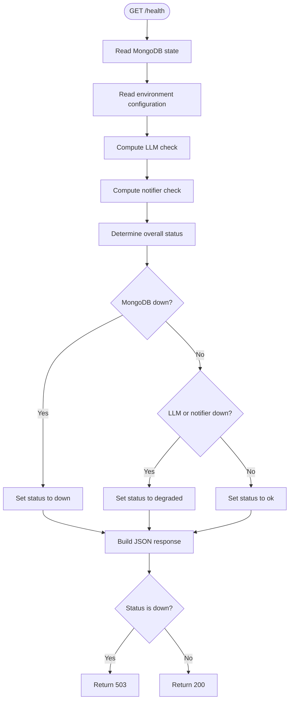
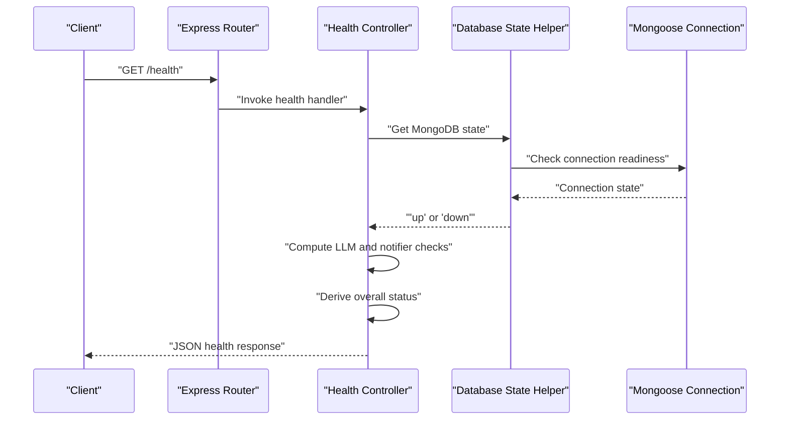
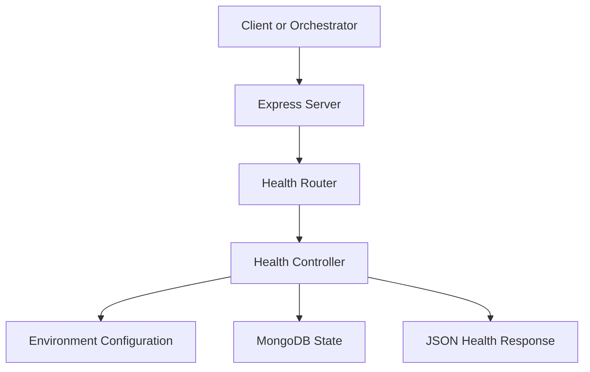
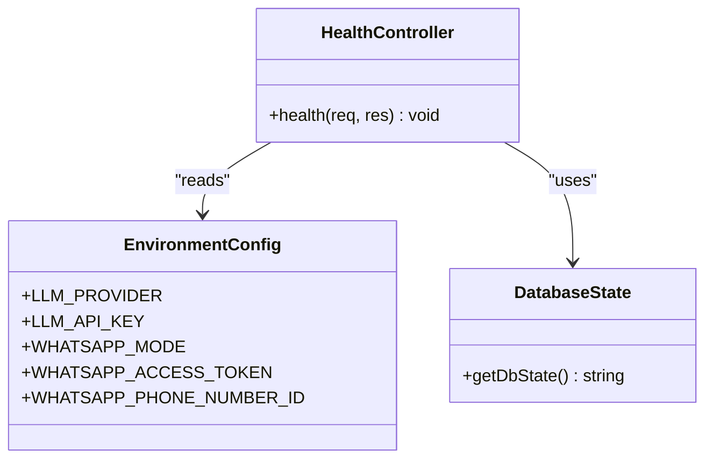
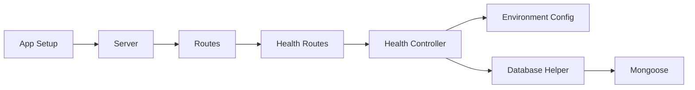

# Health Endpoints

<cite>
**Referenced Files in This Document**
- [health.controller.js](file://src/controllers/health.controller.js)
- [health.routes.js](file://src/routes/health.routes.js)
- [db.js](file://src/config/db.js)
- [env.js](file://src/config/env.js)
- [app.js](file://src/app.js)
- [server.js](file://src/server.js)
- [health.test.js](file://tests/health.test.js)
- [README.md](file://README.md)
</cite>

## Table of Contents
1. [Introduction](#introduction)
2. [Endpoint Summary](#endpoint-summary)
3. [Request and Response Schema](#request-and-response-schema)
4. [Authentication and Security](#authentication-and-security)
5. [Status Codes and Error Handling](#status-codes-and-error-handling)
6. [Health Check Logic](#health-check-logic)
7. [MongoDB Connectivity Verification](#mongodb-connectivity-verification)
8. [Practical curl Examples](#practical-curl-examples)
9. [Interpreting Health Status Indicators](#interpreting-health-status-indicators)
10. [Container Orchestration and Load Balancer Integration](#container-orchestration-and-load-balancer-integration)
11. [Architecture Overview](#architecture-overview)
12. [Detailed Component Analysis](#detailed-component-analysis)
13. [Dependency Analysis](#dependency-analysis)
14. [Performance Considerations](#performance-considerations)
15. [Troubleshooting Guide](#troubleshooting-guide)
16. [Conclusion](#conclusion)

## Introduction
This document provides detailed API documentation for the health monitoring endpoint used by the Lead System Manager application. The endpoint exposes system liveness, dependency status, and operational metrics so that operators, orchestrators, and load balancers can determine whether the service is healthy and ready to accept traffic.

The primary endpoint covered here is:

- `GET /health`

It returns a structured JSON response indicating overall health, per-dependency checks, process uptime, and application version. It does not require authentication and is intended for internal or infrastructure-facing consumers such as Kubernetes probes, Docker healthchecks, reverse proxies, and load balancers.

## Endpoint Summary

| Field | Value |
|---|---|
| Method | `GET` |
| Path | `/health` |
| Authentication | None required |
| Content-Type | `application/json` |
| Purpose | Report system status, dependency health, uptime, and version |
| Typical success status | `200 OK` when the core system is available |
| Degraded behavior | Returns `200 OK` with `status: "degraded"` when non-core dependencies are unavailable |
| Failure behavior | Returns `503 Service Unavailable` when MongoDB is down |

The route is mounted under the Express router and exposed through the main application server. In normal operation, the server listens on the configured port (default `3000`).

**Section sources**
- [health.routes.js:1-9](file://src/routes/health.routes.js#L1-L9)
- [README.md:399-407](file://README.md#L399-L407)

## Request and Response Schema

### Request
The health endpoint accepts no request body and has no required headers beyond standard HTTP headers.

| Property | Type | Required | Description |
|---|---|---:|---|
| URL path | string | Yes | `/health` |
| Query parameters | object | No | Not used by this endpoint |
| Headers | object | No | Standard HTTP headers; no special headers required |
| Body | none | No | GET requests do not include a body |

### Response Body
The response is a JSON object with the following fields:

| Field | Type | Description |
|---|---|---|
| `status` | string | Overall health indicator: `"ok"`, `"degraded"`, or `"down"` |
| `uptimeSec` | number | Process uptime in seconds, rounded to an integer |
| `checks` | object | Dependency check results |
| `checks.mongo` | string | MongoDB connection state: `"up"` or `"down"` |
| `checks.llm` | string | LLM provider state: `"disabled"`, `"up"`, or `"down"` |
| `checks.notifier` | string | WhatsApp notifier state: `"disabled"`, `"up"`, or `"down"` |
| `version` | string | Application version read from package metadata |

### Example Success Response
A successful healthy response looks like this:

```json
{
  "status": "ok",
  "uptimeSec": 123,
  "checks": {
    "mongo": "up",
    "llm": "disabled",
    "notifier": "up"
  },
  "version": "1.0.0"
}
```

### Example Degraded Response
When optional dependencies are missing but the core system remains usable:

```json
{
  "status": "degraded",
  "uptimeSec": 123,
  "checks": {
    "mongo": "up",
    "llm": "down",
    "notifier": "down"
  },
  "version": "1.0.0"
}
```

### Example Failure Response
When MongoDB is unreachable:

```json
{
  "status": "down",
  "uptimeSec": 123,
  "checks": {
    "mongo": "down",
    "llm": "disabled",
    "notifier": "up"
  },
  "version": "1.0.0"
}
```

**Section sources**
- [health.controller.js:19-50](file://src/controllers/health.controller.js#L19-L50)
- [health.test.js:20-42](file://tests/health.test.js#L20-L42)
- [README.md:292-298](file://README.md#L292-L298)

## Authentication and Security
No authentication is required to call `/health`. This design allows unauthenticated infrastructure components such as orchestrators, healthcheck agents, and load balancers to probe the service without credentials.

Security considerations:

- Because the endpoint is public, avoid exposing sensitive information in the response.
- The current response includes application version and dependency states, which are generally safe for infrastructure use.
- If future versions add sensitive diagnostics, consider restricting access via network policy, reverse proxy rules, or token-based access.

**Section sources**
- [health.routes.js:1-9](file://src/routes/health.routes.js#L1-L9)
- [README.md:399-407](file://README.md#L399-L407)

## Status Codes and Error Handling

| Status Code | Meaning | When Returned |
|---|---|---|
| `200 OK` | Service is available | Core system is running; MongoDB is connected |
| `200 OK` with `status: "degraded"` | Service is available but some optional dependencies are missing | MongoDB is up, but LLM or notifier checks report failure |
| `503 Service Unavailable` | Service is not ready | MongoDB connection is down |

Error handling behavior:

- The controller computes dependency states and derives an overall status.
- If MongoDB is down, the response status code becomes `503`.
- If only optional dependencies are down, the response remains `200` with `status: "degraded"`.
- The global error handler and correlation ID middleware apply to all responses, including health responses.

**Section sources**
- [health.controller.js:38-49](file://src/controllers/health.controller.js#L38-L49)
- [health.test.js:20-42](file://tests/health.test.js#L20-L42)
- [README.md:386-397](file://README.md#L386-L397)

## Health Check Logic
The health endpoint evaluates three categories:

1. **MongoDB**: Uses Mongoose connection state to determine if the database is reachable.
2. **LLM Provider**: Determines whether the configured LLM provider is enabled and appears configured.
3. **Notifier**: Determines whether the WhatsApp notifier is enabled and appears configured.

### Decision Rules
- If MongoDB is not up, the overall status is `"down"`.
- If MongoDB is up but either LLM or notifier is down, the overall status is `"degraded"`.
- Otherwise, the overall status is `"ok"`.

### LLM State Rules
- If `LLM_PROVIDER` is set to `"none"`, the LLM check is `"disabled"`.
- If `LLM_PROVIDER` is `"ollama"`, the LLM check is considered `"up"` because local Ollama does not require an API key at this stage.
- For other providers, the presence of `LLM_API_KEY` determines whether the check is `"up"` or `"down"`.

### Notifier State Rules
- If `WHATSAPP_MODE` is `"simulated"`, the notifier check is `"up"` by design.
- In cloud mode, both `WHATSAPP_ACCESS_TOKEN` and `WHATSAPP_PHONE_NUMBER_ID` must be present for the notifier check to be `"up"`.



**Diagram sources**
- [health.controller.js:19-50](file://src/controllers/health.controller.js#L19-L50)

**Section sources**
- [health.controller.js:8-18](file://src/controllers/health.controller.js#L8-L18)
- [health.controller.js:19-50](file://src/controllers/health.controller.js#L19-L50)

## MongoDB Connectivity Verification
MongoDB connectivity is determined by inspecting the Mongoose connection readiness state. The helper function returns:

- `"up"` when the driver reports an established connection.
- `"down"` otherwise.

The application connects to MongoDB using a configurable URI. On startup, it attempts to connect with a short server selection timeout. If the initial connection fails and retry mode is enabled, the application continues listening while a background retry loop attempts reconnection with exponential backoff.

Important implications for `/health`:

- A failed first connection does not crash the server.
- `/health` immediately reflects the current connection state.
- As retries succeed, `/health` transitions from `"down"` to `"up"`.



**Diagram sources**
- [health.routes.js:1-9](file://src/routes/health.routes.js#L1-L9)
- [health.controller.js:19-50](file://src/controllers/health.controller.js#L19-L50)
- [db.js:15-18](file://src/config/db.js#L15-L18)

**Section sources**
- [db.js:15-18](file://src/config/db.js#L15-L18)
- [db.js:27-47](file://src/config/db.js#L27-L47)
- [db.js:50-67](file://src/config/db.js#L50-L67)

## Practical curl Examples

### Successful Healthy Response
When MongoDB is connected and optional dependencies are configured or disabled:

```bash
curl http://localhost:3000/health
```

Expected characteristics:

- HTTP status: `200`
- `status`: `"ok"`
- `checks.mongo`: `"up"`
- `checks.llm`: depends on configuration
- `checks.notifier`: depends on configuration
- `version`: application version
- `uptimeSec`: positive integer

### Degraded Response
When MongoDB is connected but optional dependencies are missing:

```bash
curl http://localhost:3000/health
```

Expected characteristics:

- HTTP status: `200`
- `status`: `"degraded"`
- At least one of `checks.llm` or `checks.notifier` is `"down"`

### Failure Response
When MongoDB is unreachable:

```bash
curl http://localhost:3000/health
```

Expected characteristics:

- HTTP status: `503`
- `status`: `"down"`
- `checks.mongo`: `"down"`

These examples match the documented behavior and test assertions.

**Section sources**
- [README.md:292-298](file://README.md#L292-L298)
- [health.test.js:20-42](file://tests/health.test.js#L20-L42)

## Interpreting Health Status Indicators

| Indicator | Meaning | Operational Action |
|---|---|---|
| `status: "ok"` | Core system is healthy and ready | Accept traffic normally |
| `status: "degraded"` | Core system is available but optional features may be impaired | Accept traffic but monitor logs and dependent services |
| `status: "down"` | Core data dependency is unavailable | Stop routing new traffic until MongoDB recovers |
| `checks.mongo: "up"` | MongoDB connection is established | Database layer is available |
| `checks.mongo: "down"` | MongoDB connection is not established | Investigate MongoDB availability, credentials, network, or cluster health |
| `checks.llm: "disabled"` | LLM classification is disabled | Expected when `LLM_PROVIDER=none` |
| `checks.llm: "up"` | LLM provider appears configured | Classification may use the configured provider |
| `checks.llm: "down"` | LLM provider is enabled but missing required configuration | Add or fix `LLM_API_KEY` or provider settings |
| `checks.notifier: "disabled"` | WhatsApp notifier is disabled | Expected when notifier is not configured |
| `checks.notifier: "up"` | WhatsApp notifier is simulated or configured | Outbound notifications are expected to work |
| `checks.notifier: "down"` | WhatsApp notifier is enabled but missing required configuration | Add `WHATSAPP_ACCESS_TOKEN` and `WHATSAPP_PHONE_NUMBER_ID` |

The `uptimeSec` field helps distinguish between a fresh restart and a long-running process. The `version` field helps identify which deployment revision is responding.

**Section sources**
- [health.controller.js:19-50](file://src/controllers/health.controller.js#L19-L50)
- [health.test.js:20-42](file://tests/health.test.js#L20-L42)

## Container Orchestration and Load Balancer Integration

### Kubernetes Probes
Use `/health` for both liveness and readiness probes:

- **Liveness probe**: Detects deadlocks or unrecoverable failures.
- **Readiness probe**: Ensures the service is ready to receive traffic after startup and database connection.

Recommended behavior:

- Treat `200 OK` as healthy.
- Treat `503 Service Unavailable` as unhealthy.
- Use `degraded` responses as healthy unless business logic requires stricter readiness criteria.

Example concepts:

- Liveness probe: `GET /health`
- Readiness probe: `GET /health`
- Failure threshold: fail after repeated `503` responses
- Success threshold: succeed after repeated `200` responses

### Docker Healthcheck
Use the built-in Docker healthcheck mechanism:

```bash
docker run --health-cmd="curl -f http://localhost:3000/health" \
  --health-interval=10s \
  --health-timeout=5s \
  --health-retries=3 \
  lead_system_manager
```

### Reverse Proxy and Load Balancer
Reverse proxies and load balancers can use `/health` to remove unhealthy instances from rotation:

- Remove instances returning `503`.
- Keep instances returning `200`, even if `status` is `"degraded"`, unless your organization treats degradation as a readiness failure.
- Prefer network-level isolation over disabling the instance solely because optional dependencies are missing.

### Rolling Deployments
During rolling updates:

- New instances should pass `/health` before being marked ready.
- Old instances should be drained after new instances become healthy.
- Monitor `uptimeSec` to confirm that a healthy response comes from a newly started process rather than a stale cached response.

**Section sources**
- [README.md:399-407](file://README.md#L399-L407)

## Architecture Overview
The health endpoint follows a simple Express routing pattern:

1. An incoming HTTP request arrives at the server.
2. Express routes the request to the health router.
3. The router invokes the health controller.
4. The controller reads MongoDB state and environment configuration.
5. The controller computes dependency checks and overall status.
6. The controller returns a JSON response with the appropriate HTTP status code.



**Diagram sources**
- [server.js:1-200](file://src/server.js#L1-L200)
- [app.js:1-200](file://src/app.js#L1-L200)
- [health.routes.js:1-9](file://src/routes/health.routes.js#L1-L9)
- [health.controller.js:19-50](file://src/controllers/health.controller.js#L19-L50)

## Detailed Component Analysis

### Health Controller
The health controller is responsible for:

- Reading MongoDB connection state.
- Evaluating LLM provider configuration.
- Evaluating WhatsApp notifier configuration.
- Computing overall health status.
- Returning a structured JSON response.

Key behaviors:

- MongoDB state is obtained from a shared database helper.
- LLM state is derived from `LLM_PROVIDER` and `LLM_API_KEY`.
- Notifier state is derived from `WHATSAPP_MODE`, `WHATSAPP_ACCESS_TOKEN`, and `WHATSAPP_PHONE_NUMBER_ID`.
- Version is loaded from package metadata.
- Uptime is derived from Node process uptime.



**Diagram sources**
- [health.controller.js:1-50](file://src/controllers/health.controller.js#L1-L50)
- [env.js:1-200](file://src/config/env.js#L1-L200)
- [db.js:15-18](file://src/config/db.js#L15-L18)

**Section sources**
- [health.controller.js:1-50](file://src/controllers/health.controller.js#L1-L50)

### Health Router
The health router mounts the `/health` endpoint and delegates handling to the controller.

Responsibilities:

- Register the `GET /health` route.
- Import and invoke the health controller.

**Section sources**
- [health.routes.js:1-9](file://src/routes/health.routes.js#L1-L9)

### Database State Helper
The database state helper abstracts Mongoose connection state.

Responsibilities:

- Expose a simple function returning `"up"` or `"down"`.
- Manage MongoDB connection lifecycle.
- Provide background retry behavior for server processes.

**Section sources**
- [db.js:15-18](file://src/config/db.js#L15-L18)
- [db.js:27-47](file://src/config/db.js#L27-L47)
- [db.js:50-67](file://src/config/db.js#L50-L67)
- [db.js:69-77](file://src/config/db.js#L69-L77)

### Test Coverage
The test suite validates:

- Successful `200 OK` response when MongoDB is connected.
- Correct dependency check values in tests.
- `503 Service Unavailable` when MongoDB is disconnected.
- Presence of correlation ID header.

**Section sources**
- [health.test.js:1-44](file://tests/health.test.js#L1-L44)

## Dependency Analysis
The health endpoint depends on several layers:

- **HTTP layer**: Express server and router.
- **Controller layer**: Business logic for health evaluation.
- **Configuration layer**: Environment variables validated at startup.
- **Data layer**: Mongoose connection state.



**Diagram sources**
- [app.js:1-200](file://src/app.js#L1-L200)
- [server.js:1-200](file://src/server.js#L1-L200)
- [health.routes.js:1-9](file://src/routes/health.routes.js#L1-L9)
- [health.controller.js:1-50](file://src/controllers/health.controller.js#L1-L50)
- [db.js:1-77](file://src/config/db.js#L1-L77)

**Section sources**
- [health.controller.js:1-50](file://src/controllers/health.controller.js#L1-L50)
- [health.routes.js:1-9](file://src/routes/health.routes.js#L1-L9)
- [db.js:1-77](file://src/config/db.js#L1-L77)

## Performance Considerations
The health endpoint is intentionally lightweight:

- It does not perform expensive database queries.
- It reads Mongoose connection state, which is fast.
- It reads environment variables, which are in-memory.
- It reads application version from package metadata once during module initialization.
- It computes uptime from the Node process.

Operational recommendations:

- Avoid adding heavy diagnostic logic to `/health`.
- Keep probe intervals reasonable, such as every 5–15 seconds.
- Do not treat transient degradation as a reason to stop probing; allow recovery windows.

[No sources needed since this section provides general guidance]

## Troubleshooting Guide

| Symptom | Likely Cause | Recommended Action |
|---|---|---|
| `/health` returns `503` with `mongo: down` | MongoDB is unreachable | Verify `MONGODB_URI`, start MongoDB, check network, or wait for retry |
| `/health` returns `200` with `status: "degraded"` | Optional dependencies are missing | Configure LLM provider or WhatsApp notifier as needed |
| `checks.llm: "down"` | LLM provider enabled but missing API key | Set `LLM_API_KEY` for Gemini or Groq |
| `checks.notifier: "down"` | WhatsApp notifier enabled but missing credentials | Set `WHATSAPP_ACCESS_TOKEN` and `WHATSAPP_PHONE_NUMBER_ID` |
| `/health` never becomes healthy after startup | MongoDB connection still failing | Check MongoDB logs, credentials, and cluster availability |
| Healthcheck passes but application fails later | Health endpoint does not validate all runtime state | Extend readiness checks or add application-specific readiness endpoints |

**Section sources**
- [README.md:409-419](file://README.md#L409-L419)
- [health.controller.js:19-50](file://src/controllers/health.controller.js#L19-L50)
- [db.js:27-47](file://src/config/db.js#L27-L47)

## Conclusion
The `/health` endpoint provides a clear, infrastructure-friendly view of system health. It distinguishes between core availability and optional dependency health, uses `503` for critical failures such as MongoDB unavailability, and returns `200` for both fully healthy and degraded states. This makes it suitable for container orchestration, load balancing, and operational monitoring.

For production deployments:

- Use `/health` as a basic liveness and readiness probe.
- Treat `503` as unhealthy.
- Decide explicitly whether `degraded` should block readiness based on organizational policy.
- Monitor dependency checks and correlate them with logs and metrics.

[No sources needed since this section summarizes without analyzing specific files]