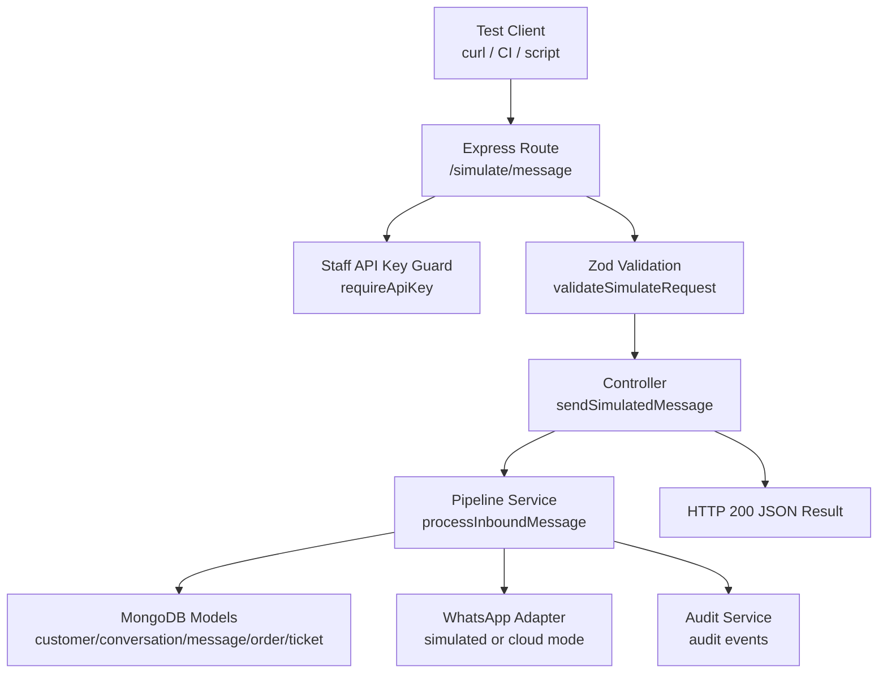
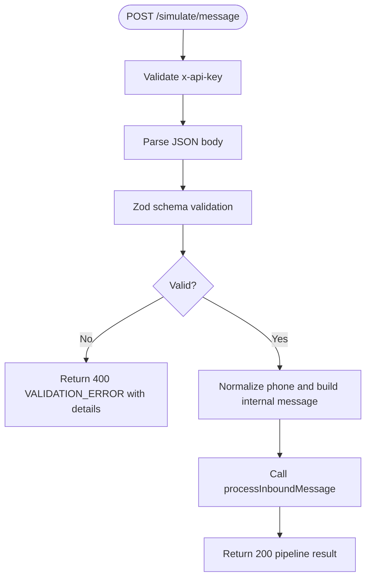
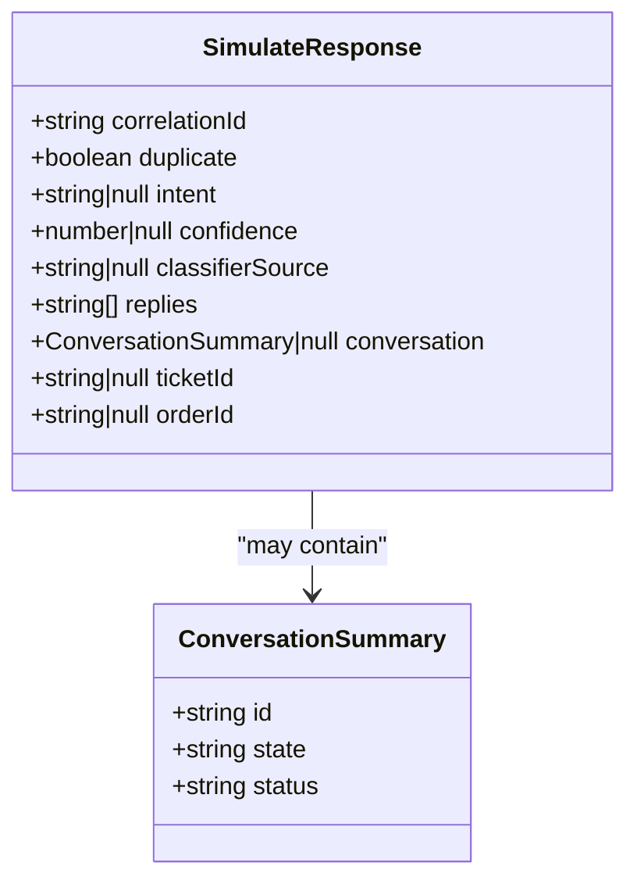
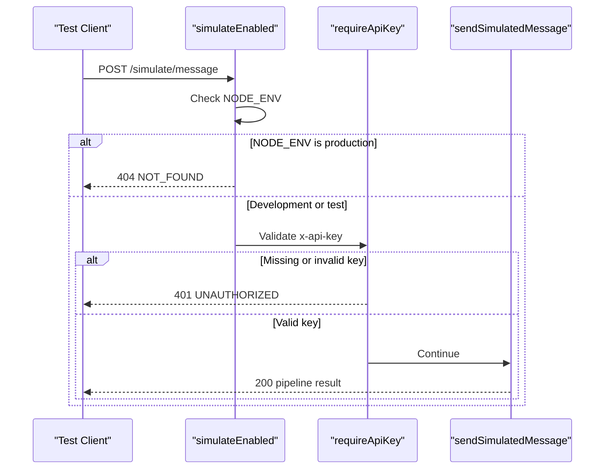
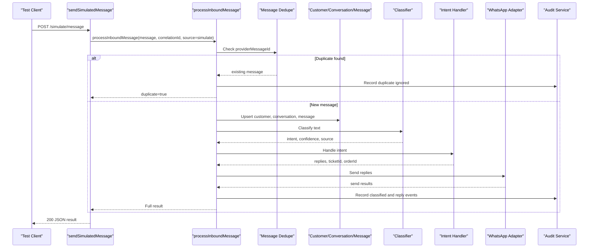
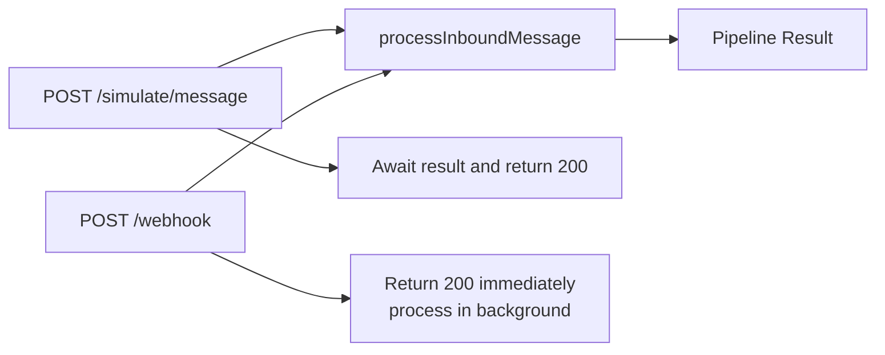
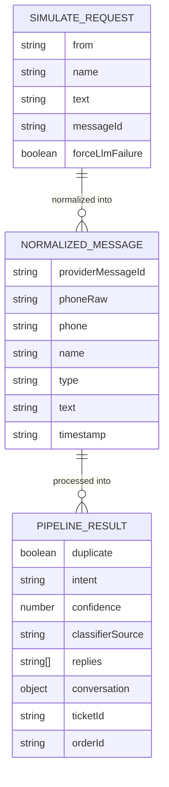
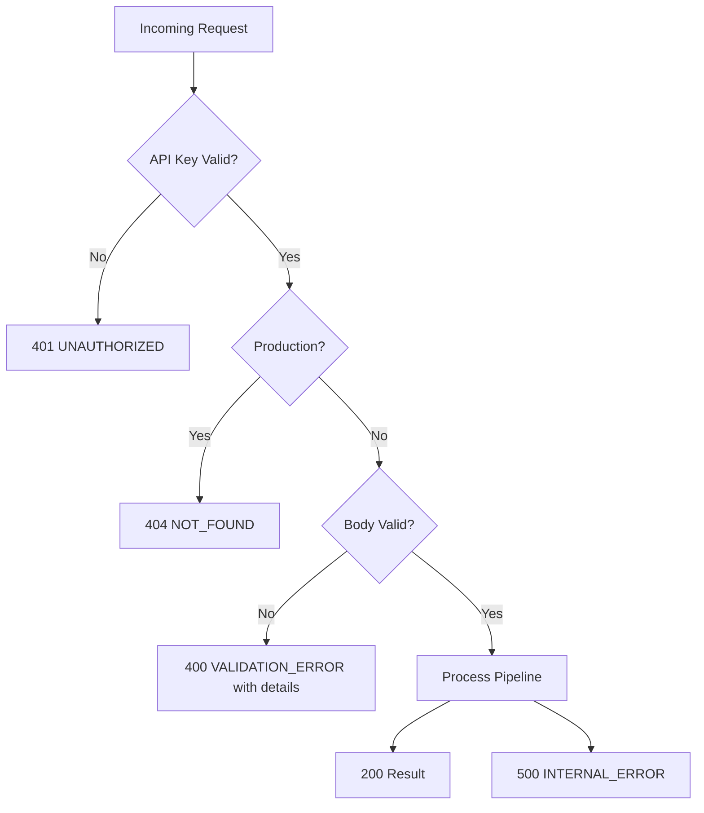

# Simulation Endpoints

<cite>
**Referenced Files in This Document**
- [simulate.controller.js](file://src/controllers/simulate.controller.js)
- [simulate.routes.js](file://src/routes/simulate.routes.js)
- [simulate.validator.js](file://src/validators/simulate.validator.js)
- [pipeline.service.js](file://src/services/pipeline.service.js)
- [webhook.controller.js](file://src/controllers/webhook.controller.js)
- [webhook.validator.js](file://src/validators/webhook.validator.js)
- [simulate.test.js](file://tests/simulate.test.js)
- [run-simulate-prod.mjs](file://tests/helpers/run-simulate-prod.mjs)
- [webhook-sample.json](file://test_inputs/webhook-sample.json)
- [README.md](file://README.md)
</cite>

## Table of Contents
1. [Introduction](#introduction)
2. [Endpoint Summary](#endpoint-summary)
3. [Request Schema](#request-schema)
4. [Response Schema](#response-schema)
5. [Authentication and Environment Behavior](#authentication-and-environment-behavior)
6. [Pipeline Processing Flow](#pipeline-processing-flow)
7. [Simulation Mode vs Production Webhook Processing](#simulation-mode-vs-production-webhook-processing)
8. [Mock Data Structures](#mock-data-structures)
9. [Practical Test Payloads and Expected Responses](#practical-test-payloads-and-expected-responses)
10. [Error Handling Reference](#error-handling-reference)
11. [Debugging Workflow](#debugging-workflow)
12. [Automated Testing Integration](#automated-testing-integration)
13. [Development Workflow Integration](#development-workflow-integration)
14. [Performance Testing Scenarios](#performance-testing-scenarios)
15. [Conclusion](#conclusion)

## Introduction
The simulation endpoint is a staff-only HTTP interface for driving the message pipeline without connecting to Meta or WhatsApp. It exists so developers, testers, and automation can validate classification, persistence, replies, orders, tickets, and audit behavior using controlled payloads rather than real customer traffic.

In the current implementation stage, the pipeline accepts and validates inbound messages, persists them, records audit events, and returns a documented result shape. Classification, reply generation, order creation, ticket escalation, and advanced intent handling are progressively implemented across later tasks; many response fields may therefore be `null`, empty, or absent until those features land.

**Section sources**
- [README.md:38-46](file://README.md#L38-L46)
- [README.md:319-344](file://README.md#L319-L344)

## Endpoint Summary

| Field | Value |
|---|---|
| Method | `POST` |
| Path | `/simulate/message` |
| Purpose | Simulate an inbound WhatsApp-style message and return the full pipeline processing result synchronously |
| Authentication | Staff API key via `x-api-key` header |
| Production behavior | Disabled; returns `404 NOT_FOUND` when `NODE_ENV=production` |
| Primary use cases | Manual testing, automated test scenarios, development workflow integration, performance testing |



**Diagram sources**
- [simulate.routes.js:18](file://src/routes/simulate.routes.js#L18)
- [simulate.controller.js:12-34](file://src/controllers/simulate.controller.js#L12-L34)
- [pipeline.service.js:66-273](file://src/services/pipeline.service.js#L66-L273)

**Section sources**
- [simulate.routes.js:10-18](file://src/routes/simulate.routes.js#L10-L18)
- [simulate.controller.js:4-34](file://src/controllers/simulate.controller.js#L4-L34)
- [README.md:399-404](file://README.md#L399-L404)

## Request Schema

### HTTP Headers

| Header | Required | Description |
|---|---:|---|
| `Content-Type` | Yes | Must be `application/json` |
| `x-api-key` | Yes | Staff API key configured through `STAFF_API_KEY` |

### Request Body

| Field | Type | Required | Default | Validation Rules | Notes |
|---|---|---:|---|---|---|
| `from` | string | Yes | — | Non-empty string validated as a Nigerian phone number | Example format: `+2348012345678` |
| `name` | string | No | `null` | Optional string with length between 1 and 100 | Customer display name |
| `text` | string | Yes | — | Non-empty string with maximum length 1000 | Message body |
| `messageId` | string | No | Auto-generated UUID prefixed with `sim-` | Optional string with length between 1 and 100 | Used for deduplication testing |
| `forceLlmFailure` | boolean | No | `false` | Optional boolean | Forces classifier failure path for testing LLM fallback behavior |

The validator normalizes the incoming request into the internal message shape used by the pipeline. If validation fails, the error response includes structured details with field paths and human-readable messages.



**Diagram sources**
- [simulate.validator.js:10-54](file://src/validators/simulate.validator.js#L10-L54)
- [simulate.routes.js:18](file://src/routes/simulate.routes.js#L18)

**Section sources**
- [simulate.validator.js:6-21](file://src/validators/simulate.validator.js#L6-L21)
- [simulate.validator.js:23-54](file://src/validators/simulate.validator.js#L23-L54)
- [simulate.test.js:47-66](file://tests/simulate.test.js#L47-L66)

## Response Schema

### Success Response

| Field | Type | Description |
|---|---|---|
| `correlationId` | string | Unique request identifier returned in both the response body and the `x-correlation-id` header |
| `duplicate` | boolean | Whether the provider message ID was already processed |
| `intent` | string or null | Classified intent; currently may be `null` while intent handling is implemented |
| `confidence` | number or null | Classifier confidence score; currently may be `null` |
| `classifierSource` | string or null | Source of classification such as rules or LLM; currently may be `null` |
| `replies` | array of strings | Outbound replies actually sent through the WhatsApp adapter |
| `conversation` | object or null | Conversation summary containing `id`, `state`, and `status`; may be `null` before conversation persistence is active |
| `ticketId` | string or null | Created complaint ticket ID; may be `null` |
| `orderId` | string or null | Created order ID; may be `null` |

The response always has the same top-level shape, even when downstream features are not yet implemented. This makes it safe for tests to assert structure while allowing future fields to become populated.



**Diagram sources**
- [simulate.controller.js:23-33](file://src/controllers/simulate.controller.js#L23-L33)
- [pipeline.service.js:28-54](file://src/services/pipeline.service.js#L28-L54)
- [pipeline.service.js:263-272](file://src/services/pipeline.service.js#L263-L272)

**Section sources**
- [simulate.controller.js:23-33](file://src/controllers/simulate.controller.js#L23-L33)
- [pipeline.service.js:28-54](file://src/services/pipeline.service.js#L28-L54)
- [simulate.test.js:68-90](file://tests/simulate.test.js#L68-L90)

## Authentication and Environment Behavior

### Staff API Key
The endpoint requires the `x-api-key` header. If missing or invalid, the middleware returns `401 UNAUTHORIZED`.

### Production Disablement
When `NODE_ENV=production`, the route guard rejects all requests to `/simulate/message` with `404 NOT_FOUND`. This is intentional: the simulate harness is a development and testing tool, not a production webhook entry point.



**Diagram sources**
- [simulate.routes.js:10-18](file://src/routes/simulate.routes.js#L10-L18)
- [simulate.test.js:40-45](file://tests/simulate.test.js#L40-L45)
- [simulate.test.js:103-120](file://tests/simulate.test.js#L103-L120)
- [run-simulate-prod.mjs:15-26](file://tests/helpers/run-simulate-prod.mjs#L15-L26)

**Section sources**
- [simulate.routes.js:10-18](file://src/routes/simulate.routes.js#L10-L18)
- [simulate.test.js:40-45](file://tests/simulate.test.js#L40-L45)
- [simulate.test.js:103-120](file://tests/simulate.test.js#L103-L120)

## Pipeline Processing Flow

Both the simulation endpoint and the production webhook share the same core pipeline function. The difference is how the HTTP layer handles timing:

- **Simulation endpoint**: awaits pipeline processing and returns the result synchronously.
- **Webhook endpoint**: returns `200` immediately and processes messages asynchronously.



**Diagram sources**
- [simulate.controller.js:12-34](file://src/controllers/simulate.controller.js#L12-L34)
- [pipeline.service.js:66-273](file://src/services/pipeline.service.js#L66-L273)

**Section sources**
- [pipeline.service.js:12-27](file://src/services/pipeline.service.js#L12-L27)
- [pipeline.service.js:66-273](file://src/services/pipeline.service.js#L66-L273)

## Simulation Mode vs Production Webhook Processing

| Aspect | `/simulate/message` | `/webhook` |
|---|---|---|
| Trigger | Staff API call from tests, scripts, or manual tools | Meta Cloud API delivery |
| Authentication | `x-api-key` | HMAC-SHA256 signature verification |
| Timing | Synchronous; waits for pipeline completion | Asynchronous; returns `200` immediately |
| Purpose | Development, testing, demo, automation | Live customer messaging |
| Environment gate | Disabled in production | Always available when configured |
| Input shape | Simplified simulate request normalized by `validateSimulateRequest` | Meta payload normalized by `extractInboundMessages` |
| Output | Full pipeline result including intent, replies, conversation, ticket, order | Immediate `received` acknowledgment |



**Diagram sources**
- [simulate.controller.js:4-11](file://src/controllers/simulate.controller.js#L4-L11)
- [webhook.controller.js:27-55](file://src/controllers/webhook.controller.js#L27-L55)
- [pipeline.service.js:12-18](file://src/services/pipeline.service.js#L12-L18)

**Section sources**
- [simulate.controller.js:4-11](file://src/controllers/simulate.controller.js#L4-L11)
- [webhook.controller.js:27-55](file://src/controllers/webhook.controller.js#L27-L55)
- [webhook.validator.js:60-95](file://src/validators/webhook.validator.js#L60-L95)

## Mock Data Structures

### Internal Normalized Message Shape
The simulate validator transforms the simple request into the internal message shape consumed by the pipeline:

| Field | Meaning |
|---|---|
| `providerMessageId` | Unique message ID for deduplication |
| `phoneRaw` | Original phone string from the request |
| `phone` | Normalized E.164 phone number |
| `name` | Customer name or `null` |
| `type` | Message type; simulate uses `text` |
| `text` | Message body |
| `timestamp` | Currently `null` for simulate requests |

### Webhook Sample Payload
The repository includes a sample Meta webhook payload that shows the real-world input shape. The webhook validator extracts multiple messages from nested entries and converts them into the same internal message shape used by the pipeline.



**Diagram sources**
- [simulate.validator.js:39-51](file://src/validators/simulate.validator.js#L39-L51)
- [webhook.validator.js:68-95](file://src/validators/webhook.validator.js#L68-L95)
- [webhook-sample.json:1-29](file://test_inputs/webhook-sample.json#L1-L29)
- [pipeline.service.js:28-54](file://src/services/pipeline.service.js#L28-L54)

**Section sources**
- [simulate.validator.js:39-51](file://src/validators/simulate.validator.js#L39-L51)
- [webhook.validator.js:60-95](file://src/validators/webhook.validator.js#L60-L95)
- [webhook-sample.json:1-29](file://test_inputs/webhook-sample.json#L1-L29)

## Practical Test Payloads and Expected Responses

### Minimal Valid Payload
A minimal valid request must include a Nigerian phone number and non-empty text.

| Field | Example Value |
|---|---|
| `from` | `+2348012345678` |
| `text` | `I want to buy 2 bags of rice` |

Expected outcome:
- Status: `200`
- Body contains `correlationId`, `duplicate`, `intent`, `confidence`, `classifierSource`, `replies`, `conversation`, `ticketId`, `orderId`
- In the current implementation stage, most business fields are `null` or empty because classification and handlers are still being implemented

### Explicit Message ID Payload
Use `messageId` to exercise deduplication logic.

| Field | Example Value |
|---|---|
| `from` | `+2348012345678` |
| `text` | `Do you have rice?` |
| `messageId` | `sim-0001` |

Expected outcome:
- First call: `duplicate=false`
- Repeated call with the same `messageId`: `duplicate=true` and the existing conversation summary included

### Force LLM Failure Payload
Use `forceLlmFailure=true` to exercise classifier fallback behavior.

| Field | Example Value |
|---|---|
| `from` | `+2348012345678` |
| `text` | `I want to buy 2 bags of rice` |
| `forceLlmFailure` | `true` |

Expected outcome:
- Status: `200`
- Pipeline logs classifier fallback
- Response shape remains consistent; fields reflect fallback behavior once implemented

### Omitted Message ID
If `messageId` is omitted, the validator generates one automatically. Tests assert that the endpoint still succeeds.

**Section sources**
- [simulate.test.js:32-37](file://tests/simulate.test.js#L32-L37)
- [simulate.test.js:68-101](file://tests/simulate.test.js#L68-L101)
- [README.md:319-344](file://README.md#L319-L344)

## Error Handling Reference

| Scenario | HTTP Status | Error Code | Details |
|---|---:|---|---|
| Missing or invalid staff API key | `401` | `UNAUTHORIZED` | Authentication failed |
| Invalid request body | `400` | `VALIDATION_ERROR` | Structured validation issues with field paths |
| Production environment | `404` | `NOT_FOUND` | Simulate endpoint disabled in production |
| Unexpected server error | `500` | `INTERNAL_ERROR` | General server failure |
| External dependency unavailable | `503` | `DEPENDENCY_UNAVAILABLE` | For example, MongoDB down |

Validation errors include an array of detail objects with `path` and `message`. This makes it easy to identify which field failed validation and why.



**Diagram sources**
- [simulate.routes.js:10-18](file://src/routes/simulate.routes.js#L10-L18)
- [simulate.validator.js:28-37](file://src/validators/simulate.validator.js#L28-L37)
- [README.md:388-397](file://README.md#L388-L397)

**Section sources**
- [simulate.validator.js:28-37](file://src/validators/simulate.validator.js#L28-L37)
- [simulate.test.js:40-66](file://tests/simulate.test.js#L40-L66)
- [simulate.test.js:103-120](file://tests/simulate.test.js#L103-L120)
- [README.md:388-397](file://README.md#L388-L397)

## Debugging Workflow

### Step-by-Step Debugging

1. **Start the application locally.**
   Use the development script or start command described in the project documentation.

2. **Ensure MongoDB is available.**
   Use the in-memory dev script, Docker Compose, or Atlas depending on your environment.

3. **Seed the product catalogue if needed.**
   Some intents and handlers depend on product data.

4. **Send a simulate request with a known `messageId`.**
   This lets you reproduce the same flow and verify deduplication.

5. **Inspect the correlation ID.**
   Every response includes `correlationId`, and the `x-correlation-id` header echoes it. Use this value to trace logs and audit events.

6. **Check outbound simulated messages.**
   In simulated WhatsApp mode, outbound messages are logged to stdout and written to `logs/whatsapp-outbound.log`.

7. **Force failures intentionally.**
   Use `forceLlmFailure=true` to test classifier fallback behavior.

8. **Verify production disablement.**
   Run the helper script under `NODE_ENV=production` to confirm the endpoint returns `404 NOT_FOUND`.

### Correlation ID Traceability
The system attaches a correlation ID to every request. Logs, audit events, and responses should all reference the same ID, making it possible to trace a simulated message from HTTP entry through database writes, classification, replies, and audit recording.

**Section sources**
- [README.md:319-349](file://README.md#L319-L349)
- [README.md:394-397](file://README.md#L394-L397)
- [pipeline.service.js:68-75](file://src/services/pipeline.service.js#L68-L75)
- [run-simulate-prod.mjs:15-26](file://tests/helpers/run-simulate-prod.mjs#L15-L26)

## Automated Testing Integration

The test suite exercises the simulate endpoint using `supertest` against an in-process Express app backed by an in-memory MongoDB instance.

### Covered Behaviors

| Test Case | Assertion |
|---|---|
| Missing API key | Returns `401 UNAUTHORIZED` |
| Non-Nigerian phone number | Returns `400 VALIDATION_ERROR` with `from` path |
| Empty text | Returns `400 VALIDATION_ERROR` with `text` path |
| Valid request | Returns `200` with expected response shape |
| Auto-generated message ID | Succeeds when `messageId` is omitted |
| Production disablement | Child process running in production returns `404 NOT_FOUND` |

### Running the Tests
Run the full suite with the project’s test command. Individual files can be executed directly with Node’s built-in test runner.

```bash
npm test
node --test tests/simulate.test.js
```

**Section sources**
- [simulate.test.js:1-30](file://tests/simulate.test.js#L1-L30)
- [simulate.test.js:39-121](file://tests/simulate.test.js#L39-L121)
- [run-simulate-prod.mjs:1-30](file://tests/helpers/run-simulate-prod.mjs#L1-L30)
- [README.md:351-363](file://README.md#L351-L363)

## Development Workflow Integration

### Local Developer Loop
1. Start the API.
2. Seed the product catalogue.
3. Send a simulate request with a realistic retail message.
4. Inspect the response shape and logs.
5. Repeat with different intents, edge cases, and failure flags.

### Script-Based Testing
The README documents a curl-based developer loop for simulating customer messages. This approach is useful for quick manual checks before writing automated tests.

### CI Integration
Because the test suite uses an in-memory MongoDB and does not require external services, it can run in CI environments without Docker or a live database. The production-disablement test spawns a child process with explicit environment variables, ensuring environment-gated behavior is tested in isolation.

**Section sources**
- [README.md:75-97](file://README.md#L75-L97)
- [README.md:319-344](file://README.md#L319-L344)
- [README.md:351-363](file://README.md#L351-L363)

## Performance Testing Scenarios

### Throughput Testing
Send a high volume of simulate requests concurrently to measure:
- Request throughput
- Database write latency
- Classification latency
- Reply sending latency
- Audit event recording latency

### Deduplication Stress Test
Send many requests with the same `messageId` to verify:
- Only one message is persisted
- Subsequent requests return `duplicate=true`
- Audit records reflect duplicate handling
- No retry storms occur

### Failure Injection Testing
Use `forceLlmFailure=true` to evaluate:
- Fallback behavior
- Logging accuracy
- Response consistency
- Audit trail completeness

### Load Profile Recommendations
- Warm up the connection pool and database index usage.
- Separate baseline runs from failure-injection runs.
- Capture correlation IDs for sampled requests to inspect logs.
- Monitor memory usage, especially when running many concurrent requests.

[No sources needed since this section provides general guidance]

## Conclusion
The `/simulate/message` endpoint is the primary development and testing entry point for the message pipeline. It accepts a simplified request, validates it, normalizes it into the same internal shape used by production webhooks, and returns a stable response shape that reflects pipeline progress.

Its key strengths are:
- Deterministic testing without Meta integration
- Shared pipeline logic with production webhook processing
- Structured validation and error reporting
- Correlation-traceable logging and audit events
- Environment-gated disablement in production

As classification, replies, orders, tickets, and metrics are implemented, the simulate endpoint will continue to serve as the canonical way to validate end-to-end behavior through controlled HTTP requests.

[No sources needed since this section summarizes without analyzing specific files]