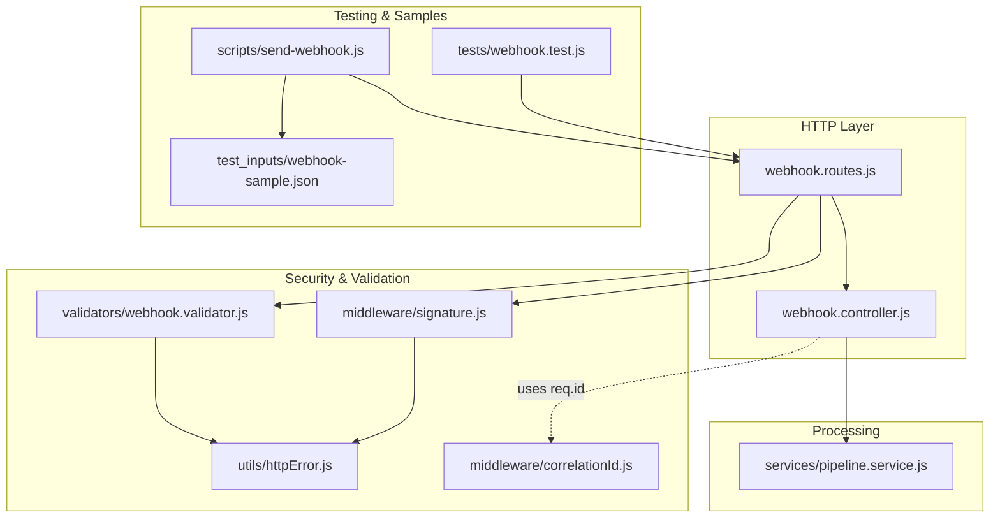
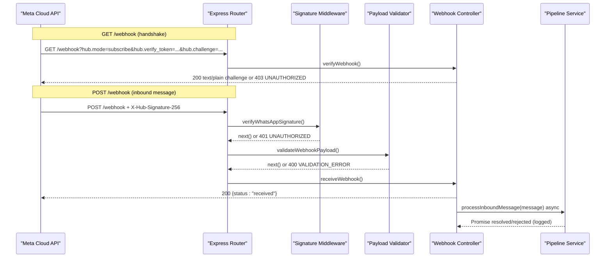
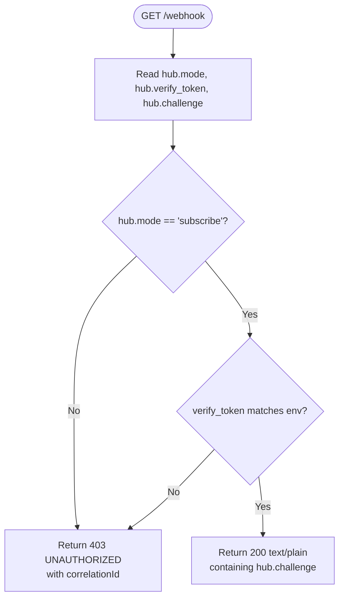
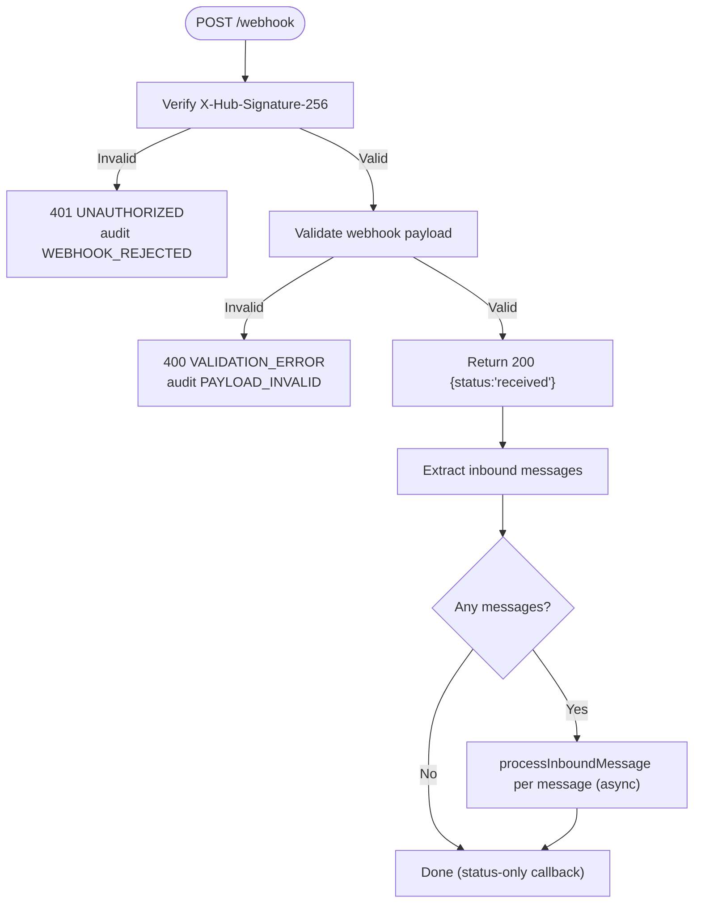
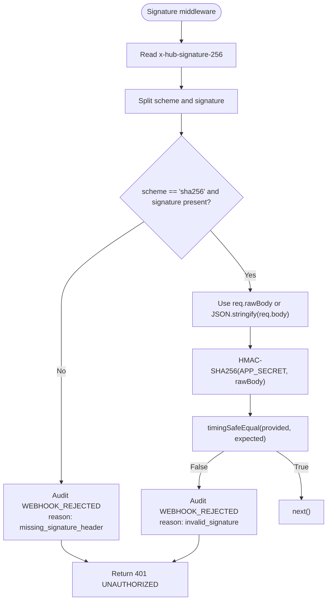
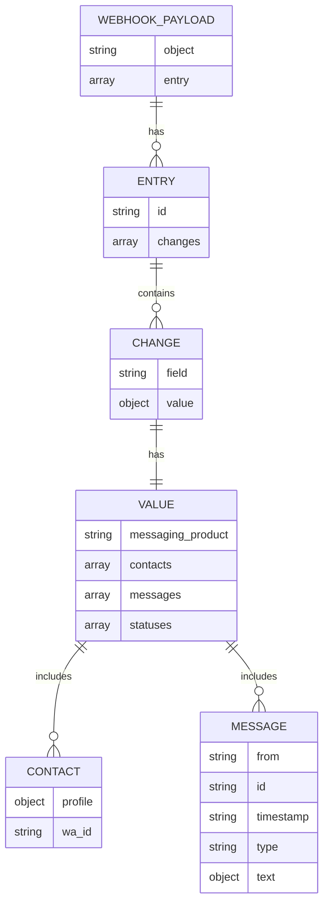
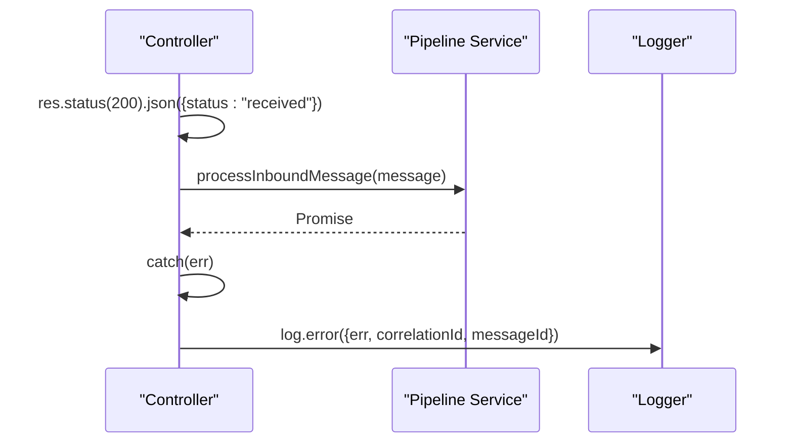
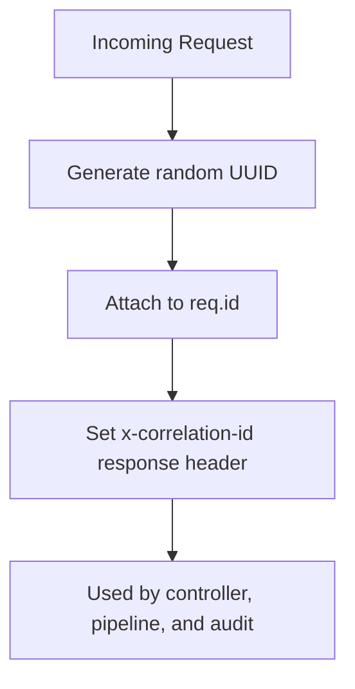
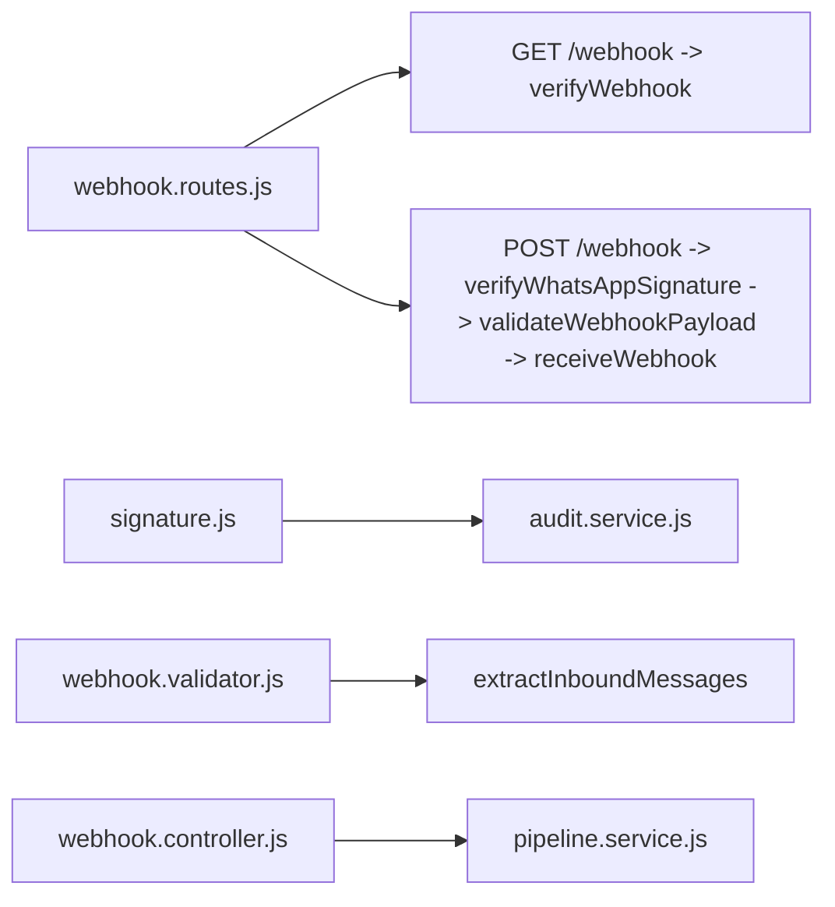

# Webhook Endpoints

<cite>
**Referenced Files in This Document**
- [webhook.controller.js](file://src/controllers/webhook.controller.js)
- [webhook.routes.js](file://src/routes/webhook.routes.js)
- [signature.js](file://src/middleware/signature.js)
- [webhook.validator.js](file://src/validators/webhook.validator.js)
- [pipeline.service.js](file://src/services/pipeline.service.js)
- [correlationId.js](file://src/middleware/correlationId.js)
- [httpError.js](file://src/utils/httpError.js)
- [send-webhook.js](file://scripts/send-webhook.js)
- [webhook-sample.json](file://test_inputs/webhook-sample.json)
- [webhook.test.js](file://tests/webhook.test.js)
- [README.md](file://README.md)
</cite>

## Table of Contents
1. [Introduction](#introduction)
2. [Project Structure](#project-structure)
3. [Core Components](#core-components)
4. [Architecture Overview](#architecture-overview)
5. [Detailed Component Analysis](#detailed-component-analysis)
6. [Dependency Analysis](#dependency-analysis)
7. [Performance Considerations](#performance-considerations)
8. [Troubleshooting Guide](#troubleshooting-guide)
9. [Conclusion](#conclusion)
10. [Appendices](#appendices)

## Introduction
This document describes the WhatsApp webhook endpoints exposed by the application:

- `GET /webhook` — Meta verification handshake using a verify token and challenge response.
- `POST /webhook` — Inbound WhatsApp message ingestion with HMAC-SHA256 signature verification, payload validation, and asynchronous processing.

The implementation follows Meta’s Cloud API expectations: Meta signs webhook bodies with the app secret, sends the signature in `X-Hub-Signature-256`, and expects an immediate successful HTTP response while the backend processes messages asynchronously.

## Project Structure
The webhook feature is implemented across controllers, middleware, validators, routes, services, and tests:

**Diagram sources**
- [webhook.routes.js:1-16](file://src/routes/webhook.routes.js#L1-L16)
- [webhook.controller.js:1-56](file://src/controllers/webhook.controller.js#L1-L56)
- [signature.js:1-51](file://src/middleware/signature.js#L1-L51)
- [webhook.validator.js:1-124](file://src/validators/webhook.validator.js#L1-L124)
- [pipeline.service.js:1-81](file://src/services/pipeline.service.js#L1-L81)
- [correlationId.js:1-14](file://src/middleware/correlationId.js#L1-L14)
- [httpError.js:1-31](file://src/utils/httpError.js#L1-L31)
- [send-webhook.js:1-84](file://scripts/send-webhook.js#L1-L84)
- [webhook-sample.json:1-29](file://test_inputs/webhook-sample.json#L1-L29)
- [webhook.test.js:1-168](file://tests/webhook.test.js#L1-L168)

**Section sources**
- [webhook.routes.js:1-16](file://src/routes/webhook.routes.js#L1-L16)
- [webhook.controller.js:1-56](file://src/controllers/webhook.controller.js#L1-L56)
- [README.md:386-407](file://README.md#L386-L407)

## Core Components
- **Webhook controller**: Handles Meta verification and inbound message dispatch.
- **Signature middleware**: Verifies `X-Hub-Signature-256` using HMAC-SHA256 against the configured app secret.
- **Payload validator**: Validates the Meta webhook shape and extracts normalized inbound messages.
- **Pipeline service**: Receives normalized messages for future classification, conversation handling, replies, and audit logging.
- **Correlation ID middleware**: Generates and attaches a correlation ID to every request/response.
- **Standard error utilities**: Provide structured error responses with consistent codes.

**Section sources**
- [webhook.controller.js:5-55](file://src/controllers/webhook.controller.js#L5-L55)
- [signature.js:7-50](file://src/middleware/signature.js#L7-L50)
- [webhook.validator.js:7-123](file://src/validators/webhook.validator.js#L7-L123)
- [pipeline.service.js:3-80](file://src/services/pipeline.service.js#L3-L80)
- [correlationId.js:3-13](file://src/middleware/correlationId.js#L3-L13)
- [httpError.js:1-31](file://src/utils/httpError.js#L1-L31)

## Architecture Overview
The webhook flow separates security, validation, and processing into distinct layers:

**Diagram sources**
- [webhook.routes.js:8-13](file://src/routes/webhook.routes.js#L8-L13)
- [webhook.controller.js:10-55](file://src/controllers/webhook.controller.js#L10-L55)
- [signature.js:19-50](file://src/middleware/signature.js#L19-L50)
- [webhook.validator.js:103-123](file://src/validators/webhook.validator.js#L103-L123)
- [pipeline.service.js:42-80](file://src/services/pipeline.service.js#L42-L80)

## Detailed Component Analysis

### GET /webhook — Meta Verification Handshake
- Purpose: Complete Meta’s callback URL verification once when registering the webhook.
- Query parameters:
  - `hub.mode`: Must be `subscribe`.
  - `hub.verify_token`: Must match the configured verify token.
  - `hub.challenge`: Echoed back on success.
- Behavior:
  - If `hub.mode === 'subscribe'` and the verify token matches the environment value, return `200` with plain text containing the challenge.
  - Otherwise, return `403` with a standard error body including `error.code = 'UNAUTHORIZED'` and `correlationId`.

**Diagram sources**
- [webhook.controller.js:10-25](file://src/controllers/webhook.controller.js#L10-L25)

**Section sources**
- [webhook.controller.js:5-25](file://src/controllers/webhook.controller.js#L5-L25)
- [README.md:300-305](file://README.md#L300-L305)

### POST /webhook — Inbound Message Processing
- Purpose: Receive inbound WhatsApp messages from Meta.
- Security:
  - Requires `X-Hub-Signature-256` header.
  - Signature must be `sha256=<hex>` computed over the raw request body using the configured app secret.
- Payload validation:
  - The request body must conform to the expected Meta webhook structure.
  - Unknown fields are preserved; only consumed fields are validated.
- Response behavior:
  - On success, immediately return `200` with `{ status: "received" }`.
  - Messages are processed asynchronously so failures cannot cause retry storms.
  - Status-only callbacks (delivery receipts without `messages`) are accepted but do not trigger message processing.

**Diagram sources**
- [webhook.routes.js:11-13](file://src/routes/webhook.routes.js#L11-L13)
- [signature.js:19-50](file://src/middleware/signature.js#L19-L50)
- [webhook.validator.js:103-123](file://src/validators/webhook.validator.js#L103-L123)
- [webhook.controller.js:35-55](file://src/controllers/webhook.controller.js#L35-L55)

**Section sources**
- [webhook.routes.js:11-13](file://src/routes/webhook.routes.js#L11-L13)
- [webhook.controller.js:27-55](file://src/controllers/webhook.controller.js#L27-L55)
- [webhook.validator.js:60-123](file://src/validators/webhook.validator.js#L60-L123)

### HMAC-SHA256 Signature Verification
- Header format: `X-Hub-Signature-256: sha256=<hex_signature>`
- Algorithm:
  - Compute HMAC-SHA256 over the raw request body using `WHATSAPP_APP_SECRET`.
  - Compare the provided hex signature with the expected hex signature using timing-safe comparison.
- Failure handling:
  - Missing or malformed header → `401 UNAUTHORIZED`.
  - Invalid signature → `401 UNAUTHORIZED`.
  - Rejections are recorded as `WEBHOOK_REJECTED` audit events before returning the error.

**Diagram sources**
- [signature.js:19-50](file://src/middleware/signature.js#L19-L50)

**Section sources**
- [signature.js:7-50](file://src/middleware/signature.js#L7-L50)
- [webhook.test.js:99-130](file://tests/webhook.test.js#L99-L130)

### Webhook Payload Schema and Normalization
- Top-level requirements:
  - `object` must be `whatsapp_business_account`.
  - `entry` must be an array with at least one entry.
- Entry structure:
  - Each entry contains `changes`, where each change has a `field` and `value`.
  - Only changes with `field === 'messages'` produce inbound messages.
- Value structure:
  - `contacts` may include profile name and WhatsApp ID.
  - `messages` is an array of message objects.
  - `statuses` may exist for delivery receipts without messages.
- Message normalization:
  - Each message is converted into a normalized object containing provider message ID, phone number, optional display name, message type, text body, and timestamp.
  - Non-text messages have `text: null` but retain their `type`.

**Diagram sources**
- [webhook.validator.js:12-58](file://src/validators/webhook.validator.js#L12-L58)
- [webhook.validator.js:68-95](file://src/validators/webhook.validator.js#L68-L95)

**Section sources**
- [webhook.validator.js:7-123](file://src/validators/webhook.validator.js#L7-L123)
- [webhook-sample.json:1-29](file://test_inputs/webhook-sample.json#L1-L29)

### Asynchronous Processing Behavior
- The controller returns `200` immediately after signature and payload validation succeed.
- Each extracted message is passed to `processInboundMessage` asynchronously.
- Errors during async processing are caught and logged; they do not affect the HTTP response.
- This design prevents Meta retry storms caused by downstream processing failures.

**Diagram sources**
- [webhook.controller.js:35-55](file://src/controllers/webhook.controller.js#L35-L55)
- [pipeline.service.js:42-80](file://src/services/pipeline.service.js#L42-L80)

**Section sources**
- [webhook.controller.js:27-55](file://src/controllers/webhook.controller.js#L27-L55)
- [pipeline.service.js:3-80](file://src/services/pipeline.service.js#L3-L80)

### Correlation ID Usage
- Every request receives a generated UUID stored on `req.id`.
- The same ID is attached to logs, audit events, and returned in the `x-correlation-id` response header.
- This enables tracing a single webhook event across signature validation, payload validation, controller logic, and pipeline processing.

**Diagram sources**
- [correlationId.js:3-13](file://src/middleware/correlationId.js#L3-L13)
- [webhook.controller.js:36-36](file://src/controllers/webhook.controller.js#L36-L36)

**Section sources**
- [correlationId.js:3-13](file://src/middleware/correlationId.js#L3-L13)
- [README.md:394-397](file://README.md#L394-L397)

### Error Handling Strategy
- Standard error responses include:
  - `error.code`: machine-readable code such as `VALIDATION_ERROR`, `UNAUTHORIZED`, `NOT_FOUND`, `RATE_LIMITED`, `INTERNAL_ERROR`, `DEPENDENCY_UNAVAILABLE`.
  - `error.message`: human-readable description.
  - `error.details`: optional array of validation issues.
  - `correlationId`: request correlation ID.
- Specific webhook errors:
  - Missing or invalid signature → `401 UNAUTHORIZED` with `WEBHOOK_REJECTED` audit.
  - Invalid payload shape → `400 VALIDATION_ERROR` with `PAYLOAD_INVALID` audit.
  - Handshake token mismatch → `403 UNAUTHORIZED`.

**Section sources**
- [httpError.js:1-31](file://src/utils/httpError.js#L1-L31)
- [signature.js:23-30](file://src/middleware/signature.js#L23-L30)
- [webhook.validator.js:103-123](file://src/validators/webhook.validator.js#L103-L123)
- [webhook.controller.js:20-24](file://src/controllers/webhook.controller.js#L20-L24)
- [README.md:388-397](file://README.md#L388-L397)

## Dependency Analysis
The webhook route composes middleware and controller logic in a strict order:

**Diagram sources**
- [webhook.routes.js:1-16](file://src/routes/webhook.routes.js#L1-L16)
- [signature.js:1-51](file://src/middleware/signature.js#L1-L51)
- [webhook.validator.js:1-124](file://src/validators/webhook.validator.js#L1-124)
- [webhook.controller.js:1-56](file://src/controllers/webhook.controller.js#L1-L56)
- [pipeline.service.js:1-81](file://src/services/pipeline.service.js#L1-L81)

**Section sources**
- [webhook.routes.js:1-16](file://src/routes/webhook.routes.js#L1-L16)

## Performance Considerations
- **Fast acknowledgment**: `POST /webhook` returns `200` immediately to avoid Meta retries.
- **Async processing**: Message processing is fire-and-forget per message; errors are logged rather than propagated to the HTTP layer.
- **Minimal synchronous work**: Signature and validation are lightweight; heavy operations belong in the pipeline.
- **Rate limiting**: The README indicates rate limiting is enabled outside tests via `express-rate-limit`; specific limits are configured at the application level rather than inside the webhook controller.

[No sources needed since this section provides general guidance]

## Troubleshooting Guide
Common webhook issues and resolutions:

- **Handshake fails with 403**:
  - Ensure `WHATSAPP_VERIFY_TOKEN` in `.env` matches the value configured in Meta’s webhook settings.
- **POST returns 401 Invalid webhook signature**:
  - Ensure `WHATSAPP_APP_SECRET` matches the Meta app secret.
  - Confirm the client sends `X-Hub-Signature-256: sha256=<hex>` computed over the exact raw body.
- **POST returns 400 VALIDATION_ERROR**:
  - Inspect `error.details` for Zod validation issues.
  - Ensure the payload conforms to the expected Meta webhook structure.
- **No outbound reply received**:
  - Check logs for async processing errors from `processInboundMessage`.
  - Verify the pipeline implementation for intent classification, reply sending, and audit recording.

**Section sources**
- [README.md:409-419](file://README.md#L409-L419)
- [webhook.test.js:99-148](file://tests/webhook.test.js#L99-L148)

## Conclusion
The webhook implementation provides a secure, fast, and auditable integration point for Meta’s WhatsApp Cloud API:

- `GET /webhook` supports Meta’s verification handshake.
- `POST /webhook` enforces HMAC-SHA256 signature verification, validates payloads, and returns immediate success while processing messages asynchronously.
- Correlation IDs enable end-to-end tracing.
- Structured errors and audit events support observability and debugging.
- The current pipeline is a skeleton ready for classification, conversation handling, replies, orders, tickets, and staff notifications.

[No sources needed since this section summarizes without analyzing specific files]

## Appendices

### API Definitions

#### GET /webhook
- Purpose: Meta verification handshake.
- Auth: Verify token via query parameter.
- Query parameters:
  - `hub.mode`: Required; must be `subscribe`.
  - `hub.verify_token`: Required; must match configured token.
  - `hub.challenge`: Required; echoed back on success.
- Success response:
  - Status: `200`
  - Content-Type: `text/plain`
  - Body: challenge string
- Failure response:
  - Status: `403`
  - Body: standard error object with `error.code = 'UNAUTHORIZED'` and `correlationId`

**Section sources**
- [webhook.controller.js:10-25](file://src/controllers/webhook.controller.js#L10-L25)
- [README.md:300-305](file://README.md#L300-L305)

#### POST /webhook
- Purpose: Inbound WhatsApp message ingestion.
- Auth: HMAC-SHA256 signature verification.
- Required headers:
  - `Content-Type: application/json`
  - `X-Hub-Signature-256: sha256=<hex>`
- Success response:
  - Status: `200`
  - Body: `{ status: "received" }`
- Failure responses:
  - `401 UNAUTHORIZED` for missing or invalid signature.
  - `400 VALIDATION_ERROR` for invalid payload shape.

**Section sources**
- [webhook.routes.js:11-13](file://src/routes/webhook.routes.js#L11-L13)
- [signature.js:19-50](file://src/middleware/signature.js#L19-L50)
- [webhook.validator.js:103-123](file://src/validators/webhook.validator.js#L103-L123)
- [webhook.controller.js:35-55](file://src/controllers/webhook.controller.js#L35-L55)

### Request Headers
- `X-Hub-Signature-256`: HMAC-SHA256 signature of the raw request body.
- `Content-Type`: `application/json` for webhook payloads.
- `X-Correlation-ID`: Returned on every response; used for tracing.

**Section sources**
- [signature.js:19-50](file://src/middleware/signature.js#L19-L50)
- [correlationId.js:9-12](file://src/middleware/correlationId.js#L9-L12)
- [README.md:394-397](file://README.md#L394-L397)

### Webhook Payload Examples
A valid sample payload is provided in the repository and can be signed locally for testing.

- Sample file path: `test_inputs/webhook-sample.json`
- Testing script path: `scripts/send-webhook.js`

Usage patterns supported by the script:
- Send default sample payload.
- Override message text and ID.
- Simulate bad signature.
- Customize target URL and secret.

**Section sources**
- [webhook-sample.json:1-29](file://test_inputs/webhook-sample.json#L1-L29)
- [send-webhook.js:6-17](file://scripts/send-webhook.js#L6-L17)
- [send-webhook.js:39-77](file://scripts/send-webhook.js#L39-L77)
- [README.md:307-317](file://README.md#L307-L317)

### Integration Patterns with Meta’s WhatsApp Business API
- Register the callback URL in Meta’s WhatsApp configuration.
- Configure the verify token to match `WHATSAPP_VERIFY_TOKEN`.
- Subscribe to the `messages` field.
- Ensure the server is publicly reachable over HTTPS.
- For real messaging, set `WHATSAPP_MODE=cloud` and provide required Cloud API credentials.

**Section sources**
- [README.md:205-243](file://README.md#L205-L243)

### Rate Limiting
- Rate limiting is enabled outside tests through `express-rate-limit`.
- The standard error code for rate-limited requests is `RATE_LIMITED`.
- Specific limit values are configured at the application level.

**Section sources**
- [README.md:406-407](file://README.md#L406-L407)
- [httpError.js:29-30](file://src/utils/httpError.js#L29-L30)