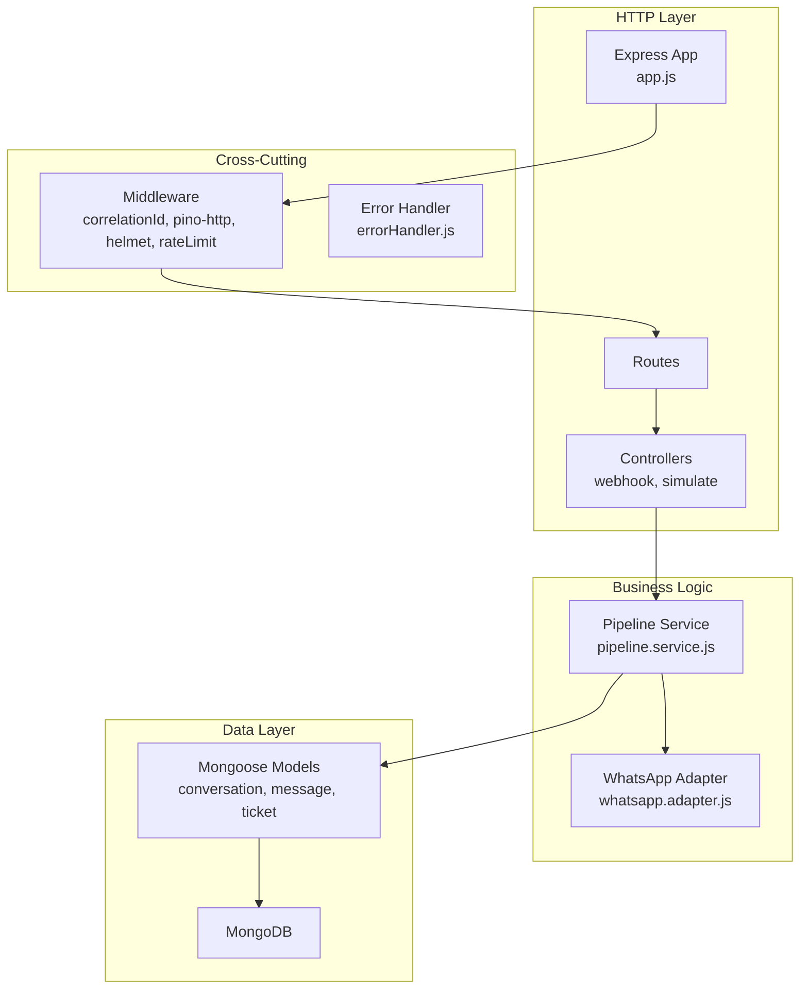
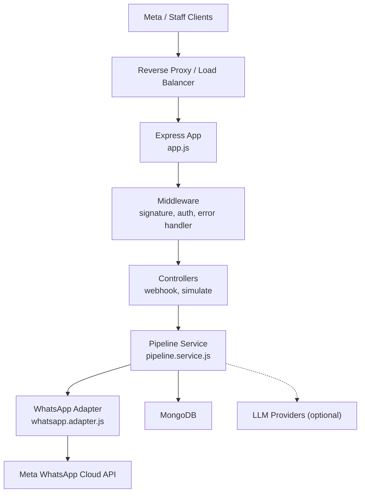
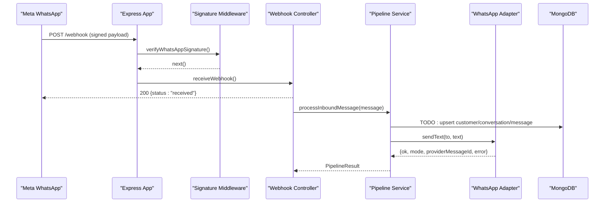
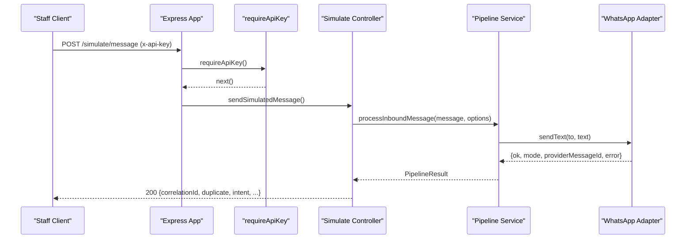
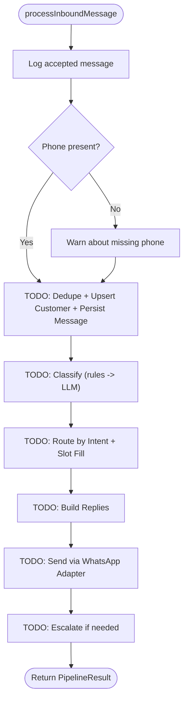
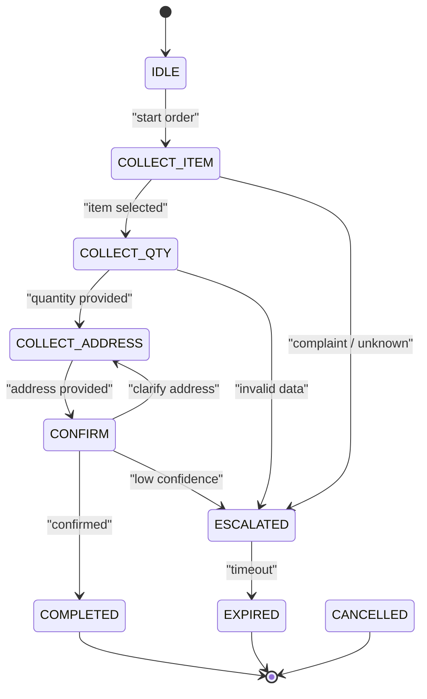
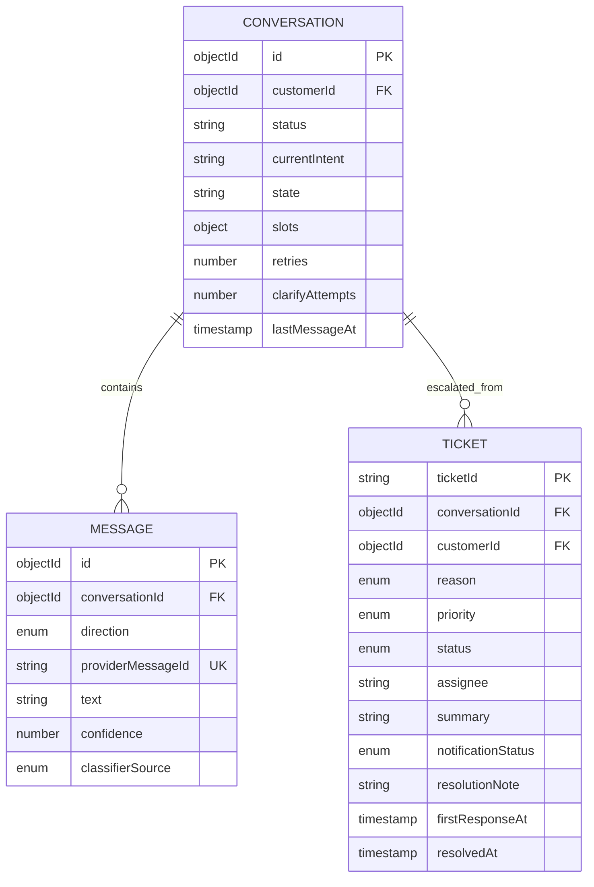
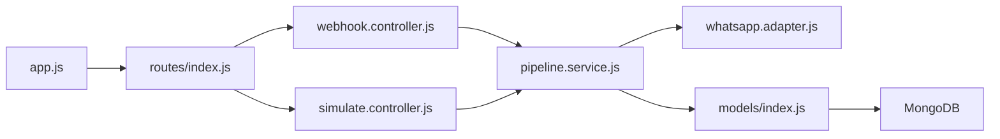

# Architecture Overview

<cite>
**Referenced Files in This Document**
- [README.md](file://README.md)
- [package.json](file://package.json)
- [src/app.js](file://src/app.js)
- [src/server.js](file://src/server.js)
- [src/config/db.js](file://src/config/db.js)
- [src/controllers/webhook.controller.js](file://src/controllers/webhook.controller.js)
- [src/controllers/simulate.controller.js](file://src/controllers/simulate.controller.js)
- [src/middleware/signature.js](file://src/middleware/signature.js)
- [src/middleware/auth.js](file://src/middleware/auth.js)
- [src/middleware/errorHandler.js](file://src/middleware/errorHandler.js)
- [src/services/pipeline.service.js](file://src/services/pipeline.service.js)
- [src/services/whatsapp.adapter.js](file://src/services/whatsapp.adapter.js)
- [src/models/conversation.model.js](file://src/models/conversation.model.js)
- [src/models/message.model.js](file://src/models/message.model.js)
- [src/models/ticket.model.js](file://src/models/ticket.model.js)
- [src/models/index.js](file://src/models/index.js)
</cite>

## Table of Contents
1. Introduction
2. Project Structure
3. Core Components
4. Architecture Overview
5. Detailed Component Analysis
6. Dependency Analysis
7. Performance Considerations
8. Troubleshooting Guide
9. Conclusion

## Introduction
This document describes the Lead System Manager’s system design for automated WhatsApp retail conversations. The backend accepts inbound WhatsApp messages, validates and normalizes them, processes them through a message pipeline, persists conversation state, and sends replies via an adapter that supports both simulated and Meta Cloud API modes. It also exposes staff-only simulation endpoints and health checks.

The system follows a layered architecture with clear separation between:
- Controllers: HTTP entry points for webhooks and simulation.
- Middleware: Cross-cutting concerns such as signature verification, staff authentication, correlation IDs, logging, rate limiting, and error handling.
- Services: Business logic including the message pipeline and the WhatsApp channel adapter.
- Models: Mongoose schemas representing customers, conversations, messages, orders, tickets, and audit events.
- Utilities: Shared helpers for environment validation, structured logging, phone normalization, and HTTP error shaping.

External boundaries include Meta’s WhatsApp Cloud API and optional LLM providers for intent classification. Deployment targets Node.js with Express, MongoDB via Mongoose, and can run locally or inside Docker.

**Section sources**
- [README.md:1-47](file://README.md#L1-L47)
- [README.md:50-58](file://README.md#L50-L58)
- [README.md:163-198](file://README.md#L163-L198)
- [README.md:364-384](file://README.md#L364-L384)

## Project Structure
The repository is organized by feature layers under `src/`:
- `config/` — Environment validation and database connection management.
- `controllers/` — Webhook and simulate HTTP handlers.
- `middleware/` — Signature verification, staff API key auth, correlation ID injection, error handling.
- `services/` — Message pipeline (skeleton) and WhatsApp adapter.
- `models/` — Mongoose models for domain entities.
- `utils/` — Logging, HTTP errors, async wrapper, phone utilities.
- `routes/` — Route registration.
- `validators/` — Zod schemas for webhook and simulate payloads.



**Diagram sources**
- [src/app.js:1-76](file://src/app.js#L1-L76)
- [src/controllers/webhook.controller.js:1-56](file://src/controllers/webhook.controller.js#L1-L56)
- [src/controllers/simulate.controller.js:1-35](file://src/controllers/simulate.controller.js#L1-L35)
- [src/services/pipeline.service.js:1-81](file://src/services/pipeline.service.js#L1-L81)
- [src/services/whatsapp.adapter.js:1-136](file://src/services/whatsapp.adapter.js#L1-L136)
- [src/models/conversation.model.js:1-52](file://src/models/conversation.model.js#L1-L52)
- [src/models/message.model.js:1-35](file://src/models/message.model.js#L1-L35)
- [src/models/ticket.model.js:1-49](file://src/models/ticket.model.js#L1-L49)

**Section sources**
- [README.md:364-384](file://README.md#L364-L384)
- [package.json:1-36](file://package.json#L1-L36)

## Core Components
- Application bootstrap and middleware stack:
  - Creates the Express app, disables server headers, trusts one reverse proxy, injects correlation IDs, configures structured logging, applies security headers, parses JSON while preserving raw body for HMAC verification, enforces coarse rate limiting, mounts routes, and installs not-found and error handlers.
- Server lifecycle:
  - Starts listening before connecting to MongoDB so the process remains available; `/health` reports degraded when Mongo is down. Graceful shutdown closes the server and disconnects the database with a timeout safeguard.
- Database connectivity:
  - Connects with retry and exponential backoff; background retries do not keep the event loop alive. Provides connection state for health checks.
- Controllers:
  - Webhook controller handles Meta handshake and asynchronous processing of inbound messages.
  - Simulate controller drives the pipeline synchronously for testing and demos.
- Pipeline service:
  - Central processing point for inbound messages; currently returns a skeleton result shape with TODOs for dedupe, customer/conversation persistence, classification, routing, reply sending, escalation, and auditing.
- WhatsApp adapter:
  - Implements the adapter pattern with two modes: simulated (logs to stdout and file) and cloud (calls Meta Graph API). Always resolves without throwing and returns a uniform result object.
- Models:
  - Conversation model defines states and statuses for slot-filling and lifecycle.
  - Message model stores immutable messages with unique providerMessageId for deduplication.
  - Ticket model captures escalations with reasons, priorities, statuses, and notification tracking.

**Section sources**
- [src/app.js:11-75](file://src/app.js#L11-L75)
- [src/server.js:1-50](file://src/server.js#L1-L50)
- [src/config/db.js:1-77](file://src/config/db.js#L1-L77)
- [src/controllers/webhook.controller.js:1-56](file://src/controllers/webhook.controller.js#L1-L56)
- [src/controllers/simulate.controller.js:1-35](file://src/controllers/simulate.controller.js#L1-L35)
- [src/services/pipeline.service.js:1-81](file://src/services/pipeline.service.js#L1-L81)
- [src/services/whatsapp.adapter.js:1-136](file://src/services/whatsapp.adapter.js#L1-L136)
- [src/models/conversation.model.js:1-52](file://src/models/conversation.model.js#L1-L52)
- [src/models/message.model.js:1-35](file://src/models/message.model.js#L1-L35)
- [src/models/ticket.model.js:1-49](file://src/models/ticket.model.js#L1-L49)

## Architecture Overview
The system uses a layered architecture with explicit boundaries:
- HTTP layer: Express app, route mounting, and controllers.
- Middleware layer: Correlation ID, structured logging, security headers, rate limiting, signature verification, staff API key auth, and centralized error handling.
- Service layer: Pipeline orchestrates message processing; WhatsApp adapter abstracts outbound messaging.
- Data layer: Mongoose models persist domain entities into MongoDB.



**Diagram sources**
- [src/app.js:1-76](file://src/app.js#L1-L76)
- [src/controllers/webhook.controller.js:1-56](file://src/controllers/webhook.controller.js#L1-L56)
- [src/controllers/simulate.controller.js:1-35](file://src/controllers/simulate.controller.js#L1-L35)
- [src/services/pipeline.service.js:1-81](file://src/services/pipeline.service.js#L1-L81)
- [src/services/whatsapp.adapter.js:1-136](file://src/services/whatsapp.adapter.js#L1-L136)
- [src/config/db.js:1-77](file://src/config/db.js#L1-L77)

## Detailed Component Analysis

### Webhook Ingestion Flow
Incoming WhatsApp messages are received at the webhook endpoint. The signature middleware verifies the HMAC-SHA256 signature using the raw request body. Payload validation extracts normalized messages. The controller immediately returns 200 and processes each message asynchronously to avoid retry storms.



**Diagram sources**
- [src/controllers/webhook.controller.js:1-56](file://src/controllers/webhook.controller.js#L1-L56)
- [src/middleware/signature.js:1-51](file://src/middleware/signature.js#L1-L51)
- [src/services/pipeline.service.js:1-81](file://src/services/pipeline.service.js#L1-L81)
- [src/services/whatsapp.adapter.js:1-136](file://src/services/whatsapp.adapter.js#L1-L136)

**Section sources**
- [src/controllers/webhook.controller.js:1-56](file://src/controllers/webhook.controller.js#L1-L56)
- [src/middleware/signature.js:1-51](file://src/middleware/signature.js#L1-L51)

### Simulate Endpoint Flow
Staff clients use the simulate endpoint to drive the pipeline without Meta. The controller awaits pipeline processing and returns the full result shape for manual testing and demos.



**Diagram sources**
- [src/controllers/simulate.controller.js:1-35](file://src/controllers/simulate.controller.js#L1-L35)
- [src/middleware/auth.js:1-23](file://src/middleware/auth.js#L1-L23)
- [src/services/pipeline.service.js:1-81](file://src/services/pipeline.service.js#L1-L81)
- [src/services/whatsapp.adapter.js:1-136](file://src/services/whatsapp.adapter.js#L1-L136)

**Section sources**
- [src/controllers/simulate.controller.js:1-35](file://src/controllers/simulate.controller.js#L1-L35)
- [src/middleware/auth.js:1-23](file://src/middleware/auth.js#L1-L23)

### Pipeline Processing Logic
The pipeline is the central processing hub. It logs accepted messages, notes missing phone numbers, and provides a stable result contract. Future steps include deduplication, customer/conversation persistence, classification (rules then LLM), routing, slot filling, reply generation, outbound messaging, and escalation.



**Diagram sources**
- [src/services/pipeline.service.js:1-81](file://src/services/pipeline.service.js#L1-L81)

**Section sources**
- [src/services/pipeline.service.js:1-81](file://src/services/pipeline.service.js#L1-L81)

### WhatsApp Adapter Pattern
The adapter abstracts outbound messaging behind a single interface. It supports:
- Simulated mode: logs to stdout and writes JSON lines to a file.
- Cloud mode: calls Meta Graph API with bearer token, timeout, and error handling.
- Test hook: forced failure path for notification failure scenarios.

```mermaid
classDiagram
class WhatsAppAdapter {
+sendText(to, text) Promise~{ok, mode, providerMessageId, error}~
-simulateSend(to, text)
-cloudSend(to, text)
-appendOutboundLog(entry)
-forcedFailure() boolean
}
class Env {
+WHATSAPP_MODE
+WHATSAPP_API_VERSION
+WHATSAPP_PHONE_NUMBER_ID
+WHATSAPP_ACCESS_TOKEN
+WHATSAPP_FORCE_SEND_FAILURE
}
class Logger {
+info(...)
+warn(...)
+error(...)
}
class PhoneUtils {
+toWaId(phone)
+maskPhone(phone)
}
WhatsAppAdapter --> Env : "reads configuration"
WhatsAppAdapter --> Logger : "logs outcomes"
WhatsAppAdapter --> PhoneUtils : "normalizes recipient"
```

**Diagram sources**
- [src/services/whatsapp.adapter.js:1-136](file://src/services/whatsapp.adapter.js#L1-L136)

**Section sources**
- [src/services/whatsapp.adapter.js:1-136](file://src/services/whatsapp.adapter.js#L1-L136)

### State Machine for Conversations
Conversations track business state and status. The state machine drives slot-filling across multiple turns, collecting items, quantities, addresses, and phone numbers, confirming orders, and transitioning to completed, cancelled, escalated, or expired states.



**Diagram sources**
- [src/models/conversation.model.js:1-52](file://src/models/conversation.model.js#L1-L52)

**Section sources**
- [src/models/conversation.model.js:1-52](file://src/models/conversation.model.js#L1-L52)

### Data Persistence Model
Key domain models:
- Conversation: rolling per customer with state machine fields, slots, and timestamps.
- Message: immutable records with direction, providerMessageId (unique index for dedupe), intent metadata, and classifier source.
- Ticket: escalation record with reason, priority, status, assignee, summary, and notification status.



**Diagram sources**
- [src/models/conversation.model.js:1-52](file://src/models/conversation.model.js#L1-L52)
- [src/models/message.model.js:1-35](file://src/models/message.model.js#L1-L35)
- [src/models/ticket.model.js:1-49](file://src/models/ticket.model.js#L1-L49)

**Section sources**
- [src/models/conversation.model.js:1-52](file://src/models/conversation.model.js#L1-L52)
- [src/models/message.model.js:1-35](file://src/models/message.model.js#L1-L35)
- [src/models/ticket.model.js:1-49](file://src/models/ticket.model.js#L1-L49)

## Dependency Analysis
High-level dependencies:
- Express application depends on middleware for correlation ID, logging, security headers, rate limiting, and error handling.
- Controllers depend on services for business logic.
- Pipeline service depends on WhatsApp adapter for outbound messaging and will depend on models for persistence.
- Models depend on Mongoose and MongoDB.
- Configuration and environment variables gate external integrations (Meta, LLM providers).



**Diagram sources**
- [src/app.js:1-76](file://src/app.js#L1-L76)
- [src/controllers/webhook.controller.js:1-56](file://src/controllers/webhook.controller.js#L1-L56)
- [src/controllers/simulate.controller.js:1-35](file://src/controllers/simulate.controller.js#L1-L35)
- [src/services/pipeline.service.js:1-81](file://src/services/pipeline.service.js#L1-L81)
- [src/services/whatsapp.adapter.js:1-136](file://src/services/whatsapp.adapter.js#L1-L136)
- [src/models/index.js:1-13](file://src/models/index.js#L1-L13)

**Section sources**
- [src/app.js:1-76](file://src/app.js#L1-L76)
- [src/models/index.js:1-13](file://src/models/index.js#L1-L13)

## Performance Considerations
- Fast webhook response: Immediate 200 prevents Meta retry storms; heavy work runs asynchronously.
- Structured logging: Pino integration reduces overhead and improves traceability.
- Rate limiting: Coarse limits protect against abuse while accommodating provider retries.
- Database resilience: Background retries with exponential backoff keep the service available even when MongoDB is temporarily unreachable.
- Outbound messaging: Timeout and error handling prevent long hangs; simulated mode avoids network latency during development.

[No sources needed since this section provides general guidance]

## Troubleshooting Guide
Common operational issues and resolutions:
- Invalid environment variables at startup: Compare `.env` with `.env.example`; the validator lists offending variables.
- Health check returns 503 mongo down: Ensure MongoDB is reachable or start the in-memory dev instance.
- Port conflicts: Change `PORT` in `.env`.
- Webhook signature invalid: Verify `WHATSAPP_APP_SECRET` matches the signer; use the helper script with the correct secret.
- Handshake rejected: Ensure `WHATSAPP_VERIFY_TOKEN` matches Meta’s configuration.
- Forced failures: Use `WHATSAPP_FORCE_SEND_FAILURE=true` to exercise notifier failure paths.

**Section sources**
- [README.md:409-419](file://README.md#L409-L419)
- [src/middleware/errorHandler.js:1-80](file://src/middleware/errorHandler.js#L1-L80)
- [src/config/db.js:1-77](file://src/config/db.js#L1-L77)

## Conclusion
The Lead System Manager implements a clean, layered architecture with well-defined responsibilities across controllers, middleware, services, and models. The WhatsApp adapter abstracts outbound channels, the pipeline centralizes message processing, and the conversation state machine enables multi-turn interactions. External dependencies are gated by configuration, and cross-cutting concerns like security, logging, and error handling are consistently applied. The design supports future enhancements such as intent classification, order handling, and staff notifications while maintaining robustness and observability.

[No sources needed since this section summarizes without analyzing specific files]