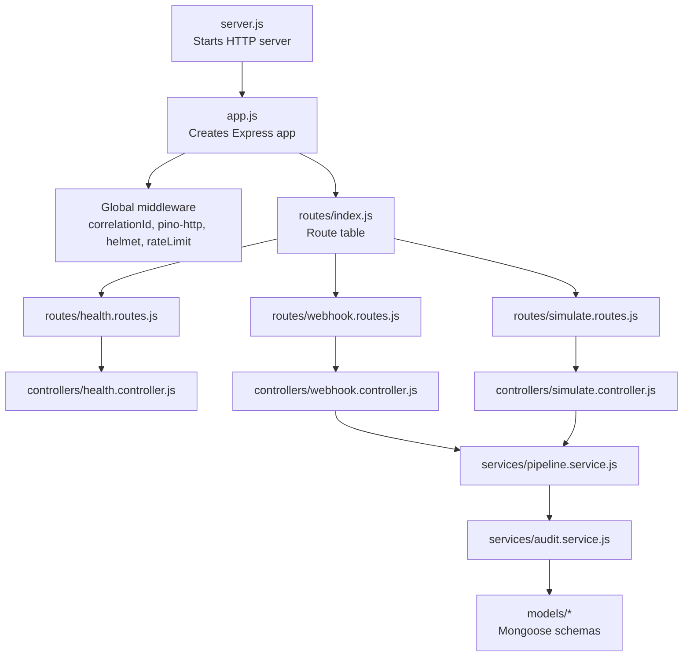
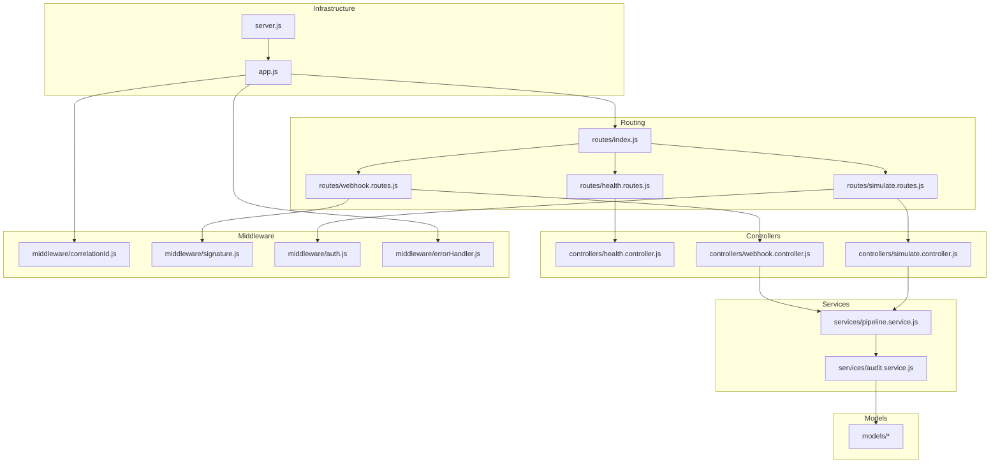
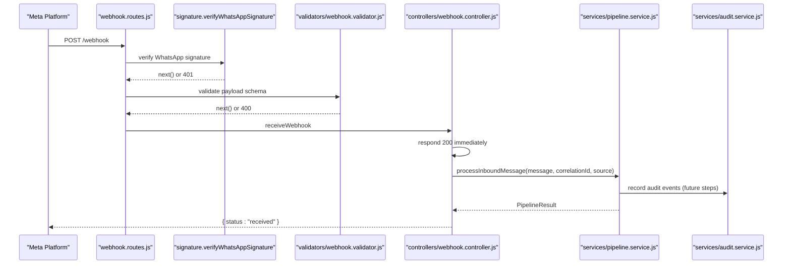
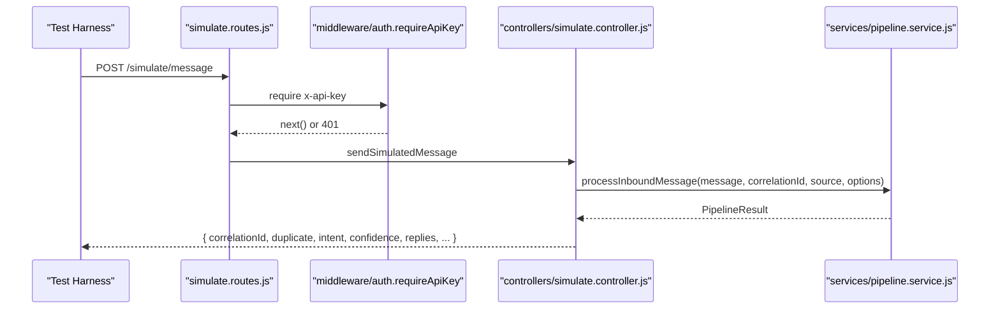
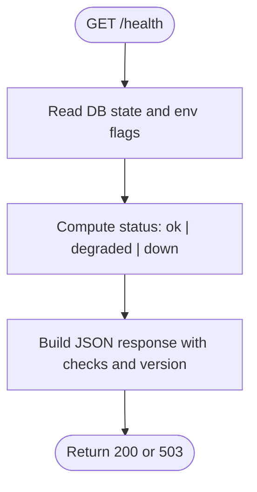
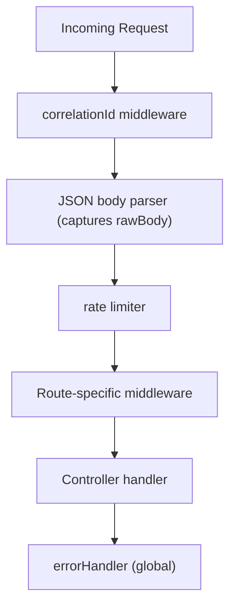
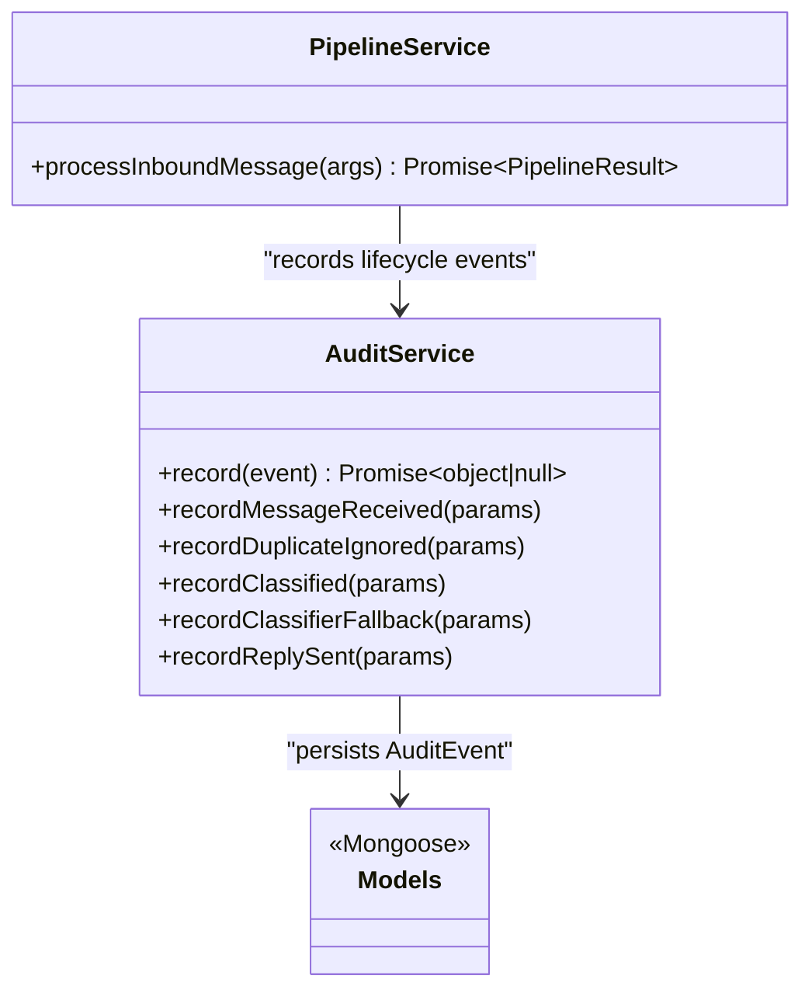
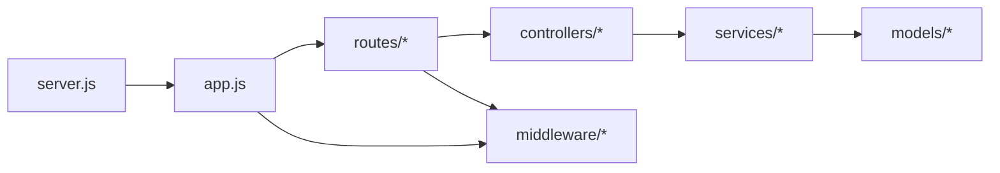

# Component Relationships

<cite>
**Referenced Files in This Document**
- [app.js](file://src/app.js)
- [server.js](file://src/server.js)
- [index.js](file://src/routes/index.js)
- [health.routes.js](file://src/routes/health.routes.js)
- [webhook.routes.js](file://src/routes/webhook.routes.js)
- [simulate.routes.js](file://src/routes/simulate.routes.js)
- [health.controller.js](file://src/controllers/health.controller.js)
- [webhook.controller.js](file://src/controllers/webhook.controller.js)
- [simulate.controller.js](file://src/controllers/simulate.controller.js)
- [auth.js](file://src/middleware/auth.js)
- [signature.js](file://src/middleware/signature.js)
- [correlationId.js](file://src/middleware/correlationId.js)
- [errorHandler.js](file://src/middleware/errorHandler.js)
- [pipeline.service.js](file://src/services/pipeline.service.js)
- [audit.service.js](file://src/services/audit.service.js)
- [package.json](file://package.json)
</cite>

## Table of Contents
1. [Introduction](#introduction)
2. [Project Structure](#project-structure)
3. [Core Components](#core-components)
4. [Architecture Overview](#architecture-overview)
5. [Detailed Component Analysis](#detailed-component-analysis)
6. [Dependency Analysis](#dependency-analysis)
7. [Performance Considerations](#performance-considerations)
8. [Troubleshooting Guide](#troubleshooting-guide)
9. [Conclusion](#conclusion)

## Introduction
This document explains the component relationships and interactions in the Lead System Manager architecture. It maps the dependency hierarchy from server initialization through route handlers to business logic services, documents how controllers delegate to services, how middleware intercepts requests, and how models provide data access. It also describes the request lifecycle from HTTP entry points through validation, processing, and response generation, including coupling strategies, interface definitions, integration points, and how circular dependencies are avoided.

## Project Structure
The application is an Express-based API with a clear separation between infrastructure (server and app setup), routing, controllers, middleware, services, and models. The main entry point starts the HTTP server, builds the Express application, mounts global middleware, registers routes, and connects to MongoDB asynchronously so that startup remains resilient when the database is unavailable.

**Diagram sources**
- [server.js:1-26](file://src/server.js#L1-L26)
- [app.js:15-74](file://src/app.js#L15-L74)
- [index.js:10-16](file://src/routes/index.js#L10-L16)
- [health.routes.js:1-8](file://src/routes/health.routes.js#L1-L8)
- [webhook.routes.js:1-15](file://src/routes/webhook.routes.js#L1-L15)
- [simulate.routes.js:1-20](file://src/routes/simulate.routes.js#L1-L20)
- [health.controller.js:1-51](file://src/controllers/health.controller.js#L1-L51)
- [webhook.controller.js:1-56](file://src/controllers/webhook.controller.js#L1-L56)
- [simulate.controller.js:1-35](file://src/controllers/simulate.controller.js#L1-L35)
- [pipeline.service.js:1-81](file://src/services/pipeline.service.js#L1-L81)
- [audit.service.js:1-116](file://src/services/audit.service.js#L1-L116)

**Section sources**
- [server.js:1-26](file://src/server.js#L1-L26)
- [app.js:15-74](file://src/app.js#L15-L74)
- [index.js:10-16](file://src/routes/index.js#L10-L16)

## Core Components
- Application bootstrap: `createApp` constructs the Express instance, configures security headers, logging, body parsing, rate limiting, and error handling, then mounts route groups.
- Server bootstrap: `server.js` listens on the configured port, logs environment details, connects to MongoDB after listening, and implements graceful shutdown with timeouts.
- Route table: `routes/index.js` centralizes mounted route groups for health, webhook, and simulate endpoints.
- Controllers: Thin layer that validates inputs via middleware or validators, delegates to services, and returns standardized responses.
- Middleware: Cross-cutting concerns such as correlation IDs, signature verification, API key authentication, and centralized error handling.
- Services: Business logic orchestration; currently the pipeline service orchestrates message processing steps and integrates audit logging.
- Models: Mongoose-backed entities used by services (e.g., audit events).

**Section sources**
- [app.js:15-74](file://src/app.js#L15-L74)
- [server.js:1-50](file://src/server.js#L1-L50)
- [index.js:10-16](file://src/routes/index.js#L10-L16)

## Architecture Overview
The system follows a layered architecture:
- Infrastructure layer: server and app configuration.
- Routing layer: Express routers grouping related endpoints.
- Controller layer: request/response handling and delegation.
- Service layer: domain logic and orchestration.
- Data layer: Mongoose models for persistence.

**Diagram sources**
- [server.js:1-26](file://src/server.js#L1-L26)
- [app.js:15-74](file://src/app.js#L15-L74)
- [index.js:10-16](file://src/routes/index.js#L10-L16)
- [health.routes.js:1-8](file://src/routes/health.routes.js#L1-L8)
- [webhook.routes.js:1-15](file://src/routes/webhook.routes.js#L1-L15)
- [simulate.routes.js:1-20](file://src/routes/simulate.routes.js#L1-L20)
- [health.controller.js:1-51](file://src/controllers/health.controller.js#L1-L51)
- [webhook.controller.js:1-56](file://src/controllers/webhook.controller.js#L1-L56)
- [simulate.controller.js:1-35](file://src/controllers/simulate.controller.js#L1-L35)
- [correlationId.js:1-14](file://src/middleware/correlationId.js#L1-L14)
- [signature.js:1-51](file://src/middleware/signature.js#L1-L51)
- [auth.js:1-23](file://src/middleware/auth.js#L1-L23)
- [errorHandler.js:1-80](file://src/middleware/errorHandler.js#L1-L80)
- [pipeline.service.js:1-81](file://src/services/pipeline.service.js#L1-L81)
- [audit.service.js:1-116](file://src/services/audit.service.js#L1-L116)

## Detailed Component Analysis

### Request Lifecycle: Webhook Inbound Message
The webhook endpoint demonstrates the full request lifecycle: signature verification, payload validation, immediate acknowledgment, and asynchronous processing.

**Diagram sources**
- [webhook.routes.js:1-15](file://src/routes/webhook.routes.js#L1-L15)
- [signature.js:1-51](file://src/middleware/signature.js#L1-L51)
- [webhook.controller.js:1-56](file://src/controllers/webhook.controller.js#L1-L56)
- [pipeline.service.js:1-81](file://src/services/pipeline.service.js#L1-L81)
- [audit.service.js:1-116](file://src/services/audit.service.js#L1-L116)

**Section sources**
- [webhook.routes.js:1-15](file://src/routes/webhook.routes.js#L1-L15)
- [signature.js:1-51](file://src/middleware/signature.js#L1-L51)
- [webhook.controller.js:1-56](file://src/controllers/webhook.controller.js#L1-L56)
- [pipeline.service.js:1-81](file://src/services/pipeline.service.js#L1-L81)

### Request Lifecycle: Simulate Endpoint
The simulate endpoint provides a synchronous test harness for the pipeline, awaiting processing results and returning structured outcomes.

**Diagram sources**
- [simulate.routes.js:1-20](file://src/routes/simulate.routes.js#L1-L20)
- [auth.js:1-23](file://src/middleware/auth.js#L1-L23)
- [simulate.controller.js:1-35](file://src/controllers/simulate.controller.js#L1-L35)
- [pipeline.service.js:1-81](file://src/services/pipeline.service.js#L1-L81)

**Section sources**
- [simulate.routes.js:1-20](file://src/routes/simulate.routes.js#L1-L20)
- [auth.js:1-23](file://src/middleware/auth.js#L1-L23)
- [simulate.controller.js:1-35](file://src/controllers/simulate.controller.js#L1-L35)
- [pipeline.service.js:1-81](file://src/services/pipeline.service.js#L1-L81)

### Health Check Flow
The health controller aggregates system state across dependencies and returns a status reflecting overall health.

**Diagram sources**
- [health.routes.js:1-8](file://src/routes/health.routes.js#L1-L8)
- [health.controller.js:1-51](file://src/controllers/health.controller.js#L1-L51)

**Section sources**
- [health.routes.js:1-8](file://src/routes/health.routes.js#L1-L8)
- [health.controller.js:1-51](file://src/controllers/health.controller.js#L1-L51)

### Middleware Interception Points
- Correlation ID: attaches a unique identifier to every request and response header.
- Signature verification: validates HMAC signatures for incoming webhooks using raw request body.
- API key authentication: validates staff API keys using constant-time comparison.
- Error handling: centralizes error mapping and standardizes error responses.

**Diagram sources**
- [correlationId.js:1-14](file://src/middleware/correlationId.js#L1-L14)
- [app.js:21-67](file://src/app.js#L21-L67)
- [signature.js:1-51](file://src/middleware/signature.js#L1-L51)
- [auth.js:1-23](file://src/middleware/auth.js#L1-L23)
- [errorHandler.js:1-80](file://src/middleware/errorHandler.js#L1-L80)

**Section sources**
- [correlationId.js:1-14](file://src/middleware/correlationId.js#L1-L14)
- [app.js:21-67](file://src/app.js#L21-L67)
- [signature.js:1-51](file://src/middleware/signature.js#L1-L51)
- [auth.js:1-23](file://src/middleware/auth.js#L1-L23)
- [errorHandler.js:1-80](file://src/middleware/errorHandler.js#L1-L80)

### Service Orchestration: Pipeline and Audit
The pipeline service acts as the single entry point for inbound message processing. It currently returns a skeleton result and is designed to integrate future steps such as deduplication, customer upsert, conversation loading, classification, routing, reply sending, and escalation. Audit events are best-effort writes that do not block the live path.

**Diagram sources**
- [pipeline.service.js:1-81](file://src/services/pipeline.service.js#L1-L81)
- [audit.service.js:1-116](file://src/services/audit.service.js#L1-L116)

**Section sources**
- [pipeline.service.js:1-81](file://src/services/pipeline.service.js#L1-L81)
- [audit.service.js:1-116](file://src/services/audit.service.js#L1-L116)

### Interface Definitions and Contracts
- Pipeline input contract: normalized message object, correlation ID, source type, and optional flags.
- Pipeline output contract: structured result containing duplicate flag, intent, confidence, classifier source, replies, conversation snapshot, ticket ID, and order ID.
- Audit event contract: typed events with correlation ID, entity metadata, actor, and detail payload.

These contracts are defined in the pipeline and audit services and guide future integrations without tight coupling to specific implementations.

**Section sources**
- [pipeline.service.js:21-41](file://src/services/pipeline.service.js#L21-L41)
- [audit.service.js:1-36](file://src/services/audit.service.js#L1-L36)

## Dependency Analysis
The dependency graph shows clear unidirectional flows:
- Routes depend on controllers and middleware.
- Controllers depend on services.
- Services depend on utilities and models.
- Middleware depends on configuration and shared utilities.
- No circular imports are present among these layers.

**Diagram sources**
- [index.js:10-16](file://src/routes/index.js#L10-L16)
- [health.routes.js:1-8](file://src/routes/health.routes.js#L1-L8)
- [webhook.routes.js:1-15](file://src/routes/webhook.routes.js#L1-L15)
- [simulate.routes.js:1-20](file://src/routes/simulate.routes.js#L1-L20)
- [health.controller.js:1-51](file://src/controllers/health.controller.js#L1-L51)
- [webhook.controller.js:1-56](file://src/controllers/webhook.controller.js#L1-L56)
- [simulate.controller.js:1-35](file://src/controllers/simulate.controller.js#L1-L35)
- [pipeline.service.js:1-81](file://src/services/pipeline.service.js#L1-L81)
- [audit.service.js:1-116](file://src/services/audit.service.js#L1-L116)
- [app.js:15-74](file://src/app.js#L15-L74)
- [server.js:1-26](file://src/server.js#L1-L26)

**Section sources**
- [index.js:10-16](file://src/routes/index.js#L10-L16)
- [app.js:15-74](file://src/app.js#L15-L74)
- [server.js:1-26](file://src/server.js#L1-L26)

## Performance Considerations
- Fast acknowledgment for webhooks: the webhook controller responds immediately and processes messages asynchronously to avoid retry storms from the provider.
- Rate limiting: coarse abuse protection with generous limits suitable for provider retries; disabled in tests.
- Logging: structured logging via Pino with correlation IDs improves observability and performance diagnostics.
- Startup resilience: the server starts listening before connecting to MongoDB, allowing health checks to reflect connectivity while avoiding crash loops.

[No sources needed since this section provides general guidance]

## Troubleshooting Guide
- Centralized error handling: all errors are mapped to a consistent shape with codes, messages, and details. Zod validation errors, Mongoose validation errors, cast errors, duplicate key errors, and malformed payloads are handled uniformly.
- Correlation IDs: every response includes a correlation ID for tracing requests across logs and audit events.
- Signature failures: invalid or missing webhook signatures are audited and return unauthorized responses.
- Health checks: use the health endpoint to diagnose dependency states (MongoDB, LLM provider, notifier).

**Section sources**
- [errorHandler.js:1-80](file://src/middleware/errorHandler.js#L1-L80)
- [signature.js:1-51](file://src/middleware/signature.js#L1-L51)
- [health.controller.js:1-51](file://src/controllers/health.controller.js#L1-L51)

## Conclusion
The Lead System Manager follows a clean, layered architecture with explicit boundaries between routing, controllers, middleware, services, and models. Controllers delegate to services, middleware intercepts requests for cross-cutting concerns, and services encapsulate business logic and orchestrate data access. The design avoids circular dependencies by maintaining one-way import directions and using well-defined interfaces for inter-component communication. The request lifecycle is robust, with fast acknowledgments for external providers, comprehensive validation, and centralized error handling.