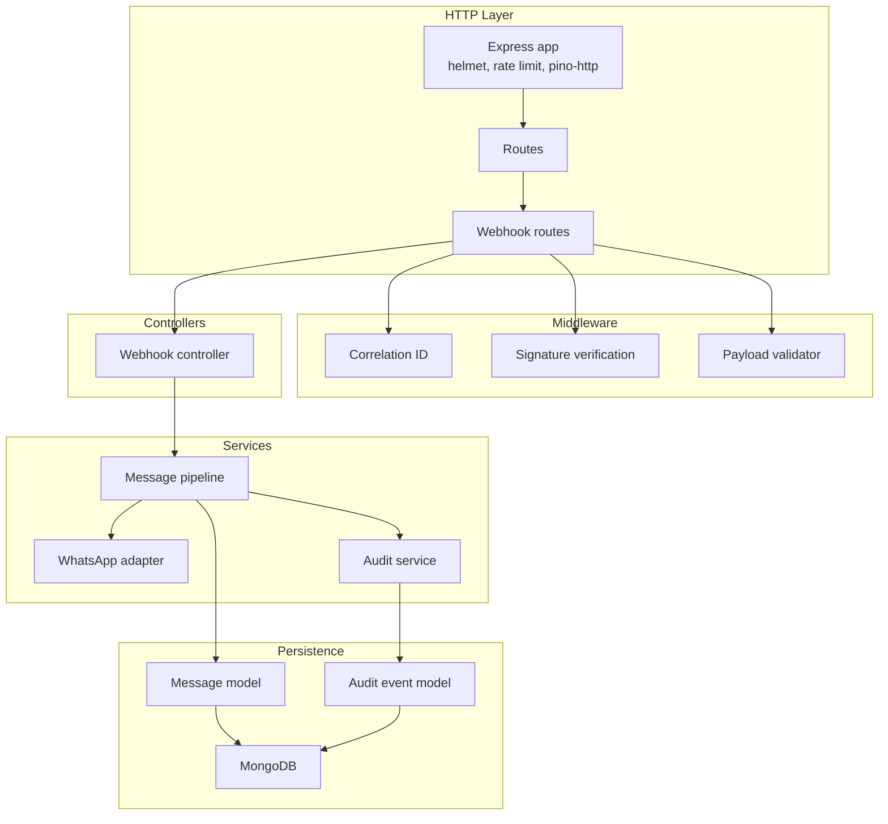
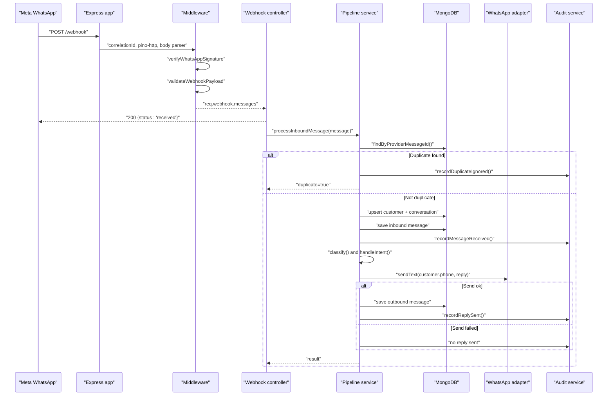
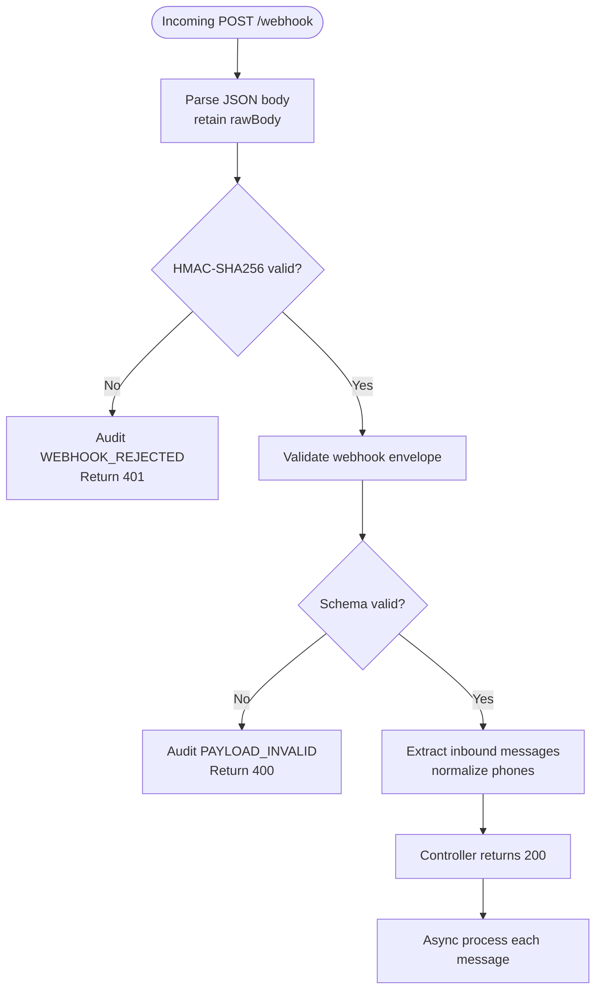
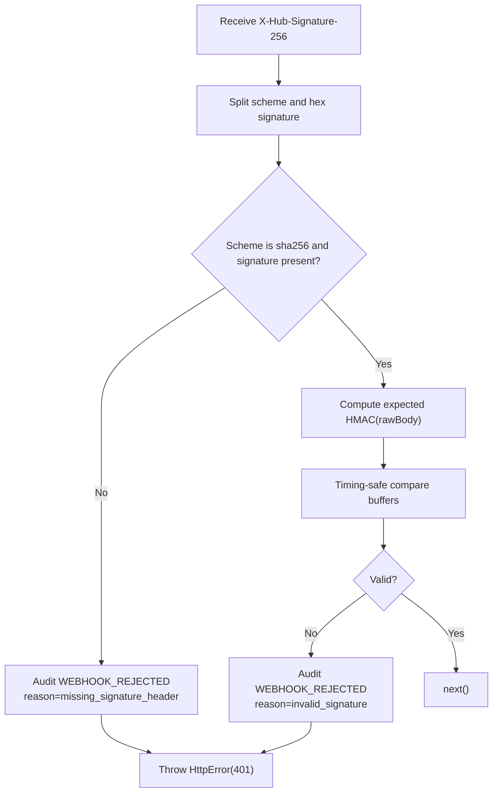
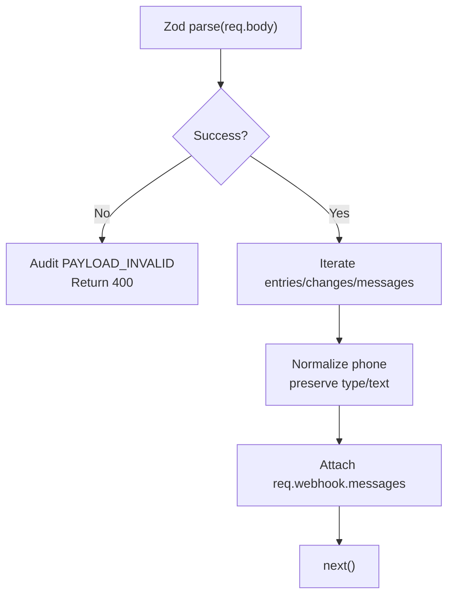
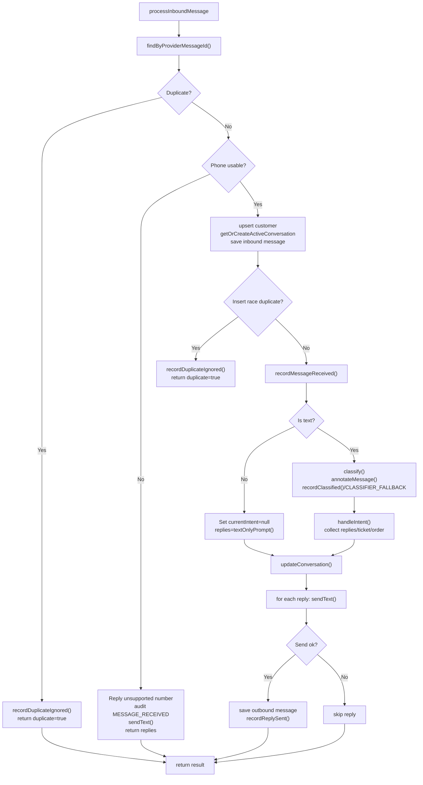
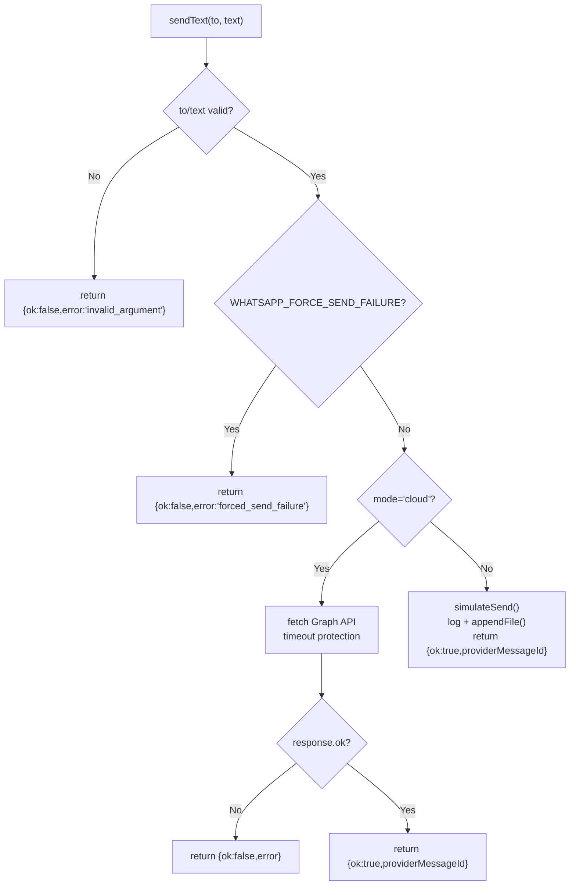
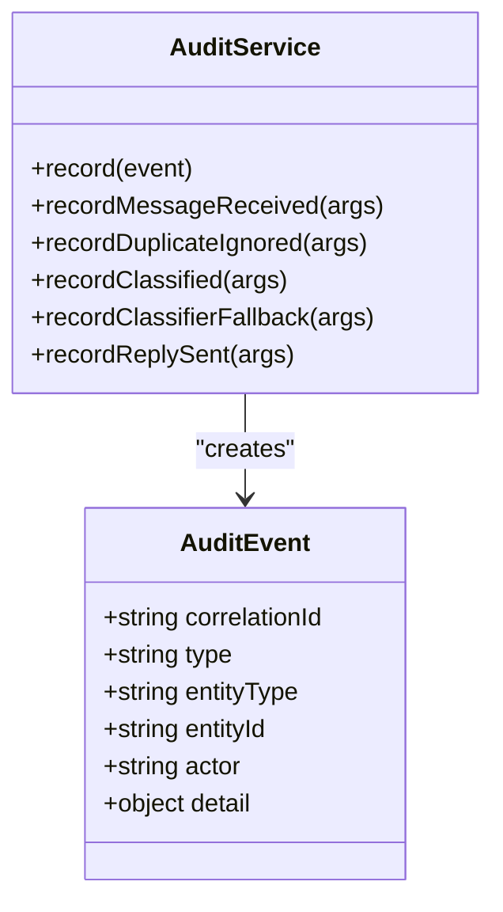
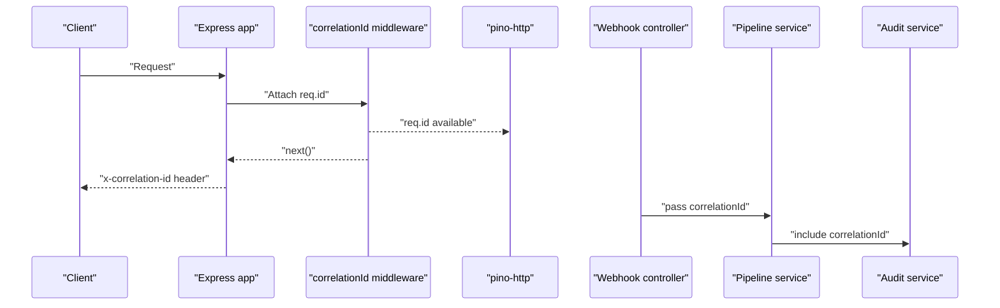
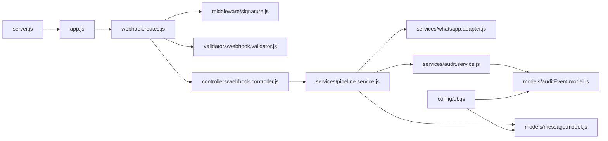

# Data Flow Architecture

<cite>
**Referenced Files in This Document**
- [app.js](file://src/app.js)
- [server.js](file://src/server.js)
- [webhook.routes.js](file://src/routes/webhook.routes.js)
- [signature.js](file://src/middleware/signature.js)
- [correlationId.js](file://src/middleware/correlationId.js)
- [webhook.controller.js](file://src/controllers/webhook.controller.js)
- [webhook.validator.js](file://src/validators/webhook.validator.js)
- [pipeline.service.js](file://src/services/pipeline.service.js)
- [whatsapp.adapter.js](file://src/services/whatsapp.adapter.js)
- [message.model.js](file://src/models/message.model.js)
- [audit.service.js](file://src/services/audit.service.js)
- [auditEvent.model.js](file://src/models/auditEvent.model.js)
- [db.js](file://src/config/db.js)
- [logger.js](file://src/utils/logger.js)
- [httpError.js](file://src/utils/httpError.js)
</cite>

## Table of Contents
1. [Introduction](#introduction)
2. [Project Structure](#project-structure)
3. [Core Components](#core-components)
4. [Architecture Overview](#architecture-overview)
5. [Detailed Component Analysis](#detailed-component-analysis)
6. [Dependency Analysis](#dependency-analysis)
7. [Performance Considerations](#performance-considerations)
8. [Troubleshooting Guide](#troubleshooting-guide)
9. [Conclusion](#conclusion)

## Introduction
This document explains the complete data flow for inbound WhatsApp messages in the Lead System Manager. It traces a request from webhook ingestion through signature verification, payload validation, pipeline processing, database persistence, and outbound responses. It also documents transformation stages, validation points, error propagation, audit event capture, and how correlation IDs maintain end-to-end traceability.

The system is designed so that Meta’s webhook receives an immediate 200 response, while message processing continues asynchronously. This prevents provider retry storms from becoming server failures. All requests carry a correlation ID used across logs, audit events, and API responses.

## Project Structure
At a high level, the inbound path uses Express middleware for security and observability, route handlers for business entry points, validators for schema enforcement, services for domain logic, adapters for external channels, and Mongoose models for persistence.

**Diagram sources**
- [app.js:15-75](file://src/app.js#L15-L75)
- [webhook.routes.js:1-16](file://src/routes/webhook.routes.js#L1-L16)
- [correlationId.js:1-14](file://src/middleware/correlationId.js#L1-L14)
- [signature.js:1-51](file://src/middleware/signature.js#L1-L51)
- [webhook.validator.js:1-124](file://src/validators/webhook.validator.js#L1-L124)
- [webhook.controller.js:1-56](file://src/controllers/webhook.controller.js#L1-L56)
- [pipeline.service.js:1-274](file://src/services/pipeline.service.js#L1-L274)
- [whatsapp.adapter.js:1-136](file://src/services/whatsapp.adapter.js#L1-L136)
- [message.model.js:1-35](file://src/models/message.model.js#L1-L35)
- [audit.service.js:1-116](file://src/services/audit.service.js#L1-L116)
- [auditEvent.model.js:1-49](file://src/models/auditEvent.model.js#L1-L49)

**Section sources**
- [app.js:15-75](file://src/app.js#L15-L75)
- [server.js:1-50](file://src/server.js#L1-L50)
- [webhook.routes.js:1-16](file://src/routes/webhook.routes.js#L1-L16)

## Core Components
- HTTP application and middleware: Adds correlation IDs, structured logging, body parsing with raw buffer retention, rate limiting, and global error handling.
- Webhook routes: Separate handshake GET and signed POST endpoints; POST applies signature verification and payload validation before invoking the controller.
- Signature verification: Validates HMAC-SHA256 against the raw request body using timing-safe comparison; rejects are audited.
- Payload validation: Uses Zod to validate the Meta webhook envelope, extract inbound messages, normalize phone numbers, and store normalized messages on the request.
- Webhook controller: Responds immediately with 200, then processes each inbound message asynchronously.
- Message pipeline: Deduplicates by provider message ID, persists customer/conversation/inbound message, classifies intent, routes through intent handlers, sends replies, and records audit events.
- WhatsApp adapter: Sends outbound messages either in simulated mode (log file) or cloud mode (Meta Graph API), returning a uniform result object.
- Audit service: Best-effort append-only audit trail with typed helpers for lifecycle events.
- Models: Message and audit event schemas define persistence contracts and indexes.

**Section sources**
- [app.js:15-75](file://src/app.js#L15-L75)
- [webhook.routes.js:1-16](file://src/routes/webhook.routes.js#L1-L16)
- [signature.js:1-51](file://src/middleware/signature.js#L1-L51)
- [webhook.validator.js:1-124](file://src/validators/webhook.validator.js#L1-L124)
- [webhook.controller.js:1-56](file://src/controllers/webhook.controller.js#L1-L56)
- [pipeline.service.js:1-274](file://src/services/pipeline.service.js#L1-L274)
- [whatsapp.adapter.js:1-136](file://src/services/whatsapp.adapter.js#L1-L136)
- [audit.service.js:1-116](file://src/services/audit.service.js#L1-L116)
- [message.model.js:1-35](file://src/models/message.model.js#L1-L35)
- [auditEvent.model.js:1-49](file://src/models/auditEvent.model.js#L1-L49)

## Architecture Overview
The inbound message architecture follows a layered pipeline:

**Diagram sources**
- [webhook.routes.js:1-16](file://src/routes/webhook.routes.js#L1-L16)
- [signature.js:1-51](file://src/middleware/signature.js#L1-L51)
- [webhook.validator.js:1-124](file://src/validators/webhook.validator.js#L1-L124)
- [webhook.controller.js:1-56](file://src/controllers/webhook.controller.js#L1-L56)
- [pipeline.service.js:1-274](file://src/services/pipeline.service.js#L1-L274)
- [whatsapp.adapter.js:1-136](file://src/services/whatsapp.adapter.js#L1-L136)
- [audit.service.js:1-116](file://src/services/audit.service.js#L1-L116)
- [message.model.js:1-35](file://src/models/message.model.js#L1-L35)

## Detailed Component Analysis

### Inbound Request Lifecycle
The request enters the Express application, where correlation IDs are attached, structured logging is enabled, JSON bodies are parsed while retaining the raw buffer for HMAC verification, and rate limiting is applied. The webhook route then enforces signature verification and payload validation before invoking the controller.

Key behaviors:
- Correlation ID generation and header injection occur early.
- Raw body retention enables accurate HMAC verification.
- Signature verification rejects invalid signatures with an audited rejection.
- Payload validation normalizes the Meta envelope into a flat list of inbound messages.
- The controller returns 200 immediately and processes messages asynchronously.

**Diagram sources**
- [app.js:41-50](file://src/app.js#L41-L50)
- [correlationId.js:1-14](file://src/middleware/correlationId.js#L1-L14)
- [signature.js:1-51](file://src/middleware/signature.js#L1-L51)
- [webhook.validator.js:1-124](file://src/validators/webhook.validator.js#L1-L124)
- [webhook.controller.js:1-56](file://src/controllers/webhook.controller.js#L1-L56)

**Section sources**
- [app.js:15-75](file://src/app.js#L15-L75)
- [correlationId.js:1-14](file://src/middleware/correlationId.js#L1-L14)
- [signature.js:1-51](file://src/middleware/signature.js#L1-L51)
- [webhook.validator.js:1-124](file://src/validators/webhook.validator.js#L1-L124)
- [webhook.controller.js:1-56](file://src/controllers/webhook.controller.js#L1-L56)

### Signature Verification and Error Propagation
Signature verification computes HMAC-SHA256 over the exact raw bytes captured by the body parser and compares them using a timing-safe function. If the scheme is missing or the signature does not match, it records an audit event and throws a standardized HTTP error.

Error propagation:
- Invalid signature → audit WEBHOOK_REJECTED → HttpError(401).
- Missing or malformed signature header → audit WEBHOOK_REJECTED → HttpError(401).

**Diagram sources**
- [signature.js:1-51](file://src/middleware/signature.js#L1-L51)
- [httpError.js:1-31](file://src/utils/httpError.js#L1-L31)
- [audit.service.js:1-116](file://src/services/audit.service.js#L1-L116)

**Section sources**
- [signature.js:1-51](file://src/middleware/signature.js#L1-L51)
- [httpError.js:1-31](file://src/utils/httpError.js#L1-L31)

### Payload Validation and Normalization
The validator ensures the incoming envelope matches the expected structure, extracts all inbound messages, and normalizes sender phone numbers. Non-text messages preserve their type but have null text. Invalid payloads are audited and return a 400 error.

Transformation details:
- Envelope validation: object, entry array, changes, value, contacts, messages.
- Extraction: iterates entries and changes, filters for field 'messages', collects messages.
- Normalization: converts raw phone to E.164 when possible; stores both raw and normalized values.
- Output: req.webhook.messages contains normalized inbound message objects.

**Diagram sources**
- [webhook.validator.js:1-124](file://src/validators/webhook.validator.js#L1-L124)
- [audit.service.js:1-116](file://src/services/audit.service.js#L1-L116)

**Section sources**
- [webhook.validator.js:1-124](file://src/validators/webhook.validator.js#L1-L124)

### Pipeline Processing and Persistence
The pipeline is the central orchestrator for message processing. It performs deduplication, persistence, classification, routing, reply sending, and audit recording.

Processing steps:
1. Dedupe check by providerMessageId.
2. Handle unsupported phone numbers by replying without persistence.
3. Upsert customer and resume/create active conversation.
4. Save inbound message with unique index backstop.
5. Record MESSAGE_RECEIVED audit event.
6. Classify text messages; annotate message and record CLASSIFIED or CLASSIFIER_FALLBACK.
7. Route via intent handler; collect replies, ticketId, orderId, and conversation updates.
8. Update conversation state.
9. Send replies through the WhatsApp adapter; persist successful outbound messages and record REPLY_SENT.

**Diagram sources**
- [pipeline.service.js:1-274](file://src/services/pipeline.service.js#L1-L274)
- [message.model.js:1-35](file://src/models/message.model.js#L1-L35)
- [audit.service.js:1-116](file://src/services/audit.service.js#L1-L116)

**Section sources**
- [pipeline.service.js:1-274](file://src/services/pipeline.service.js#L1-L274)
- [message.model.js:1-35](file://src/models/message.model.js#L1-L35)

### Outbound Messaging and Failure Handling
The WhatsApp adapter provides a uniform contract for sending text messages. In simulated mode, it logs to stdout and appends JSON lines to a log file. In cloud mode, it calls the Meta Graph API with timeout protection and returns a consistent result object indicating success or failure.

Failure strategies:
- Invalid arguments: returns ok=false with error code.
- Forced failure flag: returns ok=false for testing notification-failure paths.
- Cloud API errors: captures HTTP status or exception details and returns ok=false.
- Pipeline behavior: skips failed replies and continues processing other replies; only successful sends are persisted and audited.

**Diagram sources**
- [whatsapp.adapter.js:1-136](file://src/services/whatsapp.adapter.js#L1-L136)

**Section sources**
- [whatsapp.adapter.js:1-136](file://src/services/whatsapp.adapter.js#L1-L136)

### Audit Trail and Traceability
Audit events are recorded at key lifecycle points:
- WEBHOOK_REJECTED: invalid signature.
- PAYLOAD_INVALID: malformed webhook envelope.
- MESSAGE_RECEIVED: after successful persistence of inbound message.
- DUPLICATE_IGNORED: duplicate providerMessageId detected.
- CLASSIFIED: classification outcome including intent, confidence, source, entities.
- CLASSIFIER_FALLBACK: classifier degraded or unconvinced.
- REPLY_SENT: successful outbound send.

Every audit event includes a correlation ID, enabling end-to-end tracing across logs, database records, and API responses.

**Diagram sources**
- [audit.service.js:1-116](file://src/services/audit.service.js#L1-L116)
- [auditEvent.model.js:1-49](file://src/models/auditEvent.model.js#L1-L49)

**Section sources**
- [audit.service.js:1-116](file://src/services/audit.service.js#L1-L116)
- [auditEvent.model.js:1-49](file://src/models/auditEvent.model.js#L1-L49)

### Correlation ID Flow
A correlation ID is generated per request and propagated throughout the stack:
- Generated by correlation ID middleware.
- Injected into response headers.
- Used by structured logging via pino-http.
- Passed explicitly to pipeline processing and audit events.

**Diagram sources**
- [correlationId.js:1-14](file://src/middleware/correlationId.js#L1-L14)
- [app.js:21-36](file://src/app.js#L21-L36)
- [webhook.controller.js:35-54](file://src/controllers/webhook.controller.js#L35-L54)
- [pipeline.service.js:66-75](file://src/services/pipeline.service.js#L66-L75)
- [audit.service.js:22-35](file://src/services/audit.service.js#L22-L35)

**Section sources**
- [correlationId.js:1-14](file://src/middleware/correlationId.js#L1-L14)
- [app.js:21-36](file://src/app.js#L21-L36)

## Dependency Analysis
The inbound path has clear layering and controlled dependencies:

**Diagram sources**
- [webhook.routes.js:1-16](file://src/routes/webhook.routes.js#L1-L16)
- [signature.js:1-51](file://src/middleware/signature.js#L1-L51)
- [webhook.validator.js:1-124](file://src/validators/webhook.validator.js#L1-L124)
- [webhook.controller.js:1-56](file://src/controllers/webhook.controller.js#L1-L56)
- [pipeline.service.js:1-274](file://src/services/pipeline.service.js#L1-L274)
- [whatsapp.adapter.js:1-136](file://src/services/whatsapp.adapter.js#L1-L136)
- [audit.service.js:1-116](file://src/services/audit.service.js#L1-L116)
- [message.model.js:1-35](file://src/models/message.model.js#L1-L35)
- [auditEvent.model.js:1-49](file://src/models/auditEvent.model.js#L1-L49)
- [app.js:15-75](file://src/app.js#L15-L75)
- [server.js:1-50](file://src/server.js#L1-L50)
- [db.js:1-77](file://src/config/db.js#L1-L77)

**Section sources**
- [webhook.routes.js:1-16](file://src/routes/webhook.routes.js#L1-L16)
- [pipeline.service.js:1-274](file://src/services/pipeline.service.js#L1-L274)
- [whatsapp.adapter.js:1-136](file://src/services/whatsapp.adapter.js#L1-L136)
- [audit.service.js:1-116](file://src/services/audit.service.js#L1-L116)
- [message.model.js:1-35](file://src/models/message.model.js#L1-L35)
- [auditEvent.model.js:1-49](file://src/models/auditEvent.model.js#L1-L49)
- [app.js:15-75](file://src/app.js#L15-L75)
- [server.js:1-50](file://src/server.js#L1-L50)
- [db.js:1-77](file://src/config/db.js#L1-L77)

## Performance Considerations
- Immediate 200 response: Prevents webhook retry storms by decoupling HTTP acknowledgment from processing.
- Asynchronous processing: Each message is processed independently; failures do not block subsequent messages.
- Database resilience: MongoDB connection retries run in the background; the server remains healthy even if Mongo is temporarily down.
- Rate limiting: Coarse abuse protection with generous limits suitable for provider retries.
- Logging overhead: Structured logging with correlation IDs adds minimal overhead; sensitive headers are redacted.
- Outbound adapter: Simulated mode avoids network latency; cloud mode uses timeouts to avoid hanging requests.

[No sources needed since this section provides general guidance]

## Troubleshooting Guide
Common issues and resolution strategies:

- Invalid webhook signature:
  - Symptom: 401 UNAUTHORIZED.
  - Cause: Missing or incorrect HMAC-SHA256 header.
  - Action: Verify WHATSAPP_APP_SECRET and ensure the signer uses the raw body.
  - Evidence: Audit WEBHOOK_REJECTED.

- Invalid webhook payload:
  - Symptom: 400 VALIDATION_ERROR.
  - Cause: Schema mismatch in the Meta envelope.
  - Action: Inspect payload structure and required fields.
  - Evidence: Audit PAYLOAD_INVALID.

- Duplicate message handling:
  - Symptom: Messages ignored after first processing.
  - Cause: Provider retries delivering the same providerMessageId.
  - Action: No action required; dedupe is intentional.
  - Evidence: Audit DUPLICATE_IGNORED.

- Classifier fallback:
  - Symptom: Classification degraded or rules-based.
  - Cause: LLM failure or low confidence.
  - Action: Review classifier configuration and thresholds.
  - Evidence: Audit CLASSIFIER_FALLBACK.

- Outbound send failure:
  - Symptom: Reply not delivered.
  - Cause: Network error, API error, or forced failure flag.
  - Action: Check WHATSAPP_MODE, credentials, and logs; use forced failure flag for tests.
  - Evidence: Pipeline logs and absence of REPLY_SENT audit event.

- MongoDB connectivity:
  - Symptom: Health endpoint reports down.
  - Cause: Mongo unreachable at startup.
  - Action: Start Mongo or fix MONGODB_URI; server retries in background.
  - Evidence: Connection logs and health checks.

**Section sources**
- [signature.js:1-51](file://src/middleware/signature.js#L1-L51)
- [webhook.validator.js:1-124](file://src/validators/webhook.validator.js#L1-L124)
- [pipeline.service.js:1-274](file://src/services/pipeline.service.js#L1-L274)
- [whatsapp.adapter.js:1-136](file://src/services/whatsapp.adapter.js#L1-L136)
- [db.js:1-77](file://src/config/db.js#L1-L77)

## Conclusion
The Lead System Manager implements a robust, observable inbound message pipeline. Security and validation occur early, ensuring only legitimate and well-formed webhooks proceed. The pipeline guarantees idempotency through deduplication, persists critical state, classifies and routes messages, and sends replies through a resilient adapter. Audit events and correlation IDs provide comprehensive traceability across the entire lifecycle. Error handling is explicit and best-effort for non-critical components like auditing, preserving system stability under failure conditions.

[No sources needed since this section summarizes without analyzing specific files]