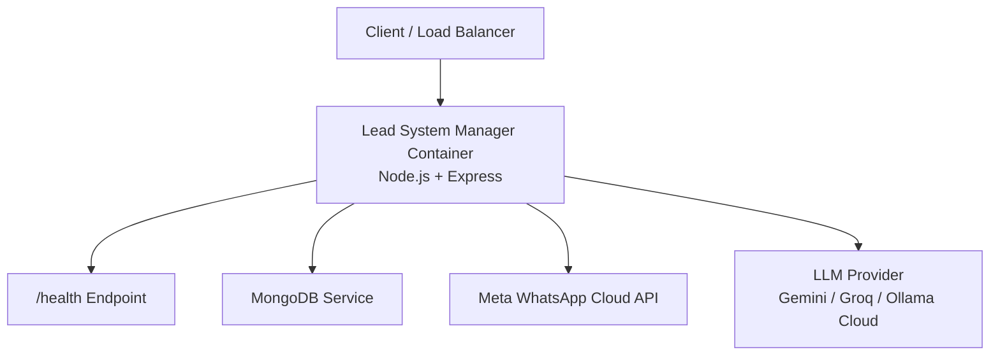
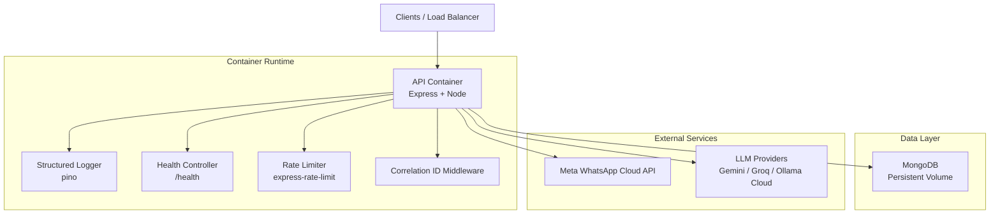
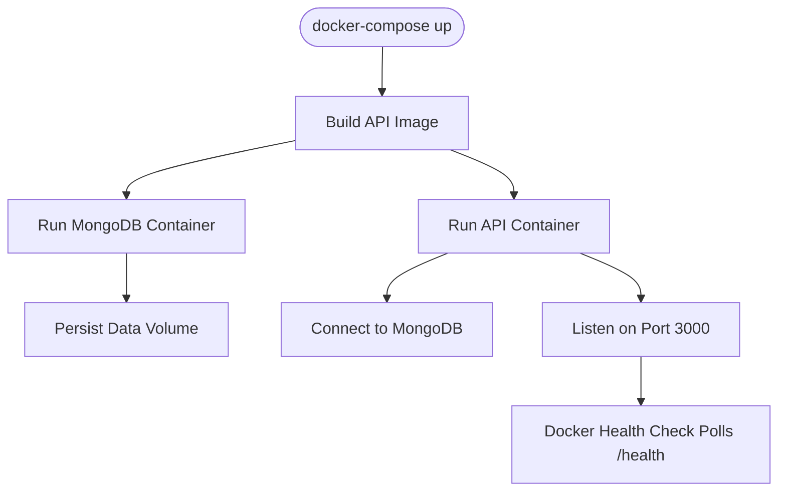
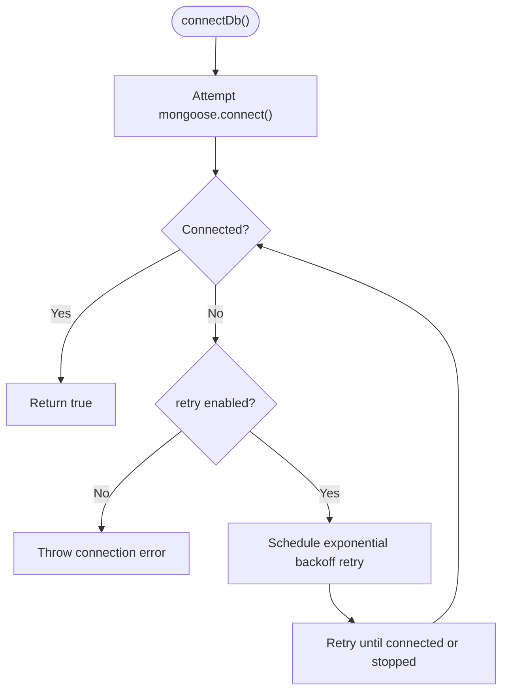
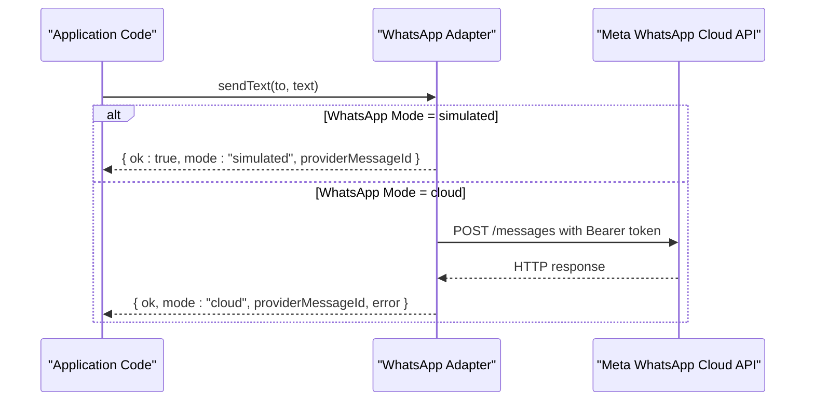
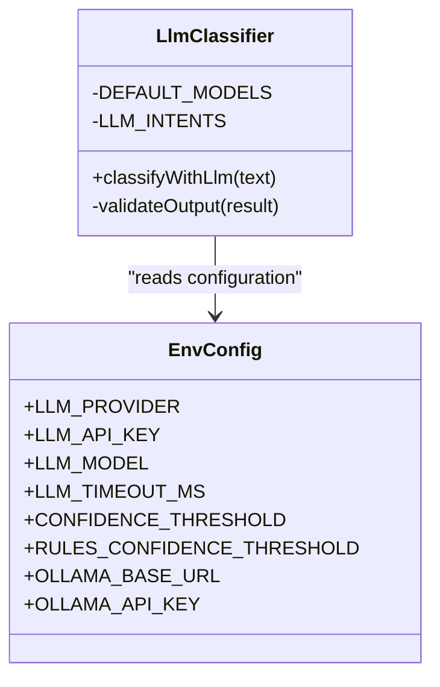
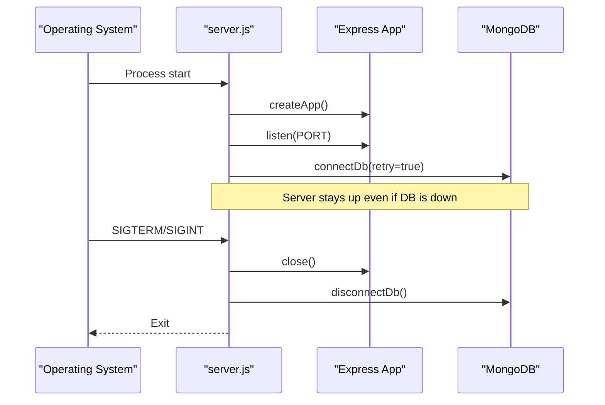
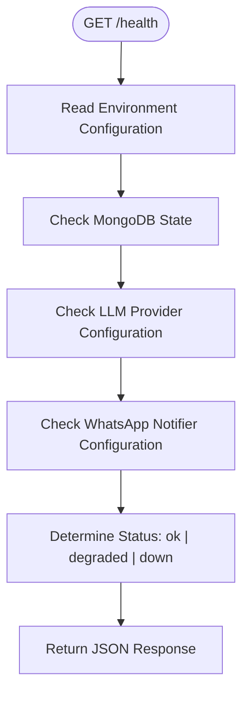
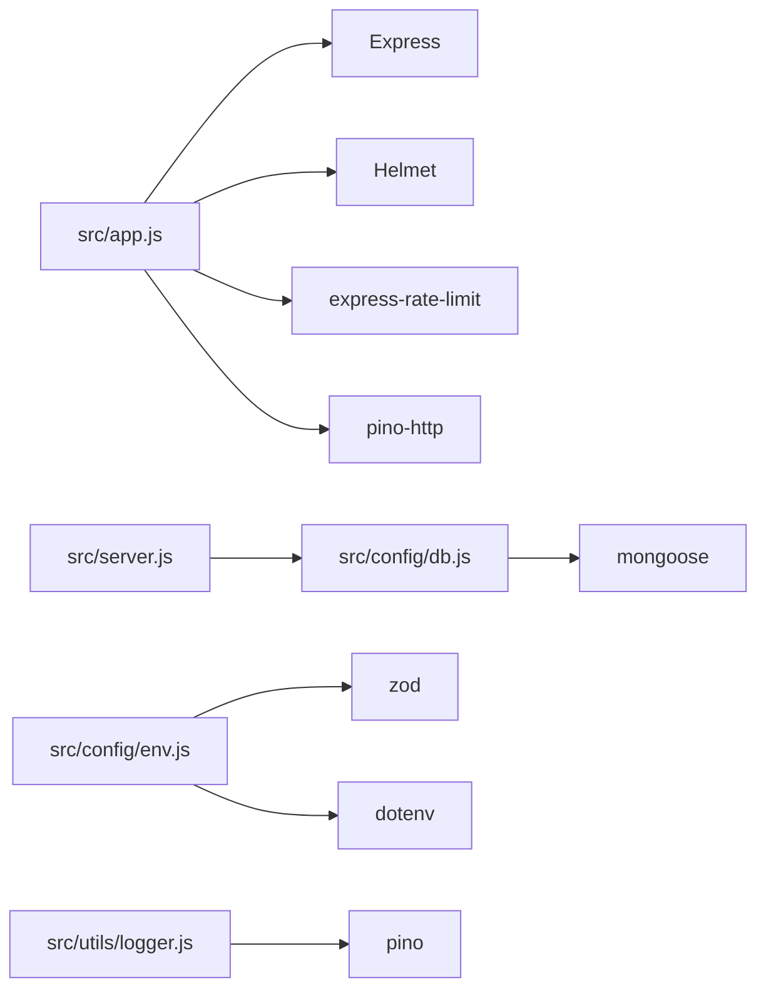

# Infrastructure Topology

<cite>
**Referenced Files in This Document**
- [Dockerfile](file://Dockerfile)
- [docker-compose.yml](file://docker-compose.yml)
- [.dockerignore](file://.dockerignore)
- [package.json](file://package.json)
- [src/server.js](file://src/server.js)
- [src/app.js](file://src/app.js)
- [src/config/env.js](file://src/config/env.js)
- [src/config/db.js](file://src/config/db.js)
- [src/utils/logger.js](file://src/utils/logger.js)
- [src/controllers/health.controller.js](file://src/controllers/health.controller.js)
- [src/routes/health.routes.js](file://src/routes/health.routes.js)
- [src/services/whatsapp.adapter.js](file://src/services/whatsapp.adapter.js)
- [src/middleware/correlationId.js](file://src/middleware/correlationId.js)
- [src/middleware/errorHandler.js](file://src/middleware/errorHandler.js)
- [src/services/classifier/llm.js](file://src/services/classifier/llm.js)
</cite>

## Table of Contents
1. [Introduction](#introduction)
2. [Project Structure](#project-structure)
3. [Core Components](#core-components)
4. [Architecture Overview](#architecture-overview)
5. [Detailed Component Analysis](#detailed-component-analysis)
6. [Dependency Analysis](#dependency-analysis)
7. [Performance Considerations](#performance-considerations)
8. [Troubleshooting Guide](#troubleshooting-guide)
9. [Conclusion](#conclusion)

## Introduction
This document describes the infrastructure topology and deployment considerations for the Lead System Manager. It focuses on the containerized Node.js application, Docker image construction, docker-compose orchestration, environment configuration, database connectivity, external integrations with Meta WhatsApp and LLM providers, scaling and high availability patterns, monitoring and logging, health checks, and operational metrics collection points.

The system is a single-process Express API that can be scaled horizontally behind a reverse proxy or load balancer. It connects to MongoDB, optionally integrates with Meta WhatsApp Cloud API, and optionally delegates classification to an LLM provider such as Gemini, Groq, or Ollama Cloud.

## Project Structure
At runtime, the application exposes HTTP endpoints through Express, validates environment variables at startup, connects to MongoDB, and wires middleware for security, structured logging, correlation IDs, rate limiting, and error handling. The container image is built from a small Alpine Node base, installs production dependencies, exposes port 3000, and defines a Docker health check against `/health`.

**Diagram sources**
- [Dockerfile:1-17](file://Dockerfile#L1-L17)
- [docker-compose.yml:1-30](file://docker-compose.yml#L1-L30)
- [src/server.js:1-50](file://src/server.js#L1-L50)
- [src/app.js:1-76](file://src/app.js#L1-L76)
- [src/controllers/health.controller.js:1-51](file://src/controllers/health.controller.js#L1-L51)
- [src/services/whatsapp.adapter.js:1-136](file://src/services/whatsapp.adapter.js#L1-L136)
- [src/services/classifier/llm.js:1-248](file://src/services/classifier/llm.js#L1-L248)

**Section sources**
- [Dockerfile:1-17](file://Dockerfile#L1-L17)
- [docker-compose.yml:1-30](file://docker-compose.yml#L1-L30)
- [package.json:1-36](file://package.json#L1-L36)

## Core Components
- Container image: Alpine-based Node image, production dependency installation, port exposure, and Docker-level health check.
- Compose services: API service and MongoDB service with persistent volume.
- Environment configuration: Zod-validated configuration with strict production checks and provider-specific requirements.
- Database layer: Mongoose connection with background retry and graceful shutdown.
- External adapters: WhatsApp adapter supporting simulated and cloud modes; LLM classifier adapter supporting multiple providers.
- Observability: Structured pino logging, request correlation IDs, rate limiting, and a composite health endpoint.

**Section sources**
- [Dockerfile:1-17](file://Dockerfile#L1-L17)
- [docker-compose.yml:1-30](file://docker-compose.yml#L1-L30)
- [src/config/env.js:1-144](file://src/config/env.js#L1-L144)
- [src/config/db.js:1-77](file://src/config/db.js#L1-L77)
- [src/services/whatsapp.adapter.js:1-136](file://src/services/whatsapp.adapter.js#L1-L136)
- [src/services/classifier/llm.js:1-248](file://src/services/classifier/llm.js#L1-L248)
- [src/utils/logger.js:1-34](file://src/utils/logger.js#L1-L34)
- [src/controllers/health.controller.js:1-51](file://src/controllers/health.controller.js#L1-L51)

## Architecture Overview
The deployed topology consists of:
- One or more Lead System Manager containers exposing port 3000.
- A shared MongoDB instance or cluster reachable via `MONGODB_URI`.
- Optional external APIs: Meta WhatsApp Cloud API and an LLM provider.

**Diagram sources**
- [src/app.js:1-76](file://src/app.js#L1-L76)
- [src/server.js:1-50](file://src/server.js#L1-L50)
- [src/controllers/health.controller.js:1-51](file://src/controllers/health.controller.js#L1-L51)
- [src/utils/logger.js:1-34](file://src/utils/logger.js#L1-L34)
- [src/config/db.js:1-77](file://src/config/db.js#L1-L77)
- [src/services/whatsapp.adapter.js:1-136](file://src/services/whatsapp.adapter.js#L1-L136)
- [src/services/classifier/llm.js:1-248](file://src/services/classifier/llm.js#L1-L248)

## Detailed Component Analysis

### Container Image and Docker Health Check
The image uses a minimal Node base, copies package manifests first for layer caching, installs production-only dependencies, copies application code, exposes port 3000, and defines a Docker health check polling `/health`. The process entry point runs `src/server.js`.

Key deployment implications:
- Use read-only root filesystems where possible and mount only required volumes.
- Keep `.env` out of the image by injecting environment variables at runtime.
- Ensure the orchestrator maps port 3000 and provides sufficient memory/CPU for outbound HTTP calls to WhatsApp and LLM providers.

**Section sources**
- [Dockerfile:1-17](file://Dockerfile#L1-L17)
- [.dockerignore:1-16](file://.dockerignore#L1-L16)

### Service Orchestration with docker-compose
The compose file defines:
- `api`: builds from the current directory, maps port 3000, sets development environment variables, depends on MongoDB, and mounts source code plus a node_modules volume for local development.
- `mongo`: uses the official MongoDB image, maps port 27017, and persists data under a named volume.

Operational notes:
- For production, replace development values with secrets managed by your platform (e.g., Kubernetes Secrets, Docker Swarm secrets, or a vault).
- Do not bind MongoDB directly to host ports in production; use internal networks.
- Separate build and runtime environments to avoid leaking dev tooling into images.

**Diagram sources**
- [docker-compose.yml:1-30](file://docker-compose.yml#L1-L30)
- [Dockerfile:1-17](file://Dockerfile#L1-L17)
- [src/server.js:1-50](file://src/server.js#L1-L50)
- [src/controllers/health.controller.js:1-51](file://src/controllers/health.controller.js#L1-L51)

**Section sources**
- [docker-compose.yml:1-30](file://docker-compose.yml#L1-L30)

### Environment Configuration Management
Environment variables are loaded relative to the project root and validated with Zod. The configuration enforces:
- Required fields for production, including staff API key and WhatsApp verification tokens.
- Conditional requirements for WhatsApp Cloud mode and LLM providers.
- Safe boolean parsing for environment flags.

Configuration categories relevant to infrastructure:
- Runtime: `NODE_ENV`, `PORT`, `LOG_LEVEL`.
- Database: `MONGODB_URI`.
- WhatsApp: `WHATSAPP_MODE`, `WHATSAPP_VERIFY_TOKEN`, `WHATSAPP_APP_SECRET`, `WHATSAPP_PHONE_NUMBER_ID`, `WHATSAPP_ACCESS_TOKEN`, `WHATSAPP_API_VERSION`, `WHATSAPP_FORCE_SEND_FAILURE`, `STAFF_WHATSAPP_NUMBER`.
- LLM: `LLM_PROVIDER`, `LLM_API_KEY`, `LLM_MODEL`, `LLM_TIMEOUT_MS`, `CONFIDENCE_THRESHOLD`, `RULES_CONFIDENCE_THRESHOLD`, `OLLAMA_BASE_URL`, `OLLAMA_API_KEY`.
- Tickets: `TICKET_SLA_MINUTES`.

Best practices:
- Never commit secrets; inject them at runtime through your platform’s secret manager.
- Validate all required keys before starting the service; invalid configuration exits early.
- Pin versions for external providers when supported.

**Section sources**
- [src/config/env.js:1-144](file://src/config/env.js#L1-L144)

### Database Connection Pooling and Resilience
The database module uses Mongoose with:
- A server selection timeout.
- Background retry with exponential backoff when the initial connection fails.
- Connection state reporting for health checks.
- Graceful disconnect during shutdown.

Important behavior:
- The server starts listening even if MongoDB is unavailable; `/health` reports down until recovery.
- Retries do not keep the event loop alive unnecessarily.
- Seed scripts can opt out of retries to fail fast.

Connection pooling details:
- Mongoose manages its own connection pool based on driver defaults. Tune pool size and timeouts through Mongoose options if needed.
- For high-throughput workloads, consider a managed MongoDB Atlas cluster with proper read/write preferences and retryable writes enabled.

**Diagram sources**
- [src/config/db.js:1-77](file://src/config/db.js#L1-L77)

**Section sources**
- [src/config/db.js:1-77](file://src/config/db.js#L1-L77)

### External Service Integrations

#### Meta WhatsApp API
The WhatsApp adapter supports two modes:
- Simulated mode: logs messages and writes JSON lines to a log file without contacting Meta.
- Cloud mode: sends text messages through the Meta WhatsApp Cloud API using bearer token authentication.

Operational characteristics:
- Outbound requests have a fixed timeout.
- Errors are normalized and logged; callers receive a result object indicating success or failure.
- A test hook allows forcing send failures to validate downstream resilience.

Deployment guidance:
- In production, set `WHATSAPP_MODE=cloud` and provide `WHATSAPP_PHONE_NUMBER_ID` and `WHATSAPP_ACCESS_TOKEN`.
- Store tokens securely and rotate them according to Meta’s recommendations.
- Monitor outbound logs and webhook delivery status.

**Diagram sources**
- [src/services/whatsapp.adapter.js:1-136](file://src/services/whatsapp.adapter.js#L1-L136)

**Section sources**
- [src/services/whatsapp.adapter.js:1-136](file://src/services/whatsapp.adapter.js#L1-L136)

#### LLM Providers
The LLM classifier adapter abstracts three providers:
- Gemini
- Groq
- Ollama Cloud

Key behaviors:
- Provider selection is controlled by `LLM_PROVIDER`.
- Provider-specific model names are configured.
- Output is strictly validated as JSON with allowed intents.
- Timeouts and HTTP errors degrade gracefully to unknown intent with appropriate failure codes.

Infrastructure considerations:
- Provide `LLM_API_KEY` for Gemini and Groq.
- For Ollama Cloud, provide `OLLAMA_API_KEY` and optionally configure `OLLAMA_BASE_URL`.
- Tune `LLM_TIMEOUT_MS` and confidence thresholds to balance latency and accuracy.
- Treat LLM unavailability as degraded, not fatal, so core routing and rules still function.

**Diagram sources**
- [src/services/classifier/llm.js:1-248](file://src/services/classifier/llm.js#L1-L248)
- [src/config/env.js:1-144](file://src/config/env.js#L1-L144)

**Section sources**
- [src/services/classifier/llm.js:1-248](file://src/services/classifier/llm.js#L1-L248)
- [src/config/env.js:1-144](file://src/config/env.js#L1-L144)

### Application Lifecycle and Shutdown
The server:
- Creates the Express app.
- Starts listening immediately.
- Connects to MongoDB asynchronously.
- Handles SIGINT and SIGTERM for graceful shutdown, closing the HTTP server and disconnecting MongoDB within a bounded timeout.

This design ensures readiness probes can pass while the database reconnects, avoiding unnecessary restarts.

**Diagram sources**
- [src/server.js:1-50](file://src/server.js#L1-L50)
- [src/config/db.js:1-77](file://src/config/db.js#L1-L77)

**Section sources**
- [src/server.js:1-50](file://src/server.js#L1-L50)

### Monitoring, Logging, and Health Checks

#### Health Endpoint
The `/health` endpoint returns:
- Status: `ok`, `degraded`, or `down`.
- Uptime in seconds.
- Checks for MongoDB, LLM provider, and WhatsApp notifier.
- Application version.

HTTP semantics:
- `down` returns 503 when MongoDB is unavailable.
- `degraded` returns 200 when optional components like LLM or WhatsApp are unavailable.
- `ok` returns 200 when core functionality is healthy.

**Diagram sources**
- [src/controllers/health.controller.js:1-51](file://src/controllers/health.controller.js#L1-L51)
- [src/config/db.js:1-77](file://src/config/db.js#L1-L77)
- [src/config/env.js:1-144](file://src/config/env.js#L1-L144)

**Section sources**
- [src/controllers/health.controller.js:1-51](file://src/controllers/health.controller.js#L1-L51)
- [src/routes/health.routes.js:1-9](file://src/routes/health.routes.js#L1-L9)

#### Structured Logging and Correlation IDs
- Pino logger is configured with redaction for sensitive headers.
- Request correlation IDs are generated per request and included in logs and responses.
- HTTP access logs are emitted through pino-http with custom log levels and serializers.

Operational tips:
- Centralize logs with a log aggregator (e.g., Loki, CloudWatch, Datadog).
- Filter out `/health` from noisy access logs if desired.
- Use correlation IDs to trace requests across services.

**Section sources**
- [src/utils/logger.js:1-34](file://src/utils/logger.js#L1-L34)
- [src/middleware/correlationId.js:1-13](file://src/middleware/correlationId.js#L1-L13)
- [src/app.js:1-76](file://src/app.js#L1-L76)

#### Error Handling and Metrics Collection Points
- Global error handler normalizes validation errors, Mongoose errors, duplicate key errors, and generic errors.
- Error responses include correlation IDs and structured error objects.
- Operational metrics can be collected from:
  - HTTP status codes via access logs.
  - Rate limit rejections.
  - Health check status transitions.
  - WhatsApp send outcomes.
  - LLM provider call outcomes and timeouts.

**Section sources**
- [src/middleware/errorHandler.js:37-79](file://src/middleware/errorHandler.js#L37-L79)
- [src/app.js:52-67](file://src/app.js#L52-L67)

## Dependency Analysis
The runtime dependencies relevant to infrastructure include Express, Mongoose, Helmet, pino, pino-http, express-rate-limit, dotenv, and zod. The application trusts one reverse proxy for client IP resolution and uses structured logging and rate limiting as primary defenses.

**Diagram sources**
- [src/app.js:1-76](file://src/app.js#L1-L76)
- [src/server.js:1-50](file://src/server.js#L1-L50)
- [src/config/db.js:1-77](file://src/config/db.js#L1-L77)
- [src/config/env.js:1-144](file://src/config/env.js#L1-L144)
- [src/utils/logger.js:1-34](file://src/utils/logger.js#L1-L34)
- [package.json:18-29](file://package.json#L18-L29)

**Section sources**
- [package.json:1-36](file://package.json#L1-L36)
- [src/app.js:1-76](file://src/app.js#L1-L76)
- [src/config/env.js:1-144](file://src/config/env.js#L1-L144)

## Performance Considerations
- Horizontal scaling: Run multiple API replicas behind a reverse proxy or load balancer. Since the app is stateless except for in-memory timers, any replica can handle requests.
- Reverse proxy: Configure TLS termination, sticky sessions are not required, and enable connection keep-alive to upstreams.
- Rate limiting: The default limiter is coarse and generous; tune window and limits based on expected webhook traffic and abuse patterns.
- Database: Use a managed MongoDB cluster with appropriate instance sizing, storage class, and backup policies. Enable retryable writes and read preferences aligned with workload needs.
- External APIs:
  - WhatsApp: Respect provider rate limits and implement retries with backoff at the caller level.
  - LLM: Tune `LLM_TIMEOUT_MS` and confidence thresholds to reduce latency spikes and fallback churn.
- Resource limits: Set CPU and memory limits in your orchestrator to prevent noisy neighbor issues and enable autoscaling based on CPU, memory, or custom metrics.
- Log volume: Avoid excessive debug logging in production; use `LOG_LEVEL` to control verbosity.

[No sources needed since this section provides general guidance]

## Troubleshooting Guide
Common operational scenarios:

- Application starts but health is down:
  - Verify MongoDB connectivity and `MONGODB_URI`.
  - Check background retry logs for connection attempts.
  - Confirm that the orchestrator does not kill the process before retries complete.

- Health shows degraded:
  - LLM provider missing or misconfigured: ensure `LLM_PROVIDER` and required keys are set.
  - WhatsApp notifier disabled: verify `WHATSAPP_MODE`, tokens, and phone number ID.

- WhatsApp sends failing:
  - Inspect adapter logs for HTTP errors or timeouts.
  - Validate bearer token and phone number ID.
  - Use simulated mode temporarily to isolate application logic from provider issues.

- Excessive rate limit rejections:
  - Review client request patterns and adjust limiter settings.
  - Ensure webhooks are not being retried excessively by upstream systems.

- Graceful shutdown delays:
  - Investigate long-running requests or slow database disconnects.
  - Adjust shutdown timeout if necessary.

**Section sources**
- [src/config/db.js:1-77](file://src/config/db.js#L1-L77)
- [src/controllers/health.controller.js:1-51](file://src/controllers/health.controller.js#L1-L51)
- [src/services/whatsapp.adapter.js:1-136](file://src/services/whatsapp.adapter.js#L1-L136)
- [src/app.js:52-67](file://src/app.js#L52-L67)
- [src/server.js:28-50](file://src/server.js#L28-L50)

## Conclusion
The Lead System Manager is designed for simple, reliable deployment as a containerized Node.js service. It prioritizes safe configuration validation, resilient database connectivity, clear health signaling, and structured observability. Scaling is achieved horizontally behind a reverse proxy, while high availability depends on external services: MongoDB should be a managed cluster, and external integrations should be treated as optional with graceful degradation. Monitoring should focus on health status transitions, error rates, rate limit events, and external API performance.

[No sources needed since this section summarizes without analyzing specific files]