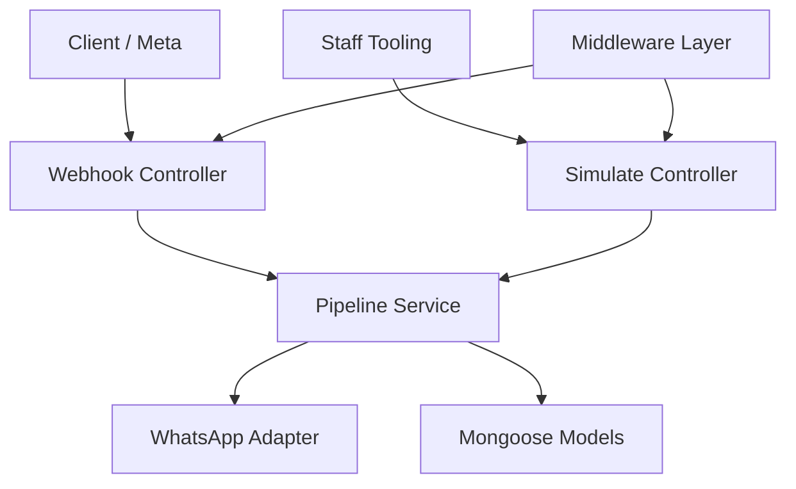
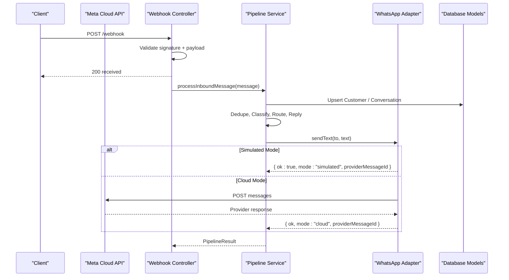
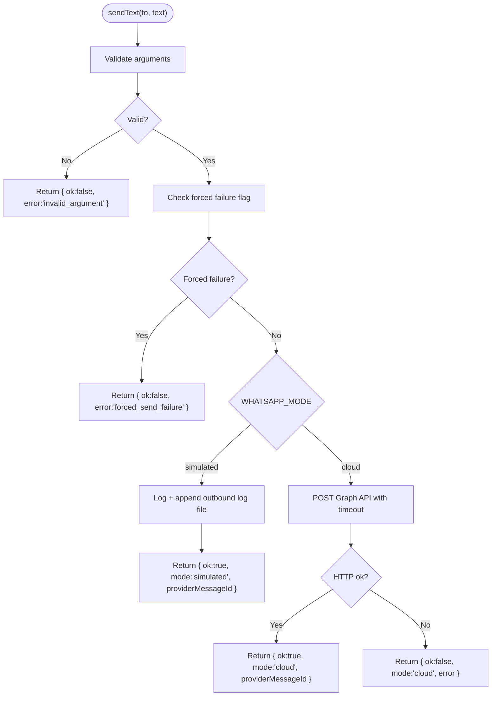
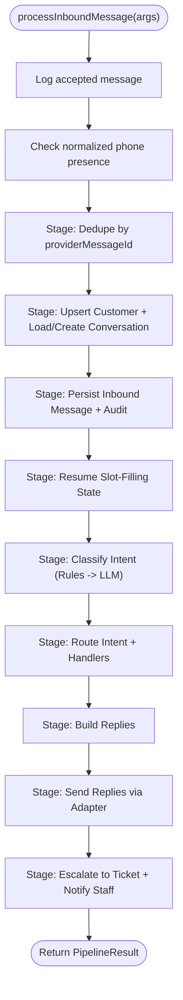
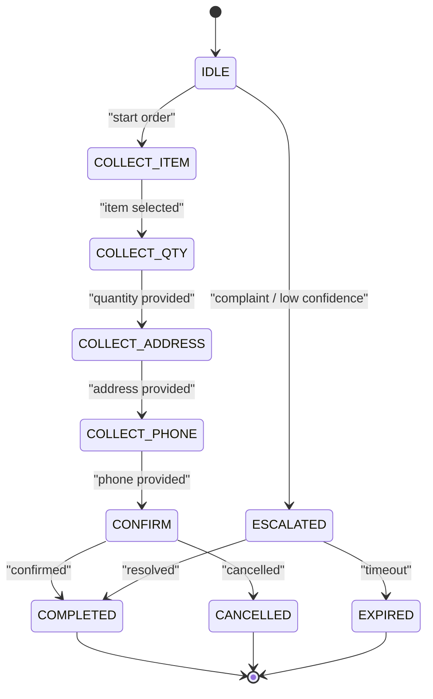
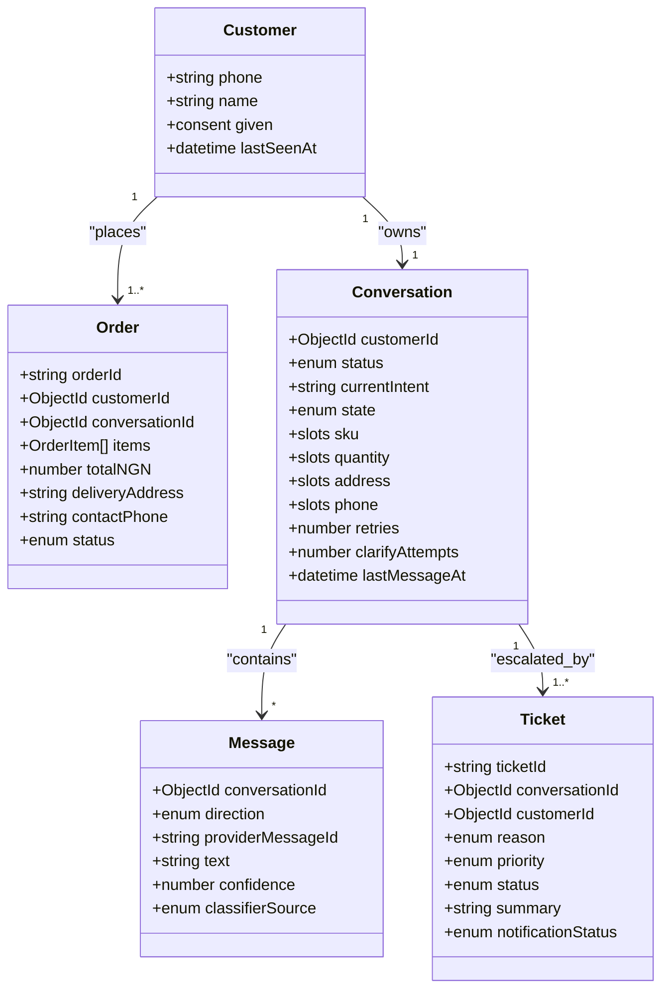
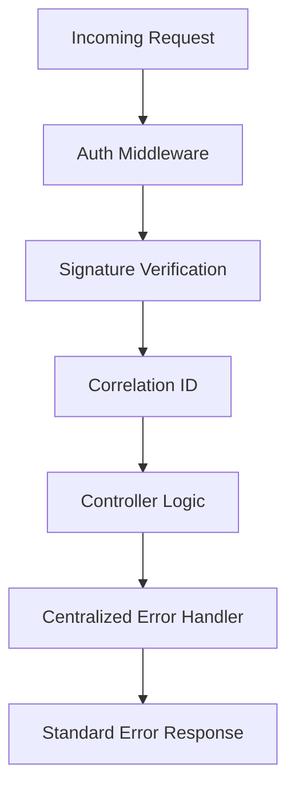
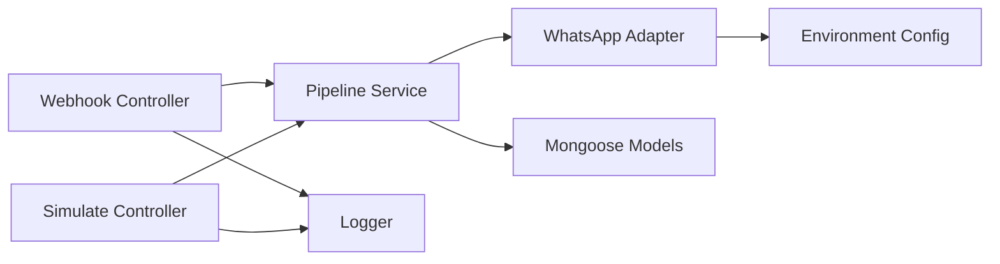

# System Design Patterns

<cite>
**Referenced Files in This Document**
- [README.md](file://README.md)
- [whatsapp.adapter.js](file://src/services/whatsapp.adapter.js)
- [pipeline.service.js](file://src/services/pipeline.service.js)
- [conversation.model.js](file://src/models/conversation.model.js)
- [customer.model.js](file://src/models/customer.model.js)
- [message.model.js](file://src/models/message.model.js)
- [order.model.js](file://src/models/order.model.js)
- [ticket.model.js](file://src/models/ticket.model.js)
- [webhook.controller.js](file://src/controllers/webhook.controller.js)
- [simulate.controller.js](file://src/controllers/simulate.controller.js)
- [errorHandler.js](file://src/middleware/errorHandler.js)
- [auth.js](file://src/middleware/auth.js)
</cite>

## Table of Contents
1. [Introduction](#introduction)
2. [Project Structure](#project-structure)
3. [Core Components](#core-components)
4. [Architecture Overview](#architecture-overview)
5. [Detailed Component Analysis](#detailed-component-analysis)
6. [Dependency Analysis](#dependency-analysis)
7. [Performance Considerations](#performance-considerations)
8. [Troubleshooting Guide](#troubleshooting-guide)
9. [Conclusion](#conclusion)

## Introduction
This document explains the architectural design patterns implemented by the Lead System Manager, a WhatsApp retail automation API. It focuses on:

- The **adapter pattern** used to abstract WhatsApp communication and support both simulated and production modes.
- The **pipeline pattern** for message processing workflow, including stage-based processing and error handling.
- The **state machine pattern** for conversation management, covering slot-filling logic and state transitions.
- The **repository pattern** for data access through Mongoose models.
- The **middleware pattern** for cross-cutting concerns such as authentication, signature verification, correlation IDs, and centralized error handling.

The system accepts inbound WhatsApp messages, normalizes them, classifies intent, manages multi-turn conversations, sends replies, tracks orders and tickets, and maintains an audit trail. In development, it defaults to a simulated messaging mode so no Meta account is required.

**Section sources**
- [README.md:1-46](file://README.md#L1-L46)

## Project Structure
The repository follows a layered structure:

- `controllers` handle HTTP endpoints.
- `services` contain business logic, including the WhatsApp adapter and message pipeline.
- `models` define Mongoose schemas and entities.
- `middleware` implements cross-cutting concerns.
- `validators` enforce input contracts with Zod.
- `utils` provide shared helpers like logging and phone normalization.
- `routes` wire controllers to Express paths.
- `config` validates environment variables and wires logging.

**Diagram sources**
- [webhook.controller.js:1-56](file://src/controllers/webhook.controller.js#L1-L56)
- [simulate.controller.js:1-35](file://src/controllers/simulate.controller.js#L1-L35)
- [pipeline.service.js:1-81](file://src/services/pipeline.service.js#L1-L81)
- [whatsapp.adapter.js:1-136](file://src/services/whatsapp.adapter.js#L1-L136)

**Section sources**
- [README.md:364-384](file://README.md#L364-L384)

## Core Components
This section introduces the core components that implement the documented design patterns.

- **WhatsApp Adapter**: Abstracts outbound messaging behind a stable interface, supporting simulated and cloud modes.
- **Message Pipeline**: A skeleton pipeline that will host deduplication, customer/conversation loading, classification, routing, reply generation, and escalation stages.
- **Conversation State Machine**: Defines conversation states and slots for order slot-filling.
- **Data Models**: Represent customers, messages, orders, tickets, and conversations using Mongoose.
- **Controllers**: Expose webhook and simulate endpoints.
- **Middleware**: Provide authentication, signature verification, correlation IDs, and centralized error handling.

**Section sources**
- [whatsapp.adapter.js:1-136](file://src/services/whatsapp.adapter.js#L1-L136)
- [pipeline.service.js:1-81](file://src/services/pipeline.service.js#L1-L81)
- [conversation.model.js:1-52](file://src/models/conversation.model.js#L1-L52)
- [customer.model.js:1-28](file://src/models/customer.model.js#L1-L28)
- [message.model.js:1-35](file://src/models/message.model.js#L1-L35)
- [order.model.js:1-53](file://src/models/order.model.js#L1-L53)
- [ticket.model.js:1-49](file://src/models/ticket.model.js#L1-L49)
- [webhook.controller.js:1-56](file://src/controllers/webhook.controller.js#L1-L56)
- [simulate.controller.js:1-35](file://src/controllers/simulate.controller.js#L1-L35)
- [errorHandler.js:1-80](file://src/middleware/errorHandler.js#L1-L80)
- [auth.js:1-23](file://src/middleware/auth.js#L1-L23)

## Architecture Overview
The system uses several complementary patterns:

- **Adapter Pattern**: The WhatsApp adapter isolates channel-specific behavior behind a single interface. Callers do not need to know whether messages are logged or sent via the Meta Cloud API.
- **Pipeline Pattern**: The message pipeline provides a clear sequence of processing stages. Each stage can be extended independently while keeping the overall flow consistent.
- **State Machine Pattern**: Conversations maintain a current state and slots; future stages will transition between states based on user input and business rules.
- **Repository Pattern**: Mongoose models encapsulate persistence logic and schema constraints, acting as repositories for domain entities.
- **Middleware Pattern**: Cross-cutting concerns are handled centrally, ensuring consistent validation, security, correlation tracking, and error responses.

**Diagram sources**
- [webhook.controller.js:27-56](file://src/controllers/webhook.controller.js#L27-L56)
- [pipeline.service.js:42-80](file://src/services/pipeline.service.js#L42-L80)
- [whatsapp.adapter.js:106-135](file://src/services/whatsapp.adapter.js#L106-L135)

## Detailed Component Analysis

### Adapter Pattern: WhatsApp Communication Abstraction
The WhatsApp adapter exposes a single function to send text messages. Depending on configuration, it either logs the message (simulated mode) or calls the Meta Cloud API (cloud mode). The contract always returns a result object indicating success, mode, provider message ID, and optional error details.

Key behaviors:
- Validates inputs and returns a safe failure result instead of throwing.
- Supports a test hook to force send failures for testing notification failure paths.
- Uses structured logging and masks phone numbers for privacy.
- Implements timeouts and graceful error handling for cloud sends.

**Diagram sources**
- [whatsapp.adapter.js:106-135](file://src/services/whatsapp.adapter.js#L106-L135)
- [whatsapp.adapter.js:47-58](file://src/services/whatsapp.adapter.js#L47-L58)
- [whatsapp.adapter.js:60-104](file://src/services/whatsapp.adapter.js#L60-L104)

Why this pattern was chosen:
- Decouples business logic from channel specifics.
- Enables safe local development without external dependencies.
- Simplifies testing by swapping implementations behind one interface.
- Centralizes retry/failure semantics at the adapter boundary.

**Section sources**
- [whatsapp.adapter.js:1-136](file://src/services/whatsapp.adapter.js#L1-L136)

### Pipeline Pattern: Message Processing Workflow
The pipeline service defines the entry point for processing inbound messages. It currently acts as a skeleton, logging acceptance and reserving placeholders for future stages:

- Deduplication by provider message ID.
- Upserting customers and loading or creating conversations.
- Persisting inbound messages and audit events.
- Resuming slot-filling state.
- Classifying intent using rules first and LLM fallback.
- Routing to intent handlers and generating replies.
- Sending replies through the WhatsApp adapter.
- Escalating to tickets and notifying staff.

**Diagram sources**
- [pipeline.service.js:3-20](file://src/services/pipeline.service.js#L3-L20)
- [pipeline.service.js:42-80](file://src/services/pipeline.service.js#L42-L80)

Why this pattern was chosen:
- Provides a single extension point for all message processing logic.
- Makes each stage independently testable and replaceable.
- Encourages clear separation of concerns across classification, routing, persistence, and notifications.
- Supports asynchronous processing and robust error isolation per stage.

**Section sources**
- [pipeline.service.js:1-81](file://src/services/pipeline.service.js#L1-L81)

### State Machine Pattern: Conversation Management
Conversations represent a rolling interaction per customer. The model defines:

- Status values: active, escalated, completed, expired.
- State values: IDLE, COLLECT_ITEM, COLLECT_QTY, COLLECT_ADDRESS, COLLECT_PHONE, CONFIRM, COMPLETED, CANCELLED, ESCALATED, EXPIRED.
- Slots for partially collected order data: sku, quantity, address, phone.
- Metadata such as retries, clarification attempts, and last activity timestamp.

Future pipeline stages will transition between these states based on user input and business rules, implementing slot-filling for orders.

**Diagram sources**
- [conversation.model.js:3-16](file://src/models/conversation.model.js#L3-L16)
- [conversation.model.js:18-43](file://src/models/conversation.model.js#L18-L43)

Why this pattern was chosen:
- Captures multi-turn conversation semantics explicitly.
- Enforces valid state transitions through enums.
- Keeps partial data in slots for incremental collection.
- Facilitates deterministic behavior for slot-filling and escalation.

**Section sources**
- [conversation.model.js:1-52](file://src/models/conversation.model.js#L1-L52)

### Repository Pattern: Data Access Through Mongoose Models
The project uses Mongoose models as repositories for domain entities:

- Customer: keyed by normalized E.164 phone number, with consent metadata.
- Message: immutable conversation message with unique provider message ID for deduplication.
- Order: order items, totals, delivery address, contact phone, and status transitions.
- Ticket: human escalation records with reasons, priorities, statuses, and notification tracking.
- Conversation: rolling conversation per customer with state and slots.

These models encapsulate schema constraints, indexes, and guards against redefinition during tests.

**Diagram sources**
- [customer.model.js:1-28](file://src/models/customer.model.js#L1-L28)
- [message.model.js:1-35](file://src/models/message.model.js#L1-L35)
- [order.model.js:1-53](file://src/models/order.model.js#L1-L53)
- [ticket.model.js:1-49](file://src/models/ticket.model.js#L1-L49)
- [conversation.model.js:1-52](file://src/models/conversation.model.js#L1-L52)

Why this pattern was chosen:
- Encapsulates persistence logic and schema validation.
- Provides a clean abstraction over MongoDB operations.
- Ensures consistency through indexes and enum constraints.
- Supports idempotent seeding and test isolation.

**Section sources**
- [customer.model.js:1-28](file://src/models/customer.model.js#L1-L28)
- [message.model.js:1-35](file://src/models/message.model.js#L1-L35)
- [order.model.js:1-53](file://src/models/order.model.js#L1-L53)
- [ticket.model.js:1-49](file://src/models/ticket.model.js#L1-L49)
- [conversation.model.js:1-52](file://src/models/conversation.model.js#L1-L52)

### Middleware Pattern: Cross-Cutting Concerns
Middleware handles responsibilities that cut across multiple endpoints:

- Authentication: Staff endpoints require a shared API key header with constant-time comparison.
- Signature Verification: Incoming webhooks verify HMAC-SHA256 signatures using the configured app secret.
- Correlation ID: Every request carries a correlation ID for tracing.
- Error Handling: Centralized error handler maps various error types into a standard JSON body and appropriate HTTP status codes.

**Diagram sources**
- [auth.js:1-23](file://src/middleware/auth.js#L1-L23)
- [errorHandler.js:1-80](file://src/middleware/errorHandler.js#L1-L80)

Why this pattern was chosen:
- Keeps security and observability concerns separate from business logic.
- Ensures consistent error shapes and logging across the application.
- Reduces duplication and risk of inconsistent validation or error handling.

**Section sources**
- [auth.js:1-23](file://src/middleware/auth.js#L1-L23)
- [errorHandler.js:1-80](file://src/middleware/errorHandler.js#L1-L80)

## Dependency Analysis
The following diagram shows how controllers depend on services, which in turn depend on adapters and models.

**Diagram sources**
- [webhook.controller.js:1-56](file://src/controllers/webhook.controller.js#L1-L56)
- [simulate.controller.js:1-35](file://src/controllers/simulate.controller.js#L1-L35)
- [pipeline.service.js:1-81](file://src/services/pipeline.service.js#L1-L81)
- [whatsapp.adapter.js:1-136](file://src/services/whatsapp.adapter.js#L1-L136)

**Section sources**
- [webhook.controller.js:1-56](file://src/controllers/webhook.controller.js#L1-L56)
- [simulate.controller.js:1-35](file://src/controllers/simulate.controller.js#L1-L35)
- [pipeline.service.js:1-81](file://src/services/pipeline.service.js#L1-L81)
- [whatsapp.adapter.js:1-136](file://src/services/whatsapp.adapter.js#L1-L136)

## Performance Considerations
- Asynchronous webhook processing ensures fast responses to Meta, avoiding retry storms caused by slow processing.
- The adapter enforces a timeout for cloud sends to prevent long-running requests.
- Structured logging with correlation IDs enables efficient tracing and debugging.
- Database indexes on frequently queried fields improve lookup performance for conversations, messages, orders, and tickets.
- Simulated mode avoids network overhead during development and testing.

[No sources needed since this section provides general guidance]

## Troubleshooting Guide
Common issues and their resolution strategies:

- Invalid environment variables at startup: Compare `.env` with the template; the validation layer lists offending variables.
- Health endpoint reports database down: Ensure MongoDB is reachable or start the in-memory dev instance.
- Webhook signature mismatch: Verify the app secret matches the signer; use the provided script with the correct secret.
- Handshake rejected: Ensure the verify token matches between the server and Meta’s configuration.
- Force send failures: Use the test hook to exercise notification failure paths.

**Section sources**
- [README.md:409-419](file://README.md#L409-L419)
- [errorHandler.js:16-79](file://src/middleware/errorHandler.js#L16-L79)

## Conclusion
The Lead System Manager applies well-established design patterns to build a robust, extensible WhatsApp automation API:

- The **adapter pattern** cleanly separates channel implementation details, enabling safe simulation and production operation.
- The **pipeline pattern** provides a clear, stage-based workflow for message processing, making future features easier to add and test.
- The **state machine pattern** captures conversation semantics and supports slot-filling for orders.
- The **repository pattern** encapsulates persistence logic and enforces data integrity through schemas and indexes.
- The **middleware pattern** centralizes cross-cutting concerns, improving security, observability, and consistency.

Together, these patterns create a maintainable architecture that balances developer ergonomics with operational reliability.