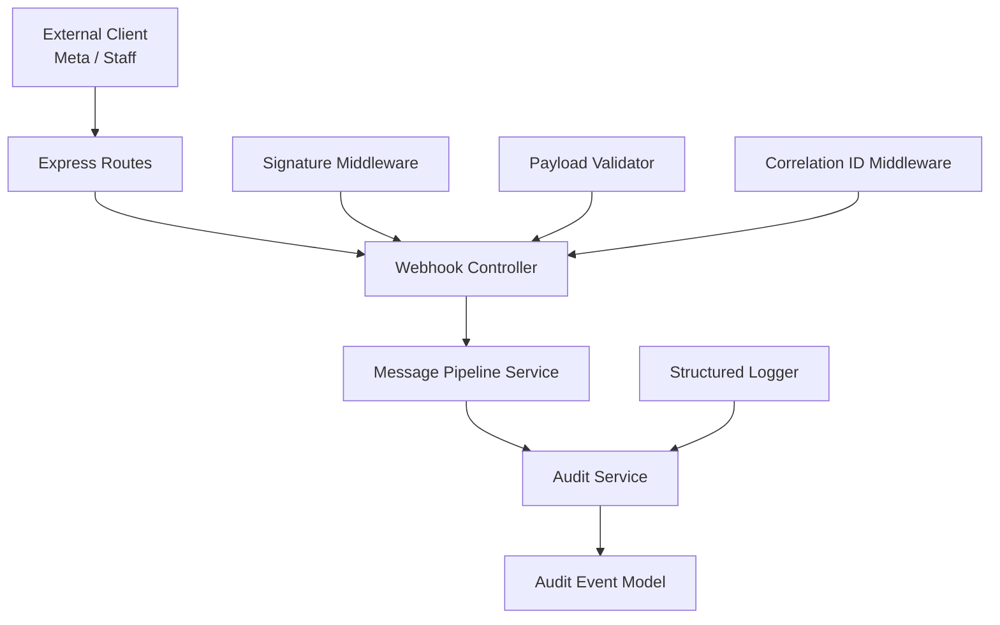
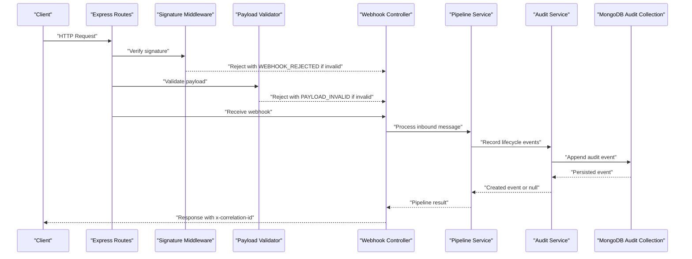
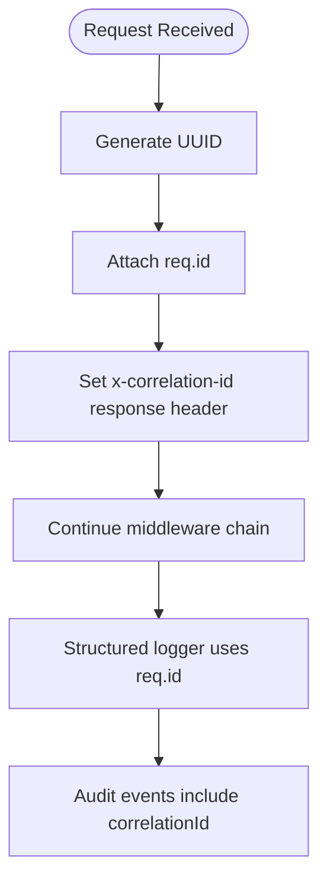
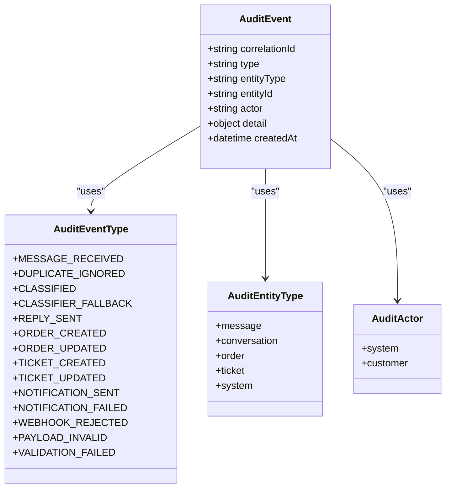
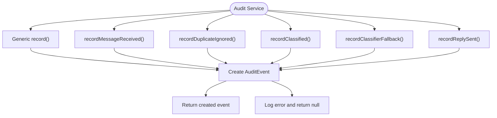
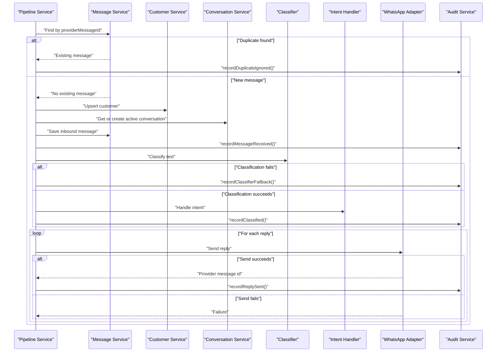
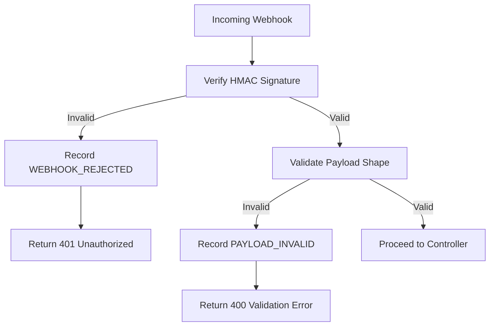
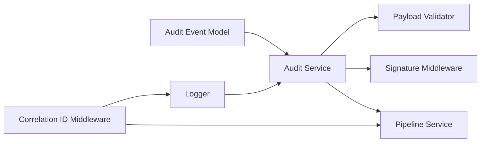

# Audit Trail System

<cite>
**Referenced Files in This Document**
- [auditEvent.model.js](file://src/models/auditEvent.model.js)
- [audit.service.js](file://src/services/audit.service.js)
- [pipeline.service.js](file://src/services/pipeline.service.js)
- [correlationId.js](file://src/middleware/correlationId.js)
- [signature.js](file://src/middleware/signature.js)
- [webhook.validator.js](file://src/validators/webhook.validator.js)
- [logger.js](file://src/utils/logger.js)
- [webhook.controller.js](file://src/controllers/webhook.controller.js)
- [webhook.routes.js](file://src/routes/webhook.routes.js)
</cite>

## Table of Contents
1. [Introduction](#introduction)
2. [Project Structure](#project-structure)
3. [Core Components](#core-components)
4. [Architecture Overview](#architecture-overview)
5. [Detailed Component Analysis](#detailed-component-analysis)
6. [Dependency Analysis](#dependency-analysis)
7. [Performance Considerations](#performance-considerations)
8. [Troubleshooting Guide](#troubleshooting-guide)
9. [Conclusion](#conclusion)

## Introduction
This document explains the audit trail system used by the WhatsApp retail automation API. The audit trail is an append-only, compliance-focused record of every important processing step for inbound messages, security checks, validation failures, and downstream operations. It is designed so that a single request correlation ID can be used to reconstruct the full journey of a customer message from webhook receipt through classification, routing, reply sending, and failure handling.

Key design goals:
- Append-only storage with no update or delete routes for the audit collection.
- Consistent event shape across all lifecycle steps.
- Best-effort audit writes that never fail the live message path.
- Correlation ID propagation from HTTP middleware into services, logs, and audit events.
- Security-sensitive rejections and invalid payloads are audited without exposing secrets.

## Project Structure
The audit trail spans several layers:
- Middleware generates and attaches a correlation ID to each request.
- Route and controller layers accept webhooks and delegate processing.
- Validators and signature middleware audit rejected or malformed requests.
- The pipeline service records lifecycle events for message processing.
- The audit service centralizes event creation and persistence.
- The audit model defines the schema, allowed values, and indexes.
- Structured logging provides correlated operational context.

**Diagram sources**
- [webhook.routes.js:1-16](file://src/routes/webhook.routes.js#L1-L16)
- [webhook.controller.js:1-56](file://src/controllers/webhook.controller.js#L1-L56)
- [pipeline.service.js:1-278](file://src/services/pipeline.service.js#L1-L278)
- [audit.service.js:1-116](file://src/services/audit.service.js#L1-L116)
- [auditEvent.model.js:1-49](file://src/models/auditEvent.model.js#L1-L49)
- [correlationId.js:1-14](file://src/middleware/correlationId.js#L1-L14)
- [signature.js:1-51](file://src/middleware/signature.js#L1-L51)
- [webhook.validator.js:1-124](file://src/validators/webhook.validator.js#L1-L124)
- [logger.js:1-34](file://src/utils/logger.js#L1-L34)

**Section sources**
- [webhook.routes.js:1-16](file://src/routes/webhook.routes.js#L1-L16)
- [webhook.controller.js:1-56](file://src/controllers/webhook.controller.js#L1-L56)
- [pipeline.service.js:1-278](file://src/services/pipeline.service.js#L1-L278)
- [audit.service.js:1-116](file://src/services/audit.service.js#L1-L116)
- [auditEvent.model.js:1-49](file://src/models/auditEvent.model.js#L1-L49)
- [correlationId.js:1-14](file://src/middleware/correlationId.js#L1-L14)
- [signature.js:1-51](file://src/middleware/signature.js#L1-L51)
- [webhook.validator.js:1-124](file://src/validators/webhook.validator.js#L1-L124)
- [logger.js:1-34](file://src/utils/logger.js#L1-L34)

## Core Components
The audit trail system consists of five core components:

| Component | Responsibility | Key Behavior |
|---|---|---|
| Correlation ID middleware | Generates a unique request identifier | Stores it on the request object and returns it in the response header |
| Audit event model | Defines the audit schema and constraints | Enforces allowed types, entity types, actors, and timestamps |
| Audit service | Centralizes audit event creation | Provides typed helpers for lifecycle events and best-effort persistence |
| Pipeline service | Orchestrates message processing | Records dedupe, classification, fallback, and reply events |
| Security and validation layers | Reject unauthorized or malformed requests | Record `WEBHOOK_REJECTED` and `PAYLOAD_INVALID` events |

**Section sources**
- [correlationId.js:1-14](file://src/middleware/correlationId.js#L1-L14)
- [auditEvent.model.js:1-49](file://src/models/auditEvent.model.js#L1-L49)
- [audit.service.js:1-116](file://src/services/audit.service.js#L1-L116)
- [pipeline.service.js:1-278](file://src/services/pipeline.service.js#L1-L278)
- [signature.js:1-51](file://src/middleware/signature.js#L1-L51)
- [webhook.validator.js:1-124](file://src/validators/webhook.validator.js#L1-L124)

## Architecture Overview
The audit architecture follows a layered flow:

1. An incoming request enters Express routes.
2. Correlation ID middleware assigns a request-scoped ID.
3. Signature verification audits failed HMAC checks.
4. Payload validation audits malformed webhook bodies.
5. The controller accepts the request quickly and delegates processing.
6. The pipeline records lifecycle events for message handling.
7. The audit service persists events to MongoDB.
8. Structured logs carry the same correlation ID for operational tracing.

**Diagram sources**
- [webhook.routes.js:1-16](file://src/routes/webhook.routes.js#L1-L16)
- [signature.js:1-51](file://src/middleware/signature.js#L1-L51)
- [webhook.validator.js:1-124](file://src/validators/webhook.validator.js#L1-L124)
- [webhook.controller.js:1-56](file://src/controllers/webhook.controller.js#L1-L56)
- [pipeline.service.js:1-278](file://src/services/pipeline.service.js#L1-L278)
- [audit.service.js:1-116](file://src/services/audit.service.js#L1-L116)
- [auditEvent.model.js:1-49](file://src/models/auditEvent.model.js#L1-L49)

## Detailed Component Analysis

### Correlation ID Propagation
The correlation ID is generated once per request and flows through the entire stack:
- A UUID is attached to the request object.
- The response includes the correlation ID in the `x-correlation-id` header.
- Structured logs use the request ID when available.
- Audit events include the correlation ID so they can be grouped by request.

**Diagram sources**
- [correlationId.js:1-14](file://src/middleware/correlationId.js#L1-L14)
- [logger.js:1-34](file://src/utils/logger.js#L1-L34)
- [audit.service.js:1-116](file://src/services/audit.service.js#L1-L116)

**Section sources**
- [correlationId.js:1-14](file://src/middleware/correlationId.js#L1-L14)
- [logger.js:1-34](file://src/utils/logger.js#L1-L34)

### Audit Event Schema and Types
The audit event model defines the canonical structure for every recorded event:
- `correlationId`: required string used to group related events.
- `type`: one of the predefined audit event types.
- `entityType`: business domain such as message, conversation, order, ticket, or system.
- `entityId`: optional identifier for the affected resource.
- `actor`: who caused the event, typically system or customer.
- `detail`: flexible metadata for step-specific information.
- Timestamps are enabled only for creation; updates are disabled to preserve append-only semantics.

Indexes support efficient querying by time and by event type plus time.

**Diagram sources**
- [auditEvent.model.js:1-49](file://src/models/auditEvent.model.js#L1-L49)

**Section sources**
- [auditEvent.model.js:1-49](file://src/models/auditEvent.model.js#L1-L49)

### Audit Service and Lifecycle Events
The audit service provides:
- A generic `record` function for ad-hoc audit events.
- Typed helpers for message lifecycle events.
- Best-effort persistence: failures are logged but do not break the message path.

Lifecycle events currently captured include:
- `MESSAGE_RECEIVED`: inbound message persisted after deduplication.
- `DUPLICATE_IGNORED`: repeated provider message ID ignored.
- `CLASSIFIED`: classification outcome including intent, confidence, source, and entities.
- `CLASSIFIER_FALLBACK`: classifier degradation or failure reason.
- `REPLY_SENT`: successful outbound reply send.

**Diagram sources**
- [audit.service.js:1-116](file://src/services/audit.service.js#L1-L116)
- [auditEvent.model.js:1-49](file://src/models/auditEvent.model.js#L1-L49)

**Section sources**
- [audit.service.js:1-116](file://src/services/audit.service.js#L1-L116)

### Pipeline Integration and Message Processing Flow
The pipeline orchestrates the end-to-end message lifecycle and emits audit events at key points:
- Deduplication check before persistence.
- Customer and conversation upsert.
- Inbound message persistence.
- Classification and annotation.
- Intent routing and reply generation.
- Outbound reply sending and audit recording.

**Diagram sources**
- [pipeline.service.js:1-278](file://src/services/pipeline.service.js#L1-L278)
- [audit.service.js:1-116](file://src/services/audit.service.js#L1-L116)

**Section sources**
- [pipeline.service.js:1-278](file://src/services/pipeline.service.js#L1-L278)

### Security and Validation Audit Events
Security and validation layers audit failures without exposing sensitive data:
- Signature verification audits rejected webhooks due to missing or invalid signatures.
- Payload validation audits malformed webhook bodies and includes structured validation issues.
- These events use the request correlation ID and generic audit fields rather than raw secrets.

**Diagram sources**
- [signature.js:1-51](file://src/middleware/signature.js#L1-L51)
- [webhook.validator.js:1-124](file://src/validators/webhook.validator.js#L1-L124)
- [audit.service.js:1-116](file://src/services/audit.service.js#L1-L116)

**Section sources**
- [signature.js:1-51](file://src/middleware/signature.js#L1-L51)
- [webhook.validator.js:1-124](file://src/validators/webhook.validator.js#L1-L124)

### Audit Event Creation Examples
Although specific code content is not reproduced here, the following patterns describe how audit events are created:

- Creating a generic audit event:
  - Use the audit service’s generic record function.
  - Provide `type`, `correlationId`, and optional `entityType`, `entityId`, `actor`, and `detail`.
  - Example usage paths include webhook rejection and payload validation failures.

- Creating a message lifecycle event:
  - Call the appropriate typed helper such as `recordMessageReceived`, `recordDuplicateIgnored`, `recordClassified`, `recordClassifierFallback`, or `recordReplySent`.
  - Include the correlation ID, provider message ID, conversation ID where applicable, and masked phone numbers.
  - Include classification details such as intent, confidence, source, and entities.

- Tracking correlation across layers:
  - Extract the correlation ID from the request object.
  - Pass it into the pipeline and audit helpers.
  - Use it to correlate logs, responses, and audit events.

**Section sources**
- [audit.service.js:1-116](file://src/services/audit.service.js#L1-L116)
- [pipeline.service.js:1-278](file://src/services/pipeline.service.js#L1-L278)
- [signature.js:1-51](file://src/middleware/signature.js#L1-L51)
- [webhook.validator.js:1-124](file://src/validators/webhook.validator.js#L1-L124)

### Storage Mechanisms and Indexing
Audit events are stored in a MongoDB collection using Mongoose:
- The schema enforces required fields and enumerated values.
- Timestamps are enabled only for creation to maintain append-only behavior.
- Indexes are defined for:
  - `createdAt` descending for recent-event queries.
  - Composite index on `type` ascending and `createdAt` descending for type-based time-range queries.

These indexes support both debugging queries and compliance reporting patterns.

**Section sources**
- [auditEvent.model.js:1-49](file://src/models/auditEvent.model.js#L1-L49)

### Query Patterns for Debugging and Compliance Reporting
Recommended query patterns based on the schema and indexes:

| Goal | Suggested Filter | Notes |
|---|---|---|
| Replay a full message journey | `correlationId` equals a specific value | Groups all events for one request |
| Find recent audit events | Sort by `createdAt` descending | Uses the default time index |
| Analyze failures by event type | Filter by `type` and sort by `createdAt` descending | Uses the composite type-time index |
| Investigate duplicate messages | Filter by `type` equal to `DUPLICATE_IGNORED` | Helps detect retry storms or dedupe gaps |
| Inspect classification outcomes | Filter by `type` equal to `CLASSIFIED` or `CLASSIFIER_FALLBACK` | Supports classifier performance analysis |
| Track outbound replies | Filter by `type` equal to `REPLY_SENT` | Useful for delivery success metrics |

Compliance reports should avoid storing or exporting sensitive fields. The audit model intentionally keeps `detail` flexible while relying on higher-level services to mask phone numbers and avoid secrets.

**Section sources**
- [auditEvent.model.js:1-49](file://src/models/auditEvent.model.js#L1-L49)
- [audit.service.js:1-116](file://src/services/audit.service.js#L1-L116)

### Log Analysis Techniques
Operational logs and audit events work together:
- Pino structured logs include service name, environment, ISO timestamps, and redacted sensitive headers.
- The correlation ID appears in logs and audit events, enabling cross-system tracing.
- Audit write failures are logged with the failing event type and correlation ID.

Practical techniques:
- Search logs by correlation ID to reconstruct request context.
- Compare audit events with log lines to confirm whether persistence succeeded.
- Monitor `failed to write audit event` errors to detect database or write-path issues.
- Use event types to build dashboards for message throughput, duplicates, classification outcomes, and reply success rates.

**Section sources**
- [logger.js:1-34](file://src/utils/logger.js#L1-L34)
- [audit.service.js:1-116](file://src/services/audit.service.js#L1-L116)

## Dependency Analysis
The audit system has clear boundaries and minimal coupling:
- The audit model depends only on Mongoose.
- The audit service depends on the audit model and structured logger.
- The pipeline service imports the audit service and other business services.
- Security and validation middleware import the audit service for failure auditing.
- Correlation ID middleware does not depend on audit logic; it supplies context consumed elsewhere.

**Diagram sources**
- [auditEvent.model.js:1-49](file://src/models/auditEvent.model.js#L1-L49)
- [audit.service.js:1-116](file://src/services/audit.service.js#L1-L116)
- [pipeline.service.js:1-278](file://src/services/pipeline.service.js#L1-L278)
- [signature.js:1-51](file://src/middleware/signature.js#L1-L51)
- [webhook.validator.js:1-124](file://src/validators/webhook.validator.js#L1-L124)
- [correlationId.js:1-14](file://src/middleware/correlationId.js#L1-L14)
- [logger.js:1-34](file://src/utils/logger.js#L1-L34)

**Section sources**
- [auditEvent.model.js:1-49](file://src/models/auditEvent.model.js#L1-L49)
- [audit.service.js:1-116](file://src/services/audit.service.js#L1-L116)
- [pipeline.service.js:1-278](file://src/services/pipeline.service.js#L1-L278)
- [signature.js:1-51](file://src/middleware/signature.js#L1-L51)
- [webhook.validator.js:1-124](file://src/validators/webhook.validator.js#L1-L124)
- [correlationId.js:1-14](file://src/middleware/correlationId.js#L1-L14)
- [logger.js:1-34](file://src/utils/logger.js#L1-L34)

## Performance Considerations
- Best-effort audit writes: audit failures are caught, logged, and swallowed so the live message path remains available even if the audit store is degraded.
- Append-only design: no update or delete operations reduce write complexity and simplify retention strategies.
- Indexed fields: `correlationId`, `createdAt`, and the composite `type` plus `createdAt` index support common query patterns without full scans.
- Minimal payload size: audit events carry essential identifiers and masked details rather than full request bodies.
- Asynchronous processing: the webhook controller returns immediately and processes messages asynchronously, reducing latency for external providers.

Recommendations:
- Monitor audit write failures separately from application errors.
- Avoid adding large or unbounded objects to `detail`; keep it structured and bounded.
- Add read-side aggregation or materialized views if compliance reporting becomes heavy on the primary audit collection.
- Consider partitioning or time-based sharding if audit volume grows significantly.

[No sources needed since this section provides general guidance]

## Troubleshooting Guide
Common audit-related issues and their likely causes:

| Symptom | Likely Cause | Investigation Steps |
|---|---|---|
| Audit events missing | Audit write failed | Check logs for `failed to write audit event` and inspect correlation ID |
| Duplicate messages still processed | Dedupe layer not reached or race condition | Look for `DUPLICATE_IGNORED` events and compare provider message IDs |
| Classification not recorded | Classifier failure or non-text message | Check `CLASSIFIER_FALLBACK` and `CLASSIFIED` events |
| Reply not audited | Outbound send failed | Check `REPLY_SENT` events and adapter logs |
| Webhook rejected without payload processing | Signature mismatch or missing header | Check `WEBHOOK_REJECTED` events and signature configuration |
| Malformed webhook body rejected early | Zod validation failure | Check `PAYLOAD_INVALID` events and validation issue details |

Operational tips:
- Use the correlation ID returned in the response header to trace the full request.
- Compare audit events with structured logs to determine whether persistence succeeded.
- Redaction is applied to sensitive headers in logs; audit events should not contain secrets.
- If audit writes consistently fail, treat the system as degraded even if message processing continues.

**Section sources**
- [audit.service.js:1-116](file://src/services/audit.service.js#L1-L116)
- [signature.js:1-51](file://src/middleware/signature.js#L1-L51)
- [webhook.validator.js:1-124](file://src/validators/webhook.validator.js#L1-L124)
- [pipeline.service.js:1-278](file://src/services/pipeline.service.js#L1-L278)

## Conclusion
The audit trail system provides a consistent, append-only record of message processing, security checks, and validation outcomes. It ties together HTTP middleware, controllers, validators, pipeline logic, and persistence through a shared correlation ID and structured audit events. The design prioritizes resilience by making audit writes best-effort, ensuring that compliance and debugging capabilities do not compromise the availability of the live messaging path. For compliance reporting, operators should rely on event types, correlation IDs, and indexed fields to reconstruct journeys and analyze system behavior over time.

[No sources needed since this section summarizes without analyzing specific files]