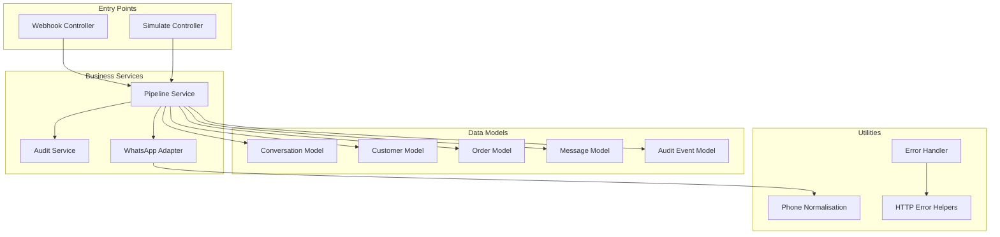
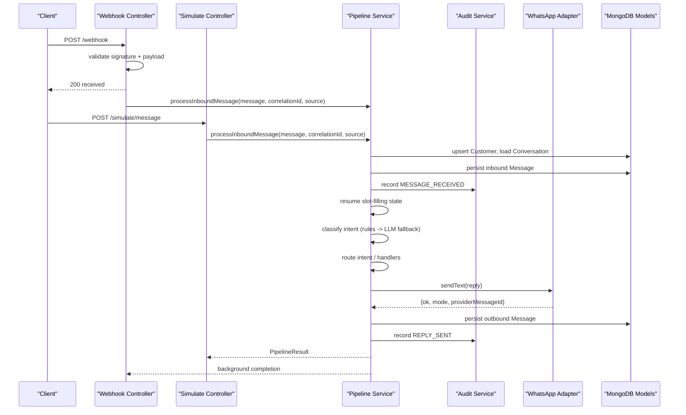
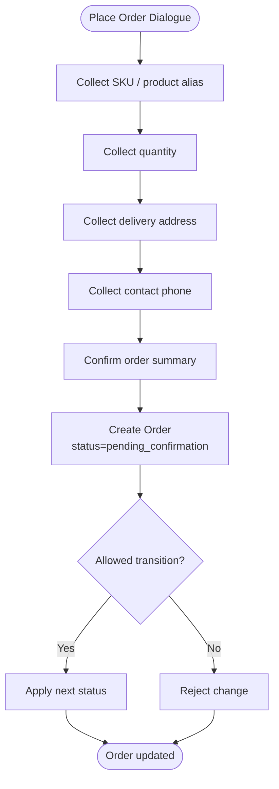
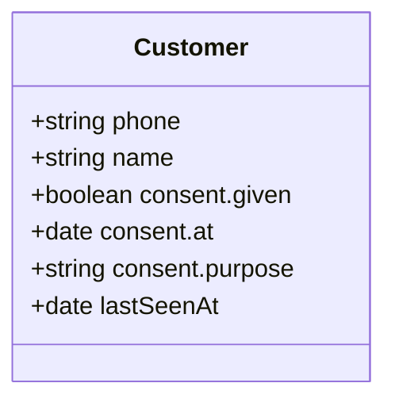
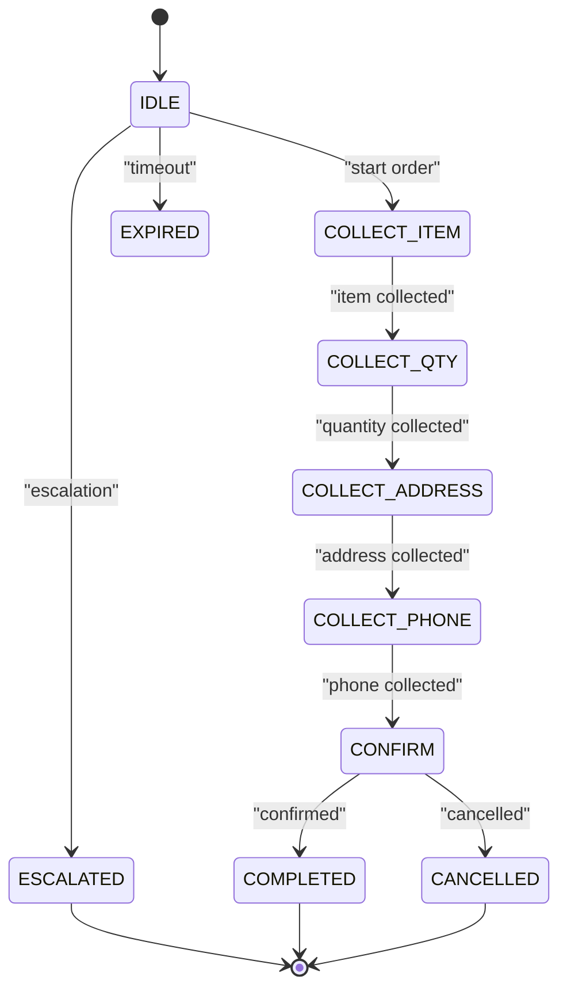
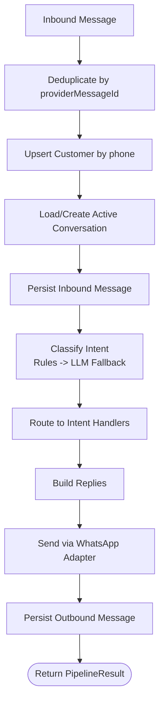
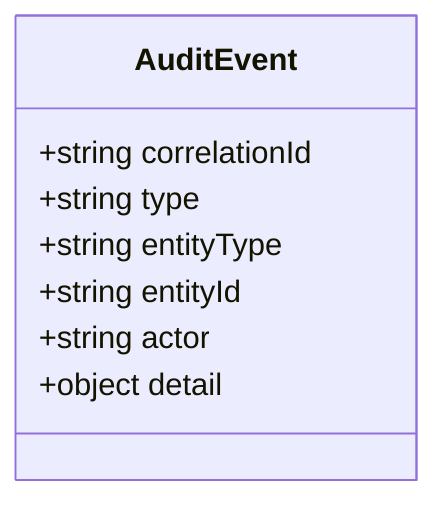
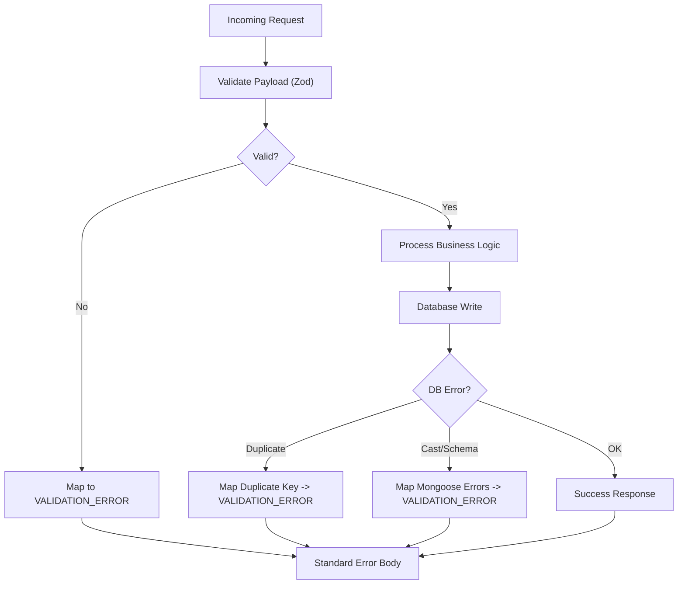
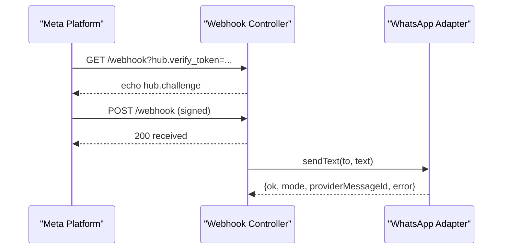
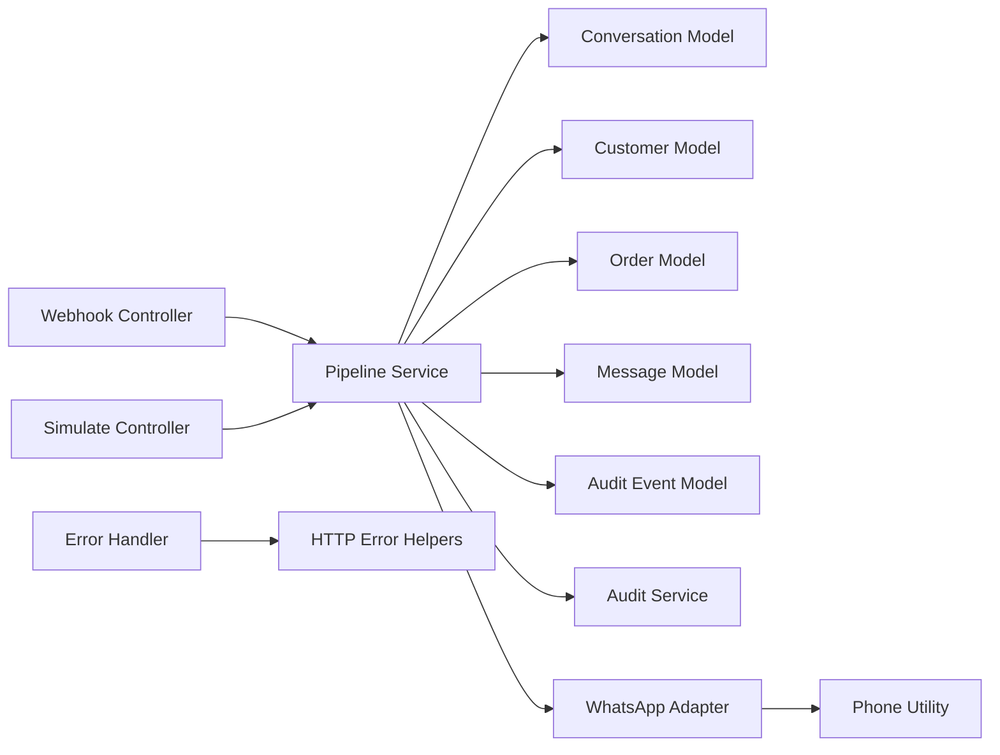

# Business Logic Layer

<cite>
**Referenced Files in This Document**
- [pipeline.service.js](file://src/services/pipeline.service.js)
- [webhook.controller.js](file://src/controllers/webhook.controller.js)
- [simulate.controller.js](file://src/controllers/simulate.controller.js)
- [conversation.model.js](file://src/models/conversation.model.js)
- [customer.model.js](file://src/models/customer.model.js)
- [order.model.js](file://src/models/order.model.js)
- [message.model.js](file://src/models/message.model.js)
- [auditEvent.model.js](file://src/models/auditEvent.model.js)
- [audit.service.js](file://src/services/audit.service.js)
- [whatsapp.adapter.js](file://src/services/whatsapp.adapter.js)
- [phone.js](file://src/utils/phone.js)
- [errorHandler.js](file://src/middleware/errorHandler.js)
- [httpError.js](file://src/utils/httpError.js)
</cite>

## Table of Contents
1. [Introduction](#introduction)
2. [Project Structure](#project-structure)
3. [Core Components](#core-components)
4. [Architecture Overview](#architecture-overview)
5. [Detailed Component Analysis](#detailed-component-analysis)
6. [Dependency Analysis](#dependency-analysis)
7. [Performance Considerations](#performance-considerations)
8. [Troubleshooting Guide](#troubleshooting-guide)
9. [Conclusion](#conclusion)

## Introduction
This document describes the business logic layer for a WhatsApp-driven retail automation system. It explains how inbound messages are normalised and routed, how multi-turn order placement is modelled through conversation state and slot-filling, how orders and customers are persisted with validation and compliance considerations, and how an append-only audit trail supports debugging and compliance. The current implementation provides the pipeline skeleton, data models, phone normalisation, audit recording, error handling, and the WhatsApp adapter; classification, deduplication, intent routing, and order creation are explicitly marked as future work in the pipeline.

## Project Structure
The business logic spans controllers (entry points), services (orchestration and external integration), models (schema and rules), utilities (normalisation and errors), and middleware (global error handling).

**Diagram sources**
- [webhook.controller.js:1-56](file://src/controllers/webhook.controller.js#L1-L56)
- [simulate.controller.js:1-35](file://src/controllers/simulate.controller.js#L1-L35)
- [pipeline.service.js:1-81](file://src/services/pipeline.service.js#L1-L81)
- [audit.service.js:1-36](file://src/services/audit.service.js#L1-L36)
- [whatsapp.adapter.js:1-136](file://src/services/whatsapp.adapter.js#L1-L136)
- [conversation.model.js:1-52](file://src/models/conversation.model.js#L1-L52)
- [customer.model.js:1-28](file://src/models/customer.model.js#L1-L28)
- [order.model.js:1-53](file://src/models/order.model.js#L1-L53)
- [message.model.js:1-35](file://src/models/message.model.js#L1-L35)
- [auditEvent.model.js:1-49](file://src/models/auditEvent.model.js#L1-L49)
- [phone.js:1-54](file://src/utils/phone.js#L1-L54)
- [errorHandler.js:1-80](file://src/middleware/errorHandler.js#L1-L80)
- [httpError.js:1-31](file://src/utils/httpError.js#L1-L31)

**Section sources**
- [README.md:36-46](file://README.md#L36-L46)
- [README.md:364-384](file://README.md#L364-L384)

## Core Components
- Pipeline service: central orchestrator for inbound message processing, currently returning a documented result shape while deferring classification, deduplication, routing, and reply generation to later tasks.
- Conversation model: defines the multi-turn state machine and slot fields used during order placement.
- Customer model: stores customer identity keyed by E.164 phone number with explicit consent metadata.
- Order model: captures order items, totals, delivery details, contact phone, and status with enforced transitions.
- Message model: immutable per-message record including classifier metadata and provider-level deduplication via unique providerMessageId.
- Audit event model and service: append-only audit trail with correlation tracking and best-effort persistence.
- WhatsApp adapter: unified outbound channel supporting simulated logging and real Meta Cloud API sends.
- Phone utility: Nigerian E.164 normalisation, validation, wa_id conversion, and log masking.
- Error handling: standardised HTTP error responses and mapping of Zod/Mongoose/validation errors.

**Section sources**
- [pipeline.service.js:1-81](file://src/services/pipeline.service.js#L1-L81)
- [conversation.model.js:1-52](file://src/models/conversation.model.js#L1-L52)
- [customer.model.js:1-28](file://src/models/customer.model.js#L1-L28)
- [order.model.js:1-53](file://src/models/order.model.js#L1-L53)
- [message.model.js:1-35](file://src/models/message.model.js#L1-L35)
- [auditEvent.model.js:1-49](file://src/models/auditEvent.model.js#L1-L49)
- [audit.service.js:1-36](file://src/services/audit.service.js#L1-L36)
- [whatsapp.adapter.js:1-136](file://src/services/whatsapp.adapter.js#L1-L136)
- [phone.js:1-54](file://src/utils/phone.js#L1-L54)
- [errorHandler.js:1-80](file://src/middleware/errorHandler.js#L1-L80)
- [httpError.js:1-31](file://src/utils/httpError.js#L1-L31)

## Architecture Overview
The business logic processes inbound messages from two entry points: the webhook endpoint (asynchronous, fast 200 response) and the simulate endpoint (synchronous, returns full pipeline result). Both funnel into the pipeline service, which is designed to perform deduplication, customer upsert, conversation loading, slot-filling, classification, routing, reply generation, outbound messaging, and auditing.

**Diagram sources**
- [webhook.controller.js:27-55](file://src/controllers/webhook.controller.js#L27-L55)
- [simulate.controller.js:4-34](file://src/controllers/simulate.controller.js#L4-L34)
- [pipeline.service.js:1-81](file://src/services/pipeline.service.js#L1-L81)
- [audit.service.js:1-36](file://src/services/audit.service.js#L1-L36)
- [whatsapp.adapter.js:106-135](file://src/services/whatsapp.adapter.js#L106-L135)

## Detailed Component Analysis

### Order Management Workflow
Orders are created by the place_order slot-filling flow and stored with a human-readable orderId linked to a customer and optionally a conversation. Orders start in pending_confirmation and can transition according to defined rules.

Key aspects:
- Creation: triggered by the order placement dialogue once required slots (product, quantity, address, contact phone) are collected.
- Status lifecycle: starts at pending_confirmation; allowed transitions are enforced by ORDER_TRANSITIONS.
- Validation: item quantities and prices are non-negative; totalNGN must be non-negative; orderId is unique.
- Integration: orders reference customerId and conversationId for traceability.

**Diagram sources**
- [order.model.js:3-18](file://src/models/order.model.js#L3-L18)
- [order.model.js:20-53](file://src/models/order.model.js#L20-L53)

**Section sources**
- [order.model.js:1-53](file://src/models/order.model.js#L1-L53)

### Customer Lifecycle Management
Customers are identified by a normalised E.164 phone number. Consent is recorded explicitly to support data minimisation and compliance.

Key aspects:
- Profile storage: phone (unique, validated), optional name, lastSeenAt timestamp.
- Consent tracking: consent.given, consent.at, consent.purpose.
- Phone normalization: incoming numbers are normalised before lookup or creation.

**Diagram sources**
- [customer.model.js:1-28](file://src/models/customer.model.js#L1-L28)
- [phone.js:16-33](file://src/utils/phone.js#L16-L33)

**Section sources**
- [customer.model.js:1-28](file://src/models/customer.model.js#L1-L28)
- [phone.js:1-54](file://src/utils/phone.js#L1-L54)

### Conversation State Machine and Slot-Filling
The conversation model implements a state machine that drives multi-turn dialogues and slot-filling for order placement. Slots accumulate partial data between messages until confirmation.

States include IDLE, COLLECT_ITEM, COLLECT_QTY, COLLECT_ADDRESS, COLLECT_PHONE, CONFIRM, COMPLETED, CANCELLED, ESCALATED, EXPIRED. Slots track sku, quantity, address, and phone.

**Diagram sources**
- [conversation.model.js:3-16](file://src/models/conversation.model.js#L3-L16)
- [conversation.model.js:18-45](file://src/models/conversation.model.js#L18-L45)

**Section sources**
- [conversation.model.js:1-52](file://src/models/conversation.model.js#L1-L52)

### Intent Routing Mechanisms
The pipeline is designed to classify intents using rules first, with an LLM fallback when needed. Once classified, the pipeline routes to intent handlers and builds replies. At this stage, the pipeline returns a skeleton result with null intent and empty replies, but the contract is fully specified.

**Diagram sources**
- [pipeline.service.js:1-81](file://src/services/pipeline.service.js#L1-L81)
- [message.model.js:1-35](file://src/models/message.model.js#L1-L35)
- [whatsapp.adapter.js:106-135](file://src/services/whatsapp.adapter.js#L106-L135)

**Section sources**
- [pipeline.service.js:1-81](file://src/services/pipeline.service.js#L1-L81)

### Audit Trail Implementation
Audit events are append-only and carry a correlationId to enable end-to-end tracing. The audit service writes best-effort records; failures are logged but do not disrupt the live path.

Key aspects:
- Event types cover message lifecycle, classification, order/ticket operations, notifications, and validation failures.
- Entities tracked include messages, conversations, orders, tickets, and system events.
- Actors distinguish system vs customer actions.

**Diagram sources**
- [auditEvent.model.js:1-49](file://src/models/auditEvent.model.js#L1-L49)
- [audit.service.js:1-36](file://src/services/audit.service.js#L1-L36)

**Section sources**
- [auditEvent.model.js:1-49](file://src/models/auditEvent.model.js#L1-L49)
- [audit.service.js:1-36](file://src/services/audit.service.js#L1-L36)

### Business Rule Validation and Error Handling
Validation occurs at multiple layers:
- Input validation via schemas (Zod) mapped to VALIDATION_ERROR responses.
- Mongoose schema constraints (e.g., enum statuses, unique keys, numeric ranges).
- Centralized error handler maps Zod, Mongoose, body-parser, and duplicate key errors to consistent error bodies.

**Diagram sources**
- [errorHandler.js:1-80](file://src/middleware/errorHandler.js#L1-L80)
- [httpError.js:1-31](file://src/utils/httpError.js#L1-L31)
- [order.model.js:20-53](file://src/models/order.model.js#L20-L53)
- [message.model.js:13-35](file://src/models/message.model.js#L13-L35)

**Section sources**
- [errorHandler.js:1-80](file://src/middleware/errorHandler.js#L1-L80)
- [httpError.js:1-31](file://src/utils/httpError.js#L1-L31)

### Integration Points with External Services
- WhatsApp Cloud API: the adapter sends outbound text messages either in simulated mode (log files and stdout) or cloud mode (Meta Graph API). It never throws; it returns a structured result with ok, mode, providerMessageId, and error.
- Meta webhooks: the controller verifies signatures and payloads, responds immediately with 200, and processes messages asynchronously.

**Diagram sources**
- [webhook.controller.js:5-25](file://src/controllers/webhook.controller.js#L5-L25)
- [whatsapp.adapter.js:60-104](file://src/services/whatsapp.adapter.js#L60-L104)

**Section sources**
- [webhook.controller.js:1-56](file://src/controllers/webhook.controller.js#L1-L56)
- [whatsapp.adapter.js:1-136](file://src/services/whatsapp.adapter.js#L1-L136)

## Dependency Analysis
The pipeline depends on models for persistence, the audit service for compliance logging, and the WhatsApp adapter for outbound messaging. Controllers depend on the pipeline, and utilities provide shared functionality.

**Diagram sources**
- [webhook.controller.js:1-56](file://src/controllers/webhook.controller.js#L1-L56)
- [simulate.controller.js:1-35](file://src/controllers/simulate.controller.js#L1-L35)
- [pipeline.service.js:1-81](file://src/services/pipeline.service.js#L1-L81)
- [conversation.model.js:1-52](file://src/models/conversation.model.js#L1-L52)
- [customer.model.js:1-28](file://src/models/customer.model.js#L1-L28)
- [order.model.js:1-53](file://src/models/order.model.js#L1-L53)
- [message.model.js:1-35](file://src/models/message.model.js#L1-L35)
- [auditEvent.model.js:1-49](file://src/models/auditEvent.model.js#L1-L49)
- [audit.service.js:1-36](file://src/services/audit.service.js#L1-L36)
- [whatsapp.adapter.js:1-136](file://src/services/whatsapp.adapter.js#L1-L136)
- [phone.js:1-54](file://src/utils/phone.js#L1-L54)
- [errorHandler.js:1-80](file://src/middleware/errorHandler.js#L1-L80)
- [httpError.js:1-31](file://src/utils/httpError.js#L1-L31)

**Section sources**
- [pipeline.service.js:1-81](file://src/services/pipeline.service.js#L1-L81)

## Performance Considerations
- Asynchronous webhook processing: immediate 200 response prevents retry storms; heavy work runs in the background.
- Best-effort audit writes: audit failures are logged and swallowed to avoid impacting the live path.
- Database indexes: conversation and order models include indexes for common queries (customerId/status, createdAt ordering).
- Adapter timeouts: cloud sends use a configurable timeout to prevent long-running requests.

[No sources needed since this section provides general guidance]

## Troubleshooting Guide
Common issues and strategies:
- Invalid environment variables: startup aborts with readable errors; compare .env with .env.example.
- Health check down: indicates MongoDB unreachable; verify connection string and service availability.
- Webhook signature mismatch: ensure WHATSAPP_APP_SECRET matches the signer; use provided script for testing.
- Handshake rejection: ensure WHATSAPP_VERIFY_TOKEN matches both .env and Meta configuration.
- Forced send failure: set WHATSAPP_FORCE_SEND_FAILURE=true to exercise notifier failure paths.

**Section sources**
- [README.md:409-419](file://README.md#L409-L419)
- [errorHandler.js:1-80](file://src/middleware/errorHandler.js#L1-L80)

## Conclusion
The business logic layer establishes a robust foundation for WhatsApp-driven order management. It defines clear data contracts for customers, conversations, orders, messages, and audit events, and provides the orchestration skeleton for classification, routing, and slot-filling. With standardized error handling, append-only auditing, and a flexible WhatsApp adapter, the system is positioned to scale into full multi-turn order workflows and compliance-ready operations.

[No sources needed since this section summarizes without analyzing specific files]