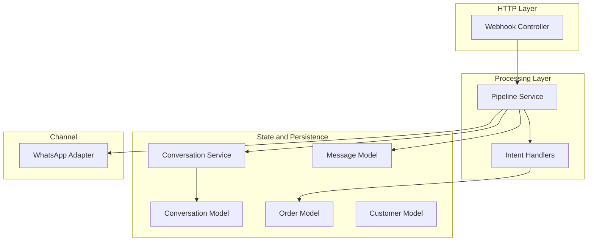
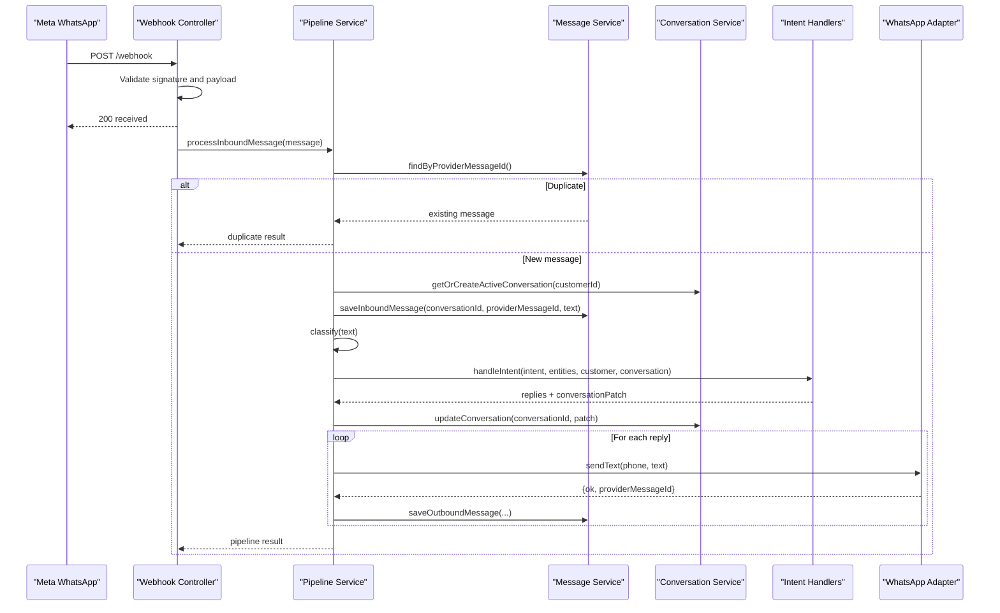
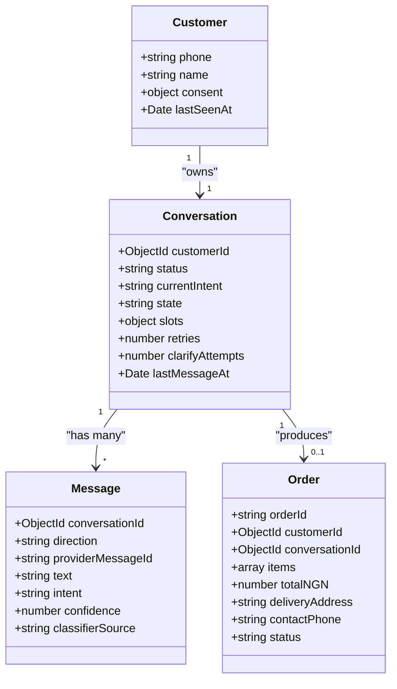
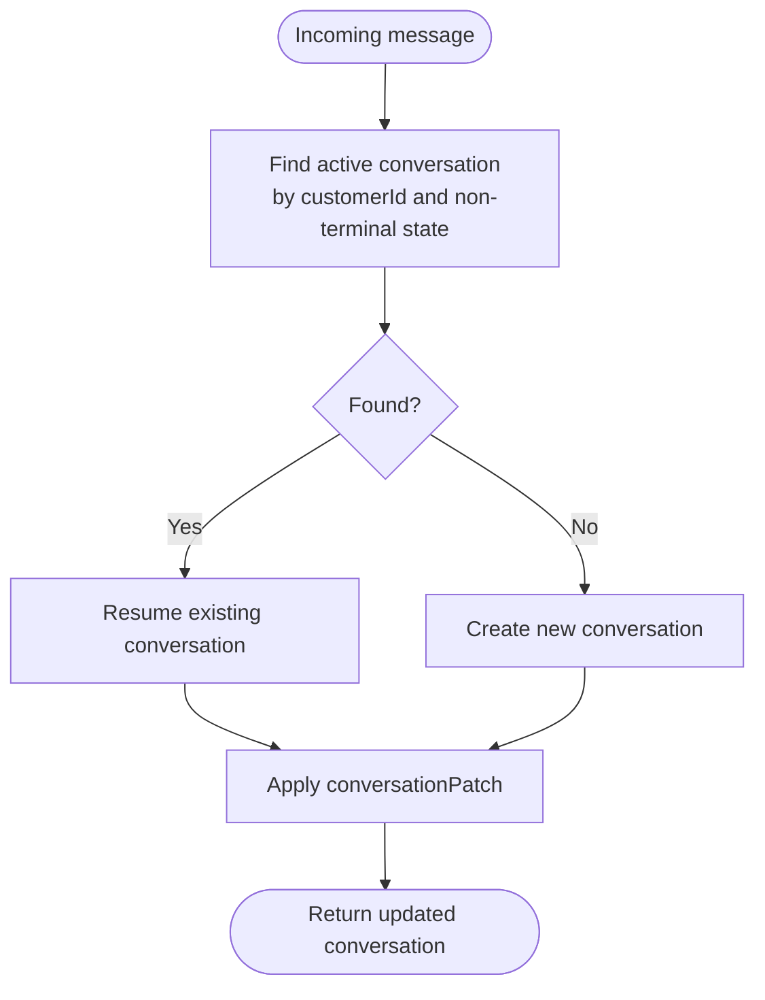
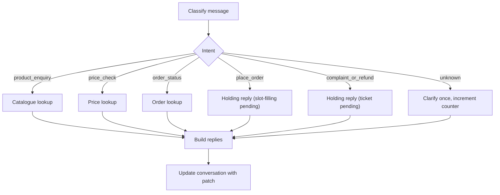
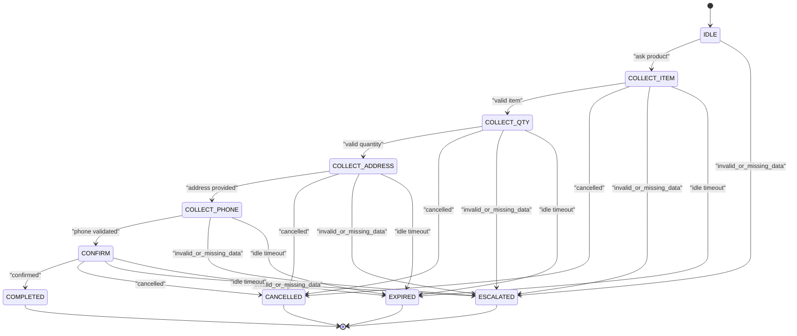
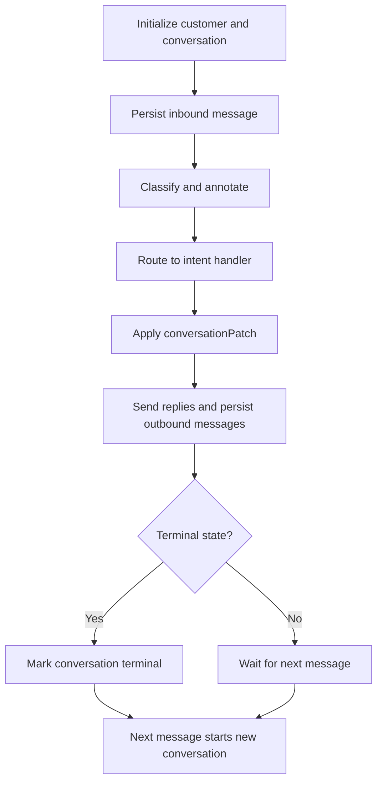
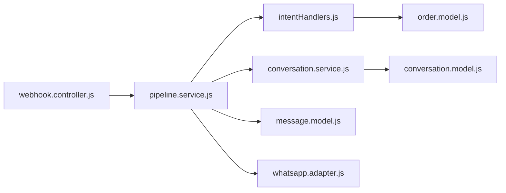

# Conversation State Machine

<cite>
**Referenced Files in This Document**
- [conversation.model.js](file://src/models/conversation.model.js)
- [message.model.js](file://src/models/message.model.js)
- [order.model.js](file://src/models/order.model.js)
- [customer.model.js](file://src/models/customer.model.js)
- [conversation.service.js](file://src/services/conversation.service.js)
- [intentHandlers.js](file://src/services/intentHandlers.js)
- [pipeline.service.js](file://src/services/pipeline.service.js)
- [webhook.controller.js](file://src/controllers/webhook.controller.js)
- [whatsapp.adapter.js](file://src/services/whatsapp.adapter.js)
- [README.md](file://README.md)
- [WORKPLAN.md](file://WORKPLAN.md)
</cite>

## Table of Contents
1. [Introduction](#introduction)
2. [Project Structure](#project-structure)
3. [Core Components](#core-components)
4. [Architecture Overview](#architecture-overview)
5. [Detailed Component Analysis](#detailed-component-analysis)
6. [Dependency Analysis](#dependency-analysis)
7. [Performance Considerations](#performance-considerations)
8. [Troubleshooting Guide](#troubleshooting-guide)
9. [Conclusion](#conclusion)
10. [Appendices](#appendices)

## Introduction
This document explains the conversation state machine for the WhatsApp retail automation system. It covers how multi-turn dialogues are initialized, maintained across messages, and concluded; how slot-filling is designed for order placement; and how conversations persist through MongoDB. It also documents current implementation gaps, recovery mechanisms, timeout handling, cleanup procedures, and guidance for extending the state machine to new conversation types.

The system uses a rolling one-conversation-per-customer model. A conversation carries:
- A lifecycle status such as active or completed.
- A state that drives the order slot-filling flow.
- Slots holding partially collected order data between messages.
- Counters for retries and clarification attempts.
- Timestamps for activity tracking.

Classification routes inbound messages to intent handlers. The pipeline persists every message, deduplicates provider message identifiers, sends replies through the WhatsApp adapter, and records audit events.

**Section sources**
- [WORKPLAN.md:137-153](file://WORKPLAN.md#L137-L153)
- [conversation.model.js:18-43](file://src/models/conversation.model.js#L18-L43)
- [pipeline.service.js:12-37](file://src/services/pipeline.service.js#L12-L37)

## Project Structure
The conversation state machine spans models, services, controllers, and adapters:

**Diagram sources**
- [webhook.controller.js:35-55](file://src/controllers/webhook.controller.js#L35-L55)
- [pipeline.service.js:66-273](file://src/services/pipeline.service.js#L66-L273)
- [intentHandlers.js:98-114](file://src/services/intentHandlers.js#L98-L114)
- [conversation.service.js:22-41](file://src/services/conversation.service.js#L22-L41)
- [conversation.model.js:23-47](file://src/models/conversation.model.js#L23-L47)
- [message.model.js:13-34](file://src/models/message.model.js#L13-L34)
- [order.model.js:35-52](file://src/models/order.model.js#L35-L52)
- [customer.model.js:7-27](file://src/models/customer.model.js#L7-L27)
- [whatsapp.adapter.js:113-135](file://src/services/whatsapp.adapter.js#L113-L135)

**Section sources**
- [README.md:364-384](file://README.md#L364-L384)
- [WORKPLAN.md:165-198](file://WORKPLAN.md#L165-L198)

## Core Components
- Conversation model: defines states, statuses, slots, and counters used by the state machine.
- Conversation service: resumes or creates an active conversation per customer and applies patches.
- Intent handlers: route classified intents to business logic; currently provide holding replies for place_order and complaint flows.
- Pipeline service: orchestrates deduplication, persistence, classification, routing, reply sending, and audit recording.
- Message model: immutable append-only messages with unique provider identifiers for deduplication.
- Order model: represents orders created after successful slot-filling.
- Customer model: keyed by normalized phone number with consent metadata.
- WhatsApp adapter: simulated or cloud messaging channel with timeouts and failure reporting.

Key responsibilities:
- Conversation initialization and resumption.
- Slot-filling state definitions and transitions.
- Context preservation through slots and current intent.
- Timeout and idle expiry design.
- Cleanup via terminal states and conversation rollover.

**Section sources**
- [conversation.model.js:3-47](file://src/models/conversation.model.js#L3-L47)
- [conversation.service.js:3-41](file://src/services/conversation.service.js#L3-L41)
- [intentHandlers.js:5-17](file://src/services/intentHandlers.js#L5-L17)
- [pipeline.service.js:66-273](file://src/services/pipeline.service.js#L66-L273)
- [message.model.js:6-34](file://src/models/message.model.js#L6-L34)
- [order.model.js:30-52](file://src/models/order.model.js#L30-L52)
- [customer.model.js:3-27](file://src/models/customer.model.js#L3-L27)
- [whatsapp.adapter.js:9-24](file://src/services/whatsapp.adapter.js#L9-L24)

## Architecture Overview
The end-to-end flow centers on the pipeline. Webhooks return quickly and process asynchronously. Every inbound message is deduplicated, persisted, classified, routed, replied to, and audited.

**Diagram sources**
- [webhook.controller.js:35-55](file://src/controllers/webhook.controller.js#L35-L55)
- [pipeline.service.js:66-273](file://src/services/pipeline.service.js#L66-L273)
- [conversation.service.js:22-41](file://src/services/conversation.service.js#L22-L41)
- [intentHandlers.js:98-114](file://src/services/intentHandlers.js#L98-L114)
- [whatsapp.adapter.js:113-135](file://src/services/whatsapp.adapter.js#L113-L135)

**Section sources**
- [WORKPLAN.md:92-135](file://WORKPLAN.md#L92-L135)
- [pipeline.service.js:12-37](file://src/services/pipeline.service.js#L12-L37)

## Detailed Component Analysis

### Conversation Model and State Definitions
The conversation model defines the state machine vocabulary:
- States include IDLE, COLLECT_ITEM, COLLECT_QTY, COLLECT_ADDRESS, COLLECT_PHONE, CONFIRM, COMPLETED, CANCELLED, ESCALATED, EXPIRED.
- Statuses include active, escalated, completed, expired.
- Slots store sku, quantity, address, and phone.
- Counters track retries and clarifyAttempts.
- lastMessageAt tracks recent activity.

These fields enable context preservation across turns and support recovery when conversations are resumed.

**Diagram sources**
- [conversation.model.js:23-47](file://src/models/conversation.model.js#L23-L47)
- [message.model.js:13-34](file://src/models/message.model.js#L13-L34)
- [order.model.js:35-52](file://src/models/order.model.js#L35-L52)
- [customer.model.js:7-27](file://src/models/customer.model.js#L7-L27)

**Section sources**
- [conversation.model.js:3-47](file://src/models/conversation.model.js#L3-L47)
- [message.model.js:6-34](file://src/models/message.model.js#L6-L34)
- [order.model.js:30-52](file://src/models/order.model.js#L30-L52)
- [customer.model.js:3-27](file://src/models/customer.model.js#L3-L27)

### Conversation Lifecycle and Resumption
The conversation service implements a rolling conversation per customer:
- It finds the most recent active conversation whose state is not terminal.
- If none exists, it creates a new conversation.
- Terminal states include COMPLETED, CANCELLED, ESCALATED, EXPIRED.
- updateConversation applies a set patch and returns the updated document.

This ensures history stays grouped per customer while allowing fresh sessions after completion or cancellation.

**Diagram sources**
- [conversation.service.js:16-41](file://src/services/conversation.service.js#L16-L41)

**Section sources**
- [conversation.service.js:3-41](file://src/services/conversation.service.js#L3-L41)

### Intent Routing and Current State
The pipeline classifies text and routes it to intent handlers. Handlers may return replies and a conversationPatch. The pipeline then updates the conversation with the patch.

Current behavior:
- product_enquiry and price_check answer from the catalogue.
- order_status looks up orders by reference or latest order for the phone.
- place_order currently returns a holding reply and does not yet transition into slot-filling states.
- unknown clarifies once and increments clarifyAttempts.

**Diagram sources**
- [pipeline.service.js:171-224](file://src/services/pipeline.service.js#L171-L224)
- [intentHandlers.js:21-96](file://src/services/intentHandlers.js#L21-L96)
- [intentHandlers.js:98-114](file://src/services/intentHandlers.js#L98-L114)

**Section sources**
- [intentHandlers.js:5-17](file://src/services/intentHandlers.js#L5-L17)
- [intentHandlers.js:21-96](file://src/services/intentHandlers.js#L21-L96)
- [intentHandlers.js:98-114](file://src/services/intentHandlers.js#L98-L114)
- [pipeline.service.js:171-224](file://src/services/pipeline.service.js#L171-L224)

### Order Slot-Filling State Machine Design
The intended slot-filling flow is defined in the work plan:
- IDLE transitions to COLLECT_ITEM.
- COLLECT_ITEM transitions to COLLECT_QTY.
- COLLECT_QTY transitions to COLLECT_ADDRESS.
- COLLECT_ADDRESS transitions to COLLECT_PHONE only if sender phone is unusable.
- COLLECT_PHONE transitions to CONFIRM.
- CONFIRM transitions to COMPLETED upon confirmation, creating an order.
- Any state can move to CANCELLED on explicit cancellation.
- Invalid input increases retries; repeated failures escalate to ESCALATED.
- Idle in-progress conversations expire to EXPIRED after a configured period.

**Diagram sources**
- [WORKPLAN.md:137-153](file://WORKPLAN.md#L137-L153)
- [conversation.model.js:5-16](file://src/models/conversation.model.js#L5-L16)

**Section sources**
- [WORKPLAN.md:137-153](file://WORKPLAN.md#L137-L153)
- [conversation.model.js:5-16](file://src/models/conversation.model.js#L5-L16)

### Conversation Initialization, Maintenance, and Conclusion
Initialization:
- The webhook controller receives messages and delegates to the pipeline.
- The pipeline upserts the customer, gets or creates an active conversation, and saves the inbound message.

Maintenance:
- Classification annotates the message and sets currentIntent.
- The intent handler may return a conversationPatch.
- The pipeline updates the conversation with the patch.

Conclusion:
- Completed, cancelled, escalated, or expired conversations become terminal.
- The next active conversation lookup skips terminal states, starting a new session.

**Diagram sources**
- [webhook.controller.js:35-55](file://src/controllers/webhook.controller.js#L35-L55)
- [pipeline.service.js:123-229](file://src/services/pipeline.service.js#L123-L229)
- [conversation.service.js:16-41](file://src/services/conversation.service.js#L16-L41)

**Section sources**
- [webhook.controller.js:35-55](file://src/controllers/webhook.controller.js#L35-L55)
- [pipeline.service.js:123-229](file://src/services/pipeline.service.js#L123-L229)
- [conversation.service.js:16-41](file://src/services/conversation.service.js#L16-L41)

### Recovery Mechanisms for Interrupted Conversations
Recovery relies on persistent state:
- The conversation stores currentIntent, slots, retries, clarifyAttempts, and lastMessageAt.
- On resume, the pipeline loads the active conversation and applies any pending patch.
- Unknown intent handling increments clarifyAttempts so the system can recover after misclassification.
- Deduplication prevents duplicate processing on provider retries.

Gaps to implement:
- Slot-filling resume logic is marked as pending in the pipeline.
- Idle expiry should mark stale COLLECT_* conversations as EXPIRED before resumption.

**Section sources**
- [pipeline.service.js:161-161](file://src/services/pipeline.service.js#L161-L161)
- [pipeline.service.js:171-224](file://src/services/pipeline.service.js#L171-L224)
- [conversation.service.js:3-14](file://src/services/conversation.service.js#L3-L14)

### Conversation Context Preservation
Context is preserved through:
- currentIntent indicating the active business goal.
- slots storing partial order data such as sku, quantity, address, and phone.
- clarifyAttempts tracking failed understanding.
- lastMessageAt enabling idle checks.

These fields allow the state machine to continue where it left off after interruptions.

**Section sources**
- [conversation.model.js:31-43](file://src/models/conversation.model.js#L31-L43)
- [pipeline.service.js:205-224](file://src/services/pipeline.service.js#L205-L224)

### Timeout Handling
Two kinds of timeouts are relevant:
- WhatsApp adapter send timeout: Cloud API calls abort after a fixed duration and return a failure result.
- LLM classifier timeout: Configured via environment variables; low-confidence or failed LLM calls fall back to rules or escalation.

The pipeline already handles send failures by logging and continuing with other replies.

**Section sources**
- [whatsapp.adapter.js:26-26](file://src/services/whatsapp.adapter.js#L26-L26)
- [whatsapp.adapter.js:60-104](file://src/services/whatsapp.adapter.js#L60-L104)
- [README.md:184-190](file://README.md#L184-L190)

### Cleanup Procedures
Cleanup is achieved through terminal states and conversation rollover:
- Terminal states include COMPLETED, CANCELLED, ESCALATED, EXPIRED.
- Active conversation lookup excludes terminal states.
- Expiry is part of the slot-filling design and will be enforced before resumption.

**Section sources**
- [conversation.service.js:16-30](file://src/services/conversation.service.js#L16-L30)
- [WORKPLAN.md:137-153](file://WORKPLAN.md#L137-L153)

### Extending the State Machine for New Conversation Types
To add a new conversation type:
1. Define new states and slots in the conversation model.
2. Add new intents in the classifier and intent handlers.
3. Implement handler logic that returns replies and conversationPatch values.
4. Update the pipeline to apply conversationPatch and manage retries and expiry.
5. Add tests covering transitions, invalid inputs, cancellation, and expiry.
6. Extend templates and audit events as needed.

Recommended extension points:
- conversation.model.js for state and slot definitions.
- intentHandlers.js for new intent routing and patching.
- pipeline.service.js for resume and expiry integration.
- whatsapp.adapter.js for channel-specific behaviors.

**Section sources**
- [conversation.model.js:5-16](file://src/models/conversation.model.js#L5-L16)
- [intentHandlers.js:98-114](file://src/services/intentHandlers.js#L98-L114)
- [pipeline.service.js:161-224](file://src/services/pipeline.service.js#L161-L224)

## Dependency Analysis
The following diagram shows key dependencies among components involved in conversation state management.

**Diagram sources**
- [webhook.controller.js:35-55](file://src/controllers/webhook.controller.js#L35-L55)
- [pipeline.service.js:66-273](file://src/services/pipeline.service.js#L66-L273)
- [intentHandlers.js:98-114](file://src/services/intentHandlers.js#L98-L114)
- [conversation.service.js:22-41](file://src/services/conversation.service.js#L22-L41)
- [conversation.model.js:23-47](file://src/models/conversation.model.js#L23-L47)
- [message.model.js:13-34](file://src/models/message.model.js#L13-L34)
- [order.model.js:35-52](file://src/models/order.model.js#L35-L52)
- [whatsapp.adapter.js:113-135](file://src/services/whatsapp.adapter.js#L113-L135)

**Section sources**
- [pipeline.service.js:66-273](file://src/services/pipeline.service.js#L66-L273)
- [intentHandlers.js:98-114](file://src/services/intentHandlers.js#L98-L114)
- [conversation.service.js:22-41](file://src/services/conversation.service.js#L22-L41)

## Performance Considerations
- Fast HTTP response: The webhook returns 200 immediately and processes messages asynchronously to avoid retry storms.
- Deduplication: Unique providerMessageId avoids duplicate processing and database writes.
- Minimal DB writes: Only essential fields are patched on the conversation.
- Channel adapter timeout: Cloud sends use a bounded timeout to prevent long waits.
- Rules-first classification: Keeps deterministic paths fast and reduces LLM dependency.

[No sources needed since this section provides general guidance]

## Troubleshooting Guide
Common issues and remedies:
- Duplicate messages: The system ignores duplicates and records audit events. Verify providerMessageId uniqueness.
- Classifier fallback: When LLM fails or confidence is low, the system falls back to rules and may escalate unclear cases.
- Send failures: The WhatsApp adapter reports failures without throwing; the pipeline logs and continues.
- Unsupported phone numbers: Non-normalized numbers receive a polite reply without persistence.
- Terminal conversations: If a conversation remains terminal, the next message creates a new session.

Operational tips:
- Use correlation IDs to trace messages end to end.
- Monitor health endpoints for MongoDB and external dependencies.
- Review audit events for rejected webhooks, classifier fallbacks, and failed notifications.

**Section sources**
- [pipeline.service.js:77-121](file://src/services/pipeline.service.js#L77-L121)
- [pipeline.service.js:171-224](file://src/services/pipeline.service.js#L171-L224)
- [whatsapp.adapter.js:113-135](file://src/services/whatsapp.adapter.js#L113-L135)
- [README.md:409-419](file://README.md#L409-L419)

## Conclusion
The conversation state machine is designed around a rolling per-customer conversation with explicit states, slots, and counters. The pipeline provides robust initialization, persistence, classification, routing, and reply handling. Slot-filling for order placement is fully specified but not yet implemented; the current place_order handler returns a holding reply. Once implemented, the state machine will transition through collection steps, confirm orders, and conclude with terminal states. Idle expiry, retries, and clarification attempts provide recovery and safety. Extending the system requires adding states, slots, intents, handlers, and tests while preserving the single-update point for conversation state.

[No sources needed since this section summarizes without analyzing specific files]

## Appendices

### Example State Definitions and Transition Rules
- States: IDLE, COLLECT_ITEM, COLLECT_QTY, COLLECT_ADDRESS, COLLECT_PHONE, CONFIRM, COMPLETED, CANCELLED, ESCALATED, EXPIRED.
- Transitions:
  - IDLE to COLLECT_ITEM on purchase intent.
  - Collection states advance on valid input.
  - Any collection state escalates after repeated invalid input.
  - Confirmation completes or cancels the order.
  - Idle in-progress states expire after timeout.

**Section sources**
- [WORKPLAN.md:137-153](file://WORKPLAN.md#L137-L153)
- [conversation.model.js:5-16](file://src/models/conversation.model.js#L5-L16)

### Example Conversation Patch Fields
- currentIntent: reflects the latest classified intent.
- state: drives slot-filling progression.
- slots: holds partial order data.
- retries: counts invalid input attempts.
- clarifyAttempts: counts clarification attempts for unknown intent.
- lastMessageAt: supports idle expiry checks.

**Section sources**
- [conversation.model.js:31-43](file://src/models/conversation.model.js#L31-L43)
- [pipeline.service.js:205-224](file://src/services/pipeline.service.js#L205-L224)