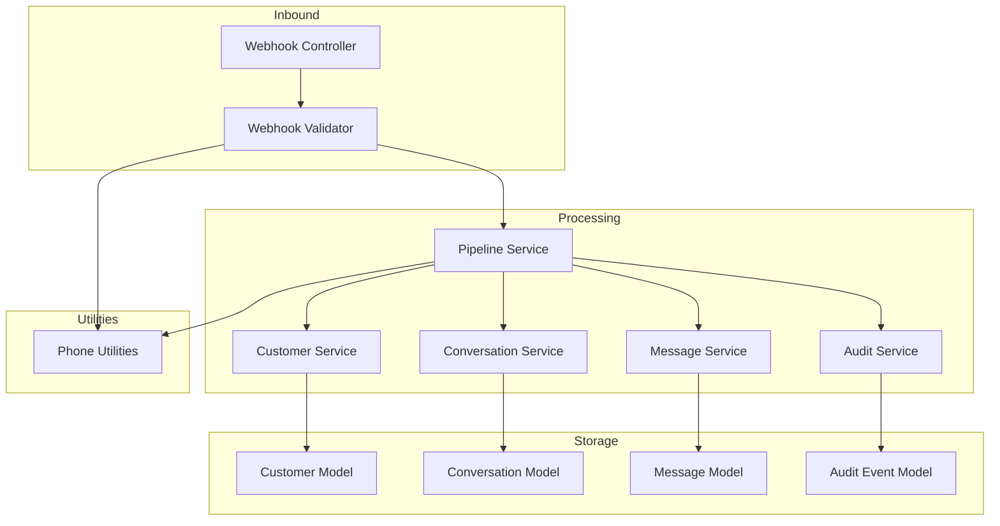
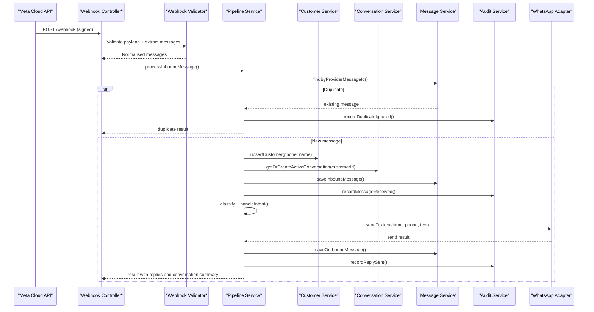
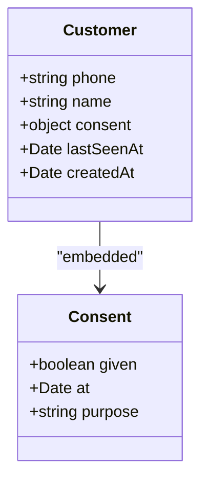
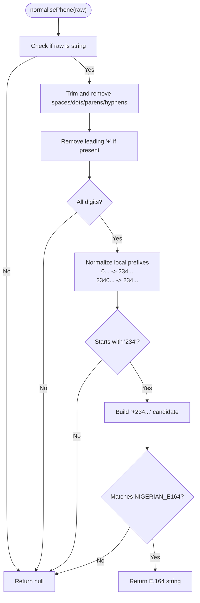
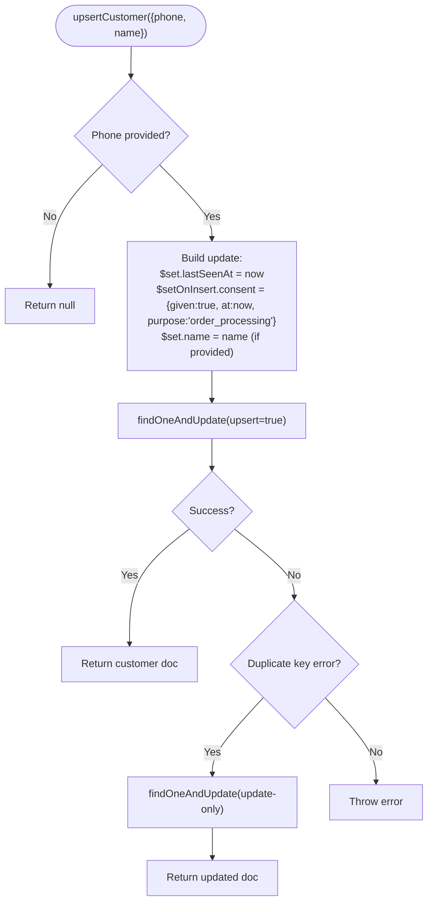
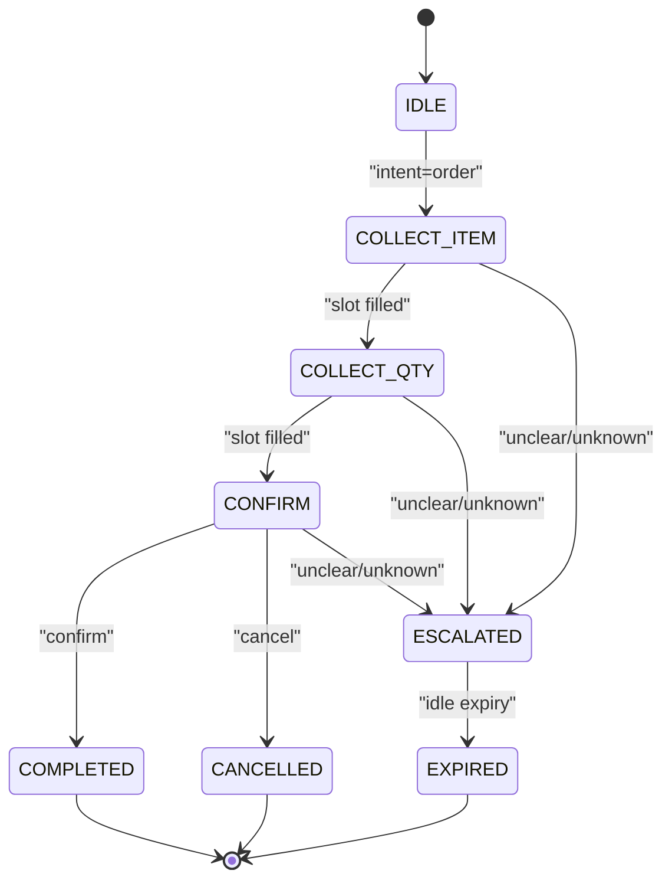
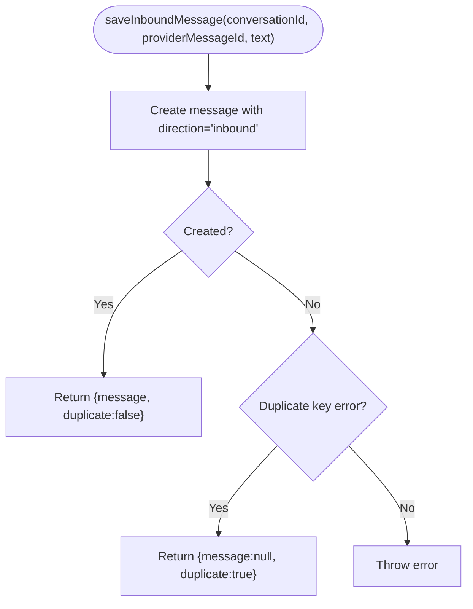
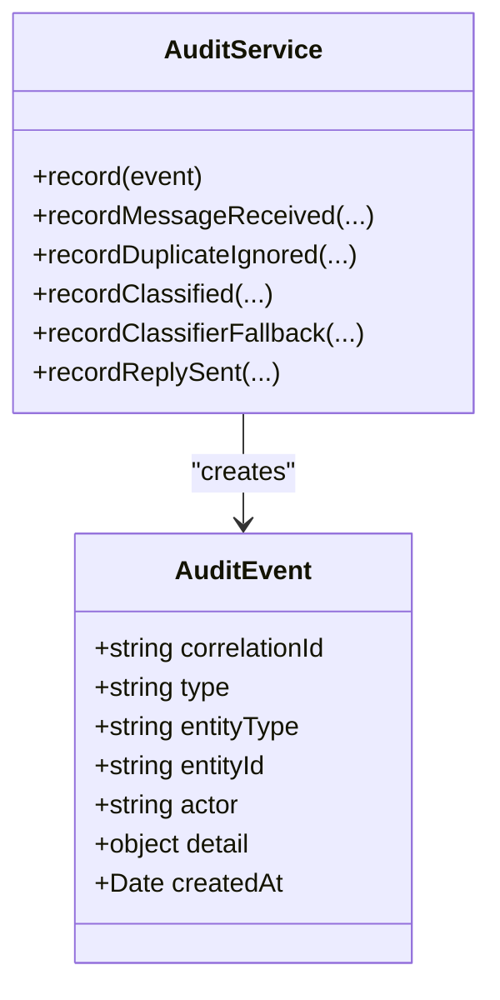
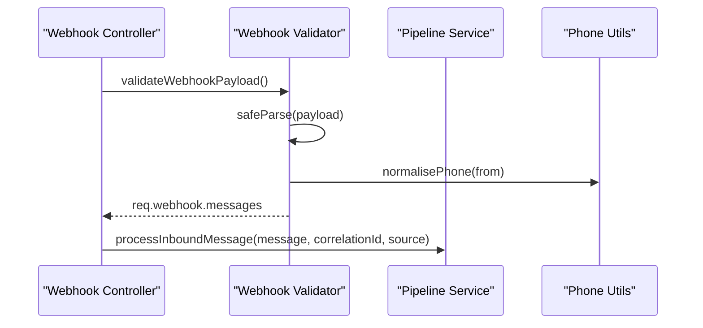
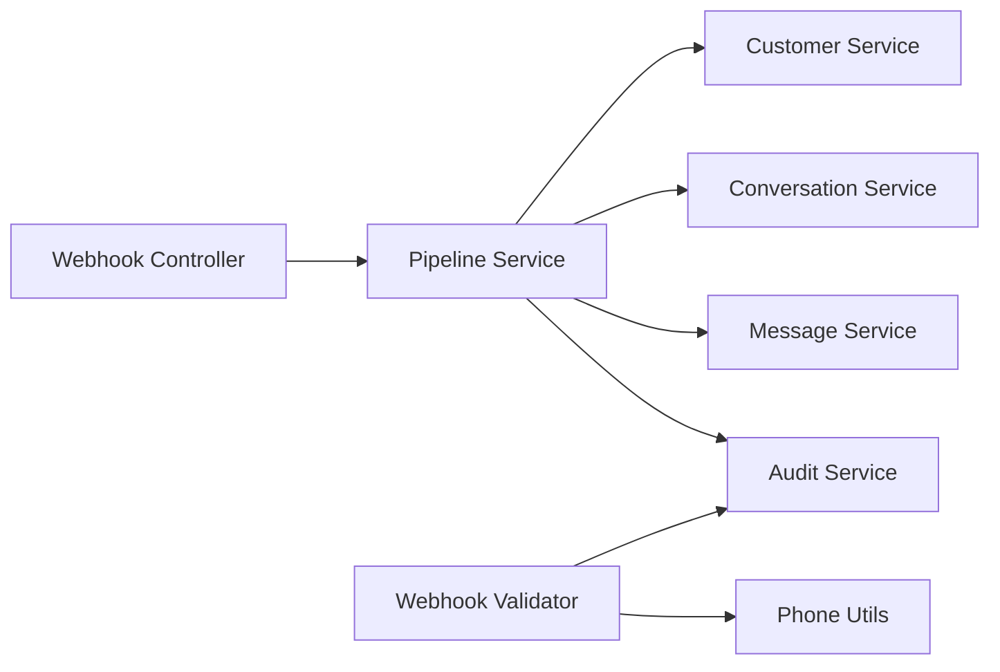

# Customer Lifecycle Management

<cite>
**Referenced Files in This Document**
- [customer.model.js](file://src/models/customer.model.js)
- [conversation.model.js](file://src/models/conversation.model.js)
- [message.model.js](file://src/models/message.model.js)
- [auditEvent.model.js](file://src/models/auditEvent.model.js)
- [customer.service.js](file://src/services/customer.service.js)
- [conversation.service.js](file://src/services/conversation.service.js)
- [message.service.js](file://src/services/message.service.js)
- [pipeline.service.js](file://src/services/pipeline.service.js)
- [webhook.controller.js](file://src/controllers/webhook.controller.js)
- [webhook.validator.js](file://src/validators/webhook.validator.js)
- [phone.js](file://src/utils/phone.js)
- [audit.service.js](file://src/services/audit.service.js)
</cite>

## Table of Contents
1. [Introduction](#introduction)
2. [Project Structure](#project-structure)
3. [Core Components](#core-components)
4. [Architecture Overview](#architecture-overview)
5. [Detailed Component Analysis](#detailed-component-analysis)
6. [Dependency Analysis](#dependency-analysis)
7. [Performance Considerations](#performance-considerations)
8. [Troubleshooting Guide](#troubleshooting-guide)
9. [Conclusion](#conclusion)

## Introduction
This document explains how customer lifecycle management is implemented in the system. It covers:
- How customer profiles are stored and keyed by phone number
- Consent tracking aligned with data-minimisation principles
- Phone number normalisation to E.164 for Nigerian numbers
- How customers are created, updated, and maintained across interactions
- Upsert operations, last seen timestamp tracking, and privacy compliance
- Data validation, security considerations, and integration with the message processing pipeline
- Examples of customer data structures and common operations

The implementation is centred around a WhatsApp-driven webhook pipeline that validates incoming messages, normalises sender phone numbers, upserts customer records, maintains an active conversation per customer, persists messages, classifies intent, sends replies, and writes an append-only audit trail.

## Project Structure
Customer lifecycle touches models, services, validators, controllers, and utilities:
- Models define the schema for customers, conversations, messages, and audit events
- Services encapsulate persistence logic for customers, conversations, messages, and auditing
- The webhook controller receives Meta webhooks and delegates to the pipeline
- The webhook validator parses and extracts inbound messages, normalising phone numbers
- The pipeline orchestrates deduplication, customer upsert, conversation handling, classification, replies, and audit logging
- Phone utilities provide normalisation, masking, and conversion helpers

**Diagram sources**
- [webhook.controller.js:1-56](file://src/controllers/webhook.controller.js#L1-L56)
- [webhook.validator.js:1-124](file://src/validators/webhook.validator.js#L1-L124)
- [pipeline.service.js:1-274](file://src/services/pipeline.service.js#L1-L274)
- [customer.service.js:1-52](file://src/services/customer.service.js#L1-L52)
- [conversation.service.js:1-42](file://src/services/conversation.service.js#L1-L42)
- [message.service.js:1-38](file://src/services/message.service.js#L1-L38)
- [audit.service.js:1-116](file://src/services/audit.service.js#L1-L116)
- [customer.model.js:1-28](file://src/models/customer.model.js#L1-L28)
- [conversation.model.js:1-52](file://src/models/conversation.model.js#L1-L52)
- [message.model.js:1-35](file://src/models/message.model.js#L1-L35)
- [auditEvent.model.js:1-49](file://src/models/auditEvent.model.js#L1-L49)
- [phone.js:1-54](file://src/utils/phone.js#L1-L54)

**Section sources**
- [webhook.controller.js:1-56](file://src/controllers/webhook.controller.js#L1-L56)
- [webhook.validator.js:1-124](file://src/validators/webhook.validator.js#L1-L124)
- [pipeline.service.js:1-274](file://src/services/pipeline.service.js#L1-L274)

## Core Components
- Customer model: stores profile keyed by normalised E.164 phone, consent metadata, and last seen timestamp
- Customer service: upserts customers, refreshes last seen, sets consent on first creation
- Conversation model and service: one rolling conversation per customer; active state machine with slot-filling fields
- Message model and service: immutable inbound/outbound messages with provider-level dedupe via unique index
- Audit event model and service: append-only audit trail with typed events and masked PII
- Phone utilities: normalise, validate, mask, and convert phone numbers
- Webhook validator: parse Meta payload, extract messages, normalise phone numbers
- Pipeline service: orchestrate end-to-end flow from inbound message to reply and audit

**Section sources**
- [customer.model.js:1-28](file://src/models/customer.model.js#L1-L28)
- [customer.service.js:1-52](file://src/services/customer.service.js#L1-L52)
- [conversation.model.js:1-52](file://src/models/conversation.model.js#L1-L52)
- [conversation.service.js:1-42](file://src/services/conversation.service.js#L1-L42)
- [message.model.js:1-35](file://src/models/message.model.js#L1-L35)
- [message.service.js:1-38](file://src/services/message.service.js#L1-L38)
- [auditEvent.model.js:1-49](file://src/models/auditEvent.model.js#L1-L49)
- [audit.service.js:1-116](file://src/services/audit.service.js#L1-L116)
- [phone.js:1-54](file://src/utils/phone.js#L1-L54)
- [webhook.validator.js:1-124](file://src/validators/webhook.validator.js#L1-L124)
- [pipeline.service.js:1-274](file://src/services/pipeline.service.js#L1-L274)

## Architecture Overview
The customer lifecycle is driven by inbound WhatsApp messages. The controller returns quickly and processes asynchronously. The pipeline ensures idempotency, updates or creates the customer, manages the active conversation, persists messages, classifies intent, sends replies, and records audit events.

**Diagram sources**
- [webhook.controller.js:27-56](file://src/controllers/webhook.controller.js#L27-L56)
- [webhook.validator.js:60-124](file://src/validators/webhook.validator.js#L60-L124)
- [pipeline.service.js:66-274](file://src/services/pipeline.service.js#L66-L274)
- [customer.service.js:19-46](file://src/services/customer.service.js#L19-L46)
- [conversation.service.js:22-42](file://src/services/conversation.service.js#L22-L42)
- [message.service.js:13-38](file://src/services/message.service.js#L13-L38)
- [audit.service.js:40-116](file://src/services/audit.service.js#L40-L116)

## Detailed Component Analysis

### Customer Profile Storage and Consent Tracking
- Keying: Customers are uniquely identified by a normalised E.164 phone string.
- Schema fields include phone, optional name, consent metadata (given flag, timestamp, purpose), and lastSeenAt.
- Consent defaults to given at creation time with a default purpose of order processing. This aligns with the documented data-minimisation approach.
- Validation enforces E.164 format at the schema level.

**Diagram sources**
- [customer.model.js:7-24](file://src/models/customer.model.js#L7-L24)

**Section sources**
- [customer.model.js:1-28](file://src/models/customer.model.js#L1-L28)

### Phone Number Normalisation and Privacy Masking
- Normalisation supports multiple input shapes and converts them to E.164 (+234...) for Nigerian numbers.
- Validation rejects non-string inputs, non-digit strings, and unsupported prefixes.
- Conversion helper strips leading plus for wa_id usage.
- Masking utility hides middle digits for logs while preserving prefix/suffix for operational visibility.

**Diagram sources**
- [phone.js:10-33](file://src/utils/phone.js#L10-L33)

**Section sources**
- [phone.js:1-54](file://src/utils/phone.js#L1-L54)

### Customer Upsert Operations and Last Seen Tracking
- Upsert path: findOneAndUpdate with upsert enabled. On insert, consent is set once; on update, lastSeenAt is refreshed.
- Name updates only occur when provided; empty names do not overwrite existing names.
- Concurrency safety: duplicate key errors during concurrent inserts are retried as plain updates.

**Diagram sources**
- [customer.service.js:19-46](file://src/services/customer.service.js#L19-L46)

**Section sources**
- [customer.service.js:1-52](file://src/services/customer.service.js#L1-L52)

### Conversation Lifecycle and Active State
- One rolling conversation per customer; the most recent active conversation is resumed.
- Terminal states (completed, cancelled, escalated, expired) roll over to a new conversation.
- Conversation tracks current intent, state, slots, retries, clarify attempts, and last message timestamp.

**Diagram sources**
- [conversation.model.js:5-16](file://src/models/conversation.model.js#L5-L16)
- [conversation.service.js:16-31](file://src/services/conversation.service.js#L16-L31)

**Section sources**
- [conversation.model.js:1-52](file://src/models/conversation.model.js#L1-L52)
- [conversation.service.js:1-42](file://src/services/conversation.service.js#L1-L42)

### Message Persistence and Deduplication
- Inbound messages are persisted immutably with a unique providerMessageId to backstop deduplication.
- Fast-path lookup avoids reprocessing duplicates; duplicate-key errors are converted into a duplicate flag rather than thrown.
- Outbound messages are persisted after successful send through the adapter.

**Diagram sources**
- [message.service.js:24-37](file://src/services/message.service.js#L24-L37)

**Section sources**
- [message.model.js:1-35](file://src/models/message.model.js#L1-L35)
- [message.service.js:1-38](file://src/services/message.service.js#L1-L38)

### Audit Trail and Privacy Compliance
- Append-only audit events capture lifecycle steps: message received, duplicate ignored, classified, classifier fallback, reply sent.
- Auditing is best-effort; failures are logged but do not break the live path.
- Sensitive data like phone numbers are masked before being written to audit details.

**Diagram sources**
- [auditEvent.model.js:31-41](file://src/models/auditEvent.model.js#L31-L41)
- [audit.service.js:22-116](file://src/services/audit.service.js#L22-L116)

**Section sources**
- [auditEvent.model.js:1-49](file://src/models/auditEvent.model.js#L1-L49)
- [audit.service.js:1-116](file://src/services/audit.service.js#L1-L116)

### Webhook Integration and Message Processing Flow
- The webhook controller verifies Meta’s handshake and returns 200 immediately for inbound payloads, then processes messages asynchronously.
- The validator parses the Meta payload, extracts messages, and normalises phone numbers using the phone utility.
- The pipeline performs deduplication, customer upsert, conversation management, message persistence, classification, reply sending, and audit recording.

**Diagram sources**
- [webhook.controller.js:10-56](file://src/controllers/webhook.controller.js#L10-L56)
- [webhook.validator.js:60-124](file://src/validators/webhook.validator.js#L60-L124)
- [pipeline.service.js:66-274](file://src/services/pipeline.service.js#L66-L274)
- [phone.js:16-33](file://src/utils/phone.js#L16-L33)

**Section sources**
- [webhook.controller.js:1-56](file://src/controllers/webhook.controller.js#L1-L56)
- [webhook.validator.js:1-124](file://src/validators/webhook.validator.js#L1-L124)
- [pipeline.service.js:1-274](file://src/services/pipeline.service.js#L1-L274)

## Dependency Analysis
Key dependencies and relationships:
- Pipeline depends on customer, conversation, message, and audit services
- Validator depends on phone utilities and audit service
- Controllers depend on pipeline and environment configuration
- Models are referenced by their respective services

**Diagram sources**
- [pipeline.service.js:1-11](file://src/services/pipeline.service.js#L1-L11)
- [webhook.validator.js:1-6](file://src/validators/webhook.validator.js#L1-L6)
- [webhook.controller.js:1-4](file://src/controllers/webhook.controller.js#L1-L4)

**Section sources**
- [pipeline.service.js:1-274](file://src/services/pipeline.service.js#L1-L274)
- [webhook.validator.js:1-124](file://src/validators/webhook.validator.js#L1-L124)
- [webhook.controller.js:1-56](file://src/controllers/webhook.controller.js#L1-L56)

## Performance Considerations
- Fast-path deduplication reduces downstream work for repeated deliveries.
- Asynchronous processing after immediate 200 response prevents retry storms.
- Unique indexes on providerMessageId ensure database-level dedupe resilience.
- Masking phone numbers in logs avoids leaking sensitive data while retaining enough context for debugging.
- Best-effort audit writes prevent audit failures from impacting the live message path.

[No sources needed since this section provides general guidance]

## Troubleshooting Guide
Common issues and resolutions:
- Invalid webhook signature: verify app secret and headers; audit captures rejection events.
- Handshake rejected: ensure verify token matches between Meta and environment.
- Unsupported phone numbers: pipeline replies without persistence; check normalisation rules and input formats.
- Duplicate messages: expected behavior; audit records DUPLICATE_IGNORED events.
- Classifier fallback: audit records CLASSIFIER_FALLBACK; pipeline continues with rules or unknown intent.
- Send failures: pipeline logs errors and continues; outbound messages are persisted only on success.

**Section sources**
- [webhook.controller.js:10-25](file://src/controllers/webhook.controller.js#L10-L25)
- [pipeline.service.js:90-121](file://src/services/pipeline.service.js#L90-L121)
- [pipeline.service.js:176-185](file://src/services/pipeline.service.js#L176-L185)
- [pipeline.service.js:231-257](file://src/services/pipeline.service.js#L231-L257)
- [audit.service.js:88-97](file://src/services/audit.service.js#L88-L97)

## Conclusion
The customer lifecycle management implementation provides robust storage, consent tracking, phone normalization, and privacy-preserving audit trails. The pipeline ensures idempotent processing, resilient deduplication, and clear separation of concerns across services. By combining schema validation, E.164 normalization, and best-effort auditing, the system balances operational reliability with compliance requirements. Future enhancements can extend classification, slot-filling, and escalation workflows while maintaining the established patterns for customer data integrity and privacy.

[No sources needed since this section summarizes without analyzing specific files]