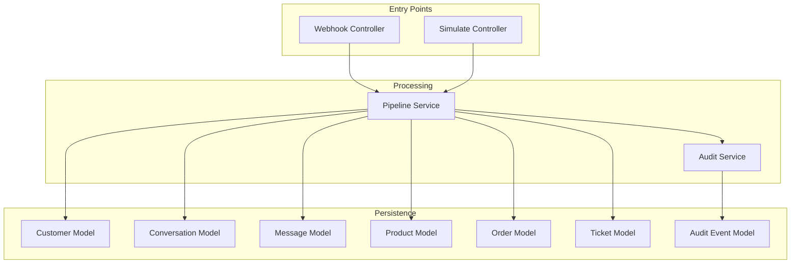
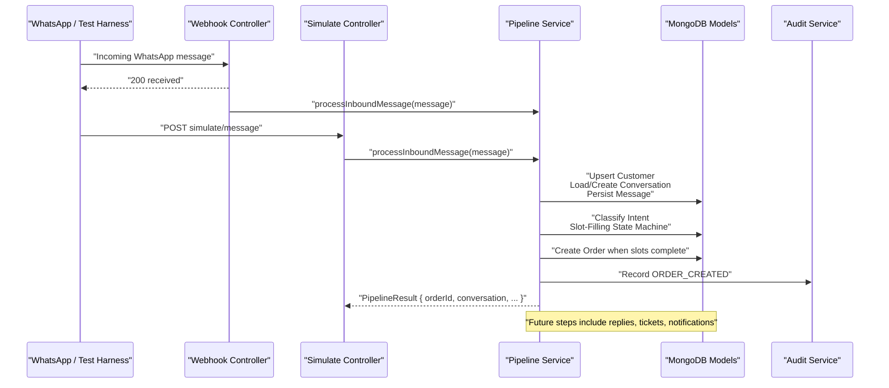
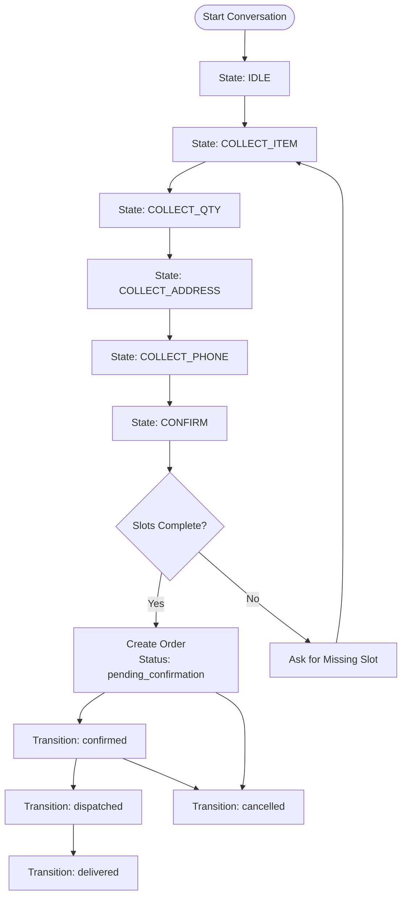
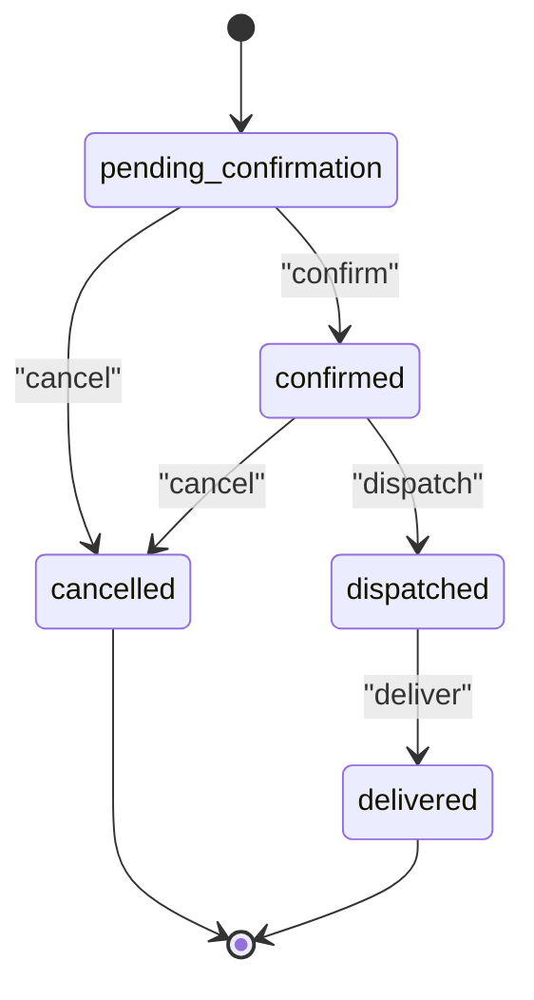
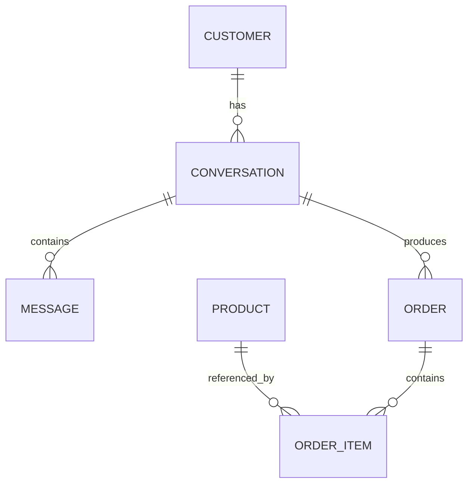
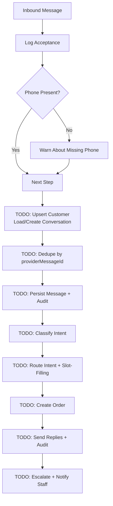
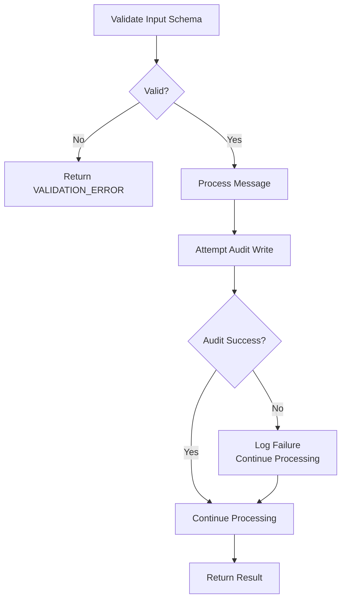
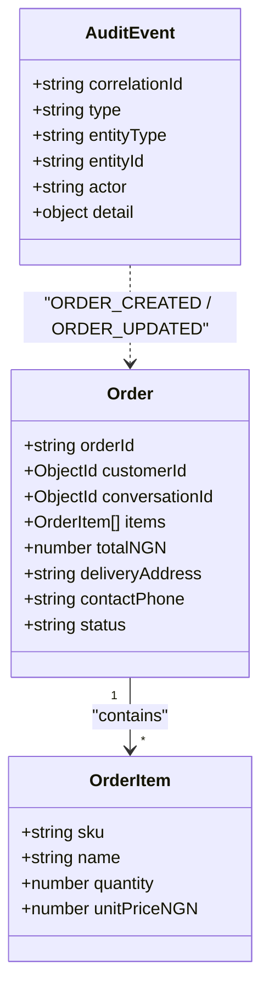
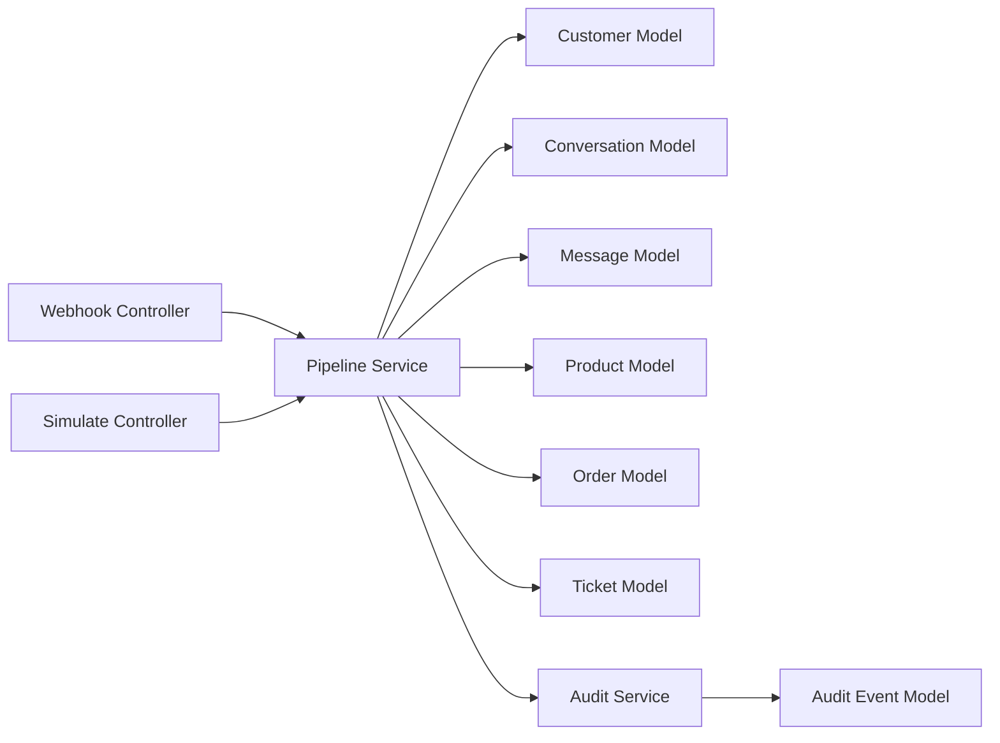

# Order Management Workflows

<cite>
**Referenced Files in This Document**
- [README.md](file://README.md)
- [order.model.js](file://src/models/order.model.js)
- [conversation.model.js](file://src/models/conversation.model.js)
- [customer.model.js](file://src/models/customer.model.js)
- [message.model.js](file://src/models/message.model.js)
- [product.model.js](file://src/models/product.model.js)
- [ticket.model.js](file://src/models/ticket.model.js)
- [auditEvent.model.js](file://src/models/auditEvent.model.js)
- [pipeline.service.js](file://src/services/pipeline.service.js)
- [audit.service.js](file://src/services/audit.service.js)
- [webhook.controller.js](file://src/controllers/webhook.controller.js)
- [simulate.controller.js](file://src/controllers/simulate.controller.js)
</cite>

## Table of Contents
1. [Introduction](#introduction)
2. [Project Structure](#project-structure)
3. [Core Components](#core-components)
4. [Architecture Overview](#architecture-overview)
5. [Detailed Component Analysis](#detailed-component-analysis)
6. [Dependency Analysis](#dependency-analysis)
7. [Performance Considerations](#performance-considerations)
8. [Troubleshooting Guide](#troubleshooting-guide)
9. [Conclusion](#conclusion)

## Introduction
This document explains the order management workflows for a WhatsApp-driven retail automation system. It focuses on:
- How orders are created through slot-filling dialogues inside conversations.
- How customer context is integrated into order placement.
- The complete order lifecycle, including status transitions and validation rules.
- How orders integrate with conversations and flow through the pipeline service.
- Persistence, audit trail integration, and relationships with customer profiles.

The repository currently implements the foundational data models, webhook ingestion, simulated message entry points, and a skeleton message pipeline. Order creation, full classification, reply generation, and ticketing are documented as planned work within the codebase’s TODOs and README roadmap.

**Section sources**
- [README.md:36-47](file://README.md#L36-L47)
- [README.md:429-438](file://README.md#L429-L438)

## Project Structure
The order-related functionality spans models, services, controllers, and supporting utilities:
- Models define the order, conversation, customer, product, message, ticket, and audit event schemas.
- Controllers expose webhook and simulate endpoints that feed messages into the pipeline.
- The pipeline service is the central processing point where future order logic will be wired.
- Audit service provides append-only event recording.

**Diagram sources**
- [webhook.controller.js:1-56](file://src/controllers/webhook.controller.js#L1-L56)
- [simulate.controller.js:1-35](file://src/controllers/simulate.controller.js#L1-L35)
- [pipeline.service.js:1-81](file://src/services/pipeline.service.js#L1-L81)
- [audit.service.js:1-36](file://src/services/audit.service.js#L1-L36)
- [customer.model.js:1-28](file://src/models/customer.model.js#L1-L28)
- [conversation.model.js:1-52](file://src/models/conversation.model.js#L1-L52)
- [message.model.js:1-35](file://src/models/message.model.js#L1-L35)
- [product.model.js:1-26](file://src/models/product.model.js#L1-L26)
- [order.model.js:1-53](file://src/models/order.model.js#L1-L53)
- [ticket.model.js:1-49](file://src/models/ticket.model.js#L1-L49)
- [auditEvent.model.js:1-49](file://src/models/auditEvent.model.js#L1-L49)

**Section sources**
- [README.md:364-384](file://README.md#L364-L384)

## Core Components
This section summarizes the core components relevant to order management.

- Order model
  - Defines order statuses and allowed transitions.
  - Stores human-readable order reference, customer link, optional conversation link, items, totals, delivery address, contact phone, and current status.
  - Includes indexes for efficient querying by status and creation time.

- Conversation model
  - Represents a rolling per-customer session.
  - Holds state machine states used for slot filling (e.g., collecting item, quantity, address, phone, confirmation).
  - Tracks slots for partially collected order data between messages.

- Customer model
  - Identifies customers by normalized E.164 phone number.
  - Records consent metadata for compliance.

- Message model
  - Immutable inbound/outbound message records.
  - Unique provider message ID supports deduplication against webhook retries.

- Product model
  - Catalogue entries with SKU, name, aliases, category, price, stock, and active flag.
  - Text search index supports alias matching during intent classification.

- Ticket model
  - Escalation record for cases such as complaints, refunds, low confidence, invalid data, unknown intents, or customer requests.

- Audit event model
  - Append-only audit trail with correlation IDs, entity types, actors, and details.
  - Includes order-related event types like ORDER_CREATED and ORDER_UPDATED.

- Pipeline service
  - Central message processing function.
  - Currently returns a skeleton result; TODOs outline where order creation, conversation loading, dedupe, classification, replies, tickets, and notifications will be implemented.

- Audit service
  - Best-effort audit writer that never takes down the live path.

- Controllers
  - Webhook controller validates Meta handshake and quickly acknowledges incoming webhooks while processing messages asynchronously.
  - Simulate controller drives the pipeline synchronously for testing and demos.

**Section sources**
- [order.model.js:1-53](file://src/models/order.model.js#L1-L53)
- [conversation.model.js:1-52](file://src/models/conversation.model.js#L1-L52)
- [customer.model.js:1-28](file://src/models/customer.model.js#L1-L28)
- [message.model.js:1-35](file://src/models/message.model.js#L1-L35)
- [product.model.js:1-26](file://src/models/product.model.js#L1-L26)
- [ticket.model.js:1-49](file://src/models/ticket.model.js#L1-L49)
- [auditEvent.model.js:1-49](file://src/models/auditEvent.model.js#L1-L49)
- [pipeline.service.js:1-81](file://src/services/pipeline.service.js#L1-L81)
- [audit.service.js:1-36](file://src/services/audit.service.js#L1-L36)
- [webhook.controller.js:1-56](file://src/controllers/webhook.controller.js#L1-L56)
- [simulate.controller.js:1-35](file://src/controllers/simulate.controller.js#L1-L35)

## Architecture Overview
The order workflow integrates three primary layers:
- Entry layer: Webhook and simulate endpoints accept messages.
- Processing layer: Pipeline orchestrates customer/context handling, conversation state, classification, slot filling, order creation, replies, tickets, and notifications.
- Persistence layer: Mongoose models store customers, conversations, messages, products, orders, tickets, and audit events.

**Diagram sources**
- [webhook.controller.js:27-56](file://src/controllers/webhook.controller.js#L27-L56)
- [simulate.controller.js:4-35](file://src/controllers/simulate.controller.js#L4-L35)
- [pipeline.service.js:1-81](file://src/services/pipeline.service.js#L1-L81)
- [audit.service.js:1-36](file://src/services/audit.service.js#L1-L36)
- [customer.model.js:1-28](file://src/models/customer.model.js#L1-L28)
- [conversation.model.js:1-52](file://src/models/conversation.model.js#L1-L52)
- [message.model.js:1-35](file://src/models/message.model.js#L1-L35)
- [order.model.js:1-53](file://src/models/order.model.js#L1-L53)
- [auditEvent.model.js:1-49](file://src/models/auditEvent.model.js#L1-L49)

## Detailed Component Analysis

### Order Creation Through Slot-Filling Dialogues
The order creation process is designed around a multi-turn conversation that collects required information via slot filling:
- Conversation state machine states include collecting item, quantity, address, phone, and confirmation.
- Slots hold partial data across messages until all required fields are present.
- When slots are complete, the pipeline creates an order linked to the customer and optionally to the conversation.

Key design points:
- Customer context is identified by normalized phone number and persisted as part of the conversation and order.
- Order items reference product SKUs and names, quantities, and unit prices, enabling total calculation.
- Delivery address and contact phone are required at order creation.
- Orders start in pending_confirmation and transition according to defined rules.

**Diagram sources**
- [conversation.model.js:5-16](file://src/models/conversation.model.js#L5-L16)
- [conversation.model.js:18-45](file://src/models/conversation.model.js#L18-L45)
- [order.model.js:3-18](file://src/models/order.model.js#L3-L18)
- [order.model.js:20-47](file://src/models/order.model.js#L20-L47)

**Section sources**
- [conversation.model.js:1-52](file://src/models/conversation.model.js#L1-L52)
- [order.model.js:1-53](file://src/models/order.model.js#L1-L53)

### Order Lifecycle and Status Transitions
Orders follow a strict state machine:
- Initial status: pending_confirmation.
- Allowed transitions:
  - pending_confirmation → confirmed or cancelled.
  - confirmed → dispatched or cancelled.
  - dispatched → delivered.
  - delivered and cancelled are terminal states.

Validation rules:
- Order items require SKU, name, quantity (minimum 1), and unit price (non-negative).
- Total must be non-negative.
- Delivery address must be trimmed and present.
- Contact phone must be present.
- Status must be one of the defined statuses.

**Diagram sources**
- [order.model.js:3-18](file://src/models/order.model.js#L3-L18)
- [order.model.js:20-47](file://src/models/order.model.js#L20-L47)

**Section sources**
- [order.model.js:1-53](file://src/models/order.model.js#L1-L53)

### Integration Between Orders and Conversations
Orders are closely tied to conversations:
- Each order can reference a conversationId, linking the order to the multi-turn dialogue that produced it.
- The conversation holds the current state and slots used to build the order.
- The pipeline is responsible for resuming conversation state and updating slots as new messages arrive.

Data flow highlights:
- Inbound messages update the conversation’s last activity timestamp and may advance its state.
- When slots are complete, the pipeline constructs order items from product catalogue data and persists the order.
- Audit events capture ORDER_CREATED and ORDER_UPDATED events with correlation IDs.

**Diagram sources**
- [customer.model.js:1-28](file://src/models/customer.model.js#L1-L28)
- [conversation.model.js:1-52](file://src/models/conversation.model.js#L1-L52)
- [message.model.js:1-35](file://src/models/message.model.js#L1-L35)
- [product.model.js:1-26](file://src/models/product.model.js#L1-L26)
- [order.model.js:1-53](file://src/models/order.model.js#L1-L53)

**Section sources**
- [conversation.model.js:1-52](file://src/models/conversation.model.js#L1-L52)
- [order.model.js:1-53](file://src/models/order.model.js#L1-L53)
- [message.model.js:1-35](file://src/models/message.model.js#L1-L35)
- [product.model.js:1-26](file://src/models/product.model.js#L1-L26)

### Pipeline Service and Order Data Flow
The pipeline service is the central processing hub:
- It accepts normalized inbound messages from webhook or simulate sources.
- It logs message acceptance and handles missing phone numbers gracefully.
- TODOs indicate upcoming implementation for:
  - Upserting customers and loading/creating conversations.
  - Deduplication by provider message ID.
  - Persisting inbound messages and auditing MESSAGE_RECEIVED.
  - Classifying intents using rules first and LLM fallback.
  - Routing intents and running slot-filling to build replies.
  - Creating orders and sending replies through the WhatsApp adapter.
  - Escalating to tickets and notifying staff.

Current behavior:
- Returns a skeleton result with null intent, no replies, and no order yet.
- Provides a clear extension point for integrating order creation and conversation state management.

**Diagram sources**
- [pipeline.service.js:1-81](file://src/services/pipeline.service.js#L1-L81)

**Section sources**
- [pipeline.service.js:1-81](file://src/services/pipeline.service.js#L1-L81)

### Validation Constraints and Error Handling Patterns
Validation constraints are enforced at the schema level:
- Customer phone must match E.164 format.
- Order items require positive quantity and non-negative unit price.
- Order totals must be non-negative.
- Statuses are enumerated and restricted to allowed values.
- Messages have unique providerMessageId to prevent duplicates.

Error handling patterns:
- Audit writes are best-effort; failures are logged but do not break the live path.
- Webhook controller returns 200 immediately and processes messages asynchronously to avoid retry storms.
- Simulate controller awaits pipeline processing and returns structured results for manual testing.
- Standardized error responses include error codes, messages, and correlation IDs.

**Diagram sources**
- [customer.model.js:7-24](file://src/models/customer.model.js#L7-L24)
- [order.model.js:20-47](file://src/models/order.model.js#L20-L47)
- [message.model.js:13-29](file://src/models/message.model.js#L13-L29)
- [audit.service.js:21-35](file://src/services/audit.service.js#L21-L35)
- [webhook.controller.js:27-56](file://src/controllers/webhook.controller.js#L27-L56)
- [simulate.controller.js:4-35](file://src/controllers/simulate.controller.js#L4-L35)

**Section sources**
- [customer.model.js:1-28](file://src/models/customer.model.js#L1-L28)
- [order.model.js:1-53](file://src/models/order.model.js#L1-L53)
- [message.model.js:1-35](file://src/models/message.model.js#L1-L35)
- [audit.service.js:1-36](file://src/services/audit.service.js#L1-L36)
- [webhook.controller.js:1-56](file://src/controllers/webhook.controller.js#L1-L56)
- [simulate.controller.js:1-35](file://src/controllers/simulate.controller.js#L1-L35)

### Order Persistence and Audit Trail Integration
Order persistence:
- Orders are stored with a unique orderId, customerId, optional conversationId, items array, totalNGN, deliveryAddress, contactPhone, and status.
- Indexes support queries by status and createdAt.

Audit trail integration:
- Audit events include ORDER_CREATED and ORDER_UPDATED types.
- Every audit event carries correlationId, entityType, entityId, actor, and detail.
- Audit service ensures append-only semantics and swallows write failures without impacting the main flow.

Relationships:
- Orders link to customers via customerId.
- Orders optionally link to conversations via conversationId.
- Audit events provide traceability across the entire message-to-order journey.

**Diagram sources**
- [order.model.js:20-53](file://src/models/order.model.js#L20-L53)
- [auditEvent.model.js:1-49](file://src/models/auditEvent.model.js#L1-L49)

**Section sources**
- [order.model.js:1-53](file://src/models/order.model.js#L1-L53)
- [auditEvent.model.js:1-49](file://src/models/auditEvent.model.js#L1-L49)
- [audit.service.js:1-36](file://src/services/audit.service.js#L1-L36)

### Relationship With Customer Profiles
Customer profiles are central to order context:
- Customers are identified by normalized E.164 phone numbers.
- Consent metadata is recorded explicitly for compliance.
- Orders reference customers via customerId, ensuring each order is attributable to a verified profile.
- Conversations also reference customers, enabling multi-turn dialogues tied to a single person.

Best practices:
- Always upsert customers by phone before creating conversations or orders.
- Respect consent flags when persisting or reusing customer data.
- Use correlation IDs to tie customer interactions across messages, orders, and audit events.

**Section sources**
- [customer.model.js:1-28](file://src/models/customer.model.js#L1-L28)
- [conversation.model.js:1-52](file://src/models/conversation.model.js#L1-L52)
- [order.model.js:1-53](file://src/models/order.model.js#L1-L53)

## Dependency Analysis
The order management workflow depends on several interconnected modules:
- Controllers depend on the pipeline service for message processing.
- The pipeline service will depend on models for customer, conversation, message, product, order, and ticket operations.
- Audit service depends on the audit event model.
- Models define enums and constraints that enforce business rules.

**Diagram sources**
- [webhook.controller.js:1-56](file://src/controllers/webhook.controller.js#L1-L56)
- [simulate.controller.js:1-35](file://src/controllers/simulate.controller.js#L1-L35)
- [pipeline.service.js:1-81](file://src/services/pipeline.service.js#L1-L81)
- [audit.service.js:1-36](file://src/services/audit.service.js#L1-L36)
- [customer.model.js:1-28](file://src/models/customer.model.js#L1-L28)
- [conversation.model.js:1-52](file://src/models/conversation.model.js#L1-L52)
- [message.model.js:1-35](file://src/models/message.model.js#L1-L35)
- [product.model.js:1-26](file://src/models/product.model.js#L1-L26)
- [order.model.js:1-53](file://src/models/order.model.js#L1-L53)
- [ticket.model.js:1-49](file://src/models/ticket.model.js#L1-L49)
- [auditEvent.model.js:1-49](file://src/models/auditEvent.model.js#L1-L49)

**Section sources**
- [README.md:364-384](file://README.md#L364-L384)

## Performance Considerations
- Webhook endpoint returns 200 immediately to avoid retry storms; processing is asynchronous.
- Audit writes are best-effort to prevent blocking the live path.
- Database indexes on status and createdAt improve query performance for orders and audit events.
- Unique providerMessageId prevents duplicate message processing.
- Conversation state minimizes redundant data collection by resuming partial slots.

[No sources needed since this section provides general guidance]

## Troubleshooting Guide
Common issues and resolutions:
- Invalid environment variables at startup: compare .env with .env.example; the error lists offending variables.
- Health check returns 503 mongo: down: ensure MongoDB is reachable or start dev Mongo.
- Webhook signature mismatch: verify WHATSAPP_APP_SECRET matches the signer.
- Handshake returns 403: ensure WHATSAPP_VERIFY_TOKEN matches Meta configuration.
- Forced send failure: use WHATSAPP_FORCE_SEND_FAILURE=true to exercise notifier failure paths.

For order-specific troubleshooting:
- If orders are not created, verify that conversation slots reach completion and that product catalogue contains matching SKUs.
- If audit events are missing, check audit service logs; audit writes are best-effort and failures are swallowed.
- If order status transitions fail, validate that transitions conform to ORDER_TRANSITIONS and that the current status allows the requested change.

**Section sources**
- [README.md:409-419](file://README.md#L409-L419)
- [audit.service.js:21-35](file://src/services/audit.service.js#L21-L35)
- [order.model.js:3-18](file://src/models/order.model.js#L3-L18)

## Conclusion
The order management workflows are built around a robust set of models and a clearly extensible pipeline:
- Orders are created through slot-filling dialogues within conversations, with strong validation and state transitions.
- Customer context is integrated via normalized phone numbers and explicit consent tracking.
- The pipeline service provides a central integration point for future order creation, classification, replies, tickets, and notifications.
- Audit trails ensure traceability, while database indexes and unique constraints support performance and integrity.
- As development progresses, the TODOs in the pipeline and roadmap will flesh out the full end-to-end order lifecycle.

[No sources needed since this section summarizes without analyzing specific files]