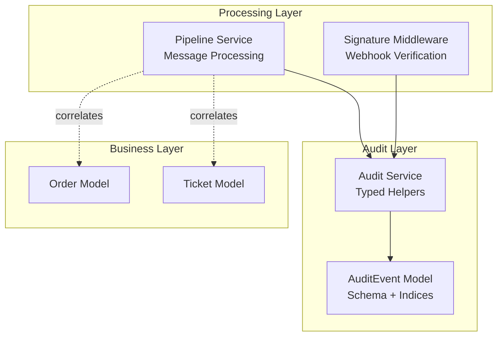
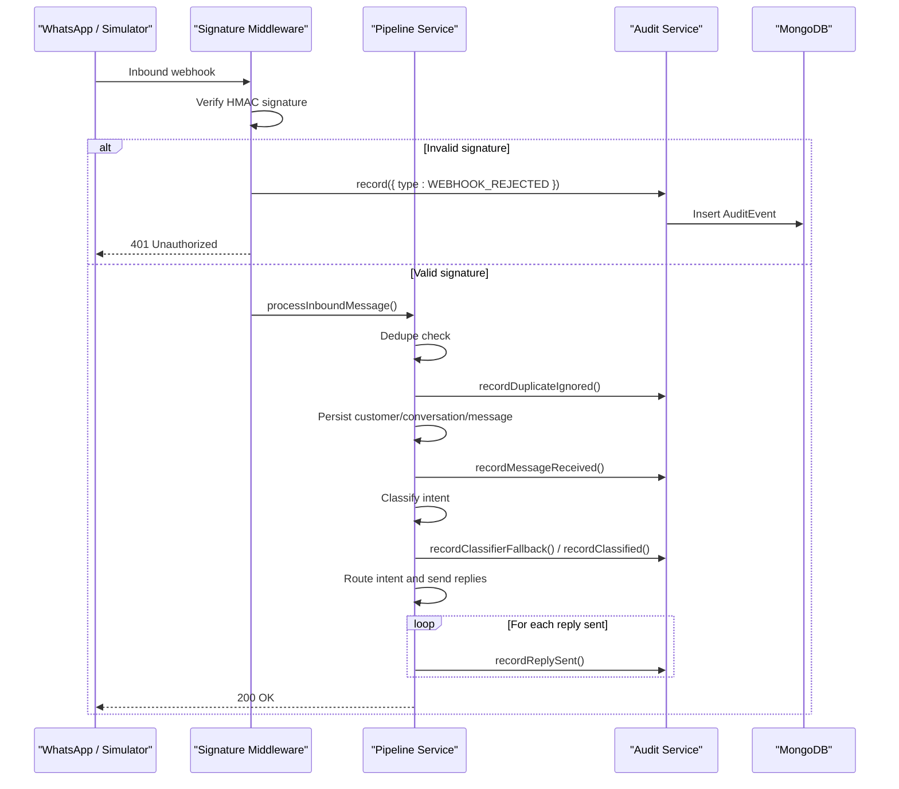
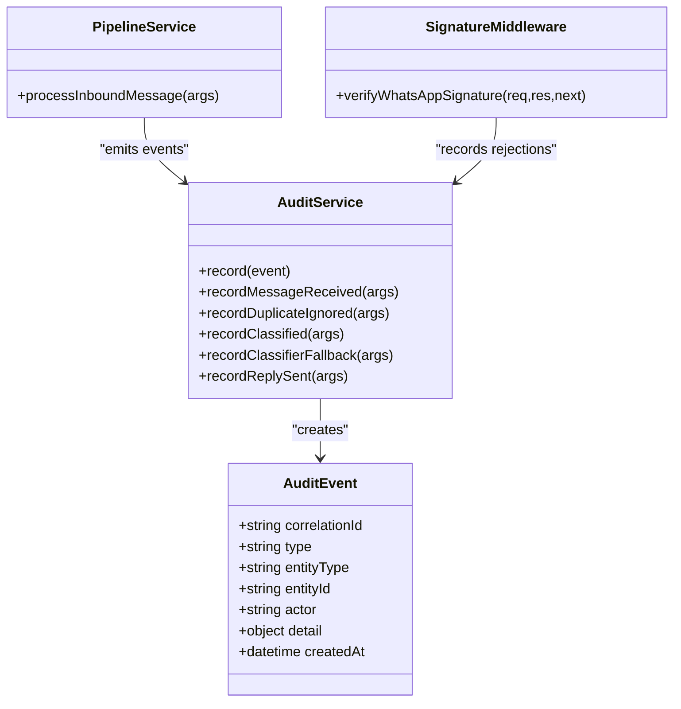
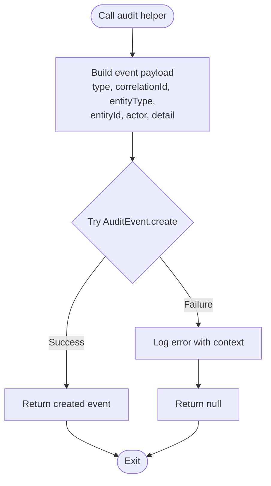
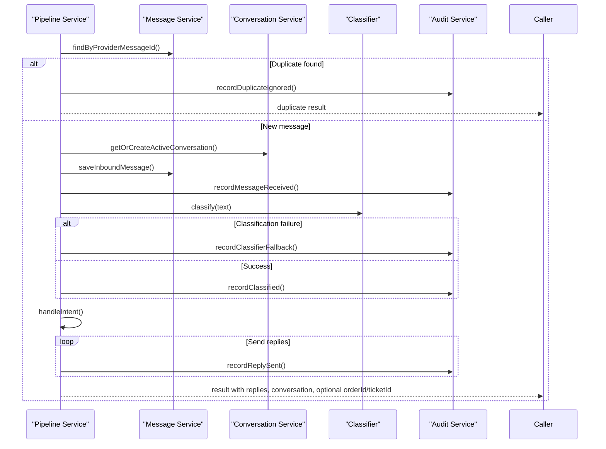
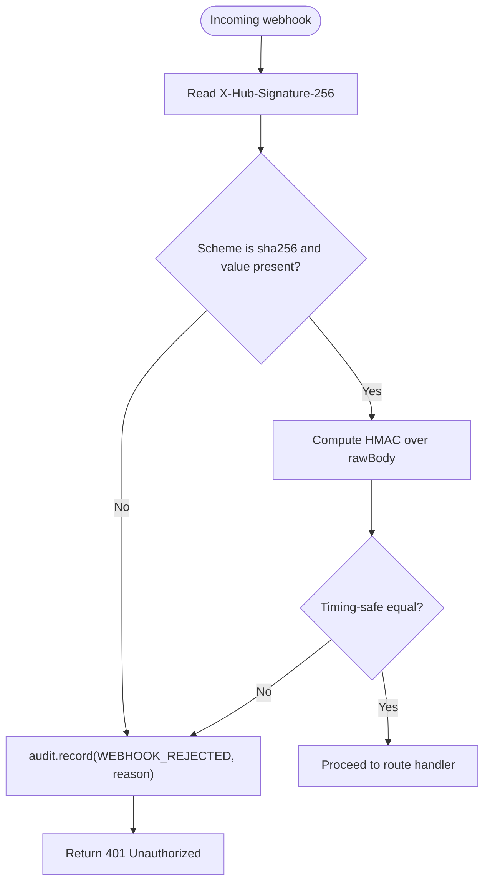
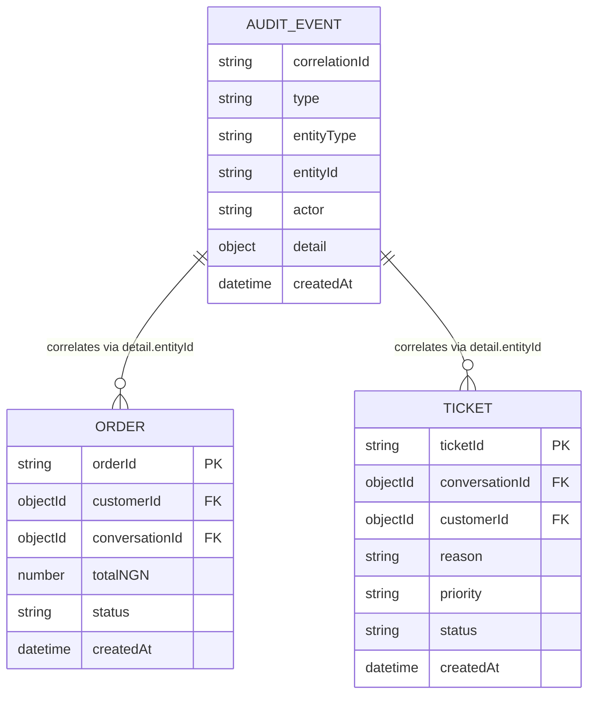
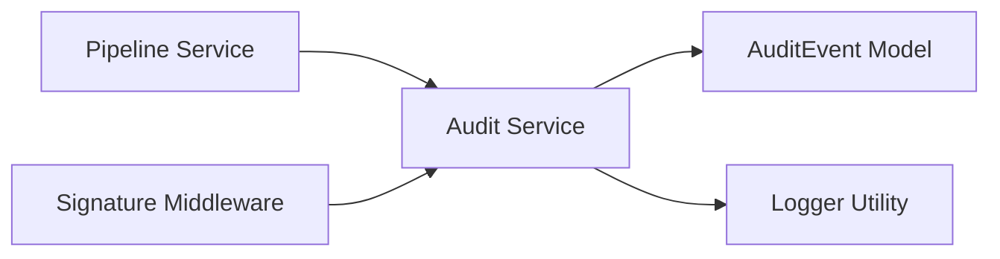

# Audit and Compliance

<cite>
**Referenced Files in This Document**
- [auditEvent.model.js](file://src/models/auditEvent.model.js)
- [audit.service.js](file://src/services/audit.service.js)
- [pipeline.service.js](file://src/services/pipeline.service.js)
- [signature.js](file://src/middleware/signature.js)
- [order.model.js](file://src/models/order.model.js)
- [ticket.model.js](file://src/models/ticket.model.js)
</cite>

## Table of Contents
1. [Introduction](#introduction)
2. [Project Structure](#project-structure)
3. [Core Components](#core-components)
4. [Architecture Overview](#architecture-overview)
5. [Detailed Component Analysis](#detailed-component-analysis)
6. [Dependency Analysis](#dependency-analysis)
7. [Performance Considerations](#performance-considerations)
8. [Troubleshooting Guide](#troubleshooting-guide)
9. [Conclusion](#conclusion)
10. [Appendices](#appendices)

## Introduction
This document describes the audit and compliance data model for the system, focusing on the AuditEvent schema, the append-only audit trail architecture, event logging patterns, and how audit events correlate with business operations such as customer interactions, order lifecycle changes, and support tickets. It also provides guidance for compliance reporting queries, data export considerations, regulatory requirements, privacy safeguards, and security measures around audit data.

## Project Structure
The audit subsystem is implemented across a small set of focused modules:
- A Mongoose schema and model define the immutable audit event record.
- An audit service exposes typed helpers for each pipeline step and a generic writer.
- The message pipeline emits audit events at key processing stages.
- Webhook signature verification middleware audits rejected requests.
- Business models (orders and tickets) are correlated through audit detail fields.

**Diagram sources**
- [auditEvent.model.js:31-48](file://src/models/auditEvent.model.js#L31-L48)
- [audit.service.js:22-36](file://src/services/audit.service.js#L22-L36)
- [pipeline.service.js:66-277](file://src/services/pipeline.service.js#L66-L277)
- [signature.js:19-49](file://src/middleware/signature.js#L19-L49)
- [order.model.js:35-52](file://src/models/order.model.js#L35-L52)
- [ticket.model.js:23-48](file://src/models/ticket.model.js#L23-L48)

**Section sources**
- [auditEvent.model.js:1-49](file://src/models/auditEvent.model.js#L1-L49)
- [audit.service.js:1-116](file://src/services/audit.service.js#L1-L116)
- [pipeline.service.js:1-278](file://src/services/pipeline.service.js#L1-L278)
- [signature.js:1-51](file://src/middleware/signature.js#L1-L51)
- [order.model.js:1-53](file://src/models/order.model.js#L1-L53)
- [ticket.model.js:1-49](file://src/models/ticket.model.js#L1-L49)

## Core Components
- AuditEvent schema defines an append-only collection with typed categorization, correlation tracking, actor context, and flexible metadata.
- Audit service centralizes event creation and provides strongly-typed helpers for message lifecycle events.
- Pipeline service integrates audit events into the inbound message flow, ensuring every important step is recorded.
- Signature middleware records webhook rejections for unauthorized or malformed requests.
- Order and ticket models provide business entities that can be correlated via audit detail fields.

Key responsibilities:
- Data modeling: strict enums for event types, entity types, and actors; indexed timestamping.
- Event emission: best-effort writes so audit failures do not impact live message processing.
- Correlation: all events carry a request-scoped correlation identifier to reconstruct journeys.
- Privacy: phone numbers are masked before being stored in audit details.

**Section sources**
- [auditEvent.model.js:3-48](file://src/models/auditEvent.model.js#L3-L48)
- [audit.service.js:22-116](file://src/services/audit.service.js#L22-L116)
- [pipeline.service.js:77-259](file://src/services/pipeline.service.js#L77-L259)
- [signature.js:19-49](file://src/middleware/signature.js#L19-L49)

## Architecture Overview
The audit trail is append-only and event-sourced by design. Every significant operation emits one or more AuditEvent records. Consumers can reconstruct full message journeys using the shared correlationId.

**Diagram sources**
- [signature.js:19-49](file://src/middleware/signature.js#L19-L49)
- [pipeline.service.js:77-259](file://src/services/pipeline.service.js#L77-L259)
- [audit.service.js:22-116](file://src/services/audit.service.js#L22-L116)

## Detailed Component Analysis

### AuditEvent Schema
The AuditEvent schema enforces an append-only audit trail with strong typing and useful indexes.

- Event categorization:
  - Event types include message lifecycle, classification outcomes, order and ticket lifecycle, notifications, and validation/webhook errors.
  - Entity types cover message, conversation, order, ticket, and system-level events.
  - Actors distinguish between system-initiated actions and customer-originated events.

- Timestamp precision:
  - The schema enables createdAt timestamps and disables updatedAt updates, ensuring immutable creation time per event.
  - Indexes optimize recent-event retrieval and type-scoped chronological queries.

- User and context tracking:
  - correlationId ties related events to a single request or message journey.
  - entityType and entityId link the event to a specific business object when applicable.
  - actor indicates whether the action was initiated by the system or a customer.
  - detail holds structured, extensible metadata for each event.

- Security and privacy:
  - Sensitive identifiers such as phone numbers are masked before being persisted in detail fields.
  - No update/delete routes exist for the audit collection, supporting immutability.

**Diagram sources**
- [auditEvent.model.js:31-48](file://src/models/auditEvent.model.js#L31-L48)
- [audit.service.js:22-116](file://src/services/audit.service.js#L22-L116)
- [pipeline.service.js:66-277](file://src/services/pipeline.service.js#L66-L277)
- [signature.js:19-49](file://src/middleware/signature.js#L19-L49)

**Section sources**
- [auditEvent.model.js:3-48](file://src/models/auditEvent.model.js#L3-L48)

### Audit Service
The audit service centralizes event creation and provides typed helpers aligned with the pipeline steps.

- Generic writer:
  - record accepts a minimal event payload and returns the created event or null if the write fails.
  - Failures are logged but swallowed so audit issues cannot disrupt the live path.

- Typed helpers:
  - MESSAGE_RECEIVED: emitted after successful persistence of an inbound message.
  - DUPLICATE_IGNORED: emitted when a provider message id has already been processed.
  - CLASSIFIED: emitted with classification outcome including intent, confidence, source, and entities.
  - CLASSIFIER_FALLBACK: emitted when LLM classification failed or was unconvinced.
  - REPLY_SENT: emitted for each successfully sent outbound reply.

- Best-effort semantics:
  - All audit writes are non-blocking from the perspective of the main workflow.
  - Errors are captured via the logger without throwing.

**Diagram sources**
- [audit.service.js:22-36](file://src/services/audit.service.js#L22-L36)

**Section sources**
- [audit.service.js:1-116](file://src/services/audit.service.js#L1-L116)

### Pipeline Integration
The pipeline orchestrates message processing and emits audit events at critical points.

- Deduplication:
  - If a provider message id is already known, DUPLICATE_IGNORED is recorded and downstream processing is skipped.

- Message reception:
  - After persisting the inbound message, MESSAGE_RECEIVED is recorded with masked phone and channel context.

- Classification:
  - If classification fails, CLASSIFIER_FALLBACK is recorded.
  - On success, CLASSIFIED is recorded with intent, confidence, classifier source, and extracted entities.

- Replies:
  - For each successful outbound reply, REPLY_SENT is recorded with masked recipient and character count.

- Correlation:
  - All events share the same correlationId to enable replay of the complete message journey.

**Diagram sources**
- [pipeline.service.js:77-259](file://src/services/pipeline.service.js#L77-L259)
- [audit.service.js:40-116](file://src/services/audit.service.js#L40-L116)

**Section sources**
- [pipeline.service.js:66-277](file://src/services/pipeline.service.js#L66-L277)

### Webhook Signature Middleware
Unauthorized or malformed webhook requests are audited before returning an error response.

- Rejection reasons include missing signature headers and invalid signatures.
- Each rejection emits a WEBHOOK_REJECTED event with the request correlationId and reason.

**Diagram sources**
- [signature.js:19-49](file://src/middleware/signature.js#L19-L49)

**Section sources**
- [signature.js:1-51](file://src/middleware/signature.js#L1-L51)

### Correlation with Business Operations
Audit events connect customer interactions to business outcomes:

- Customer interactions:
  - MESSAGE_RECEIVED and REPLY_SENT capture inbound/outbound messaging activity with masked phone numbers.
  - CLASSIFIED and CLASSIFIER_FALLBACK document AI-driven interpretation and fallback behavior.

- Orders:
  - ORDER_CREATED and ORDER_UPDATED are available event types for order lifecycle auditing.
  - The Order model includes orderId, customerId, conversationId, items, totals, delivery address, contact phone, and status transitions.

- Tickets:
  - TICKET_CREATED and TICKET_UPDATED are available event types for support escalation.
  - The Ticket model includes reason, priority, status, assignee, summary, notification status, and resolution metadata.

**Diagram sources**
- [auditEvent.model.js:31-48](file://src/models/auditEvent.model.js#L31-L48)
- [order.model.js:35-52](file://src/models/order.model.js#L35-L52)
- [ticket.model.js:23-48](file://src/models/ticket.model.js#L23-L48)

**Section sources**
- [order.model.js:1-53](file://src/models/order.model.js#L1-L53)
- [ticket.model.js:1-49](file://src/models/ticket.model.js#L1-L49)

## Dependency Analysis
The audit subsystem depends on:
- Mongoose for schema definition and MongoDB persistence.
- The logger utility for capturing audit write failures.
- The pipeline and middleware layers for emitting events.

**Diagram sources**
- [pipeline.service.js:1-10](file://src/services/pipeline.service.js#L1-L10)
- [signature.js:1-6](file://src/middleware/signature.js#L1-L6)
- [audit.service.js:1-3](file://src/services/audit.service.js#L1-L3)
- [auditEvent.model.js:1-2](file://src/models/auditEvent.model.js#L1-L2)

**Section sources**
- [audit.service.js:1-36](file://src/services/audit.service.js#L1-L36)
- [auditEvent.model.js:1-48](file://src/models/auditEvent.model.js#L1-L48)

## Performance Considerations
- Append-only design:
  - No updates or deletes reduce contention and simplify retention strategies.
- Best-effort writes:
  - Audit failures are logged and ignored to protect the primary message path.
- Indexing:
  - createdAt descending index supports recent-event queries.
  - Composite index on type and createdAt optimizes type-scoped chronological reports.
- Masked PII:
  - Phone masking reduces storage size and risk while preserving traceability.

[No sources needed since this section provides general guidance]

## Troubleshooting Guide
Common issues and diagnostics:
- Audit write failures:
  - Symptoms: audit events missing despite successful business operations.
  - Diagnostics: check application logs for “failed to write audit event” entries with type and correlationId.
  - Impact: no operational disruption; investigate database connectivity and permissions.

- Missing correlationId:
  - Ensure the request-scoped identifier is propagated to services and middleware.
  - Without it, correlating events across steps becomes difficult.

- Excessive duplicates:
  - High DUPLICATE_IGNORED counts may indicate provider retries or race conditions.
  - Review deduplication logic and upstream retry policies.

- Classifier fallbacks:
  - Frequent CLASSIFIER_FALLBACK events suggest model availability or quality issues.
  - Inspect fallback reasons and consider rule-based enhancements.

**Section sources**
- [audit.service.js:30-36](file://src/services/audit.service.js#L30-L36)
- [pipeline.service.js:171-199](file://src/services/pipeline.service.js#L171-L199)

## Conclusion
The audit and compliance subsystem implements a robust, append-only audit trail centered on the AuditEvent schema. Events are emitted consistently across the message pipeline and webhook verification, enabling full reconstruction of customer journeys and business operations. With typed categorization, correlation tracking, masked PII, and best-effort writes, the design balances compliance needs with system resilience. Orders and tickets integrate naturally through correlation fields, supporting comprehensive compliance reporting and data export workflows.

[No sources needed since this section summarizes without analyzing specific files]

## Appendices

### AuditEvent Field Reference
- correlationId: Request-scoped identifier used to correlate related events.
- type: Enumerated event category (e.g., MESSAGE_RECEIVED, CLASSIFIED, ORDER_CREATED).
- entityType: Domain entity associated with the event (message, conversation, order, ticket, system).
- entityId: Identifier of the associated entity when applicable.
- actor: Originator of the event (system or customer).
- detail: Structured metadata specific to the event type.
- createdAt: Immutable creation timestamp.

**Section sources**
- [auditEvent.model.js:31-48](file://src/models/auditEvent.model.js#L31-L48)

### Example Event Types and Use Cases
- MESSAGE_RECEIVED: Captures inbound messages after persistence, including masked phone and channel.
- DUPLICATE_IGNORED: Records repeat deliveries of the same provider message id.
- CLASSIFIED: Documents AI classification results with intent, confidence, source, and entities.
- CLASSIFIER_FALLBACK: Logs when LLM classification failed or was unconvinced.
- REPLY_SENT: Records successful outbound replies with masked recipient and length.
- WEBHOOK_REJECTED: Audits unauthorized or malformed webhook requests.
- ORDER_CREATED / ORDER_UPDATED: Available for order lifecycle auditing.
- TICKET_CREATED / TICKET_UPDATED: Available for support escalation auditing.
- NOTIFICATION_SENT / NOTIFICATION_FAILED: Available for notification lifecycle auditing.
- PAYLOAD_INVALID / VALIDATION_FAILED: Available for input validation failures.

**Section sources**
- [auditEvent.model.js:3-18](file://src/models/auditEvent.model.js#L3-L18)
- [audit.service.js:40-116](file://src/services/audit.service.js#L40-L116)
- [signature.js:23-29](file://src/middleware/signature.js#L23-L29)

### Query Patterns for Compliance Reporting
- Recent events by type:
  - Query by type with createdAt descending to retrieve the latest occurrences.
- Replay a message journey:
  - Filter by correlationId to reconstruct the full sequence of events for a request.
- Error and rejection analysis:
  - Filter by WEBHOOK_REJECTED, PAYLOAD_INVALID, or VALIDATION_FAILED to identify problematic inputs.
- Classification performance:
  - Analyze CLASSIFIED vs CLASSIFIER_FALLBACK rates to assess model reliability.
- Operational throughput:
  - Count MESSAGE_RECEIVED and REPLY_SENT per time window to measure inbound/outbound volume.

[No sources needed since this section provides general guidance]

### Data Export Capabilities
- Export by correlationId:
  - Retrieve all events for a given request to produce a complete audit report.
- Export by type and date range:
  - Generate compliance snapshots for specific event categories within time windows.
- Export by entity:
  - Use entityType and entityId to extract audit trails for orders or tickets.

[No sources needed since this section provides general guidance]

### Regulatory Compliance and Data Privacy
- Immutability:
  - Append-only collection supports evidence preservation and prevents tampering.
- Minimization:
  - Mask sensitive fields like phone numbers in audit details.
- Retention:
  - Define retention policies based on regulatory requirements; consider archiving older events and purging only according to policy.
- Access control:
  - Restrict access to audit collections to authorized roles and systems.
- Integrity:
  - Monitor audit write failures and ensure they are logged and investigated promptly.

[No sources needed since this section provides general guidance]

### Security Measures for Audit Data Protection
- Secure webhook verification:
  - HMAC signature checks prevent unauthorized webhooks and are audited upon rejection.
- Least privilege:
  - Database credentials should have minimal required permissions for insert-only access to the audit collection.
- Encryption:
  - Enable encryption at rest and in transit for MongoDB and application logs.
- Monitoring:
  - Alert on spikes in WEBHOOK_REJECTED or audit write failures.

**Section sources**
- [signature.js:19-49](file://src/middleware/signature.js#L19-L49)
- [audit.service.js:30-36](file://src/services/audit.service.js#L30-L36)