# Business Process Entities

<cite>
**Referenced Files in This Document**
- [order.model.js](file://src/models/order.model.js)
- [ticket.model.js](file://src/models/ticket.model.js)
- [customer.model.js](file://src/models/customer.model.js)
- [auditEvent.model.js](file://src/models/auditEvent.model.js)
- [conversation.model.js](file://src/models/conversation.model.js)
- [pipeline.service.js](file://src/services/pipeline.service.js)
- [intentHandlers.js](file://src/services/intentHandlers.js)
- [README.md](file://README.md)
- [WORKPLAN.md](file://WORKPLAN.md)
</cite>

## Table of Contents
1. [Introduction](#introduction)
2. [Project Structure](#project-structure)
3. [Core Components](#core-components)
4. [Architecture Overview](#architecture-overview)
5. [Detailed Component Analysis](#detailed-component-analysis)
6. [Dependency Analysis](#dependency-analysis)
7. [Performance Considerations](#performance-considerations)
8. [Troubleshooting Guide](#troubleshooting-guide)
9. [Conclusion](#conclusion)
10. [Appendices](#appendices)

## Introduction
This document describes the business data model for the WhatsApp retail automation system, focusing on orders, tickets, customers, and audit events. It explains how orders are created through a slot-filling conversation flow, how order lifecycle states and transitions are enforced, how complaint tickets are raised and tracked, and how all operations are recorded in an append-only audit trail. The goal is to make the data model clear for developers, operators, and analysts who need to understand order fulfillment, complaint handling, escalation behavior, and reporting inputs.

## Project Structure
The business entities live under `src/models`, while the message pipeline that drives order creation and ticketing lives under `src/services`. The README provides project context, configuration, and API overview; the WORKPLAN defines the intended state machines for orders and tickets.

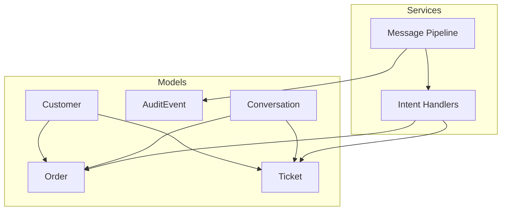

**Diagram sources**
- [order.model.js:35-47](file://src/models/order.model.js#L35-L47)
- [ticket.model.js:23-43](file://src/models/ticket.model.js#L23-L43)
- [customer.model.js:7-24](file://src/models/customer.model.js#L7-L24)
- [auditEvent.model.js:31-41](file://src/models/auditEvent.model.js#L31-L41)
- [conversation.model.js:23-42](file://src/models/conversation.model.js#L23-L42)
- [pipeline.service.js:66-273](file://src/services/pipeline.service.js#L66-L273)
- [intentHandlers.js:1-66](file://src/services/intentHandlers.js#L1-L66)

**Section sources**
- [README.md:1-46](file://README.md#L1-L46)
- [README.md:364-384](file://README.md#L364-L384)

## Core Components
This section summarizes the primary business entities and their roles.

- **Customer**: Represents a WhatsApp customer keyed by a normalized E.164 phone number. It stores consent metadata and last activity time.
- **Order**: Represents a placed order with line items, pricing, delivery details, and a strict lifecycle status.
- **Ticket**: Represents a human-handled escalation such as complaints, refunds, low-confidence classification, or AI unavailability.
- **AuditEvent**: Append-only event log used to trace messages, classifications, replies, orders, tickets, and failures.
- **Conversation**: Holds the multi-turn slot-filling state machine for order collection and tracks per-customer conversation state.

Key relationships:
- An order belongs to one customer and optionally references a conversation.
- A ticket may reference a conversation and/or a customer.
- Audit events link operational actions to correlation IDs and entity identifiers.

**Section sources**
- [customer.model.js:3-24](file://src/models/customer.model.js#L3-L24)
- [order.model.js:30-47](file://src/models/order.model.js#L30-L47)
- [ticket.model.js:17-43](file://src/models/ticket.model.js#L17-L43)
- [auditEvent.model.js:24-41](file://src/models/auditEvent.model.js#L24-L41)
- [conversation.model.js:18-42](file://src/models/conversation.model.js#L18-L42)

## Architecture Overview
The message pipeline is the central orchestrator for inbound WhatsApp messages. It performs deduplication, persists messages, classifies intent, routes to handlers, sends replies, and records audit events. Orders and tickets are produced by intent handlers when the pipeline reaches the relevant business logic.

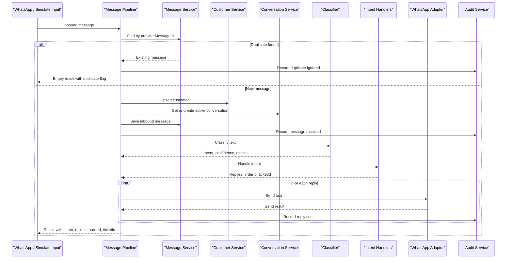

**Diagram sources**
- [pipeline.service.js:66-273](file://src/services/pipeline.service.js#L66-L273)
- [audit.service.js:22-116](file://src/services/audit.service.js#L22-L116)
- [intentHandlers.js:1-66](file://src/services/intentHandlers.js#L1-L66)

## Detailed Component Analysis

### Order Data Model
The order schema captures the full order record created by the place-order slot-filling flow. It includes a human-readable order ID, customer reference, optional conversation reference, line items, total price in NGN, delivery address, contact phone, and lifecycle status.

Key fields:
- `orderId`: Unique human-readable order reference (e.g., ORD-YYYYMMDD-NNNN).
- `customerId`: Reference to the customer who placed the order.
- `conversationId`: Optional reference to the conversation where the order was collected.
- `items`: Array of line items, each with SKU, name, quantity, and unit price in NGN.
- `totalNGN`: Required total price in NGN, validated to be non-negative.
- `deliveryAddress`: Trimmed required delivery address.
- `contactPhone`: Required contact phone string.
- `status`: Enumerated lifecycle status with default `pending_confirmation`.

Line item structure:
- `sku`: Required product identifier.
- `name`: Required product display name.
- `quantity`: Required integer at least 1.
- `unitPriceNGN`: Required numeric price at least 0.

Order lifecycle states:
- `pending_confirmation`
- `confirmed`
- `dispatched`
- `delivered`
- `cancelled`

Allowed status transitions:
- From `pending_confirmation`: can move to `confirmed` or `cancelled`.
- From `confirmed`: can move to `dispatched` or `cancelled`.
- From `dispatched`: can move to `delivered`.
- From `delivered`: no further transitions.
- From `cancelled`: no further transitions.

Indexing:
- Composite index on `status` ascending and `createdAt` descending supports queries like “recent orders by status”.

Operational notes:
- The order model documents that transitions are enforced by the PATCH endpoint referenced in the code comment.
- The order’s `orderId` is designed to be shown to customers via WhatsApp.

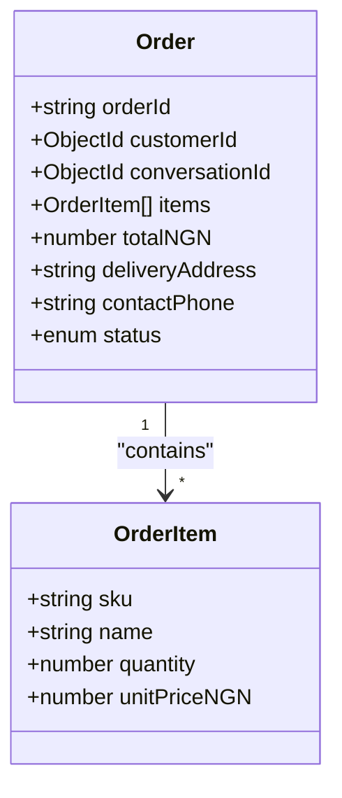

**Diagram sources**
- [order.model.js:20-47](file://src/models/order.model.js#L20-L47)

**Section sources**
- [order.model.js:3-18](file://src/models/order.model.js#L3-L18)
- [order.model.js:20-47](file://src/models/order.model.js#L20-L47)
- [order.model.js:49-52](file://src/models/order.model.js#L49-L52)

#### Order Creation Flow
The order creation flow is part of the broader message pipeline and slot-filling state machine. The pipeline accepts inbound messages, classifies them, and delegates to intent handlers. The place-order handler is documented as transitioning through slot-filling states before creating an order.

Conceptual flow:
1. Customer initiates order intent.
2. System collects item, quantity, address, and phone through conversation slots.
3. On confirmation, the system creates an order with status `pending_confirmation`.
4. Staff or downstream systems update the order status according to allowed transitions.

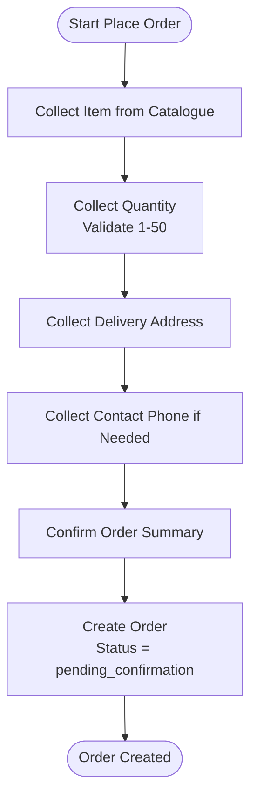

[No sources needed since this diagram shows conceptual workflow, not actual code structure]

**Section sources**
- [pipeline.service.js:12-26](file://src/services/pipeline.service.js#L12-L26)
- [intentHandlers.js:64-66](file://src/services/intentHandlers.js#L64-L66)
- [WORKPLAN.md:137-153](file://WORKPLAN.md#L137-L153)

#### Status Change Validation
Status changes must follow the defined transition map. For example:
- A `pending_confirmation` order cannot jump directly to `dispatched`; it must first become `confirmed`.
- A `delivered` or `cancelled` order is terminal and cannot change again.

Validation rules:
- Only transitions listed for the current status are permitted.
- Invalid transitions should be rejected by the order update endpoint.

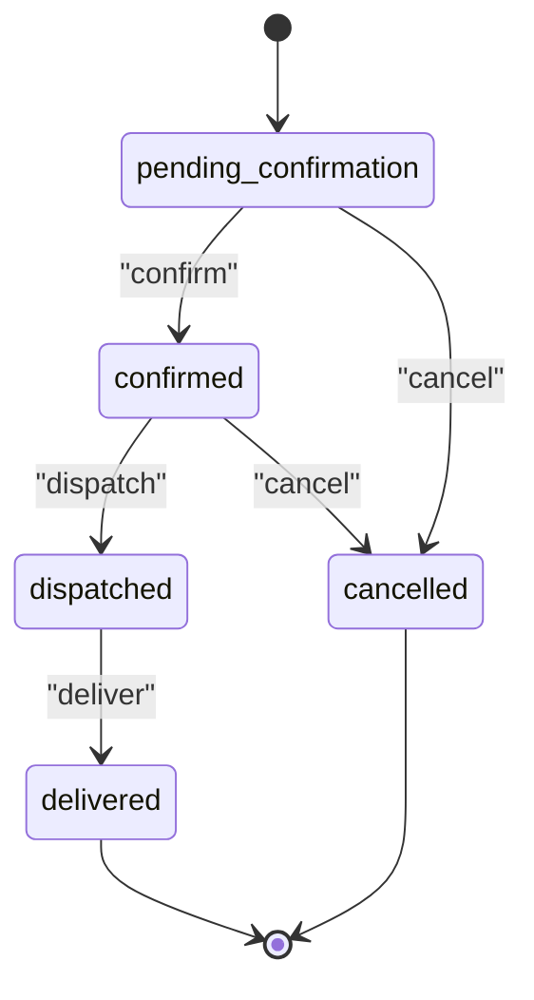

**Diagram sources**
- [order.model.js:3-18](file://src/models/order.model.js#L3-L18)

**Section sources**
- [order.model.js:11-18](file://src/models/order.model.js#L11-L18)

#### Pricing Calculations
Pricing is represented at the line-item level and aggregated into a total:
- Each line item has `unitPriceNGN`.
- Line item totals are derived by multiplying `quantity` by `unitPriceNGN`.
- `totalNGN` is the sum of all line item totals.

Business rule guidance:
- Ensure `totalNGN` equals the sum of line item totals before persisting an order.
- Validate that `unitPriceNGN` is non-negative and `quantity` is at least 1.

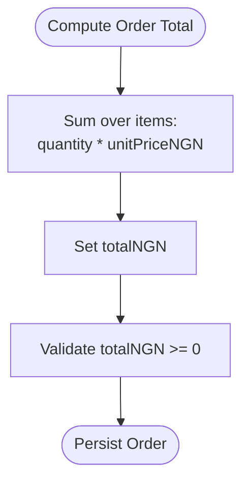

[No sources needed since this diagram shows conceptual workflow, not actual code structure]

**Section sources**
- [order.model.js:20-28](file://src/models/order.model.js#L20-L28)
- [order.model.js:35-47](file://src/models/order.model.js#L35-L47)

#### Fulfillment Tracking
Fulfillment tracking is modeled through the order status field:
- `pending_confirmation`: Order awaiting staff confirmation.
- `confirmed`: Order accepted and prepared.
- `dispatched`: Order shipped or handed off to logistics.
- `delivered`: Order completed successfully.
- `cancelled`: Order canceled at any eligible stage.

Reporting implications:
- Queries can group orders by status to compute fulfillment metrics.
- Indexes support efficient retrieval of recent orders by status.

**Section sources**
- [order.model.js:3-18](file://src/models/order.model.js#L3-L18)
- [order.model.js:49-52](file://src/models/order.model.js#L49-L52)

### Ticket Data Model
Tickets represent human escalations for complaints, refunds, low-confidence classification, AI unavailability, invalid data, unknown intents, or customer requests.

Key fields:
- `ticketId`: Unique human-readable ticket identifier.
- `conversationId`: Optional reference to the conversation that triggered the ticket.
- `customerId`: Optional reference to the customer associated with the ticket.
- `reason`: Enumerated reason for escalation.
- `priority`: Enumerated priority level with default `normal`.
- `status`: Enumerated lifecycle status with default `open`.
- `assignee`: Optional staff identifier or name.
- `summary`: Required summary of the issue.
- `notificationStatus`: Tracks whether staff notification was sent, failed, or is pending.
- `resolutionNote`: Optional resolution note added by staff.
- `firstResponseAt`: Timestamp when staff first responded.
- `resolvedAt`: Timestamp when the ticket was resolved.

Ticket reasons:
- `complaint`
- `refund`
- `low_confidence`
- `ai_unavailable`
- `invalid_data`
- `unknown_intent`
- `customer_requested`

Priority levels:
- `low`
- `normal`
- `high`

Lifecycle statuses:
- `open`
- `assigned`
- `in_progress`
- `resolved`
- `closed`

Notification statuses:
- `sent`
- `failed`
- `pending`

SLA behavior:
- Tickets open longer than the configured SLA minutes are flagged as overdue in metrics. This is derived at read time, not stored.

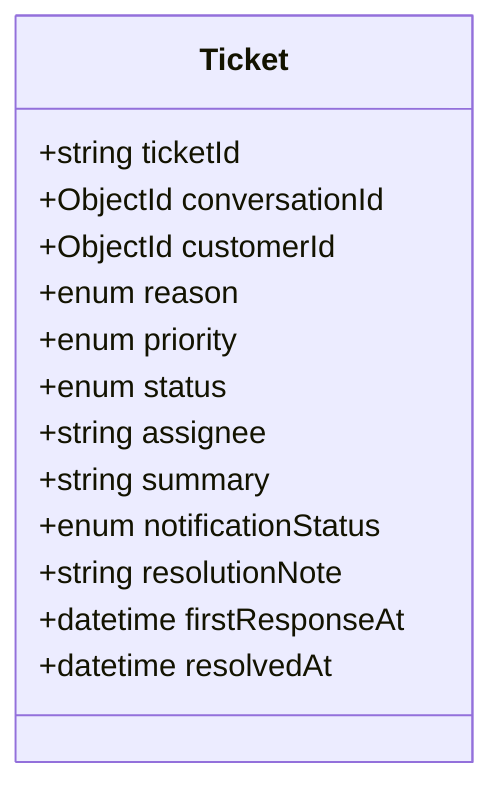

**Diagram sources**
- [ticket.model.js:3-43](file://src/models/ticket.model.js#L3-L43)

**Section sources**
- [ticket.model.js:3-15](file://src/models/ticket.model.js#L3-L15)
- [ticket.model.js:17-43](file://src/models/ticket.model.js#L17-L43)
- [ticket.model.js:45-48](file://src/models/ticket.model.js#L45-L48)

#### Complaint Handling Workflow
Complaints and other escalations are captured as tickets. The pipeline integrates with intent handlers to produce tickets when necessary. The ticket model includes fields for assignment, notifications, and resolution tracking.

Conceptual workflow:
1. A message triggers an escalation path (e.g., complaint, refund, low confidence).
2. A ticket is created with a reason and priority.
3. Staff receives a notification; its success or failure is recorded.
4. Staff assigns and updates the ticket through its lifecycle.
5. Resolution is recorded with timestamps and notes.

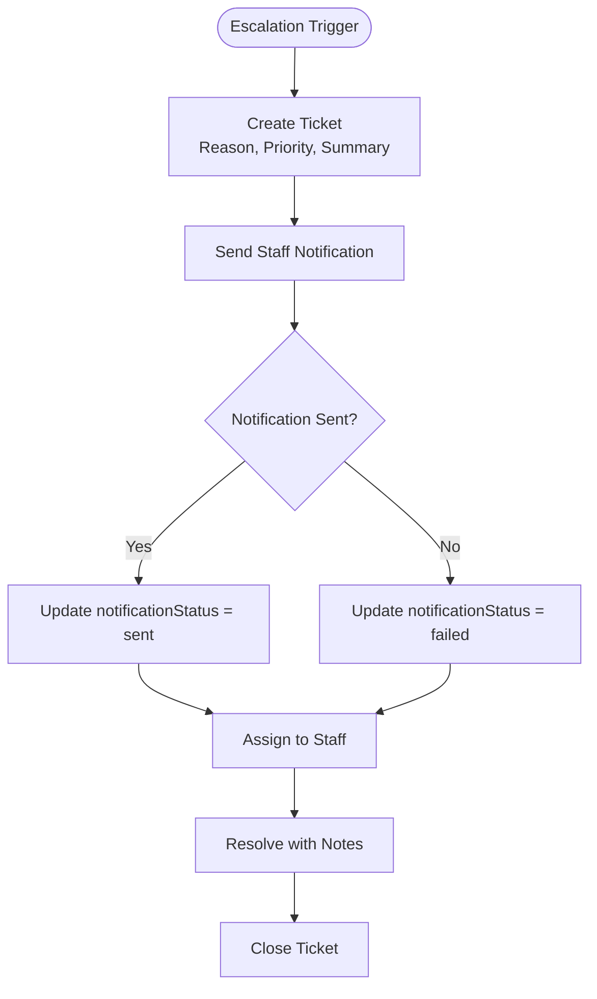

[No sources needed since this diagram shows conceptual workflow, not actual code structure]

**Section sources**
- [ticket.model.js:17-43](file://src/models/ticket.model.js#L17-L43)
- [pipeline.service.js:176-223](file://src/services/pipeline.service.js#L176-L223)
- [intentHandlers.js:1-17](file://src/services/intentHandlers.js#L1-L17)

#### Priority Levels and Assignment Mechanisms
Priority levels help triage tickets:
- `low`: Routine issues.
- `normal`: Standard workload.
- `high`: Urgent or sensitive cases.

Assignment mechanisms:
- The `assignee` field allows staff identification.
- Notifications track whether alerts reached staff.
- Metrics can derive overdue tickets based on age and status.

**Section sources**
- [ticket.model.js:13-15](file://src/models/ticket.model.js#L13-L15)
- [ticket.model.js:28-37](file://src/models/ticket.model.js#L28-L37)

#### Resolution Tracking
Resolution tracking uses:
- `status` progression through `open`, `assigned`, `in_progress`, `resolved`, `closed`.
- `firstResponseAt` for initial response time.
- `resolvedAt` for completion time.
- `resolutionNote` for staff comments.

Operational analytics:
- Mean time to first response.
- Mean time to resolve.
- Overdue rate based on SLA configuration.

**Section sources**
- [ticket.model.js:28-41](file://src/models/ticket.model.js#L28-L41)

### Customer Relationship to Orders and Tickets
Customers are the anchor entity for orders and tickets:
- Orders reference `customerId`.
- Tickets may reference `customerId`.
- Conversations also reference `customerId`, enabling multi-turn order flows tied to a single customer.

Data consistency requirements:
- Orders and tickets should only reference valid customer records.
- Customer phone numbers must conform to E.164 format.
- Consent metadata should be respected for data minimization and compliance.

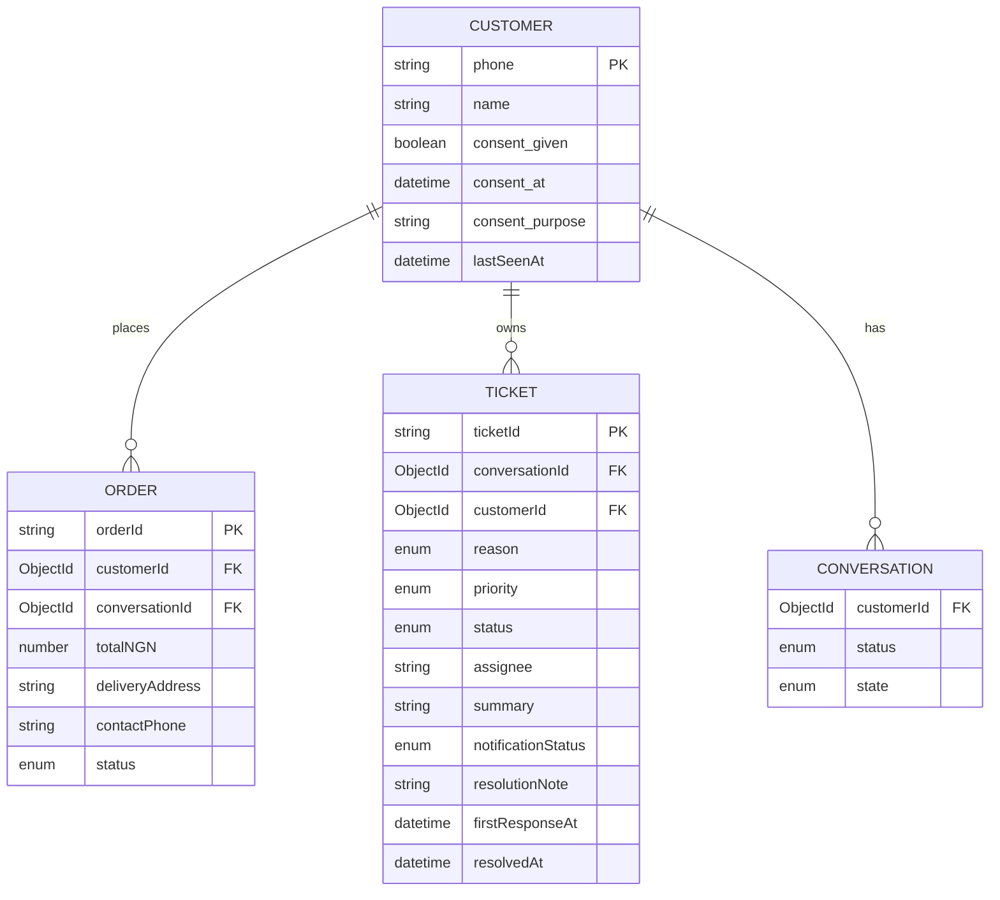

**Diagram sources**
- [customer.model.js:7-24](file://src/models/customer.model.js#L7-L24)
- [order.model.js:35-47](file://src/models/order.model.js#L35-L47)
- [ticket.model.js:23-43](file://src/models/ticket.model.js#L23-L43)
- [conversation.model.js:23-42](file://src/models/conversation.model.js#L23-L42)

**Section sources**
- [customer.model.js:3-24](file://src/models/customer.model.js#L3-L24)
- [order.model.js:35-47](file://src/models/order.model.js#L35-L47)
- [ticket.model.js:23-43](file://src/models/ticket.model.js#L23-L43)
- [conversation.model.js:18-42](file://src/models/conversation.model.js#L18-L42)

### Audit Trail Integration
The audit trail is append-only and links every major operation to a correlation ID. It supports replaying message journeys and auditing order and ticket lifecycles.

Supported event types include:
- `MESSAGE_RECEIVED`
- `DUPLICATE_IGNORED`
- `CLASSIFIED`
- `CLASSIFIER_FALLBACK`
- `REPLY_SENT`
- `ORDER_CREATED`
- `ORDER_UPDATED`
- `TICKET_CREATED`
- `TICKET_UPDATED`
- `NOTIFICATION_SENT`
- `NOTIFICATION_FAILED`
- `WEBHOOK_REJECTED`
- `PAYLOAD_INVALID`
- `VALIDATION_FAILED`

Entity types include:
- `message`
- `conversation`
- `order`
- `ticket`
- `system`

Actors include:
- `system`
- `customer`

Audit service design:
- Writes are best-effort; failures are logged but do not break the message path.
- Events carry structured detail for analysis and tracing.

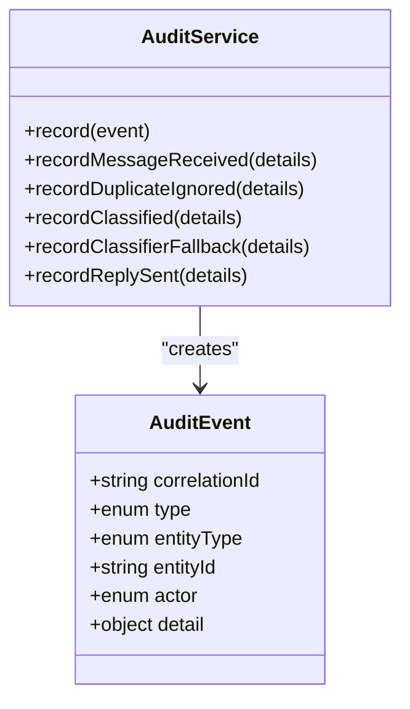

**Diagram sources**
- [auditEvent.model.js:3-48](file://src/models/auditEvent.model.js#L3-L48)
- [audit.service.js:22-116](file://src/services/audit.service.js#L22-L116)

**Section sources**
- [auditEvent.model.js:3-48](file://src/models/auditEvent.model.js#L3-L48)
- [audit.service.js:4-36](file://src/services/audit.service.js#L4-L36)
- [audit.service.js:40-116](file://src/services/audit.service.js#L40-L116)
- [pipeline.service.js:148-155](file://src/services/pipeline.service.js#L148-L155)
- [pipeline.service.js:188-195](file://src/services/pipeline.service.js#L188-L195)
- [pipeline.service.js:248-255](file://src/services/pipeline.service.js#L248-L255)

## Dependency Analysis
The following diagram maps core dependencies between models and services involved in business processes.

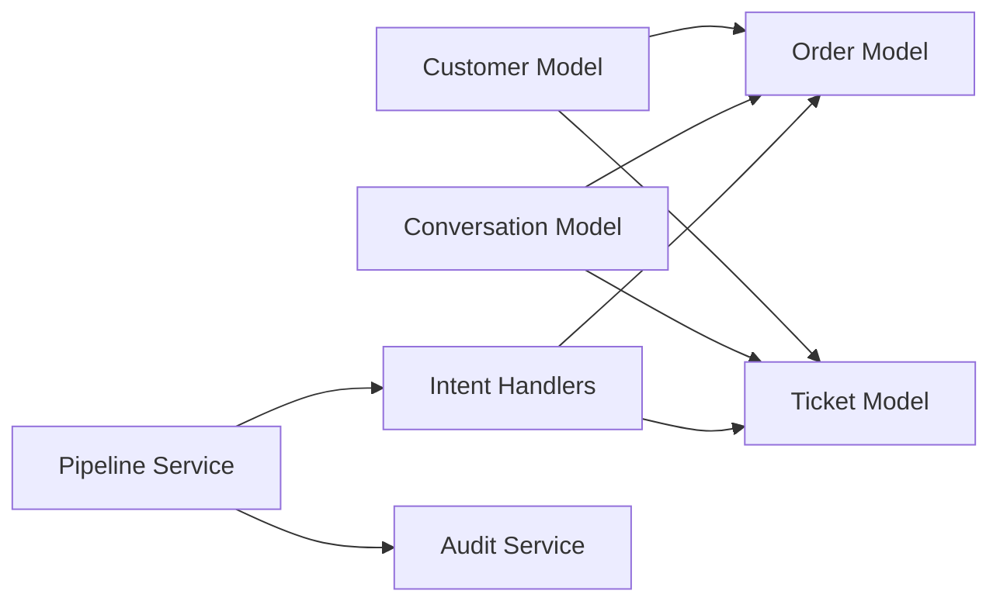

**Diagram sources**
- [order.model.js:35-47](file://src/models/order.model.js#L35-L47)
- [ticket.model.js:23-43](file://src/models/ticket.model.js#L23-L43)
- [customer.model.js:7-24](file://src/models/customer.model.js#L7-L24)
- [conversation.model.js:23-42](file://src/models/conversation.model.js#L23-L42)
- [pipeline.service.js:66-273](file://src/services/pipeline.service.js#L66-L273)
- [intentHandlers.js:1-66](file://src/services/intentHandlers.js#L1-L66)

**Section sources**
- [order.model.js:35-47](file://src/models/order.model.js#L35-L47)
- [ticket.model.js:23-43](file://src/models/ticket.model.js#L23-L43)
- [customer.model.js:7-24](file://src/models/customer.model.js#L7-L24)
- [conversation.model.js:23-42](file://src/models/conversation.model.js#L23-L42)
- [pipeline.service.js:66-273](file://src/services/pipeline.service.js#L66-L273)
- [intentHandlers.js:1-66](file://src/services/intentHandlers.js#L1-L66)

## Performance Considerations
- Order indexes on `status` and `createdAt` support efficient listing and filtering for operational dashboards.
- Ticket indexes on `status` and `createdAt` enable fast queries for overdue and active tickets.
- Audit writes are best-effort to avoid impacting the live message path; however, high-volume environments should monitor audit write latency and storage growth.
- Order totals should be computed efficiently by aggregating line items without unnecessary recalculations.

[No sources needed since this section provides general guidance]

## Troubleshooting Guide
Common data-model-related issues and resolutions:

- Invalid webhook signature or payload:
  - Check signature verification and payload validation.
  - Review audit events for `WEBHOOK_REJECTED`, `PAYLOAD_INVALID`, and `VALIDATION_FAILED`.

- Duplicate messages:
  - Deduplication prevents reprocessing; audit logs `DUPLICATE_IGNORED`.
  - Investigate provider message ID collisions or retry behavior.

- Classification fallback:
  - When LLM or classifier fails, audit records `CLASSIFIER_FALLBACK`.
  - Verify classifier configuration and thresholds.

- Reply send failures:
  - Outbound send failures are logged; audit records `REPLY_SENT` only for successful sends.
  - Check WhatsApp adapter configuration and mode.

- Order status transitions:
  - Ensure transitions comply with the defined transition map.
  - Reject invalid transitions at the API layer.

- Ticket SLA overdue:
  - Compute overdue tickets based on age and status using the SLA configuration.
  - Monitor `notificationStatus` to ensure staff alerts are delivered.

**Section sources**
- [README.md:386-407](file://README.md#L386-L407)
- [audit.service.js:22-116](file://src/services/audit.service.js#L22-L116)
- [order.model.js:11-18](file://src/models/order.model.js#L11-L18)
- [ticket.model.js:17-43](file://src/models/ticket.model.js#L17-L43)

## Conclusion
The business process entities in this system provide a robust foundation for order management, complaint handling, and auditability. Orders enforce strict lifecycle transitions and capture detailed line-item pricing. Tickets model complaint workflows with priorities, assignments, and resolution tracking. Customers anchor both orders and tickets, while conversations drive the multi-turn order collection process. The append-only audit trail ensures traceability across the entire message lifecycle. Together, these components support reliable operations, clear reporting, and scalable automation for WhatsApp-based retail interactions.

[No sources needed since this section summarizes without analyzing specific files]

## Appendices

### Example Scenarios

#### Order Creation Flow Example
- A customer sends a natural-language request to buy a product.
- The pipeline classifies the intent and enters the place-order flow.
- Slot-filling collects item, quantity, address, and phone.
- On confirmation, an order is created with status `pending_confirmation`.
- Staff confirms the order, moving it to `confirmed`, then dispatches and delivers it.

[No sources needed since this section provides conceptual examples]

#### Status Change Validation Example
- Attempting to move an order from `pending_confirmation` directly to `dispatched` should fail.
- Valid path: `pending_confirmation` → `confirmed` → `dispatched` → `delivered`.
- Cancellation is allowed from `pending_confirmation` and `confirmed`.

[No sources needed since this section provides conceptual examples]

#### Ticket Management Pattern Example
- A complaint message triggers ticket creation with reason `complaint`.
- Staff receives a notification; if delivery fails, `notificationStatus` becomes `failed`.
- Staff assigns the ticket, updates status to `in_progress`, adds a resolution note, and closes it after resolution.

[No sources needed since this section provides conceptual examples]