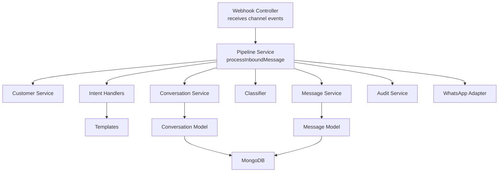
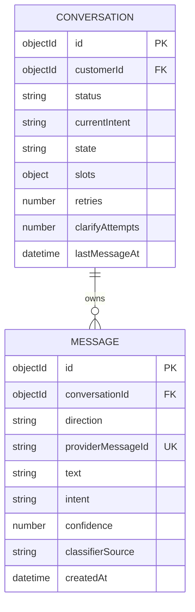
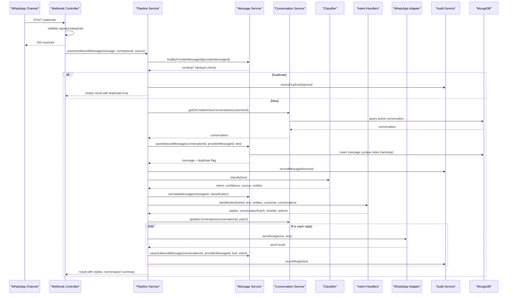
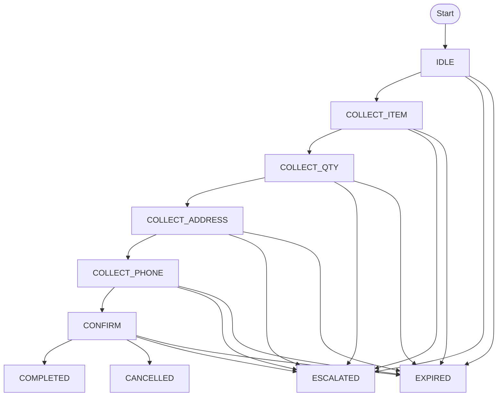
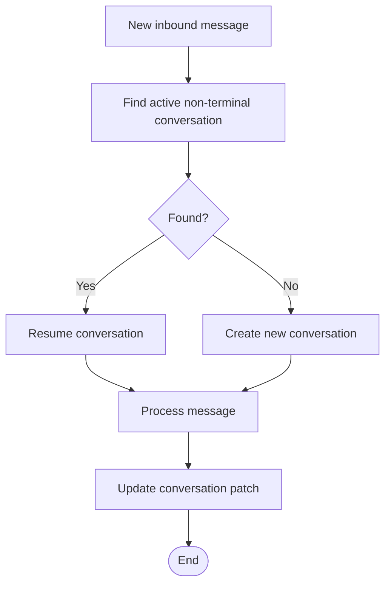
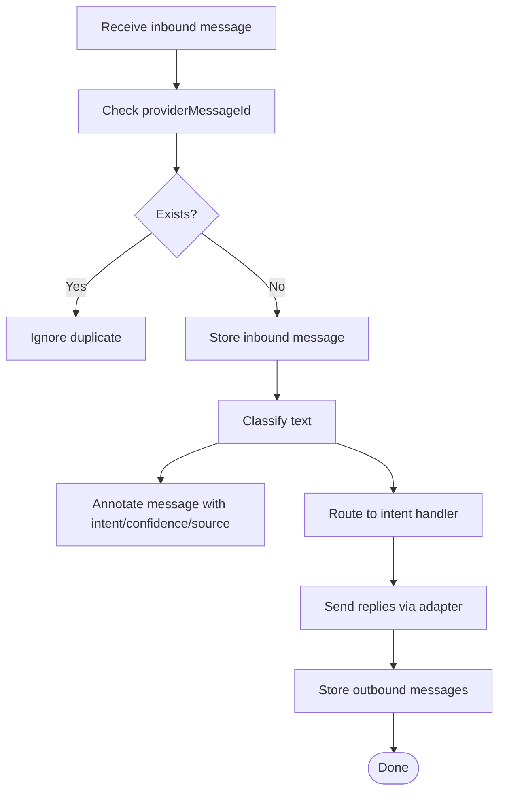
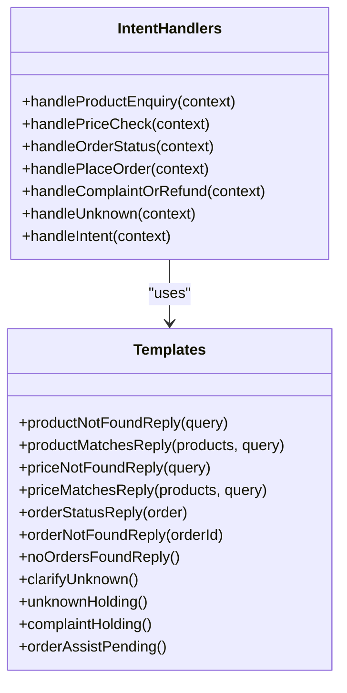
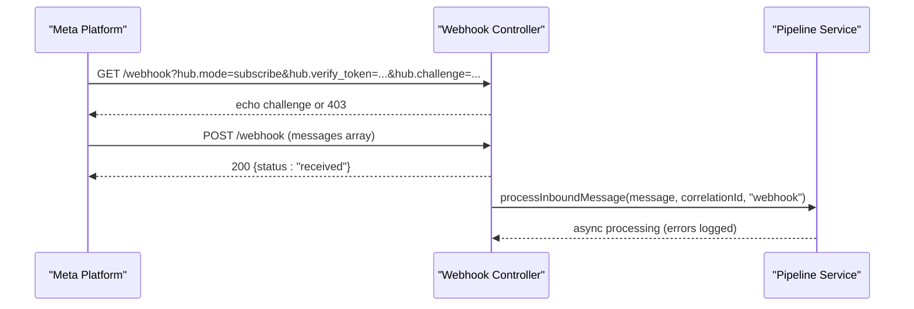
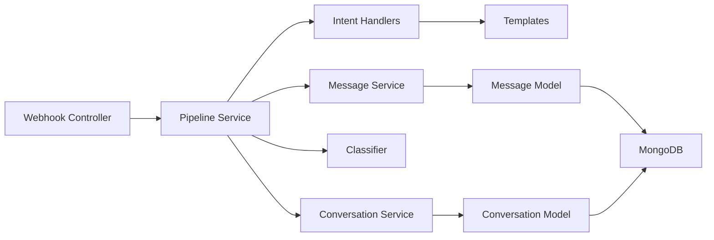

# Conversational Entities

<cite>
**Referenced Files in This Document**
- [conversation.model.js](file://src/models/conversation.model.js)
- [message.model.js](file://src/models/message.model.js)
- [conversation.service.js](file://src/services/conversation.service.js)
- [message.service.js](file://src/services/message.service.js)
- [pipeline.service.js](file://src/services/pipeline.service.js)
- [intentHandlers.js](file://src/services/intentHandlers.js)
- [webhook.controller.js](file://src/controllers/webhook.controller.js)
- [templates.js](file://src/utils/templates.js)
- [db.js](file://src/config/db.js)
</cite>

## Table of Contents
1. [Introduction](#introduction)
2. [Project Structure](#project-structure)
3. [Core Components](#core-components)
4. [Architecture Overview](#architecture-overview)
5. [Detailed Component Analysis](#detailed-component-analysis)
6. [Dependency Analysis](#dependency-analysis)
7. [Performance Considerations](#performance-considerations)
8. [Troubleshooting Guide](#troubleshooting-guide)
9. [Conclusion](#conclusion)

## Introduction
This document describes the data model and processing behavior for conversational entities in the system, focusing on two core collections:

- **Conversation**: represents a rolling customer conversation with an explicit state machine, slot-filling structure, intent tracking, and lifecycle management.
- **Message**: represents immutable inbound and outbound messages attached to a conversation, including metadata such as classification results, confidence scores, classifier source, and provider correlation identifiers.

The documentation explains how these models relate, how conversations transition through states, how messages are persisted and annotated, and how the pipeline orchestrates message handling, deduplication, classification, routing, replies, and audit logging. It also provides guidance for querying conversation history, handling high-volume messaging, and planning archival strategies.

## Project Structure
The conversational flow is implemented across models, services, controllers, and utilities:

- Models define the Conversation and Message schemas, enums, indexes, and persistence semantics.
- Services encapsulate conversation lifecycle, message persistence, intent routing, and pipeline orchestration.
- The webhook controller receives incoming channel events and delegates to the pipeline.
- Templates provide stable, testable reply text used by handlers and the pipeline.
- Database configuration manages MongoDB connection lifecycle and retries.

**Diagram sources**
- [webhook.controller.js:35-55](file://src/controllers/webhook.controller.js#L35-L55)
- [pipeline.service.js:66-273](file://src/services/pipeline.service.js#L66-L273)
- [conversation.service.js:22-42](file://src/services/conversation.service.js#L22-L42)
- [message.service.js:14-66](file://src/services/message.service.js#L14-L66)
- [conversation.model.js:23-51](file://src/models/conversation.model.js#L23-L51)
- [message.model.js:13-34](file://src/models/message.model.js#L13-L34)

**Section sources**
- [webhook.controller.js:1-56](file://src/controllers/webhook.controller.js#L1-L56)
- [pipeline.service.js:1-274](file://src/services/pipeline.service.js#L1-L274)
- [conversation.model.js:1-52](file://src/models/conversation.model.js#L1-L52)
- [message.model.js:1-35](file://src/models/message.model.js#L1-L35)

## Core Components
This section summarizes the primary data structures and their responsibilities.

### Conversation Schema
- Purpose: One rolling conversation per customer; stores current state, status, intent, partial order slots, retry counters, and last activity timestamp.
- Key fields:
  - `customerId`: reference to the customer; indexed for fast lookup.
  - `status`: active or terminal statuses.
  - `currentIntent`: most recent classified intent.
  - `state`: state machine state driving slot-filling and workflow.
  - `slots`: partial order data (SKU, quantity, address, phone).
  - `retries`, `clarifyAttempts`: counters for retries and clarification attempts.
  - `lastMessageAt`: last activity time.
- Indexes:
  - Compound index on `customerId` and `status`.
- Lifecycle:
  - Active conversations resume when a new inbound arrives.
  - Terminal states roll over to a new conversation so history remains grouped per matter.

**Section sources**
- [conversation.model.js:3-16](file://src/models/conversation.model.js#L3-L16)
- [conversation.model.js:18-48](file://src/models/conversation.model.js#L18-L48)
- [conversation.service.js:3-16](file://src/services/conversation.service.js#L3-L16)

### Message Schema
- Purpose: Immutable record of each inbound/outbound message, with classification metadata and provider correlation IDs.
- Key fields:
  - `conversationId`: reference to the owning conversation; indexed.
  - `direction`: inbound or outbound.
  - `providerMessageId`: unique identifier from the channel; globally unique.
  - `text`: message body.
  - `intent`: classified intent.
  - `confidence`: numeric confidence score.
  - `classifierSource`: rules, LLM, fallback, or null.
- Indexes:
  - Compound index on `conversationId` and `createdAt` for efficient history retrieval.
- Deduplication:
  - Unique index on `providerMessageId` prevents duplicate storage even under concurrent deliveries.

**Section sources**
- [message.model.js:3-4](file://src/models/message.model.js#L3-L4)
- [message.model.js:6-29](file://src/models/message.model.js#L6-L29)
- [message.model.js:31-34](file://src/models/message.model.js#L31-L34)

### Relationship Between Conversations and Messages
- A conversation owns many messages.
- Inbound messages are persisted first, then annotated with classification results.
- Outbound messages are persisted after successful send via the channel adapter.
- Both inbound and outbound messages include the conversation ID for threading.

**Diagram sources**
- [conversation.model.js:23-48](file://src/models/conversation.model.js#L23-L48)
- [message.model.js:13-31](file://src/models/message.model.js#L13-L31)

## Architecture Overview
The end-to-end flow for an inbound message is orchestrated by the pipeline service. The webhook controller returns immediately and processes asynchronously to avoid retry storms.

**Diagram sources**
- [webhook.controller.js:35-55](file://src/controllers/webhook.controller.js#L35-L55)
- [pipeline.service.js:66-273](file://src/services/pipeline.service.js#L66-L273)
- [message.service.js:14-66](file://src/services/message.service.js#L14-L66)
- [conversation.service.js:22-42](file://src/services/conversation.service.js#L22-L42)
- [intentHandlers.js:98-114](file://src/services/intentHandlers.js#L98-L114)

## Detailed Component Analysis

### Conversation State Machine and Slot-Filling Data Structure
The conversation state machine drives the slot-filling workflow for placing orders. Current states include idle, collection phases, confirmation, completion, cancellation, escalation, and expiration. Slots hold partially collected order data between messages.

- States:
  - Idle: initial state before any action.
  - Collect Item: asking for product selection.
  - Collect Qty: asking for quantity.
  - Collect Address: asking for delivery address.
  - Collect Phone: asking for contact phone.
  - Confirm: confirming order details.
  - Completed: order finished.
  - Cancelled: order cancelled.
  - Escalated: escalated to staff/ticket.
  - Expired: stale in-progress session expired.
- Slots:
  - SKU: selected product identifier.
  - Quantity: requested amount.
  - Address: delivery location.
  - Phone: contact phone number.
- Counters:
  - Retries: general retry count.
  - Clarify Attempts: unknown-intent clarification counter.
- Status:
  - Active: normal operational state.
  - Escalated/Completed/Expired: terminal statuses that cause rollover to a new conversation.

**Diagram sources**
- [conversation.model.js:5-16](file://src/models/conversation.model.js#L5-L16)
- [conversation.model.js:34-42](file://src/models/conversation.model.js#L34-L42)

**Section sources**
- [conversation.model.js:5-16](file://src/models/conversation.model.js#L5-L16)
- [conversation.model.js:18-42](file://src/models/conversation.model.js#L18-L42)
- [conversation.service.js:3-16](file://src/services/conversation.service.js#L3-L16)

### Conversation Lifecycle Management
- Rolling per customer: one active conversation resumes on inbound messages.
- Terminal states trigger rollover: completed, cancelled, escalated, expired.
- Lookup strategy: find the most recent active non-terminal conversation by creation date.
- Creation strategy: create a new conversation if none exists.
- Update strategy: apply `$set` patches for intent, state, slots, and counters.

**Diagram sources**
- [conversation.service.js:22-42](file://src/services/conversation.service.js#L22-L42)
- [pipeline.service.js:123-159](file://src/services/pipeline.service.js#L123-L159)
- [pipeline.service.js:226-229](file://src/services/pipeline.service.js#L226-L229)

**Section sources**
- [conversation.service.js:3-16](file://src/services/conversation.service.js#L3-L16)
- [conversation.service.js:22-42](file://src/services/conversation.service.js#L22-L42)

### Message Storage, Metadata, Correlation IDs, and Threading
- Inbound messages:
  - Persisted with direction `inbound`, provider message ID, and text.
  - Annotated later with intent, confidence, and classifier source.
- Outbound messages:
  - Persisted with direction `outbound`, provider message ID (or local UUID fallback), text, and associated intent.
- Correlation IDs:
  - Provider message ID ensures global uniqueness and deduplication.
  - Local UUIDs may be generated for outbound messages when the channel does not return a provider ID.
- Threading:
  - All messages include `conversationId`, enabling ordered retrieval per conversation.
- Indexing:
  - Compound index on `conversationId` and `createdAt` supports efficient chronological queries.

**Diagram sources**
- [pipeline.service.js:77-88](file://src/services/pipeline.service.js#L77-L88)
- [pipeline.service.js:131-146](file://src/services/pipeline.service.js#L131-L146)
- [pipeline.service.js:171-205](file://src/services/pipeline.service.js#L171-L205)
- [pipeline.service.js:234-257](file://src/services/pipeline.service.js#L234-L257)
- [message.service.js:14-66](file://src/services/message.service.js#L14-L66)

**Section sources**
- [message.model.js:6-29](file://src/models/message.model.js#L6-L29)
- [message.model.js:31-34](file://src/models/message.model.js#L31-L34)
- [message.service.js:4-11](file://src/services/message.service.js#L4-L11)
- [message.service.js:14-66](file://src/services/message.service.js#L14-L66)
- [pipeline.service.js:77-88](file://src/services/pipeline.service.js#L77-L88)
- [pipeline.service.js:131-146](file://src/services/pipeline.service.js#L131-L146)
- [pipeline.service.js:171-205](file://src/services/pipeline.service.js#L171-L205)
- [pipeline.service.js:234-257](file://src/services/pipeline.service.js#L234-L257)

### Intent Tracking and Handler Routing
- Classification:
  - Text messages are classified into intents with confidence and source.
  - Non-text messages receive a prompt requesting text input and do not set an intent.
- Annotation:
  - Classification results are stored on the inbound message.
- Routing:
  - Intent handlers map recognized intents to specific logic.
  - Unknown intents trigger clarification once; repeated unknowns increment a counter and produce a holding reply.
- Conversation Patch:
  - Handlers can request updates to conversation fields like `clarifyAttempts`.

**Diagram sources**
- [intentHandlers.js:21-96](file://src/services/intentHandlers.js#L21-L96)
- [intentHandlers.js:98-114](file://src/services/intentHandlers.js#L98-L114)
- [templates.js:28-106](file://src/utils/templates.js#L28-L106)

**Section sources**
- [pipeline.service.js:171-205](file://src/services/pipeline.service.js#L171-L205)
- [intentHandlers.js:1-17](file://src/services/intentHandlers.js#L1-L17)
- [intentHandlers.js:21-96](file://src/services/intentHandlers.js#L21-L96)
- [intentHandlers.js:98-114](file://src/services/intentHandlers.js#L98-L114)
- [templates.js:28-106](file://src/utils/templates.js#L28-L106)

### Webhook Entry Point and Asynchronous Processing
- Verification handshake: validates Meta’s verify token and echoes challenge.
- Message reception:
  - Validates signature and payload via middleware.
  - Returns 200 immediately to prevent retry storms.
  - Processes each message asynchronously through the pipeline.

**Diagram sources**
- [webhook.controller.js:10-25](file://src/controllers/webhook.controller.js#L10-L25)
- [webhook.controller.js:35-55](file://src/controllers/webhook.controller.js#L35-L55)
- [pipeline.service.js:66-88](file://src/services/pipeline.service.js#L66-L88)

**Section sources**
- [webhook.controller.js:1-56](file://src/controllers/webhook.controller.js#L1-L56)
- [pipeline.service.js:12-27](file://src/services/pipeline.service.js#L12-L27)

## Dependency Analysis
The following diagram shows key dependencies among components involved in conversational flows.

**Diagram sources**
- [webhook.controller.js:35-55](file://src/controllers/webhook.controller.js#L35-L55)
- [pipeline.service.js:66-273](file://src/services/pipeline.service.js#L66-L273)
- [message.service.js:14-66](file://src/services/message.service.js#L14-L66)
- [conversation.service.js:22-42](file://src/services/conversation.service.js#L22-L42)
- [message.model.js:13-34](file://src/models/message.model.js#L13-L34)
- [conversation.model.js:23-51](file://src/models/conversation.model.js#L23-L51)

**Section sources**
- [pipeline.service.js:1-10](file://src/services/pipeline.service.js#L1-L10)
- [intentHandlers.js:1-4](file://src/services/intentHandlers.js#L1-L4)

## Performance Considerations
For high-volume messaging scenarios, consider the following patterns already present and additional optimizations:

- Immediate acknowledgment:
  - Webhook returns 200 quickly to avoid retry storms.
- Idempotency:
  - Provider message ID deduplication prevents duplicate processing and storage.
- Efficient indexing:
  - Compound indexes on `conversationId` and `createdAt` optimize history retrieval.
  - Index on `customerId` and `status` accelerates active conversation lookup.
- Minimal writes:
  - Annotate inbound messages once after classification.
  - Batch outbound message persistence only after successful sends.
- Connection resilience:
  - MongoDB connection includes exponential backoff retries and graceful shutdown.

Additional recommendations:
- Pagination for conversation history:
  - Use `createdAt` ordering with cursor-based pagination to reduce memory pressure.
- Read replicas:
  - Offload read-heavy queries (history retrieval) to replicas.
- Caching:
  - Cache frequent catalog lookups and product matches.
- Archival:
  - Move older conversations/messages to cold storage based on age or status.
- Backpressure:
  - Queue asynchronous processing with bounded concurrency to protect downstream systems.

[No sources needed since this section provides general guidance]

## Troubleshooting Guide
Common issues and diagnostics:

- Duplicate messages:
  - Check provider message ID uniqueness and dedupe logs.
  - Verify unique index on `providerMessageId`.
- Missing conversation:
  - Ensure customer phone normalization and active conversation lookup.
  - Confirm terminal state rollover logic.
- Classification failures:
  - Inspect classifier fallback logs and annotation fields.
  - Validate intent handler mapping and template outputs.
- Send failures:
  - Review outbound message persistence and audit logs.
  - Check WhatsApp adapter responses.
- Database connectivity:
  - Monitor MongoDB connection state and retry logs.
  - Use health endpoints to detect down states.

**Section sources**
- [pipeline.service.js:77-88](file://src/services/pipeline.service.js#L77-L88)
- [pipeline.service.js:131-146](file://src/services/pipeline.service.js#L131-L146)
- [pipeline.service.js:171-205](file://src/services/pipeline.service.js#L171-L205)
- [pipeline.service.js:234-257](file://src/services/pipeline.service.js#L234-L257)
- [db.js:11-18](file://src/config/db.js#L11-L18)
- [db.js:37-67](file://src/config/db.js#L37-L67)

## Conclusion
The conversational entity model centers on a robust Conversation schema with an explicit state machine and slot-filling structure, paired with an immutable Message schema that captures both content and classification metadata. The pipeline orchestrates deduplication, persistence, classification, routing, replies, and audit logging while maintaining strong guarantees against duplicates and ensuring efficient indexing for high-volume operations. With clear relationships between conversations and messages, well-defined state transitions, and resilient database connectivity, the system provides a solid foundation for scalable conversational workflows. Future enhancements should focus on completing the slot-filling state machine, implementing ticketing for escalations, and introducing archival strategies for long-term data retention.