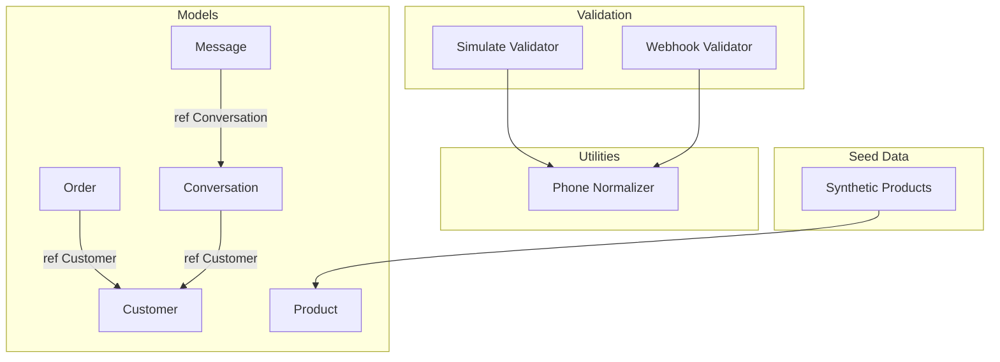
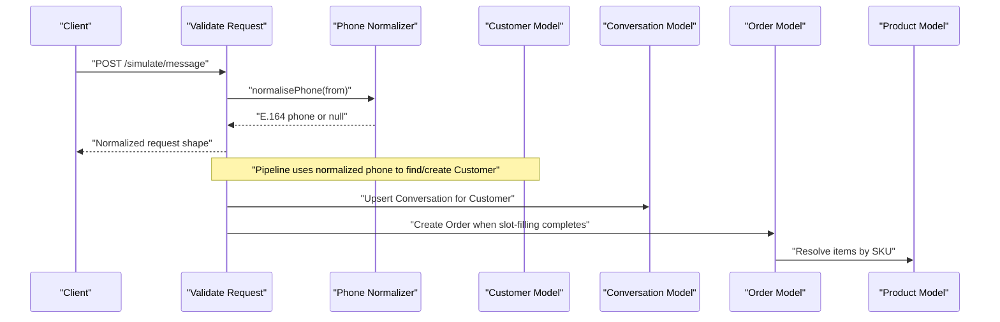
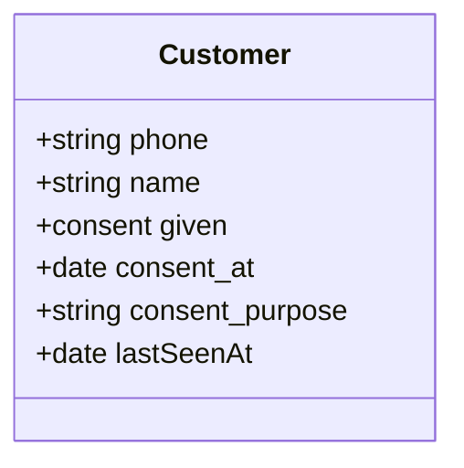
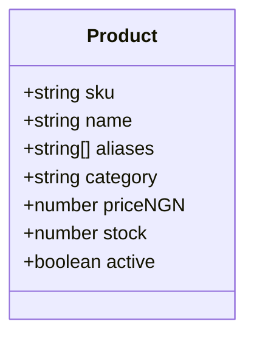
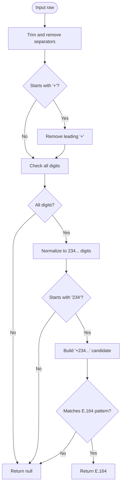
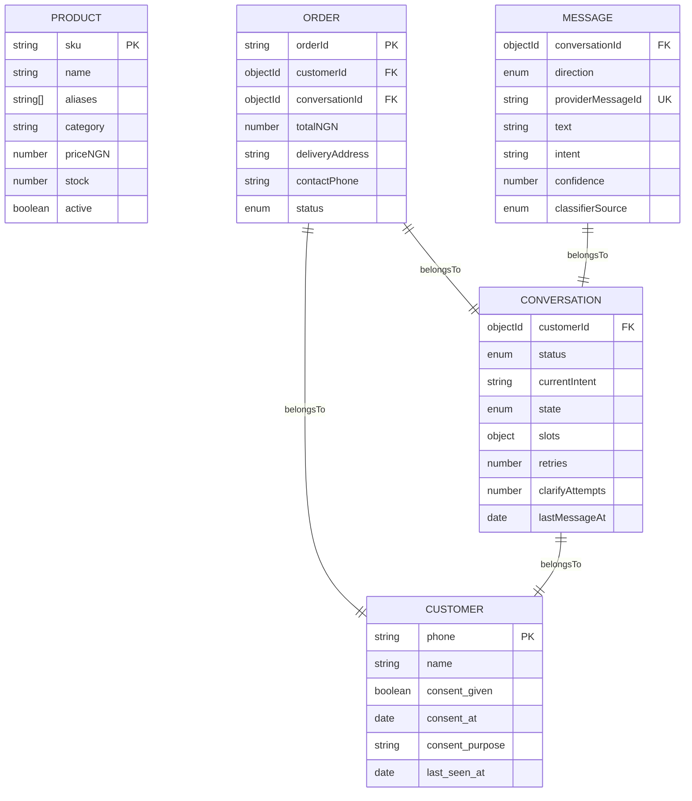
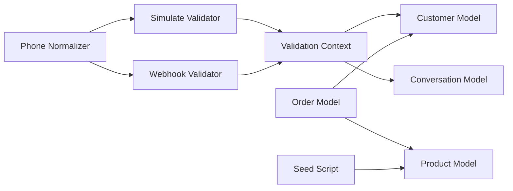
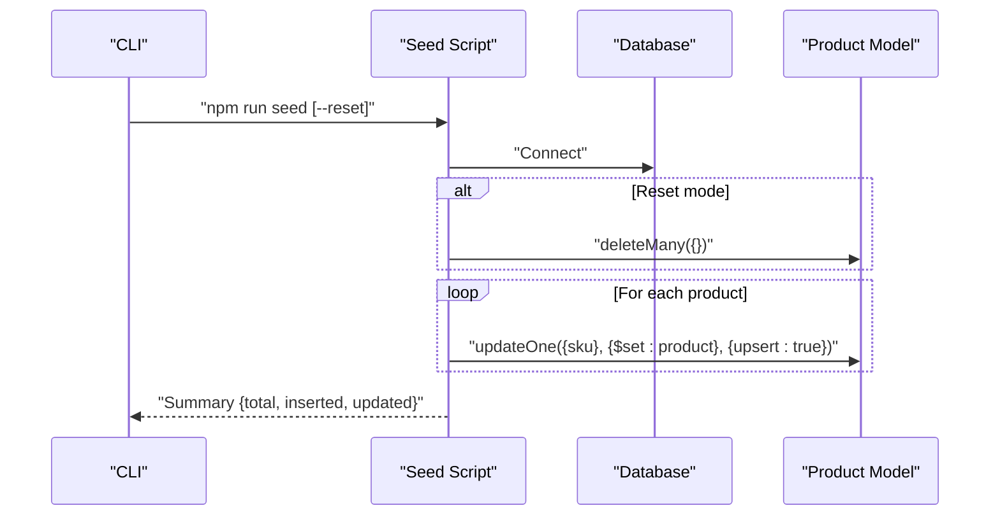

# Core Entities

<cite>
**Referenced Files in This Document**
- [customer.model.js](file://src/models/customer.model.js)
- [product.model.js](file://src/models/product.model.js)
- [phone.js](file://src/utils/phone.js)
- [products.js](file://scripts/data/products.js)
- [order.model.js](file://src/models/order.model.js)
- [conversation.model.js](file://src/models/conversation.model.js)
- [message.model.js](file://src/models/message.model.js)
- [simulate.validator.js](file://src/validators/simulate.validator.js)
- [webhook.validator.js](file://src/validators/webhook.validator.js)
- [seed.js](file://scripts/seed.js)
</cite>

## Table of Contents
1. [Introduction](#introduction)
2. [Project Structure](#project-structure)
3. [Core Components](#core-components)
4. [Architecture Overview](#architecture-overview)
5. [Detailed Component Analysis](#detailed-component-analysis)
6. [Dependency Analysis](#dependency-analysis)
7. [Performance Considerations](#performance-considerations)
8. [Privacy, Compliance, and Security](#privacy-compliance-and-security)
9. [Data Access Patterns](#data-access-patterns)
10. [Troubleshooting Guide](#troubleshooting-guide)
11. [Conclusion](#conclusion)

## Introduction
This document describes the core business data models for the lead system manager: Customer and Product. It explains field types, validation rules, indexes, relationships to related entities such as Order, Conversation, and Message, and how phone normalization supports privacy-safe customer identification. It also documents inventory management, pricing structures, catalog organization, and data access patterns used by seeding and validation flows.

## Project Structure
The relevant data model files live under `src/models`, with supporting utilities and seed data:
- Customer schema: `src/models/customer.model.js`
- Product schema: `src/models/product.model.js`
- Phone normalization utility: `src/utils/phone.js`
- Synthetic product catalogue: `scripts/data/products.js`
- Related entities: Order, Conversation, Message
- Validation layer that normalizes incoming phone numbers: `src/validators/simulate.validator.js`, `src/validators/webhook.validator.js`
- Seed script that upserts products: `scripts/seed.js`

**Diagram sources**
- [customer.model.js:7-24](file://src/models/customer.model.js#L7-L24)
- [product.model.js:9-22](file://src/models/product.model.js#L9-L22)
- [order.model.js:35-47](file://src/models/order.model.js#L35-L47)
- [conversation.model.js:23-45](file://src/models/conversation.model.js#L23-L45)
- [message.model.js:13-29](file://src/models/message.model.js#L13-L29)
- [phone.js:16-33](file://src/utils/phone.js#L16-L33)
- [simulate.validator.js:28-53](file://src/validators/simulate.validator.js#L28-L53)
- [webhook.validator.js:1-48](file://src/validators/webhook.validator.js#L1-L48)
- [products.js:7-49](file://scripts/data/products.js#L7-L49)
- [seed.js:16-35](file://scripts/seed.js#L16-L35)

**Section sources**
- [customer.model.js:1-27](file://src/models/customer.model.js#L1-L27)
- [product.model.js:1-25](file://src/models/product.model.js#L1-L25)
- [phone.js:1-54](file://src/utils/phone.js#L1-L54)
- [products.js:1-50](file://scripts/data/products.js#L1-L50)
- [order.model.js:1-53](file://src/models/order.model.js#L1-L53)
- [conversation.model.js:1-52](file://src/models/conversation.model.js#L1-L52)
- [message.model.js:1-35](file://src/models/message.model.js#L1-L35)
- [simulate.validator.js:1-54](file://src/validators/simulate.validator.js#L1-L54)
- [webhook.validator.js:1-48](file://src/validators/webhook.validator.js#L1-L48)
- [seed.js:1-60](file://scripts/seed.js#L1-L60)

## Core Components
This section summarizes the two primary business entities: Customer and Product.

### Customer Entity
- Purpose: Represents a WhatsApp customer keyed by a normalized E.164 phone number. Consent is explicitly tracked to support data-minimization and compliance requirements.
- Key fields:
  - phone: required, unique, validated against an E.164 pattern.
  - name: optional, trimmed string.
  - consent.given: boolean flag indicating whether the customer has given consent.
  - consent.at: timestamp when consent was recorded.
  - consent.purpose: reason or scope for consent (e.g., order processing).
  - lastSeenAt: timestamp updated on customer activity.
- Timestamps: creation time is tracked; update time is disabled at the schema level.

**Section sources**
- [customer.model.js:7-24](file://src/models/customer.model.js#L7-L24)

### Product Entity
- Purpose: Catalogue product with inventory and pricing information. Aliases support natural-language matching from WhatsApp messages.
- Key fields:
  - sku: required, unique, uppercase, trimmed identifier.
  - name: required, trimmed display name.
  - aliases: array of free-text names customers may use.
  - category: required, trimmed, indexed for filtering.
  - priceNGN: required numeric price in Nigerian Naira, non-negative.
  - stock: required numeric inventory count, non-negative, default zero.
  - active: boolean flag to include/exclude from catalog queries.
- Indexes:
  - Text index over name and aliases for search.
  - Category index for filtering.

**Section sources**
- [product.model.js:9-22](file://src/models/product.model.js#L9-L22)

## Architecture Overview
The Customer and Product entities are central to the ordering workflow:
- Customer is referenced by Conversation and Order.
- Product is referenced by Order items via SKU.
- Incoming messages are validated and normalized before interacting with Customer and Conversation state.
- Product catalog is seeded idempotently by SKU.

**Diagram sources**
- [simulate.validator.js:28-53](file://src/validators/simulate.validator.js#L28-L53)
- [phone.js:16-33](file://src/utils/phone.js#L16-L33)
- [conversation.model.js:23-45](file://src/models/conversation.model.js#L23-L45)
- [order.model.js:35-47](file://src/models/order.model.js#L35-L47)
- [product.model.js:9-22](file://src/models/product.model.js#L9-L22)

## Detailed Component Analysis

### Customer Schema
- Field definitions and constraints:
  - phone: String, required, unique, validated with an E.164 regex.
  - name: String, optional, trimmed.
  - consent: embedded object with given (boolean), at (Date), purpose (String).
  - lastSeenAt: Date, defaults to current time.
- Indexes:
  - Unique index on phone enforced by schema uniqueness.
- Business rules:
  - Phone must be a valid E.164 format.
  - Consent tracking supports compliance and auditability.
  - lastSeenAt provides recency metadata for customer activity.

**Diagram sources**
- [customer.model.js:7-24](file://src/models/customer.model.js#L7-L24)

**Section sources**
- [customer.model.js:7-24](file://src/models/customer.model.js#L7-L24)

### Product Schema
- Field definitions and constraints:
  - sku: String, required, unique, uppercase, trimmed.
  - name: String, required, trimmed.
  - aliases: Array of Strings, default empty.
  - category: String, required, trimmed, indexed.
  - priceNGN: Number, required, minimum 0.
  - stock: Number, required, minimum 0, default 0.
  - active: Boolean, default true.
- Indexes:
  - Text index on name and aliases for full-text search.
  - Category index for efficient filtering.
- Business rules:
  - Prices and stock must be non-negative.
  - SKU is the canonical identifier for upsert operations.

**Diagram sources**
- [product.model.js:9-22](file://src/models/product.model.js#L9-L22)

**Section sources**
- [product.model.js:9-22](file://src/models/product.model.js#L9-L22)

### Phone Normalization Utility
- Responsibilities:
  - Normalize various input formats into E.164 (+234...) for Nigerian numbers.
  - Validate whether a raw value is a usable Nigerian phone number.
  - Convert E.164 to wa_id format without leading plus.
  - Mask phone numbers for safe logging.
- Algorithm overview:
  - Strip whitespace and common separators.
  - Remove leading plus sign if present.
  - Normalize local and international variants to 234... digits.
  - Enforce Nigerian prefix and length constraints.
  - Return null if invalid.

**Diagram sources**
- [phone.js:16-33](file://src/utils/phone.js#L16-L33)

**Section sources**
- [phone.js:16-33](file://src/utils/phone.js#L16-L33)

### Relationship Mappings
- Order references Customer and Conversation:
  - customerId: ObjectId ref to Customer.
  - conversationId: ObjectId ref to Conversation.
  - items: array referencing Product by SKU.
- Conversation references Customer:
  - customerId: ObjectId ref to Customer.
- Message references Conversation:
  - conversationId: ObjectId ref to Conversation.

**Diagram sources**
- [order.model.js:35-47](file://src/models/order.model.js#L35-L47)
- [conversation.model.js:23-45](file://src/models/conversation.model.js#L23-L45)
- [message.model.js:13-29](file://src/models/message.model.js#L13-L29)
- [customer.model.js:7-24](file://src/models/customer.model.js#L7-L24)
- [product.model.js:9-22](file://src/models/product.model.js#L9-L22)

**Section sources**
- [order.model.js:35-47](file://src/models/order.model.js#L35-L47)
- [conversation.model.js:23-45](file://src/models/conversation.model.js#L23-L45)
- [message.model.js:13-29](file://src/models/message.model.js#L13-L29)

## Dependency Analysis
- Customer depends on phone normalization for consistent identity across systems.
- Product depends on synthetic seed data for initial catalog population.
- Validation layer depends on phone normalization to ensure only valid Nigerian numbers enter the pipeline.
- Order and Conversation depend on Customer for relationship integrity.
- Message depends on Conversation for message history context.

**Diagram sources**
- [phone.js:16-33](file://src/utils/phone.js#L16-L33)
- [simulate.validator.js:28-53](file://src/validators/simulate.validator.js#L28-L53)
- [webhook.validator.js:1-48](file://src/validators/webhook.validator.js#L1-L48)
- [customer.model.js:7-24](file://src/models/customer.model.js#L7-L24)
- [conversation.model.js:23-45](file://src/models/conversation.model.js#L23-L45)
- [order.model.js:35-47](file://src/models/order.model.js#L35-L47)
- [product.model.js:9-22](file://src/models/product.model.js#L9-L22)
- [seed.js:16-35](file://scripts/seed.js#L16-L35)

**Section sources**
- [phone.js:16-33](file://src/utils/phone.js#L16-L33)
- [simulate.validator.js:28-53](file://src/validators/simulate.validator.js#L28-L53)
- [webhook.validator.js:1-48](file://src/validators/webhook.validator.js#L1-L48)
- [customer.model.js:7-24](file://src/models/customer.model.js#L7-L24)
- [product.model.js:9-22](file://src/models/product.model.js#L9-L22)
- [order.model.js:35-47](file://src/models/order.model.js#L35-L47)
- [conversation.model.js:23-45](file://src/models/conversation.model.js#L23-L45)
- [seed.js:16-35](file://scripts/seed.js#L16-L35)

## Performance Considerations
- Customer:
  - Unique index on phone ensures fast lookups and prevents duplicates.
  - lastSeenAt enables quick filtering by recent activity.
- Product:
  - Category index improves filtering performance.
  - Text index on name and aliases supports efficient full-text search.
- Order:
  - Composite index on status and createdAt optimizes listing and pagination.
- Conversation:
  - Index on customerId and status supports per-customer active conversation retrieval.
- Message:
  - Index on conversationId and createdAt optimizes message history retrieval.

Recommendations:
- Keep phone normalization strict to avoid redundant records.
- Use category filters and pagination for product listings.
- Monitor text index size and query patterns for name/aliases search.

**Section sources**
- [customer.model.js:7-24](file://src/models/customer.model.js#L7-L24)
- [product.model.js:14-22](file://src/models/product.model.js#L14-L22)
- [order.model.js:49-49](file://src/models/order.model.js#L49-L49)
- [conversation.model.js:47-47](file://src/models/conversation.model.js#L47-L47)
- [message.model.js:31-31](file://src/models/message.model.js#L31-L31)

## Privacy, Compliance, and Security
- Phone normalization:
  - Ensures consistent E.164 representation, reducing duplication and enabling secure deduplication.
  - Provides masking utilities for operational logs to minimize exposure of sensitive phone numbers.
- Consent tracking:
  - Explicit consent fields (given, at, purpose) support compliance with data minimization principles.
  - lastSeenAt can help identify inactive accounts for retention policies.
- Data retention:
  - Consider purging or anonymizing customer records where consent is withdrawn or after defined retention periods.
  - Audit trails should record consent changes and data access events.
- Security considerations:
  - Avoid logging raw phone numbers; use masked versions.
  - Restrict access to customer data through authentication and authorization layers.
  - Encrypt sensitive fields at rest if required by policy.

**Section sources**
- [phone.js:49-53](file://src/utils/phone.js#L49-L53)
- [customer.model.js:16-21](file://src/models/customer.model.js#L16-L21)

## Data Access Patterns
- Seeding products:
  - Idempotent upsert by SKU using updateOne with upsert flag.
  - Supports reset mode to clear existing products before seeding.
- Validating requests:
  - Simulate validator enforces Nigerian phone format and normalizes phone before passing to pipeline.
  - Webhook validator preserves unknown fields while validating consumed parts.

**Diagram sources**
- [seed.js:16-35](file://scripts/seed.js#L16-L35)
- [products.js:7-49](file://scripts/data/products.js#L7-L49)

**Section sources**
- [seed.js:16-35](file://scripts/seed.js#L16-L35)
- [simulate.validator.js:28-53](file://src/validators/simulate.validator.js#L28-L53)
- [webhook.validator.js:1-48](file://src/validators/webhook.validator.js#L1-L48)

## Troubleshooting Guide
Common issues and resolutions:
- Invalid phone number:
  - Ensure input conforms to Nigerian E.164 format; use normalisePhone to validate and normalize.
  - Simulate validator rejects non-Nigerian numbers with validation errors.
- Duplicate product SKU:
  - Seed script handles duplicates via upsert; verify SKU uniqueness and case normalization.
- Missing product category:
  - Category is required; ensure seed data includes valid categories.
- Low stock or negative price:
  - Schema enforces non-negative values; correct seed data accordingly.

**Section sources**
- [phone.js:16-33](file://src/utils/phone.js#L16-L33)
- [simulate.validator.js:28-53](file://src/validators/simulate.validator.js#L28-L53)
- [product.model.js:11-17](file://src/models/product.model.js#L11-L17)
- [products.js:7-49](file://scripts/data/products.js#L7-L49)

## Conclusion
The Customer and Product schemas provide a solid foundation for managing customer identities with explicit consent tracking and a searchable, filterable product catalog. Phone normalization ensures consistent, privacy-safe customer identification. Indexes and validation rules optimize performance and enforce business constraints. Relationships to Order, Conversation, and Message complete the data model needed for the WhatsApp-driven ordering workflow. Adhering to the documented validation, indexing, and security practices will help maintain data integrity, performance, and compliance.