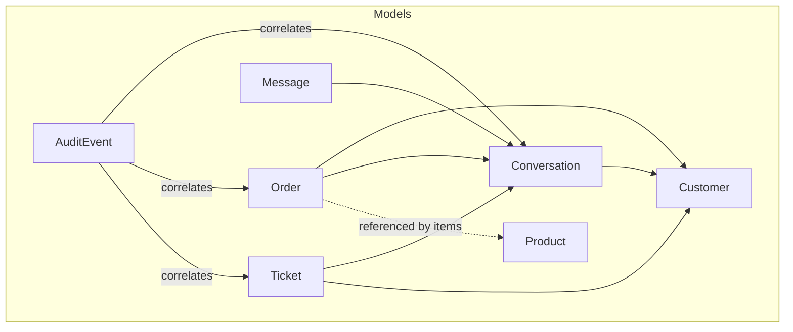
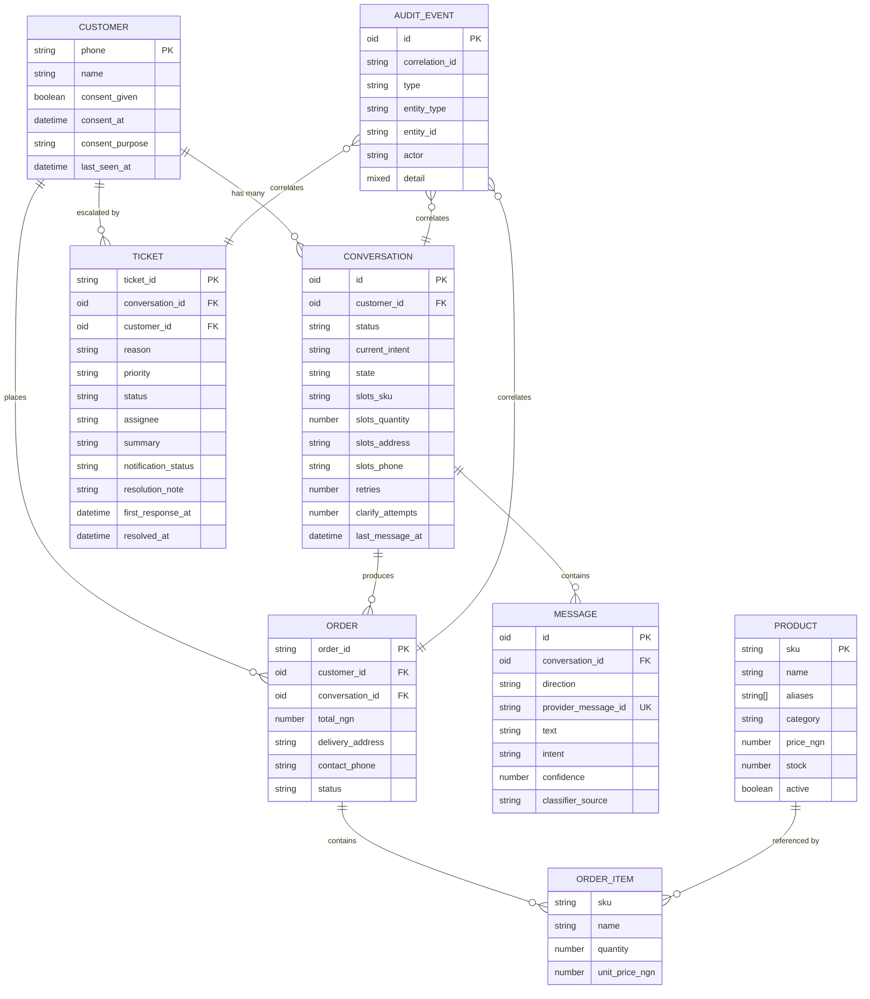
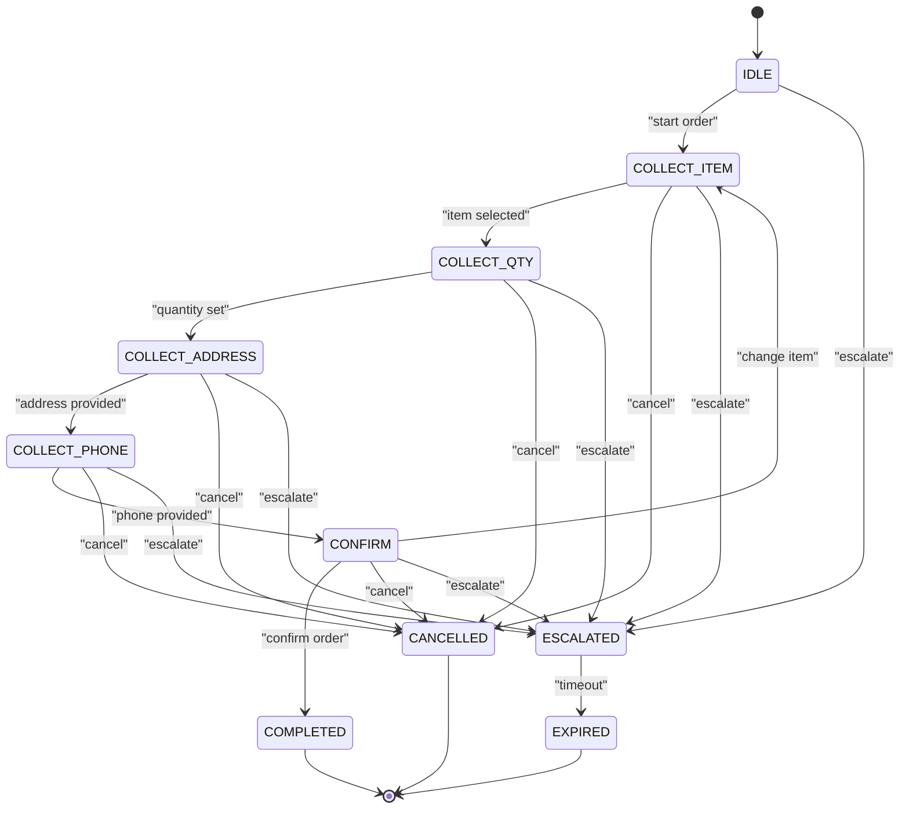
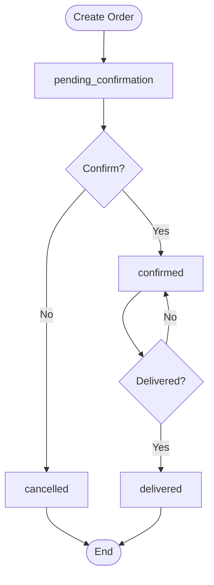
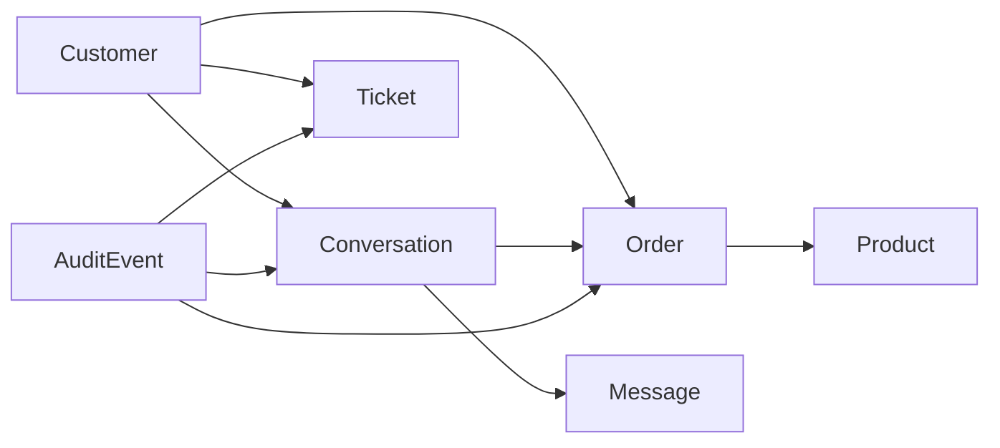

# Database Schema Design

<cite>
**Referenced Files in This Document**
- [index.js](file://src/models/index.js)
- [customer.model.js](file://src/models/customer.model.js)
- [conversation.model.js](file://src/models/conversation.model.js)
- [order.model.js](file://src/models/order.model.js)
- [message.model.js](file://src/models/message.model.js)
- [ticket.model.js](file://src/models/ticket.model.js)
- [product.model.js](file://src/models/product.model.js)
- [auditEvent.model.js](file://src/models/auditEvent.model.js)
</cite>

## Table of Contents
1. [Introduction](#introduction)
2. [Project Structure](#project-structure)
3. [Core Components](#core-components)
4. [Architecture Overview](#architecture-overview)
5. [Detailed Component Analysis](#detailed-component-analysis)
6. [Dependency Analysis](#dependency-analysis)
7. [Performance Considerations](#performance-considerations)
8. [Data Migration Strategy](#data-migration-strategy)
9. [Security, Privacy, and Compliance](#security-privacy-and-compliance)
10. [Troubleshooting Guide](#troubleshooting-guide)
11. [Conclusion](#conclusion)

## Introduction
This document describes the Mongoose data models that power the lead system manager. It focuses on entity relationships among customers, conversations, orders, messages, tickets, products, and audit events. It also documents field definitions, validation rules, indexes, constraints, conversation state machine design, order lifecycle management, customer consent tracking, and audit trail structure. Finally, it provides database schema diagrams, sample data structures, data access patterns, migration approaches, indexing strategies, retention policies, and security and compliance considerations.

## Project Structure
The data model layer is organized under `src/models`. Each domain entity has its own file, and a central index exports all models and shared enumerations to ensure idempotent registration with Mongoose.

**Diagram sources**
- [index.js:6-12](file://src/models/index.js#L6-L12)
- [customer.model.js:7-27](file://src/models/customer.model.js#L7-L27)
- [conversation.model.js:23-51](file://src/models/conversation.model.js#L23-L51)
- [order.model.js:35-52](file://src/models/order.model.js#L35-L52)
- [message.model.js:13-34](file://src/models/message.model.js#L13-L34)
- [ticket.model.js:23-48](file://src/models/ticket.model.js#L23-L48)
- [product.model.js:9-25](file://src/models/product.model.js#L9-L25)
- [auditEvent.model.js:31-48](file://src/models/auditEvent.model.js#L31-L48)

**Section sources**
- [index.js:1-13](file://src/models/index.js#L1-L13)

## Core Components
This section summarizes each model’s purpose, key fields, validations, and indexes.

- Customer
  - Purpose: Represents a WhatsApp customer keyed by normalized E.164 phone number. Tracks explicit consent for processing personal data.
  - Key fields: phone (unique, validated E.164), name, consent.given, consent.at, consent.purpose, lastSeenAt.
  - Validation: Phone must match E.164 pattern; consent defaults to given true with timestamp and purpose.
  - Indexes: Unique constraint on phone.

- Conversation
  - Purpose: Rolling per-customer session driving slot-filling for orders. Holds current state, slots, retries, and timing metadata.
  - Key fields: customerId (ref), status, currentIntent, state, slots.sku/quantity/address/phone, retries, clarifyAttempts, lastMessageAt.
  - Validation: Enumerated statuses and states; non-negative counters.
  - Indexes: Compound index on customerId + status; single-field index on customerId.

- Order
  - Purpose: Captures a placed order including line items, totals, delivery details, and lifecycle status.
  - Key fields: orderId (unique), customerId (ref), conversationId (ref), items[], totalNGN, deliveryAddress, contactPhone, status.
  - Validation: Enumerated statuses; numeric minimums; required fields.
  - Indexes: Single-field index on status; compound index on status + createdAt.

- Message
  - Purpose: Immutable log of inbound/outbound messages within a conversation. Includes classifier metadata and provider deduplication ID.
  - Key fields: conversationId (ref), direction, providerMessageId (unique), text, intent, confidence, classifierSource.
  - Validation: Enumerated directions and classifier sources; confidence range 0–1.
  - Indexes: Single-field index on conversationId; compound index on conversationId + createdAt; unique on providerMessageId.

- Ticket
  - Purpose: Human escalation record for unsafe or exceptional cases. Tracks reason, priority, status, assignee, notifications, and timestamps.
  - Key fields: ticketId (unique), conversationId (ref), customerId (ref), reason, priority, status, assignee, summary, notificationStatus, resolutionNote, firstResponseAt, resolvedAt.
  - Validation: Enumerated reasons, priorities, statuses, and notification statuses.
  - Indexes: Compound index on status + createdAt.

- Product
  - Purpose: Catalogue product with SKU, pricing, stock, aliases, and searchability.
  - Key fields: sku (unique, uppercase, trimmed), name, aliases[], category, priceNGN, stock, active.
  - Validation: Non-negative numbers; required strings; boolean active flag.
  - Indexes: Text index on name and aliases; single-field index on category.

- AuditEvent
  - Purpose: Append-only audit trail capturing system and user actions across entities. Correlated via correlationId.
  - Key fields: correlationId, type, entityType, entityId, actor, detail.
  - Validation: Enumerated types, entity types, and actors; flexible detail object.
  - Indexes: Single-field index on correlationId; time-based index on createdAt; composite index on type + createdAt.

**Section sources**
- [customer.model.js:7-27](file://src/models/customer.model.js#L7-L27)
- [conversation.model.js:23-51](file://src/models/conversation.model.js#L23-L51)
- [order.model.js:20-52](file://src/models/order.model.js#L20-L52)
- [message.model.js:13-34](file://src/models/message.model.js#L13-L34)
- [ticket.model.js:23-48](file://src/models/ticket.model.js#L23-L48)
- [product.model.js:9-25](file://src/models/product.model.js#L9-L25)
- [auditEvent.model.js:31-48](file://src/models/auditEvent.model.js#L31-L48)

## Architecture Overview
The data architecture centers around a customer-centric conversation flow that produces orders and may escalate to tickets. Messages are immutable logs tied to conversations. Products provide catalog context for orders. Audit events provide an append-only trace across the system.

**Diagram sources**
- [customer.model.js:7-27](file://src/models/customer.model.js#L7-L27)
- [conversation.model.js:23-51](file://src/models/conversation.model.js#L23-L51)
- [order.model.js:20-52](file://src/models/order.model.js#L20-L52)
- [message.model.js:13-34](file://src/models/message.model.js#L13-L34)
- [ticket.model.js:23-48](file://src/models/ticket.model.js#L23-L48)
- [product.model.js:9-25](file://src/models/product.model.js#L9-L25)
- [auditEvent.model.js:31-48](file://src/models/auditEvent.model.js#L31-L48)

## Detailed Component Analysis

### Customer Model
- Responsibilities:
  - Identify customers by normalized E.164 phone number.
  - Track explicit consent for data processing, including timestamp and purpose.
  - Maintain last seen activity timestamp.
- Data types and constraints:
  - phone: String, required, unique, E.164 regex validation.
  - name: String, optional, trimmed.
  - consent.given: Boolean, default true.
  - consent.at: Date, default now.
  - consent.purpose: String, default "order_processing".
  - lastSeenAt: Date, default now.
- Indexes:
  - Unique index on phone.
- Sample structure:
  - phone: "+2348012345678"
  - name: "Amina Bello"
  - consent: { given: true, at: "2026-01-01T10:00:00Z", purpose: "order_processing" }
  - lastSeenAt: "2026-01-02T14:30:00Z"

**Section sources**
- [customer.model.js:7-27](file://src/models/customer.model.js#L7-L27)

### Conversation Model
- Responsibilities:
  - Maintain one rolling conversation per customer.
  - Drive slot-filling state machine for order creation.
  - Store partially collected order data in slots.
- State machine:
  - States include IDLE, COLLECT_ITEM, COLLECT_QTY, COLLECT_ADDRESS, COLLECT_PHONE, CONFIRM, COMPLETED, CANCELLED, ESCALATED, EXPIRED.
  - Status values include active, escalated, completed, expired.
- Data types and constraints:
  - customerId: ObjectId ref to Customer, required, indexed.
  - status: Enum from predefined list, default active.
  - currentIntent: String, nullable.
  - state: Enum from predefined list, default IDLE.
  - slots: Embedded object with sku, quantity, address, phone.
  - retries: Number, min 0.
  - clarifyAttempts: Number, min 0.
  - lastMessageAt: Date, default now.
- Indexes:
  - Single index on customerId.
  - Compound index on customerId + status.
- Sample structure:
  - customerId: ObjectId("...")
  - status: "active"
  - state: "COLLECT_ITEM"
  - slots: { sku: "RICE-5KG", quantity: null, address: null, phone: null }
  - retries: 0
  - clarifyAttempts: 0
  - lastMessageAt: "2026-01-02T15:00:00Z"

**Diagram sources**
- [conversation.model.js:5-16](file://src/models/conversation.model.js#L5-L16)

**Section sources**
- [conversation.model.js:23-51](file://src/models/conversation.model.js#L23-L51)

### Order Model
- Responsibilities:
  - Represent a finalized order with line items, totals, delivery info, and lifecycle status.
  - Enforce allowed status transitions at the API layer.
- Data types and constraints:
  - orderId: String, required, unique.
  - customerId: ObjectId ref to Customer, required, indexed.
  - conversationId: ObjectId ref to Conversation, nullable.
  - items: Array of embedded orderItemSchema with sku, name, quantity, unitPriceNGN.
  - totalNGN: Number, required, min 0.
  - deliveryAddress: String, required, trimmed.
  - contactPhone: String, required.
  - status: Enum from predefined list, default pending_confirmation.
- Indexes:
  - Single index on status.
  - Compound index on status + createdAt.
- Allowed transitions:
  - pending_confirmation → confirmed | cancelled
  - confirmed → dispatched | cancelled
  - dispatched → delivered
  - delivered → none
  - cancelled → none
- Sample structure:
  - orderId: "ORD-20260102-0001"
  - customerId: ObjectId("...")
  - conversationId: ObjectId("...")
  - items: [{ sku: "RICE-5KG", name: "Rice 5kg", quantity: 2, unitPriceNGN: 5000 }]
  - totalNGN: 10000
  - deliveryAddress: "123 Main St, Lagos"
  - contactPhone: "+2348012345678"
  - status: "pending_confirmation"

**Diagram sources**
- [order.model.js:3-18](file://src/models/order.model.js#L3-L18)

**Section sources**
- [order.model.js:20-52](file://src/models/order.model.js#L20-L52)

### Message Model
- Responsibilities:
  - Log immutable messages within a conversation.
  - Provide classifier metadata and provider-level deduplication.
- Data types and constraints:
  - conversationId: ObjectId ref to Conversation, required, indexed.
  - direction: Enum inbound/outbound, required.
  - providerMessageId: String, required, unique.
  - text: String, default empty.
  - intent: String, nullable.
  - confidence: Number, min 0, max 1.
  - classifierSource: Enum from predefined list or null.
- Indexes:
  - Single index on conversationId.
  - Compound index on conversationId + createdAt.
  - Unique index on providerMessageId.
- Sample structure:
  - conversationId: ObjectId("...")
  - direction: "inbound"
  - providerMessageId: "wamid.HBgM...=="
  - text: "I want rice please"
  - intent: "place_order"
  - confidence: 0.92
  - classifierSource: "llm"

**Section sources**
- [message.model.js:13-34](file://src/models/message.model.js#L13-L34)

### Ticket Model
- Responsibilities:
  - Capture human escalations due to complaints, refunds, low confidence, missing data, AI unavailability, unknown intents, or customer requests.
  - Track assignment, notifications, and resolution timelines.
- Data types and constraints:
  - ticketId: String, required, unique.
  - conversationId: ObjectId ref to Conversation, nullable.
  - customerId: ObjectId ref to Customer, nullable.
  - reason: Enum from predefined list, required.
  - priority: Enum low/normal/high, default normal.
  - status: Enum open/assigned/in_progress/resolved/closed, default open.
  - assignee: String, nullable.
  - summary: String, required.
  - notificationStatus: Enum sent/failed/pending, default pending.
  - resolutionNote: String, nullable.
  - firstResponseAt: Date, nullable.
  - resolvedAt: Date, nullable.
- Indexes:
  - Compound index on status + createdAt.
- Sample structure:
  - ticketId: "TK-20260102-0001"
  - conversationId: ObjectId("...")
  - customerId: ObjectId("...")
  - reason: "complaint"
  - priority: "high"
  - status: "open"
  - assignee: "support-1"
  - summary: "Customer reported wrong item delivered"
  - notificationStatus: "sent"
  - firstResponseAt: "2026-01-02T16:00:00Z"
  - resolvedAt: null

**Section sources**
- [ticket.model.js:23-48](file://src/models/ticket.model.js#L23-L48)

### Product Model
- Responsibilities:
  - Define catalogue products with searchable names and aliases.
  - Track pricing, stock levels, and active status.
- Data types and constraints:
  - sku: String, required, unique, uppercase, trimmed.
  - name: String, required, trimmed.
  - aliases: Array of Strings, default empty.
  - category: String, required, trimmed, indexed.
  - priceNGN: Number, required, min 0.
  - stock: Number, required, min 0, default 0.
  - active: Boolean, default true.
- Indexes:
  - Text index on name and aliases.
  - Single index on category.
- Sample structure:
  - sku: "RICE-5KG"
  - name: "Rice 5kg"
  - aliases: ["bag of rice", "rice bag"]
  - category: "groceries"
  - priceNGN: 5000
  - stock: 120
  - active: true

**Section sources**
- [product.model.js:9-25](file://src/models/product.model.js#L9-L25)

### AuditEvent Model
- Responsibilities:
  - Provide an append-only audit trail for system and user actions.
  - Correlate events using correlationId to replay message journeys.
- Data types and constraints:
  - correlationId: String, required, indexed.
  - type: Enum from predefined list, required.
  - entityType: Enum message/conversation/order/ticket/system, default system.
  - entityId: String, nullable.
  - actor: Enum system/customer, default system.
  - detail: Mixed object, default {}.
- Indexes:
  - Single index on correlationId.
  - Time-based index on createdAt.
  - Composite index on type + createdAt.
- Sample structure:
  - correlationId: "req-abc123"
  - type: "ORDER_CREATED"
  - entityType: "order"
  - entityId: "ORD-20260102-0001"
  - actor: "system"
  - detail: { orderId: "ORD-20260102-0001", customerId: "..." }

**Section sources**
- [auditEvent.model.js:31-48](file://src/models/auditEvent.model.js#L31-L48)

## Dependency Analysis
The models form a clear dependency graph where conversations and orders depend on customers, messages depend on conversations, tickets can reference both conversations and customers, and orders embed references to products through items. Audit events correlate across these entities without direct foreign keys.

**Diagram sources**
- [customer.model.js:7-27](file://src/models/customer.model.js#L7-L27)
- [conversation.model.js:23-51](file://src/models/conversation.model.js#L23-L51)
- [order.model.js:20-52](file://src/models/order.model.js#L20-L52)
- [message.model.js:13-34](file://src/models/message.model.js#L13-L34)
- [ticket.model.js:23-48](file://src/models/ticket.model.js#L23-L48)
- [product.model.js:9-25](file://src/models/product.model.js#L9-L25)
- [auditEvent.model.js:31-48](file://src/models/auditEvent.model.js#L31-L48)

**Section sources**
- [index.js:6-12](file://src/models/index.js#L6-L12)

## Performance Considerations
- Indexing strategy:
  - Customer: Unique index on phone ensures fast lookup and prevents duplicates.
  - Conversation: Compound index on customerId + status optimizes queries for active sessions per customer.
  - Order: Index on status supports filtering recent orders by status; compound index on status + createdAt improves pagination.
  - Message: Index on conversationId and compound index on conversationId + createdAt optimize retrieval of conversation history.
  - Ticket: Compound index on status + createdAt supports dashboards and SLA monitoring.
  - Product: Text index on name and aliases enables full-text search; category index supports catalog filters.
  - AuditEvent: Index on correlationId enables efficient tracing; type + createdAt composite supports event browsing.
- Read/write patterns:
  - Conversations are updated frequently during slot-filling; keep updates minimal and leverage atomic operations.
  - Messages are appended immutably; avoid updates to prevent contention.
  - Orders are created once and transitioned; enforce transitions at the API layer to reduce invalid writes.
- Scalability:
  - Use TTL indexes if implementing automatic cleanup for expired conversations or audit events.
  - Partition large collections (e.g., AuditEvent) by time ranges if necessary.

[No sources needed since this section provides general guidance]

## Data Migration Strategy
- Versioning schemas:
  - Introduce a schemaVersion field when evolving models significantly.
  - Keep backward compatibility for existing fields during transitional periods.
- Migration approach:
  - Use a dedicated migration script to add new fields, convert types, and backfill defaults.
  - For enum changes, map old values to new ones and preserve historical data integrity.
- Rollback plan:
  - Maintain reversible migrations by recording previous values before destructive changes.
  - Test migrations against a staging dataset mirroring production volume.
- Data consistency:
  - Validate referential integrity at application level since MongoDB lacks foreign keys.
  - Reconcile orphaned references after bulk updates.

[No sources needed since this section provides general guidance]

## Security, Privacy, and Compliance
- Consent tracking:
  - Customer.consent captures explicit permission, timestamp, and purpose to align with data-minimization principles.
- Data minimization:
  - Only collect necessary fields such as phone, name, and consent metadata.
- Auditability:
  - AuditEvent provides an append-only trail with correlationId for end-to-end tracing.
- Access control:
  - Ensure middleware enforces authentication and authorization before writing sensitive data.
- Retention policy:
  - Implement TTL indexes or scheduled jobs to archive or purge old audit events and inactive conversations based on policy.
- Encryption:
  - Encrypt sensitive fields at rest and in transit; consider field-level encryption for phone numbers and addresses.
- Compliance:
  - Align with regional regulations (e.g., NDPA 2023) by documenting consent purposes and providing mechanisms for withdrawal.

[No sources needed since this section provides general guidance]

## Troubleshooting Guide
- Duplicate webhook messages:
  - The unique index on providerMessageId prevents duplicate inserts; handle duplicate-key errors gracefully.
- Invalid phone numbers:
  - E.164 regex validation rejects malformed numbers; normalize inputs before saving.
- Conversation stuck in intermediate state:
  - Check retries and clarifyAttempts; implement timeouts to move to EXPIRED or ESCALATED.
- Order status transitions:
  - Enforce allowed transitions at the API layer; validate before persisting updates.
- Audit trail gaps:
  - Verify correlationId propagation across services; ensure every critical action emits an AuditEvent.

**Section sources**
- [message.model.js:9-12](file://src/models/message.model.js#L9-L12)
- [conversation.model.js:33-43](file://src/models/conversation.model.js#L33-L43)
- [order.model.js:11-18](file://src/models/order.model.js#L11-L18)
- [auditEvent.model.js:24-30](file://src/models/auditEvent.model.js#L24-L30)

## Conclusion
The data model defines a robust foundation for managing customer interactions, order lifecycles, and support escalations while maintaining strong auditability and compliance. Clear state machines, enumerated constraints, and strategic indexing support reliable performance and operational visibility. Adhering to the outlined migration, security, and retention practices will ensure long-term maintainability and regulatory alignment.

[No sources needed since this section summarizes without analyzing specific files]