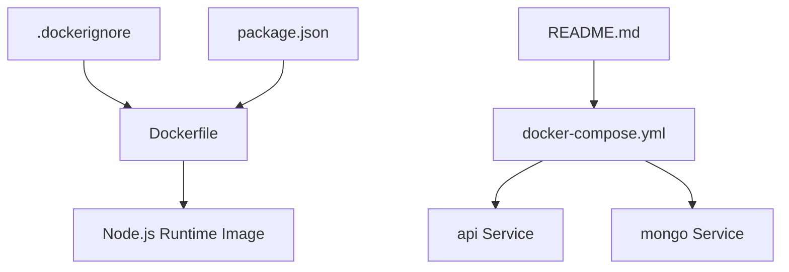
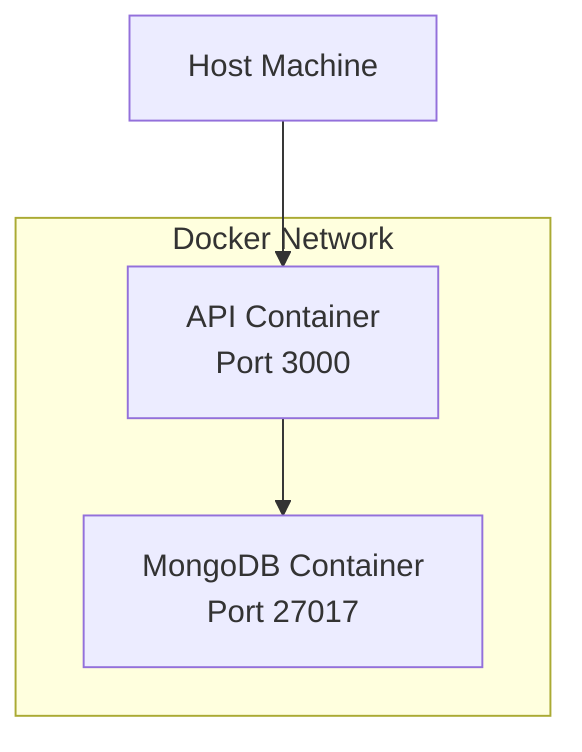
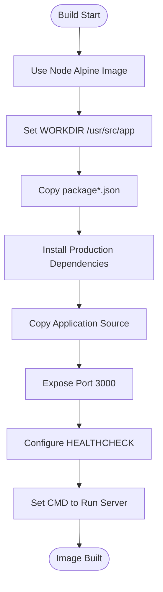
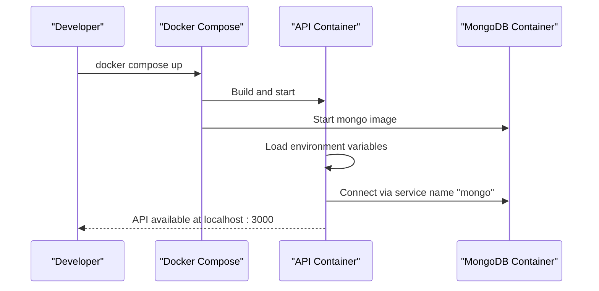
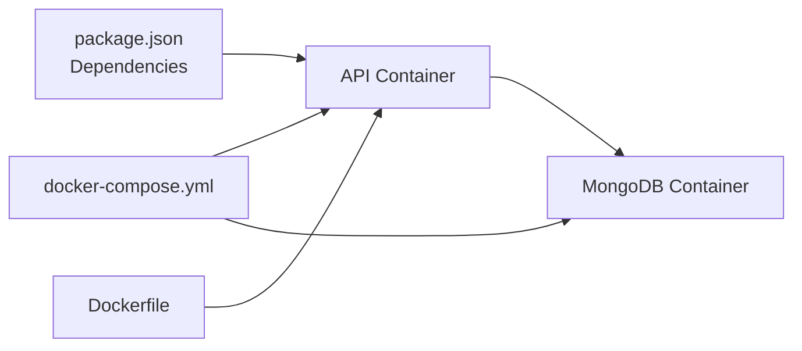

# Containerization and Orchestration

<cite>
**Referenced Files in This Document**
- [Dockerfile](file://Dockerfile)
- [docker-compose.yml](file://docker-compose.yml)
- [.dockerignore](file://.dockerignore)
- [package.json](file://package.json)
- [README.md](file://README.md)
</cite>

## Table of Contents
1. [Introduction](#introduction)
2. [Project Structure](#project-structure)
3. [Core Components](#core-components)
4. [Architecture Overview](#architecture-overview)
5. [Detailed Component Analysis](#detailed-component-analysis)
6. [Dependency Analysis](#dependency-analysis)
7. [Performance Considerations](#performance-considerations)
8. [Container Security Best Practices](#container-security-best-practices)
9. [Customizing the Container Setup](#customizing-the-container-setup)
10. [Troubleshooting Guide](#troubleshooting-guide)
11. [Conclusion](#conclusion)

## Introduction
This document explains how the application is containerized and orchestrated using Docker and Docker Compose. It covers the Dockerfile structure, build optimization techniques, development orchestration with service dependencies, environment configuration, networking, image layering, security considerations, resource constraints, customization patterns for different environments, and troubleshooting guidance.

The project is a Node.js Express API that connects to MongoDB and optionally integrates with external services such as WhatsApp and LLM providers. The container setup focuses on a small Alpine-based Node image, production-only dependency installation, health checking, and a simple two-service compose stack for local development.

## Project Structure
At the containerization level, only a few files are relevant:

- `Dockerfile`: Defines the container image for the API.
- `docker-compose.yml`: Defines the API service and a MongoDB service for local development.
- `.dockerignore`: Excludes unnecessary files from the Docker build context.
- `package.json`: Declares runtime dependencies and scripts used by the application.
- `README.md`: Documents environment variables, quick start commands, and operational notes.

**Diagram sources**
- [Dockerfile:1-17](file://Dockerfile#L1-L17)
- [docker-compose.yml:1-30](file://docker-compose.yml#L1-L30)
- [.dockerignore:1-16](file://.dockerignore#L1-L16)
- [package.json:1-36](file://package.json#L1-L36)
- [README.md:163-198](file://README.md#L163-L198)

**Section sources**
- [Dockerfile:1-17](file://Dockerfile#L1-L17)
- [docker-compose.yml:1-30](file://docker-compose.yml#L1-L30)
- [.dockerignore:1-16](file://.dockerignore#L1-L16)
- [package.json:1-36](file://package.json#L1-L36)
- [README.md:163-198](file://README.md#L163-L198)

## Core Components
This section summarizes the key containerization components and their responsibilities.

- Dockerfile
  - Uses a minimal Alpine-based Node image.
  - Installs production dependencies first to leverage Docker layer caching.
  - Copies application source code.
  - Exposes port 3000.
  - Adds a health check against `/health`.
  - Starts the server via `node src/server.js`.

- docker-compose.yml
  - Builds and runs the API service.
  - Maps host port 3000 to container port 3000.
  - Sets environment variables for development.
  - Mounts the working directory and excludes node_modules from the bind mount.
  - Runs MongoDB as a separate service with persistent volume.

- .dockerignore
  - Excludes development artifacts, tests, logs, and Docker-related files from the build context to reduce image size and speed up builds.

- package.json
  - Declares runtime dependencies and scripts.
  - Specifies Node engine requirements.
  - Provides scripts for starting, testing, seeding, linting, and running a dev MongoDB instance.

- README.md
  - Documents environment variables and validation rules.
  - Explains how to run MongoDB locally or via Docker.
  - Describes how the compose file overrides `MONGODB_URI` for the API service.

**Section sources**
- [Dockerfile:1-17](file://Dockerfile#L1-L17)
- [docker-compose.yml:1-30](file://docker-compose.yml#L1-L30)
- [.dockerignore:1-16](file://.dockerignore#L1-L16)
- [package.json:1-36](file://package.json#L1-L36)
- [README.md:163-198](file://README.md#L163-L198)

## Architecture Overview
The development architecture consists of two containers orchestrated by Docker Compose:

- API container: Node.js application listening on port 3000.
- MongoDB container: Database service with a named volume for data persistence.

Networking is handled automatically by Docker Compose; the API uses the service name `mongo` to connect to the database.

**Diagram sources**
- [docker-compose.yml:1-30](file://docker-compose.yml#L1-L30)

**Section sources**
- [docker-compose.yml:1-30](file://docker-compose.yml#L1-L30)

## Detailed Component Analysis

### Dockerfile Analysis
The Dockerfile implements a straightforward single-stage build optimized for production-like behavior during development.

Key aspects:
- Base image: Alpine-based Node image for smaller footprint.
- Working directory: `/usr/src/app`.
- Dependency installation: Production dependencies installed before copying source code to maximize layer cache hits when only source changes.
- Health check: Periodic HTTP probe against `/health`.
- Entry point: Executes `src/server.js`.

**Diagram sources**
- [Dockerfile:1-17](file://Dockerfile#L1-L17)

Optimization techniques present:
- Layer caching through early dependency installation.
- Minimal base image selection.
- No development dependencies included in the final image.

Limitations:
- Single-stage build includes all source code in the image.
- No multi-stage build to separate build-time tools from runtime.
- No explicit non-root user or read-only filesystem strategy.

**Section sources**
- [Dockerfile:1-17](file://Dockerfile#L1-L17)

### docker-compose.yml Analysis
The compose file defines a development stack with the API and MongoDB services.

Key aspects:
- API service:
  - Builds from the current directory.
  - Publishes port 3000.
  - Sets environment variables for development.
  - Depends on MongoDB.
  - Mounts the project directory and excludes node_modules from the bind mount.
- MongoDB service:
  - Uses official MongoDB image.
  - Publishes port 27017.
  - Persists data in a named volume.

**Diagram sources**
- [docker-compose.yml:1-30](file://docker-compose.yml#L1-L30)

Environment variables:
- Development-oriented values are provided directly in the compose file.
- `MONGODB_URI` points to the MongoDB service using its network alias.

Volumes:
- Project directory is mounted into the API container for live code updates.
- `node_modules` is overridden by an anonymous volume to avoid host-to-container conflicts.
- MongoDB data persists across container restarts via a named volume.

Networking:
- Services communicate over the default Docker Compose network.
- The API resolves `mongo` to the MongoDB container’s IP address.

**Section sources**
- [docker-compose.yml:1-30](file://docker-compose.yml#L1-L30)

### .dockerignore Analysis
The ignore file reduces build context size and prevents sensitive or irrelevant files from being copied into images.

Excluded items include:
- `node_modules`
- Git metadata
- Environment files
- Logs and coverage reports
- Tests and test inputs
- Documentation and task files
- Docker-related files themselves

Impact:
- Faster builds due to smaller context.
- Reduced risk of leaking secrets or development artifacts into images.

**Section sources**
- [.dockerignore:1-16](file://.dockerignore#L1-L16)

### package.json Relevance
Although not a container file, `package.json` influences container behavior:
- Runtime dependencies determine what is installed inside the image.
- Scripts define how the application starts and how tests run.
- Engine constraints ensure compatibility with the chosen Node image.

**Section sources**
- [package.json:1-36](file://package.json#L1-L36)

## Dependency Analysis
The container stack has clear separation between the API and database:

- API depends on:
  - Node.js runtime (from the base image).
  - Application dependencies declared in `package.json`.
  - MongoDB service via network.

- MongoDB depends on:
  - Its own official image.
  - Persistent storage via a named volume.

**Diagram sources**
- [package.json:1-36](file://package.json#L1-L36)
- [Dockerfile:1-17](file://Dockerfile#L1-L17)
- [docker-compose.yml:1-30](file://docker-compose.yml#L1-L30)

**Section sources**
- [package.json:1-36](file://package.json#L1-L36)
- [Dockerfile:1-17](file://Dockerfile#L1-L17)
- [docker-compose.yml:1-30](file://docker-compose.yml#L1-L30)

## Performance Considerations
Current optimizations:
- Alpine base image reduces overall image size.
- Installing production dependencies before copying source improves layer caching.
- Using `npm ci --omit=dev` ensures deterministic installs without dev dependencies.

Recommended improvements:
- Multi-stage build:
  - Stage 1: Install dependencies and build assets if needed.
  - Stage 2: Copy only necessary files into a minimal runtime image.
- Use `.dockerignore` to exclude more files if additional build artifacts exist.
- Avoid mounting `node_modules` in production; install dependencies during build instead.
- Add resource limits in production orchestration (e.g., Kubernetes or Docker Swarm).
- Tune health check intervals and timeouts based on expected startup time.

[No sources needed since this section provides general guidance]

## Container Security Best Practices
Security recommendations aligned with the current setup:

- Run as non-root:
  - Create a dedicated user in the Dockerfile and switch to it before starting the process.
- Minimize image surface:
  - Prefer multi-stage builds to exclude build tools and development dependencies.
- Secrets management:
  - Do not bake secrets into images.
  - Use environment variables, secret managers, or mounted secret files at runtime.
- Read-only filesystem:
  - Mount only required directories as writable.
- Network isolation:
  - Restrict outbound network access where possible.
- Vulnerability scanning:
  - Scan images regularly and update base images.
- Validate environment variables:
  - The application validates configuration at startup; keep validation strict in production.

**Section sources**
- [README.md:163-198](file://README.md#L163-L198)

## Customizing the Container Setup
Common customization scenarios:

- Different environments:
  - Override environment variables per environment using separate compose files or CI/CD variables.
  - Use `NODE_ENV` to control application behavior.
- External MongoDB:
  - Change `MONGODB_URI` to point to a managed MongoDB service.
- Port mapping:
  - Adjust host port mappings if port 3000 is already in use.
- Volume configuration:
  - Persist MongoDB data in a specific host path or use named volumes.
- Development experience:
  - Keep directory mounts for fast iteration.
  - Exclude heavy directories from the build context.

Examples of environment-specific adjustments:
- Development:
  - Use simulated WhatsApp mode and local MongoDB.
- Staging:
  - Point to a staging MongoDB instance and enable logging levels appropriate for debugging.
- Production:
  - Remove development-only environment variables.
  - Use real secrets from a secure store.
  - Enforce strict environment validation.

**Section sources**
- [docker-compose.yml:1-30](file://docker-compose.yml#L1-L30)
- [README.md:163-198](file://README.md#L163-L198)

## Troubleshooting Guide
Common containerization issues and resolutions:

- Build fails due to missing dependencies:
  - Ensure `package.json` is correct and dependencies can be resolved.
- Slow builds:
  - Verify `.dockerignore` excludes large directories.
  - Confirm dependency installation happens before source copy.
- API cannot connect to MongoDB:
  - Check `MONGODB_URI` and service name resolution.
  - Ensure MongoDB container is running and accessible.
- Port conflicts:
  - Change host port mappings in compose or adjust `PORT`.
- Health check failures:
  - Verify `/health` endpoint responds correctly.
  - Adjust health check timing parameters if startup is slow.
- Secrets not applied:
  - Confirm environment variables are set via compose, CI/CD, or secret manager.
- Data loss after restart:
  - Ensure MongoDB volume is configured and persisted.

Operational references:
- Environment validation and variable meanings are documented in the project README.
- Quick start and MongoDB options are described in the README.

**Section sources**
- [README.md:163-198](file://README.md#L163-L198)
- [README.md:409-419](file://README.md#L409-L419)

## Conclusion
The current containerization setup provides a lean, functional development environment using a single-node Alpine image and a two-service Docker Compose stack. It leverages layer caching, production-only dependencies, and a health check to improve reliability. For production, consider multi-stage builds, non-root execution, stricter secret handling, resource constraints, and vulnerability scanning. The compose configuration is straightforward and easily customizable for different environments by adjusting environment variables, ports, and volumes.

[No sources needed since this section summarizes without analyzing specific files]