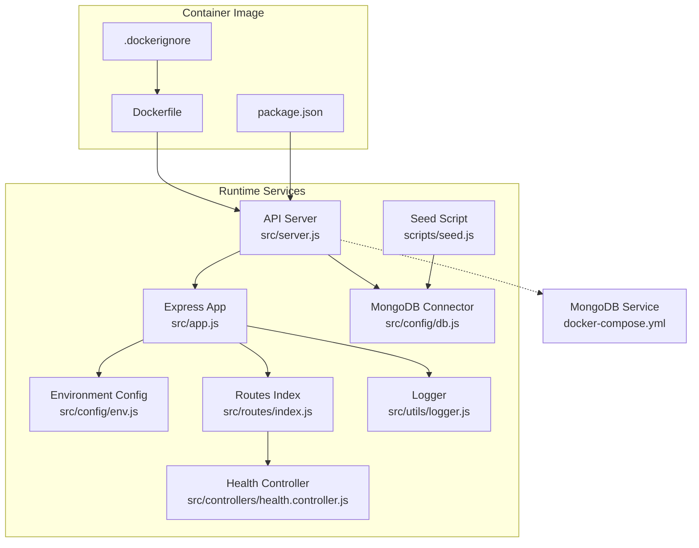
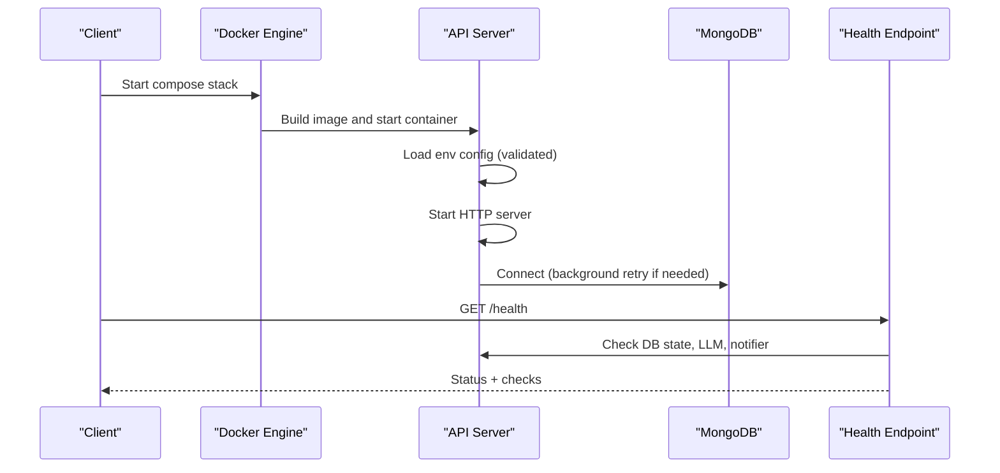
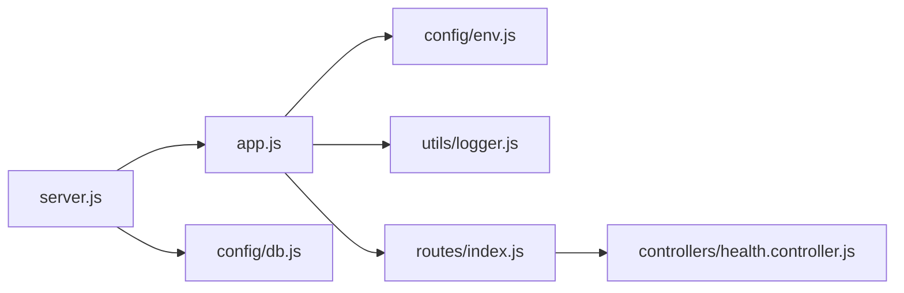

# Deployment and Operations

<cite>
**Referenced Files in This Document**
- [Dockerfile](file://Dockerfile)
- [docker-compose.yml](file://docker-compose.yml)
- [.dockerignore](file://.dockerignore)
- [package.json](file://package.json)
- [src/config/env.js](file://src/config/env.js)
- [src/config/db.js](file://src/config/db.js)
- [src/server.js](file://src/server.js)
- [src/app.js](file://src/app.js)
- [src/utils/logger.js](file://src/utils/logger.js)
- [src/controllers/health.controller.js](file://src/controllers/health.controller.js)
- [src/routes/index.js](file://src/routes/index.js)
- [scripts/seed.js](file://scripts/seed.js)
- [README.md](file://README.md)
</cite>

## Table of Contents
1. [Introduction](#introduction)
2. [Project Structure](#project-structure)
3. [Core Components](#core-components)
4. [Architecture Overview](#architecture-overview)
5. [Detailed Component Analysis](#detailed-component-analysis)
6. [Dependency Analysis](#dependency-analysis)
7. [Performance Considerations](#performance-considerations)
8. [Troubleshooting Guide](#troubleshooting-guide)
9. [Conclusion](#conclusion)
10. [Appendices](#appendices)

## Introduction
This document provides deployment and operations guidance for the WhatsApp Retail Automation API. It covers containerization with Docker, development orchestration with docker-compose, environment configuration and secret management, scaling considerations, maintenance procedures (database seeding/migrations, logging, backups), monitoring and alerting, performance tuning, capacity planning, CI/CD integration, automated testing, and rollback strategies.

## Project Structure
The application is a Node.js Express service packaged as an Alpine-based container. Development uses docker-compose to run the API alongside MongoDB. Configuration is validated at startup using Zod. Logging is structured via pino, and health checks are exposed through a dedicated endpoint.

**Diagram sources**
- [Dockerfile:1-17](file://Dockerfile#L1-L17)
- [.dockerignore:1-16](file://.dockerignore#L1-L16)
- [package.json:1-36](file://package.json#L1-L36)
- [src/server.js:1-50](file://src/server.js#L1-L50)
- [src/app.js:1-76](file://src/app.js#L1-L76)
- [src/config/env.js:1-130](file://src/config/env.js#L1-L130)
- [src/config/db.js:1-77](file://src/config/db.js#L1-L77)
- [src/controllers/health.controller.js:1-51](file://src/controllers/health.controller.js#L1-L51)
- [src/routes/index.js:1-17](file://src/routes/index.js#L1-L17)
- [src/utils/logger.js:1-34](file://src/utils/logger.js#L1-L34)
- [scripts/seed.js:1-61](file://scripts/seed.js#L1-L61)
- [docker-compose.yml:1-30](file://docker-compose.yml#L1-L30)

**Section sources**
- [Dockerfile:1-17](file://Dockerfile#L1-L17)
- [docker-compose.yml:1-30](file://docker-compose.yml#L1-L30)
- [src/server.js:1-50](file://src/server.js#L1-L50)
- [src/app.js:1-76](file://src/app.js#L1-L76)
- [src/config/env.js:1-130](file://src/config/env.js#L1-L130)
- [src/config/db.js:1-77](file://src/config/db.js#L1-L77)
- [src/controllers/health.controller.js:1-51](file://src/controllers/health.controller.js#L1-L51)
- [src/routes/index.js:1-17](file://src/routes/index.js#L1-L17)
- [src/utils/logger.js:1-34](file://src/utils/logger.js#L1-L34)
- [scripts/seed.js:1-61](file://scripts/seed.js#L1-L61)
- [README.md:75-161](file://README.md#L75-L161)

## Core Components
- Container image: Node 24 Alpine base, production-only dependencies, port 3000 exposed, built-in healthcheck calling /health.
- Compose stack: api service depends on mongo; mongo data persisted via volume.
- Environment validation: strict schema with defaults and production-specific validations.
- Database connector: non-blocking connect with background retry and graceful disconnect.
- Application bootstrap: starts HTTP server first, then connects to MongoDB; graceful shutdown with timeout.
- Health endpoint: reports ok/degraded/down based on MongoDB, LLM provider, and notifier configuration.
- Structured logging: pino logger with redaction of sensitive headers.

**Section sources**
- [Dockerfile:1-17](file://Dockerfile#L1-L17)
- [docker-compose.yml:1-30](file://docker-compose.yml#L1-L30)
- [src/config/env.js:1-130](file://src/config/env.js#L1-L130)
- [src/config/db.js:1-77](file://src/config/db.js#L1-L77)
- [src/server.js:1-50](file://src/server.js#L1-L50)
- [src/controllers/health.controller.js:1-51](file://src/controllers/health.controller.js#L1-L51)
- [src/utils/logger.js:1-34](file://src/utils/logger.js#L1-L34)

## Architecture Overview
The runtime consists of the API process and MongoDB. The API exposes REST endpoints, validates environment variables, logs requests, enforces rate limits, and performs async processing for webhooks. A health endpoint integrates readiness checks for downstream services.

**Diagram sources**
- [docker-compose.yml:1-30](file://docker-compose.yml#L1-L30)
- [Dockerfile:1-17](file://Dockerfile#L1-L17)
- [src/server.js:1-50](file://src/server.js#L1-L50)
- [src/config/env.js:1-130](file://src/config/env.js#L1-L130)
- [src/config/db.js:1-77](file://src/config/db.js#L1-L77)
- [src/controllers/health.controller.js:1-51](file://src/controllers/health.controller.js#L1-L51)

## Detailed Component Analysis

### Docker Containerization
- Base image: node:24-alpine for small footprint.
- Dependency installation: npm ci --omit=dev after copying package manifests to leverage layer caching.
- Exposed port: 3000.
- Healthcheck: calls http://127.0.0.1:3000/health every 30s with timeouts and retries.
- Entrypoint: node src/server.js.
- .dockerignore excludes node_modules, .env, tests, docs, and other non-essential files to keep images lean.

Operational notes:
- Do not mount .env into production containers; inject secrets via orchestrator or secret manager.
- Ensure the orchestrator sets NODE_ENV=production and PORT appropriately.

**Section sources**
- [Dockerfile:1-17](file://Dockerfile#L1-L17)
- [.dockerignore:1-16](file://.dockerignore#L1-L16)

### Docker Compose Orchestration (Development)
- Services:
  - api: builds from current directory, maps port 3000, sets development environment variables, depends on mongo, mounts code and ignores node_modules.
  - mongo: official mongo:8 image, persistent volume mongo_data.
- Use docker compose up --build to start both services locally.

Production adaptation:
- Remove source volume mounts.
- Inject secrets via orchestrator (Kubernetes Secrets, Docker Swarm secrets, etc.).
- Pin versions and add resource constraints.

**Section sources**
- [docker-compose.yml:1-30](file://docker-compose.yml#L1-L30)
- [README.md:141-149](file://README.md#L141-L149)

### Environment Configuration Management
- Centralized validation via src/config/env.js using Zod.
- Defaults provided for most variables; production mode rejects placeholder secrets.
- Boolean parsing handles string "true"/"false" explicitly.
- Conditional requirements enforced (e.g., WHATSAPP_MODE=cloud requires phone number ID and access token).
- LLM provider keys required when using gemini/groq.

Secret injection patterns:
- Prefer orchestrator-provided environment variables over .env files.
- For local dev, use .env (gitignored); never commit real secrets.
- Validate that production values differ from placeholders before deploying.

**Section sources**
- [src/config/env.js:1-130](file://src/config/env.js#L1-L130)
- [README.md:163-198](file://README.md#L163-L198)

### Database Connectivity and Resilience
- Connection attempts use serverSelectionTimeoutMS to fail fast on network issues.
- Background retry loop with exponential backoff keeps the server running even if MongoDB is temporarily down.
- getDbState() exposes connection readiness for health checks.
- Graceful disconnect stops retries and closes connections during shutdown.

Maintenance:
- Use scripts/seed.js to populate initial product data; supports reset mode.
- Seed script runs with retry disabled to surface immediate errors.

**Section sources**
- [src/config/db.js:1-77](file://src/config/db.js#L1-L77)
- [scripts/seed.js:1-61](file://scripts/seed.js#L1-L61)

### Application Bootstrap and Shutdown
- Starts HTTP server immediately, then connects to MongoDB asynchronously.
- If MongoDB is unavailable, /health reports degraded/down while background retries continue.
- Graceful shutdown listens for SIGINT/SIGTERM, stops accepting new connections, disconnects MongoDB, and exits within a bounded timeout.

**Section sources**
- [src/server.js:1-50](file://src/server.js#L1-L50)

### Health Endpoint and Readiness Semantics
- Returns status ok/degraded/down based on:
  - MongoDB connectivity
  - LLM provider configuration (key presence or local Ollama availability)
  - Notifier configuration (WhatsApp simulated vs cloud credentials)
- Useful for liveness/readiness probes and SLO tracking.

**Section sources**
- [src/controllers/health.controller.js:1-51](file://src/controllers/health.controller.js#L1-L51)

### Logging and Observability
- Structured JSON logs via pino with correlation IDs.
- Redaction configured for sensitive headers (API keys, authorization, webhook signatures).
- Request/response metadata includes method, URL, correlation ID, and status codes.
- Health endpoint excluded from default request logging.

**Section sources**
- [src/utils/logger.js:1-34](file://src/utils/logger.js#L1-L34)
- [src/app.js:1-76](file://src/app.js#L1-L76)

### Security Hardening
- Helmet applied for security headers.
- Rate limiting enabled outside tests with generous thresholds suitable for webhook traffic.
- Trust proxy set to one reverse proxy (e.g., nginx/ALB) for correct client IP handling.

**Section sources**
- [src/app.js:1-76](file://src/app.js#L1-L76)

## Dependency Analysis
The runtime dependency graph shows how the server bootstraps the app, loads configuration, wires middleware, and connects to MongoDB.

**Diagram sources**
- [src/server.js:1-50](file://src/server.js#L1-L50)
- [src/app.js:1-76](file://src/app.js#L1-L76)
- [src/config/env.js:1-130](file://src/config/env.js#L1-L130)
- [src/utils/logger.js:1-34](file://src/utils/logger.js#L1-L34)
- [src/routes/index.js:1-17](file://src/routes/index.js#L1-L17)
- [src/controllers/health.controller.js:1-51](file://src/controllers/health.controller.js#L1-L51)
- [src/config/db.js:1-77](file://src/config/db.js#L1-L77)

**Section sources**
- [src/server.js:1-50](file://src/server.js#L1-L50)
- [src/app.js:1-76](file://src/app.js#L1-L76)
- [src/routes/index.js:1-17](file://src/routes/index.js#L1-L17)

## Performance Considerations
- Container image optimization:
  - Production-only dependencies installed via npm ci --omit=dev.
  - Alpine base reduces image size.
- Application-level:
  - Rate limiter prevents abuse; adjust windowMs and limit according to expected throughput.
  - Body parser limit set to 1MB; tune if webhook payloads grow.
  - Helmet and trust proxy reduce overhead while improving security posture.
- Database:
  - Non-blocking connect avoids startup failures; monitor retry logs.
  - Use connection pooling settings appropriate for your MongoDB deployment.
- Scaling:
  - Stateless API nodes can be horizontally scaled behind a load balancer.
  - Keep shared state out of the process; rely on MongoDB for persistence.
  - Consider externalizing secrets and configuration via orchestrator-native mechanisms.

[No sources needed since this section provides general guidance]

## Troubleshooting Guide
Common operational issues and resolutions:
- Invalid environment variables at startup:
  - Review error output listing each invalid variable; align with .env.example and orchestrator secrets.
- Health returns 503 with mongo down:
  - Verify MongoDB reachability and MONGODB_URI; check background retry logs.
- Port conflicts:
  - Change PORT in environment or orchestrator configuration.
- Webhook signature verification failures:
  - Ensure WHATSAPP_APP_SECRET matches the signer; validate header x-hub-signature-256.
- Handshake failures:
  - Confirm WHATSAPP_VERIFY_TOKEN matches Meta’s webhook configuration.
- Forced send failure testing:
  - Use WHATSAPP_FORCE_SEND_FAILURE=true to exercise notifier failure paths.

**Section sources**
- [README.md:409-419](file://README.md#L409-L419)
- [src/config/env.js:111-121](file://src/config/env.js#L111-L121)
- [src/controllers/health.controller.js:19-50](file://src/controllers/health.controller.js#L19-L50)

## Conclusion
The system is designed for resilient operation: it starts quickly, continues serving traffic when MongoDB is temporarily unavailable, and provides clear health signals. Environment validation prevents misconfiguration, and structured logging aids observability. With proper secret management, scaling, and monitoring, the API can operate reliably in both development and production environments.

[No sources needed since this section summarizes without analyzing specific files]

## Appendices

### Environment Configuration Reference
Key variables and their roles:
- NODE_ENV: development | test | production
- PORT: HTTP port
- LOG_LEVEL: pino log level
- MONGODB_URI: MongoDB connection string
- STAFF_API_KEY: Staff API key for protected endpoints
- WHATSAPP_MODE: simulated | cloud
- WHATSAPP_VERIFY_TOKEN: Webhook handshake token
- WHATSAPP_APP_SECRET: Webhook signature verifier
- WHATSAPP_PHONE_NUMBER_ID: Cloud API sender id (required in cloud mode)
- WHATSAPP_ACCESS_TOKEN: Cloud API bearer token (required in cloud mode)
- WHATSAPP_API_VERSION: Graph API version
- WHATSAPP_FORCE_SEND_FAILURE: Test hook to force send failures
- STAFF_WHATSAPP_NUMBER: E.164 staff number for alerts
- LLM_PROVIDER: none | gemini | groq | ollama
- LLM_API_KEY: Required for gemini/groq
- LLM_MODEL: Provider model name
- LLM_TIMEOUT_MS: Classifier call timeout
- OLLAMA_BASE_URL: Local Ollama endpoint
- OLLAMA_API_KEY: Hosted Ollama key (optional)
- CONFIDENCE_THRESHOLD: Classifier confidence threshold
- TICKET_SLA_MINUTES: Ticket SLA threshold

Validation rules:
- Production rejects placeholder secrets.
- Cloud mode requires phone number ID and access token.
- Gemini/Groq require API key.

**Section sources**
- [src/config/env.js:25-109](file://src/config/env.js#L25-L109)
- [README.md:163-198](file://README.md#L163-L198)

### Maintenance Procedures

#### Database Seeding and Data Initialization
- Run seed script to populate product catalogue; supports reset mode for full refresh.
- Seed script fails fast when MongoDB is unreachable (retry disabled).

Operational steps:
- Ensure MONGODB_URI points to the target database.
- Execute seed command in the container or host environment where dependencies are installed.

**Section sources**
- [scripts/seed.js:1-61](file://scripts/seed.js#L1-L61)
- [README.md:151-161](file://README.md#L151-L161)

#### Log Rotation and Retention
- Logs are emitted to stdout by default; ensure the orchestrator forwards them to a centralized logging system.
- Configure rotation at the platform level (e.g., journald, Fluent Bit, Filebeat) to avoid unbounded growth.
- Avoid writing large files inside containers; prefer streaming logs.

[No sources needed since this section provides general guidance]

#### Backup Strategies
- Back up MongoDB volumes or managed clusters regularly.
- For docker-compose, persist mongo_data volume; schedule snapshots or use provider backup tools.
- Include configuration and secrets management in disaster recovery plans (do not back up .env files containing secrets).

[No sources needed since this section provides general guidance]

#### Disaster Recovery
- Restore MongoDB from latest snapshot.
- Reconfigure environment variables and secrets in the orchestrator.
- Validate health endpoint and critical workflows post-recovery.

[No sources needed since this section provides general guidance]

### Monitoring and Alerting
- Liveness/readiness:
  - Use container healthcheck against /health.
  - Monitor status transitions (ok -> degraded -> down) and alert on sustained degraded/down states.
- Metrics:
  - Track request rates, latency percentiles, error rates, and rate-limited responses.
- Alerts:
  - Alert on repeated MongoDB connection failures.
  - Alert on webhook signature rejections exceeding thresholds.
  - Alert on high 4xx/5xx ratios.

**Section sources**
- [Dockerfile:13-14](file://Dockerfile#L13-L14)
- [src/controllers/health.controller.js:19-50](file://src/controllers/health.controller.js#L19-L50)
- [src/app.js:52-67](file://src/app.js#L52-L67)

### Performance Tuning Guidelines
- Tune rate limiter window and limit based on observed traffic patterns.
- Adjust body parser limit if webhook payloads increase.
- Optimize MongoDB connection pool sizes per instance count.
- Enable compression at the reverse proxy layer.
- Use horizontal scaling for stateless API instances.

**Section sources**
- [src/app.js:41-67](file://src/app.js#L41-L67)

### Capacity Planning
- Estimate CPU/memory per API instance based on concurrency and payload sizes.
- Size MongoDB cluster according to dataset growth and query patterns.
- Plan autoscaling policies around CPU utilization, request latency, and queue depth (if added later).
- Account for external dependencies (Meta Graph API, LLM providers) in capacity models.

[No sources needed since this section provides general guidance]

### CI/CD Pipeline Integration
- Build stage:
  - Build container image using Dockerfile.
  - Cache npm dependencies via layer caching.
- Test stage:
  - Run unit and integration tests using npm test (uses in-memory MongoDB).
  - Lint with npm run lint.
- Deploy stage:
  - Push image to registry.
  - Update deployment manifest with new image tag.
  - Rollout strategy: rolling update with readiness probe on /health.

Automated testing in deployment pipelines:
- Execute full test suite before promotion.
- Gate deployments on passing tests and lint checks.

Rollback strategies:
- Maintain previous image tags.
- Use orchestrator rollbacks to revert to last known good deployment.
- Ensure database migrations are backward compatible or executed separately with rollback plans.

**Section sources**
- [package.json:10-16](file://package.json#L10-L16)
- [README.md:351-362](file://README.md#L351-L362)