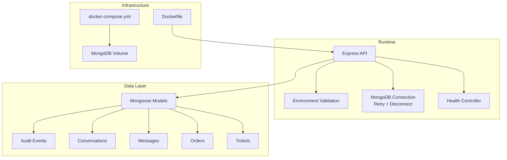
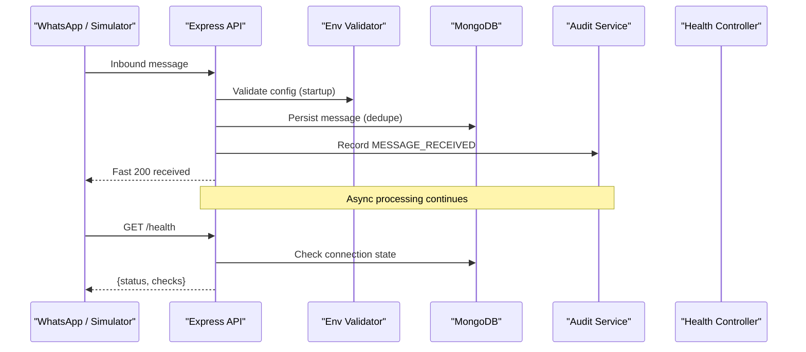
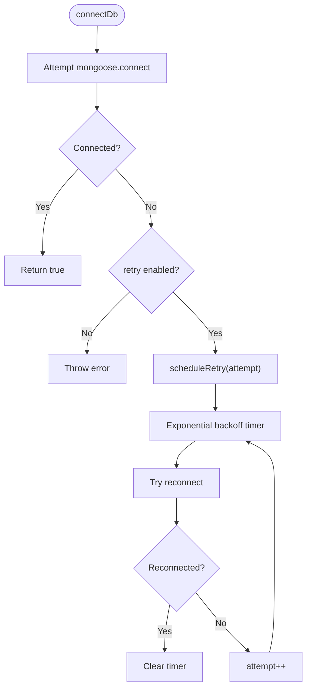
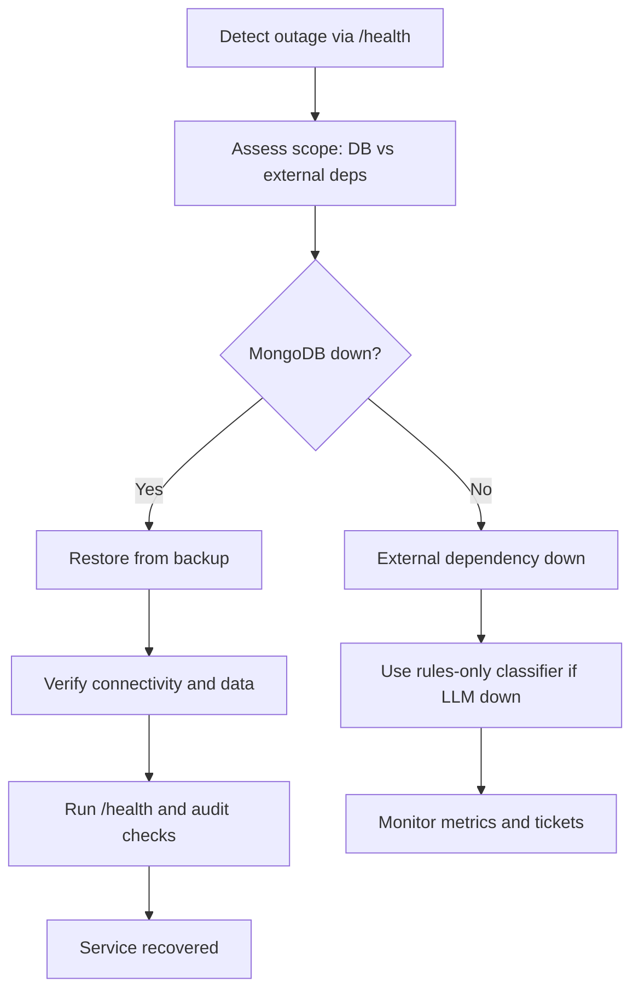
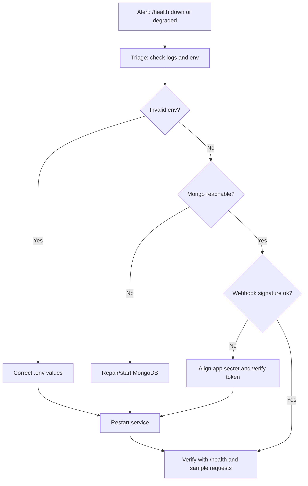
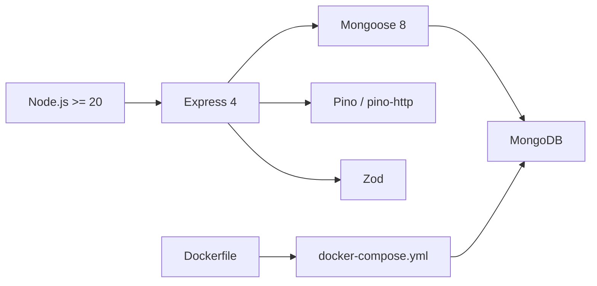
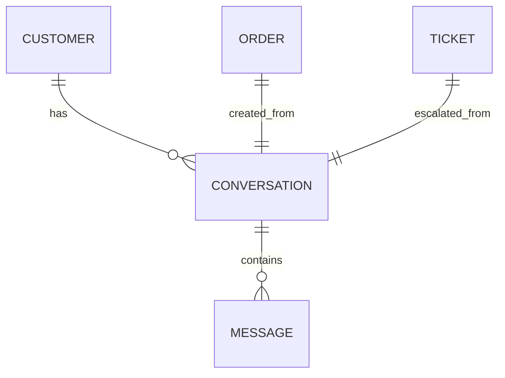

# Maintenance Procedures

<cite>
**Referenced Files in This Document**
- [README.md](file://README.md)
- [WORKPLAN.md](file://WORKPLAN.md)
- [package.json](file://package.json)
- [docker-compose.yml](file://docker-compose.yml)
- [Dockerfile](file://Dockerfile)
- [src/config/db.js](file://src/config/db.js)
- [src/config/env.js](file://src/config/env.js)
- [src/models/index.js](file://src/models/index.js)
- [src/controllers/health.controller.js](file://src/controllers/health.controller.js)
- [src/services/audit.service.js](file://src/services/audit.service.js)
- [src/models/auditEvent.model.js](file://src/models/auditEvent.model.js)
- [src/models/conversation.model.js](file://src/models/conversation.model.js)
- [src/models/message.model.js](file://src/models/message.model.js)
- [src/models/order.model.js](file://src/models/order.model.js)
- [src/models/ticket.model.js](file://src/models/ticket.model.js)
</cite>

## Table of Contents
1. [Introduction](#introduction)
2. [Project Structure](#project-structure)
3. [Core Components](#core-components)
4. [Architecture Overview](#architecture-overview)
5. [Detailed Component Analysis](#detailed-component-analysis)
6. [Dependency Analysis](#dependency-analysis)
7. [Performance Considerations](#performance-considerations)
8. [Troubleshooting Guide](#troubleshooting-guide)
9. [Conclusion](#conclusion)
10. [Appendices](#appendices)

## Introduction
This document provides comprehensive maintenance procedures for the WhatsApp Retail Automation API. It covers database operations, backup and disaster recovery, log rotation, storage management, cleanup of audit trails and temporary data, database migration and schema versioning, data integrity checks, performance monitoring, capacity planning, proactive maintenance tasks, operational health checks, routine schedules, incident response runbooks, and system recovery procedures. The guidance is grounded in the repository’s configuration, models, health checks, audit trail design, Docker setup, and documented operational expectations.

## Project Structure
The application is a Node.js Express API backed by MongoDB via Mongoose. Operational concerns are implemented through:
- Environment validation at startup
- Database connection with retry logic
- Health endpoint reporting dependency status
- Append-only audit events
- Docker Compose orchestration with persistent Mongo volume
- Scripts for seeding and development utilities

**Diagram sources**
- [Dockerfile:1-17](file://Dockerfile#L1-L17)
- [docker-compose.yml:1-30](file://docker-compose.yml#L1-L30)
- [src/config/env.js:1-144](file://src/config/env.js#L1-L144)
- [src/config/db.js:1-77](file://src/config/db.js#L1-L77)
- [src/controllers/health.controller.js:1-51](file://src/controllers/health.controller.js#L1-L51)
- [src/models/index.js:1-13](file://src/models/index.js#L1-L13)

**Section sources**
- [README.md:50-58](file://README.md#L50-L58)
- [README.md:102-149](file://README.md#L102-L149)
- [package.json:1-36](file://package.json#L1-L36)
- [docker-compose.yml:1-30](file://docker-compose.yml#L1-L30)
- [Dockerfile:1-17](file://Dockerfile#L1-L17)

## Core Components
- Environment configuration and validation: Enforces required secrets, provider settings, and runtime flags at startup.
- Database connectivity: Connects to MongoDB with exponential backoff retries; supports graceful shutdown.
- Health endpoint: Reports overall status and dependency states (MongoDB, LLM, notifier).
- Audit trail: Append-only event logging with typed helpers and indexes for efficient querying.
- Data models: Conversation state machine, immutable messages with dedupe key, order lifecycle, ticket lifecycle.

Operational implications:
- Startup failures due to invalid environment variables prevent unsafe production runs.
- Database outages degrade service but do not crash the process; background retries continue.
- Health endpoint enables automated probes and dashboards.
- Audit events provide an immutable record for compliance and troubleshooting.

**Section sources**
- [src/config/env.js:1-144](file://src/config/env.js#L1-L144)
- [src/config/db.js:1-77](file://src/config/db.js#L1-L77)
- [src/controllers/health.controller.js:1-51](file://src/controllers/health.controller.js#L1-L51)
- [src/services/audit.service.js:1-116](file://src/services/audit.service.js#L1-L116)
- [src/models/auditEvent.model.js:1-49](file://src/models/auditEvent.model.js#L1-L49)
- [src/models/conversation.model.js:1-52](file://src/models/conversation.model.js#L1-L52)
- [src/models/message.model.js:1-35](file://src/models/message.model.js#L1-L35)
- [src/models/order.model.js:1-53](file://src/models/order.model.js#L1-L53)
- [src/models/ticket.model.js:1-49](file://src/models/ticket.model.js#L1-L49)

## Architecture Overview
The system receives inbound WhatsApp messages (simulated or real), validates and audits them, classifies intent, persists conversation context, sends replies, and escalates when needed. Operational visibility is provided by health checks and structured logs.

**Diagram sources**
- [src/config/env.js:1-144](file://src/config/env.js#L1-L144)
- [src/config/db.js:1-77](file://src/config/db.js#L1-L77)
- [src/services/audit.service.js:1-116](file://src/services/audit.service.js#L1-L116)
- [src/controllers/health.controller.js:1-51](file://src/controllers/health.controller.js#L1-L51)

## Detailed Component Analysis

### Database Operations and Connectivity
- Connection behavior:
  - On failure, the server does not throw during normal operation; it logs and schedules retries with exponential backoff up to a maximum delay.
  - Graceful shutdown stops retries and closes the connection.
- Operational guidance:
  - Monitor `mongodb disconnected` and `mongodb connection error` logs.
  - Use `/health` to detect `mongo: down`.
  - Ensure `MONGODB_URI` points to a reachable instance.
  - For seed scripts that require immediate failure on connect, use the non-retry mode where applicable.

**Diagram sources**
- [src/config/db.js:27-67](file://src/config/db.js#L27-L67)

**Section sources**
- [src/config/db.js:1-77](file://src/config/db.js#L1-L77)

### Backup Strategy
- Current state:
  - Docker Compose uses a named volume `mongo_data` for persistence.
  - README documents scheduled `mongodump` daily and tested restore as part of risk mitigation.
- Recommended procedure:
  - Run `mongodump` against the running MongoDB instance or container.
  - Store backups off-host with retention policy aligned to compliance needs.
  - Periodically test restores to verify integrity and RTO/RPO targets.
  - For containerized environments, snapshot the volume or use a backup operator compatible with your platform.

Operational notes:
- Do not rely solely on Docker volumes for long-term backups.
- Include audit events and conversations in backups to preserve full traceability.

**Section sources**
- [docker-compose.yml:21-29](file://docker-compose.yml#L21-L29)
- [README.md:421-427](file://README.md#L421-L427)
- [WORKPLAN.md:677-679](file://WORKPLAN.md#L677-L679)

### Disaster Recovery Processes
- Failure scenarios:
  - MongoDB outage: service returns degraded/down; background retries continue.
  - LLM or notifier unavailable: service remains usable with reduced functionality.
- Recovery steps:
  - Restore from latest verified backup.
  - Verify connectivity and data integrity using `/health` and audit queries.
  - If restoring to a new host, update `MONGODB_URI` and restart services.
  - Validate audit continuity and message deduplication keys after restore.

**Diagram sources**
- [src/controllers/health.controller.js:1-51](file://src/controllers/health.controller.js#L1-L51)
- [src/config/db.js:1-77](file://src/config/db.js#L1-L77)
- [README.md:409-420](file://README.md#L409-L420)

**Section sources**
- [src/controllers/health.controller.js:1-51](file://src/controllers/health.controller.js#L1-L51)
- [src/config/db.js:1-77](file://src/config/db.js#L1-L77)
- [README.md:409-420](file://README.md#L409-L420)

### Log Rotation Policies
- Logging stack:
  - Structured JSON logs via pino/pino-http with correlation IDs.
  - Simulated outbound WhatsApp messages are written to stdout and a file.
- Policy recommendations:
  - Rotate application logs based on size and age.
  - Retain logs per compliance requirements; archive older logs securely.
  - Ensure log files do not include sensitive payloads; phone numbers are masked in logs.
  - Centralize logs for searchability by correlation ID.

Operational checks:
- Confirm log levels via `LOG_LEVEL`.
- Verify outbound log path exists and is rotated.

**Section sources**
- [README.md:50-58](file://README.md#L50-L58)
- [README.md:346-350](file://README.md#L346-L350)
- [README.md:283-289](file://README.md#L283-L289)

### Storage Management and Cleanup Procedures
- Collections and growth:
  - Audit events are append-only and indexed for time-based queries.
  - Conversations and messages grow with active customer interactions.
  - Orders and tickets accumulate historical records.
- Cleanup strategy:
  - Implement retention policies per collection (e.g., archive audit events older than X days).
  - Purge expired conversations and completed orders according to business rules.
  - Avoid deleting audit events; instead, archive or partition by date.
  - Monitor collection sizes and index usage; rebuild or optimize indexes as needed.

Index considerations:
- Audit events: `{ createdAt: -1 }`, `{ type: 1, createdAt: -1 }`.
- Messages: unique `providerMessageId` for dedupe; `{ conversationId: 1, createdAt: 1 }`.
- Conversations: `{ customerId: 1, status: 1 }`.
- Orders: `{ status: 1, createdAt: -1 }`.
- Tickets: `{ status: 1, createdAt: -1 }`.

**Section sources**
- [src/models/auditEvent.model.js:1-49](file://src/models/auditEvent.model.js#L1-L49)
- [src/models/message.model.js:1-35](file://src/models/message.model.js#L1-L35)
- [src/models/conversation.model.js:1-52](file://src/models/conversation.model.js#L1-L52)
- [src/models/order.model.js:1-53](file://src/models/order.model.js#L1-L53)
- [src/models/ticket.model.js:1-49](file://src/models/ticket.model.js#L1-L49)

### Database Migration Strategies and Schema Versioning
- Current approach:
  - Mongoose schemas define collections; no explicit migration framework is present.
  - Models are registered centrally to avoid duplicate model definitions.
- Recommended practices:
  - Introduce a schema version field or migration table to track changes.
  - Apply migrations before starting the service; fail fast on incompatible versions.
  - Keep backward-compatible changes where possible; deprecate fields gradually.
  - Test migrations against a copy of production-like data.

Model registration:
- Centralized model exports ensure idempotent registration across the codebase.

**Section sources**
- [src/models/index.js:1-13](file://src/models/index.js#L1-L13)

### Data Integrity Checks
- Deduplication:
  - Unique index on `providerMessageId` prevents duplicate processing.
- State constraints:
  - Order statuses and transitions are enumerated and enforced.
  - Ticket reasons, priorities, and statuses are constrained.
  - Conversation states and statuses drive the slot-filling workflow.
- Audit completeness:
  - Typed audit events cover message lifecycle, classification, replies, notifications, and errors.

Integrity verification:
- Query for orphaned messages without valid conversation references.
- Validate order totals match item sums.
- Ensure all expected audit event types exist and are consistent.

**Section sources**
- [src/models/message.model.js:1-35](file://src/models/message.model.js#L1-L35)
- [src/models/order.model.js:1-53](file://src/models/order.model.js#L1-L53)
- [src/models/ticket.model.js:1-49](file://src/models/ticket.model.js#L1-L49)
- [src/models/conversation.model.js:1-52](file://src/models/conversation.model.js#L1-L52)
- [src/services/audit.service.js:1-116](file://src/services/audit.service.js#L1-L116)

### Performance Monitoring and Capacity Planning
- Monitoring:
  - Use `/health` for liveness/readiness.
  - Track audit events and metrics endpoints for throughput and failure rates.
  - Monitor MongoDB disk usage, memory, and query latency.
- Capacity planning:
  - Size MongoDB storage based on growth rates of audit, messages, and conversations.
  - Plan for peak webhook bursts and concurrent conversations.
  - Set appropriate timeouts for external dependencies (LLM, notifier).

Proactive tasks:
- Review index usage and slow queries.
- Tune connection pools and timeouts.
- Scale horizontally if request volume increases beyond single-node capacity.

**Section sources**
- [src/controllers/health.controller.js:1-51](file://src/controllers/health.controller.js#L1-L51)
- [WORKPLAN.md:537-558](file://WORKPLAN.md#L537-L558)

### Proactive Maintenance Tasks
- Daily:
  - Verify backups completed successfully.
  - Check `/health` and alert on `down` or `degraded`.
  - Review recent audit events for anomalies.
- Weekly:
  - Analyze log growth and rotate archives.
  - Inspect collection sizes and index efficiency.
  - Validate ticket SLA compliance and overdue counts.
- Monthly:
  - Update dependencies and review security advisories.
  - Perform restore drills from backups.
  - Review environment variable rotation and secret hygiene.

**Section sources**
- [WORKPLAN.md:681-687](file://WORKPLAN.md#L681-L687)

### System Health Checks and Routine Schedules
- Health checks:
  - `/health` returns status and dependency checks.
  - Container HEALTHCHECK probes the same endpoint.
- Routine schedule:
  - Align health probe intervals with alerting thresholds.
  - Schedule periodic audits of environment configuration and secrets.

**Section sources**
- [src/controllers/health.controller.js:1-51](file://src/controllers/health.controller.js#L1-L51)
- [Dockerfile:13-14](file://Dockerfile#L13-L14)

### Incident Response Runbooks and System Recovery Procedures
- Common incidents:
  - Invalid environment variables at startup: compare `.env` with template and fix values.
  - `/health` returns 503 `mongo: down`: start or repair MongoDB, verify URI.
  - Port conflicts: change `PORT` or free the port.
  - Webhook signature mismatch: verify app secret and token alignment.
  - Handshake failures: ensure verify token matches between Meta and `.env`.
- Recovery steps:
  - Restart service after fixing configuration.
  - Validate with `/health` and sample webhook/simulator requests.
  - Review audit events for rejection reasons and payload issues.

**Diagram sources**
- [README.md:409-420](file://README.md#L409-L420)
- [src/controllers/health.controller.js:1-51](file://src/controllers/health.controller.js#L1-L51)

**Section sources**
- [README.md:409-420](file://README.md#L409-L420)

## Dependency Analysis
The application depends on:
- Node.js runtime and Express framework
- MongoDB via Mongoose
- Pino for structured logging
- Zod for validation
- Docker Compose for orchestration

**Diagram sources**
- [package.json:1-36](file://package.json#L1-L36)
- [docker-compose.yml:1-30](file://docker-compose.yml#L1-L30)
- [Dockerfile:1-17](file://Dockerfile#L1-L17)

**Section sources**
- [package.json:1-36](file://package.json#L1-L36)
- [docker-compose.yml:1-30](file://docker-compose.yml#L1-L30)
- [Dockerfile:1-17](file://Dockerfile#L1-L17)

## Performance Considerations
- Connection resilience: Background retries prevent service crashes during transient DB outages.
- Indexing: Ensure indexes align with query patterns for audit, messages, conversations, orders, and tickets.
- Timeouts: Configure LLM and notifier timeouts to avoid blocking the main pipeline.
- Resource limits: Monitor container CPU/memory and set appropriate limits.
- Scaling: Consider horizontal scaling behind a load balancer if request volume grows.

[No sources needed since this section provides general guidance]

## Troubleshooting Guide
- Startup errors:
  - Invalid environment variables: inspect validation output and correct `.env`.
- Runtime errors:
  - `/health` returns 503: investigate MongoDB connectivity.
  - Webhook rejections: verify HMAC signature and tokens.
  - Tests downloading MongoDB binary: first run requires network; subsequent runs cache the binary.
- Logs:
  - Search by correlation ID to trace message journeys.
  - Outbound simulated messages logged to stdout and file.

**Section sources**
- [README.md:409-420](file://README.md#L409-L420)
- [README.md:346-350](file://README.md#L346-L350)

## Conclusion
This maintenance guide consolidates operational best practices for the WhatsApp Retail Automation API. By following the outlined procedures for database operations, backups, disaster recovery, log rotation, storage management, schema versioning, data integrity, performance monitoring, and incident response, operators can maintain a resilient, observable, and compliant system. Regular reviews and drills will strengthen reliability and reduce mean time to recovery.

[No sources needed since this section summarizes without analyzing specific files]

## Appendices

### A. Operational Checklist
- Verify environment variables and secrets.
- Confirm `/health` reports healthy dependencies.
- Validate backups and restore procedures.
- Review audit events and metrics for anomalies.
- Rotate secrets and update dependencies per schedule.

**Section sources**
- [WORKPLAN.md:681-687](file://WORKPLAN.md#L681-L687)

### B. Model Relationships Overview

**Diagram sources**
- [src/models/conversation.model.js:1-52](file://src/models/conversation.model.js#L1-L52)
- [src/models/message.model.js:1-35](file://src/models/message.model.js#L1-L35)
- [src/models/order.model.js:1-53](file://src/models/order.model.js#L1-L53)
- [src/models/ticket.model.js:1-49](file://src/models/ticket.model.js#L1-L49)