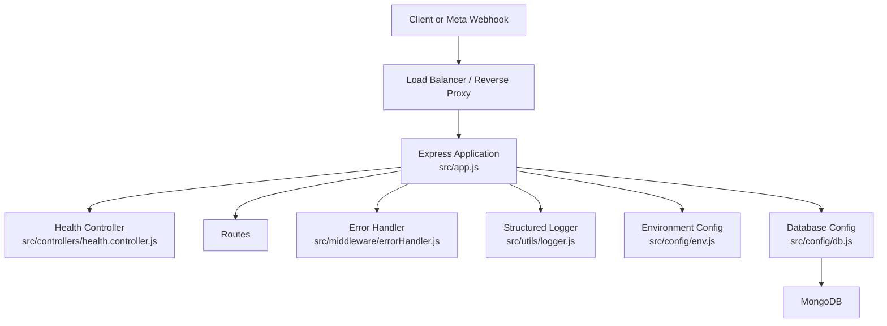
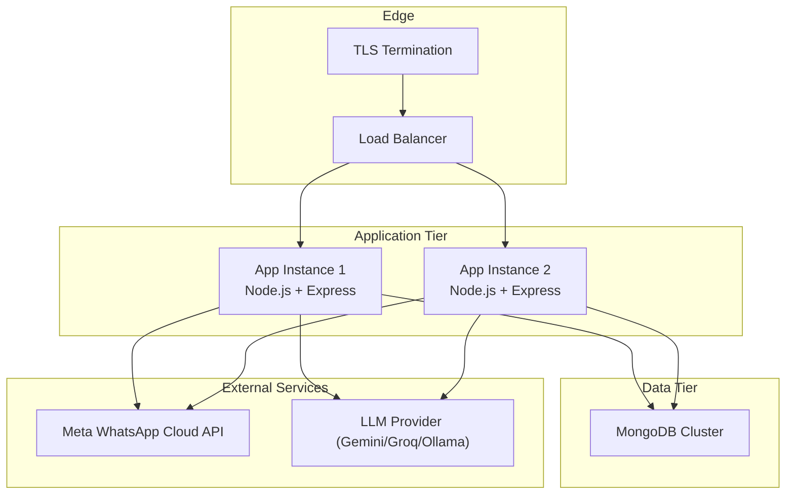
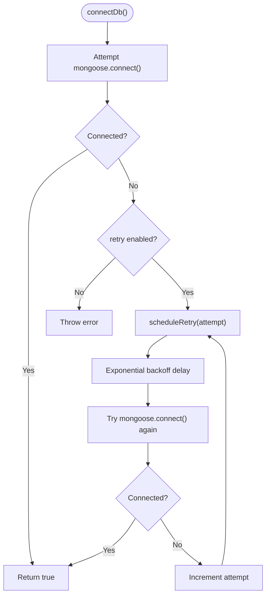

# Production Deployment Strategies

<cite>
**Referenced Files in This Document**
- [README.md](file://README.md)
- [package.json](file://package.json)
- [Dockerfile](file://Dockerfile)
- [docker-compose.yml](file://docker-compose.yml)
- [src/app.js](file://src/app.js)
- [src/server.js](file://src/server.js)
- [src/config/env.js](file://src/config/env.js)
- [src/config/db.js](file://src/config/db.js)
- [src/controllers/health.controller.js](file://src/controllers/health.controller.js)
- [src/middleware/errorHandler.js](file://src/middleware/errorHandler.js)
- [src/utils/logger.js](file://src/utils/logger.js)
</cite>

## Table of Contents
1. [Introduction](#introduction)
2. [Project Structure](#project-structure)
3. [Core Components](#core-components)
4. [Architecture Overview](#architecture-overview)
5. [Detailed Component Analysis](#detailed-component-analysis)
6. [Deployment Strategies](#deployment-strategies)
7. [Scaling and Load Balancing](#scaling-and-load-balancing)
8. [CI/CD Pipeline Integration](#cicd-pipeline-integration)
9. [Release Strategies](#release-strategies)
10. [Monitoring, Alerting, and Performance Tuning](#monitoring-alerting-and-performance-tuning)
11. [Troubleshooting Guide](#troubleshooting-guide)
12. [Conclusion](#conclusion)

## Introduction
This document provides production deployment guidance for the WhatsApp Retail Automation API. It covers direct server deployment, containerized deployment, cloud platform considerations, managed service integration, scaling patterns, CI/CD automation, release strategies such as blue-green and canary releases, and operational practices including monitoring, alerting, and performance tuning.

The application is an Express-based Node.js API backed by MongoDB, with structured logging, environment validation, rate limiting, health checks, and webhook handling. The repository includes a Dockerfile, docker-compose configuration, test scripts, and seed utilities suitable for local development and basic production-like environments.

## Project Structure
At a high level, the project follows a layered structure:
- Configuration layer handles environment validation and database connection management.
- Application layer builds the Express app, registers middleware, routes, and error handling.
- Controllers handle HTTP endpoints such as health, webhooks, and simulation.
- Utilities provide structured logging and shared helpers.
- Containerization artifacts include a Dockerfile and docker-compose setup.

**Diagram sources**
- [src/app.js:15-74](file://src/app.js#L15-L74)
- [src/controllers/health.controller.js:19-49](file://src/controllers/health.controller.js#L19-L49)
- [src/middleware/errorHandler.js:16-79](file://src/middleware/errorHandler.js#L16-L79)
- [src/utils/logger.js:11-26](file://src/utils/logger.js#L11-L26)
- [src/config/env.js:25-141](file://src/config/env.js#L25-L141)
- [src/config/db.js:37-67](file://src/config/db.js#L37-L67)

**Section sources**
- [README.md:364-384](file://README.md#L364-L384)
- [package.json:1-36](file://package.json#L1-L36)

## Core Components
Key runtime components relevant to production deployment:
- Environment validation: strict schema enforcement, default values, and production-only secret checks.
- Database connectivity: background retry with exponential backoff; graceful shutdown disconnects.
- Health endpoint: reports overall status based on MongoDB, LLM provider configuration, and notifier configuration.
- Error handling: standardized error responses, correlation IDs, and redacted logs.
- Logging: structured JSON logs via pino with sensitive header redaction.
- Application bootstrap: listens first, then connects to MongoDB; graceful shutdown on SIGINT/SIGTERM.

**Section sources**
- [src/config/env.js:25-141](file://src/config/env.js#L25-L141)
- [src/config/db.js:37-77](file://src/config/db.js#L37-L77)
- [src/controllers/health.controller.js:19-49](file://src/controllers/health.controller.js#L19-L49)
- [src/middleware/errorHandler.js:16-79](file://src/middleware/errorHandler.js#L16-L79)
- [src/utils/logger.js:11-26](file://src/utils/logger.js#L11-L26)
- [src/server.js:8-50](file://src/server.js#L8-L50)

## Architecture Overview
The production architecture typically involves:
- A reverse proxy or load balancer terminating TLS and forwarding requests to one or more application instances.
- One or more application containers running the Express API.
- A managed or self-hosted MongoDB instance accessible over the network.
- Optional external services: Meta WhatsApp Cloud API, LLM providers (Gemini, Groq), or local Ollama.

[No sources needed since this diagram shows conceptual architecture, not specific code structure]

## Detailed Component Analysis

### Environment Configuration and Validation
- The environment module loads `.env` relative to the project root and validates all variables using Zod.
- Production mode enforces replacement of placeholder secrets and requires WhatsApp Cloud credentials when enabled.
- Boolean parsing is explicit to avoid coercion pitfalls.
- All validated configuration is frozen and exported for safe consumption across modules.

Operational implications:
- Use environment variables injected by your orchestrator or secrets manager at runtime.
- Validate configuration early; invalid values abort startup with clear messages.
- Keep `.env` out of version control and rely on secure secret injection mechanisms.

**Section sources**
- [src/config/env.js:6-10](file://src/config/env.js#L6-L10)
- [src/config/env.js:16-23](file://src/config/env.js#L16-L23)
- [src/config/env.js:25-70](file://src/config/env.js#L25-L70)
- [src/config/env.js:71-123](file://src/config/env.js#L71-L123)
- [src/config/env.js:125-141](file://src/config/env.js#L125-L141)

### Database Connectivity and Resilience
- The database module manages Mongoose connections with configurable retry behavior.
- On failure, it schedules retries with exponential backoff capped at a maximum delay.
- Graceful shutdown stops retries and closes the connection cleanly.
- The health controller uses the current connection state to report readiness.

Operational implications:
- Start the process even if MongoDB is temporarily unavailable; the health endpoint reflects dependency status.
- Monitor MongoDB connection events and errors through structured logs.
- Ensure connection strings are provided securely and point to a resilient MongoDB cluster.

**Diagram sources**
- [src/config/db.js:37-67](file://src/config/db.js#L37-L67)

**Section sources**
- [src/config/db.js:1-77](file://src/config/db.js#L1-L77)
- [src/controllers/health.controller.js:19-49](file://src/controllers/health.controller.js#L19-L49)

### Health Endpoint and Readiness Semantics
- The health endpoint returns:
  - `ok` when all critical dependencies are up.
  - `degraded` when non-critical dependencies (LLM or notifier) are down but core functionality remains available.
  - `down` when MongoDB is unreachable.
- Status codes: 200 for `ok`/`degraded`, 503 for `down`.
- The response includes uptime seconds, dependency check results, and application version.

Operational implications:
- Use `/health` for liveness and readiness probes.
- Treat `degraded` as a warning condition requiring investigation but not immediate failover.
- Integrate health checks into orchestration platforms to manage traffic routing and autoscaling decisions.

**Section sources**
- [src/controllers/health.controller.js:1-51](file://src/controllers/health.controller.js#L1-L51)

### Error Handling and Structured Logging
- Centralized error handler maps various error types to standardized responses with correlation IDs.
- Sensitive headers are redacted from logs to prevent secret leakage.
- Pino logger is configured with ISO timestamps and service metadata.

Operational implications:
- Correlation IDs enable end-to-end tracing across logs and audit events.
- Standardized error bodies simplify client error handling and observability tooling.
- Redaction ensures compliance and security best practices.

**Section sources**
- [src/middleware/errorHandler.js:1-80](file://src/middleware/errorHandler.js#L1-L80)
- [src/utils/logger.js:1-34](file://src/utils/logger.js#L1-L34)

### Application Bootstrap and Graceful Shutdown
- The server starts listening before connecting to MongoDB so that the process remains available while retries occur.
- Graceful shutdown handles SIGINT and SIGTERM, closes the HTTP server, disconnects from MongoDB, and exits after a timeout.

Operational implications:
- Orchestration platforms can signal shutdown safely; ensure timeouts align with platform expectations.
- Avoid blocking operations during shutdown; keep cleanup fast and deterministic.

**Section sources**
- [src/server.js:1-50](file://src/server.js#L1-L50)

## Deployment Strategies

### Direct Server Deployment
- Install Node.js >= 20 and run the application directly using the start script.
- Provide environment variables for production settings, including MongoDB URI, secrets, and feature flags.
- Use a process manager (e.g., systemd, PM2) to supervise the process and restart on failures.
- Configure a reverse proxy (nginx, Caddy) to terminate TLS and forward to the application port.

Recommended steps:
- Set `NODE_ENV=production`, configure `PORT`, `LOG_LEVEL`, and secure secrets.
- Run the seed script once to populate initial data if required.
- Verify `/health` responds appropriately.
- Harden the host OS, restrict ports, and use firewall rules.

**Section sources**
- [README.md:130-162](file://README.md#L130-L162)
- [package.json:10-16](file://package.json#L10-L16)

### Containerized Deployment
- The Dockerfile installs production dependencies only and exposes port 3000.
- A built-in HEALTHCHECK calls `/health` to detect unhealthy containers.
- docker-compose defines api and mongo services for local development.

Production recommendations:
- Build images in CI and push to a registry.
- Deploy containers via Kubernetes, ECS, GKE, or Azure AKS.
- Inject environment variables and secrets via platform-native mechanisms.
- Persist MongoDB data using managed services or persistent volumes.

**Section sources**
- [Dockerfile:1-17](file://Dockerfile#L1-L17)
- [docker-compose.yml:1-30](file://docker-compose.yml#L1-L30)

### AWS Deployment
- Option A: Amazon ECS with Fargate or EC2 launch type.
  - Store secrets in AWS Secrets Manager or Parameter Store.
  - Use Application Load Balancer for health checks and routing.
  - Enable auto-scaling based on CPU, memory, or request count.
- Option B: Amazon EKS (Kubernetes).
  - Use Helm charts or Kustomize for manifests.
  - Configure Horizontal Pod Autoscaler and Pod Disruption Budgets.
  - Use AWS RDS for PostgreSQL or Amazon DocumentDB if migrating later; currently MongoDB should be hosted on Atlas or compatible managed service.

Operational notes:
- Route HTTPS traffic through ALB/NLB and ACM certificates.
- Use IAM roles for service accounts to access AWS resources securely.
- Enable VPC flow logs and CloudWatch metrics/logs.

[No sources needed since this section provides general guidance]

### Google Cloud Platform Deployment
- Option A: Google Cloud Run.
  - Stateless container execution model; scale to zero when idle.
  - Manage secrets via Secret Manager.
  - Use Cloud Load Balancing for global distribution.
- Option B: Google Kubernetes Engine (GKE).
  - Deploy containers with Workload Identity and Secret Manager integration.
  - Use Horizontal Pod Autoscaler and Vertical Pod Autoscaler.
  - Consider Cloud SQL alternatives if considering multi-database support later.

Operational notes:
- Enable Cloud Monitoring and Logging.
- Configure alerts for latency, error rates, and resource utilization.
- Use Cloud Armor for DDoS protection and WAF capabilities.

[No sources needed since this section provides general guidance]

### Microsoft Azure Deployment
- Option A: Azure App Service.
  - Easy deployment slots for blue-green deployments.
  - Built-in autoscale profiles and diagnostics.
- Option B: Azure Kubernetes Service (AKS).
  - Use Managed Identities for secure access to Key Vault and other services.
  - Configure Ingress Controller and Application Gateway.
  - Scale pods horizontally and vertically as needed.

Operational notes:
- Use Azure Monitor and Application Insights for telemetry.
- Configure Azure Firewall and Web Application Firewall.
- Rotate secrets via Key Vault and inject them at runtime.

[No sources needed since this section provides general guidance]

### Managed Services Integration
- MongoDB: Prefer a managed MongoDB service (e.g., MongoDB Atlas) for reliability, backups, and scaling.
- WhatsApp Cloud API: Configure webhook endpoints and tokens securely; ensure HTTPS exposure.
- LLM Providers: Configure Gemini, Groq, or Ollama based on requirements; set timeouts and fallback behavior.

Operational notes:
- Validate provider credentials at startup; the health endpoint reflects notifier and LLM status.
- Use environment-specific configurations to switch between simulated and cloud modes.

**Section sources**
- [README.md:205-261](file://README.md#L205-L261)
- [src/controllers/health.controller.js:19-49](file://src/controllers/health.controller.js#L19-L49)

## Scaling and Load Balancing

### Horizontal Scaling Patterns
- Run multiple application instances behind a load balancer.
- Ensure statelessness: store session/state externally if needed; the API appears stateless.
- Use autoscaling policies based on CPU, memory, request latency, or custom metrics.

Configuration hints:
- The app trusts one reverse proxy (`trust proxy = 1`) for accurate client IP and rate limiting.
- Rate limiting is applied globally; tune limits per environment and expected traffic patterns.

**Section sources**
- [src/app.js:18-20](file://src/app.js#L18-L20)
- [src/app.js:54-67](file://src/app.js#L54-L67)

### Load Balancer Configuration
- Terminate TLS at the edge; forward HTTP to application instances.
- Configure health checks against `/health`.
- Enable sticky sessions only if necessary; prefer stateless design.
- Set connection timeouts and keep-alive settings appropriate for Node.js.

[No sources needed since this section provides general guidance]

### High-Traffic Considerations
- Tune Node.js worker processes using clustering or orchestrator replicas.
- Increase payload size limits cautiously; the app sets a 1MB JSON body limit.
- Monitor queue backlogs if async processing is introduced later.
- Use CDN for static assets and consider caching strategies where applicable.

**Section sources**
- [src/app.js:43-50](file://src/app.js#L43-L50)

## CI/CD Pipeline Integration

### Automated Testing
- The test runner uses Node’s built-in test framework with concurrency disabled for predictable memory usage.
- Tests rely on an in-memory MongoDB server, avoiding external dependencies.
- Include unit tests, integration tests, and contract tests for webhooks and simulate endpoints.

Pipeline stages:
- Install dependencies.
- Run linting.
- Execute tests with coverage.
- Build Docker image.
- Push image to registry.

**Section sources**
- [README.md:351-362](file://README.md#L351-L362)
- [package.json:10-16](file://package.json#L10-L16)

### Code Quality Checks
- ESLint is configured for the project; ensure zero warnings in CI.
- Consider adding Prettier formatting checks and commit hooks.
- Enforce branch protection rules and require passing CI.

**Section sources**
- [README.md:351-356](file://README.md#L351-L356)
- [package.json:30-35](file://package.json#L30-L35)

### Deployment Automation
- Trigger deployments on merge to main or tagged releases.
- Use environment-specific pipelines for staging and production.
- Promote artifacts rather than rebuilding binaries.
- Integrate secret scanning and dependency vulnerability checks.

[No sources needed since this section provides general guidance]

## Release Strategies

### Rollback Strategies
- Maintain previous container images and configurations.
- Use deployment rollbacks to revert to the last known good version quickly.
- Validate health and smoke tests post-deployment; fail fast on regressions.

[No sources needed since this section provides general guidance]

### Blue-Green Deployments
- Maintain two identical environments: blue (current) and green (new).
- Switch traffic from blue to green after successful validation.
- If issues arise, switch back to blue immediately.

Platform examples:
- AWS ECS/EKS with service updates and load balancer target groups.
- GCP Cloud Run with revision routing.
- Azure App Service deployment slots.

[No sources needed since this section provides general guidance]

### Canary Releases
- Gradually shift a small percentage of traffic to the new version.
- Monitor key metrics: error rates, latency, throughput, and business KPIs.
- Promote canary to full rollout if thresholds are met; rollback automatically on anomalies.

[No sources needed since this section provides general guidance]

## Monitoring, Alerting, and Performance Tuning

### Monitoring Setup
- Collect structured logs from pino and ship to a centralized logging system.
- Expose metrics via application-level counters or integrate with platform telemetry.
- Track dependency health: MongoDB connectivity, LLM provider availability, notifier configuration.

Operational tips:
- Use correlation IDs to trace requests across services.
- Log request methods, URLs, and status codes; avoid logging sensitive payloads.

**Section sources**
- [src/utils/logger.js:11-26](file://src/utils/logger.js#L11-L26)
- [src/app.js:22-37](file://src/app.js#L22-L37)

### Alerting Configuration
- Define alerts for:
  - High error rates (5xx responses).
  - Elevated latency percentiles.
  - Dependency failures (MongoDB down, LLM/provider unavailable).
  - Resource exhaustion (CPU, memory, disk).
- Implement runbooks for common incidents.

[No sources needed since this section provides general guidance]

### Performance Tuning Guidelines
- Right-size container CPU/memory limits based on observed usage.
- Tune Node.js heap size and GC behavior if needed.
- Optimize database queries and indexes; monitor slow queries.
- Adjust rate limits and payload size limits according to traffic patterns.
- Use connection pooling and keep-alive settings appropriately.

**Section sources**
- [src/app.js:43-50](file://src/app.js#L43-L50)
- [src/config/db.js:37-67](file://src/config/db.js#L37-L67)

## Troubleshooting Guide

Common production issues and resolutions:
- Invalid environment variables at startup: compare with `.env.example`; fix missing or incorrect values.
- `/health` returns 503 with MongoDB down: verify MongoDB connectivity and credentials.
- Port conflicts: change `PORT` if another process binds the same port.
- Webhook signature mismatches: ensure `WHATSAPP_APP_SECRET` matches the signer.
- Handshake failures: ensure `WHATSAPP_VERIFY_TOKEN` matches Meta’s configuration.
- Forced send failures: use `WHATSAPP_FORCE_SEND_FAILURE=true` to exercise notifier failure paths.

**Section sources**
- [README.md:409-419](file://README.md#L409-L419)
- [src/config/env.js:125-135](file://src/config/env.js#L125-L135)
- [src/controllers/health.controller.js:19-49](file://src/controllers/health.controller.js#L19-L49)

## Conclusion
This guide outlines production-ready deployment strategies for the WhatsApp Retail Automation API across direct servers, containers, and major cloud platforms. It emphasizes robust configuration validation, resilience through background retries, comprehensive health checks, structured logging, and scalable architectures. By integrating automated testing, code quality checks, and CI/CD pipelines, teams can deploy confidently using blue-green and canary strategies. Operational excellence is achieved through vigilant monitoring, alerting, and performance tuning tailored to high-traffic scenarios.