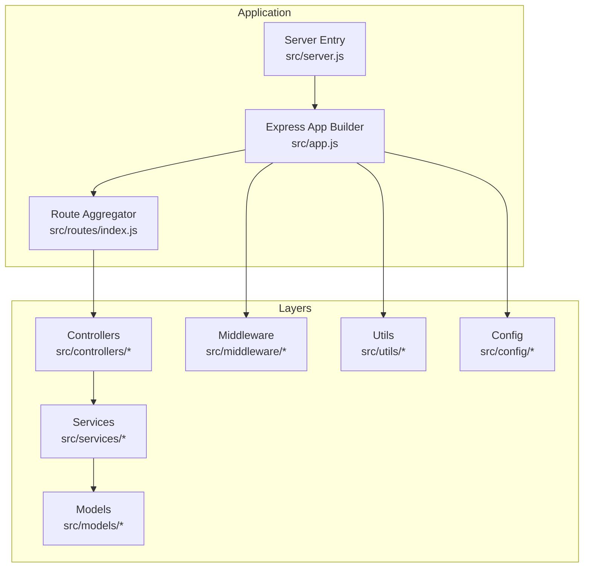
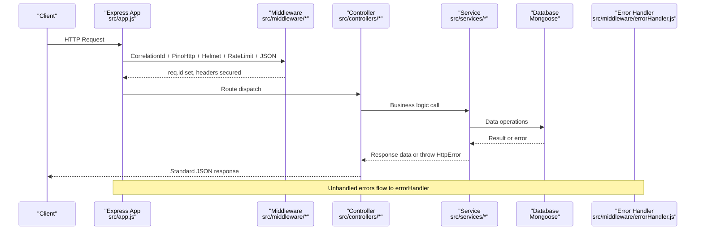
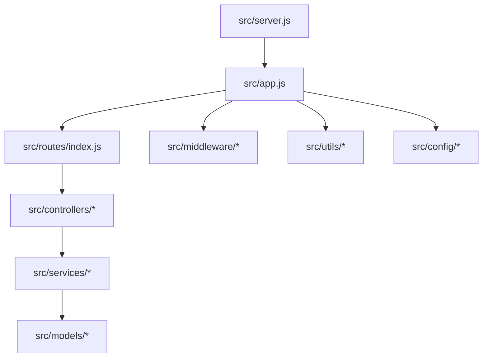
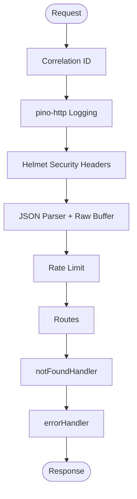
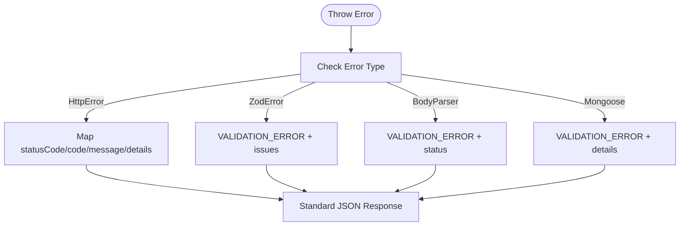
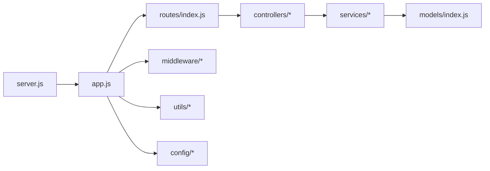

# Code Style and Conventions

<cite>
**Referenced Files in This Document**
- [eslint.config.js](file://eslint.config.js)
- [package.json](file://package.json)
- [README.md](file://README.md)
- [src/app.js](file://src/app.js)
- [src/server.js](file://src/server.js)
- [src/config/env.js](file://src/config/env.js)
- [src/middleware/errorHandler.js](file://src/middleware/errorHandler.js)
- [src/middleware/auth.js](file://src/middleware/auth.js)
- [src/utils/logger.js](file://src/utils/logger.js)
- [src/utils/httpError.js](file://src/utils/httpError.js)
- [src/utils/asyncHandler.js](file://src/utils/asyncHandler.js)
- [src/controllers/webhook.controller.js](file://src/controllers/webhook.controller.js)
- [src/services/pipeline.service.js](file://src/services/pipeline.service.js)
- [src/models/index.js](file://src/models/index.js)
- [src/routes/index.js](file://src/routes/index.js)
</cite>

## Table of Contents
1. Introduction
2. Project Structure
3. Core Components
4. Architecture Overview
5. Detailed Component Analysis
6. Dependency Analysis
7. Performance Considerations
8. Troubleshooting Guide
9. Conclusion

## Introduction
This document defines the code style, conventions, and architectural patterns for the Lead System Manager project. It covers ESLint configuration, ES modules usage, naming conventions, file organization, import/export standards, middleware implementation, error handling, async/await patterns, logging practices, and documentation requirements for public APIs. The guidance is derived from the repository’s configuration and source files to ensure consistency across current and future development.

## Project Structure
The application follows a layered Express architecture with clear separation of concerns:
- Configuration: environment validation and database wiring
- Controllers: HTTP request handlers
- Middleware: cross-cutting concerns (auth, correlation id, error handling, signature verification)
- Models: Mongoose schemas and constants
- Routes: route grouping and mounting
- Services: business logic and adapters
- Utils: shared helpers (logging, errors, async wrapper)
- Validators: input validation schemas

**Diagram sources**
- [src/server.js:1-50](file://src/server.js#L1-L50)
- [src/app.js:1-76](file://src/app.js#L1-L76)
- [src/routes/index.js:1-17](file://src/routes/index.js#L1-L17)

**Section sources**
- [README.md:364-384](file://README.md#L364-L384)
- [src/routes/index.js:1-17](file://src/routes/index.js#L1-L17)

## Core Components
- Environment configuration: validated via Zod, frozen export, and startup checks
- Logging: structured pino logger with redaction and child loggers
- Error handling: centralized handler mapping domain and framework errors to standard responses
- Async utilities: wrapper to forward async handler rejections to Express error handling
- Authentication: constant-time API key comparison for staff endpoints
- Pipeline service: central processing entry point for inbound messages

Key responsibilities and conventions are detailed in the following sections.

**Section sources**
- [src/config/env.js:1-130](file://src/config/env.js#L1-L130)
- [src/utils/logger.js:1-34](file://src/utils/logger.js#L1-L34)
- [src/middleware/errorHandler.js:1-80](file://src/middleware/errorHandler.js#L1-L80)
- [src/utils/asyncHandler.js:1-11](file://src/utils/asyncHandler.js#L1-L11)
- [src/middleware/auth.js:1-23](file://src/middleware/auth.js#L1-L23)
- [src/services/pipeline.service.js:1-81](file://src/services/pipeline.service.js#L1-L81)

## Architecture Overview
The system uses an Express application with middleware-first composition:
- Request enters through global middleware (correlation id, logging, helmet, rate limit, JSON parsing)
- Route groups mount controllers under /health, /webhook, /simulate
- Controllers delegate to services; services interact with models and external adapters
- Errors are normalized by a central error handler
- Structured logs include correlation ids and redacted secrets

**Diagram sources**
- [src/app.js:1-76](file://src/app.js#L1-L76)
- [src/middleware/errorHandler.js:1-80](file://src/middleware/errorHandler.js#L1-L80)
- [src/controllers/webhook.controller.js:1-56](file://src/controllers/webhook.controller.js#L1-L56)
- [src/services/pipeline.service.js:1-81](file://src/services/pipeline.service.js#L1-L81)

## Detailed Component Analysis

### ESLint and Language Standards
- ECMAScript version: 2022
- Module system: ES modules (type: module)
- Globals: Node built-ins and web globals explicitly declared
- Rules:
  - Warn on unused variables with underscore prefix allowed
  - Treat undefined variables as errors
- Linting script: npm run lint

Conventions:
- Prefer named exports for functions and classes
- Avoid unused imports; use underscore prefix for intentionally unused parameters
- Keep top-level modules pure and side-effect free where possible

**Section sources**
- [eslint.config.js:1-35](file://eslint.config.js#L1-L35)
- [package.json:1-36](file://package.json#L1-L36)

### Naming Conventions
- Files: kebab-case for feature files (e.g., webhook.controller.js, pipeline.service.js)
- Functions: camelCase, descriptive verbs (e.g., processInboundMessage, verifyWebhook)
- Variables: camelCase; avoid single-letter names except loop counters
- Classes: PascalCase (e.g., HttpError)
- Constants: UPPER_SNAKE_CASE for exported enums/constants (e.g., CONVERSATION_STATES)
- Modules: small, focused, single responsibility per file

Examples in codebase:
- Controller methods: verifyWebhook, receiveWebhook
- Service function: processInboundMessage
- Utility class: HttpError
- Model constants: CONVERSATION_STATES, MESSAGE_DIRECTIONS

**Section sources**
- [src/controllers/webhook.controller.js:1-56](file://src/controllers/webhook.controller.js#L1-L56)
- [src/services/pipeline.service.js:1-81](file://src/services/pipeline.service.js#L1-L81)
- [src/utils/httpError.js:1-31](file://src/utils/httpError.js#L1-L31)
- [src/models/index.js:1-13](file://src/models/index.js#L1-L13)

### File Organization Principles
- Layered directories: config, controllers, middleware, models, routes, services, utils, validators
- Single entry points:
  - src/server.js boots the server and handles graceful shutdown
  - src/app.js builds the Express app without binding a port
  - src/routes/index.js aggregates route groups
  - src/models/index.js centralizes model exports
- Import/export:
  - Use ES modules with .js extensions
  - Named exports for reusable components
  - Default export for router aggregation

**Diagram sources**
- [src/server.js:1-50](file://src/server.js#L1-L50)
- [src/app.js:1-76](file://src/app.js#L1-L76)
- [src/routes/index.js:1-17](file://src/routes/index.js#L1-L17)
- [src/models/index.js:1-13](file://src/models/index.js#L1-L13)

**Section sources**
- [src/server.js:1-50](file://src/server.js#L1-L50)
- [src/app.js:1-76](file://src/app.js#L1-L76)
- [src/routes/index.js:1-17](file://src/routes/index.js#L1-L17)
- [src/models/index.js:1-13](file://src/models/index.js#L1-L13)

### Import and Export Conventions
- Always use ES modules with explicit .js extensions
- Prefer named exports for functions, classes, and constants
- Use default export only for aggregator modules (e.g., router)
- Centralize shared dependencies (logger, env) via dedicated utils/config modules

Patterns observed:
- Logger and env imported from utils/config
- Controllers import services and config
- Middleware imports HttpError and env

**Section sources**
- [src/app.js:1-76](file://src/app.js#L1-L76)
- [src/controllers/webhook.controller.js:1-56](file://src/controllers/webhook.controller.js#L1-L56)
- [src/middleware/auth.js:1-23](file://src/middleware/auth.js#L1-L23)

### Middleware Implementation
- Correlation ID: attaches unique id to requests for tracing
- Security: helmet, rate limiting, JSON body parser with raw buffer capture
- Logging: pino-http integration with custom serializers and level mapping
- Error handling: notFoundHandler and errorHandler normalize all errors
- Authentication: requireApiKey validates x-api-key using constant-time comparison

Best practices:
- Place security and logging early in the middleware chain
- Return standardized error bodies with correlationId
- Skip heavy middleware in tests when appropriate

**Diagram sources**
- [src/app.js:1-76](file://src/app.js#L1-L76)
- [src/middleware/errorHandler.js:1-80](file://src/middleware/errorHandler.js#L1-L80)
- [src/middleware/auth.js:1-23](file://src/middleware/auth.js#L1-L23)

**Section sources**
- [src/app.js:1-76](file://src/app.js#L1-L76)
- [src/middleware/errorHandler.js:1-80](file://src/middleware/errorHandler.js#L1-L80)
- [src/middleware/auth.js:1-23](file://src/middleware/auth.js#L1-L23)

### Error Handling Patterns
- Domain errors: HttpError carries statusCode, code, message, details
- Framework errors: ZodError, body-parser, Mongoose validation/cast/duplicate handled
- Centralized mapping: errorHandler converts to standard JSON shape
- Non-production environments expose more details; production hides internals
- Consistent correlationId in every error response

**Diagram sources**
- [src/middleware/errorHandler.js:1-80](file://src/middleware/errorHandler.js#L1-L80)
- [src/utils/httpError.js:1-31](file://src/utils/httpError.js#L1-L31)

**Section sources**
- [src/middleware/errorHandler.js:1-80](file://src/middleware/errorHandler.js#L1-L80)
- [src/utils/httpError.js:1-31](file://src/utils/httpError.js#L1-L31)

### Async/Await Usage
- Controllers return promises; asyncHandler forwards rejections to error handler
- Services return Promises with typed results (JSDoc typedefs used)
- Webhook controller returns 200 immediately and processes messages asynchronously
- Graceful shutdown uses await for DB disconnect and timeout guard

Guidelines:
- Wrap async Express handlers with asyncHandler
- Catch and log unhandled promise rejections at boundaries
- Use structured child loggers for async tasks

**Section sources**
- [src/utils/asyncHandler.js:1-11](file://src/utils/asyncHandler.js#L1-L11)
- [src/controllers/webhook.controller.js:1-56](file://src/controllers/webhook.controller.js#L1-L56)
- [src/services/pipeline.service.js:1-81](file://src/services/pipeline.service.js#L1-L81)
- [src/server.js:1-50](file://src/server.js#L1-L50)

### Logging Patterns
- Shared pino logger configured with ISO timestamps and redaction rules
- Redacts sensitive headers (API keys, authorization, webhook signatures)
- Child loggers bound to correlationId and contextual metadata
- pino-http integrates with Express to log requests/responses with custom serializers

Recommendations:
- Use logger.child({ correlationId, ...context }) for scoped logs
- Never log secrets; rely on redaction and sanitized payloads
- Use appropriate log levels (info/warn/error) based on outcome

**Section sources**
- [src/utils/logger.js:1-34](file://src/utils/logger.js#L1-L34)
- [src/app.js:1-76](file://src/app.js#L1-L76)

### Configuration and Validation
- Environment variables loaded relative to project root
- Zod schema enforces types, ranges, and conditional requirements
- Production mode rejects placeholder secrets
- Boolean parsing helper avoids coercion pitfalls

Standards:
- Import env from config instead of reading process.env directly
- Validate all inputs and configuration at startup
- Freeze exported env object to prevent mutation

**Section sources**
- [src/config/env.js:1-130](file://src/config/env.js#L1-L130)

### Public API Documentation Requirements
- Every failure returns a standard error body with error.code, error.message, error.details, and correlationId
- Endpoint behaviors documented in README and enforced by middleware/controllers
- Health endpoint exposes service readiness; webhook handshake and signed POST documented
- Simulate endpoint for internal testing with API key protection

Guidelines:
- Maintain consistent error shapes across all endpoints
- Include correlationId in all responses for traceability
- Document auth requirements and expected headers

**Section sources**
- [README.md:386-407](file://README.md#L386-L407)
- [src/middleware/errorHandler.js:1-80](file://src/middleware/errorHandler.js#L1-L80)
- [src/controllers/webhook.controller.js:1-56](file://src/controllers/webhook.controller.js#L1-L56)

### Comment and JSDoc Conventions
- Use JSDoc for public functions and types (e.g., PipelineResult typedef)
- Explain non-obvious behavior and TODOs with task references
- Keep comments concise and actionable

Observed patterns:
- JSDoc for HttpError constructor and utility functions
- JSDoc for pipeline result shape and function parameters
- Inline comments explaining design decisions (e.g., raw buffer retention)

**Section sources**
- [src/utils/httpError.js:1-31](file://src/utils/httpError.js#L1-L31)
- [src/services/pipeline.service.js:1-81](file://src/services/pipeline.service.js#L1-L81)
- [src/app.js:1-76](file://src/app.js#L1-L76)

## Dependency Analysis
High-level dependency relationships:
- server.js depends on app.js and config/db.js
- app.js composes middleware, routes, and utilities
- routes/index.js aggregates feature routers
- controllers depend on services and config
- services depend on utils and models
- models index centralizes exports

**Diagram sources**
- [src/server.js:1-50](file://src/server.js#L1-L50)
- [src/app.js:1-76](file://src/app.js#L1-L76)
- [src/routes/index.js:1-17](file://src/routes/index.js#L1-L17)
- [src/models/index.js:1-13](file://src/models/index.js#L1-L13)

**Section sources**
- [src/server.js:1-50](file://src/server.js#L1-L50)
- [src/app.js:1-76](file://src/app.js#L1-L76)
- [src/routes/index.js:1-17](file://src/routes/index.js#L1-L17)
- [src/models/index.js:1-13](file://src/models/index.js#L1-L13)

## Performance Considerations
- Early middleware order minimizes overhead for unmatched routes
- Rate limiter skips in test environment to avoid flaky tests
- JSON parser retains raw buffer only for webhook signature verification
- Structured logging with pino is efficient; avoid excessive log verbosity in production
- Database connection does not block server startup; health endpoint reflects connectivity

[No sources needed since this section provides general guidance]

## Troubleshooting Guide
Common issues and resolutions:
- Invalid environment variables: check .env against .env.example; startup aborts with detailed Zod errors
- MongoDB down: /health reports degraded/down; start Mongo or fix MONGODB_URI
- Port conflicts: change PORT in .env
- Webhook signature mismatch: ensure WHATSAPP_APP_SECRET matches signer
- Handshake failures: ensure WHATSAPP_VERIFY_TOKEN matches Meta configuration
- Forced failures: use WHATSAPP_FORCE_SEND_FAILURE=true for testing notifier paths

Operational tips:
- Use correlationId to trace requests across logs and audit events
- Inspect structured logs for redacted fields and context
- Run npm test with in-memory MongoDB for fast feedback

**Section sources**
- [README.md:409-420](file://README.md#L409-L420)
- [src/config/env.js:111-121](file://src/config/env.js#L111-L121)
- [src/app.js:54-67](file://src/app.js#L54-L67)

## Conclusion
The Lead System Manager adheres to modern JavaScript practices with ES modules, strict ESLint rules, and a clean layered architecture. Centralized error handling, structured logging, and robust environment validation ensure reliability and observability. Following these conventions will keep the codebase consistent, maintainable, and scalable as new features are added.

[No sources needed since this section summarizes without analyzing specific files]