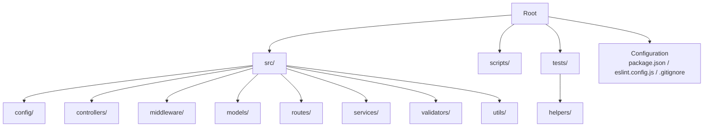
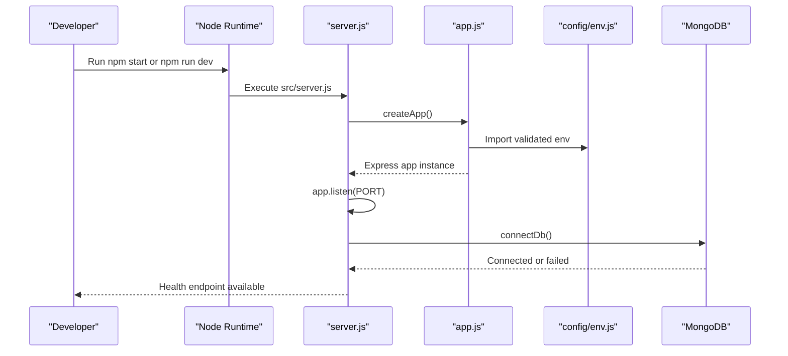
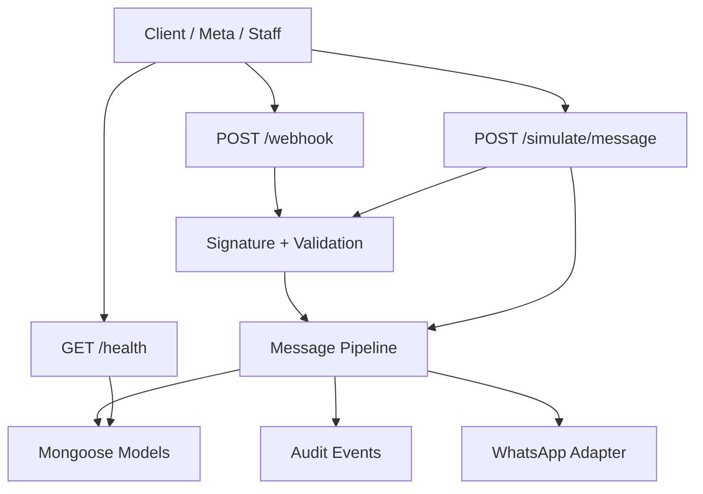
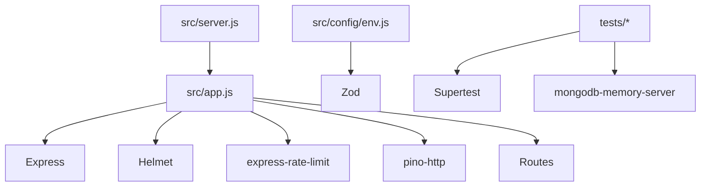

# Contribution Guidelines

<cite>
**Referenced Files in This Document**
- [README.md](file://README.md)
- [WORKPLAN.md](file://WORKPLAN.md)
- [package.json](file://package.json)
- [eslint.config.js](file://eslint.config.js)
- [.gitignore](file://.gitignore)
- [src/app.js](file://src/app.js)
- [src/server.js](file://src/server.js)
- [src/config/env.js](file://src/config/env.js)
- [tests/health.test.js](file://tests/health.test.js)
- [tests/webhook.test.js](file://tests/webhook.test.js)
- [tests/helpers/setup-env.mjs](file://tests/helpers/setup-env.mjs)
</cite>

## Table of Contents
1. [Introduction](#introduction)
2. [Project Structure](#project-structure)
3. [Core Components](#core-components)
4. [Architecture Overview](#architecture-overview)
5. [Detailed Component Analysis](#detailed-component-analysis)
6. [Dependency Analysis](#dependency-analysis)
7. [Performance Considerations](#performance-considerations)
8. [Troubleshooting Guide](#troubleshooting-guide)
9. [Conclusion](#conclusion)
10. [Appendices](#appendices)

## Introduction
This document defines the contribution process for community contributors to the Lead System Manager, a Node.js backend that automates WhatsApp retail conversations, classifies intent, manages orders and tickets, and maintains an audit trail. It covers how to set up the project, follow coding standards, write tests, update documentation, submit pull requests, and participate in reviews and discussions.

The project is intentionally small, readable, and testable: it uses Express 4, Mongoose 8, Zod validation, structured pino logging, and Node’s built-in `node:test` runner with Supertest and an in-memory MongoDB server. The README and WORKPLAN describe the business goals, API surface, data model, failure handling, and roadmap; this guide translates those into contributor workflows.

## Project Structure
The repository follows a layered structure:
- `src/`: application code (configuration, controllers, middleware, models, routes, services, validators, utilities).
- `scripts/`: development helpers such as seeding and webhook simulation.
- `tests/`: automated test suites and shared test helpers.
- Root configuration files: `package.json`, `eslint.config.js`, `.gitignore`, Docker artifacts, and documentation.

**Diagram sources**
- [README.md:364-384](file://README.md#L364-L384)

**Section sources**
- [README.md:364-384](file://README.md#L364-L384)

## Core Components
For contributors, the most important runtime entry points are:
- Application factory: builds the Express app, registers middleware, rate limiting, logging, and routes.
- Server bootstrap: starts listening, connects to MongoDB, and handles graceful shutdown.
- Environment configuration: validates all environment variables at startup using Zod.

Key responsibilities:
- `src/app.js`: creates the Express application, wires correlation IDs, structured logging, security headers, JSON parsing, rate limiting, route mounting, and error handlers.
- `src/server.js`: listens on the configured port, connects to MongoDB after boot, and implements graceful shutdown on signals.
- `src/config/env.js`: loads `.env`, parses and validates environment variables, enforces production constraints, and exports a frozen configuration object.

**Diagram sources**
- [src/server.js:1-50](file://src/server.js#L1-L50)
- [src/app.js:15-75](file://src/app.js#L15-L75)
- [src/config/env.js:125-141](file://src/config/env.js#L125-L141)

**Section sources**
- [src/app.js:1-76](file://src/app.js#L1-L76)
- [src/server.js:1-50](file://src/server.js#L1-L50)
- [src/config/env.js:1-144](file://src/config/env.js#L1-L144)

## Architecture Overview
The system exposes REST endpoints for health checks, incoming WhatsApp webhooks, and simulated message processing. All responses include a correlation ID for tracing. Webhooks verify signatures and validate payloads before asynchronously processing messages through a pipeline that may classify intent, reply, create orders or tickets, and record audit events.

**Diagram sources**
- [README.md:386-407](file://README.md#L386-L407)
- [WORKPLAN.md:92-135](file://WORKPLAN.md#L92-L135)

## Detailed Component Analysis

### Contribution Workflow

#### Fork, Clone, and Setup
1. Fork the repository on your Git provider.
2. Clone your fork locally.
3. Install dependencies with `npm install`.
4. Copy `.env.example` to `.env` and adjust values for local development.
5. Start MongoDB using one of the documented options:
   - Docker Compose: `docker compose up -d mongo`
   - In-memory dev server: `npm run dev:mongo`
   - Atlas connection string via `MONGODB_URI`
6. Seed the product catalogue with `npm run seed`.
7. Start the API with `npm run dev` or `npm start`.
8. Verify with `curl http://localhost:3000/health`.

These steps match the quick start and configuration guidance in the README.

**Section sources**
- [README.md:75-100](file://README.md#L75-L100)
- [README.md:102-160](file://README.md#L102-L160)

#### Coding Standards
- Use ES modules (`"type": "module"` in package configuration).
- Follow ESLint rules defined in the project configuration:
  - ECMAScript 2022 module syntax.
  - Warn on unused variables but ignore leading underscore patterns.
  - Error on undefined variables.
- Keep secrets out of source control:
  - `.env` is gitignored.
  - Only placeholders go into `.env.example`.
  - Production mode rejects default placeholder secrets.

Run linting with `npm run lint`. Fix warnings before submitting changes.

**Section sources**
- [package.json:1-17](file://package.json#L1-L17)
- [eslint.config.js:1-35](file://eslint.config.js#L1-L35)
- [.gitignore:1-9](file://.gitignore#L1-L9)
- [src/config/env.js:71-123](file://src/config/env.js#L71-L123)

#### Testing Requirements
- Use Node’s built-in test runner: `npm test`.
- Tests use Supertest for HTTP assertions and `mongodb-memory-server` for isolated database state.
- Test environment setup must be imported first in each test file so environment variables are set before any application module evaluates.
- Write tests for:
  - Endpoint status codes and response shapes.
  - Validation errors and standard error bodies.
  - Audit event creation where applicable.
  - Correlation ID presence on responses.
  - Edge cases such as missing signatures, invalid payloads, duplicates, and non-text messages.

Example patterns:
- Health endpoint tests assert success when MongoDB is connected and failure when disconnected.
- Webhook tests assert handshake behavior, signature verification, payload validation, asynchronous processing, and audit trails.

When adding new functionality:
- Add unit or integration tests under `tests/`.
- If testing external behavior (e.g., LLM or notifier), simulate failures using environment flags or helper scripts.
- Ensure tests pass locally with `npm test` before opening a PR.

**Section sources**
- [README.md:351-363](file://README.md#L351-L363)
- [tests/health.test.js:1-44](file://tests/health.test.js#L1-L44)
- [tests/webhook.test.js:1-222](file://tests/webhook.test.js#L1-L222)
- [tests/helpers/setup-env.mjs:1-20](file://tests/helpers/setup-env.mjs#L1-L20)

#### Documentation Expectations
- Update the README if you change:
  - Quick start steps.
  - Configuration variables.
  - API endpoints or behaviors.
  - Troubleshooting scenarios.
- Keep the WORKPLAN aligned with current scope and task status.
- When introducing new environment variables, add them to the configuration reference and ensure validation exists in `src/config/env.js`.
- Avoid committing secrets; keep only placeholders in example files.

**Section sources**
- [README.md:163-198](file://README.md#L163-L198)
- [README.md:283-289](file://README.md#L283-L289)
- [src/config/env.js:1-144](file://src/config/env.js#L1-L144)

#### Pull Request Submission
- Create a feature branch from `main` (or the appropriate base branch).
- Commit focused changes with clear messages.
- Ensure:
  - `npm test` passes.
  - `npm run lint` has no warnings.
  - Documentation is updated if behavior or configuration changed.
  - No secrets are committed.
- Open a pull request describing:
  - What changed and why.
  - How to test the change.
  - Any backward compatibility considerations.
  - Related tasks or issues.

Reviewers will check:
- Correctness and clarity of implementation.
- Adequate test coverage.
- Compliance with coding standards.
- Documentation updates.
- Security and secret handling.

#### Code Review Process and Approval Criteria
Review criteria:
- Functionality matches requirements in the README and WORKPLAN.
- Input validation uses Zod schemas consistently.
- Errors return the standard error body with a code and correlation ID.
- Audit events are recorded for significant state changes.
- External integrations (LLM, WhatsApp, notifier) are wrapped behind adapters and fail gracefully.
- Performance-sensitive paths avoid unnecessary blocking operations.
- Tests cover happy paths, edge cases, and failure modes.

Approval workflow:
- At least one maintainer review is required.
- CI-like checks should include linting and tests passing.
- Changes affecting public APIs require explicit backward compatibility notes.

#### Merge Policies
- Squash or rebase merges are preferred to keep history clean.
- Do not merge until:
  - All tests pass.
  - Linting passes.
  - Documentation is updated.
  - Review feedback is addressed.
- Versioned releases should increment version numbers and update changelogs if introduced later.

#### Reporting Bugs
Use the following template when reporting bugs:
- Summary: One-line description.
- Steps to reproduce: Exact commands or requests.
- Expected behavior: What should happen.
- Actual behavior: What happened.
- Environment: Node version, OS, MongoDB mode, relevant `.env` settings.
- Logs: Include correlation IDs and sanitized logs.
- Severity: Impact on users or operations.

Include evidence such as:
- Health endpoint output.
- Audit events related to the issue.
- Reproducible test case if possible.

#### Requesting Features
Use the following template when requesting features:
- Problem statement: Why this feature is needed.
- Proposed solution: High-level approach.
- Scope: What is included and excluded.
- Backward compatibility: How existing clients are affected.
- Testing plan: How the feature will be verified.
- Dependencies: External services or configuration changes.

Align feature requests with the roadmap in the README and the workplan.

#### Participating in Discussions
- Be respectful and constructive.
- Reference specific files, lines, or endpoints when discussing implementation details.
- Provide examples or test cases when proposing changes.
- Keep discussions focused on user value, reliability, security, and maintainability.

### Backward Compatibility Guidelines
- Do not remove or rename existing API fields without a deprecation period.
- Preserve existing status codes and error shapes unless explicitly breaking changes are planned.
- Validate and reject unknown fields where appropriate to avoid silent drift.
- Document deprecations in the README and API reference.
- Add migration notes for schema or configuration changes.

### Writing Tests
Follow these patterns:
- Set up test environment variables at the top of each test file.
- Use Supertest to send HTTP requests against the created Express app.
- Assert status codes, response bodies, headers, and side effects (audit events, database records).
- For asynchronous processing, poll until expected state appears within a timeout.
- Mock or simulate external dependencies using environment flags or adapter modes.

Examples:
- Health tests assert both successful and degraded states.
- Webhook tests cover handshake, signature verification, payload validation, and background processing.

**Section sources**
- [tests/health.test.js:1-44](file://tests/health.test.js#L1-L44)
- [tests/webhook.test.js:1-222](file://tests/webhook.test.js#L1-L222)
- [tests/helpers/setup-env.mjs:1-20](file://tests/helpers/setup-env.mjs#L1-L20)

### Updating Documentation
When changing code:
- Update the README if quick start, configuration, or API behavior changes.
- Update the WORKPLAN if scope, tasks, or assumptions change.
- Add or revise environment variable tables in the README when new variables are introduced.
- Keep troubleshooting sections current with common symptoms and fixes.

**Section sources**
- [README.md:163-198](file://README.md#L163-L198)
- [README.md:409-427](file://README.md#L409-L427)
- [WORKPLAN.md:695-716](file://WORKPLAN.md#L695-L716)

## Dependency Analysis
The application depends on:
- Express for routing and middleware.
- Helmet for security headers.
- Rate limiting for abuse protection.
- Pino for structured logging.
- Mongoose for MongoDB modeling.
- Zod for validation.
- Supertest and mongodb-memory-server for testing.

**Diagram sources**
- [src/app.js:1-76](file://src/app.js#L1-L76)
- [src/server.js:1-50](file://src/server.js#L1-L50)
- [src/config/env.js:1-144](file://src/config/env.js#L1-L144)
- [package.json:18-35](file://package.json#L18-L35)

**Section sources**
- [package.json:1-36](file://package.json#L1-L36)
- [src/app.js:1-76](file://src/app.js#L1-L76)
- [src/server.js:1-50](file://src/server.js#L1-L50)
- [src/config/env.js:1-144](file://src/config/env.js#L1-L144)

## Performance Considerations
- Keep webhook processing fast by responding immediately and performing work asynchronously.
- Use structured logging with correlation IDs to trace requests efficiently.
- Avoid heavy computation in request handlers; delegate to services or workers.
- Use Zod validation early to reject invalid inputs quickly.
- Monitor health endpoints and metrics to detect dependency degradation.
- Limit log verbosity in production and use appropriate log levels.

[No sources needed since this section provides general guidance]

## Troubleshooting Guide
Common issues and resolutions:
- Invalid environment variables at startup: compare `.env` with `.env.example`; the validator prints offending variables.
- `/health` returns 503: MongoDB is unreachable; start Docker Mongo, run the in-memory dev server, or fix `MONGODB_URI`.
- Port conflicts: change `PORT` in `.env`.
- Webhook signature mismatch: ensure `WHATSAPP_APP_SECRET` matches the signer; use the provided script with the correct secret.
- Handshake rejection: ensure `WHATSAPP_VERIFY_TOKEN` matches between `.env` and Meta’s webhook configuration.
- Forced failures for testing: enable `WHATSAPP_FORCE_SEND_FAILURE=true` or use script flags for webhook rejection scenarios.
- Tests downloading MongoDB binary: first run requires network; subsequent runs use cached binaries.

**Section sources**
- [README.md:409-427](file://README.md#L409-L427)
- [src/config/env.js:125-135](file://src/config/env.js#L125-L135)

## Conclusion
Contributing to the Lead System Manager involves setting up the environment, following coding standards, writing robust tests, updating documentation, and engaging in thoughtful code reviews. The project emphasizes clarity, validation, observability, and resilience. By adhering to these guidelines, contributors help maintain a reliable, secure, and extensible automation platform for WhatsApp retail conversations.

[No sources needed since this section summarizes without analyzing specific files]

## Appendices

### Quick Commands Reference
- Install dependencies: `npm install`
- Start API: `npm run dev` or `npm start`
- Seed catalogue: `npm run seed`
- Run tests: `npm test`
- Lint code: `npm run lint`
- Start in-memory MongoDB: `npm run dev:mongo`

**Section sources**
- [README.md:151-160](file://README.md#L151-L160)
- [package.json:10-17](file://package.json#L10-L17)