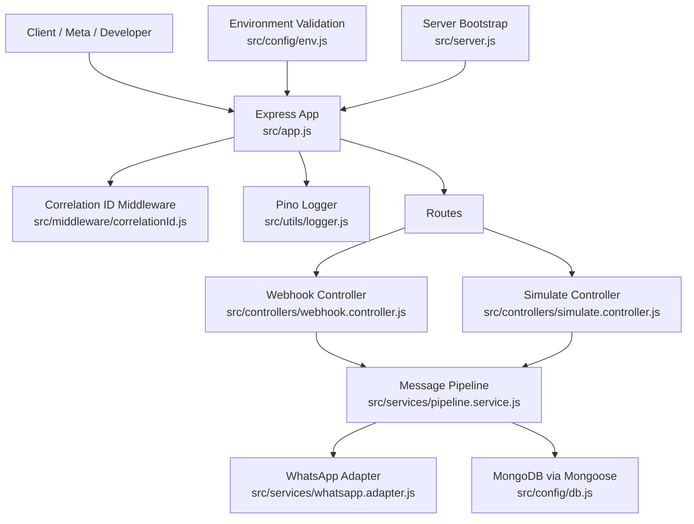
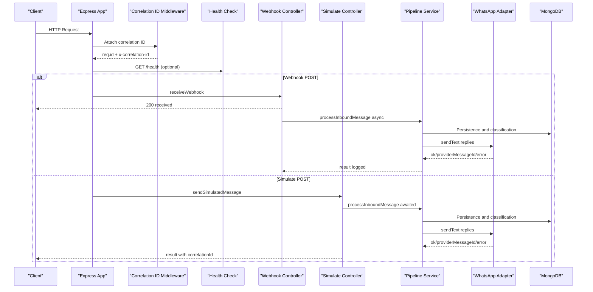
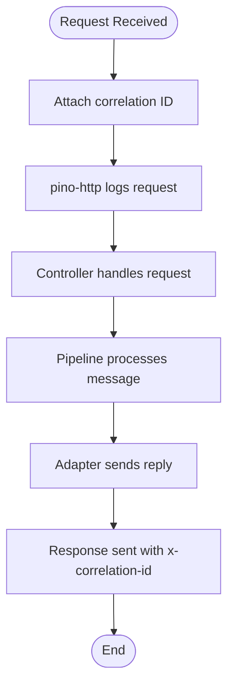
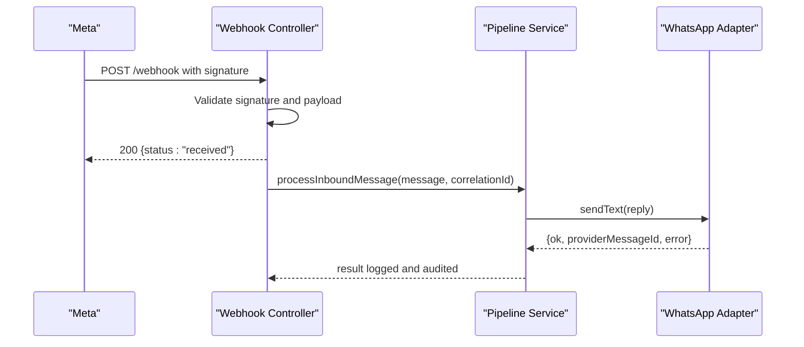
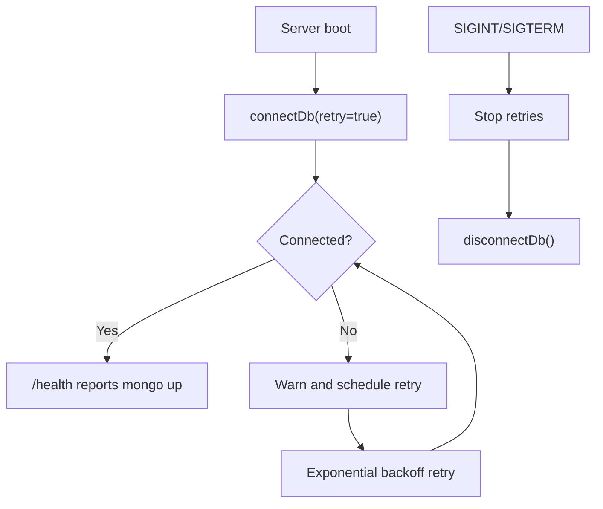
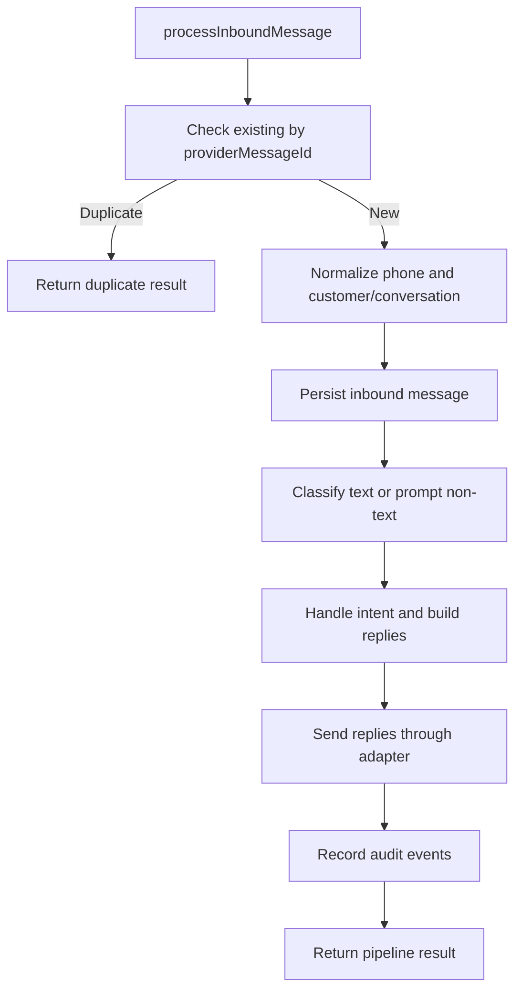
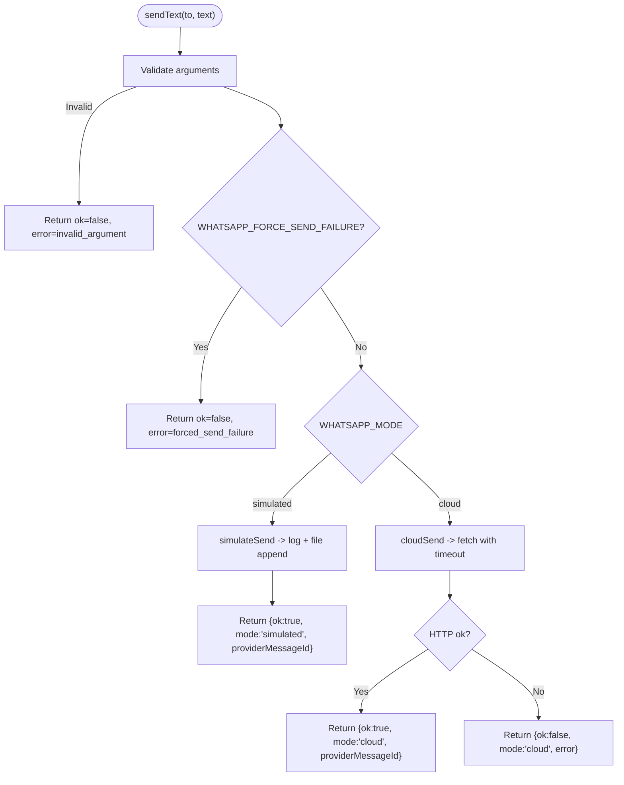
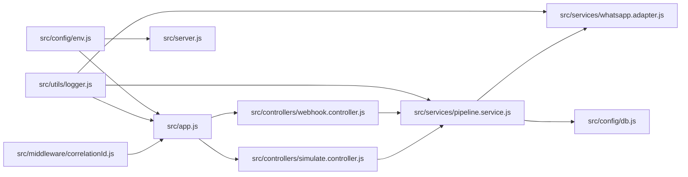

# Debugging and Profiling

<cite>
**Referenced Files in This Document**
- [README.md](file://README.md)
- [src/app.js](file://src/app.js)
- [src/server.js](file://src/server.js)
- [src/config/env.js](file://src/config/env.js)
- [src/config/db.js](file://src/config/db.js)
- [src/utils/logger.js](file://src/utils/logger.js)
- [src/middleware/correlationId.js](file://src/middleware/correlationId.js)
- [src/controllers/webhook.controller.js](file://src/controllers/webhook.controller.js)
- [src/controllers/simulate.controller.js](file://src/controllers/simulate.controller.js)
- [src/services/pipeline.service.js](file://src/services/pipeline.service.js)
- [src/services/whatsapp.adapter.js](file://src/services/whatsapp.adapter.js)
- [scripts/send-webhook.js](file://scripts/send-webhook.js)
</cite>

## Table of Contents
1. [Introduction](#introduction)
2. [Project Structure](#project-structure)
3. [Core Components](#core-components)
4. [Architecture Overview](#architecture-overview)
5. [Detailed Component Analysis](#detailed-component-analysis)
6. [Dependency Analysis](#dependency-analysis)
7. [Performance Considerations](#performance-considerations)
8. [Troubleshooting Guide](#troubleshooting-guide)
9. [Conclusion](#conclusion)

## Introduction
This document explains how to debug and profile the Lead System Manager with a focus on structured logging, request correlation, webhook integration, MongoDB connectivity, pipeline processing, performance profiling, memory leak detection, and common operational issues. It is intended for developers and operators who need to trace WhatsApp messages end-to-end, diagnose slow or failing requests, and identify bottlenecks in classification, persistence, or outbound messaging.

The system uses:
- Pino for structured JSON logs.
- A per-request correlation ID attached to every response header and log line.
- An Express application with rate limiting, Helmet, pino-http, and custom middleware.
- A message pipeline that persists inbound data, classifies intent, routes replies, and records audit events.
- A WhatsApp adapter supporting simulated and Cloud API modes.
- Environment validation through Zod at startup.

**Section sources**
- [README.md:50-57](file://README.md#L50-L57)
- [README.md:163-198](file://README.md#L163-L198)
- [README.md:386-407](file://README.md#L386-L407)

## Project Structure
For debugging purposes, the most relevant parts are:
- Application bootstrap and HTTP layer: `src/app.js`, `src/server.js`.
- Configuration and environment validation: `src/config/env.js`.
- Database connection and retry logic: `src/config/db.js`.
- Logging and correlation ID middleware: `src/utils/logger.js`, `src/middleware/correlationId.js`.
- Webhook controller and simulate controller: `src/controllers/webhook.controller.js`, `src/controllers/simulate.controller.js`.
- Message pipeline: `src/services/pipeline.service.js`.
- WhatsApp adapter: `src/services/whatsapp.adapter.js`.
- Manual webhook sender script: `scripts/send-webhook.js`.

**Diagram sources**
- [src/app.js:15-74](file://src/app.js#L15-L74)
- [src/server.js:1-26](file://src/server.js#L1-L26)
- [src/config/env.js:125-141](file://src/config/env.js#L125-L141)
- [src/middleware/correlationId.js:9-13](file://src/middleware/correlationId.js#L9-L13)
- [src/utils/logger.js:11-26](file://src/utils/logger.js#L11-L26)
- [src/controllers/webhook.controller.js:35-55](file://src/controllers/webhook.controller.js#L35-L55)
- [src/controllers/simulate.controller.js:12-34](file://src/controllers/simulate.controller.js#L12-L34)
- [src/services/pipeline.service.js:66-273](file://src/services/pipeline.service.js#L66-L273)
- [src/services/whatsapp.adapter.js:113-135](file://src/services/whatsapp.adapter.js#L113-L135)
- [src/config/db.js:37-47](file://src/config/db.js#L37-L47)

**Section sources**
- [src/app.js:15-74](file://src/app.js#L15-L74)
- [src/server.js:1-26](file://src/server.js#L1-L26)
- [src/config/env.js:125-141](file://src/config/env.js#L125-L141)

## Core Components
### Structured Logging with Pino
- The shared logger is created with service metadata, ISO timestamps, and redaction rules for sensitive headers such as API keys, authorization headers, and webhook signatures.
- Pino-http integrates with Express to log each request and response using the same logger instance.
- Child loggers can be created to attach contextual fields like correlation ID, source, and message identifiers.

Key behaviors:
- Redacted fields never appear in logs.
- Log level is controlled by `LOG_LEVEL`.
- Request/response serialization includes method, URL, id, and status code.

**Section sources**
- [src/utils/logger.js:1-34](file://src/utils/logger.js#L1-L34)
- [src/app.js:22-37](file://src/app.js#L22-L37)

### Correlation ID Tracking
- Every request receives a UUID stored on `req.id`.
- The response header `x-correlation-id` is set automatically.
- Pino-http uses `genReqId` to pick up `req.id` so all HTTP logs include the correlation ID.
- Controllers and services propagate the correlation ID into pipeline and audit contexts.

Debugging tip:
- Search logs by correlation ID to reconstruct the full lifecycle of one request across middleware, controllers, services, adapters, and audit events.

**Section sources**
- [src/middleware/correlationId.js:1-14](file://src/middleware/correlationId.js#L1-L14)
- [src/app.js:21-37](file://src/app.js#L21-L37)
- [src/controllers/webhook.controller.js:35-55](file://src/controllers/webhook.controller.js#L35-L55)
- [src/controllers/simulate.controller.js:12-34](file://src/controllers/simulate.controller.js#L12-L34)

### Environment Configuration and Validation
- All environment variables are validated at startup using Zod.
- Invalid values cause an immediate process exit with a readable list of offending variables.
- Production mode rejects default placeholder secrets.
- WhatsApp Cloud mode requires phone number ID and access token.
- LLM provider configuration enforces required keys.

Common debugging use cases:
- Startup failures due to missing or invalid `.env` values.
- Differences between local development and containerized runs where Docker Compose overrides environment variables.

**Section sources**
- [src/config/env.js:1-144](file://src/config/env.js#L1-L144)
- [README.md:163-198](file://README.md#L163-L198)

### MongoDB Connection and Retry Behavior
- The server starts listening before connecting to MongoDB so it remains available even if Mongo is down.
- `/health` reports database state; when Mongo is unreachable, health returns degraded/down.
- Failed connections trigger an exponential backoff retry loop that does not keep the event loop alive unnecessarily.
- Graceful shutdown stops retries and closes the connection.

Debugging tips:
- Check logs for MongoDB connected/disconnected/error messages.
- Use `/health` to confirm readiness.
- Inspect retry attempts and delays in warning logs.

**Section sources**
- [src/config/db.js:1-77](file://src/config/db.js#L1-L77)
- [src/server.js:20-26](file://src/server.js#L20-L26)

## Architecture Overview
The request flow for debugging typically follows these paths:

**Diagram sources**
- [src/app.js:21-37](file://src/app.js#L21-L37)
- [src/middleware/correlationId.js:9-13](file://src/middleware/correlationId.js#L9-L13)
- [src/controllers/webhook.controller.js:35-55](file://src/controllers/webhook.controller.js#L35-L55)
- [src/controllers/simulate.controller.js:12-34](file://src/controllers/simulate.controller.js#L12-L34)
- [src/services/pipeline.service.js:66-273](file://src/services/pipeline.service.js#L66-L273)
- [src/services/whatsapp.adapter.js:113-135](file://src/services/whatsapp.adapter.js#L113-L135)

## Detailed Component Analysis

### Pino Logging and Correlation Tracing
- Pino is configured once and reused throughout the application.
- Sensitive headers are redacted automatically.
- Pino-http serializes request and response objects and maps HTTP status codes to log levels.
- The correlation ID middleware ensures every log line contains a stable identifier tied to the request.

Log analysis techniques:
- Filter by `service=lead-system-manager` and `env` to isolate application logs.
- Use the correlation ID from `x-correlation-id` to trace a single request.
- Look for redacted fields to confirm secrets were not leaked.
- Map HTTP status codes to log levels: 5xx errors become error logs, 4xx warnings, others info.

**Diagram sources**
- [src/middleware/correlationId.js:9-13](file://src/middleware/correlationId.js#L9-L13)
- [src/app.js:22-37](file://src/app.js#L22-L37)
- [src/controllers/webhook.controller.js:35-55](file://src/controllers/webhook.controller.js#L35-L55)
- [src/services/pipeline.service.js:66-273](file://src/services/pipeline.service.js#L66-L273)
- [src/services/whatsapp.adapter.js:113-135](file://src/services/whatsapp.adapter.js#L113-L135)

**Section sources**
- [src/utils/logger.js:1-34](file://src/utils/logger.js#L1-L34)
- [src/app.js:22-37](file://src/app.js#L22-L37)
- [src/middleware/correlationId.js:1-14](file://src/middleware/correlationId.js#L1-L14)

### WhatsApp Webhook Integration Debugging
The webhook endpoint returns 200 immediately and processes messages asynchronously. This design prevents retry storms from Meta while preserving deduplication and audit trails.

Common issues:
- Signature verification failure: ensure `WHATSAPP_APP_SECRET` matches the signer.
- Handshake failure: ensure `WHATSAPP_VERIFY_TOKEN` matches Meta’s configuration.
- No inbound messages: status-only callbacks are valid but contain no messages.
- Outbound send failures: check adapter mode, timeout, and forced failure flag.

Manual testing:
- Use the provided script to sign payloads and send them locally.
- Test duplicate handling by reusing a provider message ID.
- Force signature failure to verify rejection and audit behavior.

**Diagram sources**
- [src/controllers/webhook.controller.js:35-55](file://src/controllers/webhook.controller.js#L35-L55)
- [src/services/pipeline.service.js:66-273](file://src/services/pipeline.service.js#L66-L273)
- [src/services/whatsapp.adapter.js:113-135](file://src/services/whatsapp.adapter.js#L113-L135)
- [scripts/send-webhook.js:39-77](file://scripts/send-webhook.js#L39-L77)

**Section sources**
- [src/controllers/webhook.controller.js:1-56](file://src/controllers/webhook.controller.js#L1-L56)
- [scripts/send-webhook.js:1-84](file://scripts/send-webhook.js#L1-L84)

### MongoDB Query and Connectivity Debugging
- Connection state is exposed through `/health`.
- Logs include connected, disconnected, and error events.
- Background retries use exponential backoff with capped delay.
- Seed scripts can throw on first failure when retry is disabled.

Debugging steps:
- Confirm `MONGODB_URI` points to the correct instance.
- Check whether the server started without MongoDB and whether health reports down.
- Inspect retry logs for attempt numbers and delays.
- Use graceful shutdown to stop retries cleanly.

**Diagram sources**
- [src/config/db.js:37-77](file://src/config/db.js#L37-L77)
- [src/server.js:20-49](file://src/server.js#L20-L49)

**Section sources**
- [src/config/db.js:1-77](file://src/config/db.js#L1-L77)
- [src/server.js:20-49](file://src/server.js#L20-L49)

### Pipeline Processing Debugging
The pipeline centralizes deduplication, persistence, classification, routing, reply sending, and audit recording. It accepts both webhook and simulate inputs and returns a consistent result shape.

Key debugging areas:
- Deduplication by provider message ID.
- Unsupported phone numbers replying without persistence.
- Classification fallbacks and classifier source tracking.
- Intent routing outcomes including tickets and orders.
- Reply send failures and outbound audit entries.

**Diagram sources**
- [src/services/pipeline.service.js:66-273](file://src/services/pipeline.service.js#L66-L273)

**Section sources**
- [src/services/pipeline.service.js:1-274](file://src/services/pipeline.service.js#L1-L274)

### WhatsApp Adapter Debugging
The adapter supports two modes:
- Simulated mode: logs outbound messages to stdout and appends JSON lines to a file.
- Cloud mode: sends real messages through the Meta Graph API with a configurable timeout.

Important behaviors:
- `sendText` never throws; it returns a result object with `ok`, `mode`, `providerMessageId`, and `error`.
- Forced failure mode is useful for testing notification failure paths.
- Phone numbers are masked in logs.
- File append failures do not fail the send operation.

**Diagram sources**
- [src/services/whatsapp.adapter.js:47-104](file://src/services/whatsapp.adapter.js#L47-L104)
- [src/services/whatsapp.adapter.js:113-135](file://src/services/whatsapp.adapter.js#L113-L135)

**Section sources**
- [src/services/whatsapp.adapter.js:1-136](file://src/services/whatsapp.adapter.js#L1-L136)

## Dependency Analysis
The following diagram shows runtime dependencies among core modules involved in request handling and observability.

**Diagram sources**
- [src/config/env.js:125-141](file://src/config/env.js#L125-L141)
- [src/app.js:1-76](file://src/app.js#L1-L76)
- [src/server.js:1-26](file://src/server.js#L1-L26)
- [src/utils/logger.js:1-34](file://src/utils/logger.js#L1-L34)
- [src/middleware/correlationId.js:1-14](file://src/middleware/correlationId.js#L1-L14)
- [src/controllers/webhook.controller.js:1-56](file://src/controllers/webhook.controller.js#L1-L56)
- [src/controllers/simulate.controller.js:1-35](file://src/controllers/simulate.controller.js#L1-L35)
- [src/services/pipeline.service.js:1-274](file://src/services/pipeline.service.js#L1-L274)
- [src/services/whatsapp.adapter.js:1-136](file://src/services/whatsapp.adapter.js#L1-L136)
- [src/config/db.js:1-77](file://src/config/db.js#L1-L77)

**Section sources**
- [src/app.js:1-76](file://src/app.js#L1-L76)
- [src/server.js:1-26](file://src/server.js#L1-L26)
- [src/services/pipeline.service.js:1-274](file://src/services/pipeline.service.js#L1-L274)

## Performance Considerations
### Profiling Tools and Techniques
- Use Node.js built-in profiler tools such as CPU profiles and heap snapshots to identify hotspots in classification, persistence, and outbound messaging.
- Capture profiles during simulated message processing because it awaits the full pipeline and returns results synchronously.
- Compare profiles between simulated and cloud modes to distinguish local processing costs from external API latency.

Recommended workflow:
- Run the application with profiling enabled.
- Trigger representative webhook or simulate requests.
- Generate CPU and heap snapshots.
- Analyze long-running tasks, synchronous blocks, and repeated allocations.

### Memory Leak Detection
- Watch for unbounded growth in retained memory during long-running processes.
- Focus on:
  - Large outbound log files in simulated mode.
  - Accumulated conversation or message documents if indexes or cleanup are missing.
  - External API responses or buffers held longer than necessary.
- Use heap snapshots to compare baseline and after sustained load.

### Bottleneck Identification
- Measure end-to-end latency per correlation ID.
- Separate time spent in:
  - HTTP middleware and rate limiting.
  - MongoDB queries and writes.
  - Classification and intent routing.
  - WhatsApp adapter calls.
- For cloud mode, inspect timeouts and network errors.
- For simulated mode, inspect file I/O and log volume.

[No sources needed since this section provides general guidance]

## Troubleshooting Guide

### Environment Configuration Problems
Symptoms:
- Startup fails with invalid environment variables.
- Production refuses default secrets.
- Cloud mode requires additional credentials.

Actions:
- Compare `.env` with the template and validate variable types.
- Replace placeholder secrets in production.
- Ensure WhatsApp Cloud mode has phone number ID and access token.
- Verify LLM provider requirements.

**Section sources**
- [src/config/env.js:71-123](file://src/config/env.js#L71-L123)
- [README.md:163-198](file://README.md#L163-L198)

### WhatsApp Webhook Issues
Symptoms:
- 401 invalid signature.
- 403 handshake rejected.
- No inbound messages processed.
- Outbound messages fail.

Actions:
- Confirm `WHATSAPP_APP_SECRET` matches the signer.
- Confirm `WHATSAPP_VERIFY_TOKEN` matches Meta’s configuration.
- Use the manual sender script to reproduce the issue.
- Check adapter mode and forced failure flag.
- Review logs for send failures and timeouts.

**Section sources**
- [src/controllers/webhook.controller.js:10-25](file://src/controllers/webhook.controller.js#L10-L25)
- [src/controllers/webhook.controller.js:35-55](file://src/controllers/webhook.controller.js#L35-L55)
- [src/services/whatsapp.adapter.js:113-135](file://src/services/whatsapp.adapter.js#L113-L135)
- [scripts/send-webhook.js:39-77](file://scripts/send-webhook.js#L39-L77)

### MongoDB Connectivity Issues
Symptoms:
- Health reports down.
- Server starts without MongoDB.
- Frequent disconnects or connection errors.

Actions:
- Verify `MONGODB_URI`.
- Check logs for connected/disconnected/error events.
- Inspect retry attempts and delays.
- Use graceful shutdown to stop background retries.

**Section sources**
- [src/config/db.js:11-18](file://src/config/db.js#L11-L18)
- [src/config/db.js:37-67](file://src/config/db.js#L37-L67)
- [src/server.js:20-26](file://src/server.js#L20-L26)

### Pipeline Processing Issues
Symptoms:
- Duplicate messages still processed.
- Non-text messages not handled.
- Classifier fallbacks occur unexpectedly.
- Replies not sent or partially sent.

Actions:
- Trace the correlation ID through logs.
- Check deduplication by provider message ID.
- Inspect classification results and classifier source.
- Review adapter send results and audit entries.
- Use simulate endpoint to reproduce deterministic flows.

**Section sources**
- [src/services/pipeline.service.js:66-273](file://src/services/pipeline.service.js#L66-L273)
- [src/controllers/simulate.controller.js:12-34](file://src/controllers/simulate.controller.js#L12-L34)

### External Integration Challenges
Symptoms:
- Meta webhook not reaching the API.
- Real WhatsApp messages not delivered.
- LLM classification unavailable or slow.

Actions:
- Expose the API over HTTPS and configure ngrok or a reverse proxy.
- Subscribe Meta to the messages field.
- Switch to cloud mode only when credentials are ready.
- Adjust LLM timeout and provider settings.
- Use rules-only mode to isolate external dependency failures.

**Section sources**
- [README.md:205-243](file://README.md#L205-L243)
- [README.md:245-261](file://README.md#L245-L261)
- [src/services/whatsapp.adapter.js:60-104](file://src/services/whatsapp.adapter.js#L60-L104)

## Conclusion
Effective debugging of the Lead System Manager relies on structured logging, correlation ID tracing, and clear separation of concerns across HTTP, pipeline, persistence, and adapter layers. By combining correlation-based log searches, health checks, manual webhook simulation, and careful inspection of environment configuration, developers can quickly locate failures in webhook signing, MongoDB connectivity, classification, and outbound messaging. Performance profiling and memory analysis should focus on the pipeline’s asynchronous stages and external integrations, while troubleshooting guides provide actionable steps for the most common operational issues.

[No sources needed since this section summarizes without analyzing specific files]