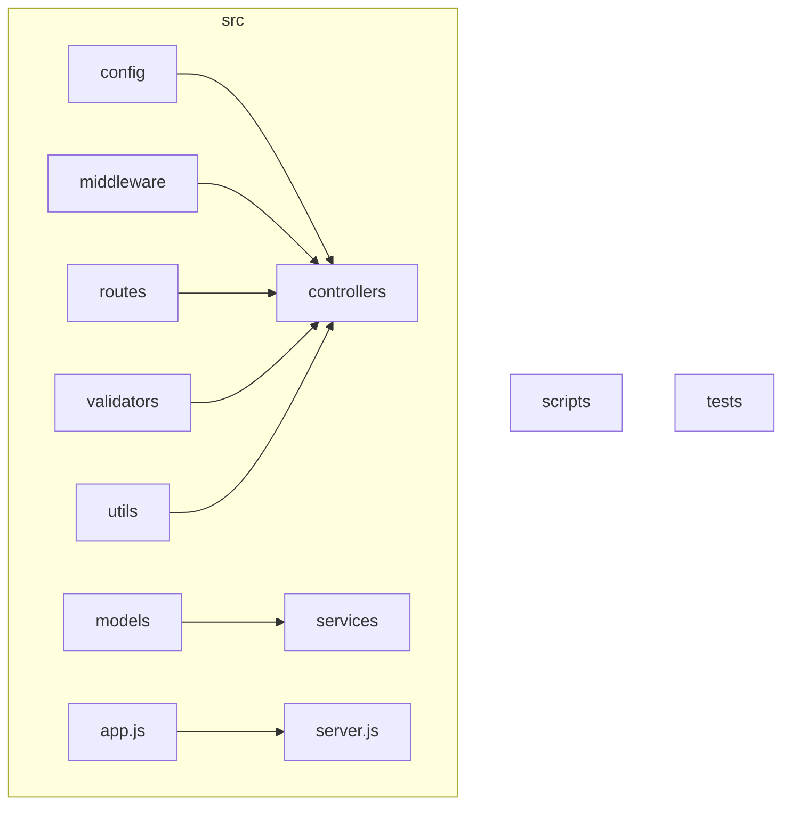
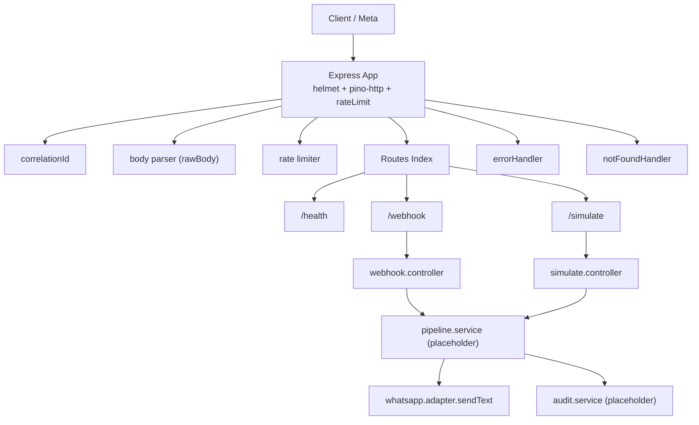
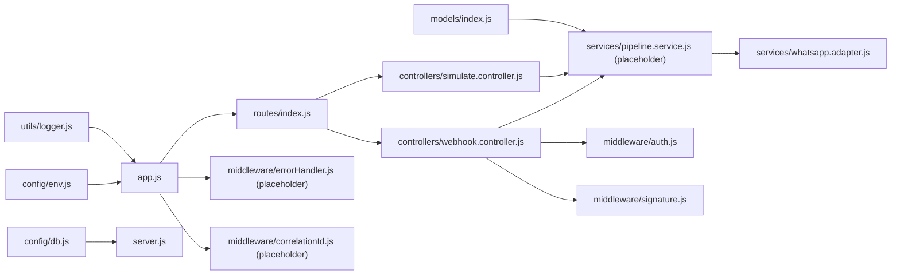
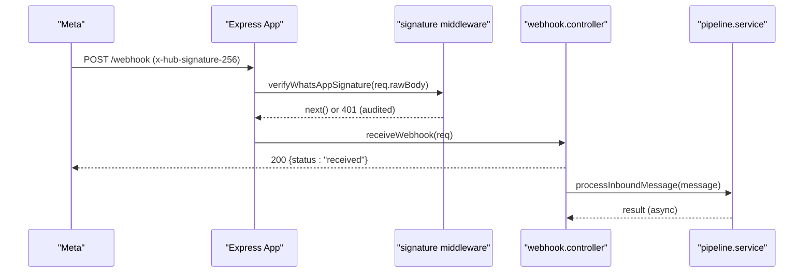
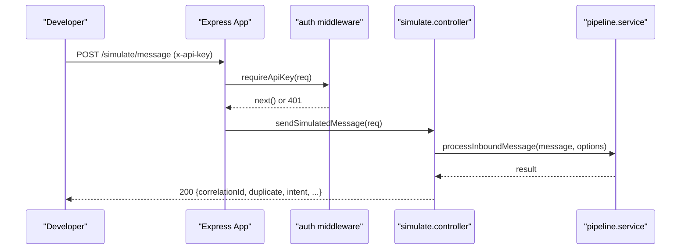
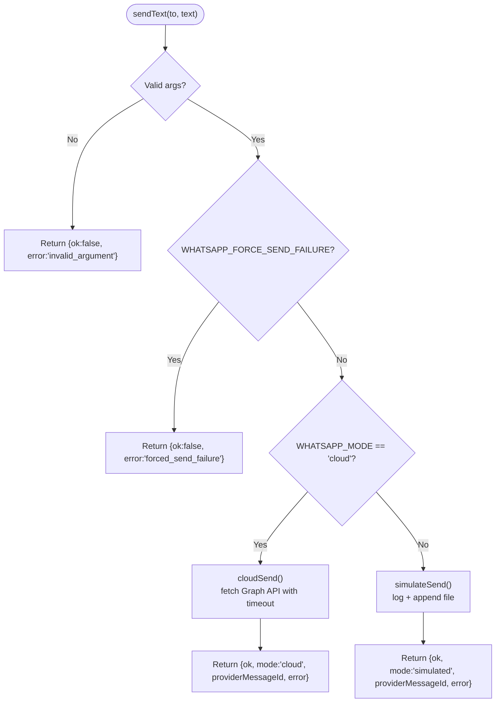

# Development Guide

<cite>
**Referenced Files in This Document**
- [README.md](file://README.md)
- [package.json](file://package.json)
- [eslint.config.js](file://eslint.config.js)
- [.gitignore](file://.gitignore)
- [Dockerfile](file://Dockerfile)
- [docker-compose.yml](file://docker-compose.yml)
- [src/app.js](file://src/app.js)
- [src/server.js](file://src/server.js)
- [src/config/env.js](file://src/config/env.js)
- [src/config/db.js](file://src/config/db.js)
- [src/models/index.js](file://src/models/index.js)
- [src/routes/index.js](file://src/routes/index.js)
- [src/controllers/webhook.controller.js](file://src/controllers/webhook.controller.js)
- [src/controllers/simulate.controller.js](file://src/controllers/simulate.controller.js)
- [src/middleware/auth.js](file://src/middleware/auth.js)
- [src/middleware/signature.js](file://src/middleware/signature.js)
- [src/services/whatsapp.adapter.js](file://src/services/whatsapp.adapter.js)
- [src/utils/logger.js](file://src/utils/logger.js)
</cite>

## Table of Contents
1. Introduction
2. Project Structure
3. Core Components
4. Architecture Overview
5. Detailed Component Analysis
6. Dependency Analysis
7. Performance Considerations
8. Troubleshooting Guide
9. Conclusion
10. Appendices

## Introduction
This guide provides development standards and workflows for contributors to the Lead System Manager, a WhatsApp retail automation API built with Node.js, Express, Mongoose, Zod, Pino, and Helmet. It covers code style conventions enforced by ESLint, Git workflow procedures, pull request processes, code review standards, project structure rationale, naming conventions, architectural patterns, environment setup, debugging techniques, profiling guidance, feature extension practices, backward compatibility, documentation standards, commit message conventions, and contribution guidelines.

The system exposes health, webhook, and simulate endpoints, validates all configuration at startup, persists data via Mongoose, and integrates with the Meta WhatsApp Cloud API or a simulated channel. All responses carry a correlation id for end-to-end tracing.

## Project Structure
The repository follows a feature-oriented layout under src:
- config: environment validation (Zod), MongoDB connection, logger wiring
- controllers: HTTP handlers for health, webhook, and simulate
- middleware: correlation id injection, error handling, signature verification, staff API key auth
- models: Mongoose schemas and constants
- routes: route groups mounted centrally
- services: WhatsApp adapter, pipeline skeleton, audit recording
- validators: payload schemas for webhook and simulate
- utils: shared helpers (logger, phone normalization, async wrapper, http errors)

Top-level directories:
- scripts: seed, dev-memory-mongo, send-webhook helper
- tests: node:test suites and helpers
- dashboard: future staff dashboard (not part of this guide’s scope)

**Diagram sources**
- [src/app.js:1-76](file://src/app.js#L1-L76)
- [src/server.js:1-50](file://src/server.js#L1-L50)
- [src/routes/index.js:1-17](file://src/routes/index.js#L1-L17)
- [src/models/index.js:1-13](file://src/models/index.js#L1-L13)

**Section sources**
- [README.md:364-384](file://README.md#L364-L384)

## Core Components
- Application bootstrap: creates Express app, wires logging, security headers, rate limiting, body parsing, routes, and error handlers.
- Server lifecycle: starts listening before DB connect; graceful shutdown with timeout; background retry loop for MongoDB.
- Configuration: centralized, validated, frozen env object with production checks and provider-specific requirements.
- Database: Mongoose connection with exponential backoff retries and disconnect on shutdown.
- Models: single index entry point that registers schemas and exports domain entities.
- Routes: central router mounting /health, /webhook, /simulate.
- Controllers: webhook handshake/receive and simulate message orchestration.
- Middleware: correlation id, HMAC signature verification, staff API key authentication, error handler.
- Services: WhatsApp adapter supporting simulated/cloud modes with timeouts and forced failure testing.
- Utilities: structured logger with redaction, phone utilities, async handler wrapper, HTTP error factory.

**Section sources**
- [src/app.js:1-76](file://src/app.js#L1-L76)
- [src/server.js:1-50](file://src/server.js#L1-L50)
- [src/config/env.js:1-130](file://src/config/env.js#L1-L130)
- [src/config/db.js:1-77](file://src/config/db.js#L1-L77)
- [src/models/index.js:1-13](file://src/models/index.js#L1-L13)
- [src/routes/index.js:1-17](file://src/routes/index.js#L1-L17)
- [src/controllers/webhook.controller.js:1-56](file://src/controllers/webhook.controller.js#L1-L56)
- [src/controllers/simulate.controller.js:1-35](file://src/controllers/simulate.controller.js#L1-L35)
- [src/middleware/auth.js:1-23](file://src/middleware/auth.js#L1-L23)
- [src/middleware/signature.js:1-51](file://src/middleware/signature.js#L1-L51)
- [src/services/whatsapp.adapter.js:1-136](file://src/services/whatsapp.adapter.js#L1-L136)
- [src/utils/logger.js:1-34](file://src/utils/logger.js#L1-L34)

## Architecture Overview
The application is an Express API layered into middleware, controllers, services, and data access. Security and observability are applied globally. The WhatsApp adapter abstracts outbound messaging across simulated and cloud modes.

**Diagram sources**
- [src/app.js:1-76](file://src/app.js#L1-L76)
- [src/routes/index.js:1-17](file://src/routes/index.js#L1-L17)
- [src/controllers/webhook.controller.js:1-56](file://src/controllers/webhook.controller.js#L1-L56)
- [src/controllers/simulate.controller.js:1-35](file://src/controllers/simulate.controller.js#L1-L35)
- [src/services/whatsapp.adapter.js:1-136](file://src/services/whatsapp.adapter.js#L1-L136)

## Detailed Component Analysis

### Code Style and Quality Conventions
- Language: ES modules with ECMAScript 2022 features.
- Globals: console, process, timers, Buffer, AbortController, fetch, Response are declared as globals in ESLint.
- Rules:
  - no-unused-vars warns when variables or arguments are unused; underscores prefix allows intentional ignores.
  - no-undef is an error to prevent undefined references.
- Ignore patterns: node_modules, coverage, logs.

Practical rules for contributors:
- Prefer named imports and avoid unused variables; use underscore prefixes for intentionally ignored parameters.
- Do not rely on implicit globals; declare them or import explicitly.
- Keep files small and focused; split logic into utils/services where appropriate.

**Section sources**
- [eslint.config.js:1-35](file://eslint.config.js#L1-L35)
- [package.json:1-36](file://package.json#L1-L36)

### Git Workflow and Pull Requests
Recommended workflow:
- Create a feature branch from main using a descriptive name: feature/add-order-api, fix/webhook-dedupe, chore/update-deps.
- Keep commits atomic and meaningful; follow conventional commits (see Commit Message Conventions).
- Ensure tests pass locally: npm test.
- Run linter: npm run lint.
- Open a pull request with:
  - Clear description of changes and motivation
  - Link to related tasks/issues
  - Screenshots or logs if user-facing behavior changed
  - Checklist: tests added/updated, docs updated, secrets not committed
- Address review feedback promptly; keep PRs small and focused.

Review checklist:
- Correctness: logic matches requirements and edge cases handled
- Security: secrets not exposed, inputs validated, timing-safe comparisons used
- Observability: correlation ids logged, sensitive fields redacted
- Performance: no unnecessary allocations, timeouts set for external calls
- Maintainability: clear naming, modular design, consistent patterns

**Section sources**
- [README.md:351-362](file://README.md#L351-L362)

### Environment Setup and Running Locally
- Install dependencies: npm install
- Copy .env.example to .env and fill placeholders
- Start MongoDB:
  - Docker: docker compose up -d mongo
  - In-memory: npm run dev:mongo
- Seed catalogue: npm run seed
- Start server: npm run dev or npm start
- Verify health: curl http://localhost:3000/health

Containerized development:
- docker compose up --build runs api and mongo together
- Volume mounts enable live reload during development

Environment validation:
- All variables validated at startup; invalid values abort the process with readable messages
- Production mode rejects default change-me secrets
- Provider-specific requirements enforced (WhatsApp cloud keys, LLM provider keys)

**Section sources**
- [README.md:75-160](file://README.md#L75-L160)
- [README.md:163-198](file://README.md#L163-L198)
- [src/config/env.js:1-130](file://src/config/env.js#L1-L130)
- [docker-compose.yml:1-30](file://docker-compose.yml#L1-L30)
- [Dockerfile:1-17](file://Dockerfile#L1-L17)

### Debugging Techniques
- Structured logging:
  - Use logger.child() to bind context like correlationId
  - Sensitive headers are automatically redacted
- Correlation id:
  - Every response includes x-correlation-id; grep logs by id to trace requests
- Webhook testing:
  - Use scripts/send-webhook.js to sign payloads and exercise success/failure paths
- Simulate endpoint:
  - POST /simulate/message drives the pipeline without Meta; returns full outcome shape
- Health checks:
  - GET /health reports service status and dependency states

**Section sources**
- [src/utils/logger.js:1-34](file://src/utils/logger.js#L1-L34)
- [src/app.js:21-36](file://src/app.js#L21-L36)
- [README.md:290-350](file://README.md#L290-L350)

### Profiling and Performance Optimization
- Rate limiting:
  - Global limiter configured with generous limits for webhook retries; skipped in tests
- Timeouts:
  - External WhatsApp Cloud API calls have explicit timeouts to avoid hanging
- Logging levels:
  - Configure LOG_LEVEL to control verbosity; silent disables logs
- Memory usage:
  - Tests run with concurrency=1 for predictable memory usage on Windows
- Database connectivity:
  - Background retry loop with exponential backoff prevents crash loops when Mongo is down

Optimization tips:
- Avoid heavy synchronous work in request handlers; offload to background jobs
- Cache static lookups (e.g., product catalog) where safe
- Profile with Node.js built-in tools (CPU profiler, heap snapshots) and monitor logs for slow operations

**Section sources**
- [src/app.js:52-67](file://src/app.js#L52-L67)
- [src/services/whatsapp.adapter.js:26-104](file://src/services/whatsapp.adapter.js#L26-L104)
- [package.json:10-16](file://package.json#L10-L16)
- [src/config/db.js:27-67](file://src/config/db.js#L27-L67)

### Adding New Features and Extending Functionality
Follow these steps:
- Define or extend Zod schemas in validators for new payloads
- Add route group under routes and mount it in routes/index.js
- Implement controller(s) under controllers
- Place business logic in services
- Persist data via models exported from models/index.js
- Add middleware if needed (auth, signature, correlation)
- Write tests under tests and update README/API reference if public behavior changes
- Update configuration in env.js if new environment variables are required

Backward compatibility:
- Validate inputs strictly; reject unknown fields
- Preserve existing response shapes; add optional fields only when safe
- Guard new behaviors behind feature flags or environment toggles where appropriate
- Keep deprecations gradual with migration notes

**Section sources**
- [src/routes/index.js:1-17](file://src/routes/index.js#L1-L17)
- [src/models/index.js:1-13](file://src/models/index.js#L1-L13)
- [src/config/env.js:25-109](file://src/config/env.js#L25-L109)
- [README.md:386-407](file://README.md#L386-L407)

### Documentation Standards
- Inline comments should explain why, not what; keep concise
- Public APIs documented in README.md API reference table
- Decision records kept in docs/DECISIONS.md (referenced in README)
- Configuration reference maintained alongside env.js schema
- Changelog or task tracking linked from PR descriptions

**Section sources**
- [README.md:386-407](file://README.md#L386-L407)
- [README.md:421-427](file://README.md#L421-L427)

### Commit Message Conventions
Use Conventional Commits:
- feat: add order creation endpoint
- fix: correct webhook dedupe logic
- docs: update API reference for simulate endpoint
- refactor: extract pipeline processing into service
- test: add webhook signature rejection scenario
- chore: update dependencies

Scope examples:
- feat(routes): mount /orders
- fix(middleware): sanitize correlation id in logs
- perf(adapter): reduce string allocations in cloudSend

**Section sources**
- [README.md:351-362](file://README.md#L351-L362)

### Contribution Guidelines
- Fork the repository and create a feature branch
- Follow code style and linting rules
- Write tests for new functionality and edge cases
- Ensure npm test passes and npm run lint has zero warnings
- Update documentation when behavior changes
- Submit a pull request with clear description and checklists
- Engage constructively in code reviews

**Section sources**
- [README.md:351-362](file://README.md#L351-L362)

## Dependency Analysis
High-level module relationships:

**Diagram sources**
- [src/app.js:1-76](file://src/app.js#L1-L76)
- [src/server.js:1-50](file://src/server.js#L1-L50)
- [src/config/env.js:1-130](file://src/config/env.js#L1-L130)
- [src/config/db.js:1-77](file://src/config/db.js#L1-L77)
- [src/models/index.js:1-13](file://src/models/index.js#L1-L13)
- [src/routes/index.js:1-17](file://src/routes/index.js#L1-L17)
- [src/controllers/webhook.controller.js:1-56](file://src/controllers/webhook.controller.js#L1-L56)
- [src/controllers/simulate.controller.js:1-35](file://src/controllers/simulate.controller.js#L1-L35)
- [src/services/whatsapp.adapter.js:1-136](file://src/services/whatsapp.adapter.js#L1-L136)

**Section sources**
- [src/app.js:1-76](file://src/app.js#L1-L76)
- [src/server.js:1-50](file://src/server.js#L1-L50)
- [src/routes/index.js:1-17](file://src/routes/index.js#L1-L17)

## Performance Considerations
- Request throughput:
  - Rate limiter protects against abuse while allowing webhook retries
  - JSON body size limited to 1MB
- External integrations:
  - WhatsApp Cloud API calls time out after 10 seconds
  - Simulated mode avoids network overhead
- Logging:
  - Pino structured logs with selective ignore for /health
  - Redaction prevents accidental secret exposure
- Database:
  - Connection retries with exponential backoff
  - Graceful shutdown closes connections and stops retries

Best practices:
- Minimize synchronous blocking operations
- Use streaming for large payloads where possible
- Cache frequently accessed data in memory with TTL strategies
- Monitor pino metrics and correlate errors via correlation id

**Section sources**
- [src/app.js:41-67](file://src/app.js#L41-L67)
- [src/services/whatsapp.adapter.js:26-104](file://src/services/whatsapp.adapter.js#L26-L104)
- [src/utils/logger.js:1-34](file://src/utils/logger.js#L1-L34)
- [src/config/db.js:27-67](file://src/config/db.js#L27-L67)

## Troubleshooting Guide
Common issues and resolutions:
- Invalid environment variables at startup:
  - Compare .env with .env.example; the validator prints each offending variable
- /health returns 503 mongo: down:
  - Start MongoDB via Docker, in-memory script, or fix MONGODB_URI
- Port conflict EADDRINUSE:
  - Change PORT in .env
- Webhook POST returns 401 Invalid webhook signature:
  - Ensure WHATSAPP_APP_SECRET matches the signer; use scripts/send-webhook.js with correct secret
- Handshake returns 403:
  - Ensure WHATSAPP_VERIFY_TOKEN matches between .env and Meta webhook config
- Force send failures for testing:
  - Set WHATSAPP_FORCE_SEND_FAILURE=true or use --bad-signature on the webhook sender script
- Tests download MongoDB binary:
  - First run requires network; subsequent runs use cached binary

Security reminders:
- Never commit real secrets; .env is gitignored
- Production mode refuses default change-me secrets
- Logs mask phone numbers and redact sensitive headers

**Section sources**
- [README.md:409-420](file://README.md#L409-L420)
- [src/config/env.js:111-121](file://src/config/env.js#L111-L121)
- [.gitignore:1-9](file://.gitignore#L1-L9)

## Conclusion
This guide establishes consistent coding standards, secure and observable architecture practices, and reliable development workflows for the Lead System Manager. By following the ESLint rules, Git and PR procedures, and component patterns outlined here, contributors can extend the system safely, maintain backward compatibility, and deliver high-quality changes efficiently.

## Appendices

### API Endpoints Summary
- GET /health: liveness/readiness with dependency checks
- GET /webhook: Meta verification handshake
- POST /webhook: inbound WhatsApp messages (signature verified, fast 200, async processing)
- POST /simulate/message: staff-only pipeline driver (requires x-api-key)

Error response envelope:
- { error: { code, message, details }, correlationId }

Standard codes:
- VALIDATION_ERROR (400), UNAUTHORIZED (401/403), NOT_FOUND (404), RATE_LIMITED (429), INTERNAL_ERROR (500), DEPENDENCY_UNAVAILABLE (503)

**Section sources**
- [README.md:386-407](file://README.md#L386-L407)

### Webhook Signature Verification Flow

**Diagram sources**
- [src/middleware/signature.js:1-51](file://src/middleware/signature.js#L1-L51)
- [src/controllers/webhook.controller.js:1-56](file://src/controllers/webhook.controller.js#L1-L56)

### Simulate Message Flow

**Diagram sources**
- [src/middleware/auth.js:1-23](file://src/middleware/auth.js#L1-L23)
- [src/controllers/simulate.controller.js:1-35](file://src/controllers/simulate.controller.js#L1-L35)

### WhatsApp Adapter Modes

**Diagram sources**
- [src/services/whatsapp.adapter.js:113-135](file://src/services/whatsapp.adapter.js#L113-L135)
- [src/services/whatsapp.adapter.js:47-104](file://src/services/whatsapp.adapter.js#L47-L104)