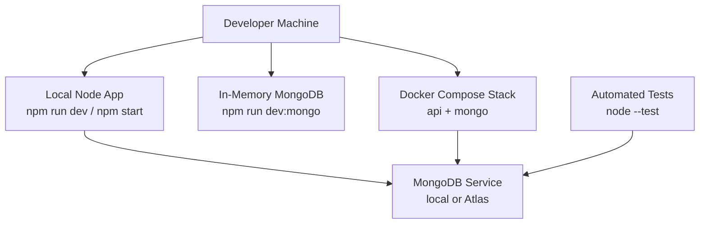
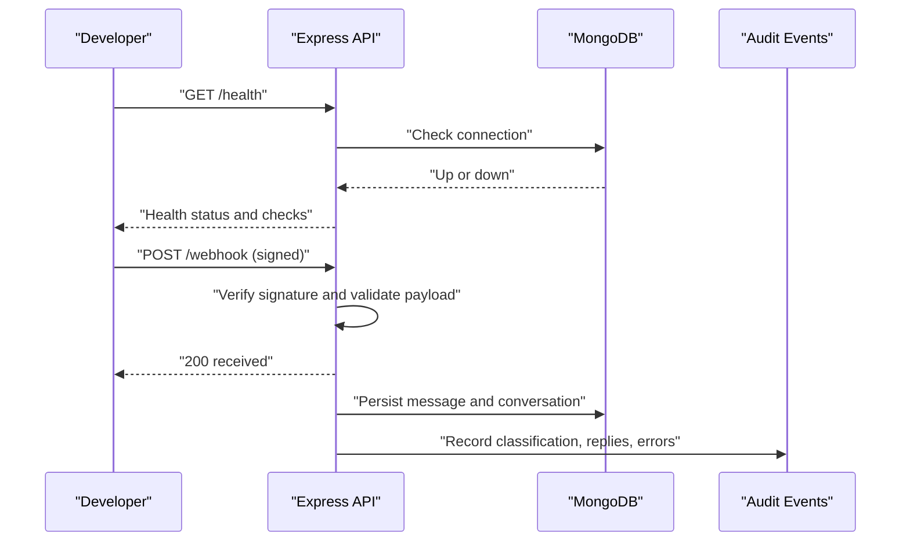
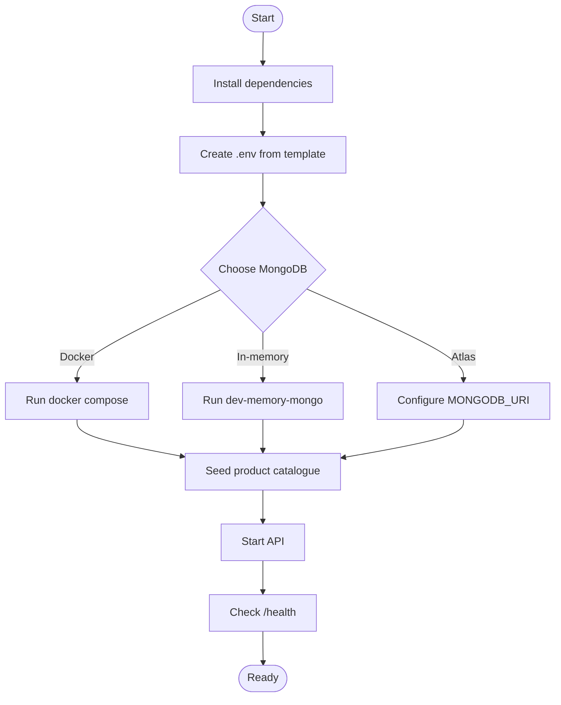
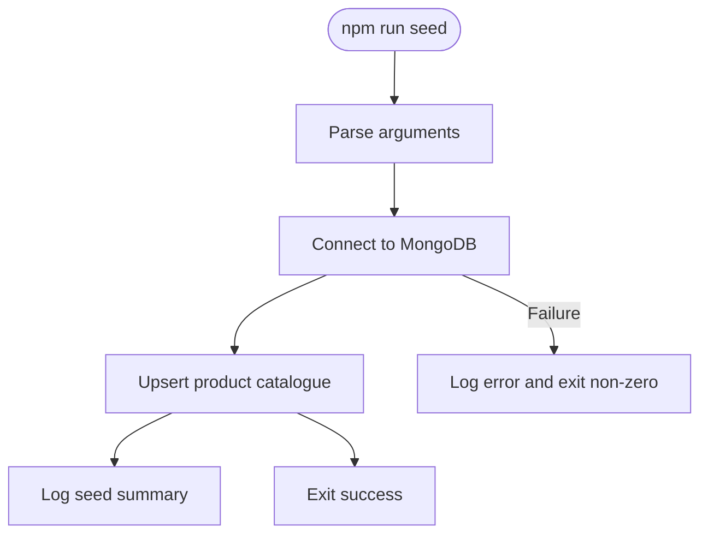
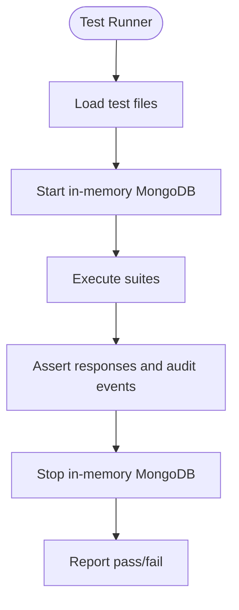
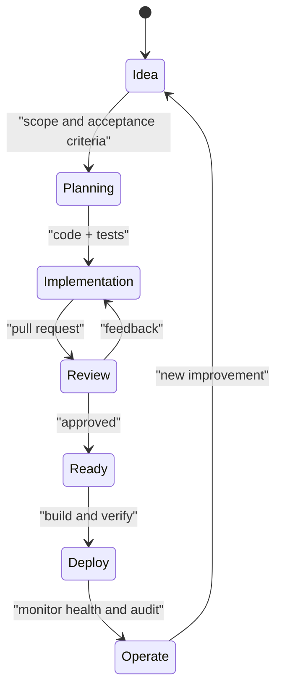
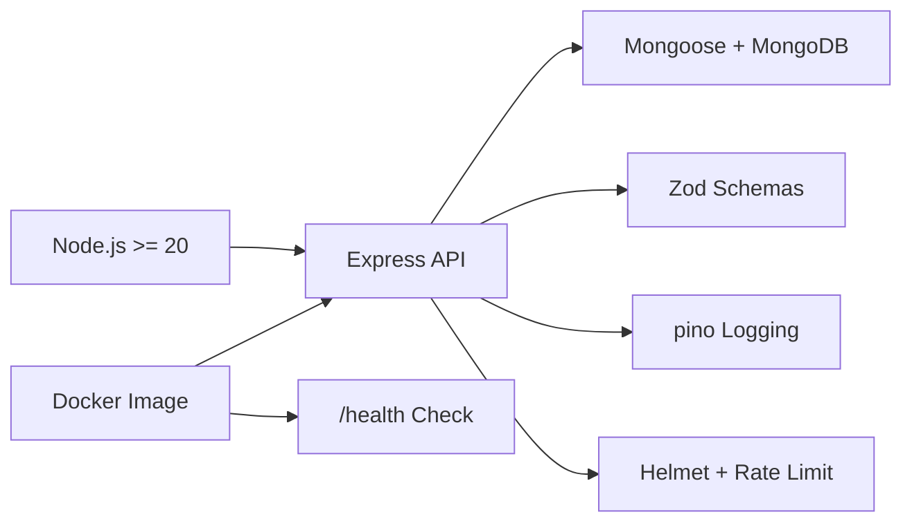

# Development Workflow

<cite>
**Referenced Files in This Document**   
- [README.md](file://README.md)
- [WORKPLAN.md](file://WORKPLAN.md)
- [package.json](file://package.json)
- [.gitignore](file://.gitignore)
- [docker-compose.yml](file://docker-compose.yml)
- [Dockerfile](file://Dockerfile)
- [scripts/seed.js](file://scripts/seed.js)
- [scripts/dev-memory-mongo.js](file://scripts/dev-memory-mongo.js)
- [tests/webhook.test.js](file://tests/webhook.test.js)
- [tests/seed.test.js](file://tests/seed.test.js)
</cite>

## Table of Contents
1. [Introduction](#introduction)
2. [Project Structure](#project-structure)
3. [Core Components](#core-components)
4. [Architecture Overview](#architecture-overview)
5. [Detailed Component Analysis](#detailed-component-analysis)
6. [Dependency Analysis](#dependency-analysis)
7. [Performance Considerations](#performance-considerations)
8. [Troubleshooting Guide](#troubleshooting-guide)
9. [Conclusion](#conclusion)
10. [Appendices](#appendices)

## Introduction
This document describes the development workflow for the WhatsApp Retail Automation API. It covers how to set up the local environment, run and seed the database, execute tests, and operate through Docker. It also documents the feature lifecycle from idea to deployment, including code review expectations, quality gates, release practices, versioning, changelog maintenance, dependency management, security updates, and breaking change handling.

The repository is a Node.js Express API backed by MongoDB, with Zod-based validation, structured logging, simulated WhatsApp messaging, and an audit trail. The project ships scripts for running an in-memory MongoDB locally, seeding product data, and testing without external services.

## Project Structure
At a high level, the repository separates application code under `src/`, operational scripts under `scripts/`, automated tests under `tests/`, and container configuration at the root. The README explains requirements, quick start steps, configuration variables, manual API exercises, testing commands, and troubleshooting guidance. The WORKPLAN defines the intended architecture, data model, API endpoints, failure handling, and operations runbook.

**Diagram sources**
- [README.md:75-160](file://README.md#L75-L160)
- [docker-compose.yml:1-30](file://docker-compose.yml#L1-L30)
- [scripts/dev-memory-mongo.js:1-30](file://scripts/dev-memory-mongo.js#L1-L30)

**Section sources**
- [README.md:50-160](file://README.md#L50-L160)
- [WORKPLAN.md:45-62](file://WORKPLAN.md#L45-L62)

## Core Components
This section summarizes the core runtime components that developers interact with during daily work.

- Application entry point and server bootstrap are defined in the package scripts and referenced by the Docker image.
- Environment configuration is validated at startup using Zod; invalid values abort the process.
- Database connectivity uses Mongoose against a configured MongoDB URI.
- Seed script populates a synthetic product catalogue and supports idempotent upserts plus optional reset behavior.
- In-memory MongoDB helper provides a Docker-free local database for development and demos.
- Automated tests use Node’s built-in test runner with one-file concurrency and an in-memory MongoDB instance.

Key responsibilities:
- `package.json` declares scripts for starting, developing, testing, seeding, linting, and running the in-memory database.
- `scripts/seed.js` connects to MongoDB, seeds products, logs results, and exits with a non-zero status on failure.
- `scripts/dev-memory-mongo.js` starts a disposable MongoDB instance on port 27017 and handles graceful shutdown signals.
- `tests/webhook.test.js` validates webhook handshake and signed payload behavior, including audit events for rejected signatures.
- `tests/seed.test.js` verifies catalogue seeding, idempotency, and reset behavior.

**Section sources**
- [package.json:1-36](file://package.json#L1-L36)
- [scripts/seed.js:36-60](file://scripts/seed.js#L36-L60)
- [scripts/dev-memory-mongo.js:1-30](file://scripts/dev-memory-mongo.js#L1-L30)
- [tests/webhook.test.js:85-116](file://tests/webhook.test.js#L85-L116)
- [tests/seed.test.js:1-50](file://tests/seed.test.js#L1-L50)

## Architecture Overview
The system exposes health, webhook, and simulate endpoints. Webhooks are verified via HMAC signature and processed asynchronously after an immediate response. Simulate endpoints allow driving the pipeline without Meta. Health checks report MongoDB availability and other service states.

**Diagram sources**
- [README.md:386-407](file://README.md#L386-L407)
- [WORKPLAN.md:92-135](file://WORKPLAN.md#L92-L135)

## Detailed Component Analysis

### Local Development Environment Setup
Follow these steps to prepare your machine:

1. Install dependencies using the package manager.
2. Create a local `.env` file from the example template.
3. Start MongoDB using one of the documented options:
   - Docker Compose stack with a persistent Mongo volume.
   - In-memory MongoDB for fast local iteration.
   - MongoDB Atlas for cloud-backed development.
4. Seed the product catalogue.
5. Start the API in development mode or production mode.
6. Verify the health endpoint.

Important notes:
- The project requires Node.js version 20 or higher.
- The default port is configurable via environment variables.
- The `.env` file is ignored by Git; only placeholders should be committed.

**Diagram sources**
- [README.md:75-160](file://README.md#L75-L160)
- [docker-compose.yml:1-30](file://docker-compose.yml#L1-L30)
- [scripts/dev-memory-mongo.js:1-30](file://scripts/dev-memory-mongo.js#L1-L30)

**Section sources**
- [README.md:61-160](file://README.md#L61-L160)
- [.gitignore:1-9](file://.gitignore#L1-L9)

### Database Seeding Procedures
The seed script connects to MongoDB, optionally resets existing products, and upserts the synthetic catalogue. It logs a summary and exits with a failure code when the database is unavailable.

Recommended usage:
- Run the standard seed command to create or update the catalogue.
- Use the reset flag to clear stray products before seeding.
- Ensure MongoDB is reachable before running the seed.

**Diagram sources**
- [scripts/seed.js:36-60](file://scripts/seed.js#L36-L60)

**Section sources**
- [scripts/seed.js:36-60](file://scripts/seed.js#L36-L60)
- [tests/seed.test.js:18-49](file://tests/seed.test.js#L18-L49)

### Testing Workflows
The test suite uses Node’s built-in test runner with single-file concurrency. Tests rely on an in-memory MongoDB instance so no external database is required. Coverage includes environment-gated behavior, webhook signature verification, payload validation, health checks, seed idempotency, and adapter modes.

Typical commands:
- Run the full test suite.
- Run a single test file.
- Lint the codebase.

Quality expectations:
- All tests must pass.
- Linting should produce zero warnings.
- New features should include tests covering success paths, validation failures, and audit outcomes where applicable.

**Diagram sources**
- [README.md:351-362](file://README.md#L351-L362)
- [tests/webhook.test.js:85-116](file://tests/webhook.test.js#L85-L116)
- [tests/seed.test.js:1-50](file://tests/seed.test.js#L1-L50)

**Section sources**
- [README.md:351-362](file://README.md#L351-L362)
- [package.json:10-16](file://package.json#L10-L16)

### Feature Development Lifecycle
The lifecycle moves from planning through implementation, review, testing, and deployment.

1. Planning
   - Capture the idea in a task or issue.
   - Align scope with the project brief and current roadmap.
   - Identify affected components: routes, controllers, models, validators, services, middleware, tests, and documentation.

2. Implementation
   - Implement business logic following the layered structure.
   - Add Zod schemas for input validation where needed.
   - Persist relevant entities and write audit events.
   - Handle failures explicitly and return standardized error bodies.

3. Code Review Requirements
   - Changes must include tests for new functionality.
   - Audit events must be recorded for significant state changes.
   - Secrets must not be committed; use environment variables.
   - Documentation should reflect new endpoints, configuration, or behaviors.

4. Quality Gates
   - Automated tests pass.
   - Linting passes.
   - No secrets in diffs.
   - Health endpoint remains healthy in local environments.

5. Deployment
   - Build the Docker image and verify health checks.
   - Validate environment variables and secrets policy.
   - Confirm database connectivity and seed state.

[No sources needed since this diagram shows conceptual workflow, not actual code structure]

### Pull Request Process
Although the repository does not define branch naming conventions or PR templates in the analyzed files, the following process aligns with the project’s quality expectations:

- Create a feature branch from the main branch.
- Commit small, focused changes with descriptive messages.
- Open a pull request describing the problem, solution, and test coverage.
- Ensure all automated checks pass: tests, linting, and health verification.
- Address reviewer feedback until approval is granted.
- Merge after confirming that the change is safe and documented.

Review checklist:
- Tests cover expected behavior and failure paths.
- Validation schemas are updated if inputs changed.
- Audit events are written for meaningful state transitions.
- No secrets or sensitive data are included.
- README or configuration references are updated if necessary.

[No sources needed since this section provides general guidance aligned with repository quality practices]

### Release Process and Versioning Strategy
Versioning is represented in the package metadata and exposed through the health endpoint. The health response includes a version field, which can be used for operational visibility.

Release steps:
1. Update the package version according to semantic versioning principles.
2. Ensure all tests pass and linting is clean.
3. Build the Docker image and verify the health check.
4. Tag the release commit and publish artifacts as appropriate.
5. Update the changelog with user-facing changes, breaking changes, and migration notes.

Changelog maintenance:
- Record new features, bug fixes, deprecations, and breaking changes.
- Include migration instructions when environment variables or API contracts change.
- Keep the changelog synchronized with release tags.

**Section sources**
- [package.json:1-9](file://package.json#L1-L9)
- [README.md:290-298](file://README.md#L290-L298)

### Dependency Management, Security Updates, and Breaking Change Handling
Dependencies are declared in the package manifest. Production dependencies include Express, Mongoose, Zod, pino, helmet, rate limiting, and related utilities. Development dependencies include ESLint, Prettier, Supertest, and an in-memory MongoDB server for tests.

Guidelines:
- Pin or constrain versions using caret ranges as currently configured.
- Regularly review dependency updates for security patches.
- Test updates locally before merging.
- For breaking changes, update environment variables, API contracts, and tests accordingly.
- Document breaking changes in the changelog and provide migration steps.

Security considerations:
- Rotate secrets regularly and never commit real credentials.
- Enforce production checks that reject placeholder secrets.
- Monitor audit events for rejected webhooks and validation failures.
- Keep third-party providers’ keys isolated in environment variables.

**Section sources**
- [package.json:18-35](file://package.json#L18-L35)
- [README.md:283-288](file://README.md#L283-L288)

## Dependency Analysis
The runtime depends on Node.js and a set of libraries for HTTP serving, database access, validation, logging, and security hardening. Containerization uses a Node Alpine base image, installs production dependencies, copies source code, exposes port 3000, and performs a health check against the `/health` endpoint.

**Diagram sources**
- [package.json:1-35](file://package.json#L1-L35)
- [Dockerfile:1-17](file://Dockerfile#L1-L17)

**Section sources**
- [package.json:1-35](file://package.json#L1-L35)
- [Dockerfile:1-17](file://Dockerfile#L1-L17)

## Performance Considerations
- Use the in-memory MongoDB for rapid local iteration; it resets on process exit.
- Prefer rules-first classification to reduce external provider latency and cost.
- Keep payloads small and validate early to avoid unnecessary processing.
- Monitor health and audit events to detect degraded dependencies.
- Avoid committing large test fixtures; keep test data minimal and deterministic.

[No sources needed since this section provides general guidance]

## Troubleshooting Guide
Common issues and resolutions:

- Invalid environment variables at startup: compare `.env` with the example template; the validator reports each offending variable.
- Health endpoint returns a degraded or down status: verify MongoDB connectivity and provider configurations.
- Port conflicts: change the configured port in the environment.
- Webhook signature rejection: ensure the app secret matches the signer; use the provided signing script for local testing.
- Handshake mismatch: ensure the verify token matches between the app and the provider configuration.
- Tests downloading a MongoDB binary: the first run may require network access; subsequent runs use a cached binary.

Operational reminders:
- Keep `.env` out of version control.
- Rotate secrets periodically.
- Monitor audit events for anomalies.
- Maintain the product catalogue through the seed script or admin tooling.

**Section sources**
- [README.md:409-427](file://README.md#L409-L427)
- [scripts/seed.js:36-60](file://scripts/seed.js#L36-L60)

## Conclusion
This development workflow emphasizes predictable local setup, robust testing, strict validation, and clear operational signals. Developers should focus on small, testable changes, maintain auditability, protect secrets, and keep documentation aligned with code. Releases should be versioned consistently, with changelogs capturing user impact and migration guidance. Dependency updates should be reviewed for security and compatibility, and breaking changes must be handled deliberately with tests and documentation.

[No sources needed since this section summarizes without analyzing specific files]

## Appendices

### Quick Commands Reference
- Install dependencies: `npm install`
- Start in-memory MongoDB: `npm run dev:mongo`
- Seed catalogue: `npm run seed`
- Reset and seed: `npm run seed -- --reset`
- Start API: `npm run dev` or `npm start`
- Run tests: `npm test`
- Lint: `npm run lint`
- Docker stack: `docker compose up --build`

**Section sources**
- [README.md:75-160](file://README.md#L75-L160)
- [package.json:10-16](file://package.json#L10-L16)