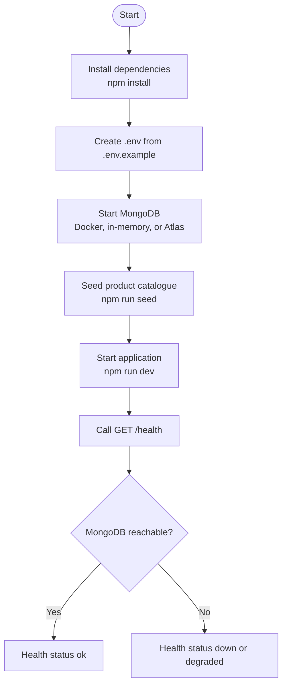
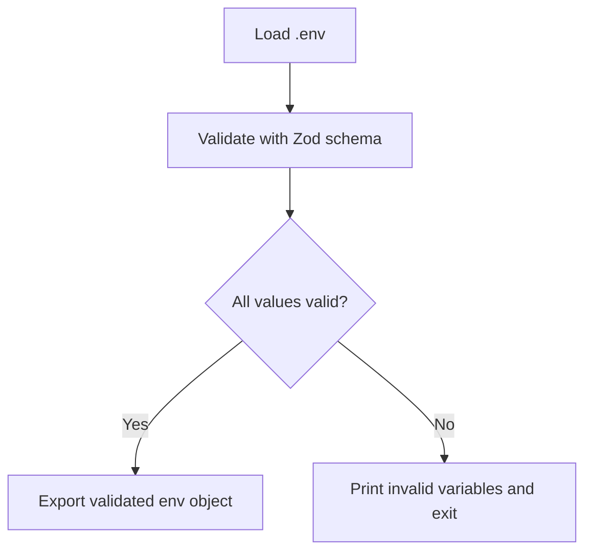
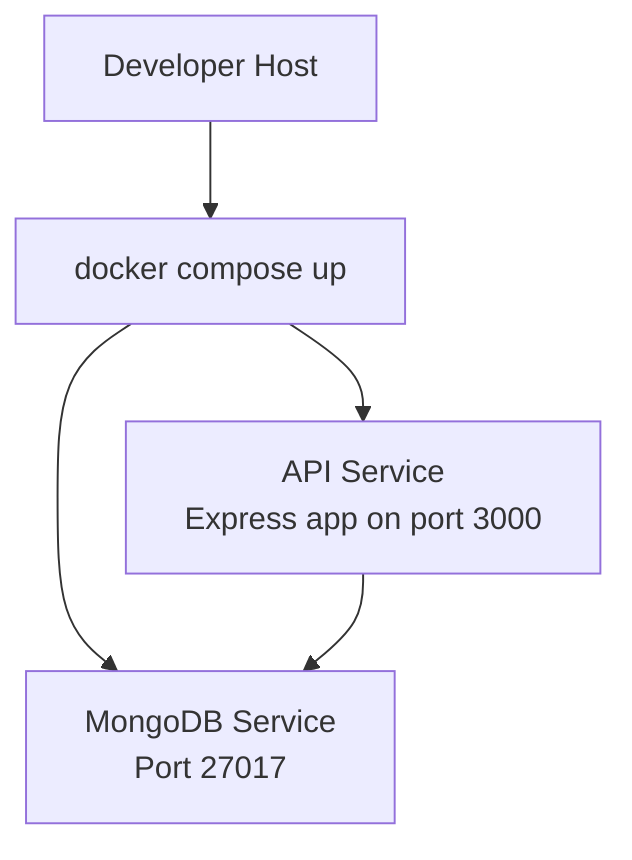
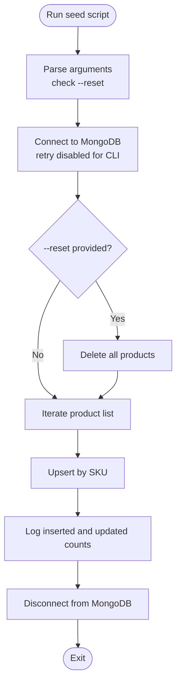
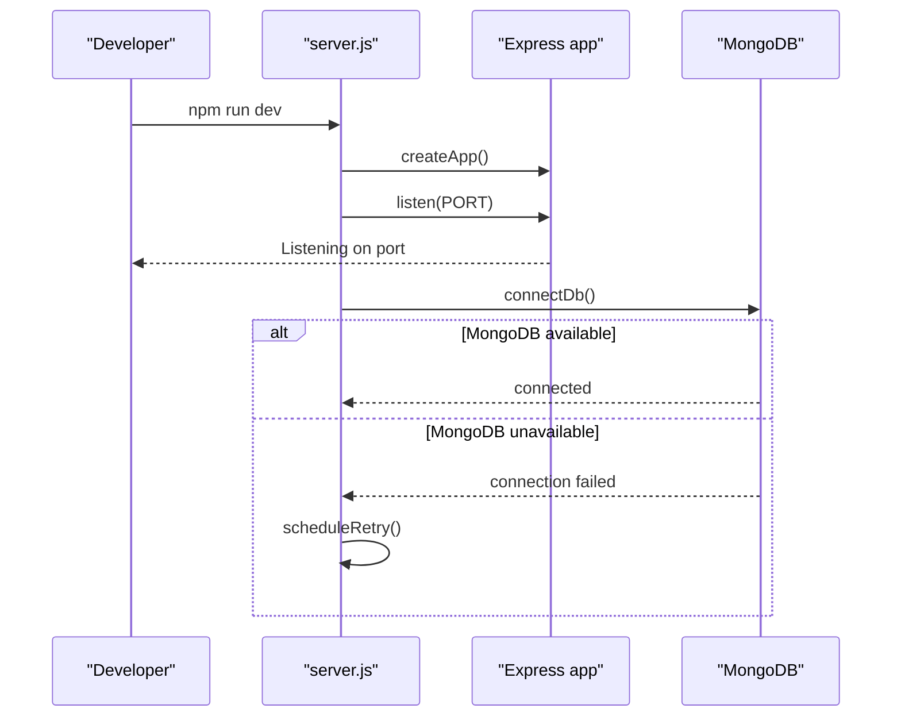
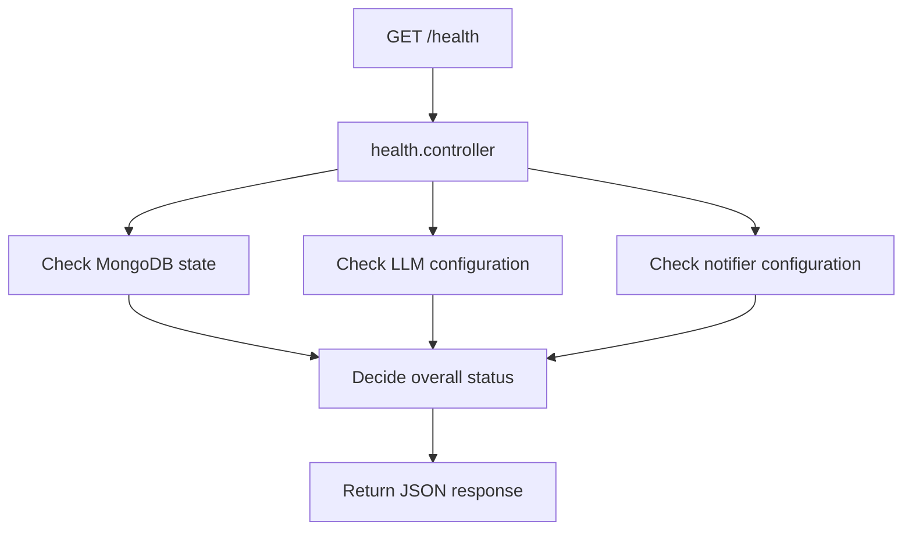
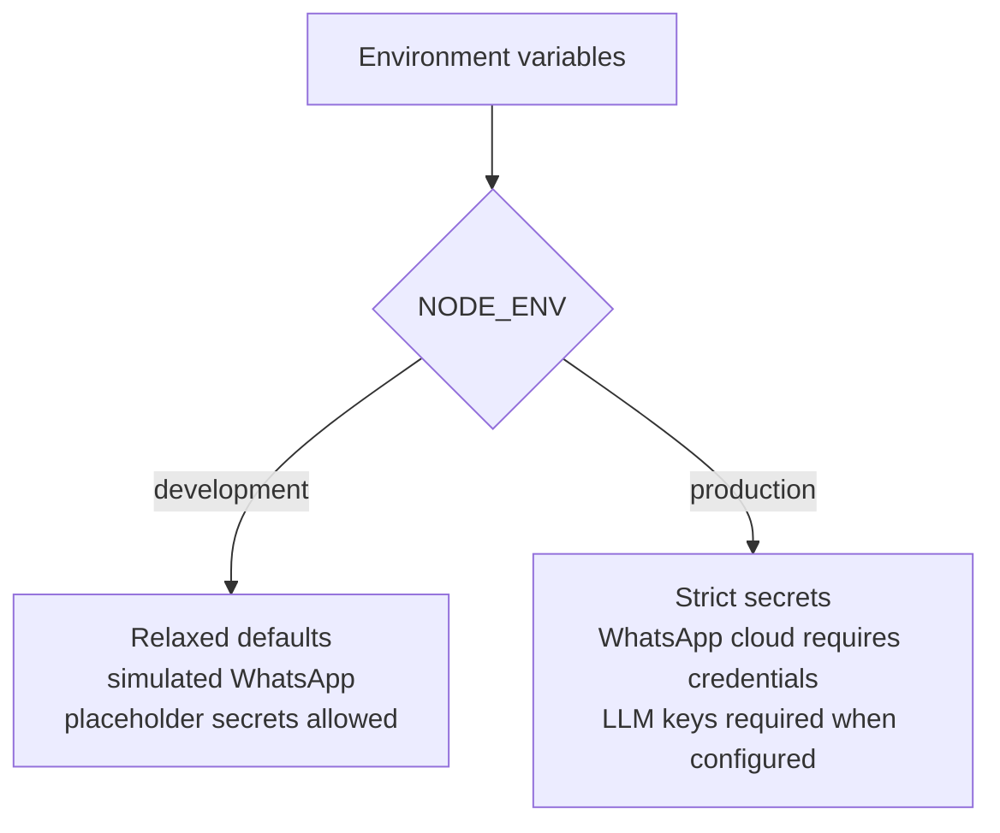

# Getting Started Guide

<cite>
**Referenced Files in This Document**
- [README.md](file://README.md)
- [package.json](file://package.json)
- [.env.example](file://.env.example)
- [src/config/env.js](file://src/config/env.js)
- [src/config/db.js](file://src/config/db.js)
- [docker-compose.yml](file://docker-compose.yml)
- [scripts/seed.js](file://scripts/seed.js)
- [scripts/dev-memory-mongo.js](file://scripts/dev-memory-mongo.js)
- [src/server.js](file://src/server.js)
- [src/controllers/health.controller.js](file://src/controllers/health.controller.js)
- [src/routes/health.routes.js](file://src/routes/health.routes.js)
</cite>

## Table of Contents
1. [Introduction](#introduction)
2. [Prerequisites](#prerequisites)
3. [Quick Start Workflow](#quick-start-workflow)
4. [Environment Setup](#environment-setup)
5. [MongoDB Setup Options](#mongodb-setup-options)
6. [Application Seeding Process](#application-seeding-process)
7. [Starting the Application](#starting-the-application)
8. [First API Call Examples](#first-api-call-examples)
9. [Development vs Production Differences](#development-vs-production-differences)
10. [Troubleshooting Guide](#troubleshooting-guide)
11. [Conclusion](#conclusion)

## Introduction
This guide helps you install, configure, and run the Lead System Manager locally. It covers Node.js prerequisites, dependency installation, environment configuration, MongoDB setup (Docker, in-memory, or Atlas), seeding the product catalogue, starting the server, and verifying it with a health check. It also explains how development and production environments differ and provides troubleshooting tips for common setup issues.

The project is an Express-based backend that supports WhatsApp automation through a simulated mode by default. You do not need external messaging credentials to get started; only Node.js and npm are required initially.

**Section sources**
- [README.md:50-73](file://README.md#L50-L73)
- [README.md:75-100](file://README.md#L75-L100)

## Prerequisites
Before installing anything, ensure your machine meets these requirements:

- Node.js version 20 or newer
- npm (bundled with Node.js)
- Optional: Docker Desktop if you want to run MongoDB via Docker Compose

The repository enforces Node.js >= 20 through its engine configuration. The README also notes that the project was developed and tested on Node 25.

What this means for you:
- If `node -v` reports a version below 20, upgrade Node.js before proceeding.
- If `npm -v` is missing, install Node.js again so npm becomes available.
- Docker is optional; you can use the in-memory MongoDB script instead.

**Section sources**
- [package.json:7-9](file://package.json#L7-L9)
- [README.md:61-73](file://README.md#L61-L73)

## Quick Start Workflow
Follow these steps to go from zero to a running API with a successful health check:

1. Install dependencies
   ```bash
   npm install
   ```

2. Create the environment file
   - Windows Command Prompt:
     ```bash
     copy .env.example .env
     ```
   - macOS or Linux:
     ```bash
     cp .env.example .env
     ```

3. Start MongoDB using one of the options described later in this guide. For local development without Docker, start the in-memory database:
   ```bash
   npm run dev:mongo
   ```

4. Seed the product catalogue
   ```bash
   npm run seed
   ```

5. Start the application
   ```bash
   npm run dev
   ```

6. Verify the health endpoint
   ```bash
   curl http://localhost:3000/health
   ```

Expected behavior after a successful setup:
- The server listens on port 3000 by default.
- The health endpoint returns status `ok` when MongoDB is reachable.
- If MongoDB is unreachable, the health endpoint may return status `down` with HTTP 503 until the connection recovers.



**Diagram sources**
- [README.md:75-97](file://README.md#L75-L97)
- [src/server.js:8-18](file://src/server.js#L8-L18)
- [src/controllers/health.controller.js:19-49](file://src/controllers/health.controller.js#L19-L49)

**Section sources**
- [README.md:75-97](file://README.md#L75-L97)

## Environment Setup
The application reads configuration from `.env`. A ready-to-copy template exists at `.env.example`.

### Recommended workflow
1. Copy `.env.example` to `.env`.
2. Keep `NODE_ENV=development` while learning the system.
3. Leave `WHATSAPP_MODE=simulated` unless you are testing real WhatsApp Cloud API behavior.
4. Generate a strong `STAFF_API_KEY` once you plan to use staff endpoints such as `/simulate/message`.
5. Set `MONGODB_URI` according to your chosen MongoDB option.

### Key variables for getting started
- `NODE_ENV`: Controls runtime behavior. Use `development` locally.
- `PORT`: HTTP port. Default is `3000`.
- `LOG_LEVEL`: Logging verbosity. Default is `info`.
- `MONGODB_URI`: Connection string for MongoDB.
- `STAFF_API_KEY`: Secret used by staff-only endpoints.
- `WHATSAPP_MODE`: `simulated` logs outbound messages; `cloud` sends real messages through Meta.
- `LLM_PROVIDER`: Classification provider. Default `none` keeps the system fully functional without AI providers.

Important validation rules enforced at startup:
- In production, default placeholder secrets like `change-me` are rejected.
- When `WHATSAPP_MODE=cloud`, phone number ID and access token are required.
- When using Gemini or Groq as the LLM provider, an API key is required.

If any environment variable is invalid, the process exits with a readable error listing each offending variable.



**Diagram sources**
- [src/config/env.js:6-10](file://src/config/env.js#L6-L10)
- [src/config/env.js:25-64](file://src/config/env.js#L25-L64)
- [src/config/env.js:65-109](file://src/config/env.js#L65-L109)
- [src/config/env.js:111-127](file://src/config/env.js#L111-L127)

**Section sources**
- [.env.example:1-42](file://.env.example#L1-L42)
- [src/config/env.js:6-10](file://src/config/env.js#L6-L10)
- [src/config/env.js:25-64](file://src/config/env.js#L25-L64)
- [src/config/env.js:65-109](file://src/config/env.js#L65-L109)
- [src/config/env.js:111-127](file://src/config/env.js#L111-L127)

## MongoDB Setup Options
You must choose one MongoDB option. The application only needs `MONGODB_URI` to point at a reachable instance.

### Option A: Docker Compose
Use this if Docker Desktop is available. The compose file defines an API service and a MongoDB service.

Steps:
1. Start the stack:
   ```bash
   docker compose up --build
   ```
2. The API listens on port 3000 inside the container and maps to host port 3000.
3. The MongoDB service uses image `mongo:8` and persists data in the `mongo_data` volume.
4. Inside the container, `MONGODB_URI` is overridden to point at the `mongo` service.

Notes:
- The compose file sets development-friendly defaults for `NODE_ENV`, `PORT`, `WHATSAPP_MODE`, and `LLM_PROVIDER`.
- Existing environment variables always win over `.env`, which allows container overrides.



**Diagram sources**
- [docker-compose.yml:1-30](file://docker-compose.yml#L1-L30)

**Section sources**
- [README.md:102-149](file://README.md#L102-L149)
- [docker-compose.yml:1-30](file://docker-compose.yml#L1-L30)

### Option B: In-Memory MongoDB for Development
Use this for fast local iteration without Docker.

Steps:
1. Start the in-memory database:
   ```bash
   npm run dev:mongo
   ```
2. Leave that terminal open while you run the API and seed scripts.
3. Data is lost when the process stops.

Behavior:
- The script starts `mongodb-memory-server` on port 27017.
- It logs the generated URI and handles graceful shutdown on `SIGINT` or `SIGTERM`.

**Section sources**
- [README.md:113-119](file://README.md#L113-L119)
- [scripts/dev-memory-mongo.js:1-31](file://scripts/dev-memory-mongo.js#L1-L31)

### Option C: MongoDB Atlas
Use this for a cloud-hosted database.

Steps:
1. Create a free M0 cluster at MongoDB Atlas.
2. Create a database user.
3. Allow your IP address or `0.0.0.0/0` for the demo.
4. Copy the connection string and set `MONGODB_URI` in `.env`.

Example format:
```
MONGODB_URI=mongodb+srv://<user>:<password>@<cluster>.mongodb.net/lead_system_manager
```

**Section sources**
- [README.md:121-129](file://README.md#L121-L129)

## Application Seeding Process
Seeding populates the synthetic product catalogue. The seed script is idempotent, meaning you can run it multiple times safely.

### What seeding does
- Connects to MongoDB.
- Optionally clears all products when the `--reset` flag is passed.
- Upserts 30 synthetic products by SKU.
- Logs insertion and update counts.
- Disconnects from MongoDB after completion.

### How to seed
Basic seed:
```bash
npm run seed
```

Reset and reseed:
```bash
npm run seed -- --reset
```

### Seed flow


**Diagram sources**
- [scripts/seed.js:8-36](file://scripts/seed.js#L8-L36)
- [scripts/seed.js:38-52](file://scripts/seed.js#L38-L52)

**Section sources**
- [README.md:151-159](file://README.md#L151-L159)
- [scripts/seed.js:1-61](file://scripts/seed.js#L1-L61)

## Starting the Application
There are two main ways to start the server:

- Development mode:
  ```bash
  npm run dev
  ```
  This runs the server with Node’s watch mode, restarting automatically when source files change.

- Production-like mode:
  ```bash
  npm start
  ```
  This runs the server once without automatic restarts.

Startup behavior:
- The Express app is created first.
- The server begins listening on `PORT` immediately.
- MongoDB connection happens afterward.
- If MongoDB is unavailable, the server stays up, but `/health` reports `down` or `degraded`.
- A background retry loop attempts to reconnect with exponential backoff.
- Graceful shutdown closes the HTTP server and disconnects MongoDB.



**Diagram sources**
- [src/server.js:1-26](file://src/server.js#L1-L26)
- [src/config/db.js:27-48](file://src/config/db.js#L27-L48)
- [src/config/db.js:50-67](file://src/config/db.js#L50-L67)

**Section sources**
- [README.md:130-139](file://README.md#L130-L139)
- [package.json:10-16](file://package.json#L10-L16)
- [src/server.js:1-50](file://src/server.js#L1-L50)
- [src/config/db.js:27-67](file://src/config/db.js#L27-L67)

## First API Call Examples
Once the server is running, you can verify it with the health endpoint.

### Health check
Request:
```bash
curl http://localhost:3000/health
```

Expected responses:
- Status `ok` with HTTP 200 when core services are healthy.
- Status `degraded` with HTTP 200 when non-critical components are unavailable.
- Status `down` with HTTP 503 when MongoDB is unreachable.

Response shape includes:
- `status`: `ok`, `degraded`, or `down`
- `uptimeSec`: approximate server uptime in seconds
- `checks`: component health details such as `mongo`, `llm`, and `notifier`
- `version`: application version from package metadata



**Diagram sources**
- [src/routes/health.routes.js:1-8](file://src/routes/health.routes.js#L1-L8)
- [src/controllers/health.controller.js:1-51](file://src/controllers/health.controller.js#L1-L51)

**Section sources**
- [README.md:290-298](file://README.md#L290-L298)
- [src/controllers/health.controller.js:1-51](file://src/controllers/health.controller.js#L1-L51)
- [src/routes/health.routes.js:1-8](file://src/routes/health.routes.js#L1-L8)

## Development vs Production Differences
The environment changes behavior in several important ways.

### Runtime behavior
- `NODE_ENV=development` is the default and suitable for local work.
- `NODE_ENV=production` enforces stricter secret policies.
- `LOG_LEVEL` controls logging verbosity.
- `WHATSAPP_MODE=simulated` logs outbound messages instead of sending them.
- `WHATSAPP_MODE=cloud` requires real Meta credentials and sends actual messages.

### Secret policy
In production, the following placeholders are rejected:
- `STAFF_API_KEY`
- `WHATSAPP_APP_SECRET`
- `WHATSAPP_VERIFY_TOKEN`

This prevents accidental deployment with default secrets.

### External integrations
- LLM classification is optional. With `LLM_PROVIDER=none`, the system remains fully functional using rule-based logic.
- Real WhatsApp messaging requires additional configuration and a publicly reachable HTTPS URL for webhook delivery.

### Port and hosting
- Locally, the server listens on `PORT`, defaulting to `3000`.
- In Docker Compose, the API service exposes port 3000 and depends on the MongoDB service.



**Diagram sources**
- [src/config/env.js:25-64](file://src/config/env.js#L25-L64)
- [src/config/env.js:65-109](file://src/config/env.js#L65-L109)
- [docker-compose.yml:1-20](file://docker-compose.yml#L1-L20)

**Section sources**
- [README.md:163-198](file://README.md#L163-L198)
- [README.md:283-289](file://README.md#L283-L289)
- [src/config/env.js:25-64](file://src/config/env.js#L25-L64)
- [src/config/env.js:65-109](file://src/config/env.js#L65-L109)

## Troubleshooting Guide
Common setup problems and their fixes:

| Symptom | Likely cause | Fix |
|---|---|---|
| Invalid environment variables at startup | Missing or incorrect `.env` values | Compare `.env` with `.env.example`; fix reported variables |
| `/health` returns 503 with `mongo: down` | MongoDB is unreachable | Start Docker MongoDB, run `npm run dev:mongo`, or fix `MONGODB_URI` |
| Port 3000 already in use | Another process uses the port | Change `PORT` in `.env` or stop the conflicting process |
| Webhook signature verification fails | `WHATSAPP_APP_SECRET` mismatch | Ensure the signer uses the same secret as `.env` |
| Webhook handshake returns 403 | Verify token mismatch | Make sure `WHATSAPP_VERIFY_TOKEN` matches both `.env` and Meta’s webhook configuration |
| Tests download a MongoDB binary | First test run fetches MongoDB memory server binary | Wait for network download; subsequent runs use cache |

Additional guidance:
- If the seed script fails, check whether MongoDB is running and whether `MONGODB_URI` points to the correct instance.
- If you see `EADDRINUSE`, change the port in `.env`.
- If you want to simulate failures for testing, use the documented feature flags rather than modifying source code.

**Section sources**
- [README.md:409-420](file://README.md#L409-L420)
- [src/config/env.js:111-121](file://src/config/env.js#L111-L121)
- [scripts/seed.js:38-52](file://scripts/seed.js#L38-L52)

## Conclusion
You now have everything needed to get the Lead System Manager running locally. Start with Node.js and npm, copy `.env.example` to `.env`, choose a MongoDB option, seed the catalogue, start the server, and verify with `/health`. Use development mode for exploration and switch to production settings only when you are ready to enforce strict secrets and integrate real external services. If something fails, consult the troubleshooting table and validate your environment variables against the schema.