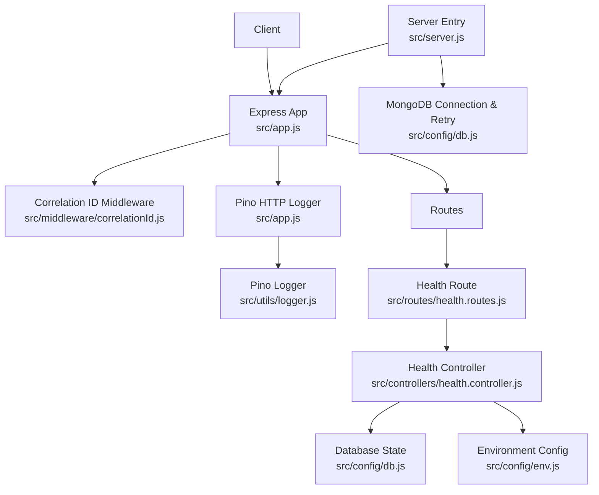
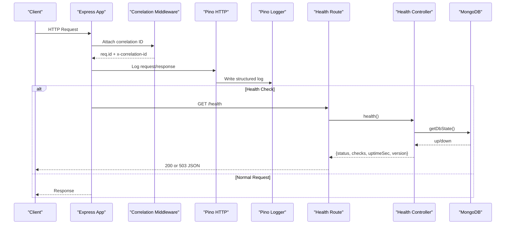
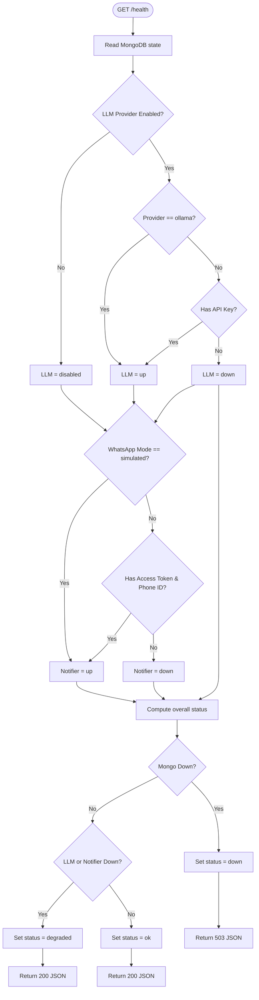
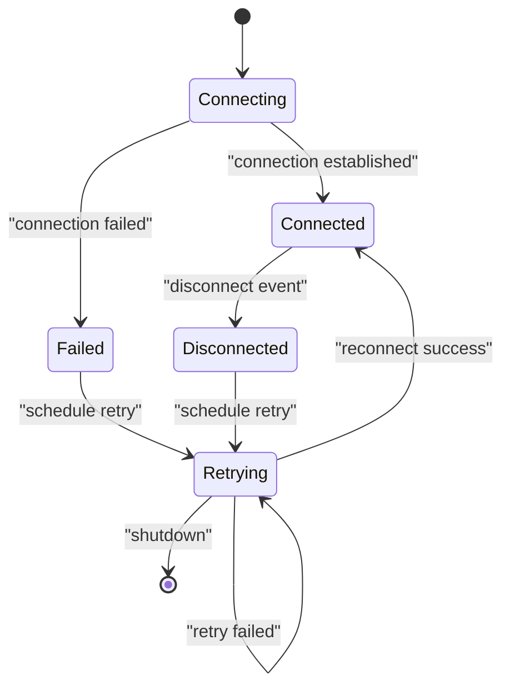
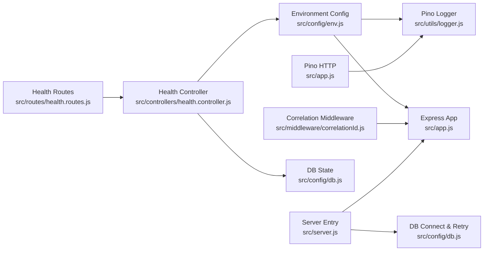

# Logging and Monitoring

<cite>
**Referenced Files in This Document**
- [logger.js](file://src/utils/logger.js)
- [correlationId.js](file://src/middleware/correlationId.js)
- [app.js](file://src/app.js)
- [server.js](file://src/server.js)
- [health.controller.js](file://src/controllers/health.controller.js)
- [health.routes.js](file://src/routes/health.routes.js)
- [db.js](file://src/config/db.js)
- [env.js](file://src/config/env.js)
- [package.json](file://package.json)
- [health.test.js](file://tests/health.test.js)
</cite>

## Table of Contents
1. [Introduction](#introduction)
2. [Project Structure](#project-structure)
3. [Core Components](#core-components)
4. [Architecture Overview](#architecture-overview)
5. [Detailed Component Analysis](#detailed-component-analysis)
6. [Dependency Analysis](#dependency-analysis)
7. [Performance Considerations](#performance-considerations)
8. [Troubleshooting Guide](#troubleshooting-guide)
9. [Conclusion](#conclusion)
10. [Appendices](#appendices)

## Introduction
This document explains the logging and monitoring system for the application. It covers structured JSON logging with Pino, correlation ID tracing across requests, health check endpoints for operational monitoring, log levels, sensitive data masking, dependency status checks (MongoDB, LLM providers, notifiers), and guidance for debugging, performance monitoring, alerting, and integration with external systems.

The implementation is designed to be observable without leaking secrets, resilient when dependencies are unavailable, and easy to integrate with standard Node.js observability tooling.

## Project Structure
The logging and monitoring features are implemented across a small set of focused modules:

- Structured logger configuration and redaction rules live in the logger utility.
- Request correlation IDs are attached by middleware and propagated through responses.
- HTTP request/response logging is handled by Pino HTTP, wired into Express.
- Health checks expose dependency status for MongoDB, LLM providers, and WhatsApp notifiers.
- Environment configuration validates log levels and feature flags.
- Database connection logic emits structured logs and retries background connections.

**Diagram sources**
- [app.js:1-76](file://src/app.js#L1-L76)
- [correlationId.js:1-14](file://src/middleware/correlationId.js#L1-L14)
- [logger.js:1-34](file://src/utils/logger.js#L1-L34)
- [health.routes.js:1-9](file://src/routes/health.routes.js#L1-L9)
- [health.controller.js:1-51](file://src/controllers/health.controller.js#L1-L51)
- [db.js:1-77](file://src/config/db.js#L1-L77)
- [env.js:1-130](file://src/config/env.js#L1-L130)
- [server.js:1-50](file://src/server.js#L1-L50)

**Section sources**
- [app.js:1-76](file://src/app.js#L1-L76)
- [server.js:1-50](file://src/server.js#L1-L50)

## Core Components
This section summarizes the key building blocks used for logging and monitoring.

- Structured JSON logger: A shared Pino instance configured with service metadata, ISO timestamps, and secret redaction rules. Child loggers can be created per request or context.
- Correlation ID middleware: Generates a UUID per request, attaches it to the response header, and exposes it on the request object so downstream components can include it in logs.
- HTTP request logging: Pino HTTP integrates with Express to emit structured request/response logs, maps status codes to log levels, serializes minimal request/response payloads, and excludes health endpoint noise.
- Health check controller: Aggregates dependency statuses (MongoDB, LLM provider, notifier) and returns an overall status with HTTP status code semantics.
- Environment configuration: Validates and exposes runtime settings including log level, feature toggles, and provider credentials.
- Database connection manager: Emits structured logs for connection events and implements background retry with exponential backoff.

**Section sources**
- [logger.js:1-34](file://src/utils/logger.js#L1-L34)
- [correlationId.js:1-14](file://src/middleware/correlationId.js#L1-L14)
- [app.js:1-76](file://src/app.js#L1-L76)
- [health.controller.js:1-51](file://src/controllers/health.controller.js#L1-L51)
- [env.js:1-130](file://src/config/env.js#L1-L130)
- [db.js:1-77](file://src/config/db.js#L1-L77)

## Architecture Overview
The logging and monitoring architecture follows a layered approach:

- Middleware layer adds correlation IDs and performs rate limiting.
- Pino HTTP captures request lifecycle events and writes structured logs via the shared Pino logger.
- Controllers and services use the shared logger for business events and errors.
- Health endpoints provide dependency status for orchestrators and load balancers.
- Environment validation ensures safe defaults and fails fast on invalid configuration.

**Diagram sources**
- [app.js:21-37](file://src/app.js#L21-L37)
- [correlationId.js:9-12](file://src/middleware/correlationId.js#L9-L12)
- [health.routes.js:6-6](file://src/routes/health.routes.js#L6-L6)
- [health.controller.js:19-49](file://src/controllers/health.controller.js#L19-L49)
- [db.js:15-18](file://src/config/db.js#L15-L18)

## Detailed Component Analysis

### Structured JSON Logging with Pino
The shared logger provides consistent, structured JSON output across the application. It includes:

- Service identity and environment metadata in the base log object.
- ISO timestamps for each log line.
- Redaction rules that mask sensitive headers such as API keys, authorization tokens, and webhook signatures.
- A child logger factory for binding contextual fields like correlation IDs.

Log levels are controlled by the validated environment variable. The default is informational, suitable for development; production typically uses info or warn depending on verbosity requirements.

Redaction targets are defined at logger initialization, ensuring secrets never reach the log stream even if they appear in request objects.

Operational notes:
- Pino HTTP serializes only minimal request/response fields to reduce log volume.
- Health endpoint requests are excluded from automatic HTTP logging to avoid noise.
- Error and warning thresholds map HTTP status codes to appropriate log levels.

**Section sources**
- [logger.js:1-34](file://src/utils/logger.js#L1-L34)
- [app.js:22-37](file://src/app.js#L22-L37)
- [env.js:25-33](file://src/config/env.js#L25-L33)

### Correlation ID Implementation
Every incoming request receives a unique correlation ID:

- Generated using a secure random UUID generator.
- Attached to the request object for downstream use.
- Returned in the response header for client-side correlation.
- Consumed by Pino HTTP to include the ID in request logs.

This enables end-to-end tracing of a single request across middleware, controllers, services, and database operations.

**Section sources**
- [correlationId.js:1-14](file://src/middleware/correlationId.js#L1-L14)
- [app.js:21-26](file://src/app.js#L21-L26)

### Health Check Endpoints
The health endpoint aggregates dependency status and returns a clear operational signal:

- MongoDB state is read from the driver’s connection readiness.
- LLM provider status is determined by configuration: disabled, local Ollama considered up, or other providers requiring an API key.
- Notifier status reflects WhatsApp mode: simulated mode is always up; cloud mode requires access token and phone number ID.
- Overall status is down if MongoDB is down; degraded if LLM or notifier is down; ok otherwise.
- HTTP status is 503 for down, 200 for ok/degraded.
- Response includes uptime seconds, individual checks, and application version.

Tests assert both healthy and unhealthy scenarios, including missing correlation ID header behavior.

**Diagram sources**
- [health.controller.js:19-49](file://src/controllers/health.controller.js#L19-L49)
- [db.js:15-18](file://src/config/db.js#L15-L18)
- [env.js:53-60](file://src/config/env.js#L53-L60)

**Section sources**
- [health.routes.js:1-9](file://src/routes/health.routes.js#L1-L9)
- [health.controller.js:1-51](file://src/controllers/health.controller.js#L1-L51)
- [health.test.js:20-43](file://tests/health.test.js#L20-L43)

### Database Dependency Monitoring and Retry Strategy
MongoDB connectivity is monitored and logged:

- Connection events emit structured logs for connected, disconnected, and error states.
- The health endpoint reads the current connection readiness.
- On initial connection failure, the server remains available and reports down until recovery.
- Background retry uses exponential backoff with capped delays.
- Graceful shutdown stops retries and disconnects cleanly.

**Diagram sources**
- [db.js:11-18](file://src/config/db.js#L11-L18)
- [db.js:37-67](file://src/config/db.js#L37-L67)
- [db.js:70-77](file://src/config/db.js#L70-L77)

**Section sources**
- [db.js:1-77](file://src/config/db.js#L1-L77)
- [server.js:20-26](file://src/server.js#L20-L26)

### Sensitive Data Masking
The logger redacts sensitive request headers to prevent accidental exposure:

- API keys in custom headers.
- Authorization headers.
- Webhook signature headers.

Redaction is applied at the logger level, so any request object passed through Pino will have these fields masked automatically.

Operational recommendations:
- Avoid logging raw request bodies unless necessary.
- Use child loggers to bind non-sensitive context fields.
- Validate that new sensitive headers are added to the redaction list if they enter the request pipeline.

**Section sources**
- [logger.js:18-25](file://src/utils/logger.js#L18-L25)

### Log Levels and Configuration
Log levels are validated against a strict enum and default to informational. Supported levels include fatal, error, warn, info, debug, trace, and silent.

Configuration highlights:
- NODE_ENV controls environment-specific behavior.
- LOG_LEVEL controls logger verbosity.
- Feature flags control optional integrations such as LLM providers and WhatsApp modes.

Production considerations:
- Ensure secrets are replaced and required fields are present.
- Prefer info or warn in production to balance observability and performance.

**Section sources**
- [env.js:25-33](file://src/config/env.js#L25-L33)
- [env.js:65-109](file://src/config/env.js#L65-L109)

### HTTP Request Logging and Status Mapping
Pino HTTP is integrated into Express to produce structured request logs:

- Correlation ID is included via the request object.
- Custom serializers limit payload size.
- Status-based log levels: 5xx and errors become error; 4xx become warn; others info.
- Health endpoint is excluded from auto-logging.

Rate limiting also includes correlation ID in its error response for easier troubleshooting.

**Section sources**
- [app.js:22-37](file://src/app.js#L22-L37)
- [app.js:54-67](file://src/app.js#L54-L67)

### Operational Metrics Collection
The health endpoint exposes basic operational metrics:

- Application uptime in seconds.
- Dependency statuses for MongoDB, LLM provider, and notifier.
- Application version.

These values are suitable for scraping by external monitoring systems or for simple dashboards.

For richer metrics (request latency percentiles, error rates, throughput), consider integrating a metrics library and exposing a dedicated metrics endpoint.

**Section sources**
- [health.controller.js:44-49](file://src/controllers/health.controller.js#L44-L49)

## Dependency Analysis
The following diagram shows how logging and monitoring components depend on each other:

**Diagram sources**
- [env.js:1-130](file://src/config/env.js#L1-L130)
- [logger.js:1-34](file://src/utils/logger.js#L1-L34)
- [app.js:1-76](file://src/app.js#L1-L76)
- [correlationId.js:1-14](file://src/middleware/correlationId.js#L1-L14)
- [health.controller.js:1-51](file://src/controllers/health.controller.js#L1-L51)
- [db.js:1-77](file://src/config/db.js#L1-L77)
- [health.routes.js:1-9](file://src/routes/health.routes.js#L1-L9)
- [server.js:1-50](file://src/server.js#L1-L50)

**Section sources**
- [app.js:1-76](file://src/app.js#L1-L76)
- [server.js:1-50](file://src/server.js#L1-L50)

## Performance Considerations
- Keep log levels appropriate for the environment to avoid excessive I/O overhead.
- Pino HTTP serializers limit payload sizes to reduce log volume.
- Exclude noisy endpoints (like health checks) from automatic HTTP logging.
- Use child loggers sparingly and avoid attaching large objects.
- Avoid logging sensitive data; rely on redaction and careful field selection.
- For high-throughput environments, consider centralized log shipping and sampling strategies.

[No sources needed since this section provides general guidance]

## Troubleshooting Guide

### Debugging Strategies
- Enable debug-level logging temporarily to capture detailed request flows.
- Use the correlation ID from the response header to filter logs for a specific request.
- Inspect health endpoint responses to identify failing dependencies quickly.
- Review MongoDB connection logs for retry attempts and failures.

**Section sources**
- [correlationId.js:9-12](file://src/middleware/correlationId.js#L9-L12)
- [health.controller.js:19-49](file://src/controllers/health.controller.js#L19-L49)
- [db.js:11-18](file://src/config/db.js#L11-L18)

### Common Issues and Resolutions
- Missing correlation ID in logs: Ensure correlation middleware runs before Pino HTTP.
- Secrets appearing in logs: Verify redaction paths cover all sensitive headers.
- Health endpoint reporting down: Check MongoDB connectivity and retry logs.
- Degraded status: Validate LLM provider configuration and notifier credentials.

**Section sources**
- [app.js:21-37](file://src/app.js#L21-L37)
- [logger.js:18-25](file://src/utils/logger.js#L18-L25)
- [health.controller.js:22-40](file://src/controllers/health.controller.js#L22-L40)
- [db.js:37-67](file://src/config/db.js#L37-L67)

### Alerting Mechanisms
- Monitor HTTP status codes returned by the health endpoint:
  - 503 indicates critical dependency failure (e.g., MongoDB).
  - 200 with degraded status indicates partial functionality.
- Alert on repeated health check failures over time windows.
- Track uptime changes and version drift for deployment verification.

**Section sources**
- [health.controller.js:38-49](file://src/controllers/health.controller.js#L38-L49)

### Integration with External Monitoring Systems
- Scrape the health endpoint periodically for status, uptime, and dependency checks.
- Forward structured logs to a centralized logging platform for analysis and alerting.
- Use correlation IDs to correlate logs across services in distributed environments.
- Optionally expose additional metrics endpoints for latency, throughput, and error rates.

[No sources needed since this section provides general guidance]

## Conclusion
The logging and monitoring system provides structured, secure, and actionable observability:

- Pino-based structured JSON logging with robust secret redaction.
- Correlation IDs for end-to-end request tracing.
- Clear health check semantics covering core and optional dependencies.
- Resilient MongoDB connectivity with background retries and graceful shutdown.
- Environment-driven configuration for safe defaults and production hardening.

Adopting the recommended practices for log levels, correlation usage, and health monitoring will improve reliability, simplify troubleshooting, and enable effective integration with external observability platforms.

[No sources needed since this section summarizes without analyzing specific files]

## Appendices

### Log Level Reference
- fatal: System unusable.
- error: Errors requiring immediate attention.
- warn: Warnings about potential issues.
- info: General operational information.
- debug: Detailed diagnostic information.
- trace: Fine-grained tracing.
- silent: No logs.

**Section sources**
- [env.js:25-33](file://src/config/env.js#L25-L33)

### Health Endpoint Response Model
- status: ok, degraded, or down.
- uptimeSec: Number of seconds since process start.
- checks: Object containing mongo, llm, notifier statuses.
- version: Application version string.

**Section sources**
- [health.controller.js:44-49](file://src/controllers/health.controller.js#L44-L49)