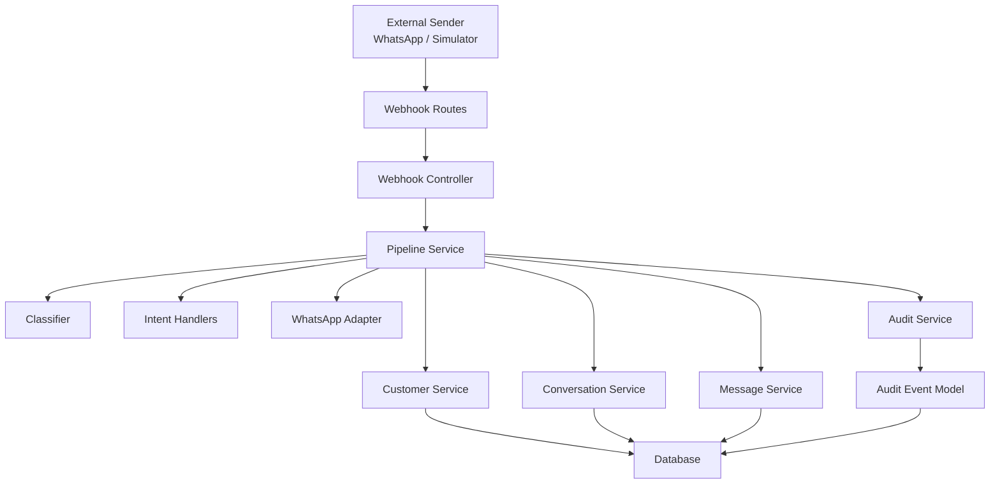
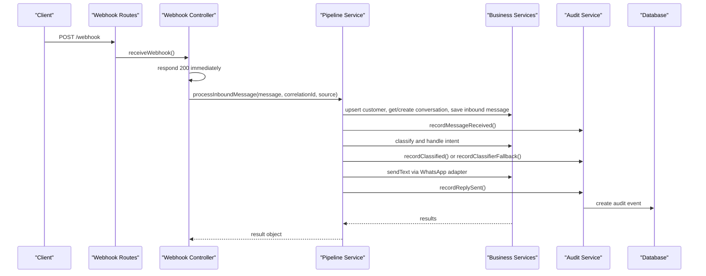
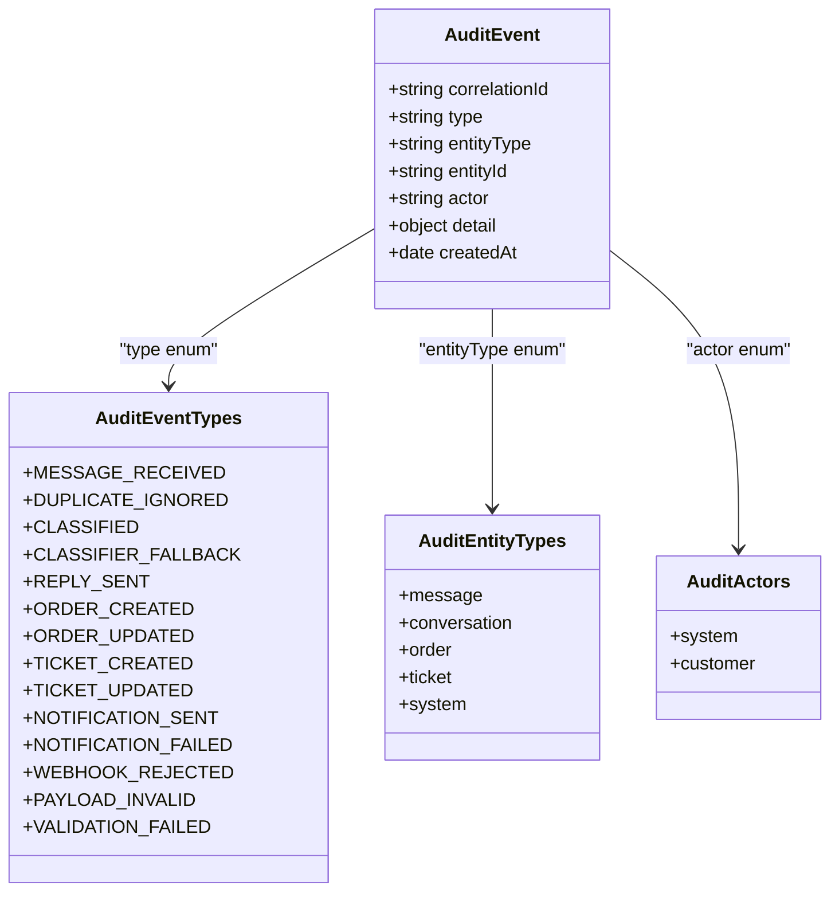
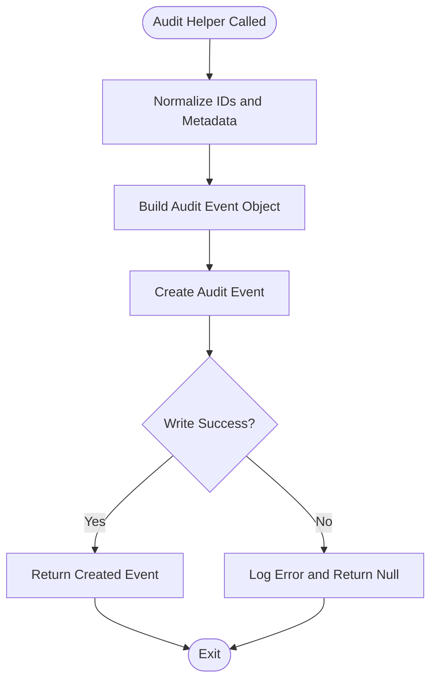
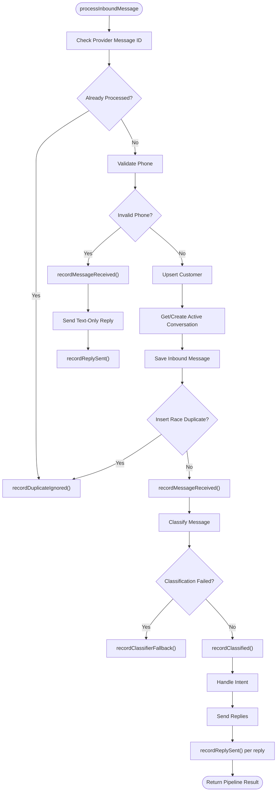
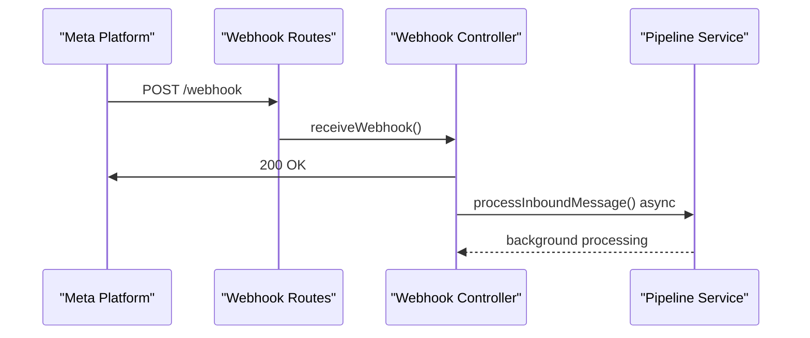
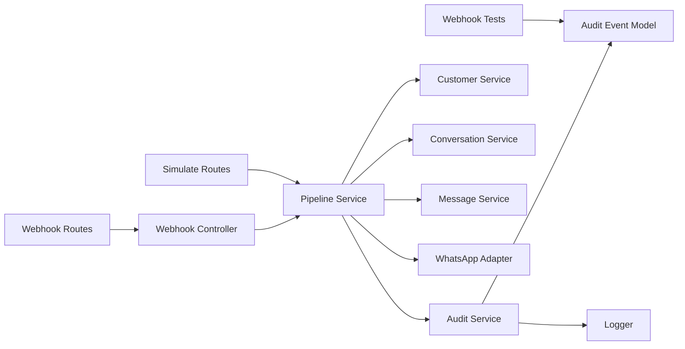

# Audit Trail Implementation

<cite>
**Referenced Files in This Document**
- [audit.service.js](file://src/services/audit.service.js)
- [auditEvent.model.js](file://src/models/auditEvent.model.js)
- [pipeline.service.js](file://src/services/pipeline.service.js)
- [webhook.controller.js](file://src/controllers/webhook.controller.js)
- [webhook.routes.js](file://src/routes/webhook.routes.js)
- [simulate.routes.js](file://src/routes/simulate.routes.js)
- [customer.service.js](file://src/services/customer.service.js)
- [conversation.service.js](file://src/services/conversation.service.js)
- [message.service.js](file://src/services/message.service.js)
- [whatsapp.adapter.js](file://src/services/whatsapp.adapter.js)
- [logger.js](file://src/utils/logger.js)
- [phone.js](file://src/utils/phone.js)
- [webhook.test.js](file://tests/webhook.test.js)
</cite>

## Table of Contents
1. [Introduction](#introduction)
2. [Project Structure](#project-structure)
3. [Core Components](#core-components)
4. [Architecture Overview](#architecture-overview)
5. [Detailed Component Analysis](#detailed-component-analysis)
6. [Dependency Analysis](#dependency-analysis)
7. [Performance Considerations](#performance-considerations)
8. [Troubleshooting Guide](#troubleshooting-guide)
9. [Conclusion](#conclusion)
10. [Appendices](#appendices)

## Introduction
This document explains the audit trail implementation for the lead system manager. The audit system captures compliance events, user interactions, and system operations across the inbound message pipeline. It is designed to be append-only, resilient to failures, and non-blocking for the live message path.

Key goals:
- Record every important lifecycle event with a consistent schema.
- Preserve correlation across webhook delivery, classification, routing, and outbound replies.
- Ensure audit failures cannot disrupt customer-facing processing.
- Provide a foundation for compliance reporting, replay, and external integration.

## Project Structure
The audit trail spans models, services, controllers, routes, and tests. The most relevant files are:

- Model layer: `src/models/auditEvent.model.js` defines the audit schema, allowed types, entity types, actors, and indexes.
- Service layer: `src/services/audit.service.js` provides typed helpers such as message received, duplicate ignored, classified, classifier fallback, and reply sent.
- Pipeline layer: `src/services/pipeline.service.js` integrates audit recording into the message processing workflow.
- Webhook entry point: `src/controllers/webhook.controller.js` returns 200 immediately and processes messages asynchronously.
- Routes: `src/routes/webhook.routes.js` and `src/routes/simulate.routes.js` mount endpoints that funnel requests into the pipeline.
- Supporting services: customer, conversation, message, WhatsApp adapter, logger, and phone utilities.
- Tests: `tests/webhook.test.js` validates audit behavior for rejected webhooks, invalid payloads, and successful replies.

**Diagram sources**
- [webhook.routes.js:1-16](file://src/routes/webhook.routes.js#L1-L16)
- [webhook.controller.js:35-55](file://src/controllers/webhook.controller.js#L35-L55)
- [pipeline.service.js:66-277](file://src/services/pipeline.service.js#L66-L277)
- [audit.service.js:1-116](file://src/services/audit.service.js#L1-L116)
- [auditEvent.model.js:1-49](file://src/models/auditEvent.model.js#L1-L49)

**Section sources**
- [webhook.routes.js:1-16](file://src/routes/webhook.routes.js#L1-L16)
- [webhook.controller.js:35-55](file://src/controllers/webhook.controller.js#L35-L55)
- [pipeline.service.js:12-37](file://src/services/pipeline.service.js#L12-L37)
- [audit.service.js:1-36](file://src/services/audit.service.js#L1-L36)
- [auditEvent.model.js:1-49](file://src/models/auditEvent.model.js#L1-L49)

## Core Components
The audit system has two primary components:

- Audit model: Defines the append-only schema, enumerated values, and indexes used for querying and compliance reporting.
- Audit service: Provides a generic record function and typed helpers for each pipeline step.

Important characteristics:
- Append-only collection: No update or delete routes exist for audit events.
- Correlation tracking: Every event includes a correlationId so full journeys can be replayed.
- Best-effort writes: Audit failures are logged and swallowed; they do not fail the main pipeline.

**Section sources**
- [auditEvent.model.js:24-49](file://src/models/auditEvent.model.js#L24-L49)
- [audit.service.js:4-36](file://src/services/audit.service.js#L4-L36)

## Architecture Overview
The audit trail integrates at multiple points in the inbound message pipeline:

- Webhook controller returns 200 immediately and processes messages asynchronously.
- Pipeline performs deduplication, persistence, classification, intent handling, and outbound replies.
- Audit records are created for key steps: message received, duplicate ignored, classified, classifier fallback, and reply sent.
- External systems can query the audit collection for compliance reporting.

**Diagram sources**
- [webhook.controller.js:35-55](file://src/controllers/webhook.controller.js#L35-L55)
- [pipeline.service.js:66-277](file://src/services/pipeline.service.js#L66-L277)
- [audit.service.js:22-116](file://src/services/audit.service.js#L22-L116)
- [auditEvent.model.js:31-44](file://src/models/auditEvent.model.js#L31-L44)

## Detailed Component Analysis

### Audit Model Schema and Enumerations
The audit model defines:
- Allowed event types: message lifecycle, order/ticket lifecycle, notifications, webhook validation, payload validation, and general validation failures.
- Entity types: message, conversation, order, ticket, system.
- Actors: system, customer.
- Fields: correlationId, type, entityType, entityId, actor, detail, createdAt.
- Indexes: createdAt descending, and composite index on type and createdAt.

This design supports:
- Compliance queries by event type and time range.
- Replay of a full journey using correlationId.
- Filtering by entity type and actor.

**Diagram sources**
- [auditEvent.model.js:3-22](file://src/models/auditEvent.model.js#L3-L22)
- [auditEvent.model.js:31-44](file://src/models/auditEvent.model.js#L31-L44)

**Section sources**
- [auditEvent.model.js:3-22](file://src/models/auditEvent.model.js#L3-L22)
- [auditEvent.model.js:24-49](file://src/models/auditEvent.model.js#L24-L49)

### Audit Service Helpers
The audit service exposes:
- Generic record function: Creates an audit event and swallows errors, logging them instead.
- Typed helpers:
  - recordMessageReceived: Captures inbound message metadata including conversationId, channel, masked phone, and message type.
  - recordDuplicateIgnored: Records when a provider message id was already processed.
  - recordClassified: Captures classification outcome including intent, confidence, source, and entities.
  - recordClassifierFallback: Records when classification failed or degraded.
  - recordReplySent: Captures outbound reply success including intent, target phone, and character count.

These helpers ensure consistent shapes for compliance queries and reporting.

**Diagram sources**
- [audit.service.js:22-36](file://src/services/audit.service.js#L22-L36)
- [audit.service.js:40-116](file://src/services/audit.service.js#L40-L116)

**Section sources**
- [audit.service.js:4-36](file://src/services/audit.service.js#L4-L36)
- [audit.service.js:40-116](file://src/services/audit.service.js#L40-L116)

### Pipeline Integration Points
The pipeline integrates audit recording at these stages:

- Deduplication: If a provider message id is already known, it records DUPLICATE_IGNORED.
- Unsupported sender: If the phone cannot be normalized, it records MESSAGE_RECEIVED and REPLY_SENT without persistence.
- Normalized flow: After persisting the inbound message, it records MESSAGE_RECEIVED.
- Classification: It records CLASSIFIED or CLASSIFIER_FALLBACK depending on outcome.
- Outbound replies: For each successful send, it records REPLY_SENT.

**Diagram sources**
- [pipeline.service.js:77-155](file://src/services/pipeline.service.js#L77-L155)
- [pipeline.service.js:171-200](file://src/services/pipeline.service.js#L171-L200)
- [pipeline.service.js:235-260](file://src/services/pipeline.service.js#L235-L260)

**Section sources**
- [pipeline.service.js:77-155](file://src/services/pipeline.service.js#L77-L155)
- [pipeline.service.js:171-200](file://src/services/pipeline.service.js#L171-L200)
- [pipeline.service.js:235-260](file://src/services/pipeline.service.js#L235-L260)

### Webhook Asynchronous Processing
The webhook controller returns 200 immediately after receiving the request. Each message is then processed asynchronously. This design prevents retry storms from Meta and ensures audit failures cannot turn into repeated webhook retries.

**Diagram sources**
- [webhook.controller.js:35-55](file://src/controllers/webhook.controller.js#L35-L55)
- [webhook.routes.js:11-13](file://src/routes/webhook.routes.js#L11-L13)

**Section sources**
- [webhook.controller.js:35-55](file://src/controllers/webhook.controller.js#L35-L55)
- [webhook.routes.js:11-13](file://src/routes/webhook.routes.js#L11-L13)

### Simulate Harness
The simulate route is disabled in production and requires an API key. It funnels simulated messages through the same pipeline, ensuring audit trails are captured consistently during testing and development.

**Section sources**
- [simulate.routes.js:10-18](file://src/routes/simulate.routes.js#L10-L18)

### Audit Event Creation Examples
Examples of audit event creation patterns:

- Message received:
  - Use recordMessageReceived with correlationId, providerMessageId, conversationId, channel, maskedPhone, and message type.
- Duplicate ignored:
  - Use recordDuplicateIgnored with correlationId, providerMessageId, and conversationId.
- Classified:
  - Use recordClassified with correlationId, providerMessageId, intent, confidence, source, and entities.
- Classifier fallback:
  - Use recordClassifierFallback with correlationId, providerMessageId, and reason.
- Reply sent:
  - Use recordReplySent with correlationId, providerMessageId, conversationId, intent, maskedPhone, and character count.

These examples follow the typed helper contract and produce consistent audit documents.

**Section sources**
- [audit.service.js:40-116](file://src/services/audit.service.js#L40-L116)

### Querying Audit Trails for Compliance Reporting
Recommended query patterns:

- By correlationId:
  - Retrieve all events for a single message journey.
- By type and createdAt range:
  - Generate compliance reports for specific event types over time windows.
- By entityType and actor:
  - Filter events by business entity and actor for targeted audits.

Indexes support efficient queries on createdAt and composite type+createdAt fields.

**Section sources**
- [auditEvent.model.js:31-44](file://src/models/auditEvent.model.js#L31-L44)

### Data Retention Policies
Current implementation does not include automatic retention or deletion logic. The audit collection is append-only and has no update/delete routes. Recommended policies:

- Define retention periods per compliance requirement (for example, 1 year, 3 years).
- Implement scheduled jobs to archive or purge old events based on createdAt.
- Separate hot and cold storage for recent vs historical events.
- Ensure retention policies do not violate append-only integrity.

[No sources needed since this section provides general guidance]

### Performance Impact Mitigation
Mitigation strategies implemented and recommended:

- Best-effort writes:
  - Audit failures are caught and logged; they do not fail the main pipeline.
- Non-blocking webhook response:
  - Immediate 200 response avoids retry storms.
- Indexed fields:
  - createdAt and type+createdAt indexes improve query performance.
- Minimal metadata:
  - Only necessary fields are recorded in detail to reduce payload size.
- Bulk operations:
  - Current helpers write one event at a time. Consider batching if throughput increases significantly.
- Backpressure:
  - Monitor database latency and queue depth; add circuit breakers if audit writes degrade.

**Section sources**
- [audit.service.js:4-36](file://src/services/audit.service.js#L4-L36)
- [webhook.controller.js:35-55](file://src/controllers/webhook.controller.js#L35-L55)
- [auditEvent.model.js:43-44](file://src/models/auditEvent.model.js#L43-L44)

### Bulk Audit Operations
Current implementation uses single-event writes through the generic record function. For high-throughput scenarios:

- Introduce a batch writer that accumulates events and flushes them periodically.
- Use MongoDB bulk insert operations where appropriate.
- Maintain correlationId and ordering guarantees within batches.
- Add metrics for batch size, latency, and failure rates.

[No sources needed since this section provides general guidance]

### Integration with External Compliance Systems
Integration approaches:

- Export audit events:
  - Periodic export to compliance data lakes or SIEM systems.
- Streaming integration:
  - Stream audit events to Kafka or similar systems for real-time monitoring.
- Webhook forwarding:
  - Forward critical events (for example, WEBHOOK_REJECTED, PAYLOAD_INVALID) to external compliance endpoints.
- Field mapping:
  - Map audit fields to compliance schemas while preserving correlationId and timestamps.

[No sources needed since this section provides general guidance]

## Dependency Analysis
The audit system depends on several modules:

- Audit service depends on AuditEvent model and logger.
- Pipeline service imports audit service and orchestrates audit recording alongside business services.
- Webhook controller delegates processing to pipeline service.
- Tests assert audit events for webhook rejection, payload validation, and reply sending.

**Diagram sources**
- [audit.service.js:1-3](file://src/services/audit.service.js#L1-L3)
- [pipeline.service.js:1-10](file://src/services/pipeline.service.js#L1-L10)
- [webhook.controller.js:1-4](file://src/controllers/webhook.controller.js#L1-L4)
- [webhook.routes.js:1-5](file://src/routes/webhook.routes.js#L1-L5)
- [simulate.routes.js:1-6](file://src/routes/simulate.routes.js#L1-L6)
- [webhook.test.js:136-203](file://tests/webhook.test.js#L136-L203)

**Section sources**
- [audit.service.js:1-3](file://src/services/audit.service.js#L1-L3)
- [pipeline.service.js:1-10](file://src/services/pipeline.service.js#L1-L10)
- [webhook.controller.js:1-4](file://src/controllers/webhook.controller.js#L1-L4)
- [webhook.routes.js:1-5](file://src/routes/webhook.routes.js#L1-L5)
- [simulate.routes.js:1-6](file://src/routes/simulate.routes.js#L1-L6)
- [webhook.test.js:136-203](file://tests/webhook.test.js#L136-L203)

## Performance Considerations
- Audit writes are best-effort and isolated from the main pipeline.
- Webhook responses are immediate to avoid retry storms.
- Indexes optimize common query patterns.
- Avoid adding heavy metadata to detail objects.
- Monitor database performance and consider batching for high volume.

[No sources needed since this section provides general guidance]

## Troubleshooting Guide
Common issues and diagnostics:

- Audit event not written:
  - Check logger for audit write failures.
  - Verify database connectivity and permissions.
- Missing correlationId:
  - Ensure correlationId is propagated from webhook or simulator.
- Duplicate events:
  - Confirm deduplication logic runs before persistence and audit recording.
- Compliance report gaps:
  - Validate query filters match event types and time ranges.
  - Check retention policies if older events are missing.

Validation references:
- Webhook signature rejection and payload invalidation are audited and tested.
- Successful replies produce MESSAGE_RECEIVED, CLASSIFIED, and REPLY_SENT events.

**Section sources**
- [audit.service.js:30-36](file://src/services/audit.service.js#L30-L36)
- [webhook.test.js:153-203](file://tests/webhook.test.js#L153-L203)

## Conclusion
The audit trail implementation provides a resilient, append-only record of compliance-critical events across the inbound message pipeline. It integrates tightly with the pipeline, webhook controller, and supporting services while remaining non-blocking and best-effort. The schema and helpers standardize event shapes, enabling reliable compliance reporting and future integrations.

[No sources needed since this section summarizes without analyzing specific files]

## Appendices

### Audit Event Schema Reference
Fields:
- correlationId: String, required, indexed.
- type: String, required, enum of AUDIT_EVENT_TYPES.
- entityType: String, default system, enum of AUDIT_ENTITY_TYPES.
- entityId: String, nullable.
- actor: String, default system, enum of AUDIT_ACTORS.
- detail: Mixed object, default empty.
- createdAt: Timestamp, auto-generated.

Indexes:
- createdAt descending.
- type ascending with createdAt descending.

**Section sources**
- [auditEvent.model.js:31-44](file://src/models/auditEvent.model.js#L31-L44)

### Audit Event Types Reference
- MESSAGE_RECEIVED
- DUPLICATE_IGNORED
- CLASSIFIED
- CLASSIFIER_FALLBACK
- REPLY_SENT
- ORDER_CREATED
- ORDER_UPDATED
- TICKET_CREATED
- TICKET_UPDATED
- NOTIFICATION_SENT
- NOTIFICATION_FAILED
- WEBHOOK_REJECTED
- PAYLOAD_INVALID
- VALIDATION_FAILED

**Section sources**
- [auditEvent.model.js:3-18](file://src/models/auditEvent.model.js#L3-L18)