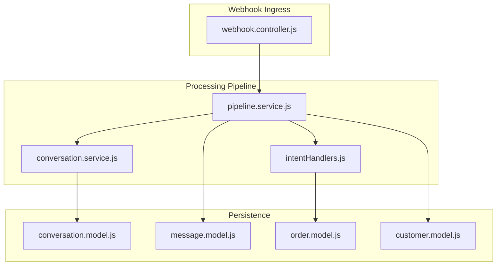
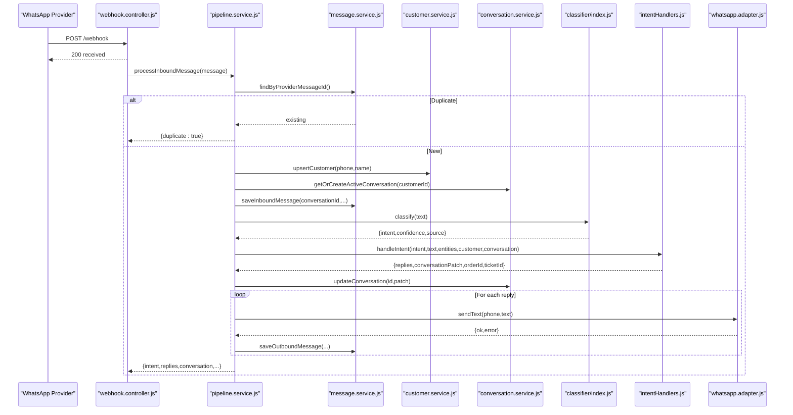
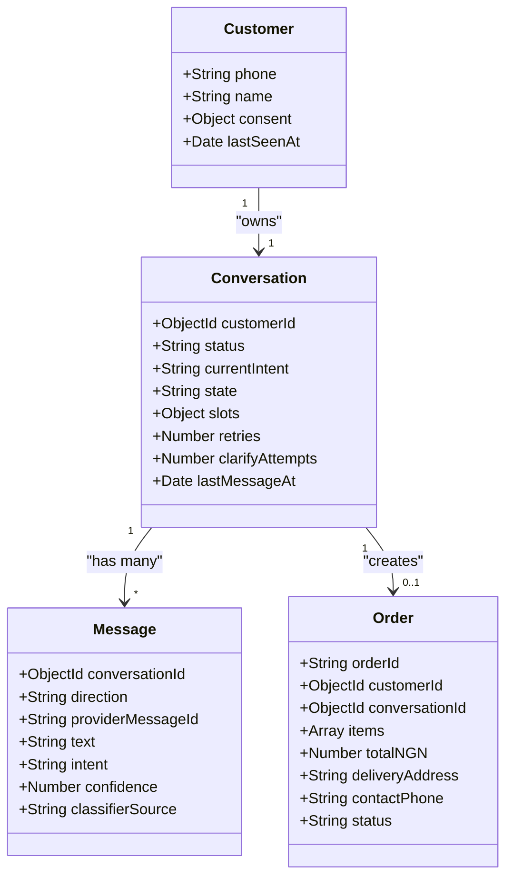
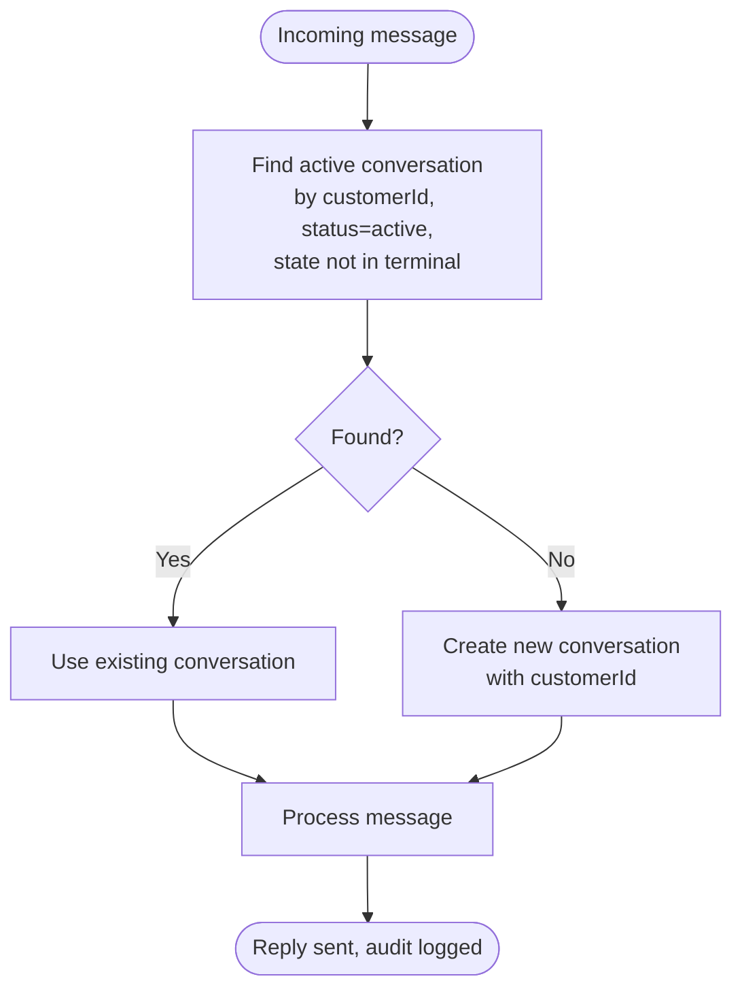
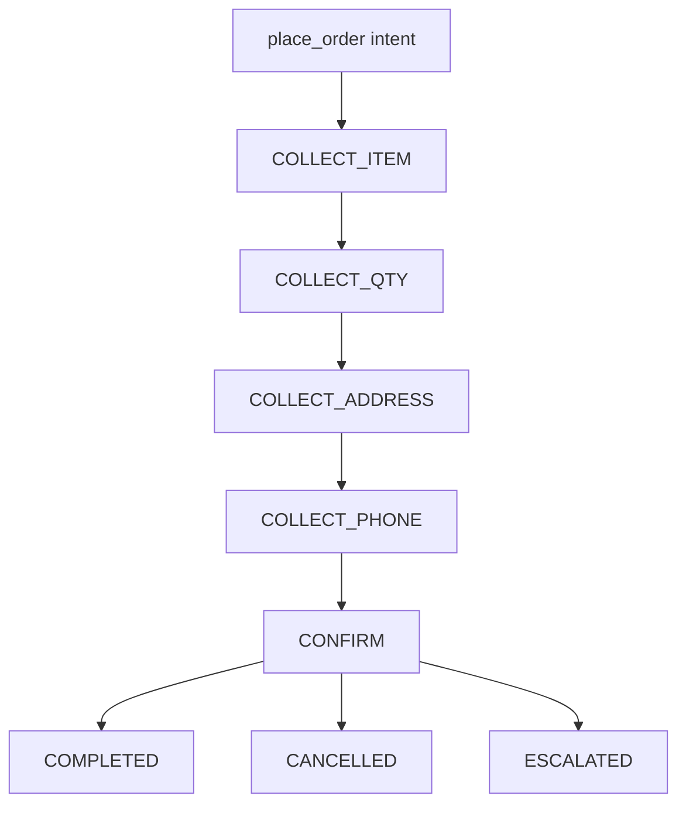
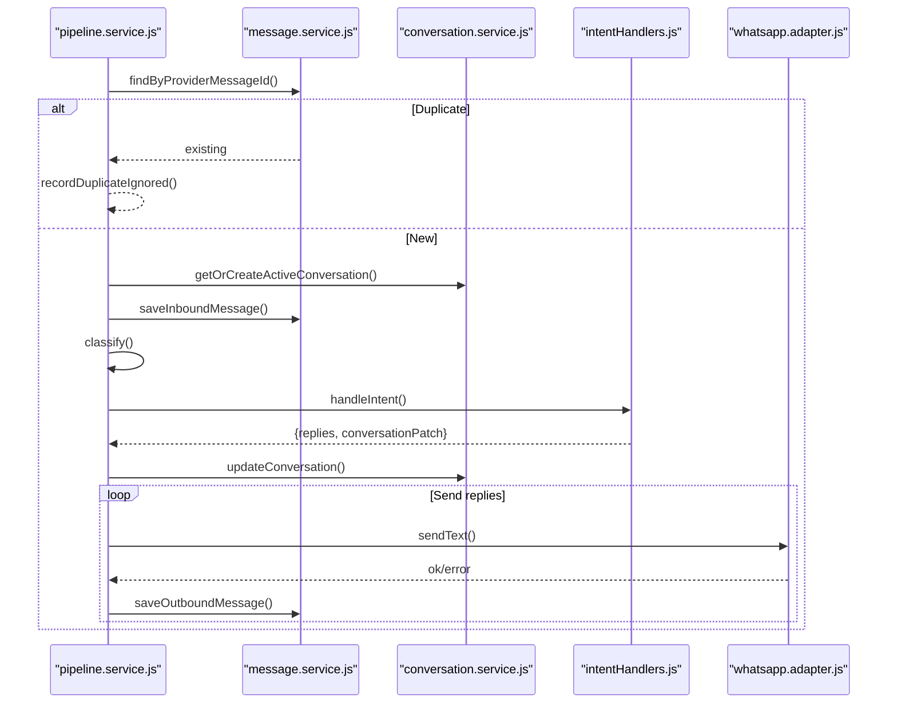
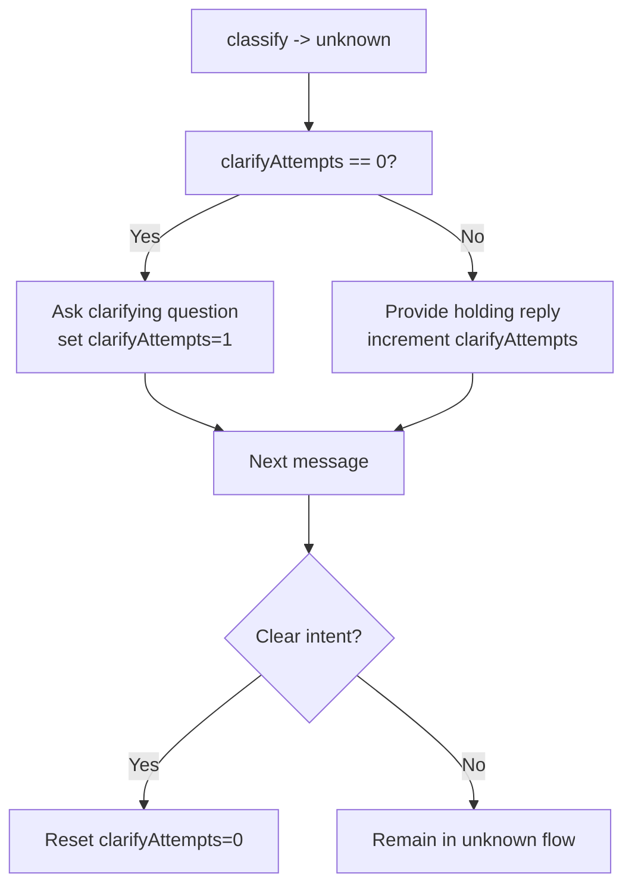
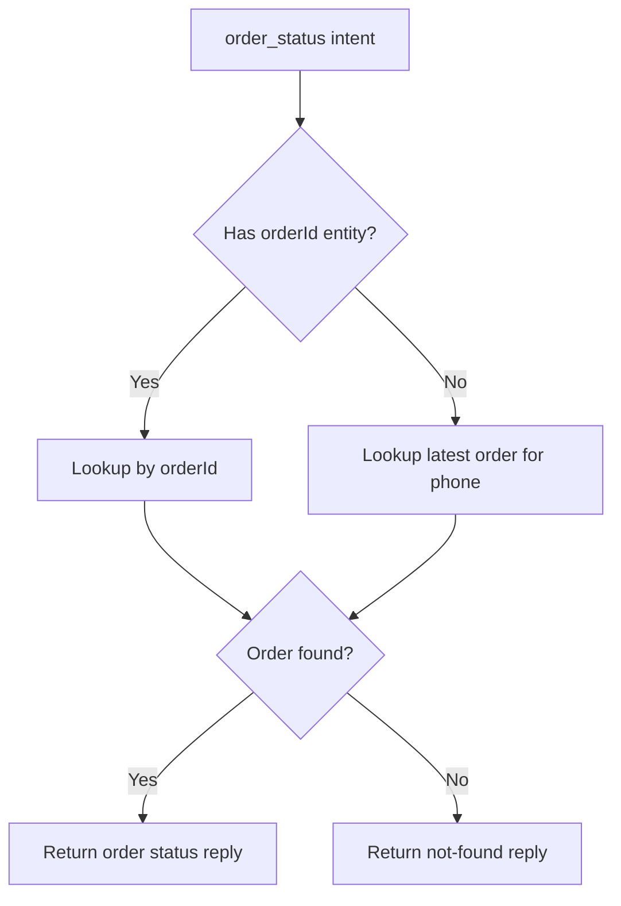
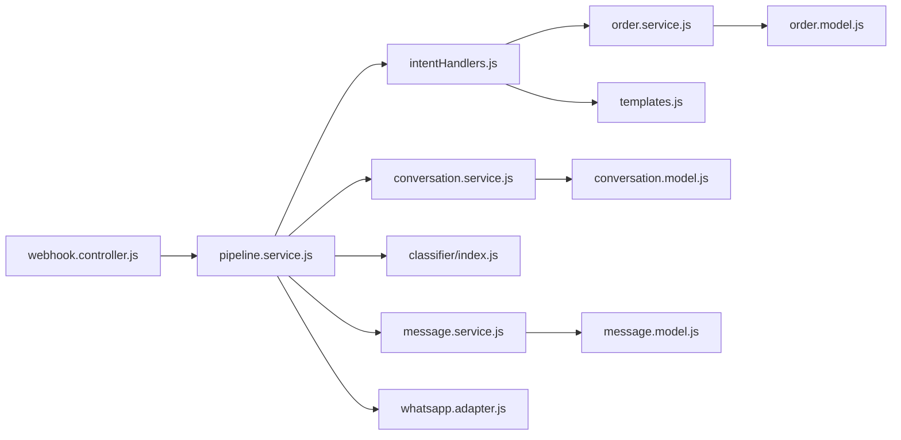

# Conversation State Management

<cite>
**Referenced Files in This Document**
- [conversation.model.js](file://src/models/conversation.model.js)
- [message.model.js](file://src/models/message.model.js)
- [order.model.js](file://src/models/order.model.js)
- [customer.model.js](file://src/models/customer.model.js)
- [conversation.service.js](file://src/services/conversation.service.js)
- [intentHandlers.js](file://src/services/intentHandlers.js)
- [pipeline.service.js](file://src/services/pipeline.service.js)
- [webhook.controller.js](file://src/controllers/webhook.controller.js)
- [app.js](file://src/app.js)
- [server.js](file://src/server.js)
- [conversation.test.js](file://tests/conversation.test.js)
- [intentHandlers.test.js](file://tests/intentHandlers.test.js)
</cite>

## Table of Contents
1. [Introduction](#introduction)
2. [Project Structure](#project-structure)
3. [Core Components](#core-components)
4. [Architecture Overview](#architecture-overview)
5. [Detailed Component Analysis](#detailed-component-analysis)
6. [Dependency Analysis](#dependency-analysis)
7. [Performance Considerations](#performance-considerations)
8. [Troubleshooting Guide](#troubleshooting-guide)
9. [Conclusion](#conclusion)

## Introduction
This document explains the conversation state management system that powers multi-turn WhatsApp interactions, with a focus on the slot-filling pattern for order workflows. It covers:
- The conversation lifecycle from creation to terminal states
- The state machine vocabulary and planned transitions
- How conversation context is maintained across messages via slots and counters
- Error recovery, deduplication, and timeout handling
- Concurrency and database locking considerations
- Performance characteristics for high-volume conversations

The implementation currently exposes a robust pipeline for classification, routing, persistence, and replies. The full slot-filling state machine is integrated into the pipeline’s intent-handling layer and conversation model; some handlers are transitional placeholders while the rest of the system is production-ready.

## Project Structure
The conversation state management spans models, services, controllers, and tests:
- Models define the data schema for conversations, messages, orders, and customers
- Services implement conversation lifecycle, intent routing, and the message processing pipeline
- Controllers expose webhook endpoints
- Tests validate conversation resume/creation and intent behaviors

**Diagram sources**
- [webhook.controller.js:35-55](file://src/controllers/webhook.controller.js#L35-L55)
- [pipeline.service.js:66-273](file://src/services/pipeline.service.js#L66-L273)
- [intentHandlers.js:98-114](file://src/services/intentHandlers.js#L98-L114)
- [conversation.service.js:22-41](file://src/services/conversation.service.js#L22-L41)
- [conversation.model.js:23-47](file://src/models/conversation.model.js#L23-L47)
- [message.model.js:13-31](file://src/models/message.model.js#L13-L31)
- [order.model.js:35-49](file://src/models/order.model.js#L35-L49)
- [customer.model.js:7-23](file://src/models/customer.model.js#L7-L23)

**Section sources**
- [webhook.controller.js:35-55](file://src/controllers/webhook.controller.js#L35-L55)
- [pipeline.service.js:66-273](file://src/services/pipeline.service.js#L66-L273)
- [conversation.service.js:22-41](file://src/services/conversation.service.js#L22-L41)
- [conversation.model.js:23-47](file://src/models/conversation.model.js#L23-L47)
- [message.model.js:13-31](file://src/models/message.model.js#L13-L31)
- [order.model.js:35-49](file://src/models/order.model.js#L35-L49)
- [customer.model.js:7-23](file://src/models/customer.model.js#L7-L23)

## Core Components
- Conversation model: Defines the state machine vocabulary (IDLE, COLLECT_ITEM, COLLECT_QTY, COLLECT_ADDRESS, COLLECT_PHONE, CONFIRM, COMPLETED, CANCELLED, ESCALATED, EXPIRED), slot fields (sku, quantity, address, phone), and counters (retries, clarifyAttempts).
- Message model: Immutable inbound/outbound messages with providerMessageId uniqueness for deduplication.
- Order model: Captures created orders with status transitions enforced by PATCH operations.
- Customer model: Normalized E.164 phone identity with consent metadata.
- Conversation service: Resumes or creates an active conversation per customer, excluding terminal states.
- Intent handlers: Route classified intents to handlers; place_order is a placeholder for the slot-filling state machine.
- Pipeline service: Orchestrates deduplication, persistence, classification, intent routing, reply sending, and audit logging.

Key responsibilities:
- Conversation lifecycle: getOrCreateActiveConversation ensures one rolling conversation per customer.
- Context maintenance: currentIntent, slots, retries, clarifyAttempts, lastMessageAt persist across messages.
- Deduplication: providerMessageId unique index prevents duplicate processing.
- Classification fallback: unknown intents trigger clarify-once behavior.

**Section sources**
- [conversation.model.js:5-16](file://src/models/conversation.model.js#L5-L16)
- [conversation.model.js:34-42](file://src/models/conversation.model.js#L34-L42)
- [message.model.js:13-31](file://src/models/message.model.js#L13-L31)
- [order.model.js:35-49](file://src/models/order.model.js#L35-L49)
- [customer.model.js:7-23](file://src/models/customer.model.js#L7-L23)
- [conversation.service.js:22-41](file://src/services/conversation.service.js#L22-L41)
- [intentHandlers.js:98-114](file://src/services/intentHandlers.js#L98-L114)
- [pipeline.service.js:77-146](file://src/services/pipeline.service.js#L77-L146)

## Architecture Overview
The system processes inbound WhatsApp messages through a single pipeline that centralizes deduplication, persistence, classification, routing, and replies.

**Diagram sources**
- [webhook.controller.js:35-55](file://src/controllers/webhook.controller.js#L35-L55)
- [pipeline.service.js:66-273](file://src/services/pipeline.service.js#L66-L273)
- [intentHandlers.js:98-114](file://src/services/intentHandlers.js#L98-L114)
- [conversation.service.js:22-41](file://src/services/conversation.service.js#L22-L41)

## Detailed Component Analysis

### Conversation Model and State Machine Vocabulary
The conversation model defines:
- Status: active, escalated, completed, expired
- State: IDLE, COLLECT_ITEM, COLLECT_QTY, COLLECT_ADDRESS, COLLECT_PHONE, CONFIRM, COMPLETED, CANCELLED, ESCALATED, EXPIRED
- Slots: sku, quantity, address, phone
- Counters: retries, clarifyAttempts
- Timestamps: lastMessageAt

These fields enable slot-filling across multiple turns and support error recovery and idle expiry logic.

**Diagram sources**
- [conversation.model.js:23-47](file://src/models/conversation.model.js#L23-L47)
- [message.model.js:13-31](file://src/models/message.model.js#L13-L31)
- [order.model.js:35-49](file://src/models/order.model.js#L35-L49)
- [customer.model.js:7-23](file://src/models/customer.model.js#L7-L23)

**Section sources**
- [conversation.model.js:5-16](file://src/models/conversation.model.js#L5-L16)
- [conversation.model.js:34-42](file://src/models/conversation.model.js#L34-L42)

### Conversation Lifecycle and Resume Logic
- One rolling conversation per customer: getOrCreateActiveConversation finds the most recent active conversation not in a terminal state; otherwise it creates a new one.
- Terminal states include COMPLETED, CANCELLED, ESCALATED, EXPIRED.
- Tests verify:
  - Resuming returns the same conversation and starts in IDLE
  - Terminal conversations roll over to a fresh conversation
  - updateConversation applies patches and returns the updated document

**Diagram sources**
- [conversation.service.js:22-31](file://src/services/conversation.service.js#L22-L31)
- [conversation.test.js:62-86](file://tests/conversation.test.js#L62-L86)

**Section sources**
- [conversation.service.js:16-31](file://src/services/conversation.service.js#L16-L31)
- [conversation.test.js:62-86](file://tests/conversation.test.js#L62-L86)

### Slot-Filling Pattern for Order Workflows
The intended slot-filling flow for placing an order follows:
- Place order intent triggers COLLECT_ITEM
- Subsequent turns collect QUANTITY, ADDRESS, PHONE
- Confirm step validates all slots and creates an order
- Finalize sets state to COMPLETED

Current implementation:
- place_order handler returns a holding reply and records currentIntent on the conversation
- The state machine integration point is marked in the pipeline and intent handlers
- Slots and counters exist in the conversation model to support this flow

**Diagram sources**
- [intentHandlers.js:64-69](file://src/services/intentHandlers.js#L64-L69)
- [conversation.model.js:5-16](file://src/models/conversation.model.js#L5-L16)
- [pipeline.service.js:161-224](file://src/services/pipeline.service.js#L161-L224)

**Section sources**
- [intentHandlers.js:64-69](file://src/services/intentHandlers.js#L64-L69)
- [conversation.model.js:5-16](file://src/models/conversation.model.js#L5-L16)
- [pipeline.service.js:161-224](file://src/services/pipeline.service.js#L161-L224)

### Message Processing Pipeline
The pipeline performs:
- Deduplication by providerMessageId
- Upserting customer and resuming conversation
- Persisting inbound message
- Classification (rules/LLM/fallback)
- Routing to intent handlers
- Updating conversation patch (currentIntent, counters)
- Sending replies and persisting outbound messages
- Audit logging at key steps

**Diagram sources**
- [pipeline.service.js:77-257](file://src/services/pipeline.service.js#L77-L257)
- [intentHandlers.js:98-114](file://src/services/intentHandlers.js#L98-L114)

**Section sources**
- [pipeline.service.js:77-257](file://src/services/pipeline.service.js#L77-L257)

### Unknown Intent Clarify-Once Flow
- When classification yields unknown, the handler asks once and increments clarifyAttempts
- On the second miss, it provides a holding reply and continues counting until ticket escalation is implemented
- Clear intents reset clarifyAttempts

**Diagram sources**
- [intentHandlers.js:83-96](file://src/services/intentHandlers.js#L83-L96)
- [intentHandlers.test.js:192-224](file://tests/intentHandlers.test.js#L192-L224)

**Section sources**
- [intentHandlers.js:83-96](file://src/services/intentHandlers.js#L83-L96)
- [intentHandlers.test.js:192-224](file://tests/intentHandlers.test.js#L192-L224)

### Order Status and Order Creation
- Order status handler resolves orders by reference or latest order for the phone number
- Orders have statuses: pending_confirmation, confirmed, dispatched, delivered, cancelled
- Transitions are enforced by PATCH operations

**Diagram sources**
- [intentHandlers.js:47-62](file://src/services/intentHandlers.js#L47-L62)
- [order.model.js:3-18](file://src/models/order.model.js#L3-L18)

**Section sources**
- [intentHandlers.js:47-62](file://src/services/intentHandlers.js#L47-L62)
- [order.model.js:3-18](file://src/models/order.model.js#L3-L18)

## Dependency Analysis
The following diagram shows how components depend on each other during message processing and state updates.

**Diagram sources**
- [webhook.controller.js:35-55](file://src/controllers/webhook.controller.js#L35-L55)
- [pipeline.service.js:1-10](file://src/services/pipeline.service.js#L1-L10)
- [intentHandlers.js:1-3](file://src/services/intentHandlers.js#L1-L3)
- [conversation.service.js:1](file://src/services/conversation.service.js#L1)
- [conversation.model.js:1](file://src/models/conversation.model.js#L1)
- [message.model.js:1](file://src/models/message.model.js#L1)
- [order.model.js:1](file://src/models/order.model.js#L1)

**Section sources**
- [pipeline.service.js:1-10](file://src/services/pipeline.service.js#L1-L10)
- [intentHandlers.js:1-3](file://src/services/intentHandlers.js#L1-L3)
- [conversation.service.js:1](file://src/services/conversation.service.js#L1)

## Performance Considerations
- Immediate 200 response: The webhook controller returns 200 immediately and processes messages asynchronously to avoid retry storms from the provider.
- Rate limiting: Coarse rate limiting protects against abuse while accommodating provider retries.
- Database indexing:
  - conversation.index(customerId, status) supports fast resume lookup
  - message.unique(providerMessageId) enables efficient deduplication
  - message.index(conversationId, createdAt) supports ordered history retrieval
  - order.index(status, createdAt) supports order queries
- Connection resilience: The server starts listening before connecting to MongoDB; health checks reflect degraded state when DB is down.

Recommendations:
- Monitor queue depth if moving to background jobs
- Add timeouts for external calls (LLM, WhatsApp adapter)
- Cache product catalog lookups where appropriate
- Use connection pooling and read replicas for high-throughput scenarios

**Section sources**
- [webhook.controller.js:35-55](file://src/controllers/webhook.controller.js#L35-L55)
- [app.js:54-67](file://src/app.js#L54-L67)
- [conversation.model.js:47](file://src/models/conversation.model.js#L47)
- [message.model.js:22](file://src/models/message.model.js#L22)
- [message.model.js:31](file://src/models/message.model.js#L31)
- [order.model.js:49](file://src/models/order.model.js#L49)
- [server.js:20-26](file://src/server.js#L20-L26)

## Troubleshooting Guide
Common issues and resolutions:
- Duplicate messages:
  - Symptom: Repeated processing despite idempotent handling
  - Cause: Missing or inconsistent providerMessageId
  - Resolution: Ensure providerMessageId is unique and persisted; rely on unique index for deduplication
- Unsupported phone numbers:
  - Symptom: Non-text prompt without persistence
  - Cause: Phone cannot be normalized to E.164
  - Resolution: Validate upstream normalization; log masked phone for debugging
- Classifier fallback:
  - Symptom: Unknown intent responses
  - Cause: LLM failure or ambiguous input
  - Resolution: Review templates and rules; monitor clarifyAttempts counter
- Conversation not resuming:
  - Symptom: New conversation created instead of resuming
  - Cause: Previous conversation in terminal state or inactive
  - Resolution: Check status and state; ensure non-terminal states for active flows
- Order status not found:
  - Symptom: Not-found reply for order references
  - Cause: Invalid orderId or no orders for phone
  - Resolution: Verify order creation and linkage to customer phone

Operational tips:
- Inspect audit logs for messageReceived, classified, replySent events
- Use correlationId to trace requests across layers
- Validate webhook signature and payload shape using middleware

**Section sources**
- [pipeline.service.js:90-121](file://src/services/pipeline.service.js#L90-L121)
- [pipeline.service.js:176-209](file://src/services/pipeline.service.js#L176-L209)
- [conversation.service.js:22-31](file://src/services/conversation.service.js#L22-L31)
- [intentHandlers.js:47-62](file://src/services/intentHandlers.js#L47-L62)

## Conclusion
The conversation state management system provides a solid foundation for multi-turn WhatsApp interactions. It enforces idempotency, maintains conversation context through slots and counters, and routes intents reliably. While the slot-filling state machine for orders is partially integrated, the pipeline and models are ready to support the full workflow. With careful attention to concurrency, timeouts, and monitoring, the system can scale to high-volume conversations while preserving reliability and user experience.