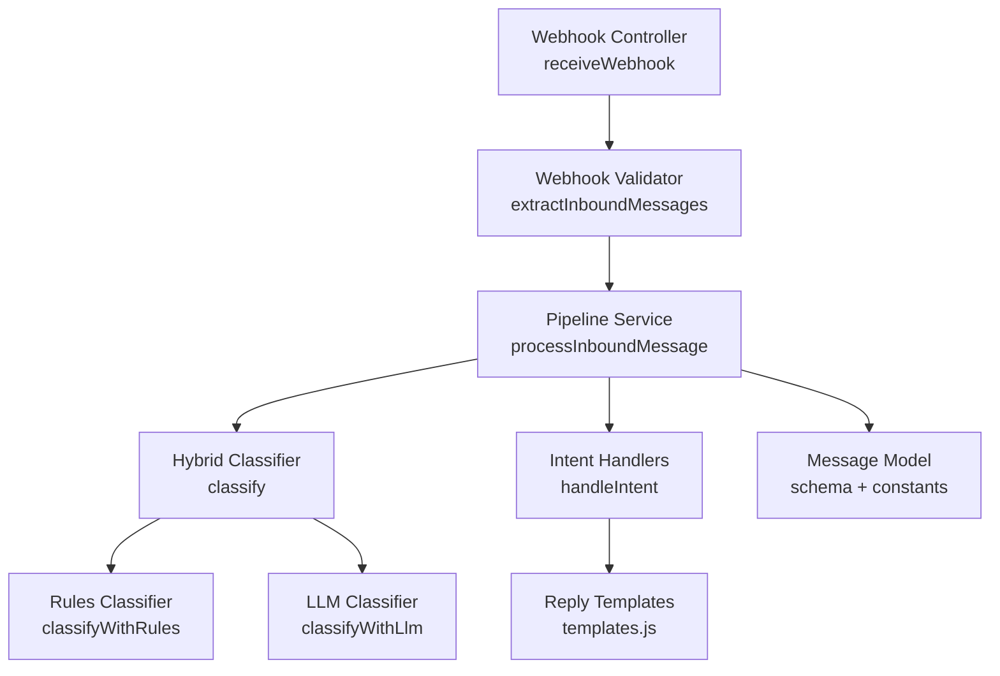
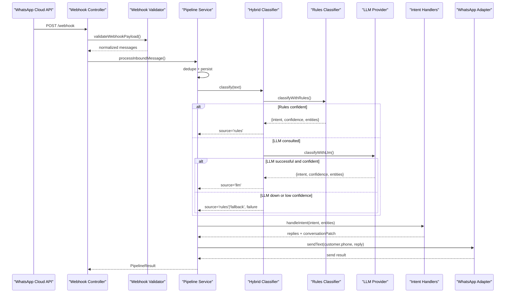
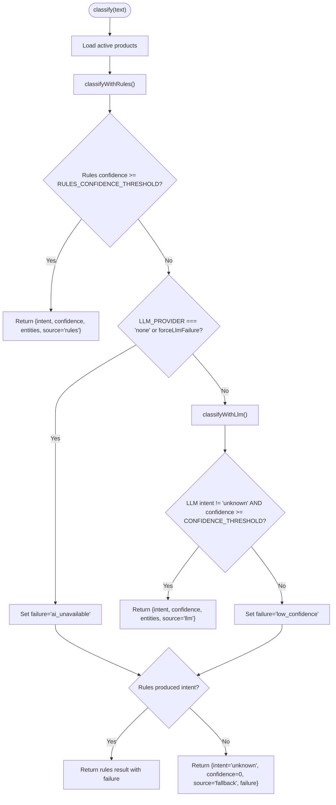
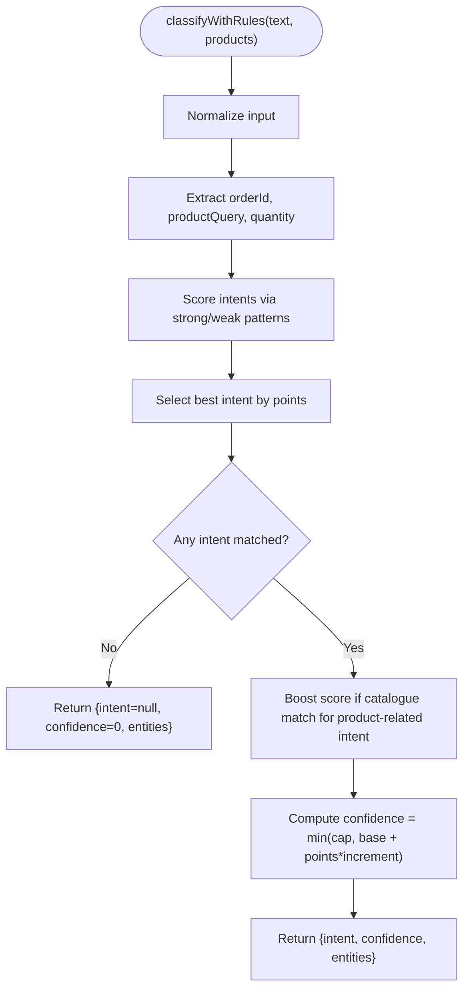
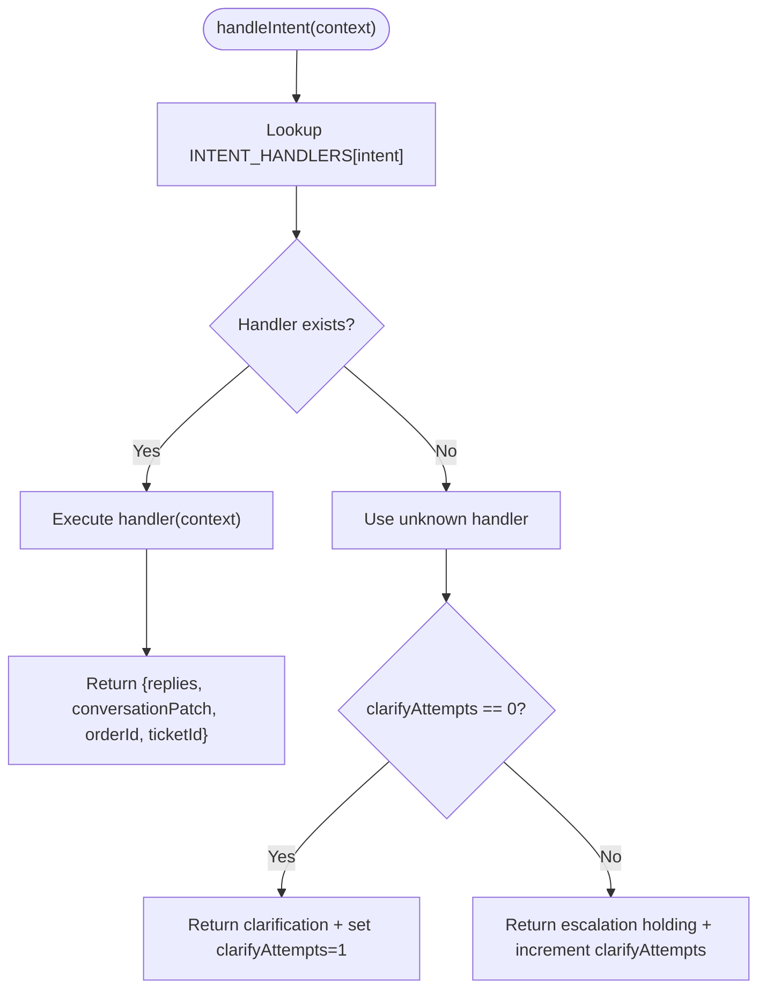
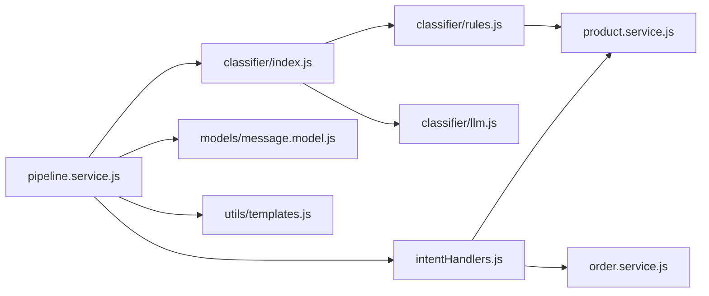

# Message Classification System

<cite>
**Referenced Files in This Document**
- [pipeline.service.js](file://src/services/pipeline.service.js)
- [classifier/index.js](file://src/services/classifier/index.js)
- [classifier/rules.js](file://src/services/classifier/rules.js)
- [classifier/llm.js](file://src/services/classifier/llm.js)
- [intentHandlers.js](file://src/services/intentHandlers.js)
- [message.model.js](file://src/models/message.model.js)
- [webhook.controller.js](file://src/controllers/webhook.controller.js)
- [webhook.validator.js](file://src/validators/webhook.validator.js)
- [env.js](file://src/config/env.js)
- [templates.js](file://src/utils/templates.js)
- [product.service.js](file://src/services/product.service.js)
</cite>

## Table of Contents
1. [Introduction](#introduction)
2. [Project Structure](#project-structure)
3. [Core Components](#core-components)
4. [Architecture Overview](#architecture-overview)
5. [Detailed Component Analysis](#detailed-component-analysis)
6. [Dependency Analysis](#dependency-analysis)
7. [Performance Considerations](#performance-considerations)
8. [Troubleshooting Guide](#troubleshooting-guide)
9. [Conclusion](#conclusion)

## Introduction
This document explains the message classification system used by the lead management service. The system uses a dual approach:
- A deterministic, rules-based classifier for fast and predictable intent detection.
- An LLM-enhanced classifier for complex or ambiguous messages that do not match predefined rules with sufficient confidence.

The pipeline supports intents such as order placement, product inquiries, price checks, order status lookups, complaints or refunds, and general greetings or unknown inputs. It also implements confidence scoring, fallback strategies when LLM services are unavailable, and auditability for accuracy improvement.

## Project Structure
The classification logic is centered around a message processing pipeline that normalizes incoming WhatsApp messages, persists them, classifies them using a hybrid classifier, routes them to intent handlers, and sends replies through the channel adapter.



**Diagram sources**
- [webhook.controller.js:35-55](file://src/controllers/webhook.controller.js#L35-L55)
- [webhook.validator.js:68-95](file://src/validators/webhook.validator.js#L68-L95)
- [pipeline.service.js:66-273](file://src/services/pipeline.service.js#L66-L273)
- [classifier/index.js:26-82](file://src/services/classifier/index.js#L26-L82)
- [classifier/rules.js:99-149](file://src/services/classifier/rules.js#L99-L149)
- [classifier/llm.js:204-248](file://src/services/classifier/llm.js#L204-L248)
- [intentHandlers.js:98-114](file://src/services/intentHandlers.js#L98-L114)
- [message.model.js:1-35](file://src/models/message.model.js#L1-L35)

**Section sources**
- [webhook.controller.js:35-55](file://src/controllers/webhook.controller.js#L35-L55)
- [webhook.validator.js:68-95](file://src/validators/webhook.validator.js#L68-L95)
- [pipeline.service.js:66-273](file://src/services/pipeline.service.js#L66-L273)

## Core Components
- Hybrid classifier orchestrator: coordinates rules-first classification and LLM fallback.
- Rules classifier: deterministic pattern matching with confidence scoring and entity extraction.
- LLM classifier: provider-agnostic interface supporting multiple providers with timeouts, validation, and error handling.
- Intent handlers: route classified messages to business logic (product search, order lookup, complaint handling).
- Reply templates: consistent customer-facing responses.
- Message model: schema and constants for persistence and auditing.
- Environment configuration: thresholds, provider selection, and timeouts.

Key responsibilities:
- The pipeline ensures deduplication, persistence, classification, routing, reply sending, and audit logging.
- The hybrid classifier returns structured results including intent, confidence, entities, source, and failure reason.
- The rules classifier provides fast, testable classification with configurable thresholds.
- The LLM classifier adds flexibility for ambiguous messages while enforcing strict output contracts.

**Section sources**
- [pipeline.service.js:66-273](file://src/services/pipeline.service.js#L66-L273)
- [classifier/index.js:26-82](file://src/services/classifier/index.js#L26-L82)
- [classifier/rules.js:99-149](file://src/services/classifier/rules.js#L99-L149)
- [classifier/llm.js:204-248](file://src/services/classifier/llm.js#L204-L248)
- [intentHandlers.js:98-114](file://src/services/intentHandlers.js#L98-L114)
- [message.model.js:1-35](file://src/models/message.model.js#L1-L35)
- [env.js:53-66](file://src/config/env.js#L53-L66)

## Architecture Overview
The end-to-end flow starts at the webhook controller, which validates and extracts inbound messages, then delegates to the pipeline. The pipeline performs deduplication, persistence, classification, intent routing, and reply dispatch. The hybrid classifier first applies rules; if confident enough, it decides immediately. Otherwise, it consults the LLM. If the LLM is unavailable or uncertain, it degrades to rules or marks the result as unknown with a failure reason.



**Diagram sources**
- [webhook.controller.js:35-55](file://src/controllers/webhook.controller.js#L35-L55)
- [webhook.validator.js:103-123](file://src/validators/webhook.validator.js#L103-L123)
- [pipeline.service.js:66-273](file://src/services/pipeline.service.js#L66-L273)
- [classifier/index.js:26-82](file://src/services/classifier/index.js#L26-L82)
- [classifier/rules.js:99-149](file://src/services/classifier/rules.js#L99-L149)
- [classifier/llm.js:204-248](file://src/services/classifier/llm.js#L204-L248)
- [intentHandlers.js:98-114](file://src/services/intentHandlers.js#L98-L114)

## Detailed Component Analysis

### Hybrid Classifier Orchestrator
The hybrid classifier coordinates two classification paths:
- Rules-first path: deterministic patterns and catalogue matching.
- LLM path: provider-agnostic calls with timeout, JSON parsing, and Zod validation.

Decision logic:
- If rules produce an intent with confidence at or above the configured threshold, return immediately with source 'rules'.
- Else, consult the LLM unless disabled via environment configuration or forced failure.
- If the LLM returns a confident decision, return with source 'llm'.
- If the LLM fails or returns low confidence, degrade to rules if available; otherwise mark as 'fallback' with a failure reason.

Failure reasons:
- 'ai_unavailable': LLM provider disabled, missing credentials, network error, timeout, or invalid response.
- 'low_confidence': LLM returned an intent but below the confidence threshold.



**Diagram sources**
- [classifier/index.js:26-82](file://src/services/classifier/index.js#L26-L82)
- [env.js:53-66](file://src/config/env.js#L53-L66)

**Section sources**
- [classifier/index.js:26-82](file://src/services/classifier/index.js#L26-L82)
- [env.js:53-66](file://src/config/env.js#L53-L66)

### Rules-Based Classifier
The rules classifier is pure and synchronous, taking message text and the active product list. It:
- Extracts entities like product query, quantity, and order ID.
- Scores intents based on strong and weak regex patterns.
- Boosts scores when a catalogue match is found for product-related intents.
- Computes confidence using a base value, per-point increment, and cap.

Supported intents:
- complaint_or_refund
- order_status
- place_order
- price_check
- product_enquiry

Entity extraction:
- Order ID: recognized by a specific pattern and normalized to uppercase.
- Product query: best-match product name from catalogue ranking.
- Quantity: first standalone number within a valid range for purchase intents.

Scoring details:
- Strong matches add more points than weak matches.
- Catalogue match confirmation boosts relevant intents.
- Confidence formula ensures bounded values.



**Diagram sources**
- [classifier/rules.js:99-149](file://src/services/classifier/rules.js#L99-L149)
- [product.service.js:72-91](file://src/services/product.service.js#L72-L91)

**Section sources**
- [classifier/rules.js:21-81](file://src/services/classifier/rules.js#L21-L81)
- [classifier/rules.js:99-149](file://src/services/classifier/rules.js#L99-L149)
- [product.service.js:72-91](file://src/services/product.service.js#L72-L91)

### LLM Integration Patterns
The LLM classifier abstracts multiple providers behind a single interface:
- Providers supported: gemini, groq, ollama.
- Configuration-driven model selection and timeouts.
- Strict JSON output enforced via Zod schema.
- Robust parsing tolerates fenced or chatty outputs.
- Error codes: timeout, http_error, invalid_output.

Security considerations:
- Customer text is untrusted; prompt injection is mitigated by system instructions and output validation.
- Text length is clamped before building prompts.

Provider-specific behaviors:
- Ollama: uses configured base URL and API key with chat completion endpoint.
- Gemini: uses generative language API with system instruction and JSON mode.
- Groq: uses OpenAI-compatible chat completions with JSON object response format.

```mermaid
classDiagram
class LLMClassifier {
+LLM_INTENTS : Array<string>
+DEFAULT_MODELS : Object
+SYSTEM_PROMPT : string
+buildUserPrompt(text) string
+withTimeout(fn) Promise
+callOllama(userPrompt, signal) Promise
+callGemini(userPrompt, signal) Promise
+callGroq(userPrompt, signal) Promise
+parseJsonLoose(raw) any
+normaliseEntities(entities) Object
+classifyWithLlm(text) Promise
}
class OutputSchema {
+intent : enum(LLM_INTENTS)
+confidence : number[0..1]
+entities : Object{productQuery?, quantity?, orderId?}
}
LLMClassifier --> OutputSchema : "Zod validated"
```

**Diagram sources**
- [classifier/llm.js:21-62](file://src/services/classifier/llm.js#L21-L62)
- [classifier/llm.js:64-76](file://src/services/classifier/llm.js#L64-L76)
- [classifier/llm.js:87-103](file://src/services/classifier/llm.js#L87-L103)
- [classifier/llm.js:105-170](file://src/services/classifier/llm.js#L105-L170)
- [classifier/llm.js:172-198](file://src/services/classifier/llm.js#L172-L198)
- [classifier/llm.js:204-248](file://src/services/classifier/llm.js#L204-L248)

**Section sources**
- [classifier/llm.js:21-62](file://src/services/classifier/llm.js#L21-L62)
- [classifier/llm.js:64-76](file://src/services/classifier/llm.js#L64-L76)
- [classifier/llm.js:87-103](file://src/services/classifier/llm.js#L87-L103)
- [classifier/llm.js:105-170](file://src/services/classifier/llm.js#L105-L170)
- [classifier/llm.js:172-198](file://src/services/classifier/llm.js#L172-L198)
- [classifier/llm.js:204-248](file://src/services/classifier/llm.js#L204-L248)

### Intent Routing and Handlers
After classification, the pipeline routes the message to an intent handler:
- product_enquiry: searches the catalogue and returns product info or matches.
- price_check: retrieves prices for matching products.
- place_order: currently returns a holding reply until slot-filling is implemented.
- order_status: looks up orders by reference or latest order for the phone.
- complaint_or_refund: returns a holding reply until ticketing is implemented.
- unknown: clarifies once, then escalates with a holding reply.

Conversation state:
- currentIntent tracks the last classified intent.
- clarifyAttempts increments for repeated unknown intents.



**Diagram sources**
- [intentHandlers.js:98-114](file://src/services/intentHandlers.js#L98-L114)
- [intentHandlers.js:21-96](file://src/services/intentHandlers.js#L21-L96)

**Section sources**
- [intentHandlers.js:21-96](file://src/services/intentHandlers.js#L21-L96)
- [intentHandlers.js:98-114](file://src/services/intentHandlers.js#L98-L114)

### Message Model and Auditability
The message model defines immutable conversation messages with fields for direction, provider message ID, text, intent, confidence, and classifier source. It includes a unique index on providerMessageId to backstop deduplication.

Constants:
- MESSAGE_DIRECTIONS: inbound/outbound.
- CLASSIFIER_SOURCES: rules/llm/fallback.

Audit integration:
- The pipeline records message received, classified, duplicate ignored, and reply sent events.
- Classifier failures are audited with reasons for observability.

**Section sources**
- [message.model.js:1-35](file://src/models/message.model.js#L1-L35)
- [pipeline.service.js:148-195](file://src/services/pipeline.service.js#L148-L195)

### Environment Configuration and Thresholds
Environment variables control classifier behavior:
- LLM_PROVIDER: selects provider or disables LLM entirely.
- CONFIDENCE_THRESHOLD: minimum confidence for LLM decisions.
- RULES_CONFIDENCE_THRESHOLD: minimum confidence for rules decisions to skip LLM.
- LLM_TIMEOUT_MS: maximum time allowed for LLM calls.
- OLLAMA_BASE_URL and OLLAMA_API_KEY: required for Ollama provider.

Validation ensures required keys are present for selected providers and warns about default secrets in production.

**Section sources**
- [env.js:53-66](file://src/config/env.js#L53-L66)
- [env.js:108-122](file://src/config/env.js#L108-L122)

## Dependency Analysis
The classification system has clear separation of concerns:
- Pipeline depends on validator, classifier, intent handlers, adapters, and models.
- Hybrid classifier depends on rules and LLM classifiers plus product service for catalogue access.
- Rules classifier depends on product service for ranking and alias matching.
- LLM classifier depends on environment configuration and external HTTP endpoints.
- Intent handlers depend on product and order services plus templates.



**Diagram sources**
- [pipeline.service.js:1-10](file://src/services/pipeline.service.js#L1-L10)
- [classifier/index.js:1-5](file://src/services/classifier/index.js#L1-L5)
- [classifier/rules.js:1](file://src/services/classifier/rules.js#L1)
- [intentHandlers.js:1-3](file://src/services/intentHandlers.js#L1-L3)
- [message.model.js:1-4](file://src/models/message.model.js#L1-L4)
- [templates.js:1-3](file://src/utils/templates.js#L1-L3)

**Section sources**
- [pipeline.service.js:1-10](file://src/services/pipeline.service.js#L1-L10)
- [classifier/index.js:1-5](file://src/services/classifier/index.js#L1-L5)
- [classifier/rules.js:1](file://src/services/classifier/rules.js#L1)
- [intentHandlers.js:1-3](file://src/services/intentHandlers.js#L1-L3)

## Performance Considerations
Optimization techniques implemented:
- Rules classifier is pure and synchronous, avoiding database I/O during classification.
- Catalogue ranking runs in memory over active products, providing deterministic and testable results.
- Hybrid classifier short-circuits on confident rules, reducing LLM calls.
- LLM calls are wrapped with timeouts to prevent blocking.
- Deduplication prevents redundant processing and database writes.

Caching strategies:
- Active product loading can be cached at the application level to reduce repeated queries.
- Common intents (e.g., greetings) could benefit from a small in-memory cache keyed by normalized text or fingerprint.

Recommendations:
- Introduce a TTL-based cache for product rankings and frequent queries.
- Add metrics counters for classification latency, success rates, and fallback frequency.
- Use connection pooling and request batching for LLM providers where supported.

[No sources needed since this section provides general guidance]

## Troubleshooting Guide
Common issues and diagnostics:
- LLM provider misconfiguration: ensure LLM_API_KEY or OLLAMA_API_KEY is set according to LLM_PROVIDER.
- Low confidence classifications: review CONFIDENCE_THRESHOLD and RULES_CONFIDENCE_THRESHOLD.
- Invalid webhook payloads: check validation errors and audit logs for PAYLOAD_INVALID events.
- Classifier fallbacks: inspect audit records for CLASSIFIER_FALLBACK with reasons ai_unavailable or low_confidence.
- Non-text messages: pipeline responds with a text-only prompt; verify templates are correct.

Debugging steps:
- Enable debug logging to trace pipeline stages and classifier decisions.
- Use forceLlmFailure option in tests to simulate provider outages.
- Validate environment variables against the schema to catch configuration errors early.

**Section sources**
- [env.js:108-122](file://src/config/env.js#L108-L122)
- [pipeline.service.js:176-195](file://src/services/pipeline.service.js#L176-L195)
- [webhook.validator.js:103-123](file://src/validators/webhook.validator.js#L103-L123)

## Conclusion
The message classification system combines deterministic rules with flexible LLM enhancement to handle a wide range of customer intents. Its architecture emphasizes reliability through fallback strategies, auditability, and clear separation of concerns. With configurable thresholds, robust error handling, and extensible intent handlers, the system is well-positioned for further enhancements such as caching, metrics, and advanced slot-filling workflows.

[No sources needed since this section summarizes without analyzing specific files]