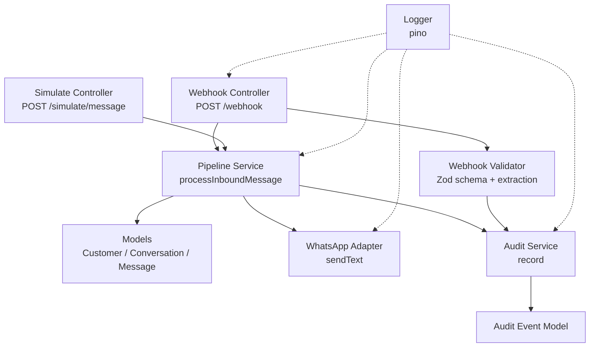
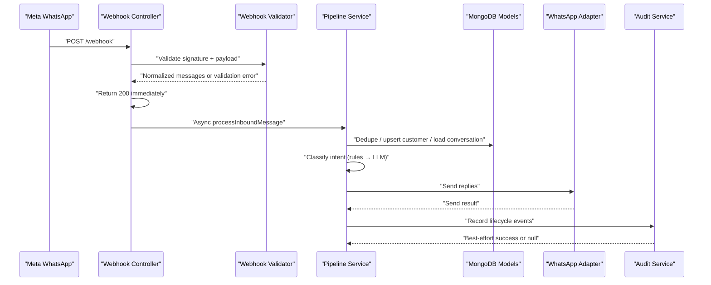
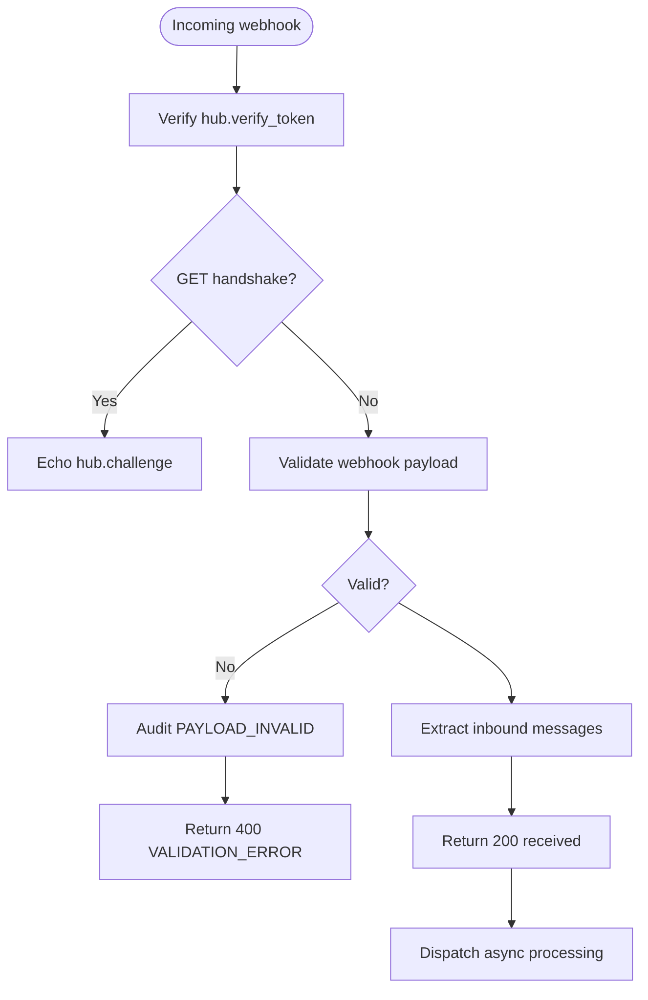
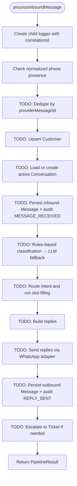
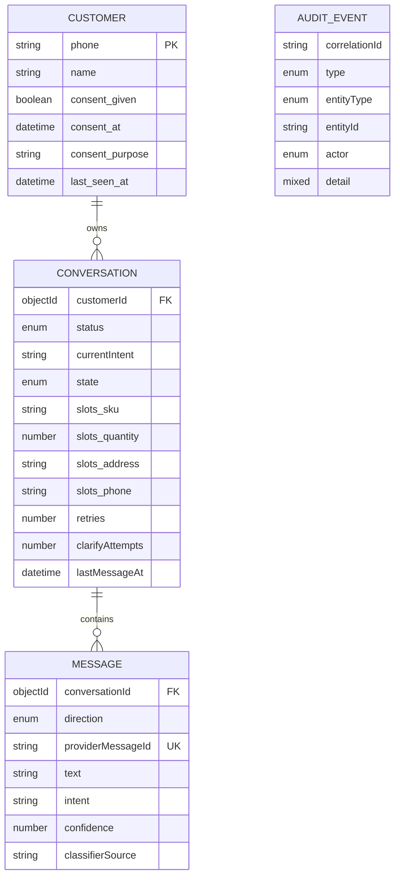
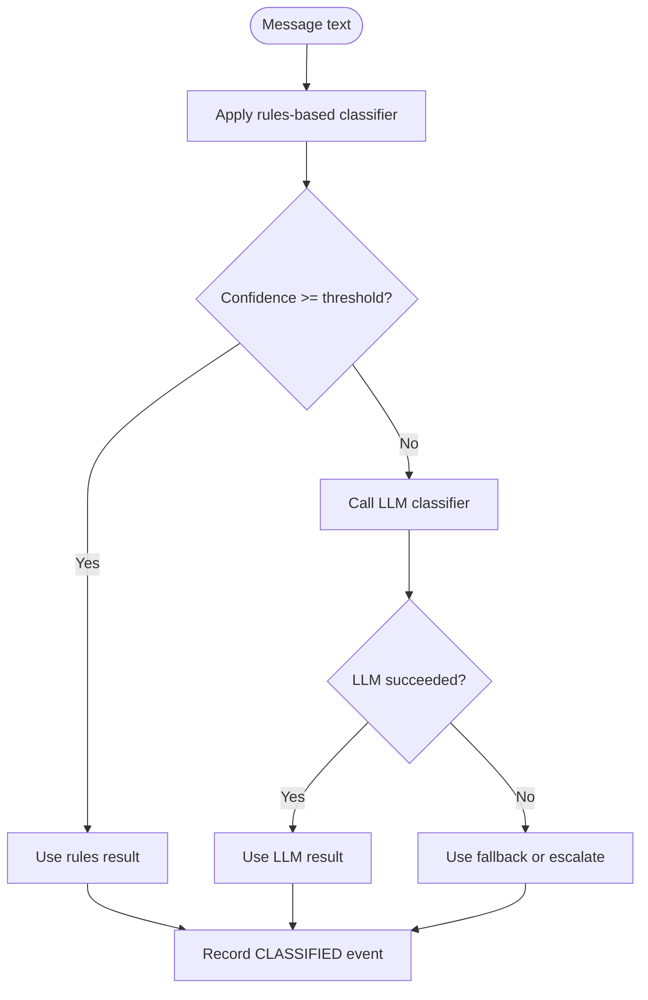
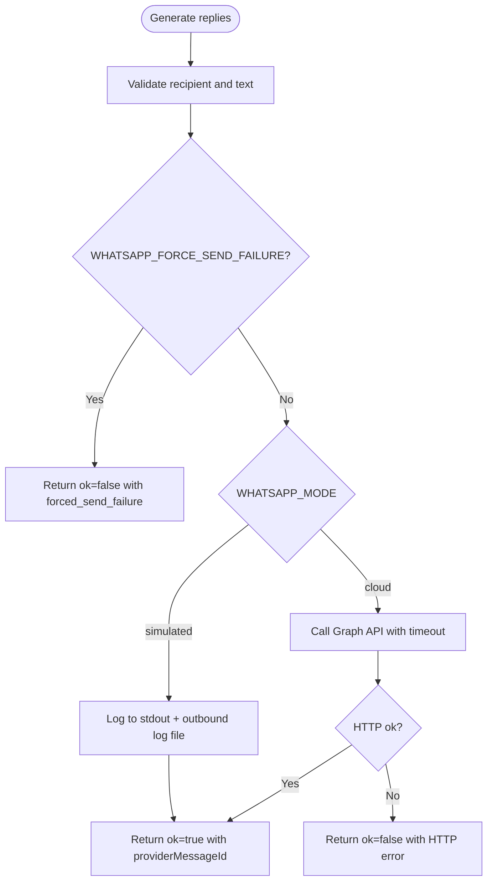
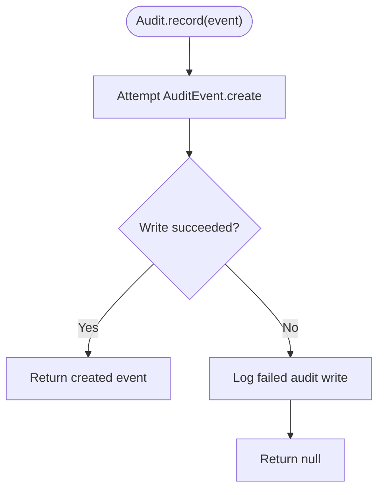
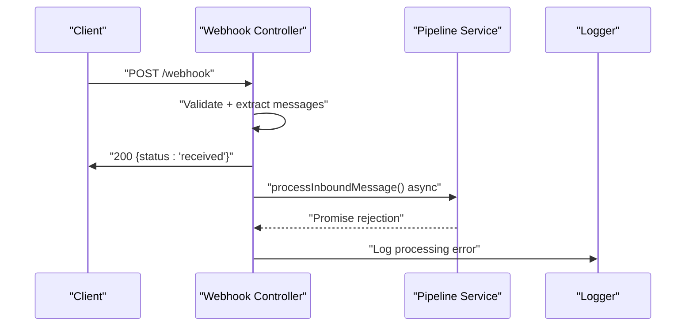
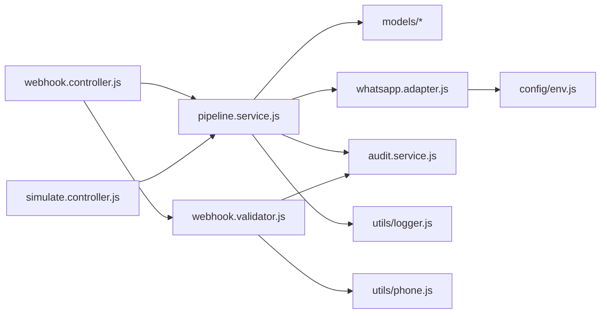

# Message Processing Pipeline

<cite>
**Referenced Files in This Document**
- [pipeline.service.js](file://src/services/pipeline.service.js)
- [webhook.controller.js](file://src/controllers/webhook.controller.js)
- [simulate.controller.js](file://src/controllers/simulate.controller.js)
- [whatsapp.adapter.js](file://src/services/whatsapp.adapter.js)
- [audit.service.js](file://src/services/audit.service.js)
- [message.model.js](file://src/models/message.model.js)
- [customer.model.js](file://src/models/customer.model.js)
- [conversation.model.js](file://src/models/conversation.model.js)
- [auditEvent.model.js](file://src/models/auditEvent.model.js)
- [webhook.validator.js](file://src/validators/webhook.validator.js)
- [logger.js](file://src/utils/logger.js)
- [README.md](file://README.md)
</cite>

## Table of Contents
1. [Introduction](#introduction)
2. [Project Structure](#project-structure)
3. [Core Components](#core-components)
4. [Architecture Overview](#architecture-overview)
5. [Detailed Component Analysis](#detailed-component-analysis)
6. [Dependency Analysis](#dependency-analysis)
7. [Performance Considerations](#performance-considerations)
8. [Troubleshooting Guide](#troubleshooting-guide)
9. [Conclusion](#conclusion)
10. [Appendices](#appendices)

## Introduction
This document explains the message processing pipeline architecture for a WhatsApp retail automation API. The system receives inbound customer messages, validates them, and funnels them through a skeleton pipeline that is designed to support:

- Message deduplication by provider message identifier
- Customer lookup or creation
- Conversation state management and slot-filling
- Intent classification using rules first and an LLM fallback
- Response generation and outbound messaging
- Audit trail recording for compliance and debugging

At this stage, the pipeline accepts and logs inbound messages but defers most business logic to future tasks. The webhook endpoint returns immediately and processes messages asynchronously, while the simulate endpoint awaits the pipeline result for manual testing.

## Project Structure
The pipeline spans controllers, services, models, validators, and utilities:

**Diagram sources**
- [webhook.controller.js:1-56](file://src/controllers/webhook.controller.js#L1-L56)
- [simulate.controller.js:1-35](file://src/controllers/simulate.controller.js#L1-L35)
- [pipeline.service.js:1-81](file://src/services/pipeline.service.js#L1-L81)
- [whatsapp.adapter.js:1-136](file://src/services/whatsapp.adapter.js#L1-L136)
- [audit.service.js:1-36](file://src/services/audit.service.js#L1-L36)
- [message.model.js:1-35](file://src/models/message.model.js#L1-L35)
- [customer.model.js:1-28](file://src/models/customer.model.js#L1-L28)
- [conversation.model.js:1-52](file://src/models/conversation.model.js#L1-L52)
- [auditEvent.model.js:1-49](file://src/models/auditEvent.model.js#L1-L49)
- [webhook.validator.js:1-124](file://src/validators/webhook.validator.js#L1-L124)
- [logger.js:1-34](file://src/utils/logger.js#L1-L34)

**Section sources**
- [README.md:36-47](file://README.md#L36-L47)
- [README.md:364-384](file://README.md#L364-L384)

## Core Components
The core components form a layered pipeline:

| Component | Responsibility | Current State |
|---|---|---|
| Webhook controller | Validates signature, verifies handshake, acknowledges Meta quickly, and dispatches messages asynchronously | Implemented |
| Webhook validator | Normalizes Meta payload into a pipeline-friendly shape and audits invalid payloads | Implemented |
| Pipeline service | Central entry point for message processing; currently returns a documented skeleton result | Skeleton implemented |
| Models | Define immutable conversation messages, customers, conversations, and audit events | Implemented |
| WhatsApp adapter | Sends replies via simulated logging or real Cloud API | Implemented |
| Audit service | Records append-only audit events with best-effort error handling | Implemented |
| Logger | Structured pino logger with correlation id and secret redaction | Implemented |

**Section sources**
- [webhook.controller.js:1-56](file://src/controllers/webhook.controller.js#L1-L56)
- [webhook.validator.js:1-124](file://src/validators/webhook.validator.js#L1-L124)
- [pipeline.service.js:1-81](file://src/services/pipeline.service.js#L1-L81)
- [message.model.js:1-35](file://src/models/message.model.js#L1-L35)
- [customer.model.js:1-28](file://src/models/customer.model.js#L1-L28)
- [conversation.model.js:1-52](file://src/models/conversation.model.js#L1-L52)
- [auditEvent.model.js:1-49](file://src/models/auditEvent.model.js#L1-L49)
- [whatsapp.adapter.js:1-136](file://src/services/whatsapp.adapter.js#L1-L136)
- [audit.service.js:1-36](file://src/services/audit.service.js#L1-L36)
- [logger.js:1-34](file://src/utils/logger.js#L1-L34)

## Architecture Overview
The pipeline follows a clear ingestion-to-response flow, even though many stages are placeholders today:

**Diagram sources**
- [webhook.controller.js:27-55](file://src/controllers/webhook.controller.js#L27-L55)
- [webhook.validator.js:97-124](file://src/validators/webhook.validator.js#L97-L124)
- [pipeline.service.js:32-80](file://src/services/pipeline.service.js#L32-L80)
- [whatsapp.adapter.js:106-135](file://src/services/whatsapp.adapter.js#L106-L135)
- [audit.service.js:21-35](file://src/services/audit.service.js#L21-L35)

## Detailed Component Analysis

### Ingestion Layer: Webhook Controller and Validator
The webhook controller handles two responsibilities:

1. **Handshake verification**: Echoes the challenge when the verify token matches.
2. **Message reception**: Returns `200` immediately, then processes each normalized message asynchronously. This prevents retry storms from causing cascading failures.

The webhook validator uses Zod to validate the Meta payload structure, extracts inbound messages, normalizes phone numbers, and records `PAYLOAD_INVALID` audit events for malformed requests.

**Diagram sources**
- [webhook.controller.js:5-25](file://src/controllers/webhook.controller.js#L5-L25)
- [webhook.controller.js:27-55](file://src/controllers/webhook.controller.js#L27-L55)
- [webhook.validator.js:53-124](file://src/validators/webhook.validator.js#L53-L124)

**Section sources**
- [webhook.controller.js:5-55](file://src/controllers/webhook.controller.js#L5-L55)
- [webhook.validator.js:1-124](file://src/validators/webhook.validator.js#L1-L124)

### Pipeline Entry Point: `processInboundMessage`
The pipeline service defines the contract for processing a single normalized inbound message. It creates a structured log child with correlation id, source, message id, and optional LLM failure flags. The current implementation returns a documented result object with fields for duplicate detection, intent, confidence, classifier source, replies, conversation metadata, ticket id, and order id.

Key design points:

- The function is asynchronous and typed via JSDoc typedefs.
- Missing phone numbers are logged as warnings because slot-filling may need to ask for them later.
- TODO comments map directly to workplan tasks for dedupe, customer/conversation persistence, audit, classification, routing, reply sending, escalation, and ticketing.

**Diagram sources**
- [pipeline.service.js:3-80](file://src/services/pipeline.service.js#L3-L80)

**Section sources**
- [pipeline.service.js:1-81](file://src/services/pipeline.service.js#L1-L81)

### Data Models and Lifecycle
The data model layer provides the backbone for message lifecycle tracking:

| Model | Purpose | Important Fields |
|---|---|---|
| `Message` | Immutable conversation message | `conversationId`, `direction`, `providerMessageId`, `text`, `intent`, `confidence`, `classifierSource` |
| `Customer` | WhatsApp customer keyed by E.164 phone | `phone`, `name`, `consent.given`, `consent.at`, `consent.purpose`, `lastSeenAt` |
| `Conversation` | Rolling per-customer conversation state | `customerId`, `status`, `currentIntent`, `state`, `slots`, `retries`, `clarifyAttempts`, `lastMessageAt` |
| `AuditEvent` | Append-only audit trail | `correlationId`, `type`, `entityType`, `entityId`, `actor`, `detail` |

The `Message` model includes a unique index on `providerMessageId`, which acts as the deduplication backstop for webhook retries. The `Conversation` model defines states such as `IDLE`, `COLLECT_ITEM`, `CONFIRM`, `COMPLETED`, and `ESCALATED`, driving slot-filling behavior.

**Diagram sources**
- [customer.model.js:1-28](file://src/models/customer.model.js#L1-L28)
- [conversation.model.js:1-52](file://src/models/conversation.model.js#L1-L52)
- [message.model.js:1-35](file://src/models/message.model.js#L1-L35)
- [auditEvent.model.js:1-49](file://src/models/auditEvent.model.js#L1-L49)

**Section sources**
- [message.model.js:1-35](file://src/models/message.model.js#L1-L35)
- [customer.model.js:1-28](file://src/models/customer.model.js#L1-L28)
- [conversation.model.js:1-52](file://src/models/conversation.model.js#L1-L52)
- [auditEvent.model.js:1-49](file://src/models/auditEvent.model.js#L1-L49)

### Classification Strategy: Rules-Based First, LLM Fallback
The pipeline documentation indicates a two-stage classification strategy:

1. **Rules-based classification**: Deterministic intent matching based on message content.
2. **LLM-enhanced fallback**: When rules are unsure or insufficient, an LLM call is attempted with configurable timeout and confidence threshold.

Configuration supports providers such as Gemini, Groq, and Ollama, with `LLM_PROVIDER=none` enabling fully functional rules-only operation. The `forceLlmFailure` option allows tests to exercise the fallback path without external LLM dependencies.

**Diagram sources**
- [pipeline.service.js:60-69](file://src/services/pipeline.service.js#L60-L69)
- [README.md:245-261](file://README.md#L245-L261)
- [README.md:184-191](file://README.md#L184-L191)

**Section sources**
- [pipeline.service.js:60-69](file://src/services/pipeline.service.js#L60-L69)
- [README.md:184-191](file://README.md#L184-L191)
- [README.md:245-261](file://README.md#L245-L261)

### Response Generation and Outbound Messaging
Response generation is intended to occur after intent routing and slot-filling. Replies are sent through the WhatsApp adapter, which supports:

- **Simulated mode**: Logs outbound messages to stdout and a JSON lines file.
- **Cloud mode**: Sends real messages through the Meta WhatsApp Cloud API.

The adapter never throws; it resolves to a result object containing `ok`, `mode`, `providerMessageId`, and `error`. This design enables callers to implement retry and failure handling safely.

**Diagram sources**
- [whatsapp.adapter.js:43-135](file://src/services/whatsapp.adapter.js#L43-L135)

**Section sources**
- [whatsapp.adapter.js:1-136](file://src/services/whatsapp.adapter.js#L1-L136)

### Audit Trail Integration
The audit service provides best-effort append-only audit recording. Failures do not break the live message path; instead, they are logged and the function returns `null`. Audit events carry correlation ids, entity types, entity ids, actors, and structured details.

Planned audit events include:

- `MESSAGE_RECEIVED`
- `DUPLICATE_IGNORED`
- `CLASSIFIED`
- `CLASSIFIER_FALLBACK`
- `REPLY_SENT`
- `ORDER_CREATED`
- `ORDER_UPDATED`
- `TICKET_CREATED`
- `TICKET_UPDATED`
- `NOTIFICATION_SENT`
- `NOTIFICATION_FAILED`
- `WEBHOOK_REJECTED`
- `PAYLOAD_INVALID`
- `VALIDATION_FAILED`

**Diagram sources**
- [audit.service.js:1-36](file://src/services/audit.service.js#L1-L36)
- [auditEvent.model.js:1-49](file://src/models/auditEvent.model.js#L1-L49)

**Section sources**
- [audit.service.js:1-36](file://src/services/audit.service.js#L1-L36)
- [auditEvent.model.js:1-49](file://src/models/auditEvent.model.js#L1-L49)

### Async Processing Model and Error Handling
The webhook controller demonstrates the recommended async pattern:

1. Validate and normalize the request.
2. Respond with `200` immediately.
3. Process messages asynchronously.
4. Catch and log processing errors so a crash does not trigger webhook retry storms.

The simulate controller awaits the pipeline result and returns the full response shape, making it suitable for manual testing and demo flows.

**Diagram sources**
- [webhook.controller.js:27-55](file://src/controllers/webhook.controller.js#L27-L55)
- [simulate.controller.js:1-35](file://src/controllers/simulate.controller.js#L1-L35)

**Section sources**
- [webhook.controller.js:27-55](file://src/controllers/webhook.controller.js#L27-L55)
- [simulate.controller.js:1-35](file://src/controllers/simulate.controller.js#L1-L35)

### Retry Mechanisms and Failure Paths
Retry and failure handling are intentionally separated from the fast-path acknowledgment:

- **Webhook retries**: Meta retries non-2xx responses; the pipeline relies on `providerMessageId` uniqueness to avoid duplicates once implemented.
- **WhatsApp send failures**: The adapter returns structured failure results, including forced failure for testing.
- **Audit failures**: Best-effort writes are swallowed and logged.
- **LLM failures**: The pipeline supports `forceLlmFailure` and configuration-driven timeouts and thresholds.

**Section sources**
- [webhook.controller.js:27-55](file://src/controllers/webhook.controller.js#L27-L55)
- [message.model.js:6-12](file://src/models/message.model.js#L6-L12)
- [whatsapp.adapter.js:43-135](file://src/services/whatsapp.adapter.js#L43-L135)
- [audit.service.js:4-11](file://src/services/audit.service.js#L4-L11)
- [pipeline.service.js:35-40](file://src/services/pipeline.service.js#L35-L40)

## Dependency Analysis
The pipeline has clear dependency boundaries:

**Diagram sources**
- [webhook.controller.js:1-56](file://src/controllers/webhook.controller.js#L1-L56)
- [simulate.controller.js:1-35](file://src/controllers/simulate.controller.js#L1-L35)
- [pipeline.service.js:1-81](file://src/services/pipeline.service.js#L1-L81)
- [whatsapp.adapter.js:1-136](file://src/services/whatsapp.adapter.js#L1-L136)
- [audit.service.js:1-36](file://src/services/audit.service.js#L1-L36)
- [webhook.validator.js:1-124](file://src/validators/webhook.validator.js#L1-L124)
- [logger.js:1-34](file://src/utils/logger.js#L1-L34)

**Section sources**
- [webhook.controller.js:1-56](file://src/controllers/webhook.controller.js#L1-L56)
- [pipeline.service.js:1-81](file://src/services/pipeline.service.js#L1-L81)
- [whatsapp.adapter.js:1-136](file://src/services/whatsapp.adapter.js#L1-L136)
- [audit.service.js:1-36](file://src/services/audit.service.js#L1-L36)
- [webhook.validator.js:1-124](file://src/validators/webhook.validator.js#L1-L124)

## Performance Considerations
- **Fast acknowledgment**: The webhook returns `200` immediately to avoid retry storms.
- **Asynchronous processing**: Each message is processed independently in the background.
- **Structured logging**: Pino logger reduces overhead and avoids leaking secrets.
- **Database indexes**: Unique and compound indexes support deduplication and query performance.
- **External timeouts**: WhatsApp cloud sends use an abort controller timeout to prevent hanging calls.
- **Best-effort audit**: Audit writes cannot block the main path.

[No sources needed since this section provides general guidance]

## Troubleshooting Guide
Common issues and their relationship to the pipeline:

| Symptom | Likely Cause | Recommended Action |
|---|---|---|
| Webhook returns `401 Invalid webhook signature` | `WHATSAPP_APP_SECRET` mismatch | Verify environment secret and signer script usage |
| Handshake returns `403` | `WHATSAPP_VERIFY_TOKEN` mismatch | Ensure Meta webhook config matches `.env` |
| `/health` returns `503 mongo: down` | MongoDB unreachable | Start MongoDB or fix `MONGODB_URI` |
| Outbound messages not appearing | Simulated vs cloud mode confusion | Check `WHATSAPP_MODE` and outbound log file |
| LLM classification not used | `LLM_PROVIDER=none` or missing keys | Configure provider, key, model, and timeout |
| Audit events missing | Audit write failure | Check logs for audit write errors; remember writes are best-effort |

**Section sources**
- [README.md:409-420](file://README.md#L409-L420)
- [audit.service.js:29-35](file://src/services/audit.service.js#L29-L35)
- [whatsapp.adapter.js:60-104](file://src/services/whatsapp.adapter.js#L60-L104)

## Conclusion
The message processing pipeline is architected around a robust ingestion layer, a clearly defined skeleton processing function, and resilient integration points for database persistence, classification, outbound messaging, and audit recording. While much of the business logic is deferred to future tasks, the current code establishes strong contracts for deduplication, customer and conversation state, intent classification, reply delivery, and compliance tracking. Extending the pipeline involves implementing the documented TODO stages while preserving the async-first, best-effort-audit, and structured-logging principles already in place.

[No sources needed since this section summarizes without analyzing specific files]

## Appendices

### Extension Points for New Pipeline Stages
To add a new stage:

1. Extend `processInboundMessage` with a new step between existing TODO markers.
2. Persist relevant state through the appropriate Mongoose model.
3. Emit audit events through `audit.service.record`.
4. If outbound communication is required, use `whatsapp.adapter.sendText`.
5. Update the `PipelineResult` typedef and response mapping where applicable.
6. Add tests using the simulate endpoint to validate end-to-end behavior.

**Section sources**
- [pipeline.service.js:60-79](file://src/services/pipeline.service.js#L60-L79)
- [simulate.controller.js:12-34](file://src/controllers/simulate.controller.js#L12-L34)