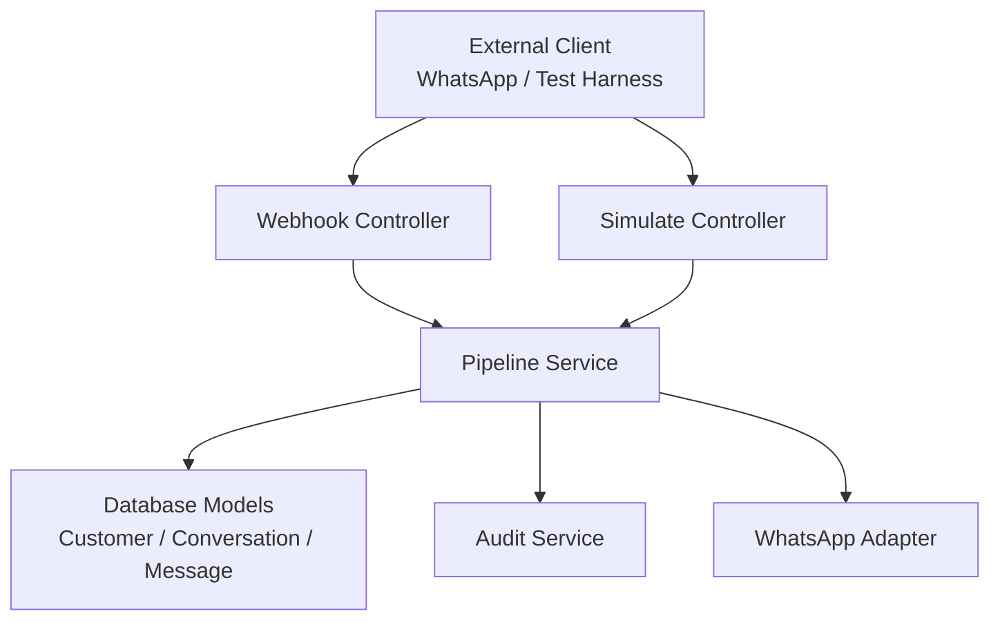
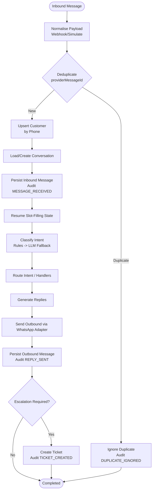
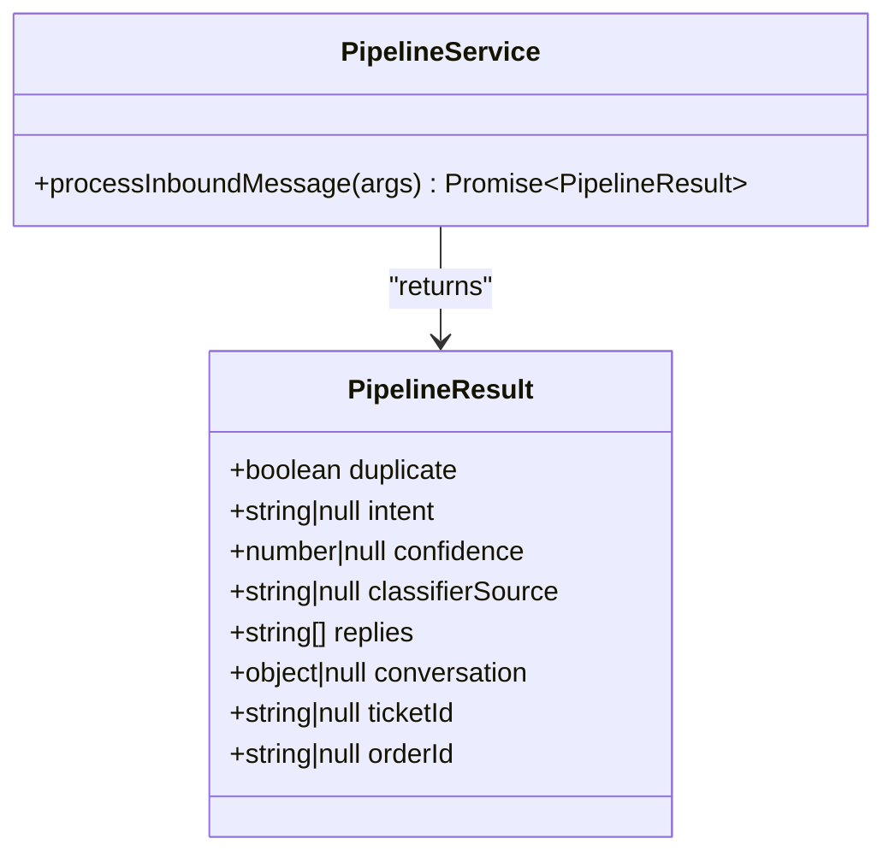
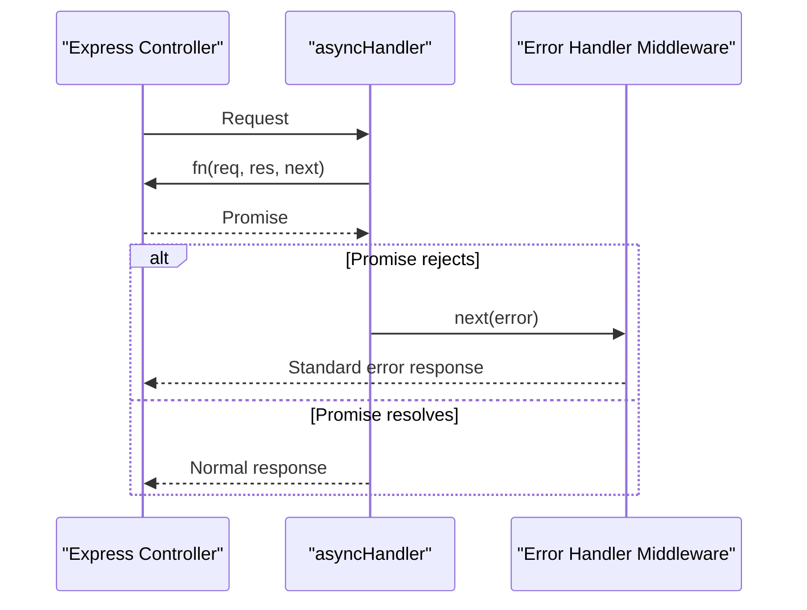
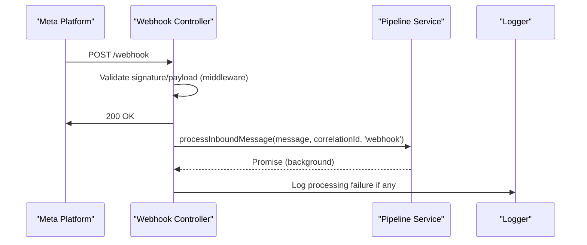
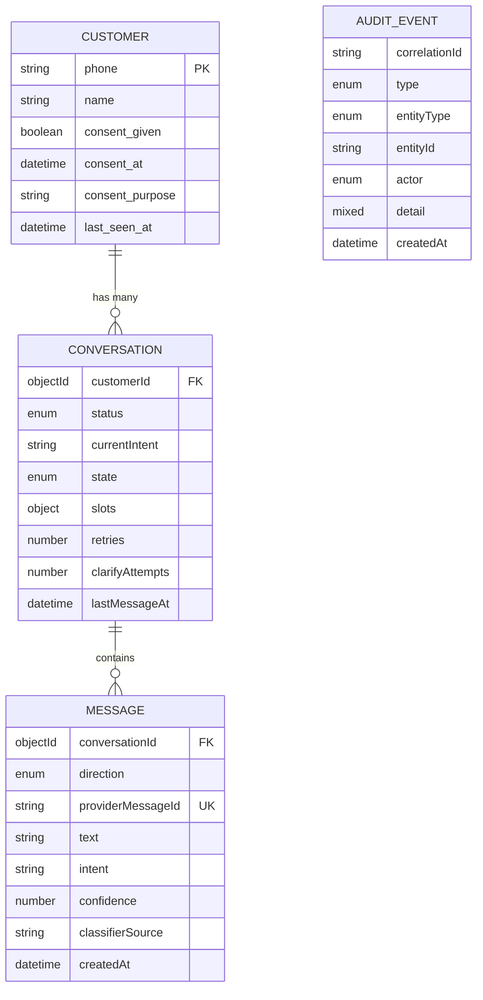
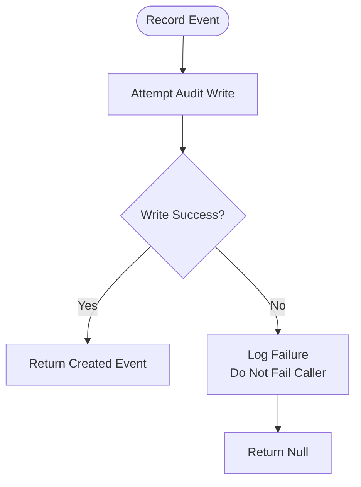
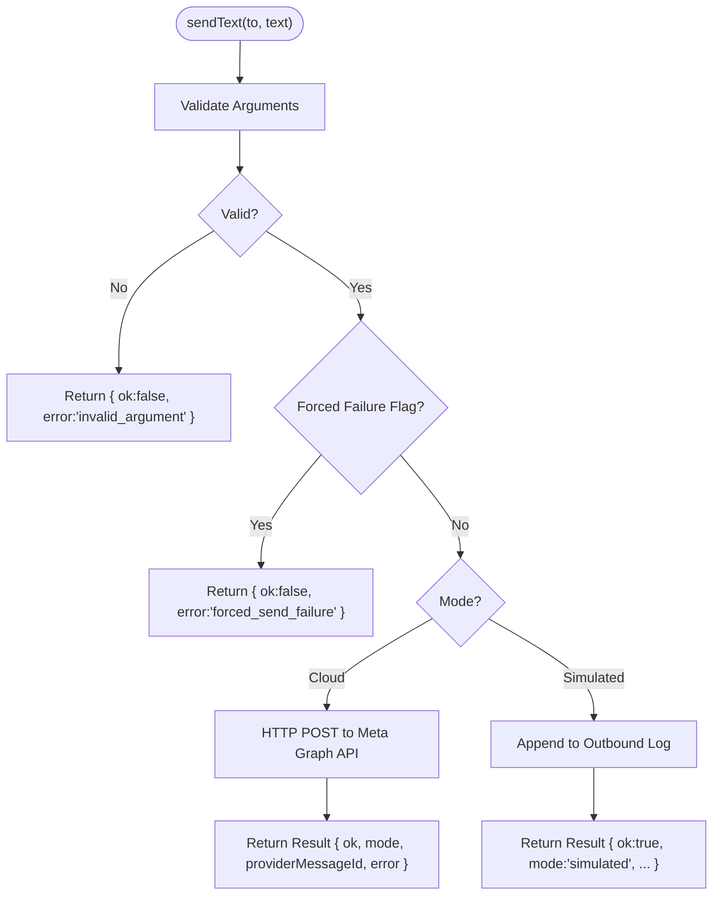
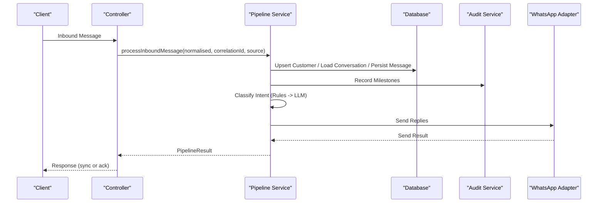
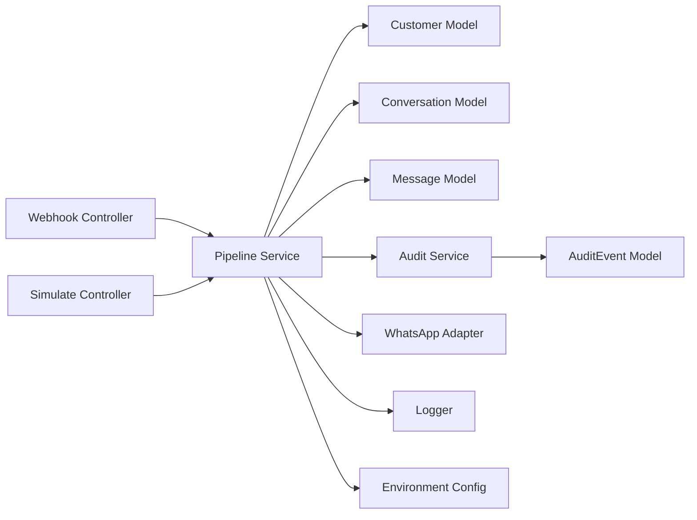

# Pipeline Architecture and Flow

<cite>
**Referenced Files in This Document**
- [pipeline.service.js](file://src/services/pipeline.service.js)
- [asyncHandler.js](file://src/utils/asyncHandler.js)
- [webhook.controller.js](file://src/controllers/webhook.controller.js)
- [simulate.controller.js](file://src/controllers/simulate.controller.js)
- [message.model.js](file://src/models/message.model.js)
- [conversation.model.js](file://src/models/conversation.model.js)
- [customer.model.js](file://src/models/customer.model.js)
- [auditEvent.model.js](file://src/models/auditEvent.model.js)
- [audit.service.js](file://src/services/audit.service.js)
- [whatsapp.adapter.js](file://src/services/whatsapp.adapter.js)
- [logger.js](file://src/utils/logger.js)
- [env.js](file://src/config/env.js)
- [errorHandler.js](file://src/middleware/errorHandler.js)
</cite>

## Table of Contents
1. [Introduction](#introduction)
2. [Project Structure](#project-structure)
3. [Core Components](#core-components)
4. [Architecture Overview](#architecture-overview)
5. [Detailed Component Analysis](#detailed-component-analysis)
6. [Dependency Analysis](#dependency-analysis)
7. [Performance Considerations](#performance-considerations)
8. [Troubleshooting Guide](#troubleshooting-guide)
9. [Conclusion](#conclusion)

## Introduction
This document explains the pipeline architecture and message flow for the lead system manager. The system is designed around a single processing entry point that normalises inbound messages and routes them through a staged pipeline. The current codebase provides a skeleton implementation with explicit TODOs for each stage: deduplication, customer lookup/upsert, conversation state management, intent classification, response generation, outbound delivery, and audit trail recording.

The pipeline is intentionally extensible: new stages can be added by composing additional steps around the central processor without changing controller logic. Error handling is layered: Express-level promise rejections are caught by an async wrapper, webhook errors are swallowed to avoid retry storms, and audit writes are best-effort so they cannot break the live path.

## Project Structure
At runtime, inbound messages arrive via two entry points:
- Webhook endpoint: returns 200 immediately and processes messages asynchronously.
- Simulate endpoint: awaits pipeline execution and returns the result synchronously.

Both endpoints funnel into the same pipeline service, which is the single place where future workplan tasks will be implemented.

**Diagram sources**
- [webhook.controller.js:35-55](file://src/controllers/webhook.controller.js#L35-L55)
- [simulate.controller.js:12-34](file://src/controllers/simulate.controller.js#L12-L34)
- [pipeline.service.js:42-80](file://src/services/pipeline.service.js#L42-L80)
- [audit.service.js:21-35](file://src/services/audit.service.js#L21-L35)
- [whatsapp.adapter.js:113-135](file://src/services/whatsapp.adapter.js#L113-L135)

**Section sources**
- [webhook.controller.js:27-55](file://src/controllers/webhook.controller.js#L27-L55)
- [simulate.controller.js:4-34](file://src/controllers/simulate.controller.js#L4-L34)
- [pipeline.service.js:3-20](file://src/services/pipeline.service.js#L3-L20)

## Core Components
- Pipeline service: orchestrates the end-to-end processing of a normalised inbound message. It currently returns a skeleton result and documents the planned stages as TODOs.
- Async handler: wraps Express handlers so rejected promises are forwarded to the global error handler.
- Webhook controller: validates Meta verification, accepts incoming WhatsApp messages, responds quickly, and processes messages in the background.
- Simulate controller: synchronous test harness that awaits pipeline results.
- Data models: Customer, Conversation, Message, and AuditEvent define the domain schema and constraints used by the pipeline.
- Audit service: appends audit events; failures are logged but do not fail the caller.
- WhatsApp adapter: sends replies either to the real Meta Cloud API or simulates sending by logging to a file.
- Logger and environment: structured logging with redaction and validated configuration.

**Section sources**
- [pipeline.service.js:32-80](file://src/services/pipeline.service.js#L32-L80)
- [asyncHandler.js:1-11](file://src/utils/asyncHandler.js#L1-L11)
- [webhook.controller.js:5-55](file://src/controllers/webhook.controller.js#L5-L55)
- [simulate.controller.js:4-34](file://src/controllers/simulate.controller.js#L4-L34)
- [customer.model.js:1-28](file://src/models/customer.model.js#L1-L28)
- [conversation.model.js:1-52](file://src/models/conversation.model.js#L1-L52)
- [message.model.js:1-35](file://src/models/message.model.js#L1-L35)
- [auditEvent.model.js:1-49](file://src/models/auditEvent.model.js#L1-L49)
- [audit.service.js:1-36](file://src/services/audit.service.js#L1-L36)
- [whatsapp.adapter.js:9-135](file://src/services/whatsapp.adapter.js#L9-L135)
- [logger.js:1-34](file://src/utils/logger.js#L1-L34)
- [env.js:25-127](file://src/config/env.js#L25-L127)

## Architecture Overview
The pipeline follows a skeleton method pattern: the pipeline service defines the overall process shape and leaves concrete steps as TODOs. Each future task (T-006 through T-014) plugs into one place, ensuring consistent behaviour across webhook and simulate flows.

**Diagram sources**
- [pipeline.service.js:3-20](file://src/services/pipeline.service.js#L3-L20)
- [message.model.js:6-12](file://src/models/message.model.js#L6-L12)
- [conversation.model.js:18-45](file://src/models/conversation.model.js#L18-L45)
- [auditEvent.model.js:3-18](file://src/models/auditEvent.model.js#L3-L18)
- [whatsapp.adapter.js:106-135](file://src/services/whatsapp.adapter.js#L106-L135)

## Detailed Component Analysis

### Pipeline Service: Skeleton Method Pattern
The pipeline service exposes a single function that accepts a normalised message, correlation ID, source, and optional flags. It logs context, acknowledges missing phone numbers, and returns a typed result object describing duplicate status, classification metadata, replies, conversation snapshot, ticket/order IDs.

Key responsibilities:
- Central orchestration point for all inbound messages.
- Logging with correlation context.
- Explicit TODOs mapping to workplan tasks for each stage.
- Typed return contract consumed by the simulate controller.

**Diagram sources**
- [pipeline.service.js:21-40](file://src/services/pipeline.service.js#L21-L40)
- [pipeline.service.js:42-80](file://src/services/pipeline.service.js#L42-L80)

**Section sources**
- [pipeline.service.js:3-20](file://src/services/pipeline.service.js#L3-L20)
- [pipeline.service.js:32-80](file://src/services/pipeline.service.js#L32-L80)

### Async Handler Utility
The async handler wraps Express handlers so that rejected promises are caught and passed to the next middleware, typically the global error handler. This is essential because Express 4 does not automatically catch async errors.

Usage patterns:
- Simulate controller uses it to await pipeline execution and return structured results.
- Any other controller should wrap async handlers to ensure consistent error propagation.

**Diagram sources**
- [asyncHandler.js:1-11](file://src/utils/asyncHandler.js#L1-L11)
- [errorHandler.js:16-79](file://src/middleware/errorHandler.js#L16-L79)

**Section sources**
- [asyncHandler.js:1-11](file://src/utils/asyncHandler.js#L1-L11)
- [simulate.controller.js:12-34](file://src/controllers/simulate.controller.js#L12-L34)
- [errorHandler.js:11-79](file://src/middleware/errorHandler.js#L11-L79)

### Webhook Controller: Fast Acknowledgement and Background Processing
The webhook controller performs:
- Meta verification handshake using verify token.
- Immediate 200 response for incoming messages to prevent retry storms.
- Iterating over messages and invoking the pipeline asynchronously.
- Catching pipeline errors and logging them without failing the request.

**Diagram sources**
- [webhook.controller.js:5-25](file://src/controllers/webhook.controller.js#L5-L25)
- [webhook.controller.js:27-55](file://src/controllers/webhook.controller.js#L27-L55)

**Section sources**
- [webhook.controller.js:5-55](file://src/controllers/webhook.controller.js#L5-L55)

### Simulate Controller: Synchronous Test Harness
The simulate controller awaits pipeline execution and returns the full result structure, making it ideal for manual testing and demos. It forwards options such as forcing LLM failure to exercise fallback paths.

**Section sources**
- [simulate.controller.js:4-34](file://src/controllers/simulate.controller.js#L4-L34)
- [pipeline.service.js:35-40](file://src/services/pipeline.service.js#L35-L40)

### Data Models and Constraints
- Customer: keyed by E.164 phone number; includes consent tracking and last seen timestamp.
- Conversation: rolling per customer; state machine drives slot-filling; tracks retries and clarify attempts.
- Message: immutable record of inbound/outbound messages; unique index on providerMessageId enforces deduplication at the database level.
- AuditEvent: append-only trail with event types, entity references, actor, and detail payload.

**Diagram sources**
- [customer.model.js:7-24](file://src/models/customer.model.js#L7-L24)
- [conversation.model.js:23-45](file://src/models/conversation.model.js#L23-L45)
- [message.model.js:13-31](file://src/models/message.model.js#L13-L31)
- [auditEvent.model.js:31-44](file://src/models/auditEvent.model.js#L31-L44)

**Section sources**
- [customer.model.js:1-28](file://src/models/customer.model.js#L1-L28)
- [conversation.model.js:1-52](file://src/models/conversation.model.js#L1-L52)
- [message.model.js:1-35](file://src/models/message.model.js#L1-L35)
- [auditEvent.model.js:1-49](file://src/models/auditEvent.model.js#L1-L49)

### Audit Service: Best-Effort Trail
The audit service records events with correlation context and swallows write failures so that audit issues never impact the live message path. Future pipeline stages should call this service for key milestones.

**Diagram sources**
- [audit.service.js:21-35](file://src/services/audit.service.js#L21-L35)

**Section sources**
- [audit.service.js:1-36](file://src/services/audit.service.js#L1-L36)

### WhatsApp Adapter: Outbound Delivery
The adapter supports two modes:
- Simulated mode: logs outbound messages to stdout and a JSON lines file.
- Cloud mode: calls the Meta WhatsApp Cloud API with timeout and error handling.

It guarantees sendText never throws and returns a result object indicating success, mode, providerMessageId, and error details.

**Diagram sources**
- [whatsapp.adapter.js:47-58](file://src/services/whatsapp.adapter.js#L47-L58)
- [whatsapp.adapter.js:60-104](file://src/services/whatsapp.adapter.js#L60-L104)
- [whatsapp.adapter.js:113-135](file://src/services/whatsapp.adapter.js#L113-L135)

**Section sources**
- [whatsapp.adapter.js:9-135](file://src/services/whatsapp.adapter.js#L9-L135)

### Execution Flow Diagram
End-to-end flow from inbound message to pipeline result:

**Diagram sources**
- [webhook.controller.js:35-55](file://src/controllers/webhook.controller.js#L35-L55)
- [simulate.controller.js:12-34](file://src/controllers/simulate.controller.js#L12-L34)
- [pipeline.service.js:42-80](file://src/services/pipeline.service.js#L42-L80)
- [audit.service.js:21-35](file://src/services/audit.service.js#L21-L35)
- [whatsapp.adapter.js:113-135](file://src/services/whatsapp.adapter.js#L113-L135)

## Dependency Analysis
The pipeline depends on:
- Controllers for ingress (webhook/simulate).
- Models for persistence and constraints.
- Audit service for observability.
- WhatsApp adapter for outbound delivery.
- Logger and env for configuration and structured logging.

**Diagram sources**
- [webhook.controller.js:1-55](file://src/controllers/webhook.controller.js#L1-L55)
- [simulate.controller.js:1-34](file://src/controllers/simulate.controller.js#L1-L34)
- [pipeline.service.js:1-80](file://src/services/pipeline.service.js#L1-L80)
- [audit.service.js:1-36](file://src/services/audit.service.js#L1-L36)
- [whatsapp.adapter.js:1-135](file://src/services/whatsapp.adapter.js#L1-L135)
- [logger.js:1-34](file://src/utils/logger.js#L1-L34)
- [env.js:1-130](file://src/config/env.js#L1-L130)

**Section sources**
- [pipeline.service.js:1-80](file://src/services/pipeline.service.js#L1-L80)
- [audit.service.js:1-36](file://src/services/audit.service.js#L1-L36)
- [whatsapp.adapter.js:1-135](file://src/services/whatsapp.adapter.js#L1-L135)

## Performance Considerations
- Fast acknowledgement: The webhook returns 200 immediately to avoid retry storms; processing happens in the background.
- Database deduplication: Unique index on providerMessageId ensures idempotency even under retries.
- Best-effort audit: Audit writes are isolated from the critical path to prevent latency spikes from affecting message processing.
- Outbound timeouts: WhatsApp cloud sends use a configurable timeout to bound external dependency latency.
- Structured logging: Pino logger with redaction avoids leaking secrets while providing correlation context for tracing.

Optimization opportunities:
- Parallelize independent operations within the pipeline (e.g., persisting inbound message and writing audit events concurrently).
- Batch outbound replies when multiple responses are generated for a single message.
- Cache frequently accessed customer/conversation data during high-throughput periods.
- Introduce backpressure and queueing for webhook bursts to protect downstream services.

[No sources needed since this section provides general guidance]

## Troubleshooting Guide
Common issues and resolution strategies:
- Webhook handshake failures: Verify token mismatch leads to 403; check environment variables for WHATSAPP_VERIFY_TOKEN.
- Validation errors: Zod and Mongoose validation errors are mapped to standard error responses with details.
- Duplicate keys: Duplicate providerMessageId triggers a validation error; ensure deduplication logic persists before sending replies.
- Audit write failures: Logged but do not fail the caller; investigate storage issues separately.
- WhatsApp send failures: Adapter returns structured error; implement retry/failure handling based on ok flag and error field.

Monitoring points:
- Correlation ID: Propagated through controllers, pipeline, and audit events for end-to-end tracing.
- Log levels: Controlled via LOG_LEVEL; adjust for development vs production.
- Outbound log file: Simulated mode writes to logs/whatsapp-outbound.log for review.

**Section sources**
- [webhook.controller.js:10-25](file://src/controllers/webhook.controller.js#L10-L25)
- [errorHandler.js:16-79](file://src/middleware/errorHandler.js#L16-L79)
- [message.model.js:6-12](file://src/models/message.model.js#L6-L12)
- [audit.service.js:21-35](file://src/services/audit.service.js#L21-L35)
- [whatsapp.adapter.js:60-104](file://src/services/whatsapp.adapter.js#L60-L104)
- [logger.js:1-34](file://src/utils/logger.js#L1-L34)

## Conclusion
The pipeline architecture provides a clear skeleton for implementing the complete message lifecycle. By centralising processing in the pipeline service and leveraging robust error handling, audit trails, and a flexible outbound adapter, the system remains resilient and observable. As future tasks are implemented, the existing structure ensures consistency, traceability, and extensibility. Adding new stages involves composing additional steps around the central processor, maintaining the same error and audit conventions throughout.

[No sources needed since this section summarizes without analyzing specific files]