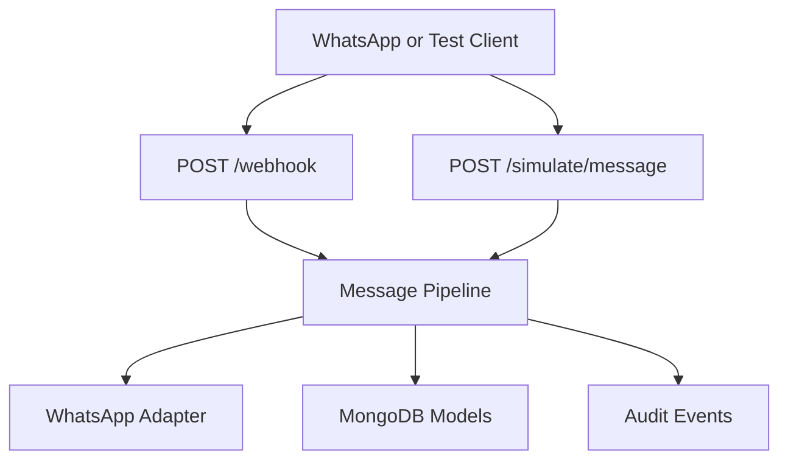
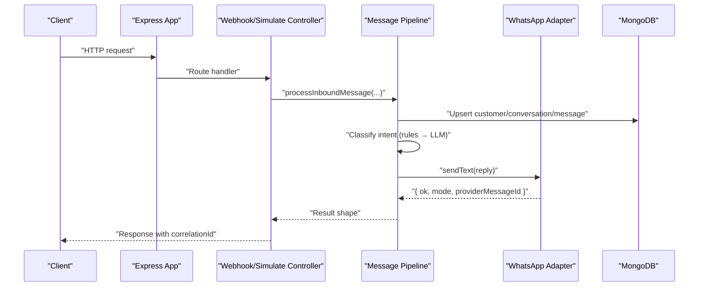
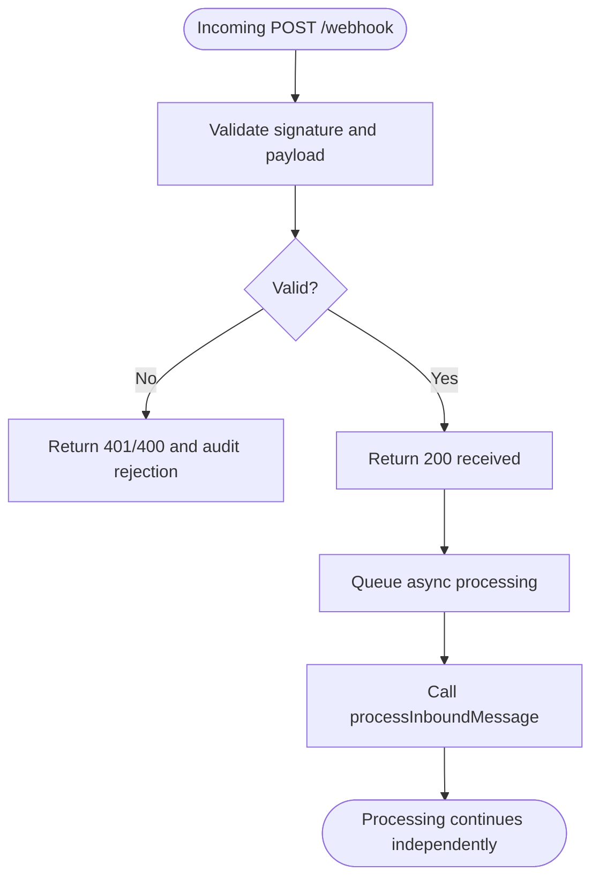
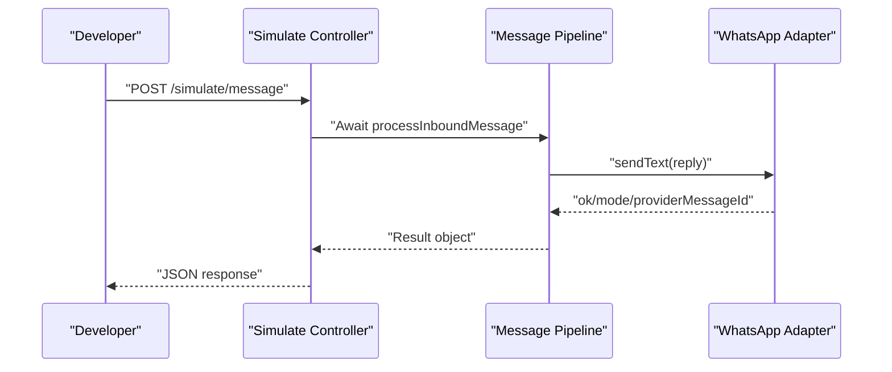
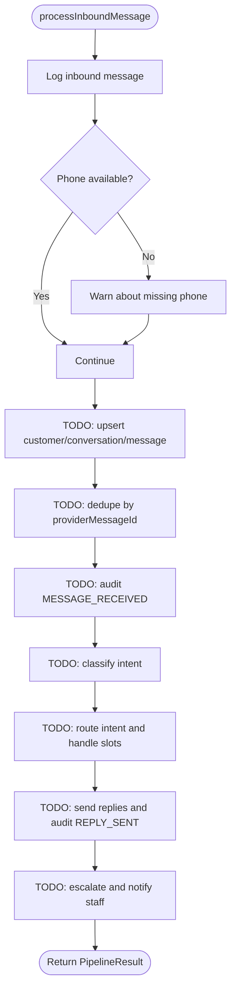
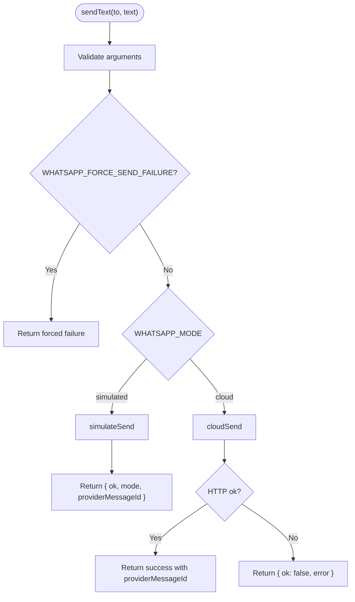
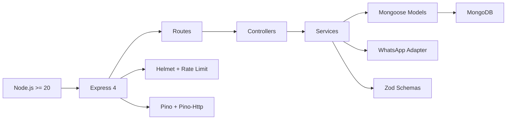

# Project Overview

<cite>
**Referenced Files in This Document**
- [README.md](file://README.md)
- [WORKPLAN.md](file://WORKPLAN.md)
- [package.json](file://package.json)
- [src/app.js](file://src/app.js)
- [src/server.js](file://src/server.js)
- [src/controllers/webhook.controller.js](file://src/controllers/webhook.controller.js)
- [src/controllers/simulate.controller.js](file://src/controllers/simulate.controller.js)
- [src/services/pipeline.service.js](file://src/services/pipeline.service.js)
- [src/services/whatsapp.adapter.js](file://src/services/whatsapp.adapter.js)
- [src/models/index.js](file://src/models/index.js)
</cite>

## Table of Contents
1. [Introduction](#introduction)
2. [Project Structure](#project-structure)
3. [Core Components](#core-components)
4. [Architecture Overview](#architecture-overview)
5. [Detailed Component Analysis](#detailed-component-analysis)
6. [Dependency Analysis](#dependency-analysis)
7. [Performance Considerations](#performance-considerations)
8. [Troubleshooting Guide](#troubleshooting-guide)
9. [Conclusion](#conclusion)

## Introduction
Lead System Manager is the backend API for Lagos Fresh Mart’s WhatsApp retail automation system. It receives customer messages, classifies their intent, answers product and pricing questions from a seeded catalogue, guides customers through order placement, tracks complaints as tickets, and records an append-only audit trail. The project is designed so that developers can run it locally without Meta credentials by default, while still supporting real WhatsApp Cloud API traffic in production.

The system targets two audiences:
- Newcomers who need to understand what the platform does for Lagos Fresh Mart.
- Experienced developers evaluating integration points such as webhook ingestion, simulated testing, message classification, order management, ticketing, and audit logging.

Business value:
- Reduces manual WhatsApp support workload.
- Provides consistent, fast replies for common retail intents.
- Captures orders and complaints with traceable audit events.
- Keeps staff informed through automated notifications.
- Offers operational visibility through health checks, structured logs, and planned metrics.

**Section sources**
- [README.md:1-13](file://README.md#L1-L13)
- [WORKPLAN.md:1-24](file://WORKPLAN.md#L1-L24)

## Project Structure
At a high level, the repository follows a layered Node.js + Express structure:
- Configuration and environment validation live under `src/config`.
- HTTP endpoints are defined in `src/routes` and handled by `src/controllers`.
- Business orchestration lives in `src/services`, including the message pipeline and WhatsApp adapter.
- Data models are Mongoose schemas under `src/models`.
- Input validation uses Zod schemas under `validators`.
- Shared utilities, middleware, and tests complete the layout.



**Diagram sources**
- [src/controllers/webhook.controller.js:35-55](file://src/controllers/webhook.controller.js#L35-L55)
- [src/controllers/simulate.controller.js:12-34](file://src/controllers/simulate.controller.js#L12-L34)
- [src/services/pipeline.service.js:42-79](file://src/services/pipeline.service.js#L42-L79)
- [src/services/whatsapp.adapter.js:113-135](file://src/services/whatsapp.adapter.js#L113-L135)
- [src/models/index.js:1-13](file://src/models/index.js#L1-L13)

Key structural notes:
- The Express application is created in `src/app.js` and started in `src/server.js`.
- The README documents the current implementation status, tech stack, configuration, quick start, API reference, and troubleshooting.
- The workplan defines the intended five intents, end-to-end flow, data model, failure handling, and roadmap tasks.

**Section sources**
- [README.md:36-58](file://README.md#L36-L58)
- [README.md:364-384](file://README.md#L364-L384)
- [WORKPLAN.md:92-153](file://WORKPLAN.md#L92-L153)

## Core Components
This section summarizes the main runtime components and responsibilities.

| Component | Responsibility | Current State |
|---|---|---|
| Express application | Middleware, security headers, rate limiting, JSON parsing, error handling | Implemented |
| Webhook controller | Meta handshake and inbound message ingestion | Implemented |
| Simulate controller | Staff-driven test harness for the full pipeline | Implemented |
| Message pipeline | Orchestrates dedupe, persistence, classification, routing, replies, escalation | Skeleton implemented; business logic is planned across sprint tasks |
| WhatsApp adapter | Sends customer replies and staff notifications in simulated or cloud mode | Implemented |
| Models | Product, customer, conversation, message, order, ticket, audit event schemas | Defined and exported |
| Validation | Zod schemas for environment variables and request payloads | Implemented |
| Logging | Pino structured logs with correlation IDs | Implemented |

Technology highlights:
- Node.js with ES modules and Express 4.
- MongoDB via Mongoose 8.
- Zod for input and environment validation.
- Pino and pino-http for structured logging.
- Helmet and express-rate-limit for HTTP hardening.
- Optional LLM providers (Gemini, Groq, Ollama) behind a classifier interface.

**Section sources**
- [src/app.js:1-75](file://src/app.js#L1-L75)
- [src/server.js:1-50](file://src/server.js#L1-L50)
- [src/controllers/webhook.controller.js:1-56](file://src/controllers/webhook.controller.js#L1-L56)
- [src/controllers/simulate.controller.js:1-35](file://src/controllers/simulate.controller.js#L1-L35)
- [src/services/pipeline.service.js:1-81](file://src/services/pipeline.service.js#L1-L81)
- [src/services/whatsapp.adapter.js:1-136](file://src/services/whatsapp.adapter.js#L1-L136)
- [src/models/index.js:1-13](file://src/models/index.js#L1-L13)
- [package.json:1-36](file://package.json#L1-L36)

## Architecture Overview
The system exposes three primary entry points:
- `GET /health`: liveness/readiness check reporting MongoDB, optional LLM, and notifier status.
- `POST /webhook`: receives WhatsApp messages from Meta after HMAC signature verification and payload validation.
- `POST /simulate/message`: developer/staff endpoint to drive the pipeline without Meta.



**Diagram sources**
- [src/app.js:15-74](file://src/app.js#L15-L74)
- [src/controllers/webhook.controller.js:35-55](file://src/controllers/webhook.controller.js#L35-L55)
- [src/controllers/simulate.controller.js:12-34](file://src/controllers/simulate.controller.js#L12-L34)
- [src/services/pipeline.service.js:42-79](file://src/services/pipeline.service.js#L42-L79)
- [src/services/whatsapp.adapter.js:113-135](file://src/services/whatsapp.adapter.js#L113-L135)

System architecture characteristics:
- Fast webhook response: the webhook returns 200 immediately and processes messages asynchronously to avoid retry storms.
- Correlation IDs: every response includes `x-correlation-id` for end-to-end tracing.
- Simulated vs production modes: the default simulated mode logs outbound messages instead of sending them; production can use the Meta Cloud API.
- Extensible pipeline: the skeleton pipeline centralizes future classification, routing, slot-filling, order creation, ticketing, and notification logic.

**Section sources**
- [README.md:399-407](file://README.md#L399-L407)
- [README.md:163-198](file://README.md#L163-L198)
- [WORKPLAN.md:92-135](file://WORKPLAN.md#L92-L135)

## Detailed Component Analysis

### Webhook Ingestion
The webhook controller supports:
- Meta verification handshake using `hub.verify_token`.
- Asynchronous processing of inbound messages after immediate 200 acknowledgment.
- Integration with the message pipeline through `processInboundMessage`.



**Diagram sources**
- [src/controllers/webhook.controller.js:10-25](file://src/controllers/webhook.controller.js#L10-L25)
- [src/controllers/webhook.controller.js:35-55](file://src/controllers/webhook.controller.js#L35-L55)

Operational implications:
- A crash during processing cannot cause Meta to retry indefinitely because the initial response is always 200.
- Deduplication and audit trails protect against duplicate or malformed webhooks.

**Section sources**
- [src/controllers/webhook.controller.js:1-56](file://src/controllers/webhook.controller.js#L1-L56)
- [WORKPLAN.md:346-383](file://WORKPLAN.md#L346-L383)

### Simulated Message Testing
The simulate controller provides a synchronous test harness:
- Accepts a normalized message object.
- Calls the same pipeline as the webhook.
- Returns the full result shape, including intent, confidence, replies, conversation state, ticket ID, and order ID once implemented.



**Diagram sources**
- [src/controllers/simulate.controller.js:12-34](file://src/controllers/simulate.controller.js#L12-L34)
- [src/services/pipeline.service.js:42-79](file://src/services/pipeline.service.js#L42-L79)
- [src/services/whatsapp.adapter.js:113-135](file://src/services/whatsapp.adapter.js#L113-L135)

Use cases:
- Manual testing without Meta.
- Demo flows for reviewers.
- Automated tests exercising classification, slot-filling, and escalation paths.

**Section sources**
- [src/controllers/simulate.controller.js:1-35](file://src/controllers/simulate.controller.js#L1-L35)
- [README.md:319-344](file://README.md#L319-L344)

### Message Pipeline
The pipeline is the central orchestrator for the message lifecycle. Its current skeleton accepts a normalized inbound message, logs context, and returns a documented result shape. Future tasks will add:
- Customer and conversation upsert.
- Deduplication by `providerMessageId`.
- Intent classification using rules first, then LLM fallback.
- Routing to intent handlers.
- Order slot-filling state machine.
- Reply sending through the WhatsApp adapter.
- Ticket creation and staff notification on escalation.



**Diagram sources**
- [src/services/pipeline.service.js:42-79](file://src/services/pipeline.service.js#L42-L79)

Complexity and design notes:
- The pipeline isolates future business logic into clearly marked TODO steps aligned with the workplan.
- Structured logging with correlation IDs makes each step observable.
- The result contract is explicit, enabling controllers to return stable shapes even while internals evolve.

**Section sources**
- [src/services/pipeline.service.js:1-81](file://src/services/pipeline.service.js#L1-L81)
- [WORKPLAN.md:92-153](file://WORKPLAN.md#L92-L153)

### WhatsApp Adapter
The adapter abstracts outbound messaging:
- Simulated mode writes to stdout and a JSON log file.
- Cloud mode calls the Meta Graph API with timeout handling.
- A forced failure flag enables testing of notification failure paths.
- The contract guarantees no thrown errors from `sendText`; callers receive `{ ok, mode, providerMessageId, error }`.



**Diagram sources**
- [src/services/whatsapp.adapter.js:47-58](file://src/services/whatsapp.adapter.js#L47-L58)
- [src/services/whatsapp.adapter.js:60-104](file://src/services/whatsapp.adapter.js#L60-L104)
- [src/services/whatsapp.adapter.js:113-135](file://src/services/whatsapp.adapter.js#L113-L135)

Integration points:
- Used for customer replies and staff notifications.
- Supports testing scenarios where notifications fail intentionally.
- Masks phone numbers in logs to reduce PII exposure.

**Section sources**
- [src/services/whatsapp.adapter.js:1-136](file://src/services/whatsapp.adapter.js#L1-L136)
- [README.md:176-183](file://README.md#L176-L183)

### Data Model and Audit Trail
The models define the core entities for the retail automation domain:
- Products: catalogue items with SKU, name, category, price, stock, and active flag.
- Customers: normalized phone, optional name, consent record, timestamps.
- Conversations: per-customer session state, intent, slot values, retries, and lifecycle status.
- Messages: inbound/outbound direction, provider message ID, intent metadata.
- Orders: line items, totals, delivery address, contact phone, status transitions.
- Tickets: complaint/refund tracking, priority, assignee, SLA-related fields.
- Audit events: append-only log of system actions with correlation IDs.

```mermaid
erDiagram
CUSTOMER ||--o{ CONVERSATION : "has"
CONVERSATION ||--o{ MESSAGE : "contains"
CONVERSATION ||--o{ ORDER : "produces"
CONVERSATION ||--o{ TICKET : "escalates_to"
PRODUCT ||--o{ ORDER : "ordered_as_item"
AUDIT_EVENT }..|| CUSTOMER : "correlates_by_id"
AUDIT_EVENT }..|| CONVERSATION : "correlates_by_id"
AUDIT_EVENT }..|| ORDER : "correlates_by_id"
AUDIT_EVENT }..|| TICKET : "correlates_by_id"
```

**Diagram sources**
- [src/models/index.js:1-13](file://src/models/index.js#L1-L13)
- [WORKPLAN.md:200-321](file://WORKPLAN.md#L200-L321)

Audit trail characteristics:
- Append-only design prevents tampering.
- Correlation IDs connect requests, messages, orders, tickets, and logs.
- Planned audit events cover message reception, classification, reply sending, order creation, ticket updates, and notification outcomes.

**Section sources**
- [WORKPLAN.md:306-321](file://WORKPLAN.md#L306-L321)
- [README.md:394-397](file://README.md#L394-L397)

## Dependency Analysis
The runtime dependencies reflect a minimal, readable stack suitable for both local development and production deployment.



**Diagram sources**
- [package.json:1-36](file://package.json#L1-L36)
- [src/app.js:1-75](file://src/app.js#L1-L75)
- [src/models/index.js:1-13](file://src/models/index.js#L1-L13)

Coupling and cohesion:
- Controllers depend on services rather than directly on databases or external APIs.
- The WhatsApp adapter encapsulates channel-specific behavior, making simulated and cloud modes interchangeable.
- Models are centralized through a single export index to keep Mongoose registration idempotent.

External integrations:
- Meta WhatsApp Cloud API when `WHATSAPP_MODE=cloud`.
- Optional LLM providers when enabled through environment configuration.
- MongoDB for persistent state.

**Section sources**
- [package.json:18-35](file://package.json#L18-L35)
- [README.md:50-58](file://README.md#L50-L58)
- [README.md:199-261](file://README.md#L199-L261)

## Performance Considerations
- Fast webhook acknowledgment reduces provider retry pressure.
- Structured logging avoids expensive string concatenation and supports efficient log searching by correlation ID.
- Rate limiting protects against abuse while remaining generous enough for provider retries.
- Simulated outbound logging avoids network overhead during development.
- Classification is designed to prefer deterministic rules before invoking potentially slow LLM calls.
- Health checks allow load balancers and orchestrators to detect degraded states early.

[No sources needed since this section provides general guidance]

## Troubleshooting Guide
Common operational issues and their resolution paths:
- Invalid environment variables at startup: compare `.env` with `.env.example`; the validator lists offending variables.
- `/health` reports MongoDB down: ensure MongoDB is reachable via `MONGODB_URI`.
- Port conflicts: change `PORT` if another process uses 3000.
- Webhook signature mismatch: verify `WHATSAPP_APP_SECRET` matches the signer.
- Handshake failures: ensure `WHATSAPP_VERIFY_TOKEN` matches between `.env` and Meta configuration.
- Intentional send failures: set `WHATSAPP_FORCE_SEND_FAILURE=true` to exercise notification failure paths.

Security and privacy considerations:
- Production rejects placeholder secrets.
- Logs mask phone numbers.
- Webhook rejections are audited without exposing raw secrets.

**Section sources**
- [README.md:409-419](file://README.md#L409-L419)
- [README.md:283-288](file://README.md#L283-L288)
- [src/app.js:54-67](file://src/app.js#L54-L67)

## Conclusion
Lead System Manager provides a focused foundation for Lagos Fresh Mart’s WhatsApp retail automation. It currently offers a robust HTTP layer, secure webhook ingestion, a simulated testing surface, a clear pipeline contract, and a well-defined data model. The next phases will implement classification, order management, ticketing, and staff notifications while preserving observability through structured logs and audit events. For newcomers, it demonstrates how a small retail operation can automate WhatsApp conversations safely and traceably. For experienced developers, it presents clean integration points for extending intents, adding channels, integrating payments or delivery partners, and scaling the pipeline with queues and workers.

[No sources needed since this section summarizes without analyzing specific files]