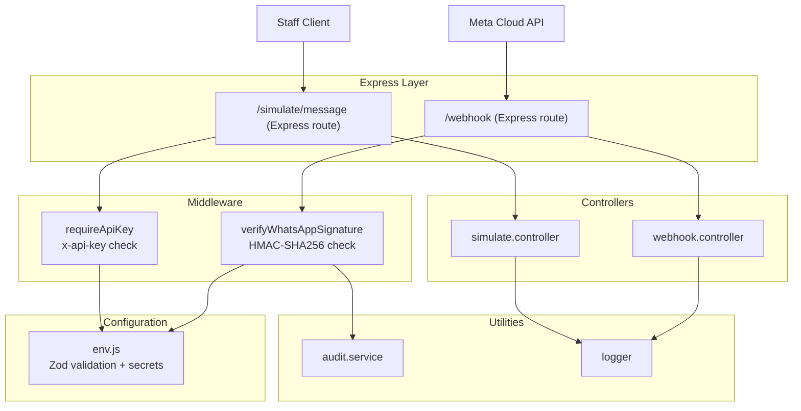
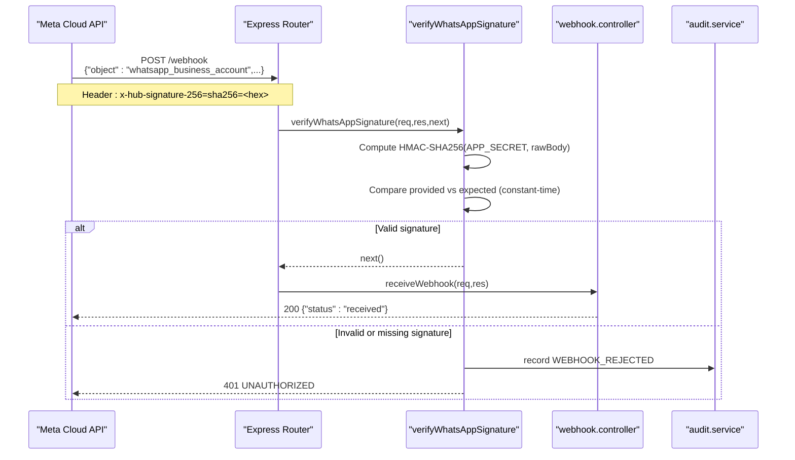
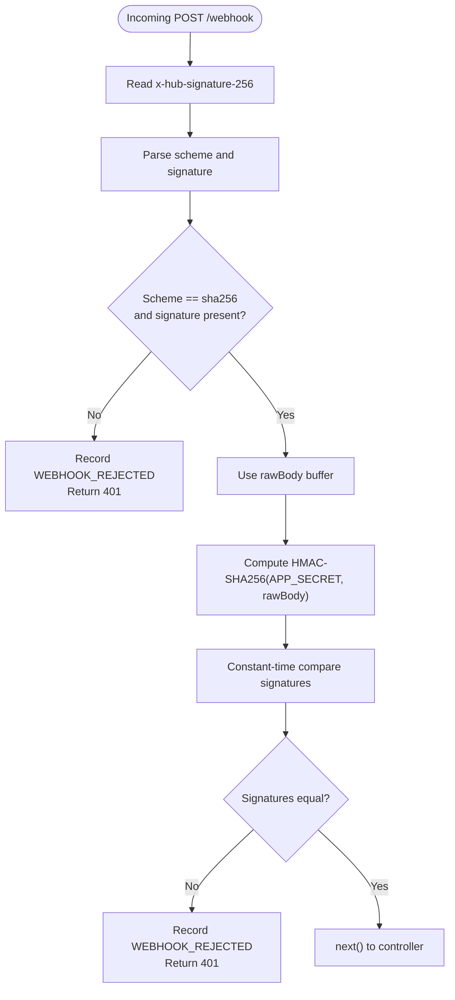
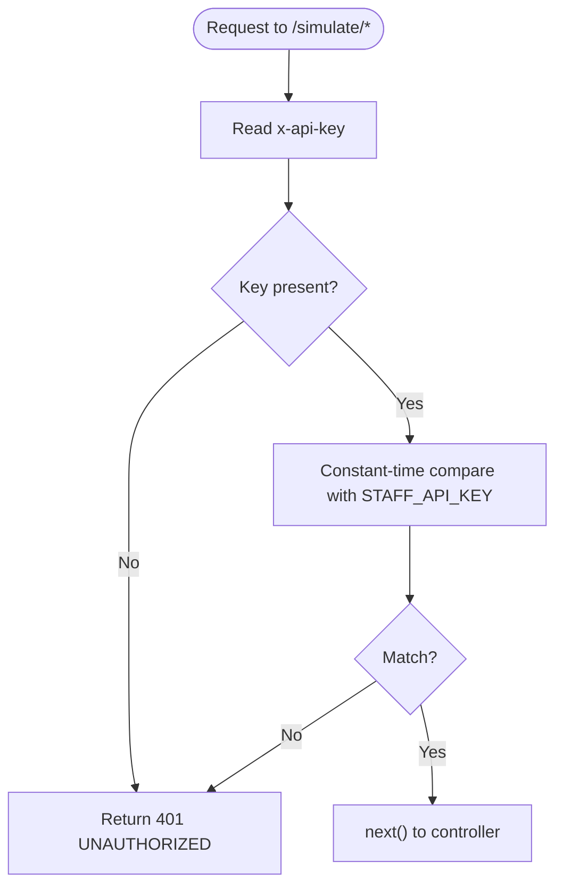
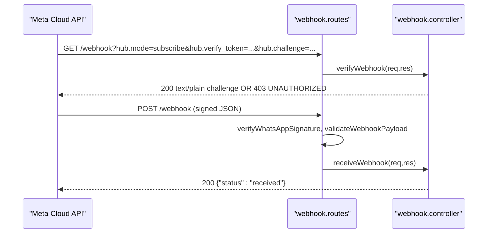
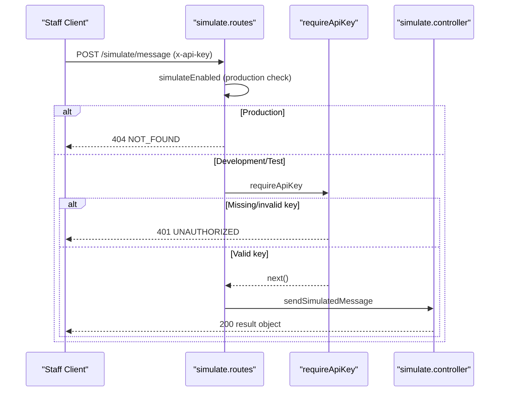
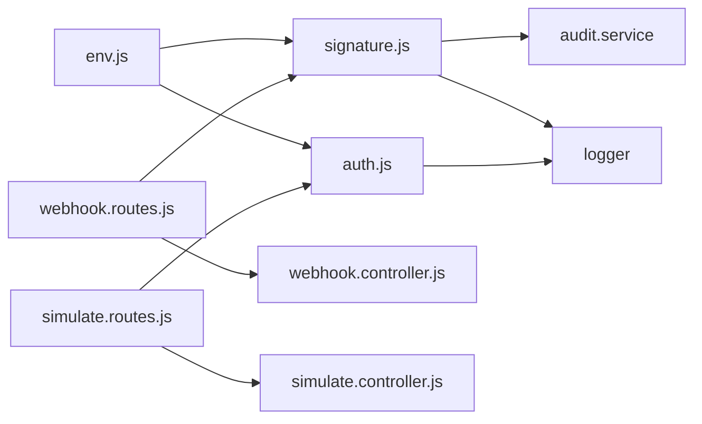

# Authentication and Authorization

<cite>
**Referenced Files in This Document**
- [README.md](file://README.md)
- [env.js](file://src/config/env.js)
- [signature.js](file://src/middleware/signature.js)
- [auth.js](file://src/middleware/auth.js)
- [webhook.controller.js](file://src/controllers/webhook.controller.js)
- [webhook.routes.js](file://src/routes/webhook.routes.js)
- [simulate.routes.js](file://src/routes/simulate.routes.js)
- [simulate.controller.js](file://src/controllers/simulate.controller.js)
- [send-webhook.js](file://scripts/send-webhook.js)
- [webhook.test.js](file://tests/webhook.test.js)
</cite>

## Table of Contents
1. [Introduction](#introduction)
2. [Project Structure](#project-structure)
3. [Core Components](#core-components)
4. [Architecture Overview](#architecture-overview)
5. [Detailed Component Analysis](#detailed-component-analysis)
6. [Dependency Analysis](#dependency-analysis)
7. [Performance Considerations](#performance-considerations)
8. [Troubleshooting Guide](#troubleshooting-guide)
9. [Conclusion](#conclusion)
10. [Appendices](#appendices)

## Introduction
This document explains the authentication and authorization mechanisms used by the application, focusing on two distinct flows:

- **Meta WhatsApp Business API webhook authentication**: HMAC-SHA256 signature verification using a stored app secret.
- **Internal staff API key authentication**: A shared API key enforced via the `x-api-key` header for internal endpoints such as `/simulate/message`.

It also covers key management through environment variables, signature generation and validation steps, error handling, audit logging, and security considerations including safe comparison practices and production checks. Practical client examples are provided through existing scripts and tests.

## Project Structure
The authentication-related logic is split across middleware, routes, controllers, configuration, and test utilities:

**Diagram sources**
- [webhook.routes.js:8-13](file://src/routes/webhook.routes.js#L8-L13)
- [simulate.routes.js:18-18](file://src/routes/simulate.routes.js#L18-L18)
- [signature.js:19-49](file://src/middleware/signature.js#L19-L49)
- [auth.js:16-21](file://src/middleware/auth.js#L16-L21)
- [webhook.controller.js:10-55](file://src/controllers/webhook.controller.js#L10-L55)
- [simulate.controller.js:12-34](file://src/controllers/simulate.controller.js#L12-L34)
- [env.js:25-127](file://src/config/env.js#L25-L127)

**Section sources**
- [README.md:364-384](file://README.md#L364-L384)
- [webhook.routes.js:1-16](file://src/routes/webhook.routes.js#L1-L16)
- [simulate.routes.js:1-21](file://src/routes/simulate.routes.js#L1-L21)

## Core Components
This section summarizes the main authentication components and their responsibilities.

### HMAC-SHA256 Webhook Signature Verification
- Verifies the `x-hub-signature-256` header sent by Meta.
- Uses the raw request body to compute an HMAC-SHA256 digest with the configured app secret.
- Compares signatures using a constant-time comparison to prevent timing attacks.
- Rejects requests without a valid signature with a 401 response and records an audit event.

**Section sources**
- [signature.js:1-51](file://src/middleware/signature.js#L1-L51)
- [webhook.routes.js:11-13](file://src/routes/webhook.routes.js#L11-L13)
- [webhook.test.js:85-130](file://tests/webhook.test.js#L85-L130)

### Staff API Key Authentication
- Protects internal endpoints such as `/simulate/message`.
- Requires the `x-api-key` header to match the configured `STAFF_API_KEY`.
- Uses a constant-time comparison helper to avoid timing side channels.
- Returns a 401 response when the key is missing or invalid.

**Section sources**
- [auth.js:1-23](file://src/middleware/auth.js#L1-L23)
- [simulate.routes.js:10-18](file://src/routes/simulate.routes.js#L10-L18)
- [README.md:271-281](file://README.md#L271-L281)

### Configuration and Secret Management
- All secrets are loaded from `.env` and validated at startup using Zod.
- Production mode rejects default placeholder values for critical secrets.
- Required fields include `WHATSAPP_APP_SECRET`, `WHATSAPP_VERIFY_TOKEN`, and `STAFF_API_KEY`.

**Section sources**
- [env.js:25-127](file://src/config/env.js#L25-L127)
- [README.md:163-198](file://README.md#L163-L198)

## Architecture Overview
The system separates inbound webhook processing from internal staff operations. Webhooks are authenticated via HMAC-SHA256 before reaching the controller; staff endpoints are protected by an API key.

**Diagram sources**
- [webhook.routes.js:11-13](file://src/routes/webhook.routes.js#L11-L13)
- [signature.js:19-49](file://src/middleware/signature.js#L19-L49)
- [webhook.controller.js:35-55](file://src/controllers/webhook.controller.js#L35-L55)

## Detailed Component Analysis

### Webhook Signature Verification Middleware
The middleware performs the following steps:

1. Extracts the `x-hub-signature-256` header.
2. Splits it into scheme and signature value.
3. Validates that the scheme is `sha256` and a signature is present.
4. Reads the raw request body buffer to ensure byte-for-byte matching with what Meta signed.
5. Computes the expected HMAC-SHA256 digest using the configured app secret.
6. Compares the provided and expected signatures using constant-time comparison.
7. On failure, records an audit event and returns a 401 unauthorized response.

**Diagram sources**
- [signature.js:19-49](file://src/middleware/signature.js#L19-L49)

**Section sources**
- [signature.js:1-51](file://src/middleware/signature.js#L1-L51)
- [webhook.routes.js:11-13](file://src/routes/webhook.routes.js#L11-L13)
- [webhook.test.js:99-130](file://tests/webhook.test.js#L99-L130)

### Staff API Key Middleware
The staff authentication middleware enforces access control for internal endpoints:

- Reads the `x-api-key` header.
- Compares it against the configured `STAFF_API_KEY` using a constant-time comparison helper.
- Returns a 401 response if the key is missing or invalid.

**Diagram sources**
- [auth.js:5-21](file://src/middleware/auth.js#L5-L21)
- [simulate.routes.js:18-18](file://src/routes/simulate.routes.js#L18-L18)

**Section sources**
- [auth.js:1-23](file://src/middleware/auth.js#L1-L23)
- [simulate.routes.js:10-18](file://src/routes/simulate.routes.js#L10-L18)
- [README.md:271-281](file://README.md#L271-L281)

### Webhook Controller and Routes
The webhook routes define:

- GET `/webhook`: Meta handshake verification, echoing the challenge when the verify token matches.
- POST `/webhook`: Signature verification, payload validation, immediate 200 response, and asynchronous message processing.

**Diagram sources**
- [webhook.routes.js:8-13](file://src/routes/webhook.routes.js#L8-L13)
- [webhook.controller.js:10-55](file://src/controllers/webhook.controller.js#L10-L55)

**Section sources**
- [webhook.controller.js:1-56](file://src/controllers/webhook.controller.js#L1-L56)
- [webhook.routes.js:1-16](file://src/routes/webhook.routes.js#L1-L16)

### Simulate Endpoint and Staff Access Control
The simulate endpoint is disabled in production and requires a valid staff API key:

- Route-level guard disables the endpoint in production.
- Middleware-level guard enforces the `x-api-key` header.
- Controller awaits pipeline processing and returns structured results.

**Diagram sources**
- [simulate.routes.js:10-18](file://src/routes/simulate.routes.js#L10-L18)
- [auth.js:16-21](file://src/middleware/auth.js#L16-L21)
- [simulate.controller.js:12-34](file://src/controllers/simulate.controller.js#L12-L34)

**Section sources**
- [simulate.routes.js:1-21](file://src/routes/simulate.routes.js#L1-L21)
- [simulate.controller.js:1-35](file://src/controllers/simulate.controller.js#L1-L35)

## Dependency Analysis
Authentication and authorization depend on configuration, crypto primitives, and audit/logging utilities.

**Diagram sources**
- [env.js:25-127](file://src/config/env.js#L25-L127)
- [signature.js:1-51](file://src/middleware/signature.js#L1-L51)
- [auth.js:1-23](file://src/middleware/auth.js#L1-L23)
- [webhook.routes.js:1-16](file://src/routes/webhook.routes.js#L1-L16)
- [simulate.routes.js:1-21](file://src/routes/simulate.routes.js#L1-L21)

**Section sources**
- [env.js:25-127](file://src/config/env.js#L25-L127)
- [signature.js:1-51](file://src/middleware/signature.js#L1-L51)
- [auth.js:1-23](file://src/middleware/auth.js#L1-L23)
- [webhook.routes.js:1-16](file://src/routes/webhook.routes.js#L1-L16)
- [simulate.routes.js:1-21](file://src/routes/simulate.routes.js#L1-L21)

## Performance Considerations
- **Constant-time comparisons**: Both HMAC and API key comparisons use constant-time functions to mitigate timing attacks.
- **Raw body usage**: The webhook signature verification uses the raw request body buffer to ensure exact byte matching with Meta’s signature, avoiding serialization differences.
- **Fast webhook responses**: The webhook controller returns 200 immediately and processes messages asynchronously, preventing retry storms from slow downstream processing.
- **Audit overhead**: Rejections are audited synchronously before returning errors; consider batching or backgrounding audits if high rejection rates occur.

[No sources needed since this section provides general guidance]

## Troubleshooting Guide
Common issues and resolutions related to authentication and authorization:

- **Invalid webhook signature (401)**: Ensure `WHATSAPP_APP_SECRET` matches the signer. Use the provided script to sign payloads correctly.
- **Handshake rejected (403)**: Ensure `WHATSAPP_VERIFY_TOKEN` in `.env` matches the value configured in Meta’s webhook settings.
- **Missing or invalid staff API key (401)**: Set `STAFF_API_KEY` in `.env` and include the `x-api-key` header in requests to `/simulate/*`.
- **Production simulation disabled**: The `/simulate/message` endpoint returns 404 in production by design.

**Section sources**
- [README.md:409-419](file://README.md#L409-L419)
- [webhook.test.js:99-130](file://tests/webhook.test.js#L99-L130)
- [simulate.routes.js:10-18](file://src/routes/simulate.routes.js#L10-L18)

## Conclusion
The application implements robust authentication and authorization mechanisms:

- **Webhook integrity**: HMAC-SHA256 signature verification ensures incoming Meta webhooks are authentic and unmodified.
- **Internal access control**: Staff endpoints are protected by a shared API key enforced via headers.
- **Security best practices**: Constant-time comparisons, strict environment validation, and audit logging support secure operation.
- **Operational clarity**: Clear routes, middleware separation, and comprehensive tests provide maintainability and confidence.

For production deployments, ensure all secrets are replaced, keys are rotated securely, and audit logs are monitored for anomalies.

[No sources needed since this section summarizes without analyzing specific files]

## Appendices

### Practical Implementation Examples

#### Generating and Verifying Webhook Signatures
- Use the provided script to sign and send webhook payloads locally.
- The script computes HMAC-SHA256 over the raw JSON body using the configured app secret and sets the `x-hub-signature-256` header.

**Section sources**
- [send-webhook.js:1-84](file://scripts/send-webhook.js#L1-L84)
- [README.md:307-317](file://README.md#L307-L317)

#### Calling Staff API Endpoints
- Include the `x-api-key` header with a strong value set in `STAFF_API_KEY`.
- Requests to `/simulate/message` will be processed only if the key matches.

**Section sources**
- [README.md:319-344](file://README.md#L319-L344)
- [simulate.routes.js:18-18](file://src/routes/simulate.routes.js#L18-L18)
- [auth.js:16-21](file://src/middleware/auth.js#L16-L21)

### Security Considerations and Key Rotation
- **Secret storage**: Secrets are loaded from `.env` and validated at startup; production rejects default placeholders.
- **Rotation strategy**: Rotate `WHATSAPP_APP_SECRET` and `STAFF_API_KEY` by updating `.env` and redeploying. Ensure clients update their signing logic and headers accordingly.
- **Audit monitoring**: Monitor `WEBHOOK_REJECTED` events for patterns indicating misconfiguration or malicious activity.
- **Transport security**: Use HTTPS for all external-facing endpoints, especially webhooks and staff APIs.

**Section sources**
- [env.js:65-109](file://src/config/env.js#L65-L109)
- [README.md:283-289](file://README.md#L283-L289)
- [signature.js:23-49](file://src/middleware/signature.js#L23-L49)