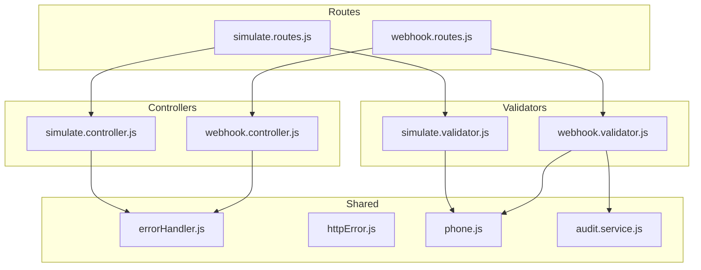
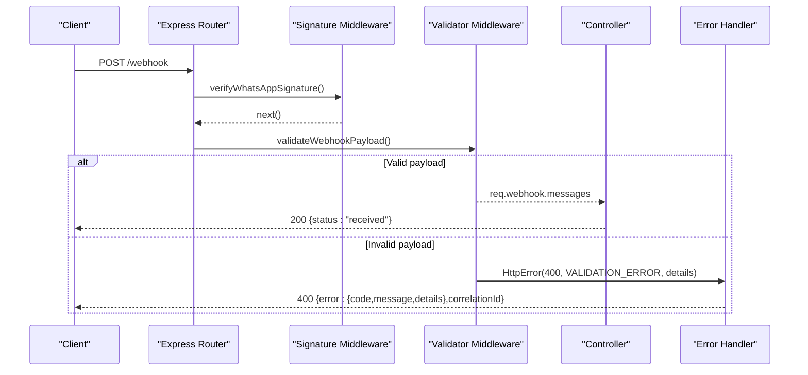
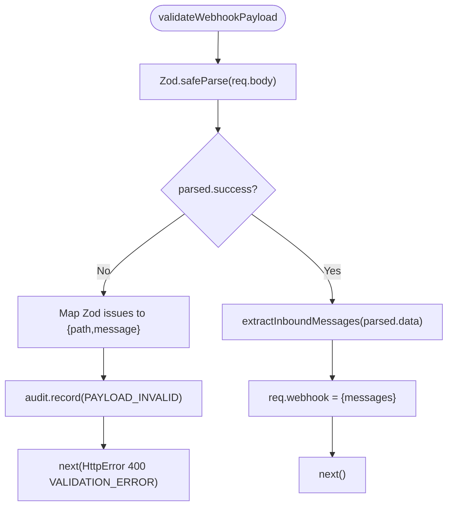
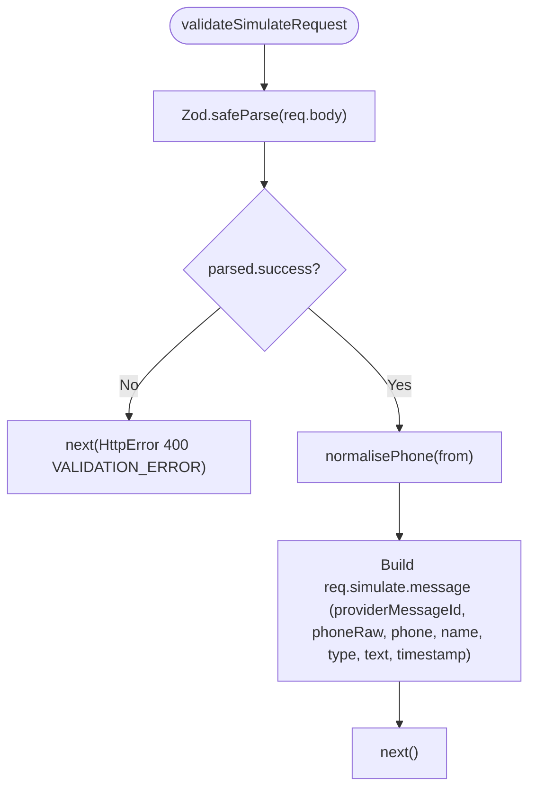
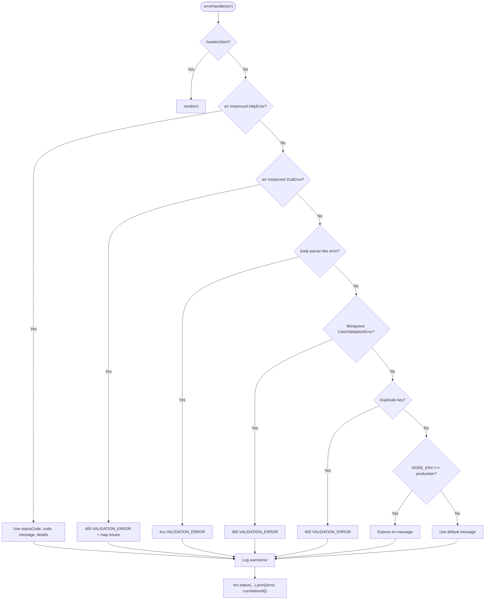
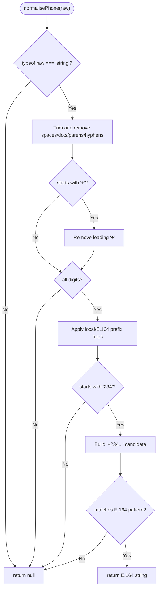
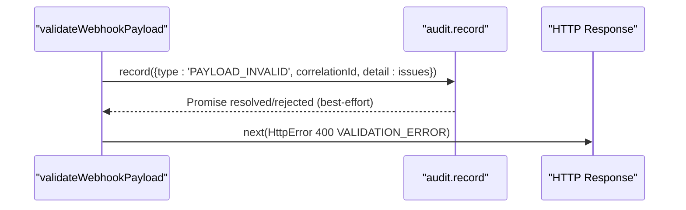
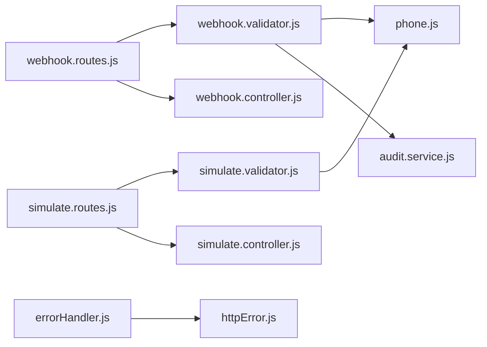

# Input Validation and Sanitization

<cite>
**Referenced Files in This Document**
- [webhook.validator.js](file://src/validators/webhook.validator.js)
- [simulate.validator.js](file://src/validators/simulate.validator.js)
- [webhook.routes.js](file://src/routes/webhook.routes.js)
- [simulate.routes.js](file://src/routes/simulate.routes.js)
- [webhook.controller.js](file://src/controllers/webhook.controller.js)
- [simulate.controller.js](file://src/controllers/simulate.controller.js)
- [errorHandler.js](file://src/middleware/errorHandler.js)
- [httpError.js](file://src/utils/httpError.js)
- [phone.js](file://src/utils/phone.js)
- [audit.service.js](file://src/services/audit.service.js)
- [package.json](file://package.json)
</cite>

## Table of Contents
1. [Introduction](#introduction)
2. [Project Structure](#project-structure)
3. [Core Components](#core-components)
4. [Architecture Overview](#architecture-overview)
5. [Detailed Component Analysis](#detailed-component-analysis)
6. [Dependency Analysis](#dependency-analysis)
7. [Performance Considerations](#performance-considerations)
8. [Troubleshooting Guide](#troubleshooting-guide)
9. [Conclusion](#conclusion)

## Introduction
This document explains the input validation and sanitization strategy used by the application, focusing on the Zod-based schema system for webhook payloads and simulate requests. It covers how validation is wired into Express routes, how errors are normalized, how audit logging is integrated with validation failures, and how phone normalization contributes to safe data handling. The goal is to help developers understand the validation pipeline, extend it safely, and troubleshoot validation-related issues consistently.

## Project Structure
Validation logic lives under `src/validators`, while route definitions wire middleware and validators together. Controllers consume validated request state, and a central error handler normalizes all error responses. Phone utilities provide normalization and validation helpers that are reused across validators.

**Diagram sources**
- [webhook.routes.js:1-16](file://src/routes/webhook.routes.js#L1-L16)
- [simulate.routes.js:1-21](file://src/routes/simulate.routes.js#L1-L21)
- [webhook.validator.js:1-124](file://src/validators/webhook.validator.js#L1-L124)
- [simulate.validator.js:1-55](file://src/validators/simulate.validator.js#L1-L55)
- [webhook.controller.js:1-56](file://src/controllers/webhook.controller.js#L1-L56)
- [simulate.controller.js:1-35](file://src/controllers/simulate.controller.js#L1-L35)
- [errorHandler.js:1-80](file://src/middleware/errorHandler.js#L1-L80)
- [httpError.js:1-31](file://src/utils/httpError.js#L1-L31)
- [phone.js:1-54](file://src/utils/phone.js#L1-L54)
- [audit.service.js:1-116](file://src/services/audit.service.js#L1-L116)

**Section sources**
- [webhook.routes.js:1-16](file://src/routes/webhook.routes.js#L1-L16)
- [simulate.routes.js:1-21](file://src/routes/simulate.routes.js#L1-L21)

## Core Components
- Zod schemas define strict contracts for incoming payloads.
- Validators parse and validate request bodies, attach normalized data to the request object, and return structured validation errors when invalid.
- A central error handler maps Zod, Mongoose, body-parser, and custom HTTP errors to a consistent JSON error envelope.
- Phone utilities normalize and validate Nigerian phone numbers, ensuring downstream systems receive canonical E.164 values.
- Audit service records validation failures and other lifecycle events without blocking the main request path.

Key responsibilities:
- Webhook validator: validates Meta Cloud API payload shape, extracts inbound messages, and audits invalid payloads.
- Simulate validator: validates test harness inputs, normalizes phone numbers, and constructs a message shape compatible with the webhook path.
- Error handler: standardizes error responses and logs them appropriately.
- Phone utilities: ensure only usable, normalized phone numbers enter the pipeline.

**Section sources**
- [webhook.validator.js:1-124](file://src/validators/webhook.validator.js#L1-L124)
- [simulate.validator.js:1-55](file://src/validators/simulate.validator.js#L1-L55)
- [errorHandler.js:1-80](file://src/middleware/errorHandler.js#L1-L80)
- [phone.js:1-54](file://src/utils/phone.js#L1-L54)
- [audit.service.js:1-116](file://src/services/audit.service.js#L1-L116)

## Architecture Overview
The validation architecture follows a layered approach:
- Route-level middleware performs signature verification and feature gating.
- Validator middleware parses and validates request bodies using Zod.
- Controllers process validated data and respond quickly or await processing depending on endpoint semantics.
- Central error handler converts all errors into a uniform response format.

**Diagram sources**
- [webhook.routes.js:11-13](file://src/routes/webhook.routes.js#L11-L13)
- [webhook.validator.js:103-123](file://src/validators/webhook.validator.js#L103-L123)
- [webhook.controller.js:35-55](file://src/controllers/webhook.controller.js#L35-L55)
- [errorHandler.js:16-79](file://src/middleware/errorHandler.js#L16-L79)

## Detailed Component Analysis

### Webhook Payload Validation
The webhook validator defines nested Zod schemas for contacts, messages, changes, entries, and the top-level payload. Unknown fields are preserved via `.passthrough()` to remain compatible with future Meta API additions.

Validation flow:
- Parse the request body against `webhookPayloadSchema`.
- On failure, map Zod issues to a flat `{path, message}` array, record an audit event, and return a 400 `VALIDATION_ERROR`.
- On success, extract inbound messages into a normalized shape and attach them to `req.webhook`.

Sanitization aspects:
- Strict typing ensures only expected fields are consumed.
- Text extraction uses optional chaining to avoid undefined access.
- Phone normalization is applied during extraction so downstream components receive canonical values.

**Diagram sources**
- [webhook.validator.js:53-58](file://src/validators/webhook.validator.js#L53-L58)
- [webhook.validator.js:68-95](file://src/validators/webhook.validator.js#L68-L95)
- [webhook.validator.js:103-123](file://src/validators/webhook.validator.js#L103-L123)

**Section sources**
- [webhook.validator.js:1-124](file://src/validators/webhook.validator.js#L1-L124)

### Simulate Endpoint Validation
The simulate validator enforces a stricter contract for testing:
- `from` must be a valid Nigerian phone number using a custom refinement.
- `text` length is bounded.
- Optional fields include `name`, `messageId`, and `forceLlmFailure`.
- `.strict()` prevents unknown fields from being silently accepted.

Normalization:
- Phone numbers are normalized to E.164 using the shared utility.
- A synthetic provider message ID is generated if not provided.
- The resulting message shape mirrors the webhook’s extracted message structure, enabling reuse of the same processing pipeline.

**Diagram sources**
- [simulate.validator.js:10-21](file://src/validators/simulate.validator.js#L10-L21)
- [simulate.validator.js:28-54](file://src/validators/simulate.validator.js#L28-L54)
- [phone.js:16-33](file://src/utils/phone.js#L16-L33)

**Section sources**
- [simulate.validator.js:1-55](file://src/validators/simulate.validator.js#L1-L55)
- [phone.js:1-54](file://src/utils/phone.js#L1-L54)

### Error Response Formatting and Handling
A centralized error handler normalizes all error responses:
- Custom `HttpError` instances carry status code, error code, message, and details.
- Zod errors are mapped to `VALIDATION_ERROR` with flattened issue paths.
- Body-parser errors (e.g., malformed JSON, payload too large) are treated as validation errors.
- Mongoose validation and cast errors are converted to user-friendly messages.
- Duplicate key errors are surfaced as validation errors.
- In non-production environments, raw error messages may be exposed for debugging.

**Diagram sources**
- [errorHandler.js:16-79](file://src/middleware/errorHandler.js#L16-L79)
- [httpError.js:6-31](file://src/utils/httpError.js#L6-L31)

**Section sources**
- [errorHandler.js:1-80](file://src/middleware/errorHandler.js#L1-L80)
- [httpError.js:1-31](file://src/utils/httpError.js#L1-L31)

### Phone Normalization and Sanitization
Phone utilities implement domain-specific normalization and validation:
- Accepts multiple input formats and returns E.164 or null.
- Provides boolean validation helper for refinements.
- Masks phone numbers in logs to reduce sensitive data exposure.

This normalization ensures:
- Downstream systems receive consistent identifiers.
- Invalid or malformed numbers are rejected early.
- Operational logs do not expose full phone numbers unnecessarily.

**Diagram sources**
- [phone.js:16-33](file://src/utils/phone.js#L16-L33)

**Section sources**
- [phone.js:1-54](file://src/utils/phone.js#L1-L54)

### Audit Integration for Validation Failures
Invalid webhook payloads are audited before returning a 400 response:
- The validator records a `PAYLOAD_INVALID` event with correlation ID and validation issues.
- Audit writes are best-effort; failures are logged but do not block the request.

**Diagram sources**
- [webhook.validator.js:103-123](file://src/validators/webhook.validator.js#L103-L123)
- [audit.service.js:22-36](file://src/services/audit.service.js#L22-L36)

**Section sources**
- [webhook.validator.js:103-123](file://src/validators/webhook.validator.js#L103-L123)
- [audit.service.js:1-116](file://src/services/audit.service.js#L1-L116)

## Dependency Analysis
The following diagram shows how validators depend on shared utilities and services, and how routes compose middleware and controllers.

**Diagram sources**
- [webhook.validator.js:1-124](file://src/validators/webhook.validator.js#L1-L124)
- [simulate.validator.js:1-55](file://src/validators/simulate.validator.js#L1-L55)
- [webhook.routes.js:1-16](file://src/routes/webhook.routes.js#L1-L16)
- [simulate.routes.js:1-21](file://src/routes/simulate.routes.js#L1-L21)
- [errorHandler.js:1-80](file://src/middleware/errorHandler.js#L1-L80)
- [httpError.js:1-31](file://src/utils/httpError.js#L1-L31)

**Section sources**
- [webhook.validator.js:1-124](file://src/validators/webhook.validator.js#L1-L124)
- [simulate.validator.js:1-55](file://src/validators/simulate.validator.js#L1-L55)
- [webhook.routes.js:1-16](file://src/routes/webhook.routes.js#L1-L16)
- [simulate.routes.js:1-21](file://src/routes/simulate.routes.js#L1-L21)
- [errorHandler.js:1-80](file://src/middleware/errorHandler.js#L1-L80)
- [httpError.js:1-31](file://src/utils/httpError.js#L1-L31)

## Performance Considerations
- Zod parsing is synchronous and fast; however, deeply nested objects can increase CPU usage. Keep schemas focused on required fields and use `.passthrough()` judiciously to avoid unnecessary validation overhead.
- For large webhook payloads:
  - Ensure body size limits are configured at the HTTP layer to reject oversized requests early.
  - Avoid heavy transformations inside validators; prefer lightweight parsing and pass raw data to background workers if needed.
- Phone normalization is O(n) over the input string and should be negligible compared to network I/O.
- Audit writes are asynchronous and best-effort to prevent blocking the main request path.

[No sources needed since this section provides general guidance]

## Troubleshooting Guide
Common validation issues and resolutions:
- Malformed JSON or payload too large:
  - The error handler maps these to `VALIDATION_ERROR` with appropriate status codes.
  - Check request size limits and content-type headers.
- Missing or invalid fields:
  - Review Zod schema constraints and refine functions.
  - Inspect the `details` array in the error response for exact field paths and messages.
- Phone number validation failures:
  - Ensure inputs conform to supported formats; use the phone normalization utility for preprocessing.
- Unexpected unknown fields:
  - For simulate requests, `.strict()` rejects unknown fields. Adjust schemas if new fields are required.

Operational tips:
- Correlation IDs are included in error responses and logs to trace requests end-to-end.
- Audit events capture validation failures for observability without impacting throughput.

**Section sources**
- [errorHandler.js:16-79](file://src/middleware/errorHandler.js#L16-L79)
- [simulate.validator.js:10-21](file://src/validators/simulate.validator.js#L10-L21)
- [webhook.validator.js:103-123](file://src/validators/webhook.validator.js#L103-L123)

## Conclusion
The application employs a robust, schema-driven validation strategy centered on Zod. Webhook and simulate endpoints enforce strict contracts, normalize phone numbers, and produce consistent error responses through a centralized handler. Audit integration ensures visibility into validation failures without compromising performance. By extending existing schemas, adding refinements, and leveraging shared utilities, teams can maintain secure, predictable input handling across the platform.

[No sources needed since this section summarizes without analyzing specific files]