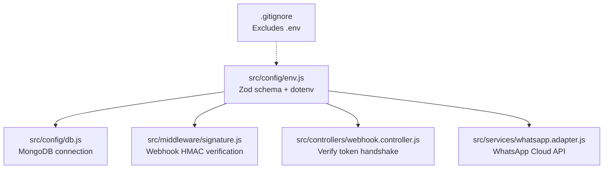
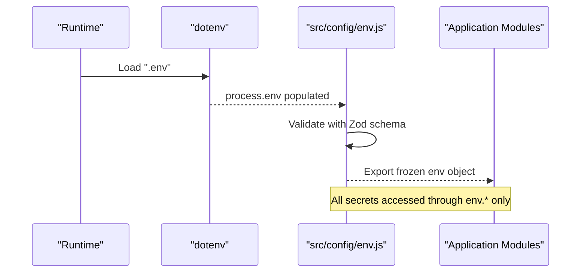
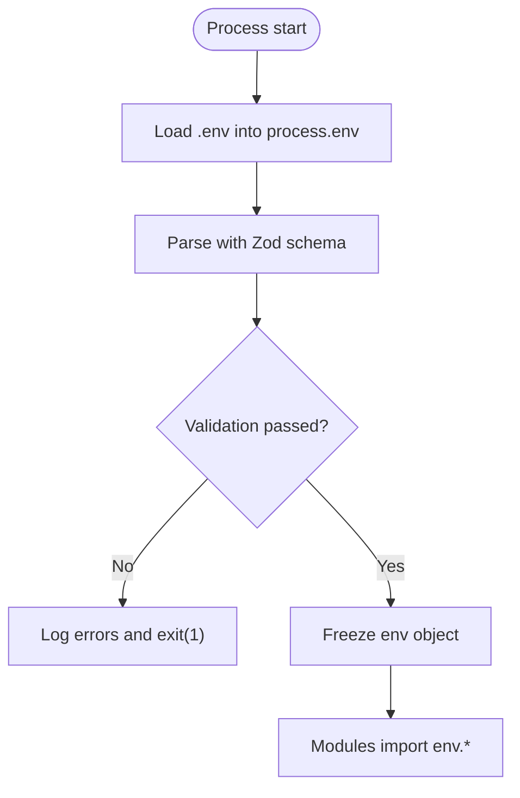
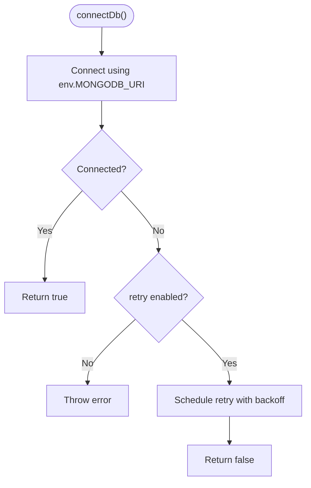
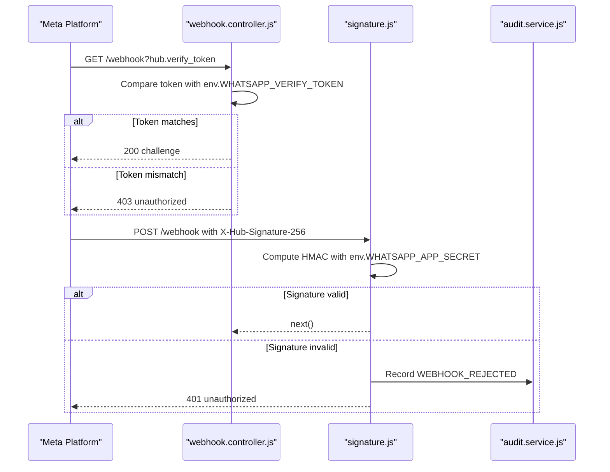
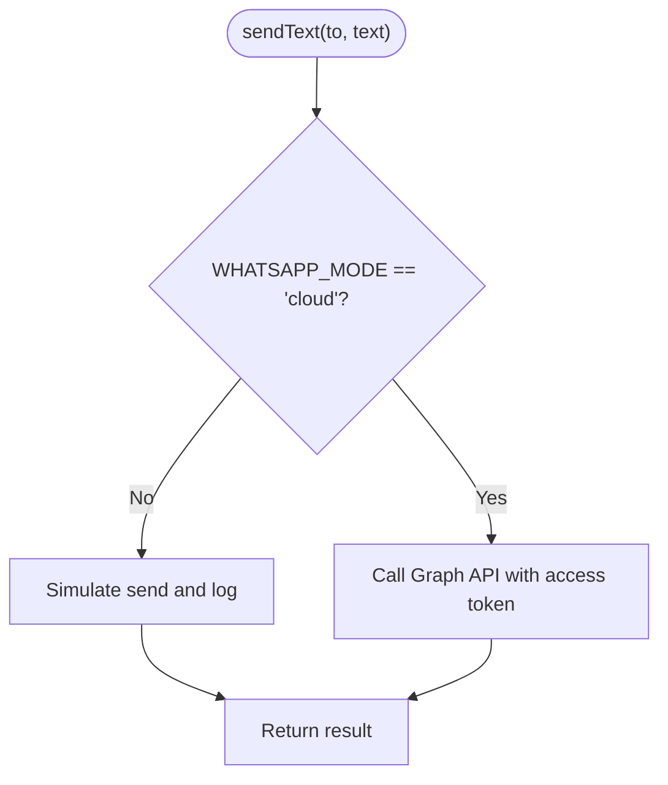
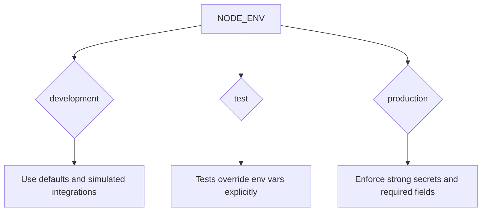
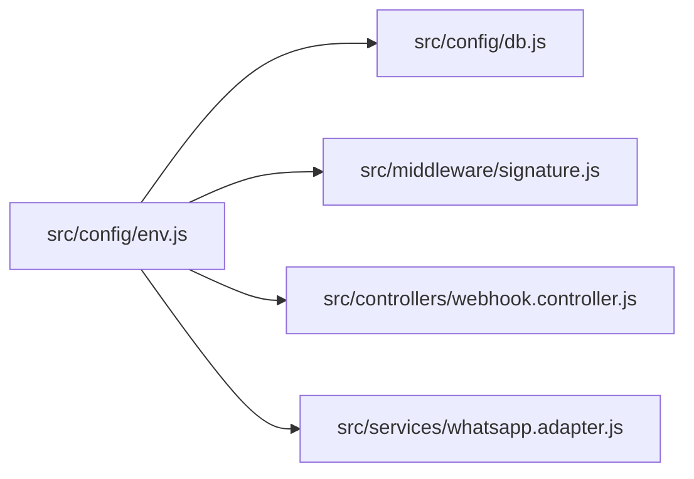

# Secrets Management

<cite>
**Referenced Files in This Document**
- [env.js](file://src/config/env.js)
- [db.js](file://src/config/db.js)
- [signature.js](file://src/middleware/signature.js)
- [webhook.controller.js](file://src/controllers/webhook.controller.js)
- [whatsapp.adapter.js](file://src/services/whatsapp.adapter.js)
- [.gitignore](file://.gitignore)
</cite>

## Table of Contents
1. [Introduction](#introduction)
2. [Project Structure](#project-structure)
3. [Core Components](#core-components)
4. [Architecture Overview](#architecture-overview)
5. [Detailed Component Analysis](#detailed-component-analysis)
6. [Dependency Analysis](#dependency-analysis)
7. [Performance Considerations](#performance-considerations)
8. [Troubleshooting Guide](#troubleshooting-guide)
9. [Conclusion](#conclusion)
10. [Appendices](#appendices)

## Introduction
This document explains how secrets and environment configuration are managed in the project. It focuses on:
- The Zod-based environment variable validation system, including required variables, defaults, and type checks.
- Secret storage best practices and environment-specific configuration.
- Secure handling of sensitive data such as webhook secrets, database credentials, and API keys.
- Deployment patterns, secret rotation guidance, audit logging for secret access, and compliance considerations.
- Common pitfalls and migration strategies to improve security posture.

The implementation uses a single validated configuration module that loads `.env`, validates values with Zod, and exposes a frozen configuration object. Sensitive runtime behavior is driven by this configuration rather than direct `process.env` reads.

## Project Structure
Secrets-related code is concentrated under configuration, middleware, controllers, services, and repository-level ignore rules:
- Configuration:
  - Environment parsing and validation: `src/config/env.js`
  - Database connection using validated configuration: `src/config/db.js`
- Security and secrets usage:
  - Webhook signature verification using app secret: `src/middleware/signature.js`
  - Webhook handshake and processing using verify token: `src/controllers/webhook.controller.js`
  - WhatsApp adapter using tokens and mode flags: `src/services/whatsapp.adapter.js`
- Repository hygiene:
  - `.env` exclusion from version control: `.gitignore`

**Diagram sources**
- [env.js:1-144](file://src/config/env.js#L1-L144)
- [db.js:1-77](file://src/config/db.js#L1-L77)
- [signature.js:1-51](file://src/middleware/signature.js#L1-L51)
- [webhook.controller.js:1-56](file://src/controllers/webhook.controller.js#L1-L56)
- [whatsapp.adapter.js:1-136](file://src/services/whatsapp.adapter.js#L1-L136)
- [.gitignore:1-9](file://.gitignore#L1-L9)

**Section sources**
- [env.js:1-144](file://src/config/env.js#L1-L144)
- [db.js:1-77](file://src/config/db.js#L1-L77)
- [signature.js:1-51](file://src/middleware/signature.js#L1-L51)
- [webhook.controller.js:1-56](file://src/controllers/webhook.controller.js#L1-L56)
- [whatsapp.adapter.js:1-136](file://src/services/whatsapp.adapter.js#L1-L136)
- [.gitignore:1-9](file://.gitignore#L1-L9)

## Core Components
This section summarizes the key components involved in secrets management and environment configuration.

- Environment configuration loader and validator (`src/config/env.js`)
  - Loads `.env` relative to the project root.
  - Validates all environment variables with a Zod schema.
  - Exposes a frozen `env` object consumed across the application.
  - Enforces production-only requirements (e.g., replacing default secrets).
  - Enforces conditional requirements based on feature flags (e.g., WhatsApp cloud mode, LLM providers).

- Database configuration (`src/config/db.js`)
  - Uses the validated `env.MONGODB_URI`.
  - Provides connection state helpers and retry logic.

- Webhook security (`src/middleware/signature.js`, `src/controllers/webhook.controller.js`)
  - Verifies incoming webhook signatures using an HMAC computed with `WHATSAPP_APP_SECRET`.
  - Handles Meta’s verification handshake using `WHATSAPP_VERIFY_TOKEN`.
  - Audits rejected webhooks.

- WhatsApp integration (`src/services/whatsapp.adapter.js`)
  - Operates in simulated or cloud modes based on `WHATSAPP_MODE`.
  - Uses `WHATSAPP_ACCESS_TOKEN`, `WHATSAPP_PHONE_NUMBER_ID`, and `WHATSAPP_API_VERSION` when in cloud mode.
  - Supports a test hook via `WHATSAPP_FORCE_SEND_FAILURE`.

- Repository protection (`.gitignore`)
  - Prevents committing `.env` files.

**Section sources**
- [env.js:1-144](file://src/config/env.js#L1-L144)
- [db.js:1-77](file://src/config/db.js#L1-L77)
- [signature.js:1-51](file://src/middleware/signature.js#L1-L51)
- [webhook.controller.js:1-56](file://src/controllers/webhook.controller.js#L1-L56)
- [whatsapp.adapter.js:1-136](file://src/services/whatsapp.adapter.js#L1-L136)
- [.gitignore:1-9](file://.gitignore#L1-L9)

## Architecture Overview
The secrets architecture centers around a single source of truth: the validated `env` object. All sensitive values are loaded early, validated, and then used by downstream modules.

**Diagram sources**
- [env.js:1-144](file://src/config/env.js#L1-L144)

## Detailed Component Analysis

### Environment Variable Validation System
The environment configuration module defines a comprehensive Zod schema that:
- Defines types and constraints for each variable.
- Supplies sensible defaults for development.
- Performs custom cross-field validations.
- Exits the process with clear error messages if validation fails.

Key behaviors:
- Boolean parsing helper avoids coercion pitfalls by explicitly normalizing string values.
- Production checks enforce replacement of placeholder secrets.
- Conditional checks require specific secrets depending on feature flags (e.g., WhatsApp cloud mode, LLM provider selection).
- The final exported `env` object is frozen to prevent accidental mutation.

**Diagram sources**
- [env.js:1-144](file://src/config/env.js#L1-L144)

**Section sources**
- [env.js:1-144](file://src/config/env.js#L1-L144)

### Database Credentials Management
Database connectivity uses the validated MongoDB URI from the environment configuration. Connection utilities provide health state and resilient retry behavior.

Important points:
- `MONGODB_URI` is required and validated as a non-empty string.
- Connection attempts use a timeout setting suitable for service discovery.
- Retry logic is implemented with exponential backoff and graceful shutdown support.

**Diagram sources**
- [db.js:1-77](file://src/config/db.js#L1-L77)

**Section sources**
- [db.js:1-77](file://src/config/db.js#L1-L77)

### Webhook Secrets and Signature Verification
Incoming webhooks are protected by two mechanisms:
- Handshake verification using `WHATSAPP_VERIFY_TOKEN`.
- Payload signature verification using `WHATSAPP_APP_SECRET` with HMAC-SHA256 and timing-safe comparison.

**Diagram sources**
- [webhook.controller.js:1-56](file://src/controllers/webhook.controller.js#L1-L56)
- [signature.js:1-51](file://src/middleware/signature.js#L1-L51)

**Section sources**
- [webhook.controller.js:1-56](file://src/controllers/webhook.controller.js#L1-L56)
- [signature.js:1-51](file://src/middleware/signature.js#L1-L51)

### WhatsApp Integration Secrets
The WhatsApp adapter supports two modes:
- Simulated mode: logs outbound messages without external calls.
- Cloud mode: sends real messages via the Meta WhatsApp Cloud API using `WHATSAPP_ACCESS_TOKEN`, `WHATSAPP_PHONE_NUMBER_ID`, and `WHATSAPP_API_VERSION`.

Validation ensures these fields are present when cloud mode is selected.

**Diagram sources**
- [whatsapp.adapter.js:1-136](file://src/services/whatsapp.adapter.js#L1-L136)

**Section sources**
- [whatsapp.adapter.js:1-136](file://src/services/whatsapp.adapter.js#L1-L136)

### Secret Storage Best Practices
Recommended practices aligned with the current implementation:
- Never commit `.env` to version control; it is already excluded by `.gitignore`.
- Provide a `.env.example` file describing required variables and safe defaults for local development.
- Inject secrets at runtime via container orchestration (e.g., Docker Compose environment overrides), which the loader supports by allowing existing `process.env` values to take precedence.
- Avoid hardcoding secrets in source code; rely exclusively on the validated `env` object.

**Section sources**
- [.gitignore:1-9](file://.gitignore#L1-L9)
- [env.js:1-144](file://src/config/env.js#L1-L144)

### Environment-Specific Configurations
The schema enforces different requirements per environment:
- Development:
  - Defaults allow running locally without external dependencies.
  - Placeholder secrets are permitted but must be replaced before production.
- Test:
  - Tests set explicit environment variables to ensure deterministic behavior.
- Production:
  - Requires strong secrets for staff API authentication and WhatsApp verification.
  - Requires WhatsApp cloud credentials when operating in cloud mode.
  - Requires LLM provider credentials when using supported providers.

**Diagram sources**
- [env.js:1-144](file://src/config/env.js#L1-L144)

**Section sources**
- [env.js:1-144](file://src/config/env.js#L1-L144)

### Secure Deployment Patterns
Patterns supported by the current design:
- Containerized deployments can inject secrets via environment variables, overriding `.env` values.
- Application startup fails fast on invalid configuration, preventing deployment with missing or weak secrets.
- Webhook signature verification prevents unauthorized payload injection.
- Audit logging records rejected webhooks for forensic analysis.

Operational recommendations:
- Store secrets in a secure secrets manager (e.g., platform-native secret stores, Kubernetes Secrets, or cloud provider secret managers).
- Map secrets to environment variables at deploy time.
- Restrict access to secret stores and deployment pipelines.
- Enable structured logging and forward logs to a centralized, tamper-evident store.

[No sources needed since this section provides general guidance]

### Secret Rotation Guidelines
Guidelines for rotating secrets safely:
- Rotate webhook app secrets and verify tokens periodically and after any suspected compromise.
- Rotate database credentials according to organizational policy and provider capabilities.
- Rotate API keys for external services (e.g., WhatsApp Cloud API, LLM providers) regularly.
- Update environment variables in the secret store and redeploy.
- Monitor audit logs for unexpected rejections during rotation windows.
- Implement dual-key support where possible to avoid downtime during rotation.

[No sources needed since this section provides general guidance]

### Audit Logging of Secret Access
Current audit coverage:
- Rejected webhook signatures are recorded with correlation IDs and reasons.
- Webhook handshake failures are logged with context.
- Database connection events are logged (connected, disconnected, error).

Recommendations:
- Extend audit logging to record secret access events where feasible (e.g., successful signature verification, token usage).
- Ensure audit entries include correlation IDs, timestamps, and minimal contextual metadata without logging secret values.
- Protect audit logs with least-privilege access controls.

**Section sources**
- [signature.js:1-51](file://src/middleware/signature.js#L1-L51)
- [webhook.controller.js:1-56](file://src/controllers/webhook.controller.js#L1-L56)
- [db.js:1-77](file://src/config/db.js#L1-L77)

### Compliance Considerations
Aligning with common security standards:
- Input validation and type enforcement reduce injection risks.
- Timing-safe comparisons mitigate side-channel attacks on secret verification.
- Centralized configuration reduces secret leakage surface area.
- Audit logging supports incident response and compliance reporting.

Best practices:
- Enforce least privilege for service accounts and API keys.
- Encrypt secrets at rest and in transit.
- Maintain an inventory of secrets and their owners.
- Regularly review access logs and rotate secrets proactively.

[No sources needed since this section provides general guidance]

### Common Pitfalls and Migration Strategies
Common pitfalls:
- Hardcoding secrets in source code or configuration files committed to repositories.
- Using weak or default secrets in production.
- Relying on implicit coercion for boolean environment variables.
- Missing required secrets for optional features (e.g., WhatsApp cloud mode).

Migration strategies:
- Replace direct `process.env` reads with imports of the validated `env` object.
- Add missing environment variables to the Zod schema with appropriate defaults and validation.
- Introduce environment-specific configuration files or overlays while keeping `.env` out of version control.
- Adopt a secrets manager and update deployment scripts to inject secrets at runtime.
- Strengthen production checks in the schema to fail fast on placeholder values.

**Section sources**
- [env.js:1-144](file://src/config/env.js#L1-L144)

## Dependency Analysis
The following diagram shows how the environment configuration is consumed by other modules.

**Diagram sources**
- [env.js:1-144](file://src/config/env.js#L1-L144)
- [db.js:1-77](file://src/config/db.js#L1-L77)
- [signature.js:1-51](file://src/middleware/signature.js#L1-L51)
- [webhook.controller.js:1-56](file://src/controllers/webhook.controller.js#L1-L56)
- [whatsapp.adapter.js:1-136](file://src/services/whatsapp.adapter.js#L1-L136)

**Section sources**
- [env.js:1-144](file://src/config/env.js#L1-L144)
- [db.js:1-77](file://src/config/db.js#L1-L77)
- [signature.js:1-51](file://src/middleware/signature.js#L1-L51)
- [webhook.controller.js:1-56](file://src/controllers/webhook.controller.js#L1-L56)
- [whatsapp.adapter.js:1-136](file://src/services/whatsapp.adapter.js#L1-L136)

## Performance Considerations
- Environment validation runs once at startup; its cost is negligible compared to request handling.
- Webhook signature verification performs HMAC computation and timing-safe comparison; this is efficient and necessary for security.
- Database retries use exponential backoff to avoid overwhelming the database during transient failures.
- External API calls (e.g., WhatsApp Cloud API) have timeouts to prevent hanging requests.

[No sources needed since this section provides general guidance]

## Troubleshooting Guide
Symptoms and resolutions:
- Application exits immediately on startup:
  - Cause: Invalid or missing environment variables.
  - Resolution: Review error output and align `.env` with required variables and production constraints.
- Webhook handshake returns 403:
  - Cause: Mismatched verify token.
  - Resolution: Ensure `WHATSAPP_VERIFY_TOKEN` matches the value configured in the platform.
- Webhook payloads return 401:
  - Cause: Invalid or missing signature header, or incorrect app secret.
  - Resolution: Verify `WHATSAPP_APP_SECRET` and confirm the platform signs payloads with HMAC-SHA256.
- WhatsApp cloud sends fail:
  - Cause: Missing or invalid cloud credentials.
  - Resolution: Set `WHATSAPP_MODE=cloud` only when `WHATSAPP_PHONE_NUMBER_ID` and `WHATSAPP_ACCESS_TOKEN` are provided.
- Database connection issues:
  - Cause: Incorrect `MONGODB_URI` or network connectivity problems.
  - Resolution: Validate the URI and check service availability; monitor retry logs.

**Section sources**
- [env.js:1-144](file://src/config/env.js#L1-L144)
- [signature.js:1-51](file://src/middleware/signature.js#L1-L51)
- [webhook.controller.js:1-56](file://src/controllers/webhook.controller.js#L1-L56)
- [whatsapp.adapter.js:1-136](file://src/services/whatsapp.adapter.js#L1-L136)
- [db.js:1-77](file://src/config/db.js#L1-L77)

## Conclusion
The project implements a robust secrets management approach centered on a validated environment configuration module. It enforces type safety, default values, and environment-specific constraints, while protecting sensitive endpoints with signature verification and audit logging. By adhering to the recommended storage, rotation, and deployment practices, teams can maintain a strong security posture and comply with operational and regulatory requirements.

[No sources needed since this section summarizes without analyzing specific files]

## Appendices

### Environment Variables Reference
- Runtime
  - `NODE_ENV`: Enumerated environment mode with default for development.
  - `PORT`: Valid port number with default.
  - `LOG_LEVEL`: Structured logging level with default.
- Database
  - `MONGODB_URI`: Non-empty MongoDB connection string.
- Staff Authentication
  - `STAFF_API_KEY`: Required in production; must replace default placeholder.
- WhatsApp Channel
  - `WHATSAPP_MODE`: Switch between simulated and cloud modes.
  - `WHATSAPP_VERIFY_TOKEN`: Used for Meta verification handshake.
  - `WHATSAPP_APP_SECRET`: Used for HMAC signature verification.
  - `WHATSAPP_PHONE_NUMBER_ID`: Required in cloud mode.
  - `WHATSAPP_ACCESS_TOKEN`: Required in cloud mode.
  - `WHATSAPP_API_VERSION`: Versioned API path segment.
  - `WHATSAPP_FORCE_SEND_FAILURE`: Test hook for failure simulation.
  - `STAFF_WHATSAPP_NUMBER`: Optional staff notification target.
- Hybrid Classifier
  - `LLM_PROVIDER`: Provider selection with default disabled.
  - `LLM_API_KEY`: Required for certain providers.
  - `LLM_MODEL`: Model identifier.
  - `LLM_TIMEOUT_MS`: Timeout in milliseconds.
  - `OLLAMA_BASE_URL`: Base URL for Ollama Cloud.
  - `OLLAMA_API_KEY`: Required for Ollama Cloud.
  - `CONFIDENCE_THRESHOLD`: Threshold for classifier confidence.
  - `RULES_CONFIDENCE_THRESHOLD`: Threshold for rules-only decisions.
- Tickets
  - `TICKET_SLA_MINUTES`: SLA duration in minutes.

**Section sources**
- [env.js:1-144](file://src/config/env.js#L1-L144)