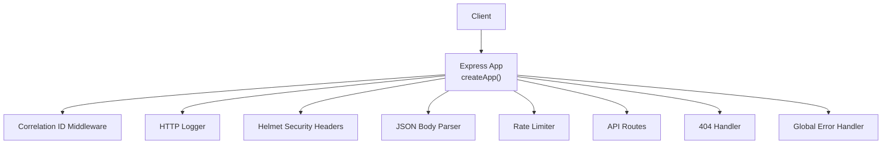
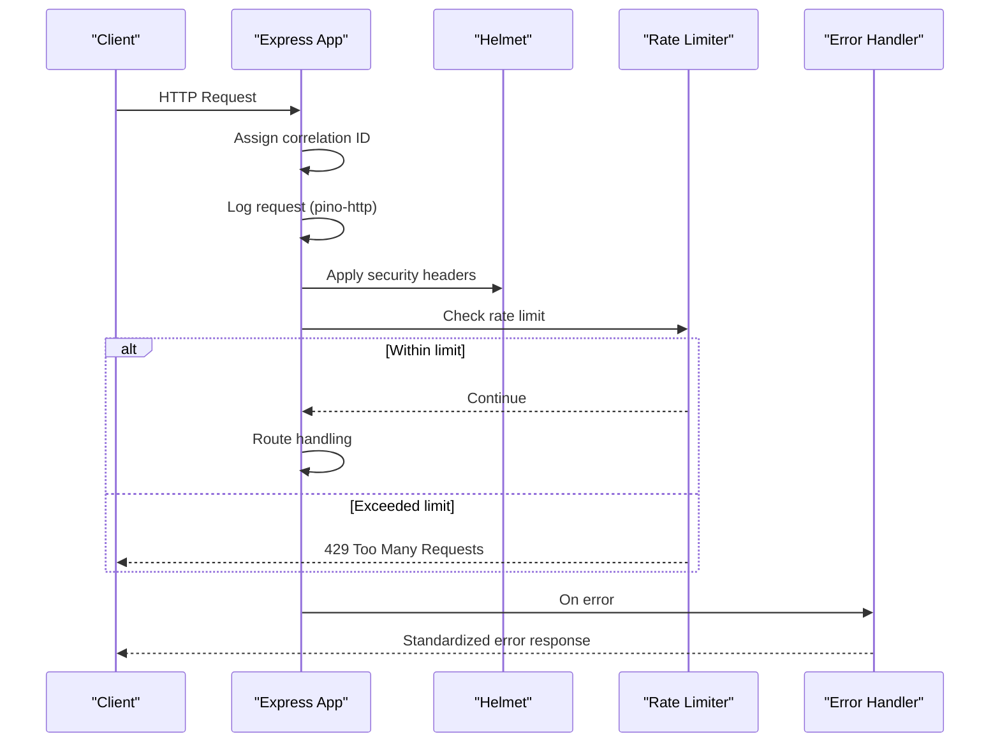
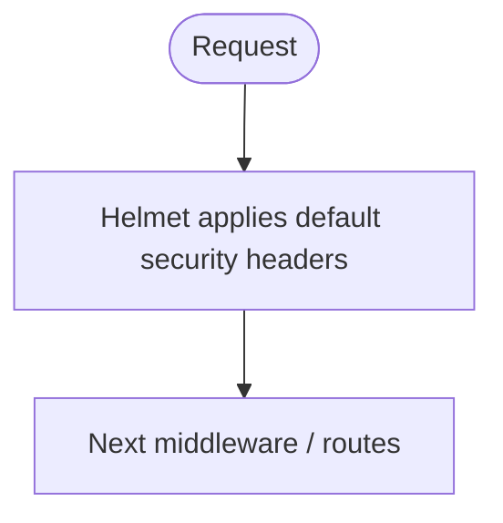
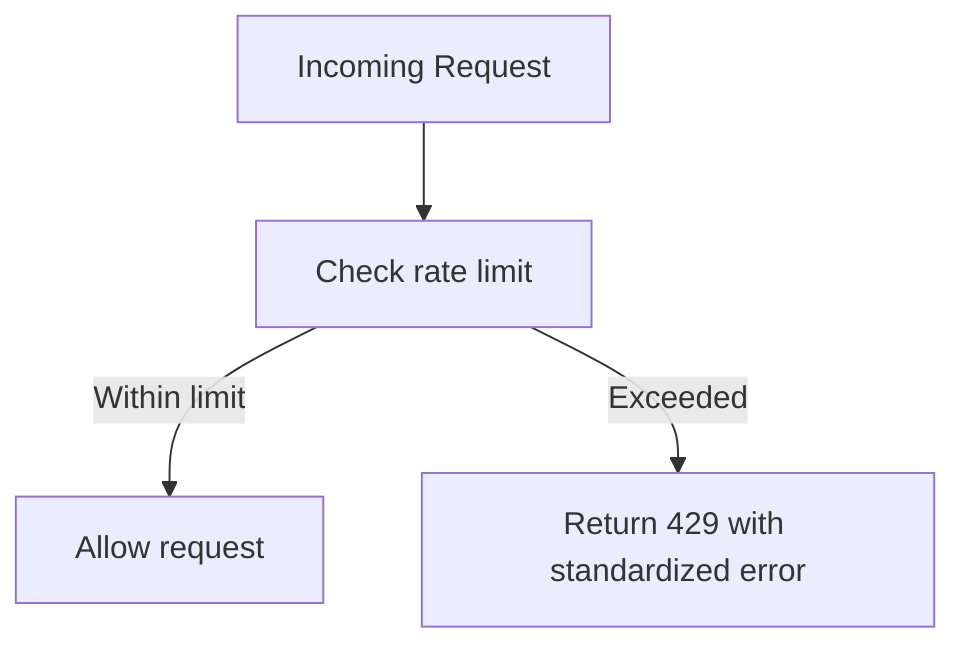
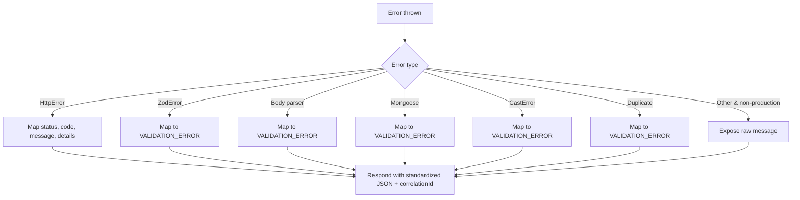
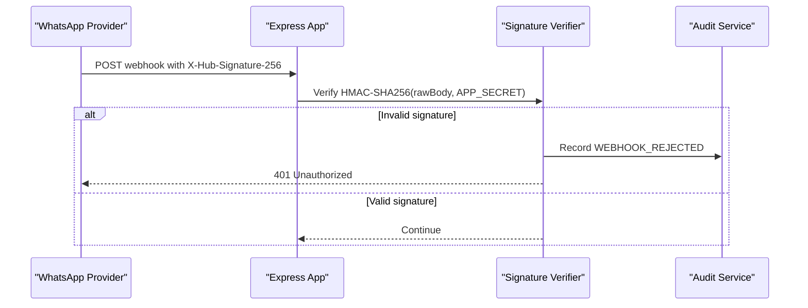
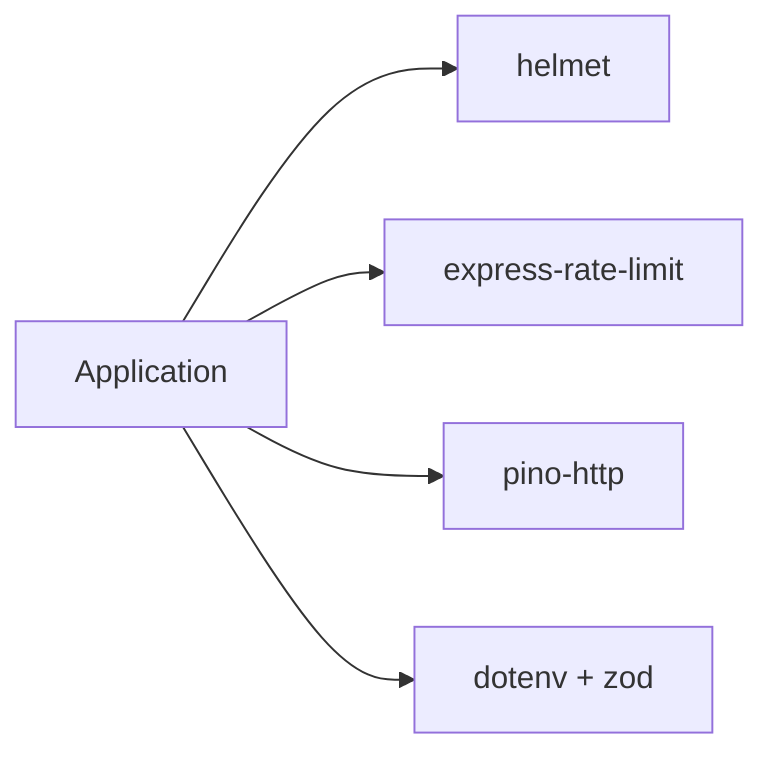

# Security Headers and Protection

<cite>
**Referenced Files in This Document**
- [app.js](file://src/app.js)
- [errorHandler.js](file://src/middleware/errorHandler.js)
- [env.js](file://src/config/env.js)
- [auth.js](file://src/middleware/auth.js)
- [signature.js](file://src/middleware/signature.js)
- [package.json](file://package.json)
</cite>

## Table of Contents
1. [Introduction](#introduction)
2. [Project Structure](#project-structure)
3. [Core Components](#core-components)
4. [Architecture Overview](#architecture-overview)
5. [Detailed Component Analysis](#detailed-component-analysis)
6. [Dependency Analysis](#dependency-analysis)
7. [Performance Considerations](#performance-considerations)
8. [Troubleshooting Guide](#troubleshooting-guide)
9. [Conclusion](#conclusion)

## Introduction
This document explains the security headers and protection mechanisms implemented in the application. It focuses on Helmet middleware configuration for HTTP security headers, rate limiting to prevent abuse and DDoS attacks, the global error handler that prevents information leakage in production, and additional protections against common web vulnerabilities such as CSRF, clickjacking, and MIME sniffing. It also provides guidance on customizing security policies, monitoring security events, and responding to incidents.

## Project Structure
Security-related behavior is primarily defined at the application bootstrap layer and reinforced by dedicated middleware:

- Application bootstrap wires logging, security headers, body parsing, rate limiting, routing, and centralized error handling.
- Environment validation ensures sensitive defaults are replaced in production.
- Authentication and webhook signature verification provide request-level security controls.

**Diagram sources**
- [app.js:15-74](file://src/app.js#L15-L74)

**Section sources**
- [app.js:15-74](file://src/app.js#L15-L74)

## Core Components
- Helmet middleware is enabled globally to set secure HTTP response headers.
- Rate limiting is applied with a generous per-minute limit and standard headers; it is skipped in tests.
- The global error handler normalizes error responses and suppresses internal details in production.
- Environment configuration validates critical secrets and enforces safe defaults.
- Staff API key authentication uses constant-time comparison.
- WhatsApp webhook signature verification uses HMAC-SHA256 with timing-safe comparison and audit logging.

**Section sources**
- [app.js:18-67](file://src/app.js#L18-L67)
- [errorHandler.js:6-79](file://src/middleware/errorHandler.js#L6-L79)
- [env.js:25-141](file://src/config/env.js#L25-L141)
- [auth.js:1-22](file://src/middleware/auth.js#L1-L22)
- [signature.js:1-37](file://src/middleware/signature.js#L1-L37)

## Architecture Overview
The request lifecycle includes correlation ID assignment, structured logging, security headers, payload size limits, rate limiting, route handling, and centralized error handling.

**Diagram sources**
- [app.js:21-72](file://src/app.js#L21-L72)
- [errorHandler.js:16-79](file://src/middleware/errorHandler.js#L16-L79)

## Detailed Component Analysis

### Helmet and HTTP Security Headers
Helmet is enabled globally to apply a baseline set of secure headers. In this application, Helmet is configured with default settings, which include protective headers such as Content Security Policy, X-Frame-Options, X-Content-Type-Options, Strict-Transport-Security, Referrer-Policy, and others.

Key behaviors:
- Helmet is mounted early in the middleware stack to ensure all responses include security headers.
- Express’s `x-powered-by` header is disabled to reduce server fingerprinting.
- Trust proxy is set so reverse proxies can correctly determine client IPs for rate limiting and logging.

Recommendations for customization:
- Tune Content Security Policy to restrict scripts, styles, and third-party resources according to your frontend architecture.
- Adjust frame options if embedding content via iframes is required.
- Enable or refine HSTS based on deployment and TLS termination points.
- Review and adjust Referrer-Policy and Permissions-Policy for your use case.

**Diagram sources**
- [app.js:18-39](file://src/app.js#L18-L39)

**Section sources**
- [app.js:18-39](file://src/app.js#L18-L39)

### Rate Limiting and Abuse Prevention
Rate limiting is implemented using express-rate-limit with the following characteristics:
- Window: 60 seconds.
- Limit: 300 requests per window.
- Standard headers enabled (`draft-7`) and legacy headers disabled.
- Skipped in test environments.
- Custom 429 response includes a standardized error object and correlation ID.

Monitoring and tuning:
- Monitor 429 responses and correlate with request IDs to identify abusive clients.
- Adjust window duration and limit based on traffic patterns and provider retry behavior.
- Consider IP-based or user-based strategies if you need finer granularity.

**Diagram sources**
- [app.js:52-67](file://src/app.js#L52-L67)

**Section sources**
- [app.js:52-67](file://src/app.js#L52-L67)

### Global Error Handler and Information Leakage Prevention
The global error handler centralizes error formatting and prevents leaking internal details in production:
- Normalizes errors into a consistent structure with code, message, and details.
- Maps known error types (validation, database, etc.) to appropriate status codes and messages.
- Suppresses raw error messages in production unless explicitly exposed.
- Logs errors with correlation IDs for observability.

Best practices:
- Always return standardized error bodies from controllers and middleware.
- Avoid logging sensitive payloads; rely on correlation IDs for tracing.
- Use structured logs and forward them to a centralized logging system.

**Diagram sources**
- [errorHandler.js:16-79](file://src/middleware/errorHandler.js#L16-L79)

**Section sources**
- [errorHandler.js:6-79](file://src/middleware/errorHandler.js#L6-L79)

### Additional Protections Against Common Web Vulnerabilities
- Clickjacking: Helmet’s default X-Frame-Options helps prevent UI redress attacks.
- MIME sniffing: Helmet’s X-Content-Type-Options prevents browsers from MIME-sniffing responses.
- CSRF: If your API serves cookies or stateful sessions, add CSRF protection for browser-based flows. For pure JSON APIs behind authentication, CSRF is less relevant but consider SameSite cookie attributes where applicable.
- XSS: Enforce a strict Content Security Policy via Helmet to restrict script execution and data sources.
- Protocol upgrades: Use Helmet’s HSTS to enforce HTTPS connections.

Note: These protections are provided by Helmet’s defaults and should be reviewed and tuned for your environment.

**Section sources**
- [app.js:39-39](file://src/app.js#L39-L39)

### Authentication and Signature Verification
- Staff endpoints require an API key passed via a custom header. Comparison is constant-time to mitigate timing attacks.
- WhatsApp webhooks verify signatures using HMAC-SHA256 over the raw request body. Rejections are audited before returning unauthorized responses.

**Diagram sources**
- [signature.js:1-37](file://src/middleware/signature.js#L1-L37)
- [auth.js:1-22](file://src/middleware/auth.js#L1-L22)

**Section sources**
- [auth.js:1-22](file://src/middleware/auth.js#L1-L22)
- [signature.js:1-37](file://src/middleware/signature.js#L1-L37)

## Dependency Analysis
The security stack depends on well-known libraries:

- helmet: Provides secure HTTP headers.
- express-rate-limit: Implements rate limiting with standard headers.
- pino-http: Structured HTTP request/response logging.
- dotenv and zod: Validate and load environment variables safely.

**Diagram sources**
- [package.json:18-28](file://package.json#L18-L28)
- [app.js:1-9](file://src/app.js#L1-L9)

**Section sources**
- [package.json:18-28](file://package.json#L18-L28)
- [app.js:1-9](file://src/app.js#L1-L9)

## Performance Considerations
- Helmet adds minimal overhead and is recommended to run early.
- Rate limiting introduces small checks per request; tune window and limit to balance throughput and protection.
- Logging overhead is controlled by log levels and serializers; avoid verbose logs in production.
- Keep body size limits conservative to mitigate resource exhaustion.

[No sources needed since this section provides general guidance]

## Troubleshooting Guide
Common issues and resolutions:
- Unexpected 429 responses:
  - Inspect rate limit counters and adjust window/limit if legitimate traffic spikes occur.
  - Ensure clients respect Retry-After when present.
- Missing security headers:
  - Confirm Helmet is mounted before routes and not overridden later.
  - Verify reverse proxy does not strip headers.
- Sensitive data in error responses:
  - Ensure all paths go through the global error handler.
  - Avoid logging raw errors in production; use correlation IDs instead.
- Webhook rejections:
  - Verify HMAC secret configuration and that the raw body is preserved for signature verification.
  - Check audit logs for rejection reasons.

**Section sources**
- [app.js:52-67](file://src/app.js#L52-L67)
- [errorHandler.js:16-79](file://src/middleware/errorHandler.js#L16-L79)
- [signature.js:1-37](file://src/middleware/signature.js#L1-L37)

## Conclusion
The application implements a solid security foundation using Helmet for HTTP hardening, rate limiting for abuse prevention, and a centralized error handler to avoid information leakage. Environment validation strengthens operational security by enforcing secret requirements in production. Authentication and webhook signature verification further protect sensitive endpoints. To maintain strong security posture, regularly review and customize Helmet policies, monitor rate limiting and error metrics, and keep dependencies updated.

[No sources needed since this section summarizes without analyzing specific files]