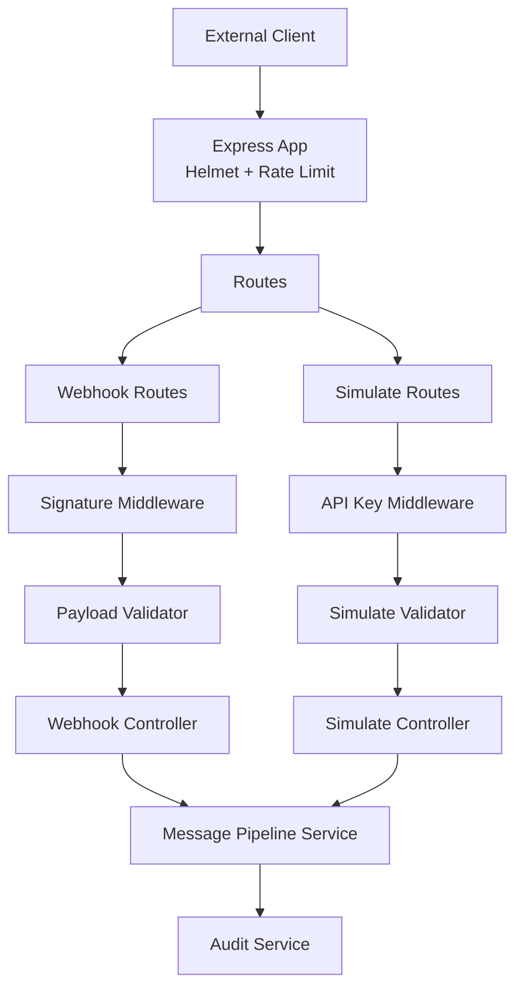
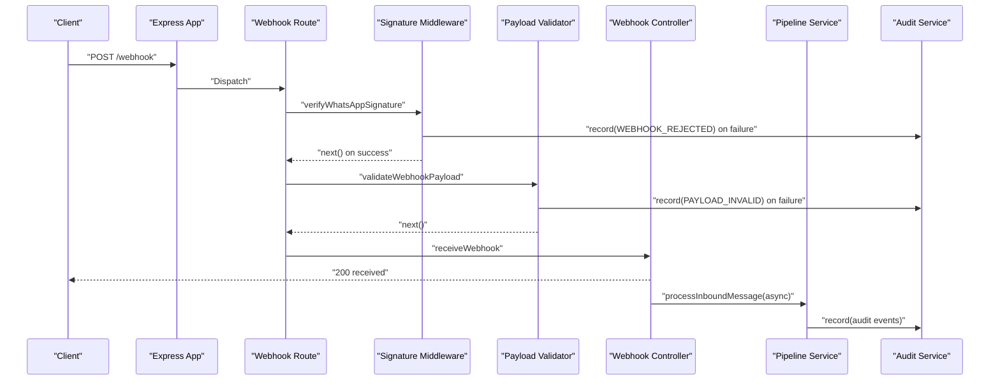
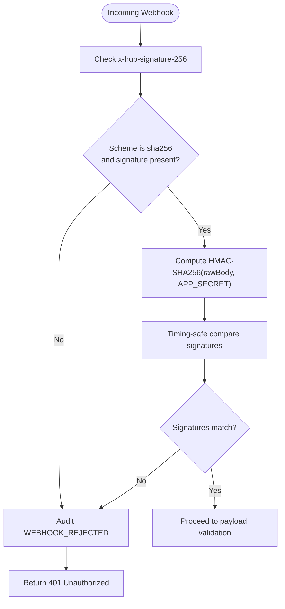
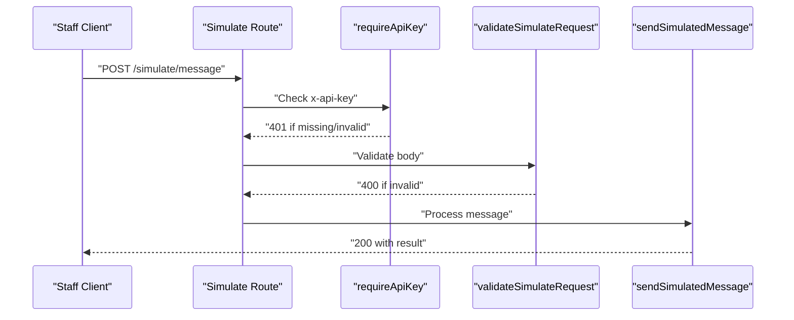
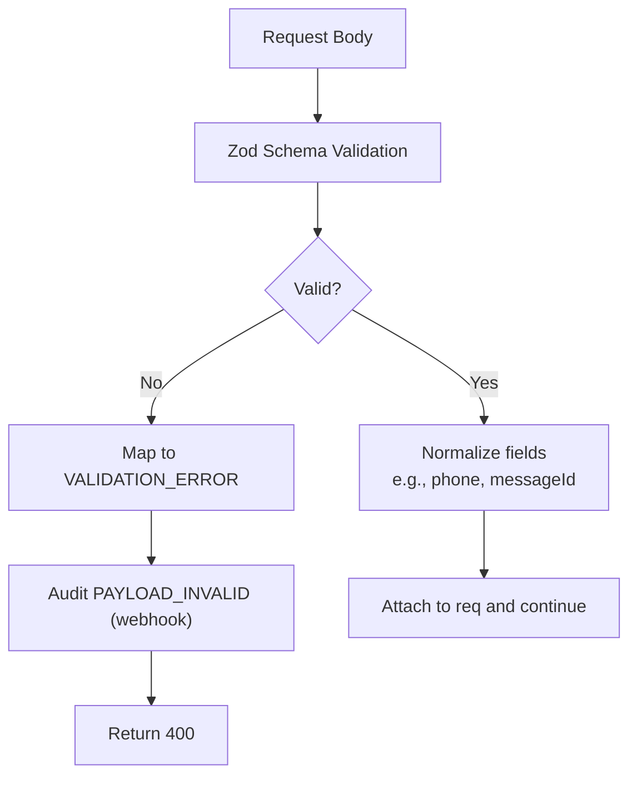
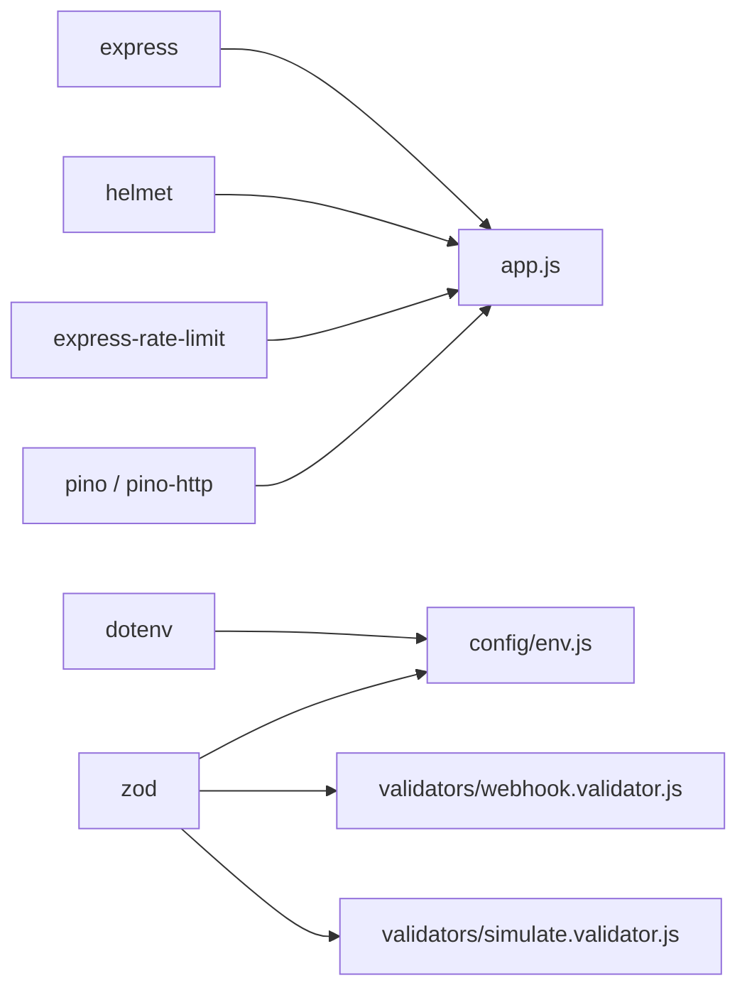

# Security Implementation

<cite>
**Referenced Files in This Document**
- [README.md](file://README.md)
- [package.json](file://package.json)
- [src/app.js](file://src/app.js)
- [src/server.js](file://src/server.js)
- [src/config/env.js](file://src/config/env.js)
- [src/middleware/signature.js](file://src/middleware/signature.js)
- [src/middleware/auth.js](file://src/middleware/auth.js)
- [src/middleware/errorHandler.js](file://src/middleware/errorHandler.js)
- [src/validators/webhook.validator.js](file://src/validators/webhook.validator.js)
- [src/validators/simulate.validator.js](file://src/validators/simulate.validator.js)
- [src/controllers/webhook.controller.js](file://src/controllers/webhook.controller.js)
- [src/controllers/simulate.controller.js](file://src/controllers/simulate.controller.js)
- [src/routes/webhook.routes.js](file://src/routes/webhook.routes.js)
- [src/routes/simulate.routes.js](file://src/routes/simulate.routes.js)
- [src/services/audit.service.js](file://src/services/audit.service.js)
</cite>

## Table of Contents
1. [Introduction](#introduction)
2. [Project Structure](#project-structure)
3. [Core Components](#core-components)
4. [Architecture Overview](#architecture-overview)
5. [Detailed Component Analysis](#detailed-component-analysis)
6. [Dependency Analysis](#dependency-analysis)
7. [Performance Considerations](#performance-considerations)
8. [Troubleshooting Guide](#troubleshooting-guide)
9. [Conclusion](#conclusion)
10. [Appendices](#appendices)

## Introduction
This document describes the implemented security controls for the WhatsApp retail automation API. It covers webhook signature verification, staff API key authentication, input validation with Zod schemas, environment variable validation, HTTP hardening through Helmet and rate limiting, structured error handling that avoids information leakage, secret management practices, production requirements, protection against common web vulnerabilities, threat mitigation strategies, security testing approaches, and compliance considerations for customer data and audit trails.

The system is an Express application that processes inbound WhatsApp messages via signed webhooks, exposes a staff-only simulation endpoint, validates all inputs, enforces strict environment configuration, and records security-relevant events to an append-only audit trail.

## Project Structure
Security-related functionality is distributed across middleware, validators, controllers, routes, configuration, and services:

- Application bootstrap and HTTP hardening are defined in the app builder.
- Webhook signing and payload validation are applied as route-level middleware.
- Staff API key authentication protects the simulate endpoints.
- Environment variables are validated at startup using Zod.
- Errors are normalized and sanitized by a central error handler.
- Audit events capture rejections and validation failures.

**Diagram sources**
- [src/app.js:1-76](file://src/app.js#L1-L76)
- [src/routes/webhook.routes.js:1-16](file://src/routes/webhook.routes.js#L1-L16)
- [src/routes/simulate.routes.js:1-21](file://src/routes/simulate.routes.js#L1-L21)
- [src/middleware/signature.js:1-51](file://src/middleware/signature.js#L1-L51)
- [src/middleware/auth.js:1-23](file://src/middleware/auth.js#L1-L23)
- [src/validators/webhook.validator.js:1-124](file://src/validators/webhook.validator.js#L1-L124)
- [src/validators/simulate.validator.js:1-55](file://src/validators/simulate.validator.js#L1-L55)
- [src/controllers/webhook.controller.js:1-56](file://src/controllers/webhook.controller.js#L1-L56)
- [src/controllers/simulate.controller.js:1-35](file://src/controllers/simulate.controller.js#L1-L35)
- [src/services/audit.service.js:1-36](file://src/services/audit.service.js#L1-L36)

**Section sources**
- [src/app.js:1-76](file://src/app.js#L1-L76)
- [src/server.js:1-50](file://src/server.js#L1-L50)
- [README.md:364-384](file://README.md#L364-L384)

## Core Components
- HMAC-SHA256 webhook signature verification ensures incoming Meta webhooks originate from a trusted source.
- Staff API key authentication protects internal simulation endpoints.
- Zod-based input validation enforces schema contracts for both webhook payloads and simulate requests.
- Environment variable validation prevents deployment with default or missing secrets.
- Helmet configures secure HTTP headers; express-rate-limit provides coarse abuse protection.
- Centralized error handling normalizes responses and suppresses sensitive stack traces in production.
- Audit service records security-relevant events such as rejected signatures and invalid payloads.

**Section sources**
- [src/middleware/signature.js:1-51](file://src/middleware/signature.js#L1-L51)
- [src/middleware/auth.js:1-23](file://src/middleware/auth.js#L1-L23)
- [src/validators/webhook.validator.js:1-124](file://src/validators/webhook.validator.js#L1-L124)
- [src/validators/simulate.validator.js:1-55](file://src/validators/simulate.validator.js#L1-L55)
- [src/config/env.js:1-130](file://src/config/env.js#L1-L130)
- [src/app.js:1-76](file://src/app.js#L1-L76)
- [src/middleware/errorHandler.js:1-80](file://src/middleware/errorHandler.js#L1-L80)
- [src/services/audit.service.js:1-36](file://src/services/audit.service.js#L1-L36)

## Architecture Overview
The security architecture applies layered defenses around request processing:

- Request enters Express and passes through correlation ID logging, structured HTTP logging, Helmet, JSON parsing (with raw body retention), and rate limiting.
- Webhook POST routes enforce signature verification before payload validation.
- Simulate routes require a valid staff API key and validate the request body.
- Controllers return fast responses for webhooks and await pipeline results for simulations.
- Errors are handled centrally, mapping framework and validation errors into a safe, standardized response shape.
- Audit events are recorded for critical security outcomes.

**Diagram sources**
- [src/routes/webhook.routes.js:1-16](file://src/routes/webhook.routes.js#L1-L16)
- [src/middleware/signature.js:1-51](file://src/middleware/signature.js#L1-L51)
- [src/validators/webhook.validator.js:1-124](file://src/validators/webhook.validator.js#L1-L124)
- [src/controllers/webhook.controller.js:1-56](file://src/controllers/webhook.controller.js#L1-L56)
- [src/services/audit.service.js:1-36](file://src/services/audit.service.js#L1-L36)

## Detailed Component Analysis

### HMAC-SHA256 Webhook Signature Verification
The webhook signature middleware verifies the `x-hub-signature-256` header against the raw request body using the configured WhatsApp app secret. It uses a timing-safe comparison to prevent timing attacks. Rejected requests are audited as `WEBHOOK_REJECTED` before returning a 401. The raw body is preserved by the JSON parser so the exact bytes signed by Meta can be verified.

Key behaviors:
- Rejects missing or malformed signature headers.
- Computes expected HMAC-SHA256 digest over the raw buffer.
- Compares provided and expected digests using constant-time equality.
- Records rejection reasons in the audit trail without exposing secrets.

**Diagram sources**
- [src/middleware/signature.js:1-51](file://src/middleware/signature.js#L1-L51)
- [src/app.js:41-50](file://src/app.js#L41-L50)
- [src/services/audit.service.js:1-36](file://src/services/audit.service.js#L1-L36)

**Section sources**
- [src/middleware/signature.js:1-51](file://src/middleware/signature.js#L1-L51)
- [src/app.js:41-50](file://src/app.js#L41-L50)

### Staff API Key Authentication
Staff-only endpoints under `/simulate/*` require the `x-api-key` header. The middleware compares the provided key against the configured `STAFF_API_KEY` using a constant-time comparison function to mitigate timing side channels. Invalid or missing keys result in a 401 response.

Additional protections:
- The simulate endpoint is disabled in production by returning 404 regardless of authentication.
- Validation ensures only allowed fields are accepted and phone numbers conform to expected formats.

**Diagram sources**
- [src/routes/simulate.routes.js:1-21](file://src/routes/simulate.routes.js#L1-L21)
- [src/middleware/auth.js:1-23](file://src/middleware/auth.js#L1-L23)
- [src/validators/simulate.validator.js:1-55](file://src/validators/simulate.validator.js#L1-L55)
- [src/controllers/simulate.controller.js:1-35](file://src/controllers/simulate.controller.js#L1-L35)

**Section sources**
- [src/middleware/auth.js:1-23](file://src/middleware/auth.js#L1-L23)
- [src/routes/simulate.routes.js:1-21](file://src/routes/simulate.routes.js#L1-L21)
- [src/validators/simulate.validator.js:1-55](file://src/validators/simulate.validator.js#L1-L55)

### Input Validation Using Zod Schemas
All user-supplied data is validated with Zod:

- Webhook payload schema validates the structure of Meta’s webhook envelope, including entries, changes, contacts, and messages. Unknown fields are preserved to remain compatible with future Meta updates. Non-text messages are represented with null text values.
- Simulate request schema enforces required fields, length limits, optional flags, and Nigerian phone number validation. It also normalizes phone numbers and generates stable identifiers when not provided.

Validation failures produce standardized 400 responses and are audited where appropriate.

**Diagram sources**
- [src/validators/webhook.validator.js:1-124](file://src/validators/webhook.validator.js#L1-L124)
- [src/validators/simulate.validator.js:1-55](file://src/validators/simulate.validator.js#L1-L55)
- [src/middleware/errorHandler.js:1-80](file://src/middleware/errorHandler.js#L1-L80)

**Section sources**
- [src/validators/webhook.validator.js:1-124](file://src/validators/webhook.validator.js#L1-L124)
- [src/validators/simulate.validator.js:1-55](file://src/validators/simulate.validator.js#L1-L55)

### Environment Variable Validation
Environment configuration is parsed and validated at startup using Zod. The validator:

- Enforces allowed enum values for runtime settings.
- Coerces numeric and boolean-like strings safely.
- Requires production secrets to differ from placeholders.
- Enforces conditional dependencies (e.g., Cloud mode requires phone ID and access token; LLM providers require API keys).
- Exits the process with a readable list of invalid variables before any server logic runs.

This prevents accidental deployment with default credentials and ensures consistent behavior across environments.

**Section sources**
- [src/config/env.js:1-130](file://src/config/env.js#L1-L130)
- [README.md:163-198](file://README.md#L163-L198)

### Security Headers Provided by Helmet
Helmet is enabled globally on the Express app. It configures standard security headers such as content security policy, frame options, XSS protection, and others according to its defaults. Combined with disabling the `X-Powered-By` header and trusting one reverse proxy, it reduces exposure to common client-side and infrastructure misconfigurations.

**Section sources**
- [src/app.js:18-39](file://src/app.js#L18-L39)

### Rate Limiting Implementation
Rate limiting is applied globally with a generous window and limit suitable for webhook retry patterns. It returns a standardized 429 response with the standard error body and correlation ID. Limits are skipped in tests to avoid flakiness.

Operational notes:
- Window and limit are tuned for provider retries.
- Standard headers are used for compatibility.
- Custom handler returns a consistent error shape.

**Section sources**
- [src/app.js:52-67](file://src/app.js#L52-L67)

### Error Handling That Prevents Information Leakage
The centralized error handler maps various error types into a uniform response shape containing a code, message, and details array. It:

- Normalizes HttpError, ZodError, Mongoose validation errors, cast errors, duplicate key errors, and body-parser errors.
- Suppresses detailed error messages in production unless explicitly exposed.
- Logs full error context internally while returning safe responses externally.
- Ensures every response includes a correlation ID for traceability.

This design minimizes information leakage while preserving diagnostic capability for operators.

**Section sources**
- [src/middleware/errorHandler.js:1-80](file://src/middleware/errorHandler.js#L1-L80)
- [src/utils/httpError.js:1-31](file://src/utils/httpError.js#L1-L31)

### Secret Management Practices
Secrets are managed through environment variables loaded from `.env`, which is gitignored. The README documents that only placeholders are committed. Production boot validation rejects default placeholder values for critical secrets. Phone numbers are masked in logs, and webhook rejection audits do not include raw payload secrets.

Recommended practices reflected in the codebase:
- Never commit real secrets.
- Use strong random values for API keys and tokens.
- Rotate secrets regularly.
- Store secrets in a secure vault in production and inject them as environment variables.

**Section sources**
- [README.md:283-289](file://README.md#L283-L289)
- [src/config/env.js:65-108](file://src/config/env.js#L65-L108)

### Production Environment Security Requirements
Production deployments must satisfy:

- Replace default secrets (`STAFF_API_KEY`, `WHATSAPP_APP_SECRET`, `WHATSAPP_VERIFY_TOKEN`).
- Configure WhatsApp Cloud mode only when required credentials are present.
- Ensure HTTPS termination at a reverse proxy or load balancer.
- Keep rate limiting enabled and monitor 429 responses.
- Restrict access to the simulate endpoint (disabled in production by route logic).
- Enable structured logging and forward logs securely to a SIEM or log aggregation system.
- Monitor audit events for anomalies.

**Section sources**
- [src/config/env.js:65-108](file://src/config/env.js#L65-L108)
- [src/routes/simulate.routes.js:10-18](file://src/routes/simulate.routes.js#L10-L18)
- [README.md:193-198](file://README.md#L193-L198)

### Protection Against Common Web Vulnerabilities
Implemented mitigations:

- CSRF: Not applicable for stateless JSON APIs behind HTTPS; ensure proper CORS policies at the reverse proxy.
- XSS: Helmet sets protective headers; avoid rendering untrusted content in HTML contexts.
- Clickjacking: Frame options set by Helmet.
- MIME sniffing: Content type enforcement via JSON parsing and Helmet.
- Protocol downgrade: Enforce HTTPS at the edge.
- Open redirect: Not present in current routes; validate redirects if added later.
- Insecure defaults: Environment validation prevents deploying with placeholder secrets.
- Timing attacks: Constant-time comparisons for secrets and signatures.
- Denial of service: Rate limiting, body size limits, and graceful shutdown.

**Section sources**
- [src/app.js:18-50](file://src/app.js#L18-L50)
- [src/middleware/auth.js:5-9](file://src/middleware/auth.js#L5-L9)
- [src/middleware/signature.js:40-44](file://src/middleware/signature.js#L40-L44)

### Threat Mitigation Strategies
- Webhook replay and tampering: HMAC-SHA256 verification over raw body prevents tampering; deduplication via provider message IDs is supported by the pipeline contract.
- Credential theft: Constant-time comparisons and minimal logging reduce side-channel risks.
- Abuse and scraping: Rate limiting and strict input validation reduce resource exhaustion.
- Misconfiguration: Startup validation blocks unsafe configurations.
- Operational risk: Best-effort audit writes ensure the live path remains available even if audit storage fails.

**Section sources**
- [src/middleware/signature.js:1-51](file://src/middleware/signature.js#L1-L51)
- [src/services/audit.service.js:1-36](file://src/services/audit.service.js#L1-L36)

### Security Testing Approaches
The test suite exercises:

- Environment-gated production behavior.
- Webhook signature success, failure, and audit trails.
- Simulate validation and response shapes.
- Health checks up/down states.
- Adapter modes and forced failure paths.

Recommendations for additional security testing:

- Fuzz webhook payloads to exercise Zod boundaries.
- Test rate limiting thresholds and header behavior.
- Verify Helmet headers in integration tests.
- Validate that production responses never leak stack traces.
- Add negative tests for missing or malformed signature headers.
- Exercise audit event creation and failure paths.

**Section sources**
- [README.md:351-362](file://README.md#L351-L362)

### Compliance Considerations for Customer Data and Audit Trails
- Data minimization: Only necessary fields are extracted and processed.
- Confidentiality: Secrets are not logged; phone numbers are masked.
- Integrity: Webhook signatures protect message integrity.
- Availability: Graceful shutdown and background processing improve resilience.
- Auditability: Security-relevant events are recorded with correlation IDs.
- Retention: Implement log and audit retention policies aligned with regulatory requirements.
- Access control: Restrict staff endpoints and restrict access to audit data.

**Section sources**
- [src/validators/webhook.validator.js:68-95](file://src/validators/webhook.validator.js#L68-L95)
- [src/services/audit.service.js:1-36](file://src/services/audit.service.js#L1-L36)
- [README.md:283-289](file://README.md#L283-L289)

## Dependency Analysis
Security-critical dependencies and their roles:

- helmet: Configures secure HTTP headers.
- express-rate-limit: Provides request throttling.
- zod: Validates environment variables and request payloads.
- pino/pino-http: Structured logging with correlation IDs.
- dotenv: Loads environment variables.
- express: HTTP framework.

**Diagram sources**
- [package.json:18-28](file://package.json#L18-L28)
- [src/app.js:1-9](file://src/app.js#L1-L9)
- [src/config/env.js:1-5](file://src/config/env.js#L1-L5)
- [src/validators/webhook.validator.js:1-3](file://src/validators/webhook.validator.js#L1-L3)
- [src/validators/simulate.validator.js:1-3](file://src/validators/simulate.validator.js#L1-L3)

**Section sources**
- [package.json:18-28](file://package.json#L18-L28)
- [src/app.js:1-9](file://src/app.js#L1-L9)

## Performance Considerations
- Webhook controller returns 200 immediately and processes messages asynchronously to avoid retry storms.
- Rate limiting is generous to accommodate provider retries while still protecting resources.
- Audit writes are best-effort to avoid blocking the live path.
- Logging excludes health checks to reduce noise.

These choices prioritize availability and reliability while maintaining security guarantees.

**Section sources**
- [src/controllers/webhook.controller.js:27-55](file://src/controllers/webhook.controller.js#L27-L55)
- [src/app.js:52-67](file://src/app.js#L52-L67)
- [src/services/audit.service.js:1-36](file://src/services/audit.service.js#L1-L36)
- [src/app.js:22-36](file://src/app.js#L22-L36)

## Troubleshooting Guide
Common issues and their security implications:

- Invalid environment variables: Indicates misconfiguration; fix before deployment.
- Webhook 401 invalid signature: Usually caused by mismatched app secret; verify secret injection and raw body preservation.
- Handshake 403: Verify token mismatch between platform and configuration.
- Rate limited responses: Indicates excessive traffic; review client retry behavior and rate limit tuning.
- Internal errors: Check structured logs with correlation IDs; production responses will not expose stack traces.

Operational tips:
- Use correlation IDs to trace requests end-to-end.
- Inspect audit events for rejected signatures and invalid payloads.
- Avoid logging raw payloads or secrets.

**Section sources**
- [README.md:409-419](file://README.md#L409-L419)
- [src/middleware/signature.js:19-49](file://src/middleware/signature.js#L19-L49)
- [src/middleware/errorHandler.js:16-79](file://src/middleware/errorHandler.js#L16-L79)

## Conclusion
The application implements a robust security posture through layered controls: cryptographic webhook verification, constant-time API key checks, comprehensive input validation, strict environment validation, HTTP hardening, rate limiting, safe error handling, and audit logging. These measures collectively mitigate common threats, reduce information leakage, and support operational visibility. Production deployments should follow the documented secret management and environment requirements, enforce HTTPS, and monitor security signals through logs and audit events.

## Appendices

### Security Checklist
- Replace all default secrets before production.
- Enable HTTPS at the edge.
- Confirm Helmet headers are present.
- Validate rate limiting behavior under load.
- Review audit events for anomalies.
- Restrict staff endpoints and limit access to sensitive data.
- Back up and rotate secrets regularly.
- Retain audit logs per compliance requirements.

[No sources needed since this section provides general guidance]