# Integration Testing Approach

<cite>
**Referenced Files in This Document**
- [README.md](file://README.md)
- [package.json](file://package.json)
- [src/app.js](file://src/app.js)
- [src/server.js](file://src/server.js)
- [src/config/env.js](file://src/config/env.js)
- [src/config/db.js](file://src/config/db.js)
- [src/controllers/webhook.controller.js](file://src/controllers/webhook.controller.js)
- [src/controllers/simulate.controller.js](file://src/controllers/simulate.controller.js)
- [src/services/pipeline.service.js](file://src/services/pipeline.service.js)
- [src/services/whatsapp.adapter.js](file://src/services/whatsapp.adapter.js)
- [tests/helpers/setup-env.mjs](file://tests/helpers/setup-env.mjs)
- [tests/helpers/testDb.js](file://tests/helpers/testDb.js)
- [tests/helpers/run-adapter-scenario.mjs](file://tests/helpers/run-adapter-scenario.mjs)
- [tests/helpers/run-simulate-prod.mjs](file://tests/helpers/run-simulate-prod.mjs)
- [tests/webhook.test.js](file://tests/webhook.test.js)
- [tests/simulate.test.js](file://tests/simulate.test.js)
- [tests/whatsappAdapter.test.js](file://tests/whatsappAdapter.test.js)
</cite>

## Table of Contents
1. [Introduction](#introduction)
2. [Project Structure](#project-structure)
3. [Core Components](#core-components)
4. [Architecture Overview](#architecture-overview)
5. [Detailed Component Analysis](#detailed-component-analysis)
6. [Dependency Analysis](#dependency-analysis)
7. [Performance Considerations](#performance-considerations)
8. [Troubleshooting Guide](#troubleshooting-guide)
9. [Conclusion](#conclusion)

## Introduction
This document explains the integration testing approach for the WhatsApp retail automation API, focusing on:
- API endpoint testing with supertest
- Webhook processing flows and asynchronous validation
- Simulated message handling through the `/simulate/message` harness
- End-to-end workflow validation across controllers, pipeline, models, and the WhatsApp adapter
- The scenario runner used for adapter testing
- Mocking external services such as Meta’s Graph API
- Database state management using an in-memory MongoDB instance
- Strategies for testing complex business flows, error propagation, concurrent requests, and event-driven processes

The test suite uses Node’s built-in `node:test` runner, supertest for HTTP assertions, and `mongodb-memory-server` so tests run without a live database or Docker.

**Section sources**
- [README.md:50-58](file://README.md#L50-L58)
- [README.md:351-362](file://README.md#L351-L362)
- [package.json:10-16](file://package.json#L10-L16)

## Project Structure
At a high level, integration tests exercise the Express application created by `createApp`, send HTTP requests through supertest, and assert both response shapes and downstream database state.

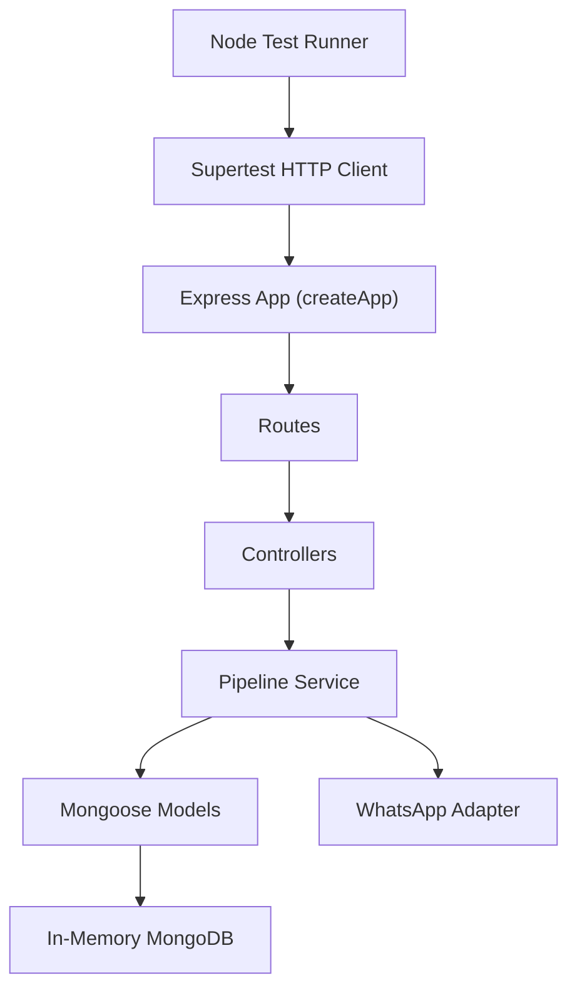

**Diagram sources**
- [src/app.js](file://src/app.js)
- [src/controllers/webhook.controller.js:1-56](file://src/controllers/webhook.controller.js#L1-L56)
- [src/controllers/simulate.controller.js:1-35](file://src/controllers/simulate.controller.js#L1-L35)
- [src/services/pipeline.service.js:1-274](file://src/services/pipeline.service.js#L1-L274)
- [src/services/whatsapp.adapter.js:1-136](file://src/services/whatsapp.adapter.js#L1-L136)
- [tests/helpers/testDb.js:1-28](file://tests/helpers/testDb.js#L1-L28)

**Section sources**
- [README.md:364-384](file://README.md#L364-L384)
- [package.json:18-35](file://package.json#L18-L35)

## Core Components
The integration tests are organized around three main areas:

| Area | Purpose | Key Files |
|---|---|---|
| Test environment bootstrap | Sets `NODE_ENV=test`, disables logs, configures safe defaults, and prepares environment variables before any source module loads | [tests/helpers/setup-env.mjs:1-19](file://tests/helpers/setup-env.mjs#L1-L19) |
| Database lifecycle | Starts an in-memory MongoDB, connects Mongoose, clears collections between tests, and shuts down cleanly | [tests/helpers/testDb.js:1-28](file://tests/helpers/testDb.js#L1-L28) |
| HTTP integration tests | Uses supertest against `createApp()` to validate endpoints, headers, status codes, and downstream persistence | [tests/webhook.test.js:1-222](file://tests/webhook.test.js#L1-L222), [tests/simulate.test.js:1-134](file://tests/simulate.test.js#L1-L134) |
| Adapter scenario runner | Spawns child processes with controlled environments and optional `fetch` mocks to test the WhatsApp adapter outside the normal app lifecycle | [tests/helpers/run-adapter-scenario.mjs:1-44](file://tests/helpers/run-adapter-scenario.mjs#L1-L44), [tests/whatsappAdapter.test.js:1-119](file://tests/whatsappAdapter.test.js#L1-L119) |
| Production isolation helper | Boots the real app in production mode inside a child process to verify that `/simulate/message` is disabled | [tests/helpers/run-simulate-prod.mjs:1-30](file://tests/helpers/run-simulate-prod.mjs#L1-L30) |

**Section sources**
- [tests/helpers/setup-env.mjs:1-19](file://tests/helpers/setup-env.mjs#L1-L19)
- [tests/helpers/testDb.js:1-28](file://tests/helpers/testDb.js#L1-L28)
- [tests/webhook.test.js:1-222](file://tests/webhook.test.js#L1-L222)
- [tests/simulate.test.js:1-134](file://tests/simulate.test.js#L1-L134)
- [tests/whatsappAdapter.test.js:1-119](file://tests/whatsappAdapter.test.js#L1-L119)
- [tests/helpers/run-adapter-scenario.mjs:1-44](file://tests/helpers/run-adapter-scenario.mjs#L1-L44)
- [tests/helpers/run-simulate-prod.mjs:1-30](file://tests/helpers/run-simulate-prod.mjs#L1-L30)

## Architecture Overview
The tested request paths share a common pipeline but differ in how results are returned:

- **Webhook POST**: returns `200` immediately and processes messages asynchronously; tests must wait for audit events to confirm background work.
- **Simulate POST**: awaits the full pipeline and returns classification, replies, conversation, ticket, and order information synchronously.
- **WhatsApp adapter**: never throws; it returns a result object indicating success, mode, provider ID, or error.

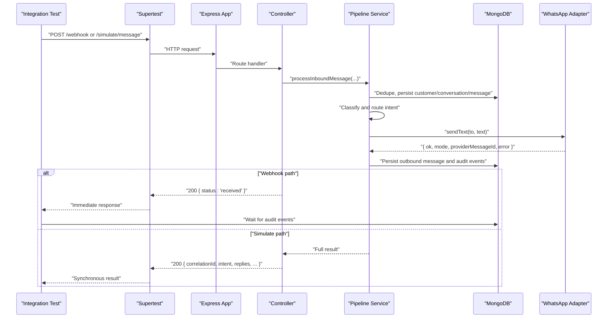

**Diagram sources**
- [src/controllers/webhook.controller.js:27-55](file://src/controllers/webhook.controller.js#L27-L55)
- [src/controllers/simulate.controller.js:12-34](file://src/controllers/simulate.controller.js#L12-L34)
- [src/services/pipeline.service.js:66-273](file://src/services/pipeline.service.js#L66-L273)
- [src/services/whatsapp.adapter.js:113-135](file://src/services/whatsapp.adapter.js#L113-L135)

## Detailed Component Analysis

### Webhook Integration Testing
The webhook tests cover:
- GET handshake verification token behavior
- POST signature validation
- Payload shape validation
- Asynchronous processing confirmation via audit events
- Status-only callbacks

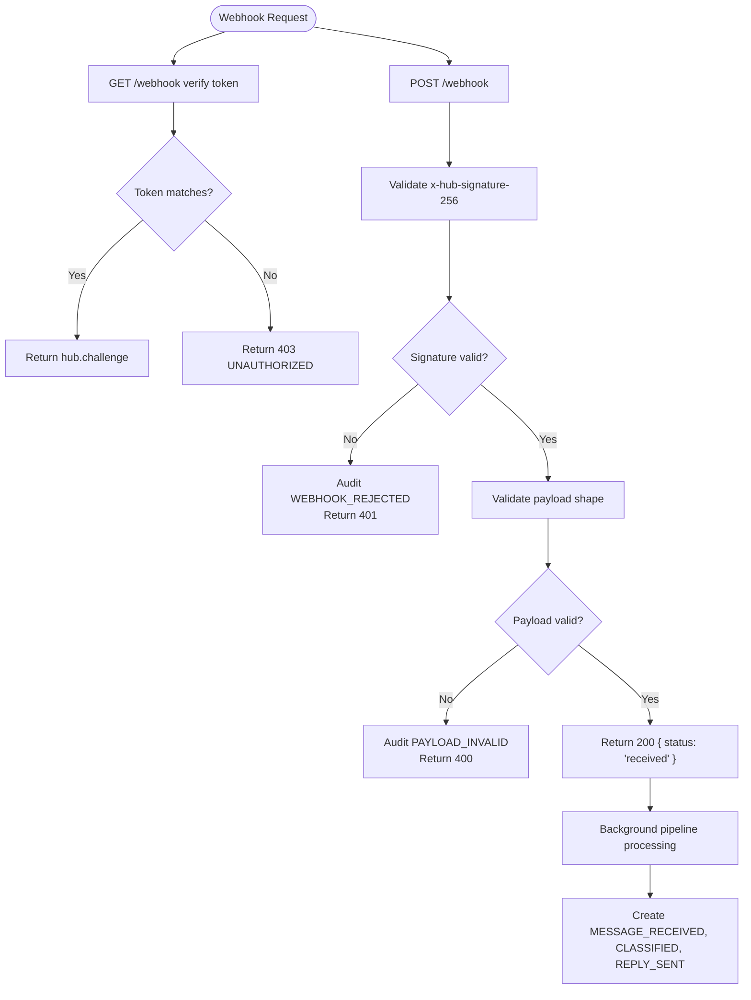

**Diagram sources**
- [tests/webhook.test.js:72-94](file://tests/webhook.test.js#L72-L94)
- [tests/webhook.test.js:96-124](file://tests/webhook.test.js#L96-L124)
- [tests/webhook.test.js:153-202](file://tests/webhook.test.js#L153-L202)
- [src/controllers/webhook.controller.js:10-25](file://src/controllers/webhook.controller.js#L10-L25)
- [src/controllers/webhook.controller.js:35-55](file://src/controllers/webhook.controller.js#L35-L55)

Key testing patterns:
- HMAC signature generation mirrors what Meta would send.
- A polling helper waits for audit events because webhook processing is fire-and-forget after the immediate `200`.
- Audit events are used as the source of truth for asynchronous outcomes.

**Section sources**
- [tests/webhook.test.js:1-222](file://tests/webhook.test.js#L1-L222)
- [src/controllers/webhook.controller.js:1-56](file://src/controllers/webhook.controller.js#L1-L56)

### Simulate Endpoint Integration Testing
The simulate endpoint is the primary synchronous harness for driving the full pipeline without Meta. Tests validate:
- Staff API key requirement
- Phone number validation
- Text validation
- Response shape and fields
- Auto-generated message ID
- Production-mode disablement

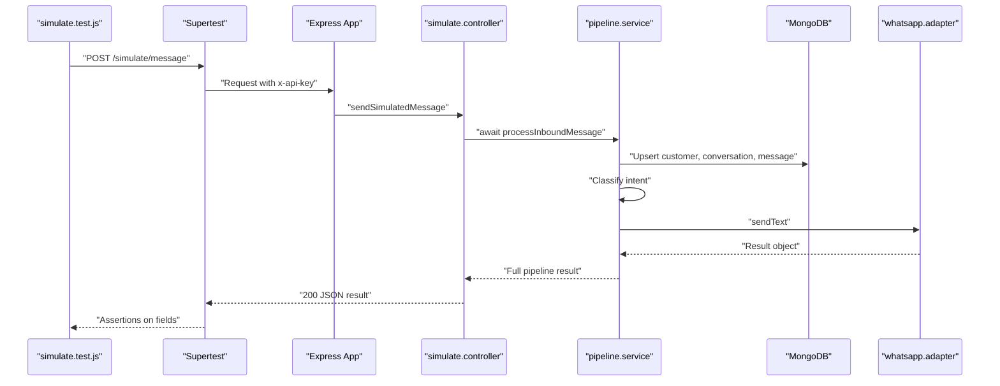

**Diagram sources**
- [tests/simulate.test.js:39-102](file://tests/simulate.test.js#L39-L102)
- [src/controllers/simulate.controller.js:12-34](file://src/controllers/simulate.controller.js#L12-L34)
- [src/services/pipeline.service.js:66-273](file://src/services/pipeline.service.js#L66-L273)

Production isolation is tested by spawning a child process that boots the real app with `NODE_ENV=production` and asserts that `/simulate/message` returns `404 NOT_FOUND`.

**Section sources**
- [tests/simulate.test.js:1-134](file://tests/simulate.test.js#L1-L134)
- [tests/helpers/run-simulate-prod.mjs:1-30](file://tests/helpers/run-simulate-prod.mjs#L1-L30)
- [src/controllers/simulate.controller.js:1-35](file://src/controllers/simulate.controller.js#L1-L35)

### WhatsApp Adapter Scenario Runner
The adapter tests use a dedicated scenario runner to isolate external dependencies. The runner:
- Accepts a scenario argument
- Optionally replaces `globalThis.fetch`
- Imports and calls `sendText` from the adapter
- Prints a single JSON line containing the result and captured fetch calls

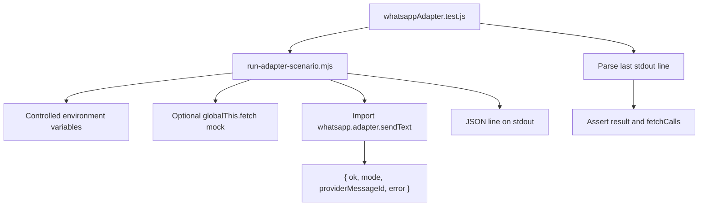

**Diagram sources**
- [tests/whatsappAdapter.test.js:21-32](file://tests/whatsappAdapter.test.js#L21-L32)
- [tests/helpers/run-adapter-scenario.mjs:1-44](file://tests/helpers/run-adapter-scenario.mjs#L1-L44)
- [src/services/whatsapp.adapter.js:113-135](file://src/services/whatsapp.adapter.js#L113-L135)

Scenarios covered include:
- Simulated mode success and log file verification
- Forced send failure via environment hook
- Cloud mode successful Graph API call
- Cloud mode HTTP error mapping
- Cloud mode network error mapping

**Section sources**
- [tests/whatsappAdapter.test.js:1-119](file://tests/whatsappAdapter.test.js#L1-L119)
- [tests/helpers/run-adapter-scenario.mjs:1-44](file://tests/helpers/run-adapter-scenario.mjs#L1-L44)
- [src/services/whatsapp.adapter.js:1-136](file://src/services/whatsapp.adapter.js#L1-L136)

### Database State Management During Integration Tests
Tests manage database state using a shared helper:

| Operation | Behavior |
|---|---|
| Start test database | Creates an in-memory MongoDB server and connects Mongoose |
| Stop test database | Disconnects Mongoose and stops the in-memory server |
| Clear database | Deletes all documents from every collection between tests |

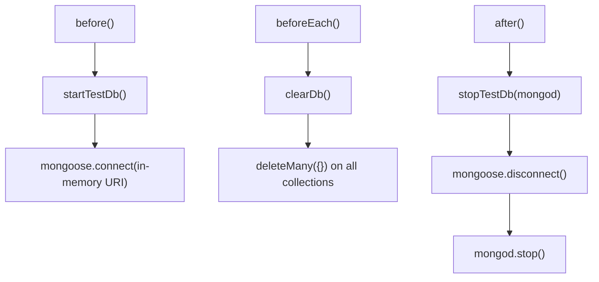

**Diagram sources**
- [tests/helpers/testDb.js:1-28](file://tests/helpers/testDb.js#L1-L28)

Best practices demonstrated:
- Each test file imports the environment bootstrap first.
- `before()` starts the in-memory database once per file.
- `after()` ensures cleanup even if tests fail.
- `beforeEach()` clears collections to avoid cross-test pollution.

**Section sources**
- [tests/helpers/testDb.js:1-28](file://tests/helpers/testDb.js#L1-L28)
- [tests/webhook.test.js:17-27](file://tests/webhook.test.js#L17-L27)
- [tests/simulate.test.js:24-30](file://tests/simulate.test.js#L24-L30)

### Testing Complex Business Flows
The pipeline integrates multiple layers:
- Deduplication by provider message ID
- Customer and conversation persistence
- Message persistence
- Classification and intent routing
- Reply sending through the WhatsApp adapter
- Audit trail recording

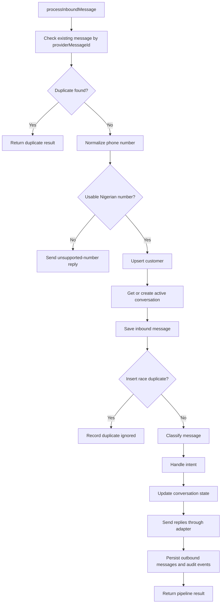

**Diagram sources**
- [src/services/pipeline.service.js:66-273](file://src/services/pipeline.service.js#L66-L273)

Testing this flow relies on:
- Supertest for HTTP entry points
- Direct model queries for asserting persisted data
- Audit events for validating asynchronous side effects
- Adapter result objects for verifying outbound messaging behavior

**Section sources**
- [src/services/pipeline.service.js:1-274](file://src/services/pipeline.service.js#L1-L274)
- [tests/webhook.test.js:96-124](file://tests/webhook.test.js#L96-L124)
- [tests/simulate.test.js:68-102](file://tests/simulate.test.js#L68-L102)

### Error Propagation Across Layers
Error handling follows consistent patterns:
- Controllers return standardized error bodies with `error.code`, `message`, and `correlationId`.
- Middleware and utilities wrap async handlers to avoid unhandled promise rejections.
- The WhatsApp adapter never throws; it returns `{ ok: false, error }`.
- Webhook rejects and invalid payloads are audited rather than silently failing.

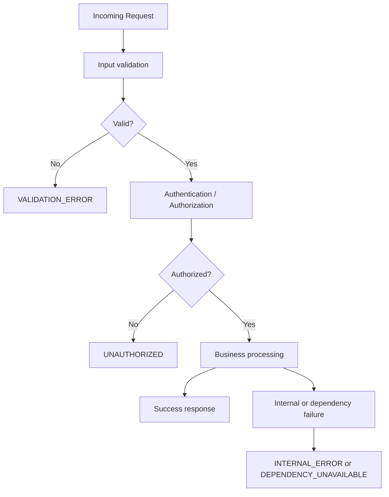

**Diagram sources**
- [README.md:388-397](file://README.md#L388-L397)
- [src/controllers/webhook.controller.js:20-24](file://src/controllers/webhook.controller.js#L20-L24)
- [src/services/whatsapp.adapter.js:85-100](file://src/services/whatsapp.adapter.js#L85-L100)

**Section sources**
- [README.md:388-397](file://README.md#L388-L397)
- [tests/webhook.test.js:153-202](file://tests/webhook.test.js#L153-L202)
- [tests/simulate.test.js:40-66](file://tests/simulate.test.js#L40-L66)
- [src/services/whatsapp.adapter.js:60-104](file://src/services/whatsapp.adapter.js#L60-L104)

### Concurrent Request Handling
Concurrent safety is validated at the pipeline layer:
- Deduplication checks exist before persistence.
- A second duplicate check occurs after inserting the inbound message to handle insert races.
- Audit events record duplicates when they occur.

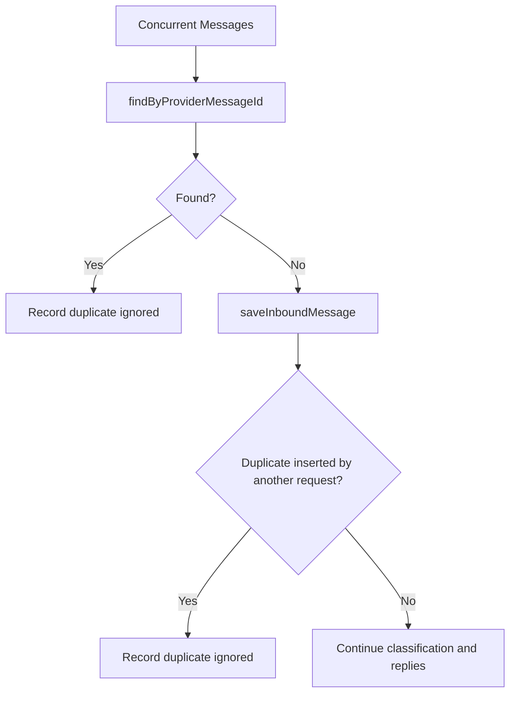

**Diagram sources**
- [src/services/pipeline.service.js:77-88](file://src/services/pipeline.service.js#L77-L88)
- [src/services/pipeline.service.js:131-146](file://src/services/pipeline.service.js#L131-L146)

**Section sources**
- [src/services/pipeline.service.js:77-146](file://src/services/pipeline.service.js#L77-L146)

### Testing Asynchronous Operations and Event-Driven Processes
Asynchronous webhook processing is validated by waiting for audit events rather than relying solely on the HTTP response. This pattern is important because:
- Meta retries non-2xx responses.
- Processing failures must not cause retry storms.
- Audit events provide durable evidence of pipeline progress.

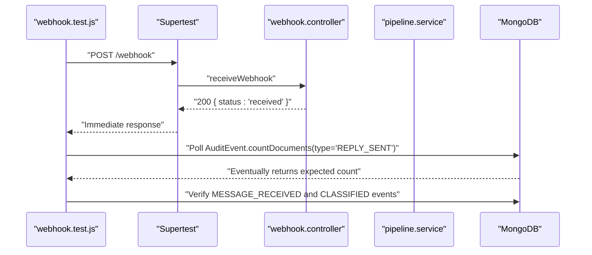

**Diagram sources**
- [tests/webhook.test.js:33-41](file://tests/webhook.test.js#L33-L41)
- [tests/webhook.test.js:109-124](file://tests/webhook.test.js#L109-L124)
- [src/controllers/webhook.controller.js:35-55](file://src/controllers/webhook.controller.js#L35-L55)

**Section sources**
- [tests/webhook.test.js:33-41](file://tests/webhook.test.js#L33-L41)
- [src/controllers/webhook.controller.js:27-55](file://src/controllers/webhook.controller.js#L27-L55)

## Dependency Analysis
The integration tests depend on several runtime and test-time components:

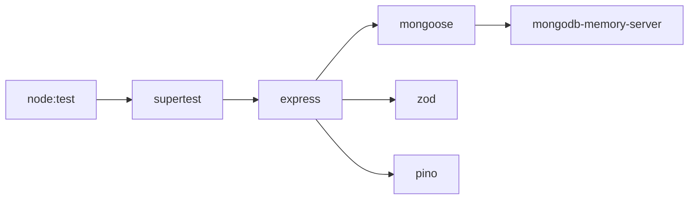

**Diagram sources**
- [package.json:18-35](file://package.json#L18-L35)

Coupling observations:
- Tests import `createApp` directly, coupling them to the application factory rather than a running server URL.
- Environment setup is imported before other modules so configuration values are available during static imports.
- Adapter tests isolate external HTTP behavior by replacing `globalThis.fetch` in a child process.

**Section sources**
- [package.json:18-35](file://package.json#L18-L35)
- [tests/helpers/setup-env.mjs:1-19](file://tests/helpers/setup-env.mjs#L1-L19)
- [tests/helpers/run-adapter-scenario.mjs:14-37](file://tests/helpers/run-adapter-scenario.mjs#L14-L37)

## Performance Considerations
- The test runner executes tests sequentially using `--test-concurrency=1`, which reduces memory pressure and makes Windows execution predictable.
- In-memory MongoDB avoids disk I/O and external service startup costs.
- Webhook tests poll for audit events with a bounded timeout and interval, preventing indefinite hangs while still validating asynchronous behavior.
- Adapter scenarios run in child processes, isolating environment changes and fetch mocks from the parent test process.

[No sources needed since this section provides general guidance]

## Troubleshooting Guide
Common integration testing issues and resolutions:

| Symptom | Likely Cause | Resolution |
|---|---|---|
| Tests fail because environment variables are missing | Source modules loaded before test env was set | Ensure `./helpers/setup-env.mjs` is the first import in each test file |
| Database connection errors | In-memory MongoDB not started or not stopped properly | Use `startTestDb()` in `before()` and `stopTestDb()` in `after()` |
| Cross-test data pollution | Collections not cleared between tests | Add `clearDb()` in `beforeEach()` |
| Webhook tests pass HTTP assertion but fail later | Background processing not awaited | Wait for audit events instead of asserting only the HTTP response |
| Adapter tests fail due to real network calls | `fetch` not mocked in cloud scenarios | Use `run-adapter-scenario.mjs` with `cloud-ok`, `cloud-http-error`, or `cloud-network-error` |
| Simulate endpoint behaves differently locally vs CI | Environment mode mismatch | Use `run-simulate-prod.mjs` to test production behavior in a child process |

**Section sources**
- [tests/helpers/setup-env.mjs:1-19](file://tests/helpers/setup-env.mjs#L1-L19)
- [tests/helpers/testDb.js:1-28](file://tests/helpers/testDb.js#L1-L28)
- [tests/webhook.test.js:33-41](file://tests/webhook.test.js#L33-L41)
- [tests/whatsappAdapter.test.js:21-32](file://tests/whatsappAdapter.test.js#L21-L32)
- [tests/helpers/run-simulate-prod.mjs:1-30](file://tests/helpers/run-simulate-prod.mjs#L1-L30)

## Conclusion
The integration testing strategy combines HTTP-level assertions with database and audit-event verification to validate end-to-end workflows. The design separates concerns clearly:
- supertest exercises Express routes
- the pipeline centralizes business logic
- the adapter abstracts external messaging behavior
- audit events provide reliable evidence for asynchronous processing
- child-process helpers enable isolated environment and external-service testing

This approach scales well as new intents, handlers, and adapters are added, because tests can assert both immediate response contracts and durable downstream state.

[No sources needed since this section summarizes without analyzing specific files]