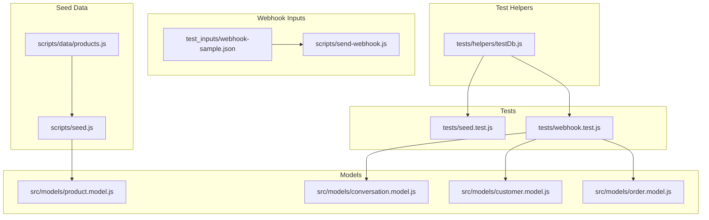
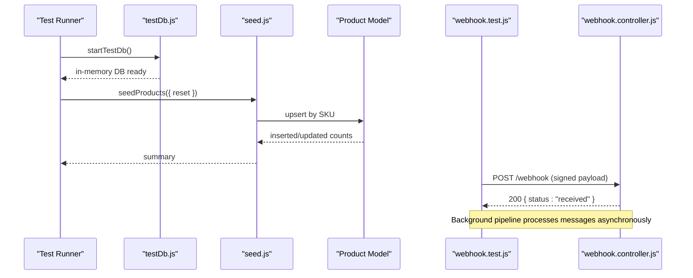
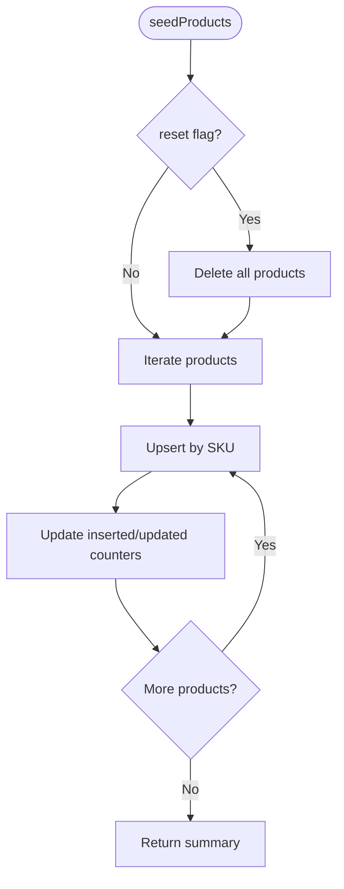
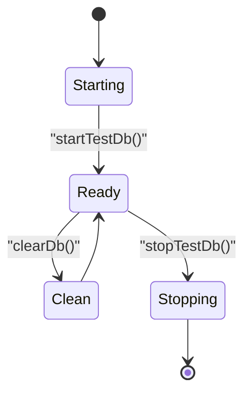
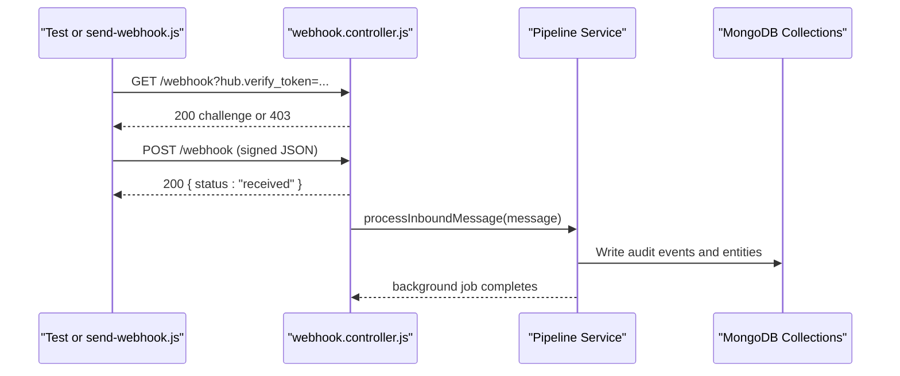
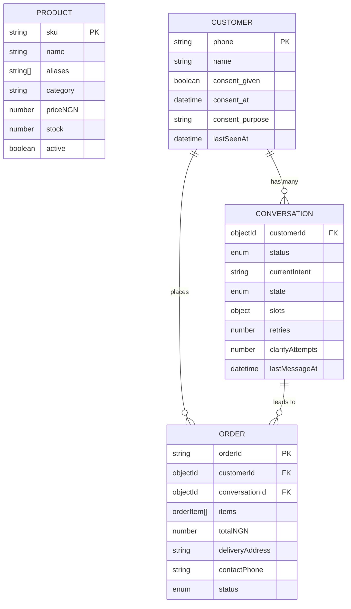
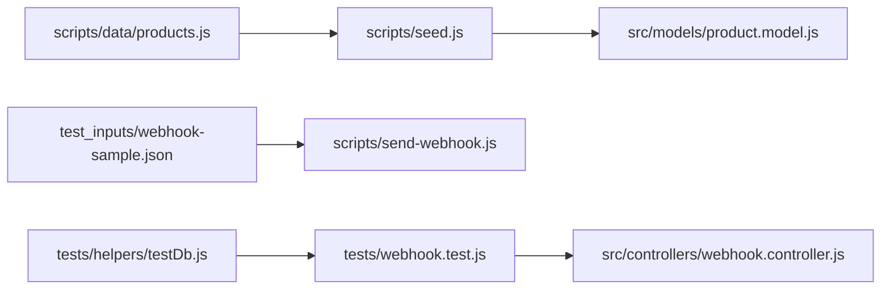

# Test Data Management

<cite>
**Referenced Files in This Document**   
- [seed.js](file://scripts/seed.js)
- [products.js](file://scripts/data/products.js)
- [webhook-sample.json](file://test_inputs/webhook-sample.json)
- [send-webhook.js](file://scripts/send-webhook.js)
- [testDb.js](file://tests/helpers/testDb.js)
- [seed.test.js](file://tests/seed.test.js)
- [webhook.test.js](file://tests/webhook.test.js)
- [product.model.js](file://src/models/product.model.js)
- [conversation.model.js](file://src/models/conversation.model.js)
- [customer.model.js](file://src/models/customer.model.js)
- [order.model.js](file://src/models/order.model.js)
- [webhook.controller.js](file://src/controllers/webhook.controller.js)
</cite>

## Table of Contents
1. [Introduction](#introduction)
2. [Project Structure](#project-structure)
3. [Core Components](#core-components)
4. [Architecture Overview](#architecture-overview)
5. [Detailed Component Analysis](#detailed-component-analysis)
6. [Dependency Analysis](#dependency-analysis)
7. [Performance Considerations](#performance-considerations)
8. [Troubleshooting Guide](#troubleshooting-guide)
9. [Conclusion](#conclusion)

## Introduction
This document explains how test data is created, managed, and cleaned up across the project. It covers:
- Seed data for the product catalogue
- Webhook payload templates for WhatsApp-style integration tests
- In-memory database setup and isolation between tests
- Strategies for realistic datasets, consistency, versioning, dynamic generation, cleanup, and performance

The goal is to make it easy to write reliable tests that use consistent, isolated, and maintainable data without leaking state or depending on external services.

## Project Structure
Test data lives in a small set of focused locations:
- `scripts/data/products.js` defines the synthetic product catalogue used by the seed script
- `scripts/seed.js` seeds the Product collection idempotently by SKU
- `test_inputs/webhook-sample.json` provides a sample Meta-shaped webhook payload
- `scripts/send-webhook.js` signs and posts payloads for manual or scripted testing
- `tests/helpers/testDb.js` manages an in-memory MongoDB instance and collection cleanup
- `tests/seed.test.js` validates seed behaviour
- `tests/webhook.test.js` constructs inline webhook fixtures and asserts end-to-end processing

**Diagram sources**
- [products.js:1-50](file://scripts/data/products.js#L1-L50)
- [seed.js:1-61](file://scripts/seed.js#L1-L61)
- [webhook-sample.json:1-29](file://test_inputs/webhook-sample.json#L1-L29)
- [send-webhook.js:1-84](file://scripts/send-webhook.js#L1-L84)
- [testDb.js:1-29](file://tests/helpers/testDb.js#L1-L29)
- [seed.test.js:1-51](file://tests/seed.test.js#L1-L51)
- [webhook.test.js:1-222](file://tests/webhook.test.js#L1-L222)
- [product.model.js:1-26](file://src/models/product.model.js#L1-L26)
- [conversation.model.js:1-52](file://src/models/conversation.model.js#L1-L52)
- [customer.model.js:1-28](file://src/models/customer.model.js#L1-L28)
- [order.model.js:1-53](file://src/models/order.model.js#L1-L53)

**Section sources**
- [products.js:1-50](file://scripts/data/products.js#L1-L50)
- [seed.js:1-61](file://scripts/seed.js#L1-L61)
- [webhook-sample.json:1-29](file://test_inputs/webhook-sample.json#L1-L29)
- [send-webhook.js:1-84](file://scripts/send-webhook.js#L1-L84)
- [testDb.js:1-29](file://tests/helpers/testDb.js#L1-L29)
- [seed.test.js:1-51](file://tests/seed.test.js#L1-L51)
- [webhook.test.js:1-222](file://tests/webhook.test.js#L1-L222)
- [product.model.js:1-26](file://src/models/product.model.js#L1-L26)
- [conversation.model.js:1-52](file://src/models/conversation.model.js#L1-L52)
- [customer.model.js:1-28](file://src/models/customer.model.js#L1-L28)
- [order.model.js:1-53](file://src/models/order.model.js#L1-L53)

## Core Components
- Synthetic product catalogue: A static array of product objects with SKU, name, aliases, category, price, and stock. Used as the canonical source for seeding.
- Seed script: Upserts products by SKU, supports optional reset, and is idempotent.
- Webhook payload template: A minimal Meta-shaped JSON fixture representing a WhatsApp text message.
- Webhook sender helper: Signs payloads using HMAC-SHA256 and POSTs them to the local API for manual or scripted testing.
- Test database helper: Starts/stops an in-memory MongoDB and clears all collections between tests.
- Tests: Validate seed idempotency and webhook handling, including signature verification, validation errors, and asynchronous processing.

**Section sources**
- [products.js:1-50](file://scripts/data/products.js#L1-L50)
- [seed.js:1-61](file://scripts/seed.js#L1-L61)
- [webhook-sample.json:1-29](file://test_inputs/webhook-sample.json#L1-L29)
- [send-webhook.js:1-84](file://scripts/send-webhook.js#L1-L84)
- [testDb.js:1-29](file://tests/helpers/testDb.js#L1-L29)
- [seed.test.js:1-51](file://tests/seed.test.js#L1-L51)
- [webhook.test.js:1-222](file://tests/webhook.test.js#L1-L222)

## Architecture Overview
The test data architecture separates concerns into three layers:
- Static fixtures: Product catalogue and webhook sample payload
- Runtime helpers: Seed script and webhook sender
- Test harness: In-memory DB and per-test lifecycle management

**Diagram sources**
- [testDb.js:1-29](file://tests/helpers/testDb.js#L1-L29)
- [seed.js:1-61](file://scripts/seed.js#L1-L61)
- [product.model.js:1-26](file://src/models/product.model.js#L1-L26)
- [webhook.test.js:1-222](file://tests/webhook.test.js#L1-L222)
- [webhook.controller.js:1-56](file://src/controllers/webhook.controller.js#L1-L56)

## Detailed Component Analysis

### Synthetic Product Catalogue
- Purpose: Provide a stable, realistic-looking dataset for search, classification, and pricing scenarios.
- Structure: Each product includes SKU, display name, natural-language aliases, category, price in NGN, and stock level.
- Usage: The seed script upserts each product by SKU, making repeated runs safe and deterministic.

Guidelines:
- Keep SKUs unique and uppercase; they are the primary key for idempotent seeding.
- Add aliases to reflect common customer phrasing for better matching.
- Group items by category to support filtering and analytics.

**Section sources**
- [products.js:1-50](file://scripts/data/products.js#L1-L50)
- [product.model.js:1-26](file://src/models/product.model.js#L1-L26)

### Seed Script and Idempotency
- Behavior:
  - Optional reset clears all products before seeding.
  - Upserts each product by SKU.
  - Returns counts for total, inserted, and updated entries.
- Testing:
  - Verifies first run inserts all products.
  - Verifies second run updates existing products without duplicates.
  - Validates specific product fields after seeding.
  - Confirms reset removes stray documents.

**Diagram sources**
- [seed.js:16-36](file://scripts/seed.js#L16-L36)

**Section sources**
- [seed.js:1-61](file://scripts/seed.js#L1-L61)
- [seed.test.js:1-51](file://tests/seed.test.js#L1-L51)

### Webhook Payload Templates
- Sample payload: Represents a Meta WhatsApp business account event containing a single inbound text message.
- Sender helper: Reads a payload file, optionally overrides message fields, computes HMAC-SHA256 signature, and POSTs to the webhook endpoint.
- Test usage: Tests construct payloads inline to cover valid, invalid, and edge cases such as non-text messages and missing signatures.

Best practices:
- Use the sample payload as a base and mutate only the fields under test.
- Always sign payloads with the same secret used by the application in tests.
- For manual testing, pass command-line flags to vary message content, IDs, and URLs.

**Section sources**
- [webhook-sample.json:1-29](file://test_inputs/webhook-sample.json#L1-L29)
- [send-webhook.js:1-84](file://scripts/send-webhook.js#L1-L84)
- [webhook.test.js:1-222](file://tests/webhook.test.js#L1-L222)

### Test Database Isolation and Cleanup
- In-memory server: Each test file starts its own in-memory MongoDB instance via a helper.
- Lifecycle:
  - Before hook: start in-memory DB
  - After hook: stop in-memory DB
  - BeforeEach hook: clear all collections to isolate tests
- Benefits:
  - No shared state between tests
  - Fast teardown and no external dependencies
  - Deterministic environment

**Diagram sources**
- [testDb.js:1-29](file://tests/helpers/testDb.js#L1-L29)

**Section sources**
- [testDb.js:1-29](file://tests/helpers/testDb.js#L1-L29)
- [webhook.test.js:1-222](file://tests/webhook.test.js#L1-L222)

### Webhook Processing Flow Under Test
- Handshake: GET /webhook echoes challenge when verify token matches.
- Message ingestion: POST /webhook returns 200 immediately and processes messages asynchronously.
- Validation: Signature header must be present and valid; payload shape is validated.
- Auditing: Audit events record MESSAGE_RECEIVED, CLASSIFIED, REPLY_SENT, WEBHOOK_REJECTED, PAYLOAD_INVALID.

**Diagram sources**
- [webhook.controller.js:1-56](file://src/controllers/webhook.controller.js#L1-L56)
- [webhook.test.js:1-222](file://tests/webhook.test.js#L1-L222)

**Section sources**
- [webhook.controller.js:1-56](file://src/controllers/webhook.controller.js#L1-L56)
- [webhook.test.js:1-222](file://tests/webhook.test.js#L1-L222)

### Data Models Relevant to Test Scenarios
- Product: Indexed by SKU and category; text index on name and aliases for search-like behavior.
- Conversation: Tracks customer conversation state and slot-filling data.
- Customer: Normalized phone number with consent metadata.
- Order: Captures order items, totals, delivery details, and status transitions.

These models define the shape of data your tests should create or assert against.

**Diagram sources**
- [product.model.js:1-26](file://src/models/product.model.js#L1-L26)
- [conversation.model.js:1-52](file://src/models/conversation.model.js#L1-L52)
- [customer.model.js:1-28](file://src/models/customer.model.js#L1-L28)
- [order.model.js:1-53](file://src/models/order.model.js#L1-L53)

**Section sources**
- [product.model.js:1-26](file://src/models/product.model.js#L1-L26)
- [conversation.model.js:1-52](file://src/models/conversation.model.js#L1-L52)
- [customer.model.js:1-28](file://src/models/customer.model.js#L1-L28)
- [order.model.js:1-53](file://src/models/order.model.js#L1-L53)

## Dependency Analysis
Key relationships among test data components:
- Seed script depends on the product model and the static product catalogue.
- Webhook tests depend on the in-memory DB helper and construct payloads inline.
- Manual webhook sending depends on the sample payload and app secret configuration.

**Diagram sources**
- [products.js:1-50](file://scripts/data/products.js#L1-L50)
- [seed.js:1-61](file://scripts/seed.js#L1-L61)
- [product.model.js:1-26](file://src/models/product.model.js#L1-L26)
- [webhook-sample.json:1-29](file://test_inputs/webhook-sample.json#L1-L29)
- [send-webhook.js:1-84](file://scripts/send-webhook.js#L1-L84)
- [testDb.js:1-29](file://tests/helpers/testDb.js#L1-L29)
- [webhook.test.js:1-222](file://tests/webhook.test.js#L1-L222)
- [webhook.controller.js:1-56](file://src/controllers/webhook.controller.js#L1-L56)

**Section sources**
- [seed.js:1-61](file://scripts/seed.js#L1-L61)
- [webhook.test.js:1-222](file://tests/webhook.test.js#L1-L222)
- [send-webhook.js:1-84](file://scripts/send-webhook.js#L1-L84)
- [testDb.js:1-29](file://tests/helpers/testDb.js#L1-L29)

## Performance Considerations
- Prefer in-memory databases for unit tests to avoid I/O overhead and external service dependencies.
- Use idempotent seeding by unique keys (e.g., SKU) to avoid unnecessary writes on repeated runs.
- Clear collections between tests rather than recreating the database to reduce startup time.
- Construct minimal payloads for webhook tests; mutate only the fields relevant to the scenario.
- Avoid loading large datasets unless necessary; generate dynamic subsets instead of full catalogs when possible.
- For slow asynchronous flows (e.g., background processing), poll until expected side effects appear rather than using fixed sleeps.

[No sources needed since this section provides general guidance]

## Troubleshooting Guide
Common issues and resolutions:
- Seed fails to connect: Ensure the database is reachable; the seed script logs helpful hints when connection fails.
- Duplicate products after seeding: Verify you are not inserting outside the seed flow; rely on SKU-based upserts.
- Webhook signature mismatch: Confirm the signing secret used by the sender matches the application’s configured secret.
- Missing signature header: Include the required signature header when posting webhooks.
- Invalid payload shape: Validate the structure against the expected Meta format; tests demonstrate minimal valid shapes.
- Flaky async assertions: Poll for expected audit events or records rather than relying on timing assumptions.

**Section sources**
- [seed.js:38-52](file://scripts/seed.js#L38-L52)
- [send-webhook.js:39-83](file://scripts/send-webhook.js#L39-L83)
- [webhook.test.js:96-222](file://tests/webhook.test.js#L96-L222)

## Conclusion
This repository uses a clean separation between static fixtures, runtime helpers, and test harnesses to manage test data effectively. The product catalogue is seeded idempotently by SKU, webhook payloads are templated and signed consistently, and tests run against an isolated in-memory database with explicit cleanup. Following these patterns ensures predictable, fast, and maintainable tests while supporting realistic scenarios through structured fixtures and controlled mutation.

[No sources needed since this section summarizes without analyzing specific files]