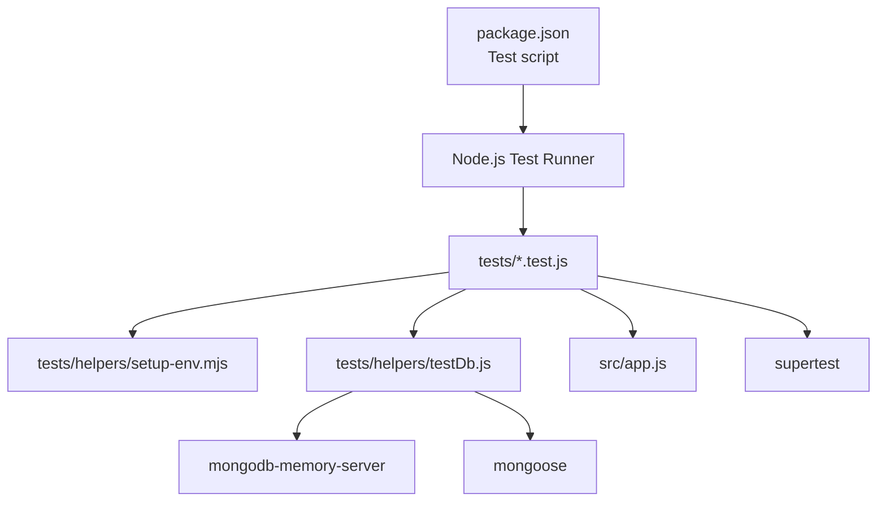
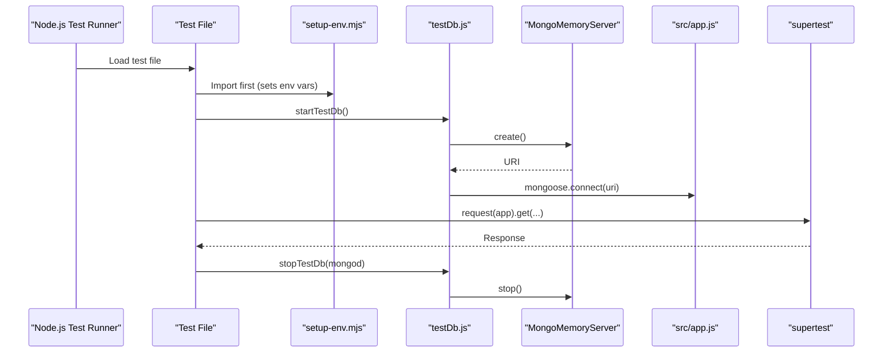
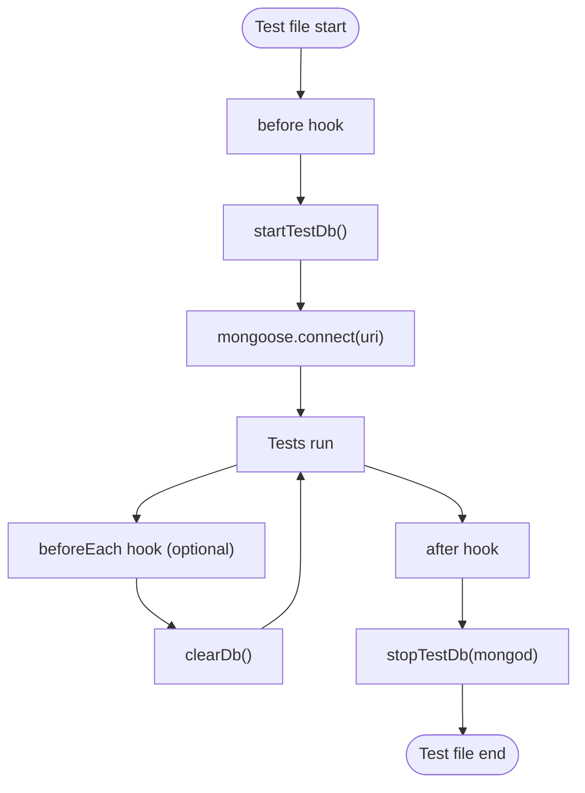
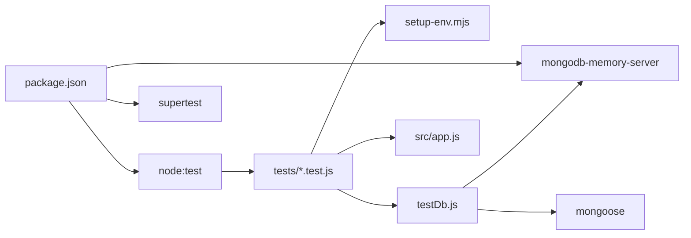

# Testing Framework and Setup

<cite>
**Referenced Files in This Document**
- [package.json](file://package.json)
- [setup-env.mjs](file://tests/helpers/setup-env.mjs)
- [testDb.js](file://tests/helpers/testDb.js)
- [health.test.js](file://tests/health.test.js)
- [simulate.test.js](file://tests/simulate.test.js)
- [webhook.test.js](file://tests/webhook.test.js)
- [run-adapter-scenario.mjs](file://tests/helpers/run-adapter-scenario.mjs)
- [dev-memory-mongo.js](file://scripts/dev-memory-mongo.js)
</cite>

## Table of Contents
1. [Introduction](#introduction)
2. [Project Structure](#project-structure)
3. [Core Components](#core-components)
4. [Architecture Overview](#architecture-overview)
5. [Detailed Component Analysis](#detailed-component-analysis)
6. [Dependency Analysis](#dependency-analysis)
7. [Performance Considerations](#performance-considerations)
8. [Troubleshooting Guide](#troubleshooting-guide)
9. [Conclusion](#conclusion)

## Introduction
This document explains the testing framework setup and configuration for the project. It covers:
- Node.js built-in test runner configuration
- Environment setup utilities
- Database mocking with mongodb-memory-server
- Test database initialization, connection management, and cleanup
- Configuration examples for unit, integration, and end-to-end (E2E) scenarios
- Available test helper utilities and how to extend them

The goal is to make it easy to run tests locally without external services while keeping behavior close to production.

## Project Structure
The testing-related code lives under `tests/`, with shared helpers under `tests/helpers/`. The Node.js test runner is configured via npm scripts in `package.json`.

**Diagram sources**
- [package.json:10-16](file://package.json#L10-L16)
- [health.test.js:1-10](file://tests/health.test.js#L1-L10)
- [testDb.js:1-12](file://tests/helpers/testDb.js#L1-L12)

**Section sources**
- [package.json:1-36](file://package.json#L1-L36)

## Core Components
- Node.js test runner: invoked through an npm script that enables concurrency control.
- Environment bootstrap: a helper that sets required environment variables before any application modules load.
- In-memory database: a helper that starts a MongoDB instance using mongodb-memory-server and connects Mongoose.
- Test suites: example tests demonstrating API testing with supertest and database interactions.

Key responsibilities:
- Ensure deterministic environment variables for all tests.
- Provide isolated, fast, and disposable database instances per test file.
- Offer reusable utilities for clearing data between tests.

**Section sources**
- [package.json:10-16](file://package.json#L10-L16)
- [setup-env.mjs:1-20](file://tests/helpers/setup-env.mjs#L1-L20)
- [testDb.js:1-29](file://tests/helpers/testDb.js#L1-L29)

## Architecture Overview
The testing architecture centers around three layers:
- Test runner layer: Node.js test runner executes test files.
- Environment layer: setup-env.mjs configures process.env before app code loads.
- Data layer: testDb.js manages an in-memory MongoDB instance and Mongoose connections.

**Diagram sources**
- [health.test.js:1-18](file://tests/health.test.js#L1-L18)
- [testDb.js:8-22](file://tests/helpers/testDb.js#L8-L22)

## Detailed Component Analysis

### Node.js Test Runner Configuration
- The test command uses the Node.js built-in test runner with concurrency set to one to avoid race conditions across test files.
- This ensures stable execution when tests share global state or resources.

Configuration highlights:
- Script name: test
- Command: node --test --test-concurrency=1

Usage:
- Run all tests: npm test

Notes:
- Concurrency can be increased later if tests are fully isolated.

**Section sources**
- [package.json:10-16](file://package.json#L10-L16)

### Environment Setup Utilities
Purpose:
- Set deterministic environment variables at the very beginning of each test file.
- Override developer .env values by setting process.env before any src/ module imports.

What it configures:
- NODE_ENV=test
- PORT
- LOG_LEVEL=silent
- MONGODB_URI placeholder
- STAFF_API_KEY
- WhatsApp mode and tokens
- LLM provider disabled
- Ticket SLA minutes

How to use:
- Import the helper as the first line in every test file.

Extension guidance:
- Add new environment variables here if they are required by application modules during tests.
- Keep secrets out of version control; prefer test-specific values here.

**Section sources**
- [setup-env.mjs:1-20](file://tests/helpers/setup-env.mjs#L1-L20)

### Database Mocking with mongodb-memory-server
Purpose:
- Start an in-memory MongoDB server for each test file.
- Connect Mongoose to this server so models work exactly like against a real database.

Key utilities:
- startTestDb(): Starts MongoMemoryServer and connects Mongoose. Returns the server instance.
- stopTestDb(mongod): Disconnects Mongoose and stops the server.
- clearDb(): Deletes all documents from all collections between tests.

Lifecycle pattern used in tests:
- before(): startTestDb()
- after(): stopTestDb(mongod)
- beforeEach(): clearDb() (optional, per suite)

Connection management:
- Each test file gets its own in-memory MongoDB instance.
- Mongoose disconnects cleanly on teardown.

Cleanup strategy:
- Clear collections between tests to prevent cross-test pollution.
- Stop the in-memory server after the test file completes.

**Section sources**
- [testDb.js:1-29](file://tests/helpers/testDb.js#L1-L29)

### Test Database Initialization and Cleanup Flow

**Diagram sources**
- [health.test.js:12-18](file://tests/health.test.js#L12-L18)
- [webhook.test.js:16-26](file://tests/webhook.test.js#L16-L26)
- [testDb.js:8-28](file://tests/helpers/testDb.js#L8-L28)

### Example Test Patterns

#### Health Endpoint Tests
- Demonstrates starting the in-memory database, making HTTP requests with supertest, and asserting response status and body fields.
- Shows how to simulate a disconnected database by calling mongoose.disconnect().

Key behaviors validated:
- 200 OK when MongoDB is up
- 503 Service Unavailable when MongoDB is down
- Presence of correlation ID header

**Section sources**
- [health.test.js:1-44](file://tests/health.test.js#L1-L44)

#### Simulate Endpoint Tests
- Validates authentication requirements, input validation, pipeline result shape, auto-generated messageId, and production-mode disabling.
- Uses a child process helper to verify behavior in production-like environments.

Key patterns:
- Using supertest to send POST requests
- Checking error codes and details
- Spawning a child process to run a scenario script with custom environment variables

**Section sources**
- [simulate.test.js:1-122](file://tests/simulate.test.js#L1-L122)

#### Webhook Tests
- Covers handshake verification and webhook payload handling.
- Verifies signature validation, audit logging for rejected payloads, and acceptance of status-only callbacks.
- Uses clearDb() in beforeEach to ensure clean state per test.

Key patterns:
- HMAC signature generation for webhook payloads
- Assertions on audit events stored in MongoDB
- Handling both message and status-only payloads

**Section sources**
- [webhook.test.js:1-168](file://tests/webhook.test.js#L1-L168)

### Helper Utilities for Common Scenarios

#### run-adapter-scenario.mjs
Purpose:
- Runs the WhatsApp adapter in a child process with controlled fetch mocks.
- Supports scenarios such as successful cloud response, HTTP error, and network error.
- Prints a single JSON line with the result and captured fetch calls for assertions.

Usage:
- Invoke from a test with node:child_process.execFile.
- Pass a scenario argument to select behavior.

When to use:
- When you need to isolate side effects or global state changes (e.g., replacing globalThis.fetch).
- For E2E-style checks of third-party integrations without real network calls.

**Section sources**
- [run-adapter-scenario.mjs:1-44](file://tests/helpers/run-adapter-scenario.mjs#L1-L44)

### Extending Helpers for New Requirements
- Adding new environment variables:
  - Update setup-env.mjs with new keys and default test values.
- Adding new database operations:
  - Extend testDb.js with additional helpers (e.g., seedTestData, truncateCollections).
- Adding new test scenarios:
  - Create new test files under tests/ and import setup-env.mjs first.
  - Use startTestDb/stopTestDb/clearDb as needed.
- Adding new child-process scenarios:
  - Extend run-adapter-scenario.mjs with new branches and arguments.

Best practices:
- Keep test data minimal and deterministic.
- Prefer beforeEach for clearing state when tests must be independent.
- Avoid sharing mutable global state across tests unless necessary.

## Dependency Analysis
The testing stack depends on:
- Node.js test runner for orchestration
- supertest for HTTP assertions
- mongodb-memory-server for in-memory MongoDB
- mongoose for schema/model access in tests

**Diagram sources**
- [package.json:18-34](file://package.json#L18-L34)
- [health.test.js:1-10](file://tests/health.test.js#L1-L10)
- [testDb.js:1-12](file://tests/helpers/testDb.js#L1-L12)

**Section sources**
- [package.json:18-34](file://package.json#L18-L34)

## Performance Considerations
- Concurrency: Running tests sequentially avoids flakiness but increases total runtime. If tests become fully isolated, consider increasing concurrency.
- Database isolation: Using an in-memory MongoDB per test file is fast and reliable. Clearing collections between tests adds overhead but ensures determinism.
- Child processes: Spawning child processes for scenario tests adds startup cost; reuse where possible or batch scenarios.

Recommendations:
- Group related tests to minimize repeated setup/teardown.
- Seed only the minimal data required for each test.
- Profile slow tests and refactor to reduce external dependencies.

## Troubleshooting Guide
Common issues and resolutions:
- Tests fail due to missing environment variables:
  - Ensure setup-env.mjs is imported as the first line in every test file.
- MongoDB connection errors:
  - Verify startTestDb runs before any model usage.
  - Confirm stopTestDb is called in after hooks.
- Flaky tests due to shared state:
  - Use clearDb() in beforeEach to reset collections.
- Webhook signature failures:
  - Ensure the correct secret is used when generating signatures in tests.
- Production-mode endpoint disabled:
  - Validate behavior by running the child process scenario with NODE_ENV=production.

Operational tips:
- Use the development memory MongoDB script to run the app locally without Docker.
- Check logs from the in-memory MongoDB script for connection URIs and lifecycle events.

**Section sources**
- [health.test.js:12-18](file://tests/health.test.js#L12-L18)
- [webhook.test.js:24-26](file://tests/webhook.test.js#L24-L26)
- [dev-memory-mongo.js:1-31](file://scripts/dev-memory-mongo.js#L1-L31)

## Conclusion
The testing framework leverages Node.js built-in test runner, a simple environment bootstrap, and mongodb-memory-server to provide fast, isolated, and deterministic tests. By following the established patterns—importing setup-env.mjs first, managing database lifecycle with testDb.js, and using supertest for HTTP assertions—you can confidently add new tests and helpers. For advanced scenarios, extend the provided helpers or spawn child processes to isolate side effects.