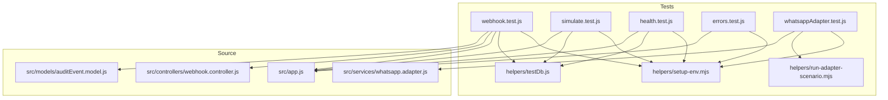
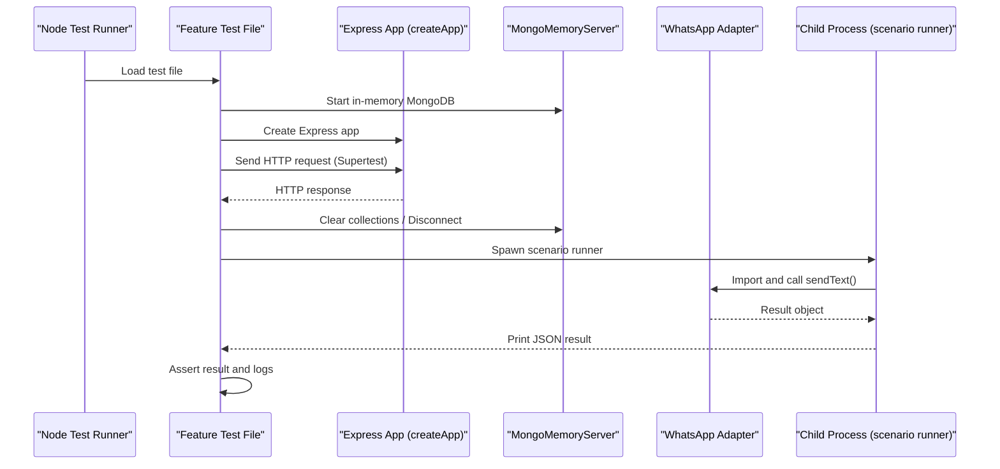
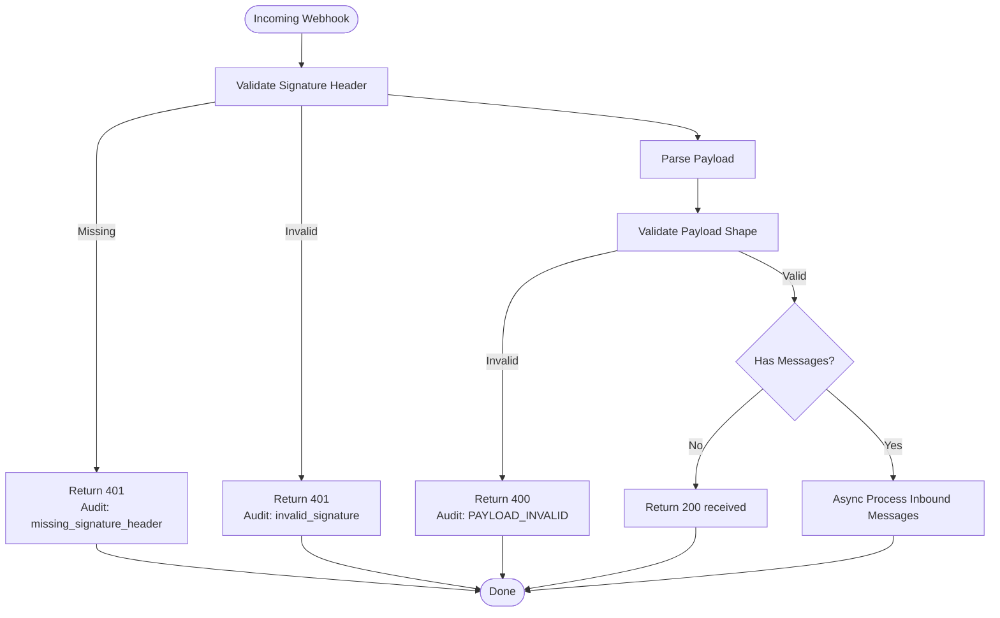
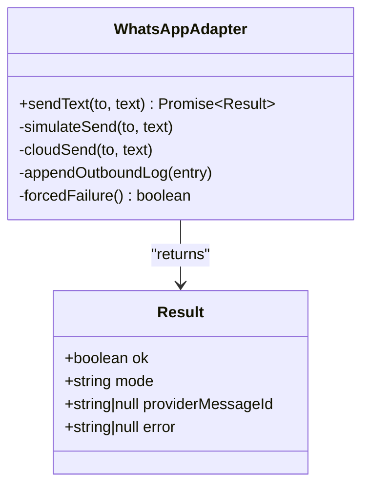
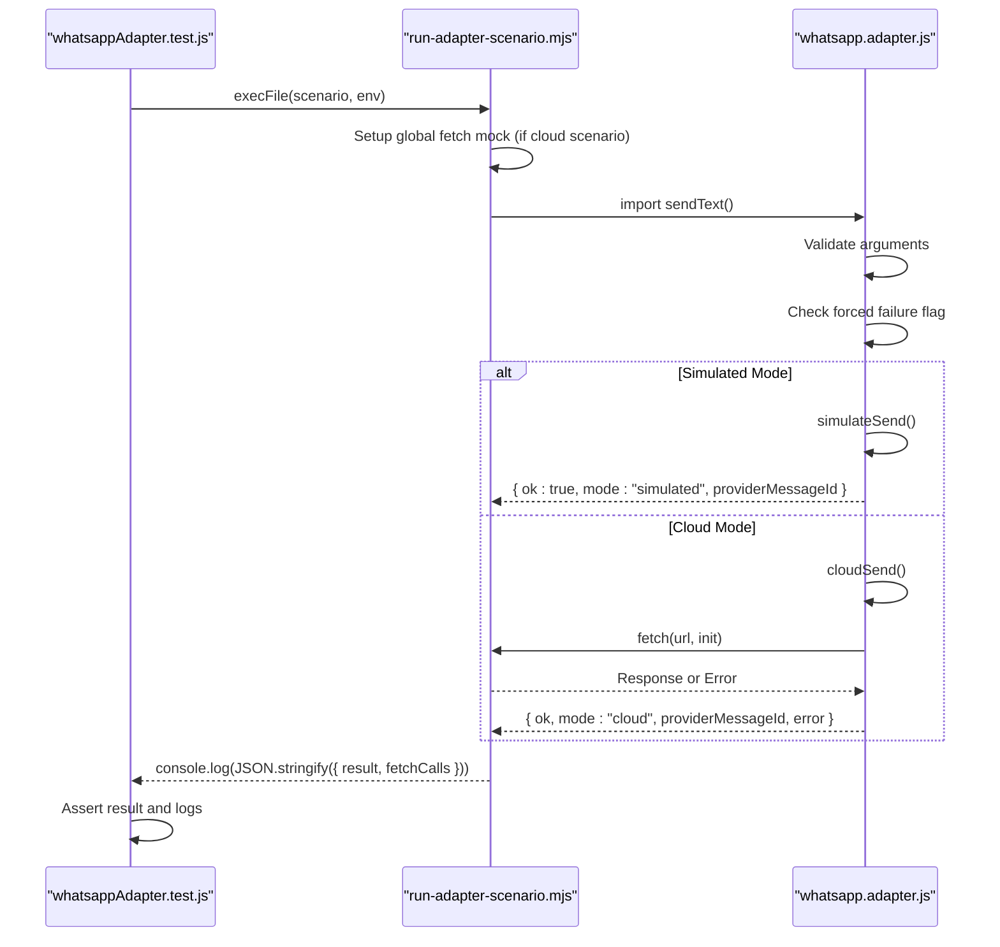
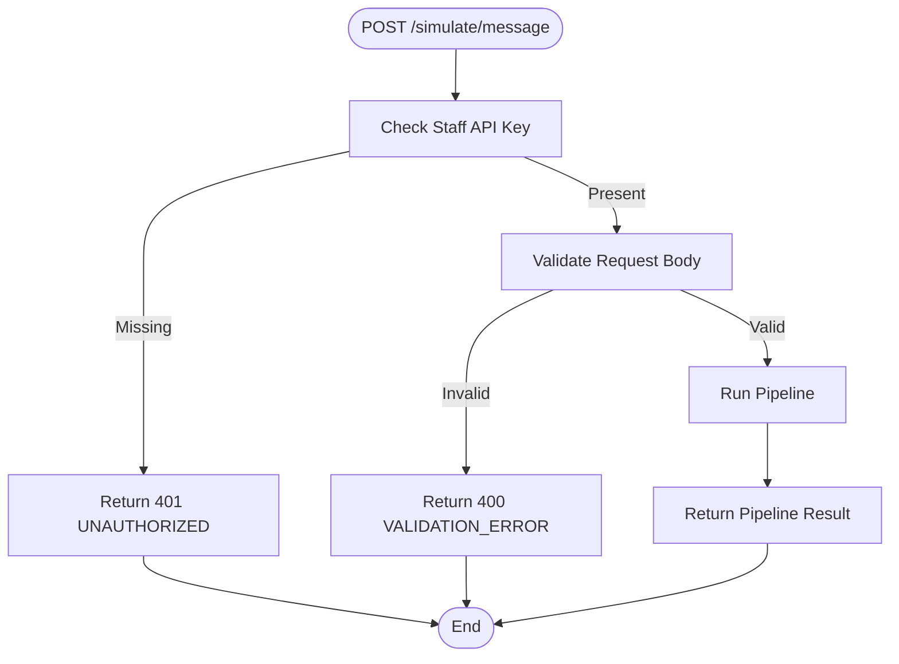
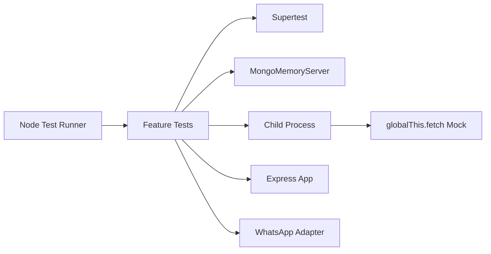

# Testing Strategy

<cite>
**Referenced Files in This Document**
- [package.json](file://package.json)
- [setup-env.mjs](file://tests/helpers/setup-env.mjs)
- [testDb.js](file://tests/helpers/testDb.js)
- [run-adapter-scenario.mjs](file://tests/helpers/run-adapter-scenario.mjs)
- [whatsappAdapter.test.js](file://tests/whatsappAdapter.test.js)
- [webhook.test.js](file://tests/webhook.test.js)
- [simulate.test.js](file://tests/simulate.test.js)
- [health.test.js](file://tests/health.test.js)
- [errors.test.js](file://tests/errors.test.js)
- [whatsapp.adapter.js](file://src/services/whatsapp.adapter.js)
- [webhook.controller.js](file://src/controllers/webhook.controller.js)
- [auditEvent.model.js](file://src/models/auditEvent.model.js)
</cite>

## Table of Contents
1. [Introduction](#introduction)
2. [Project Structure](#project-structure)
3. [Core Components](#core-components)
4. [Architecture Overview](#architecture-overview)
5. [Detailed Component Analysis](#detailed-component-analysis)
6. [Dependency Analysis](#dependency-analysis)
7. [Performance Considerations](#performance-considerations)
8. [Troubleshooting Guide](#troubleshooting-guide)
9. [Conclusion](#conclusion)

## Introduction
This document explains the testing strategy for the WhatsApp Retail Automation API. It covers unit and integration tests, mock strategies for external dependencies, test database setup with an in-memory MongoDB, test data management, helper utilities, and coverage areas including webhook processing, WhatsApp adapter modes, error handling, and business logic validation. It also provides guidelines for writing new tests, organizing them, and considerations for continuous integration and production readiness.

The project uses Node’s built-in test runner, Supertest for HTTP integration tests, and mongodb-memory-server for isolated test databases. The WhatsApp adapter supports simulated and cloud modes, which are validated through both direct unit-style assertions and child-process-based scenario tests.

## Project Structure
Tests live under `tests/`, organized by feature or concern:
- Feature tests: `webhook.test.js`, `simulate.test.js`, `health.test.js`, `errors.test.js`, `whatsappAdapter.test.js`
- Shared helpers: `helpers/setup-env.mjs`, `helpers/testDb.js`, `helpers/run-adapter-scenario.mjs`

**Diagram sources**
- [webhook.test.js:1-168](file://tests/webhook.test.js#L1-L168)
- [simulate.test.js:1-122](file://tests/simulate.test.js#L1-L122)
- [health.test.js:1-44](file://tests/health.test.js#L1-L44)
- [errors.test.js:1-37](file://tests/errors.test.js#L1-L37)
- [whatsappAdapter.test.js:1-119](file://tests/whatsappAdapter.test.js#L1-L119)
- [setup-env.mjs:1-20](file://tests/helpers/setup-env.mjs#L1-L20)
- [testDb.js:1-29](file://tests/helpers/testDb.js#L1-L29)
- [run-adapter-scenario.mjs:1-44](file://tests/helpers/run-adapter-scenario.mjs#L1-L44)
- [webhook.controller.js:1-56](file://src/controllers/webhook.controller.js#L1-L56)
- [whatsapp.adapter.js:1-136](file://src/services/whatsapp.adapter.js#L1-L136)
- [auditEvent.model.js:1-49](file://src/models/auditEvent.model.js#L1-L49)

**Section sources**
- [package.json:10-16](file://package.json#L10-L16)
- [webhook.test.js:1-168](file://tests/webhook.test.js#L1-L168)
- [whatsappAdapter.test.js:1-119](file://tests/whatsappAdapter.test.js#L1-L119)

## Core Components
This section summarizes the core testing components and their responsibilities.

- Test runner and scripts
  - Node’s built-in test runner is used via a script that runs all tests with controlled concurrency.
  - Scripts include test execution, seeding, and development helpers.

- Environment bootstrap
  - A shared environment setup file initializes required environment variables before any source module is imported.
  - It sets test-specific values such as WhatsApp mode, verify token, app secret, staff API key, LLM provider, and log level.

- Test database helper
  - Provides functions to start an in-memory MongoDB server, connect Mongoose, disconnect, stop the server, and clear all collections between tests.

- Scenario runner for WhatsApp adapter
  - A child-process helper that imports the WhatsApp adapter with a controlled environment and optional fetch mock.
  - It prints a final JSON line containing the result and captured fetch calls for assertion.

- Integration test suite
  - Webhook handshake and message ingestion tests using Supertest against the Express app.
  - Simulate endpoint tests validating authentication, validation, pipeline response shape, and production behavior.
  - Health check tests verifying service status and dependency health.
  - Error handling tests ensuring standard error responses and correlation IDs.

- Unit-style adapter tests
  - Directly assert the WhatsApp adapter’s contract across simulated mode, forced failure, and cloud mode scenarios.

**Section sources**
- [package.json:10-16](file://package.json#L10-L16)
- [setup-env.mjs:1-20](file://tests/helpers/setup-env.mjs#L1-L20)
- [testDb.js:1-29](file://tests/helpers/testDb.js#L1-L29)
- [run-adapter-scenario.mjs:1-44](file://tests/helpers/run-adapter-scenario.mjs#L1-L44)
- [webhook.test.js:1-168](file://tests/webhook.test.js#L1-L168)
- [simulate.test.js:1-122](file://tests/simulate.test.js#L1-L122)
- [health.test.js:1-44](file://tests/health.test.js#L1-L44)
- [errors.test.js:1-37](file://tests/errors.test.js#L1-L37)
- [whatsappAdapter.test.js:1-119](file://tests/whatsappAdapter.test.js#L1-L119)

## Architecture Overview
The testing architecture combines unit-style checks with HTTP integration tests and process-isolated scenarios.

**Diagram sources**
- [webhook.test.js:1-168](file://tests/webhook.test.js#L1-L168)
- [simulate.test.js:1-122](file://tests/simulate.test.js#L1-L122)
- [health.test.js:1-44](file://tests/health.test.js#L1-L44)
- [errors.test.js:1-37](file://tests/errors.test.js#L1-L37)
- [whatsappAdapter.test.js:1-119](file://tests/whatsappAdapter.test.js#L1-L119)
- [testDb.js:1-29](file://tests/helpers/testDb.js#L1-L29)
- [run-adapter-scenario.mjs:1-44](file://tests/helpers/run-adapter-scenario.mjs#L1-L44)
- [whatsapp.adapter.js:1-136](file://src/services/whatsapp.adapter.js#L1-L136)

## Detailed Component Analysis

### Webhook Processing Tests
These tests validate the webhook handshake and inbound message handling, including signature verification, payload validation, audit logging, and status-only callbacks.

Key behaviors verified:
- Handshake challenge echo when verify token matches.
- Unauthorized rejection when verify token mismatches.
- Successful acceptance of signed payloads with immediate 200 response.
- Rejection of invalid signatures and missing signature headers, with audit events recorded.
- Rejection of invalid payload shapes with validation errors and audit events.
- Acceptance of status-only callbacks without creating audit entries.

**Diagram sources**
- [webhook.test.js:61-167](file://tests/webhook.test.js#L61-L167)
- [webhook.controller.js:10-55](file://src/controllers/webhook.controller.js#L10-L55)
- [auditEvent.model.js:3-18](file://src/models/auditEvent.model.js#L3-L18)

**Section sources**
- [webhook.test.js:1-168](file://tests/webhook.test.js#L1-L168)
- [webhook.controller.js:1-56](file://src/controllers/webhook.controller.js#L1-L56)
- [auditEvent.model.js:1-49](file://src/models/auditEvent.model.js#L1-L49)

### WhatsApp Adapter Tests
The adapter supports two modes:
- Simulated mode: logs outbound messages to a file and returns a simulated provider ID.
- Cloud mode: posts to the Meta Graph API and returns the provider message ID.

Tests cover:
- Simulated mode success and outbound log content.
- Invalid argument handling without throwing.
- Forced failure path via environment flag.
- Cloud mode success, HTTP error mapping, and network error mapping.
- Capture of fetch calls to assert URL, headers, and body structure.

**Diagram sources**
- [whatsapp.adapter.js:1-136](file://src/services/whatsapp.adapter.js#L1-L136)

**Diagram sources**
- [whatsappAdapter.test.js:1-119](file://tests/whatsappAdapter.test.js#L1-L119)
- [run-adapter-scenario.mjs:1-44](file://tests/helpers/run-adapter-scenario.mjs#L1-L44)
- [whatsapp.adapter.js:1-136](file://src/services/whatsapp.adapter.js#L1-L136)

**Section sources**
- [whatsappAdapter.test.js:1-119](file://tests/whatsappAdapter.test.js#L1-L119)
- [run-adapter-scenario.mjs:1-44](file://tests/helpers/run-adapter-scenario.mjs#L1-L44)
- [whatsapp.adapter.js:1-136](file://src/services/whatsapp.adapter.js#L1-L136)

### Simulate Endpoint Tests
These tests validate the simulate endpoint’s authentication, input validation, pipeline response shape, automatic messageId generation, and production disablement.

Key behaviors verified:
- Requires staff API key; unauthorized requests return 401.
- Validates phone number format and rejects non-Nigerian numbers.
- Rejects empty text fields with validation details.
- Returns expected pipeline response shape with correlation ID header.
- Auto-generates messageId when omitted.
- Disables the endpoint in production, returning 404.

**Diagram sources**
- [simulate.test.js:39-121](file://tests/simulate.test.js#L39-L121)

**Section sources**
- [simulate.test.js:1-122](file://tests/simulate.test.js#L1-L122)

### Health Check Tests
These tests ensure the health endpoint reports correct status based on dependency availability.

Key behaviors verified:
- Returns 200 with detailed checks when MongoDB is up and LLM is disabled.
- Returns 503 with down status when MongoDB is disconnected.

**Section sources**
- [health.test.js:1-44](file://tests/health.test.js#L1-L44)

### Error Handling Tests
These tests confirm consistent error responses and correlation IDs across unknown routes and malformed JSON.

Key behaviors verified:
- Unknown routes return 404 with standardized error body and correlation ID.
- Malformed JSON returns 400 with standardized error body and correlation ID.

**Section sources**
- [errors.test.js:1-37](file://tests/errors.test.js#L1-L37)

## Dependency Analysis
The test suite depends on:
- Node’s built-in test runner for orchestration.
- Supertest for HTTP integration testing.
- mongodb-memory-server for isolated test databases.
- Child process execution for scenario isolation and fetch mocking.

**Diagram sources**
- [package.json:10-16](file://package.json#L10-L16)
- [webhook.test.js:1-168](file://tests/webhook.test.js#L1-L168)
- [whatsappAdapter.test.js:1-119](file://tests/whatsappAdapter.test.js#L1-L119)
- [run-adapter-scenario.mjs:1-44](file://tests/helpers/run-adapter-scenario.mjs#L1-L44)

**Section sources**
- [package.json:10-16](file://package.json#L10-L16)
- [testDb.js:1-29](file://tests/helpers/testDb.js#L1-L29)
- [run-adapter-scenario.mjs:1-44](file://tests/helpers/run-adapter-scenario.mjs#L1-L44)

## Performance Considerations
- Concurrency control: The test script runs tests with a fixed concurrency to avoid race conditions and resource contention during parallel execution.
- Database isolation: Using an in-memory MongoDB ensures fast startup and teardown, avoiding slow disk I/O and external database dependencies.
- Process isolation: Scenario tests run in child processes to isolate environment changes and fetch mocks, preventing cross-test pollution.
- Logging: Outbound logs in simulated mode are written to files; tests read these files to assert message contents, which is efficient for small datasets but should be monitored for large-scale tests.
- Network mocking: Cloud mode tests replace fetch with deterministic mocks, eliminating network latency and flakiness.

[No sources needed since this section provides general guidance]

## Troubleshooting Guide
Common issues and resolutions:
- Environment not set before imports: Ensure `tests/helpers/setup-env.mjs` is imported first in every test file so environment variables are available before source modules load.
- Database connection errors: Use `startTestDb()` and `stopTestDb()` in `before`/`after` hooks; clear collections with `clearDb()` in `beforeEach` to maintain isolation.
- Flaky WhatsApp adapter tests: Use the child-process scenario runner to isolate environment and fetch mocks; verify `WHATSAPP_MODE` and related variables are set correctly.
- Missing audit events: Confirm that webhook rejection paths write audit events and that tests query the AuditEvent model after failures.
- Correlation ID expectations: Assertions expect correlation IDs in responses and headers; ensure middleware is active and tests check both.

**Section sources**
- [setup-env.mjs:1-20](file://tests/helpers/setup-env.mjs#L1-L20)
- [testDb.js:1-29](file://tests/helpers/testDb.js#L1-L29)
- [webhook.test.js:99-148](file://tests/webhook.test.js#L99-L148)
- [errors.test.js:11-35](file://tests/errors.test.js#L11-L35)

## Conclusion
The testing strategy combines robust unit-style checks with comprehensive integration tests. It leverages Node’s built-in test runner, Supertest, and mongodb-memory-server to provide fast, isolated, and reliable tests. The WhatsApp adapter is thoroughly validated across simulated and cloud modes, including error paths and environment-driven behaviors. Webhook processing, simulate endpoint, health checks, and error handling are covered with clear assertions and audit trail verification. For new features, follow the established patterns: bootstrap environment, use the test database helper, prefer child-process scenarios for external dependencies, and assert both HTTP contracts and side effects like audit events and outbound logs. Continuous integration should execute the test script with controlled concurrency and capture logs for debugging.

[No sources needed since this section summarizes without analyzing specific files]