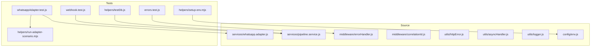
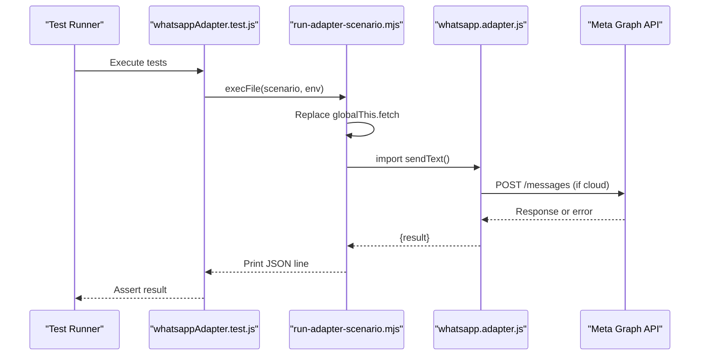
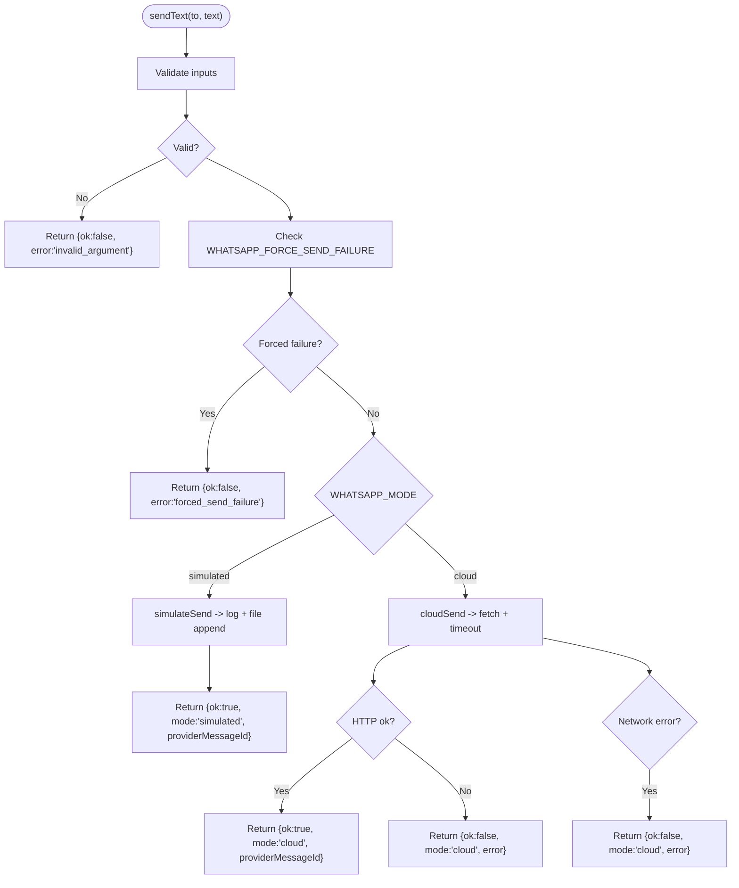
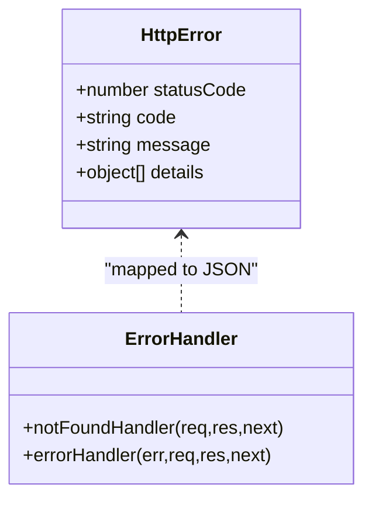
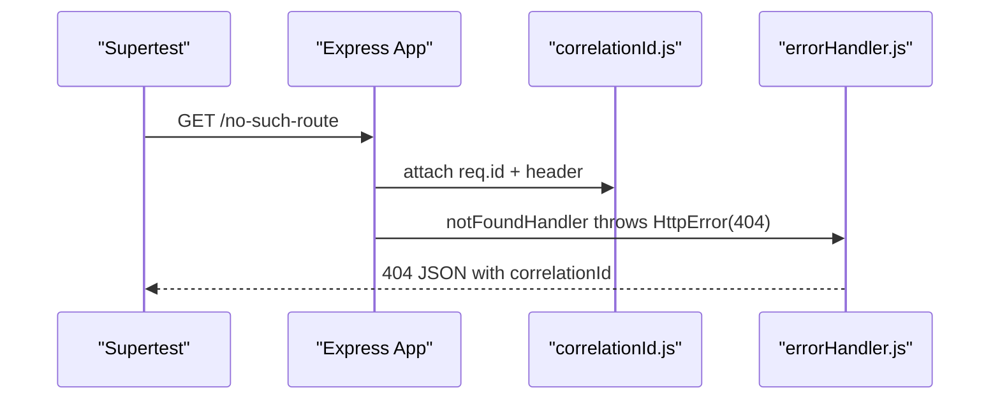
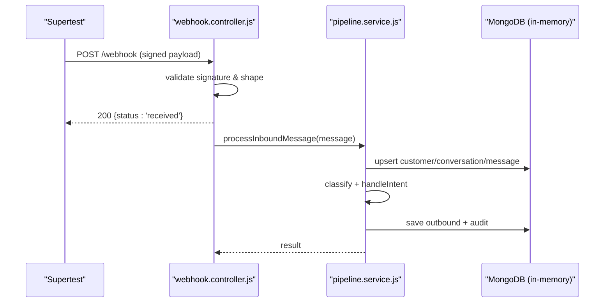
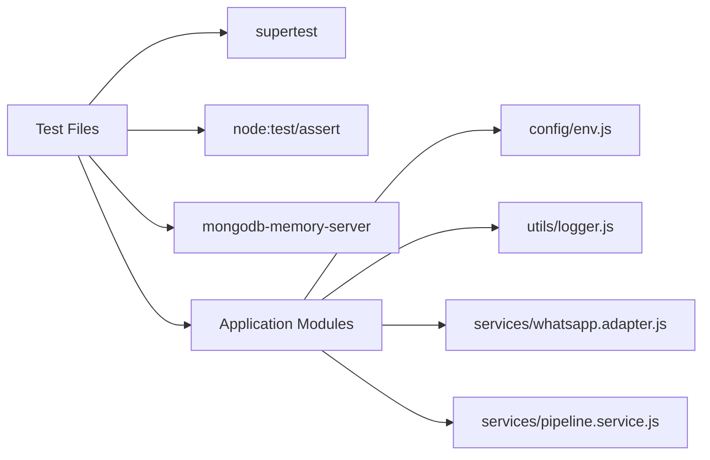

# Unit Testing Patterns

<cite>
**Referenced Files in This Document**
- [whatsappAdapter.test.js](file://tests/whatsappAdapter.test.js)
- [whatsapp.adapter.js](file://src/services/whatsapp.adapter.js)
- [run-adapter-scenario.mjs](file://tests/helpers/run-adapter-scenario.mjs)
- [setup-env.mjs](file://tests/helpers/setup-env.mjs)
- [testDb.js](file://tests/helpers/testDb.js)
- [errors.test.js](file://tests/errors.test.js)
- [webhook.test.js](file://tests/webhook.test.js)
- [httpError.js](file://src/utils/httpError.js)
- [asyncHandler.js](file://src/utils/asyncHandler.js)
- [errorHandler.js](file://src/middleware/errorHandler.js)
- [correlationId.js](file://src/middleware/correlationId.js)
- [pipeline.service.js](file://src/services/pipeline.service.js)
- [logger.js](file://src/utils/logger.js)
- [env.js](file://src/config/env.js)
- [package.json](file://package.json)
</cite>

## Table of Contents
1. Introduction
2. Project Structure
3. Core Components
4. Architecture Overview
5. Detailed Component Analysis
6. Dependency Analysis
7. Performance Considerations
8. Troubleshooting Guide
9. Conclusion

## Introduction
This document explains the unit testing patterns used across the codebase and how to test components such as the WhatsApp adapter, error handling utilities, middleware, service layer logic, and utility modules. It covers mocking strategies for external dependencies, async function testing, assertion techniques, edge cases, and performance considerations for tests.

The project uses Node’s built-in test runner with strict assertions, Supertest for HTTP integration tests, and an in-memory MongoDB helper for database-backed scenarios. The WhatsApp adapter supports simulated and cloud modes, which are tested through controlled child processes and fetch mocks.

## Project Structure
Tests live under the tests directory and follow a clear separation:
- Test files assert behavior against application modules.
- helpers contain reusable test utilities (environment bootstrap, in-memory database, scenario runner).
- Source modules under src implement the application logic being tested.

**Diagram sources**
- [whatsappAdapter.test.js:1-119](file://tests/whatsappAdapter.test.js#L1-L119)
- [errors.test.js:1-37](file://tests/errors.test.js#L1-L37)
- [webhook.test.js:1-168](file://tests/webhook.test.js#L1-L168)
- [setup-env.mjs:1-20](file://tests/helpers/setup-env.mjs#L1-L20)
- [testDb.js:1-29](file://tests/helpers/testDb.js#L1-L29)
- [run-adapter-scenario.mjs:1-44](file://tests/helpers/run-adapter-scenario.mjs#L1-L44)
- [whatsapp.adapter.js:1-136](file://src/services/whatsapp.adapter.js#L1-L136)
- [pipeline.service.js:1-274](file://src/services/pipeline.service.js#L1-L274)
- [errorHandler.js:1-80](file://src/middleware/errorHandler.js#L1-L80)
- [correlationId.js:1-14](file://src/middleware/correlationId.js#L1-L14)
- [httpError.js:1-31](file://src/utils/httpError.js#L1-L31)
- [asyncHandler.js:1-11](file://src/utils/asyncHandler.js#L1-L11)
- [logger.js:1-34](file://src/utils/logger.js#L1-L34)
- [env.js:1-144](file://src/config/env.js#L1-L144)

**Section sources**
- [package.json:10-16](file://package.json#L10-L16)
- [whatsappAdapter.test.js:1-119](file://tests/whatsappAdapter.test.js#L1-L119)
- [errors.test.js:1-37](file://tests/errors.test.js#L1-L37)
- [webhook.test.js:1-168](file://tests/webhook.test.js#L1-L168)

## Core Components
This section summarizes the key testing targets and their contracts:
- WhatsApp adapter: sendText returns a non-throwing result object with ok, mode, providerMessageId, and error fields. It supports simulated and cloud modes.
- Error handling: HttpError class and factory helpers produce standardized error responses; errorHandler maps various errors into a consistent JSON shape.
- Middleware: correlationId attaches a request id and response header; errorHandler centralizes error formatting.
- Pipeline service: processInboundMessage orchestrates message processing, classification, replies, and audit logging.
- Utilities: logger provides structured logging; env validates environment variables.

Testing approaches:
- Use setup-env.mjs to set deterministic environment values before importing source modules.
- For HTTP endpoints, use Supertest to send requests and assert status codes, headers, and bodies.
- For external integrations like Meta Graph API, mock globalThis.fetch inside a child process via run-adapter-scenario.mjs.
- For database-backed flows, start MongoMemoryServer using testDb.js and clear collections between tests.

**Section sources**
- [whatsapp.adapter.js:9-24](file://src/services/whatsapp.adapter.js#L9-L24)
- [httpError.js:1-31](file://src/utils/httpError.js#L1-L31)
- [errorHandler.js:1-80](file://src/middleware/errorHandler.js#L1-L80)
- [correlationId.js:1-14](file://src/middleware/correlationId.js#L1-L14)
- [pipeline.service.js:12-37](file://src/services/pipeline.service.js#L12-L37)
- [logger.js:1-34](file://src/utils/logger.js#L1-L34)
- [env.js:125-141](file://src/config/env.js#L125-L141)

## Architecture Overview
The testing architecture isolates concerns:
- Environment bootstrap ensures deterministic configuration.
- HTTP tests validate middleware and controller behavior.
- Adapter tests isolate network calls by mocking fetch in a child process.
- Database tests use an in-memory server to avoid external dependencies.

**Diagram sources**
- [whatsappAdapter.test.js:25-32](file://tests/whatsappAdapter.test.js#L25-L32)
- [run-adapter-scenario.mjs:12-43](file://tests/helpers/run-adapter-scenario.mjs#L12-L43)
- [whatsapp.adapter.js:60-104](file://src/services/whatsapp.adapter.js#L60-L104)

## Detailed Component Analysis

### WhatsApp Adapter Testing
Patterns:
- Simulated mode: verify that sendText logs to an outbound file and returns a simulated providerMessageId.
- Failure injection: set WHATSAPP_FORCE_SEND_FAILURE to force a failure path without real network calls.
- Cloud mode: replace globalThis.fetch to simulate success, HTTP errors, and network failures.
- Assertions: check ok, mode, providerMessageId, error, and captured fetchCalls.

**Diagram sources**
- [whatsapp.adapter.js:113-135](file://src/services/whatsapp.adapter.js#L113-L135)
- [whatsapp.adapter.js:47-58](file://src/services/whatsapp.adapter.js#L47-L58)
- [whatsapp.adapter.js:60-104](file://src/services/whatsapp.adapter.js#L60-L104)

Key testing practices:
- Use setup-env.mjs at the top of test files to ensure WHATSAPP_MODE is set before imports.
- For cloud scenarios, spawn a child process with run-adapter-scenario.mjs and inject a custom fetch implementation.
- Capture fetchCalls to assert URL, Authorization header, and body structure.
- Verify that invalid arguments do not throw but return a structured error.

**Section sources**
- [whatsappAdapter.test.js:1-119](file://tests/whatsappAdapter.test.js#L1-L119)
- [run-adapter-scenario.mjs:1-44](file://tests/helpers/run-adapter-scenario.mjs#L1-L44)
- [setup-env.mjs:1-20](file://tests/helpers/setup-env.mjs#L1-L20)
- [whatsapp.adapter.js:1-136](file://src/services/whatsapp.adapter.js#L1-L136)

### Error Handling Utilities Testing
Patterns:
- HttpError class carries statusCode, code, message, and details.
- Factory helpers create standard errors (badRequest, unauthorized, notFound, rateLimited).
- errorHandler maps ZodError, Mongoose validation errors, CastError, duplicate key errors, and body-parser errors into a unified JSON response.

Testing approach:
- Trigger routes that cause validation or unknown route errors.
- Assert status codes, error.code, error.message, and presence of correlationId.
- Confirm x-correlation-id header matches the body correlationId.

**Diagram sources**
- [httpError.js:1-31](file://src/utils/httpError.js#L1-L31)
- [errorHandler.js:1-80](file://src/middleware/errorHandler.js#L1-L80)

**Section sources**
- [errors.test.js:1-37](file://tests/errors.test.js#L1-L37)
- [httpError.js:1-31](file://src/utils/httpError.js#L1-L31)
- [errorHandler.js:1-80](file://src/middleware/errorHandler.js#L1-L80)

### Middleware Testing
Patterns:
- correlationId middleware sets req.id and adds x-correlation-id header.
- errorHandler centralizes error mapping and response formatting.
- asyncHandler wraps Express handlers to forward promise rejections to next.

Testing approach:
- Send requests via Supertest and assert headers and bodies.
- Ensure correlationId appears in both response header and body.
- Validate that malformed payloads map to VALIDATION_ERROR.

**Diagram sources**
- [correlationId.js:1-14](file://src/middleware/correlationId.js#L1-L14)
- [errorHandler.js:1-80](file://src/middleware/errorHandler.js#L1-L80)
- [errors.test.js:1-37](file://tests/errors.test.js#L1-L37)

**Section sources**
- [correlationId.js:1-14](file://src/middleware/correlationId.js#L1-L14)
- [errorHandler.js:1-80](file://src/middleware/errorHandler.js#L1-L80)
- [asyncHandler.js:1-11](file://src/utils/asyncHandler.js#L1-L11)
- [errors.test.js:1-37](file://tests/errors.test.js#L1-L37)

### Webhook and Service Layer Testing
Patterns:
- Webhook handshake verifies hub.verify_token and echoes challenge.
- Webhook POST validates signature and payload shape, records audit events, and returns 200 immediately while processing asynchronously.
- Pipeline service orchestrates dedupe, persistence, classification, intent routing, reply sending, and audit logging.

Testing approach:
- Use Supertest to exercise webhook endpoints.
- Compute HMAC signatures with known secrets to simulate valid and invalid cases.
- Start an in-memory MongoDB via testDb.js and clear collections between tests.
- Assert AuditEvent documents created for rejected webhooks and invalid payloads.

**Diagram sources**
- [webhook.test.js:1-168](file://tests/webhook.test.js#L1-L168)
- [pipeline.service.js:66-273](file://src/services/pipeline.service.js#L66-L273)
- [testDb.js:1-29](file://tests/helpers/testDb.js#L1-L29)

**Section sources**
- [webhook.test.js:1-168](file://tests/webhook.test.js#L1-L168)
- [pipeline.service.js:1-274](file://src/services/pipeline.service.js#L1-L274)
- [testDb.js:1-29](file://tests/helpers/testDb.js#L1-L29)

### Utility Modules Testing
Patterns:
- logger provides structured logging with redaction; tests should avoid asserting log output unless necessary.
- env validates environment variables and can be influenced by process.env before module load.

Testing approach:
- Set NODE_ENV=test and other required variables in setup-env.mjs.
- Avoid relying on side effects from logger; focus on functional outcomes.

**Section sources**
- [logger.js:1-34](file://src/utils/logger.js#L1-L34)
- [env.js:1-144](file://src/config/env.js#L1-L144)
- [setup-env.mjs:1-20](file://tests/helpers/setup-env.mjs#L1-L20)

## Dependency Analysis
The test suite depends on:
- Node test runner and strict assertions.
- Supertest for HTTP integration tests.
- mongodb-memory-server for isolated database state.
- Application modules for behavior verification.

**Diagram sources**
- [package.json:18-35](file://package.json#L18-L35)
- [whatsappAdapter.test.js:1-119](file://tests/whatsappAdapter.test.js#L1-L119)
- [errors.test.js:1-37](file://tests/errors.test.js#L1-L37)
- [webhook.test.js:1-168](file://tests/webhook.test.js#L1-L168)

**Section sources**
- [package.json:18-35](file://package.json#L18-L35)

## Performance Considerations
- Keep tests fast by avoiding real network calls; mock fetch for cloud scenarios.
- Use in-memory MongoDB to eliminate startup overhead and external DB dependencies.
- Run tests sequentially when needed to avoid race conditions (the test script enforces concurrency=1).
- Limit log verbosity in tests by setting LOG_LEVEL=silent in setup-env.mjs.
- Prefer targeted assertions over broad snapshot checks to reduce flakiness.

[No sources needed since this section provides general guidance]

## Troubleshooting Guide
Common issues and resolutions:
- Environment not loaded early enough: Always import setup-env.mjs as the first import in test files so env values are set before any src module evaluates.
- Fetch not mocked in cloud scenarios: Ensure run-adapter-scenario.mjs replaces globalThis.fetch before importing whatsapp.adapter.js.
- Database state leaking between tests: Use startTestDb and clearDb in beforeEach hooks; stopTestDb in after hooks.
- Correlation ID mismatches: Verify that errorHandler returns correlationId in the body and correlationId middleware sets the header.
- Validation errors not mapped correctly: Confirm that errorHandler handles ZodError, Mongoose validation, CastError, and duplicate key errors.

**Section sources**
- [setup-env.mjs:1-20](file://tests/helpers/setup-env.mjs#L1-L20)
- [run-adapter-scenario.mjs:12-43](file://tests/helpers/run-adapter-scenario.mjs#L12-L43)
- [testDb.js:1-29](file://tests/helpers/testDb.js#L1-L29)
- [errorHandler.js:1-80](file://src/middleware/errorHandler.js#L1-L80)
- [correlationId.js:1-14](file://src/middleware/correlationId.js#L1-L14)

## Conclusion
The codebase demonstrates robust testing patterns:
- Isolate external dependencies via environment control and fetch mocking.
- Use structured error types and centralized error handling for predictable responses.
- Leverage in-memory databases for reliable, fast, and isolated data tests.
- Apply strict assertions and clear test organization to maintain clarity and confidence.

These practices enable comprehensive coverage of adapters, middleware, services, and utilities while keeping tests fast, deterministic, and maintainable.