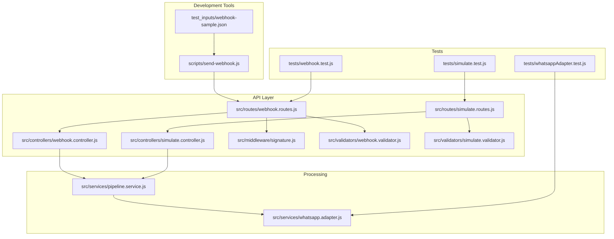
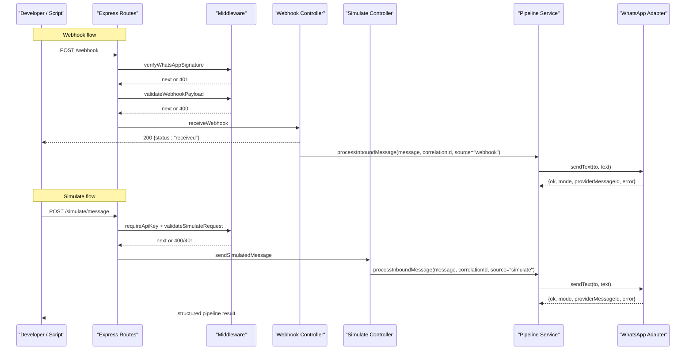
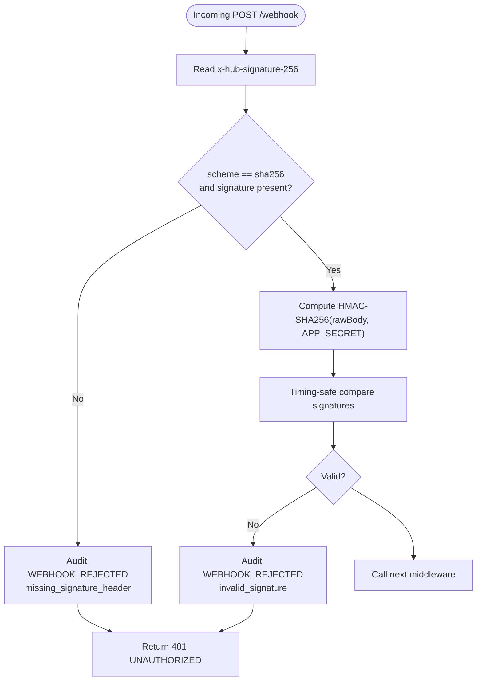
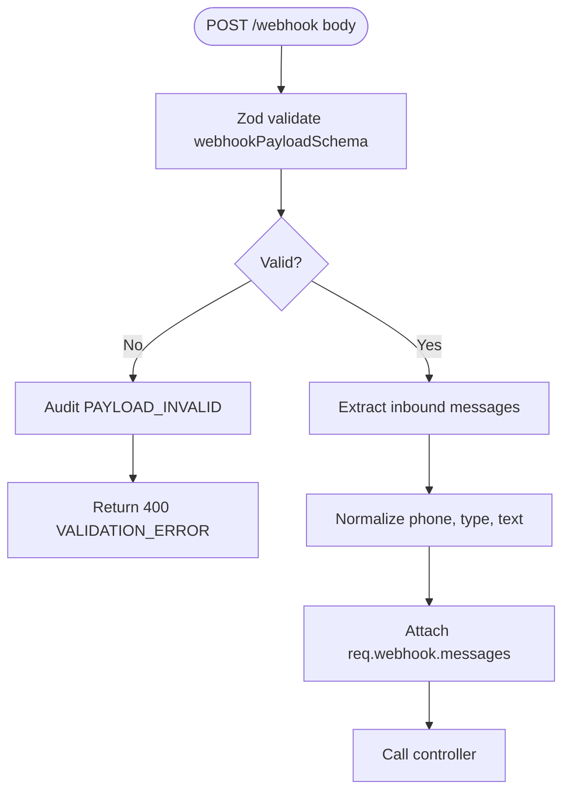
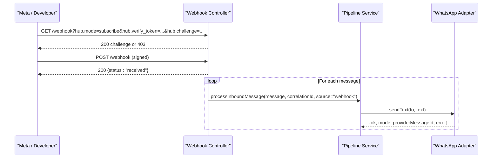
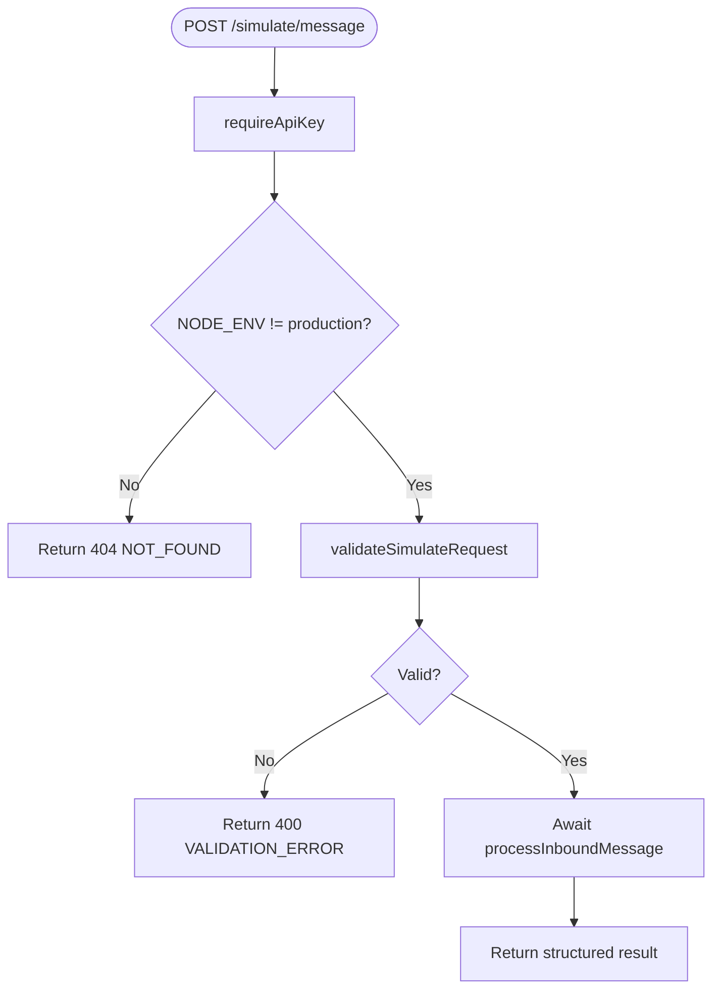
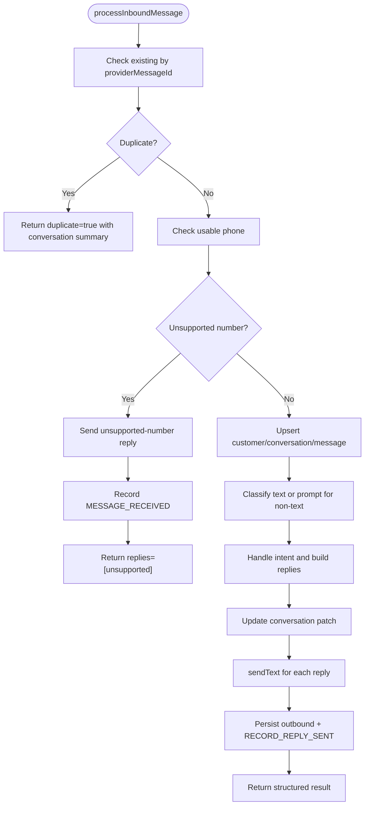
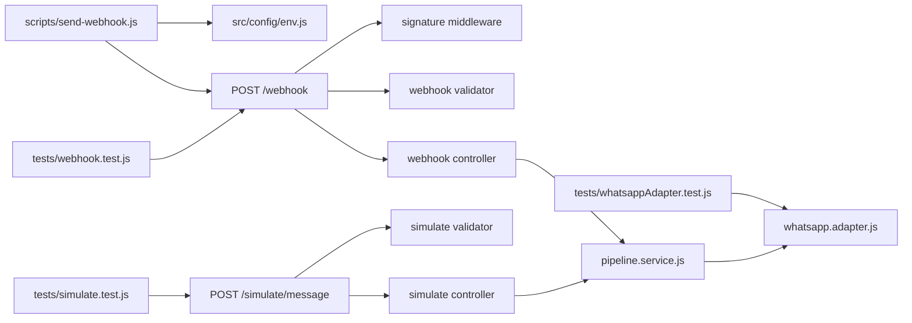

# Development and Testing Approaches

<cite>
**Referenced Files in This Document**
- [README.md](file://README.md)
- [package.json](file://package.json)
- [scripts/send-webhook.js](file://scripts/send-webhook.js)
- [test_inputs/webhook-sample.json](file://test_inputs/webhook-sample.json)
- [src/controllers/webhook.controller.js](file://src/controllers/webhook.controller.js)
- [src/controllers/simulate.controller.js](file://src/controllers/simulate.controller.js)
- [src/middleware/signature.js](file://src/middleware/signature.js)
- [src/routes/webhook.routes.js](file://src/routes/webhook.routes.js)
- [src/routes/simulate.routes.js](file://src/routes/simulate.routes.js)
- [src/services/pipeline.service.js](file://src/services/pipeline.service.js)
- [src/services/whatsapp.adapter.js](file://src/services/whatsapp.adapter.js)
- [src/validators/webhook.validator.js](file://src/validators/webhook.validator.js)
- [src/validators/simulate.validator.js](file://src/validators/simulate.validator.js)
- [tests/webhook.test.js](file://tests/webhook.test.js)
- [tests/simulate.test.js](file://tests/simulate.test.js)
- [tests/whatsappAdapter.test.js](file://tests/whatsappAdapter.test.js)
</cite>

## Table of Contents
1. [Introduction](#introduction)
2. [Project Structure](#project-structure)
3. [Core Components](#core-components)
4. [Architecture Overview](#architecture-overview)
5. [Detailed Component Analysis](#detailed-component-analysis)
6. [Dependency Analysis](#dependency-analysis)
7. [Performance Considerations](#performance-considerations)
8. [Troubleshooting Guide](#troubleshooting-guide)
9. [Conclusion](#conclusion)
10. [Appendices](#appendices)

## Introduction
This document explains how to develop and test the WhatsApp integration without Meta, how to simulate webhooks locally, how to manage test data, and how to run automated tests for signature verification, message processing, adapter behavior, and error conditions. It also provides debugging guidance, log analysis tips, performance considerations, and examples of unit, integration, and end-to-end testing workflows.

The project supports a simulated WhatsApp mode by default so developers can exercise the full pipeline without a Meta account. Real Cloud API sending is available when configured.

**Section sources**
- [README.md:1-47](file://README.md#L1-L47)
- [README.md:163-197](file://README.md#L163-L197)

## Project Structure
The repository separates configuration, controllers, middleware, routes, services, validators, utilities, scripts, sample payloads, and tests. The most relevant parts for development and testing are:

- Scripts that sign and send webhook payloads locally.
- Sample webhook payload used by manual and automated tests.
- Webhook and simulate routes with their middleware chain.
- Controllers that handle handshake, incoming messages, and simulated customer messages.
- Validators that normalize and validate payloads.
- Pipeline service that orchestrates dedupe, persistence, classification, routing, replies, and audit events.
- WhatsApp adapter that implements simulated and cloud modes.
- Test suites covering webhook flow, simulate endpoint, and adapter scenarios.



**Diagram sources**
- [scripts/send-webhook.js:1-84](file://scripts/send-webhook.js#L1-L84)
- [test_inputs/webhook-sample.json:1-29](file://test_inputs/webhook-sample.json#L1-L29)
- [src/routes/webhook.routes.js:1-16](file://src/routes/webhook.routes.js#L1-L16)
- [src/routes/simulate.routes.js:1-21](file://src/routes/simulate.routes.js#L1-L21)
- [src/controllers/webhook.controller.js:1-56](file://src/controllers/webhook.controller.js#L1-L56)
- [src/controllers/simulate.controller.js:1-35](file://src/controllers/simulate.controller.js#L1-L35)
- [src/middleware/signature.js:1-51](file://src/middleware/signature.js#L1-L51)
- [src/validators/webhook.validator.js:1-124](file://src/validators/webhook.validator.js#L1-L124)
- [src/validators/simulate.validator.js:1-55](file://src/validators/simulate.validator.js#L1-L55)
- [src/services/pipeline.service.js:1-278](file://src/services/pipeline.service.js#L1-L278)
- [src/services/whatsapp.adapter.js:1-136](file://src/services/whatsapp.adapter.js#L1-L136)
- [tests/webhook.test.js:1-222](file://tests/webhook.test.js#L1-L222)
- [tests/simulate.test.js:1-134](file://tests/simulate.test.js#L1-L134)
- [tests/whatsappAdapter.test.js:1-119](file://tests/whatsappAdapter.test.js#L1-L119)

**Section sources**
- [README.md:364-384](file://README.md#L364-L384)
- [package.json:10-16](file://package.json#L10-L16)

## Core Components
This section summarizes the components you will use during development and testing.

- Simulated local development:
  - The application runs in simulated WhatsApp mode by default. Outbound messages are logged instead of sent to Meta.
  - Use the simulate endpoint to drive the pipeline without Meta.
- Webhook simulation script:
  - Signs a sample payload using the configured app secret and POSTs it to the local webhook endpoint.
  - Supports overriding text, id, URL, secret, and forcing a bad signature.
- Test data management:
  - A sample webhook payload exists under `test_inputs/webhook-sample.json`.
  - Tests construct similar payloads programmatically and assert on audit events and database state.
- Automated testing strategies:
  - Unit-style tests for the WhatsApp adapter (simulated, forced failure, cloud OK, HTTP error, network error).
  - Integration-style tests for webhook handshake, signature verification, payload validation, and background processing.
  - End-to-end style tests for the simulate endpoint, including production disablement via child process execution.

Key behaviors:
- Webhook GET verifies Meta’s handshake token and echoes the challenge.
- Webhook POST validates signature, validates payload shape, returns 200 immediately, then processes messages asynchronously.
- Simulate POST requires staff API key, validates Nigerian phone numbers, normalizes input, awaits pipeline processing, and returns structured results.
- Pipeline performs dedupe, persistence, classification, intent handling, reply sending, and audit recording.
- Adapter returns a stable result object regardless of success or failure, enabling callers to implement retry/failure handling.

**Section sources**
- [README.md:9-13](file://README.md#L9-L13)
- [README.md:290-350](file://README.md#L290-L350)
- [scripts/send-webhook.js:6-17](file://scripts/send-webhook.js#L6-L17)
- [src/controllers/webhook.controller.js:5-55](file://src/controllers/webhook.controller.js#L5-L55)
- [src/controllers/simulate.controller.js:4-34](file://src/controllers/simulate.controller.js#L4-L34)
- [src/services/pipeline.service.js:12-54](file://src/services/pipeline.service.js#L12-L54)
- [src/services/whatsapp.adapter.js:9-24](file://src/services/whatsapp.adapter.js#L9-L24)

## Architecture Overview
The following diagram maps the request flows for webhook and simulate endpoints through middleware, controllers, validators, pipeline, and adapter.



**Diagram sources**
- [src/routes/webhook.routes.js:8-13](file://src/routes/webhook.routes.js#L8-L13)
- [src/routes/simulate.routes.js:10-18](file://src/routes/simulate.routes.js#L10-L18)
- [src/middleware/signature.js:7-50](file://src/middleware/signature.js#L7-L50)
- [src/validators/webhook.validator.js:97-123](file://src/validators/webhook.validator.js#L97-L123)
- [src/validators/simulate.validator.js:23-54](file://src/validators/simulate.validator.js#L23-L54)
- [src/controllers/webhook.controller.js:27-55](file://src/controllers/webhook.controller.js#L27-L55)
- [src/controllers/simulate.controller.js:4-34](file://src/controllers/simulate.controller.js#L4-L34)
- [src/services/pipeline.service.js:66-277](file://src/services/pipeline.service.js#L66-L277)
- [src/services/whatsapp.adapter.js:106-135](file://src/services/whatsapp.adapter.js#L106-L135)

## Detailed Component Analysis

### Webhook Signature Verification
The signature middleware checks the `x-hub-signature-256` header against an HMAC-SHA256 digest of the raw body using the configured app secret. Rejections are audited before returning 401.

Key points:
- Requires scheme `sha256=` and a hex signature.
- Uses timing-safe comparison.
- Records `WEBHOOK_REJECTED` audit events with reasons such as missing header or invalid signature.
- Depends on the raw body being captured earlier in the stack.



**Diagram sources**
- [src/middleware/signature.js:7-50](file://src/middleware/signature.js#L7-L50)

**Section sources**
- [src/middleware/signature.js:1-51](file://src/middleware/signature.js#L1-L51)

### Webhook Payload Validation and Normalization
After signature verification, the payload is validated against a Zod schema. Unknown fields are preserved. Invalid payloads are audited as `PAYLOAD_INVALID` and return 400. Valid payloads are normalized into inbound messages and attached to the request.

Important behaviors:
- Only entries with `field === 'messages'` and non-empty `messages` arrays are processed.
- Non-text messages keep `type` but have `text: null`, allowing polite text-only replies later.
- Status-only callbacks (delivery receipts) are accepted and ignored by the pipeline.



**Diagram sources**
- [src/validators/webhook.validator.js:53-58](file://src/validators/webhook.validator.js#L53-L58)
- [src/validators/webhook.validator.js:68-95](file://src/validators/webhook.validator.js#L68-L95)
- [src/validators/webhook.validator.js:103-123](file://src/validators/webhook.validator.js#L103-L123)

**Section sources**
- [src/validators/webhook.validator.js:1-124](file://src/validators/webhook.validator.js#L1-L124)

### Webhook Controller Flow
The webhook controller handles:
- GET handshake: echoes `hub.challenge` when the verify token matches; otherwise returns 403.
- POST processing: returns 200 immediately, then processes each message asynchronously. Processing failures are logged and do not cause retry storms.



**Diagram sources**
- [src/controllers/webhook.controller.js:5-55](file://src/controllers/webhook.controller.js#L5-L55)
- [src/services/pipeline.service.js:66-277](file://src/services/pipeline.service.js#L66-L277)
- [src/services/whatsapp.adapter.js:106-135](file://src/services/whatsapp.adapter.js#L106-L135)

**Section sources**
- [src/controllers/webhook.controller.js:1-56](file://src/controllers/webhook.controller.js#L1-L56)

### Simulate Endpoint and Production Disablement
The simulate endpoint is a staff-only harness for driving the pipeline without Meta. It:
- Requires a staff API key.
- Validates Nigerian phone numbers and required fields.
- Normalizes the request into the same shape as webhook messages.
- Awaits pipeline processing and returns a structured result.
- Is disabled in production by returning 404.



**Diagram sources**
- [src/routes/simulate.routes.js:10-18](file://src/routes/simulate.routes.js#L10-L18)
- [src/validators/simulate.validator.js:10-54](file://src/validators/simulate.validator.js#L10-L54)
- [src/controllers/simulate.controller.js:4-34](file://src/controllers/simulate.controller.js#L4-L34)

**Section sources**
- [src/routes/simulate.routes.js:1-21](file://src/routes/simulate.routes.js#L1-L21)
- [src/validators/simulate.validator.js:1-55](file://src/validators/simulate.validator.js#L1-L55)
- [src/controllers/simulate.controller.js:1-35](file://src/controllers/simulate.controller.js#L1-L35)

### Message Pipeline
The pipeline centralizes:
- Deduplication by provider message ID.
- Customer and conversation upsert.
- Inbound and outbound message persistence.
- Classification and intent handling.
- Reply sending through the adapter.
- Comprehensive audit event recording.



**Diagram sources**
- [src/services/pipeline.service.js:66-277](file://src/services/pipeline.service.js#L66-L277)

**Section sources**
- [src/services/pipeline.service.js:1-278](file://src/services/pipeline.service.js#L1-L278)

### WhatsApp Adapter Modes
The adapter supports:
- Simulated mode: logs to stdout and writes JSON lines to an outbound log file.
- Cloud mode: sends real messages via the Meta Graph API with timeout handling.
- Forced failure hook: allows testing notification-failure paths.

It always returns a stable result object with `ok`, `mode`, `providerMessageId`, and `error`.

```mermaid
classDiagram
class WhatsAppAdapter {
+sendText(to, text) Promise~{ok, mode, providerMessageId, error}~
-simulateSend(to, text) Promise~{ok, mode, providerMessageId, error}~
-cloudSend(to, text) Promise~{ok, mode, providerMessageId, error}~
-forcedFailure() boolean
}
class SimulatedMode {
+logsToStdout()
+writesOutboundLog()
}
class CloudMode {
+postsGraphAPI()
+handlesTimeout()
+mapsProviderErrors()
}
WhatsAppAdapter --> SimulatedMode : "WHATSAPP_MODE=simulated"
WhatsAppAdapter --> CloudMode : "WHATSAPP_MODE=cloud"
```

**Diagram sources**
- [src/services/whatsapp.adapter.js:9-24](file://src/services/whatsapp.adapter.js#L9-L24)
- [src/services/whatsapp.adapter.js:47-58](file://src/services/whatsapp.adapter.js#L47-L58)
- [src/services/whatsapp.adapter.js:60-104](file://src/services/whatsapp.adapter.js#L60-L104)
- [src/services/whatsapp.adapter.js:113-135](file://src/services/whatsapp.adapter.js#L113-L135)

**Section sources**
- [src/services/whatsapp.adapter.js:1-136](file://src/services/whatsapp.adapter.js#L1-L136)

## Dependency Analysis
The main dependencies between development and testing artifacts are:



**Diagram sources**
- [scripts/send-webhook.js:1-84](file://scripts/send-webhook.js#L1-L84)
- [tests/webhook.test.js:1-222](file://tests/webhook.test.js#L1-L222)
- [tests/simulate.test.js:1-134](file://tests/simulate.test.js#L1-L134)
- [tests/whatsappAdapter.test.js:1-119](file://tests/whatsappAdapter.test.js#L1-L119)
- [src/middleware/signature.js:1-51](file://src/middleware/signature.js#L1-L51)
- [src/validators/webhook.validator.js:1-124](file://src/validators/webhook.validator.js#L1-L124)
- [src/validators/simulate.validator.js:1-55](file://src/validators/simulate.validator.js#L1-L55)
- [src/controllers/webhook.controller.js:1-56](file://src/controllers/webhook.controller.js#L1-L56)
- [src/controllers/simulate.controller.js:1-35](file://src/controllers/simulate.controller.js#L1-L35)
- [src/services/pipeline.service.js:1-278](file://src/services/pipeline.service.js#L1-L278)
- [src/services/whatsapp.adapter.js:1-136](file://src/services/whatsapp.adapter.js#L1-L136)

**Section sources**
- [package.json:10-16](file://package.json#L10-L16)

## Performance Considerations
- Webhook POST returns 200 immediately and processes messages asynchronously. This prevents retry storms from long-running workloads.
- The adapter enforces a timeout for Cloud API calls to avoid blocking indefinitely.
- Simulated outbound logging writes JSON lines to a file; this is optional observability and never fails the send path.
- Tests use an in-memory MongoDB server to avoid external service overhead.
- The Node test runner executes tests sequentially to reduce memory pressure on Windows.

Recommendations:
- Keep webhook handlers fast and offload heavy work to background jobs if needed.
- Monitor outbound log growth in simulated mode and rotate or truncate as appropriate.
- Use `WHATSAPP_FORCE_SEND_FAILURE` to validate retry and fallback logic without impacting production.
- Profile classification and intent handling paths separately since they may involve external LLM providers.

[No sources needed since this section provides general guidance]

## Troubleshooting Guide
Common issues and resolutions:

- Invalid environment variables at startup:
  - Compare `.env` with `.env.example`; the error lists each offending variable.
- Health endpoint returns 503:
  - MongoDB is unreachable; start Docker Mongo, run the in-memory dev script, or fix `MONGODB_URI`.
- Port conflict:
  - Something else uses port 3000; change `PORT` in `.env`.
- Webhook POST returns 401:
  - `WHATSAPP_APP_SECRET` does not match the signer. With the script, omit `--secret` to use the value from `.env`.
- Handshake returns 403:
  - `WHATSAPP_VERIFY_TOKEN` in `.env` and in Meta’s webhook config must be identical.
- Force send failures:
  - Set `WHATSAPP_FORCE_SEND_FAILURE=true` or use `--bad-signature` on the webhook script to trigger rejection paths.
- Tests download a MongoDB binary:
  - First run fetches it once; afterwards it is cached.

Debugging techniques:
- Use correlation IDs: every response includes `x-correlation-id`, which appears in audit events and logs.
- Inspect outbound simulated messages:
  - Stdout contains structured logs.
  - File `logs/whatsapp-outbound.log` contains one JSON line per simulated outbound message.
- Audit events:
  - Verify `MESSAGE_RECEIVED`, `CLASSIFIED`, `REPLY_SENT`, `WEBHOOK_REJECTED`, and `PAYLOAD_INVALID` events to trace lifecycle and failures.

**Section sources**
- [README.md:409-419](file://README.md#L409-L419)
- [README.md:346-350](file://README.md#L346-L350)
- [src/services/whatsapp.adapter.js:33-41](file://src/services/whatsapp.adapter.js#L33-L41)
- [src/middleware/signature.js:23-30](file://src/middleware/signature.js#L23-L30)
- [src/validators/webhook.validator.js:112-118](file://src/validators/webhook.validator.js#L112-L118)

## Conclusion
The repository provides a robust development and testing approach for WhatsApp integration:
- Local development works without Meta using simulated mode.
- The webhook simulation script reproduces Meta’s signing behavior for manual testing.
- Validators and middleware enforce security and correctness early.
- The pipeline centralizes business logic and auditability.
- Tests cover signature verification, payload validation, adapter modes, and production disablement.
- Debugging is supported through correlation IDs, structured logs, and audit events.

Use the provided scripts and test suites to iterate quickly, validate edge cases, and ensure reliability before connecting to Meta.

[No sources needed since this section summarizes without analyzing specific files]

## Appendices

### Webhook Simulation Script Usage
Run the script to POST a signed webhook payload to the local API:

- Default usage posts the sample payload with a valid signature.
- Override message text and id for repeatable scenarios.
- Use `--bad-signature` to exercise rejection paths.
- Provide custom URL and secret when needed.

Example commands:
- `node scripts/send-webhook.js`
- `node scripts/send-webhook.js --text "Do you have rice?" --id wamid.DEMO1`
- `node scripts/send-webhook.js --bad-signature`
- `node scripts/send-webhook.js my-payload.json --url http://localhost:3000/webhook --secret s3cret`

**Section sources**
- [scripts/send-webhook.js:6-17](file://scripts/send-webhook.js#L6-L17)
- [scripts/send-webhook.js:39-77](file://scripts/send-webhook.js#L39-L77)

### Test Data Management
- Sample webhook payload:
  - Located at `test_inputs/webhook-sample.json`.
  - Used by the simulation script and representative of Meta’s structure.
- Programmatic payloads:
  - Tests construct payloads inline to vary message types, ids, and content.
- Database state assertions:
  - Tests poll audit events and query models to confirm processing outcomes.

**Section sources**
- [test_inputs/webhook-sample.json:1-29](file://test_inputs/webhook-sample.json#L1-L29)
- [tests/webhook.test.js:43-70](file://tests/webhook.test.js#L43-L70)

### Automated Testing Strategies
- Webhook tests:
  - Verify handshake success and token mismatch.
  - Assert immediate 200 and background processing completion.
  - Validate signature success, wrong signature, missing header, invalid payload, and status-only callbacks.
- Simulate tests:
  - Enforce staff API key requirement.
  - Validate Nigerian phone constraints and empty text.
  - Assert structured result shape and pipeline outcomes.
  - Confirm production disablement via child process execution.
- Adapter tests:
  - Simulated mode returns ok and appends to outbound log.
  - Invalid arguments return a safe failure result.
  - Forced failure hook produces expected error.
  - Cloud mode posts to Graph API, returns provider message id, maps HTTP errors, and maps network errors.

Running tests:
- Full suite: `npm test`
- Single file: `node --test tests/webhook.test.js`

**Section sources**
- [tests/webhook.test.js:72-221](file://tests/webhook.test.js#L72-L221)
- [tests/simulate.test.js:39-133](file://tests/simulate.test.js#L39-L133)
- [tests/whatsappAdapter.test.js:34-118](file://tests/whatsappAdapter.test.js#L34-L118)
- [README.md:351-363](file://README.md#L351-L363)

### Mock Implementations and Scenarios
- Simulated outbound log:
  - Adapter writes JSON lines to `logs/whatsapp-outbound.log`.
  - Tests read and parse the file to assert message content.
- Child-process scenario runner:
  - Adapter tests execute a helper script with modified environment variables and optional fetch mocking to isolate cloud behavior.
- Forced failure hook:
  - Environment flag forces send failures to validate downstream handling.

**Section sources**
- [src/services/whatsapp.adapter.js:30-41](file://src/services/whatsapp.adapter.js#L30-L41)
- [tests/whatsappAdapter.test.js:14-32](file://tests/whatsappAdapter.test.js#L14-L32)
- [tests/whatsappAdapter.test.js:64-70](file://tests/whatsappAdapter.test.js#L64-L70)