# Message Processing and Transformation

<cite>
**Referenced Files in This Document**
- [README.md](file://README.md)
- [whatsapp.adapter.js](file://src/services/whatsapp.adapter.js)
- [pipeline.service.js](file://src/services/pipeline.service.js)
- [simulate.controller.js](file://src/controllers/simulate.controller.js)
- [webhook.controller.js](file://src/controllers/webhook.controller.js)
- [phone.js](file://src/utils/phone.js)
- [webhook.validator.js](file://src/validators/webhook.validator.js)
- [simulate.validator.js](file://src/validators/simulate.validator.js)
- [message.model.js](file://src/models/message.model.js)
- [conversation.model.js](file://src/models/conversation.model.js)
- [customer.model.js](file://src/models/customer.model.js)
- [signature.js](file://src/middleware/signature.js)
</cite>

## Table of Contents
1. [Introduction](#introduction)
2. [Project Structure](#project-structure)
3. [Core Components](#core-components)
4. [Architecture Overview](#architecture-overview)
5. [Detailed Component Analysis](#detailed-component-analysis)
6. [Dependency Analysis](#dependency-analysis)
7. [Performance Considerations](#performance-considerations)
8. [Troubleshooting Guide](#troubleshooting-guide)
9. [Conclusion](#conclusion)

## Introduction
This document explains the WhatsApp message processing and transformation logic used by the Lead System Manager. It focuses on the dual-mode architecture that supports:
- Simulated development mode, where outbound messages are logged instead of sent to Meta.
- Production cloud API mode, where outbound messages are sent through the Meta WhatsApp Cloud API.

It also documents:
- The inbound message format specification.
- Phone number normalization using E.164.
- WhatsApp ID conversion for outbound sends.
- The adapter pattern implementation.
- The message transformation pipeline.
- Outbound message handling, including retries, timeouts, deduplication, logging, and error strategies.

The system is designed so that both simulated and production flows share as much logic as possible, minimizing divergence between development and real messaging behavior.

## Project Structure
At a high level, incoming requests arrive at Express controllers, pass through middleware for authentication and signature verification, then enter validators that normalize payloads into a shared internal message shape. That normalized message is processed by the pipeline service, which handles deduplication, persistence, classification, intent routing, reply generation, and outbound sending via the WhatsApp adapter.

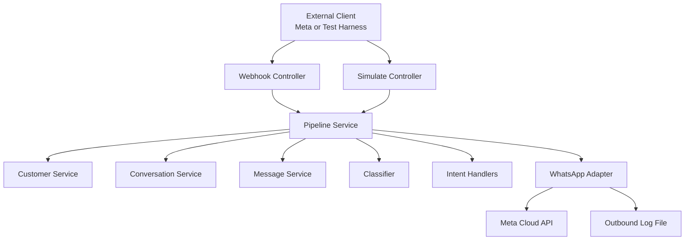

**Diagram sources**
- [webhook.controller.js:1-56](file://src/controllers/webhook.controller.js#L1-L56)
- [simulate.controller.js:1-35](file://src/controllers/simulate.controller.js#L1-L35)
- [pipeline.service.js:1-274](file://src/services/pipeline.service.js#L1-L274)
- [whatsapp.adapter.js:1-136](file://src/services/whatsapp.adapter.js#L1-L136)

**Section sources**
- [README.md:1-440](file://README.md#L1-L440)

## Core Components
The core components involved in message processing and transformation are:

| Component | Responsibility | Key Behaviors |
|---|---|---|
| WhatsApp Adapter | Sends text messages in simulated or cloud mode | Returns structured result with success flag, mode, provider message ID, and error |
| Pipeline Service | Orchestrates end-to-end message processing | Deduplication, customer/conversation management, classification, intent routing, reply sending, audit recording |
| Webhook Controller | Handles Meta webhook handshake and inbound messages | Fast 200 response, async processing, status-only callback handling |
| Simulate Controller | Drives the pipeline without Meta | Awaits processing and returns full outcome |
| Validators | Normalize and validate inputs | Convert raw webhook or simulate payloads into shared internal message shape |
| Phone Utilities | Normalize phone numbers and mask logs | E.164 normalization, wa_id conversion, safe masking |
| Models | Persist conversation state and immutable messages | Unique indexes for deduplication, conversation state machine fields |
| Signature Middleware | Verifies Meta webhook signatures | Timing-safe HMAC comparison, audit rejection |

**Section sources**
- [whatsapp.adapter.js:1-136](file://src/services/whatsapp.adapter.js#L1-L136)
- [pipeline.service.js:1-274](file://src/services/pipeline.service.js#L1-L274)
- [webhook.controller.js:1-56](file://src/controllers/webhook.controller.js#L1-L56)
- [simulate.controller.js:1-35](file://src/controllers/simulate.controller.js#L1-L35)
- [webhook.validator.js:1-124](file://src/validators/webhook.validator.js#L1-L124)
- [simulate.validator.js:1-55](file://src/validators/simulate.validator.js#L1-L55)
- [phone.js:1-54](file://src/utils/phone.js#L1-L54)
- [message.model.js:1-35](file://src/models/message.model.js#L1-L35)
- [conversation.model.js:1-52](file://src/models/conversation.model.js#L1-L52)
- [customer.model.js:1-28](file://src/models/customer.model.js#L1-L28)
- [signature.js:1-51](file://src/middleware/signature.js#L1-L51)

## Architecture Overview
The system uses an adapter pattern to abstract the messaging channel. The same `sendText` interface is used regardless of whether the application is running in simulated or production mode. This allows the pipeline to remain unchanged while only the adapter’s runtime behavior differs.

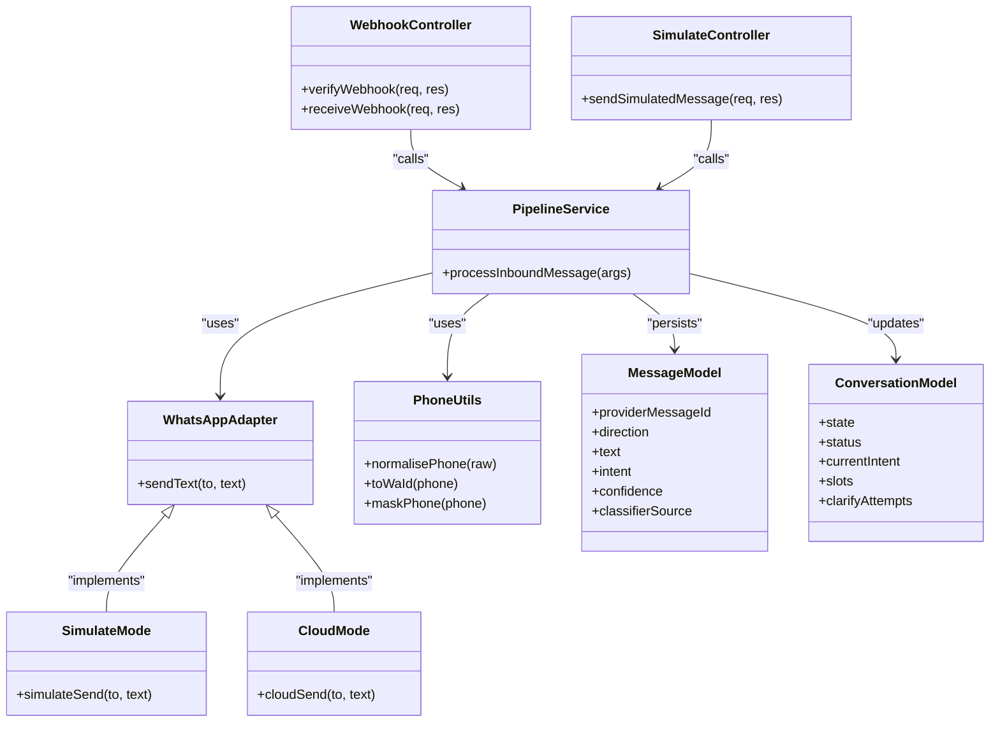

**Diagram sources**
- [pipeline.service.js:1-274](file://src/services/pipeline.service.js#L1-L274)
- [whatsapp.adapter.js:1-136](file://src/services/whatsapp.adapter.js#L1-L136)
- [webhook.controller.js:1-56](file://src/controllers/webhook.controller.js#L1-L56)
- [simulate.controller.js:1-35](file://src/controllers/simulate.controller.js#L1-L35)
- [phone.js:1-54](file://src/utils/phone.js#L1-L54)
- [message.model.js:1-35](file://src/models/message.model.js#L1-L35)
- [conversation.model.js:1-52](file://src/models/conversation.model.js#L1-L52)

## Detailed Component Analysis

### Dual-Mode Architecture: Simulated vs Production Cloud API
The WhatsApp adapter implements two modes:
- Simulated mode: Logs outbound messages to stdout and appends JSON lines to a log file. No external account is required.
- Cloud mode: Sends messages through the Meta Graph API using configured credentials.

The adapter always returns a consistent result object containing:
- Success flag
- Mode identifier
- Provider message ID when available
- Error string when applicable

This design ensures callers do not need to branch on mode; they handle the returned result uniformly.

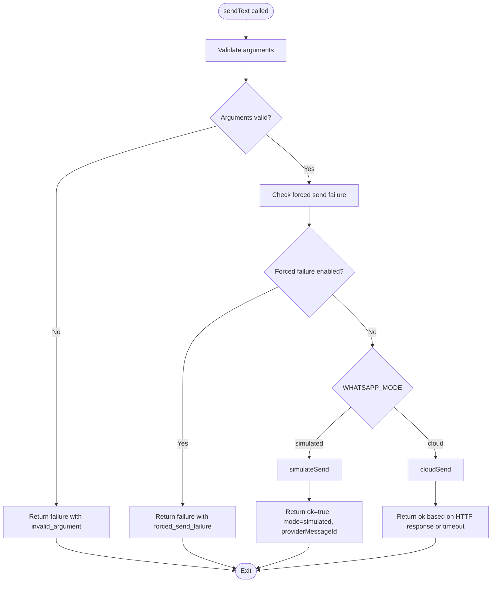

**Diagram sources**
- [whatsapp.adapter.js:47-135](file://src/services/whatsapp.adapter.js#L47-L135)

**Section sources**
- [whatsapp.adapter.js:1-136](file://src/services/whatsapp.adapter.js#L1-L136)
- [README.md:1-440](file://README.md#L1-L440)

### Message Format Specification
The webhook validator defines a trimmed schema for Meta Cloud API webhooks. It preserves unknown fields to remain compatible with future Meta changes. The validator extracts inbound messages from the nested structure and normalizes them into a flat internal shape used by the pipeline.

Key aspects of the inbound message shape:
- Provider message ID: Used for deduplication and audit tracing.
- Raw phone number: Preserved for logging and unsupported-number handling.
- Normalized phone number: E.164 Nigerian number or null if unusable.
- Sender name: Optional profile name.
- Message type: Text or other types such as image/audio.
- Text body: Present only for text messages.
- Timestamp: Optional timestamp from Meta.

Status-only callbacks without messages are accepted but ignored by the pipeline.

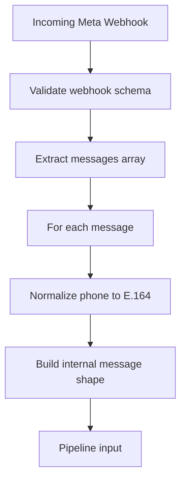

**Diagram sources**
- [webhook.validator.js:12-95](file://src/validators/webhook.validator.js#L12-L95)

**Section sources**
- [webhook.validator.js:1-124](file://src/validators/webhook.validator.js#L1-L124)

### Phone Number Normalization and WhatsApp ID Conversion
Phone normalization supports common Nigerian formats and converts them to E.164. If normalization fails, the pipeline treats the sender as unsupported and replies without persistence.

Normalization rules:
- Strip whitespace and common separators.
- Remove leading plus sign.
- Handle local zero-prefixed numbers.
- Handle country-code-prefixed numbers with extra zero.
- Require Nigerian country code prefix.
- Validate final length and digit pattern.

WhatsApp ID conversion removes the leading plus sign because the Cloud API expects the recipient ID without the plus.

Logging utilities mask phone numbers to protect sensitive data in operational logs.

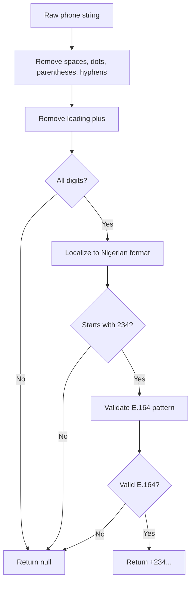

**Diagram sources**
- [phone.js:10-33](file://src/utils/phone.js#L10-L33)

**Section sources**
- [phone.js:1-54](file://src/utils/phone.js#L1-L54)

### Adapter Pattern Implementation
The adapter pattern isolates channel-specific behavior behind a single interface. Callers invoke `sendText`, and the adapter decides whether to simulate or use the Cloud API based on configuration.

Benefits:
- Unified caller code across simulated and production environments.
- Easy testing of failure paths using environment flags.
- Clear separation between business logic and external integration details.

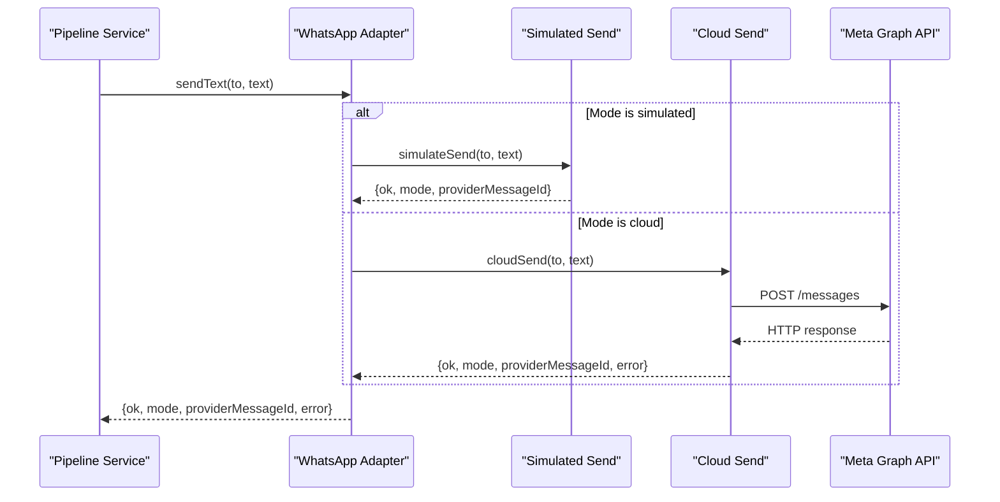

**Diagram sources**
- [whatsapp.adapter.js:47-135](file://src/services/whatsapp.adapter.js#L47-L135)

**Section sources**
- [whatsapp.adapter.js:1-136](file://src/services/whatsapp.adapter.js#L1-L136)

### Message Transformation Pipeline
The pipeline orchestrates the complete lifecycle of an inbound message:
1. Accept and log the inbound message.
2. Deduplicate by provider message ID.
3. Handle unsupported phone numbers by replying without persistence.
4. Upsert customer and resume or create active conversation.
5. Persist inbound message with unique index backstop.
6. Record message received audit event.
7. Classify text messages or prompt for non-text messages.
8. Route through intent handlers.
9. Send replies through the adapter and persist successful outbound messages.
10. Record reply sent audit events.

The pipeline returns a structured result suitable for both synchronous simulation responses and asynchronous webhook processing.

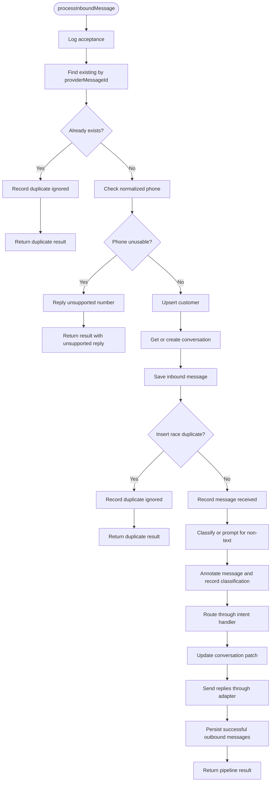

**Diagram sources**
- [pipeline.service.js:66-273](file://src/services/pipeline.service.js#L66-L273)

**Section sources**
- [pipeline.service.js:1-274](file://src/services/pipeline.service.js#L1-L274)

### Outbound Message Handling
Outbound messages are handled uniformly through the adapter. In simulated mode, messages are logged and appended to a JSON-lines file. In cloud mode, messages are sent via HTTPS with bearer token authentication.

Important behaviors:
- Timeout handling: Cloud sends abort after a fixed timeout.
- Error propagation: Non-success HTTP responses return structured errors.
- Forced failure: Environment flag can force send failures for testing.
- Provider message ID: Returned when available; null otherwise.
- Retry strategy: The adapter does not implement retry; callers should implement retry/failure handling based on the returned result.

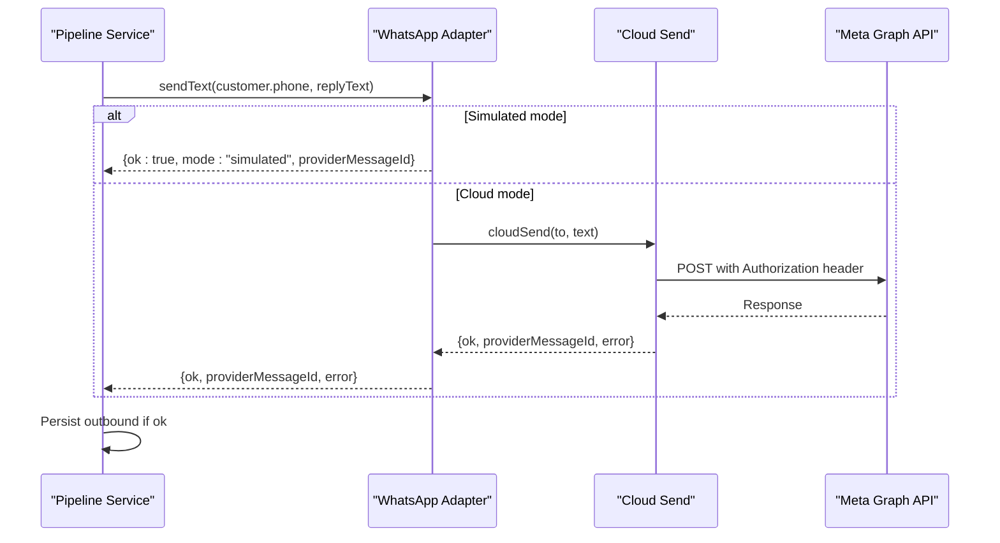

**Diagram sources**
- [pipeline.service.js:231-257](file://src/services/pipeline.service.js#L231-L257)
- [whatsapp.adapter.js:60-104](file://src/services/whatsapp.adapter.js#L60-L104)

**Section sources**
- [pipeline.service.js:1-274](file://src/services/pipeline.service.js#L1-L274)
- [whatsapp.adapter.js:1-136](file://src/services/whatsapp.adapter.js#L1-L136)

### Webhook and Simulate Entry Points
The webhook controller provides:
- GET handshake endpoint echoing the challenge when the verify token matches.
- POST endpoint returning 200 immediately and processing messages asynchronously.

The simulate controller:
- Validates the request body.
- Normalizes the payload into the same internal shape as the webhook.
- Awaits pipeline processing and returns the full outcome.

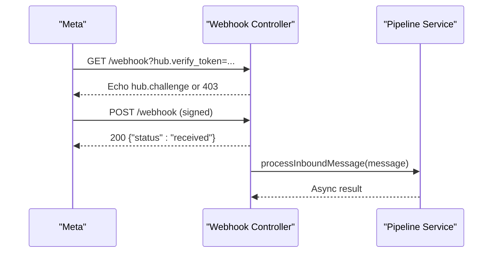

**Diagram sources**
- [webhook.controller.js:10-55](file://src/controllers/webhook.controller.js#L10-L55)
- [pipeline.service.js:66-273](file://src/services/pipeline.service.js#L66-L273)

**Section sources**
- [webhook.controller.js:1-56](file://src/controllers/webhook.controller.js#L1-L56)
- [simulate.controller.js:1-35](file://src/controllers/simulate.controller.js#L1-L35)

### Data Models and Deduplication
The message model enforces uniqueness on the provider message ID, providing a database-level backstop against duplicate processing. The conversation model tracks state, status, current intent, slots, retries, clarify attempts, and last message time. The customer model stores normalized E.164 phone numbers and consent metadata.

Deduplication occurs:
- Before persistence by checking existing provider message ID.
- After insertion due to concurrent delivery races.

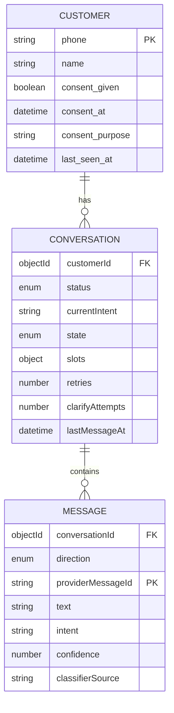

**Diagram sources**
- [customer.model.js:1-28](file://src/models/customer.model.js#L1-L28)
- [conversation.model.js:1-52](file://src/models/conversation.model.js#L1-L52)
- [message.model.js:1-35](file://src/models/message.model.js#L1-L35)

**Section sources**
- [message.model.js:1-35](file://src/models/message.model.js#L1-L35)
- [conversation.model.js:1-52](file://src/models/conversation.model.js#L1-L52)
- [customer.model.js:1-28](file://src/models/customer.model.js#L1-L28)

### Signature Verification and Security
The signature middleware verifies the HMAC-SHA256 signature provided by Meta. It compares the expected signature against the provided one using timing-safe comparison. Rejections are audited before returning unauthorized errors.

Security considerations:
- Uses raw request body for accurate signature verification.
- Rejects malformed or missing signature headers.
- Audits rejections with correlation IDs for traceability.

**Section sources**
- [signature.js:1-51](file://src/middleware/signature.js#L1-L51)

## Dependency Analysis
The following diagram shows how controllers depend on the pipeline, which depends on services, models, and the adapter.

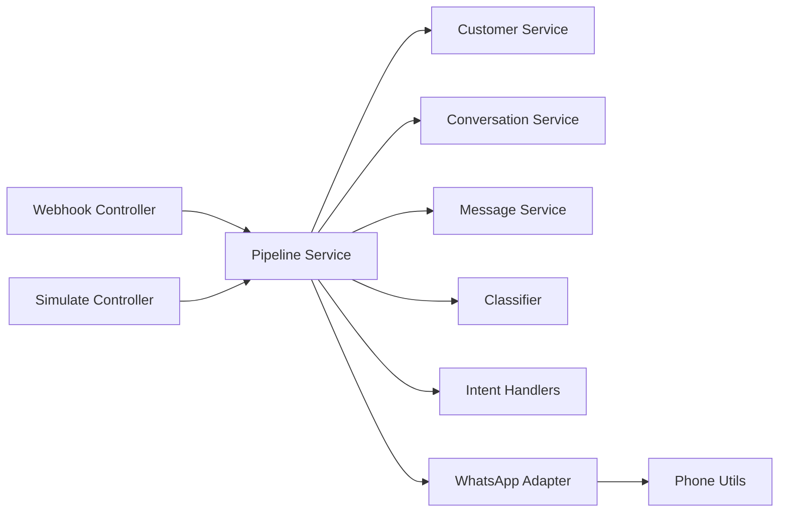

**Diagram sources**
- [webhook.controller.js:1-56](file://src/controllers/webhook.controller.js#L1-L56)
- [simulate.controller.js:1-35](file://src/controllers/simulate.controller.js#L1-L35)
- [pipeline.service.js:1-274](file://src/services/pipeline.service.js#L1-L274)
- [whatsapp.adapter.js:1-136](file://src/services/whatsapp.adapter.js#L1-L136)
- [phone.js:1-54](file://src/utils/phone.js#L1-L54)

**Section sources**
- [pipeline.service.js:1-274](file://src/services/pipeline.service.js#L1-L274)

## Performance Considerations
- Webhook processing returns 200 immediately to avoid Meta retry storms.
- Asynchronous processing prevents request timeouts from blocking inbound traffic.
- Database unique indexes provide efficient deduplication checks.
- Cloud API calls include a timeout to prevent hanging requests.
- Simulated mode avoids network overhead during development.
- Logging is structured and includes correlation IDs for tracing without exposing sensitive data.

[No sources needed since this section provides general guidance]

## Troubleshooting Guide
Common issues and resolutions:
- Invalid environment variables at startup: Compare `.env` with the example template; validation lists offending variables.
- Health check returns down: MongoDB may be unreachable; start the database or fix the connection string.
- Port conflicts: Change the port in the environment configuration.
- Webhook signature mismatch: Ensure the app secret matches the signer; use the provided script with the correct secret.
- Handshake rejected: Verify the verify token matches between the environment and Meta configuration.
- Force send failures: Use the environment flag to exercise notification failure paths.

Error handling patterns:
- Validation errors return structured error bodies with codes and details.
- Unauthorized webhook signatures are audited and return standardized errors.
- Pipeline send failures are logged and do not crash webhook processing.
- Duplicate messages are recorded and ignored gracefully.

**Section sources**
- [README.md:386-440](file://README.md#L386-L440)
- [signature.js:19-50](file://src/middleware/signature.js#L19-L50)
- [webhook.validator.js:103-123](file://src/validators/webhook.validator.js#L103-L123)
- [pipeline.service.js:77-146](file://src/services/pipeline.service.js#L77-L146)

## Conclusion
The Lead System Manager implements a robust, dual-mode WhatsApp message processing architecture. The adapter pattern cleanly separates simulated development behavior from production cloud API behavior. The pipeline centralizes deduplication, persistence, classification, intent routing, and outbound messaging. Phone normalization and WhatsApp ID conversion ensure compatibility with both internal logic and Meta’s expectations. Structured logging, signature verification, and standardized error responses support reliable operation and observability. Future enhancements can extend the pipeline with slot-filling, escalation, metrics, and richer integrations while preserving the current stable contract.

[No sources needed since this section summarizes without analyzing specific files]