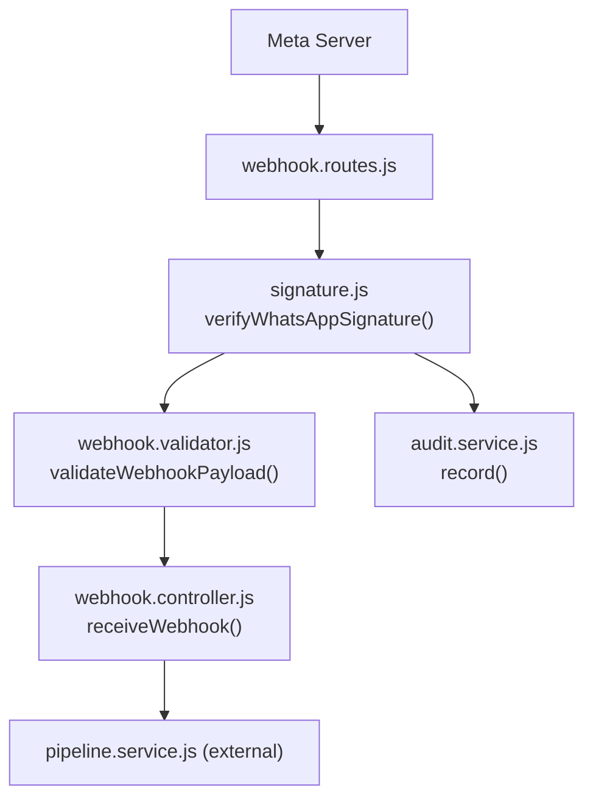
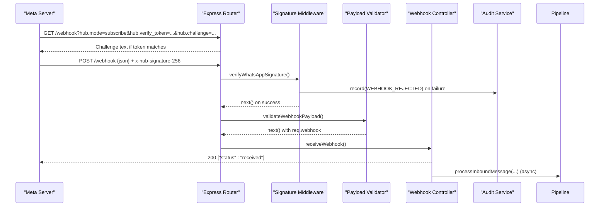
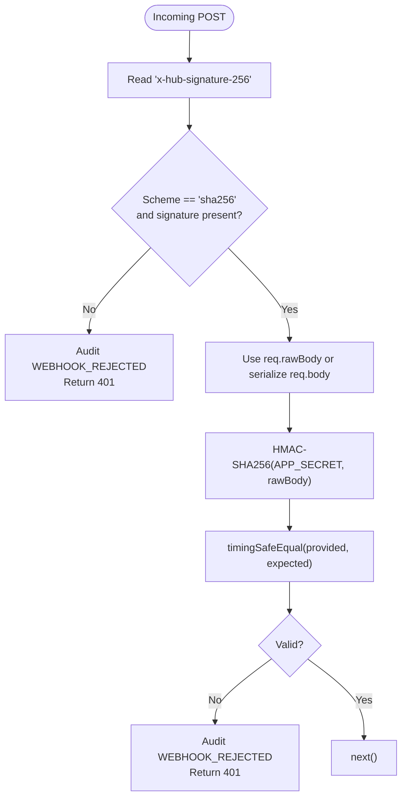
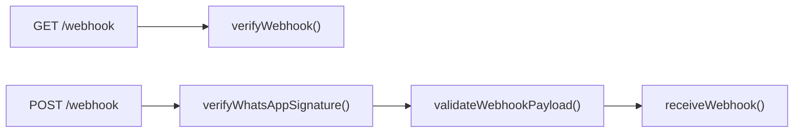
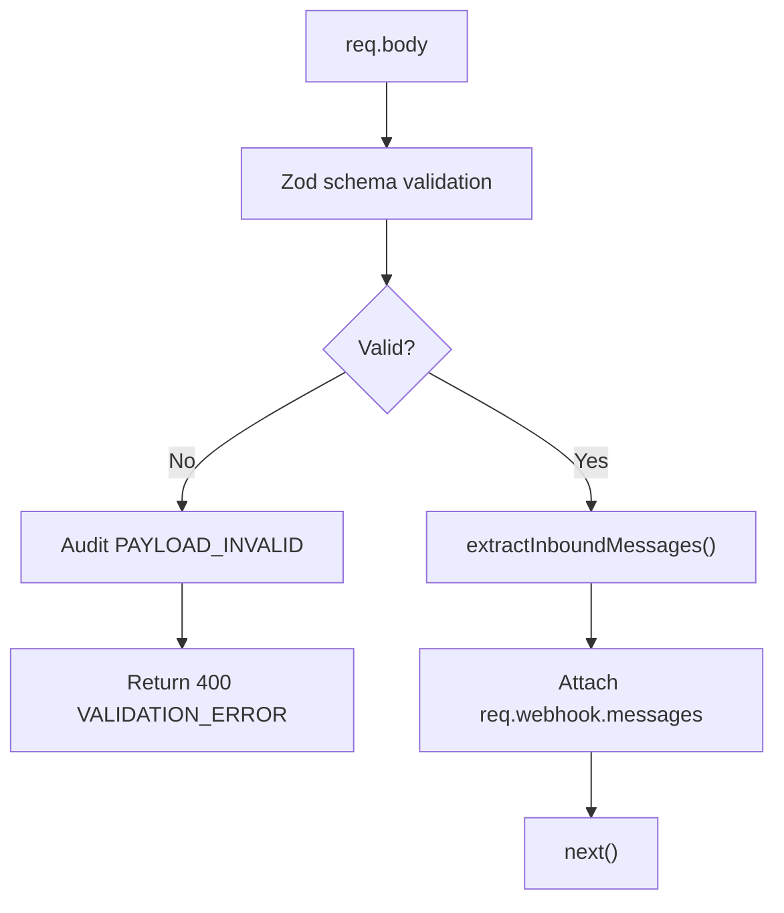
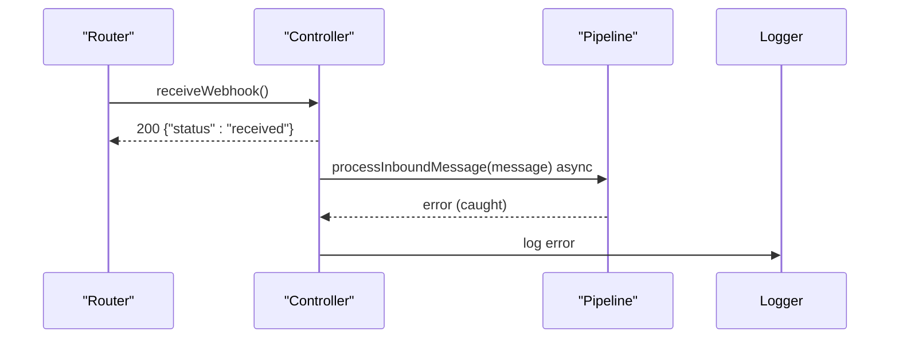
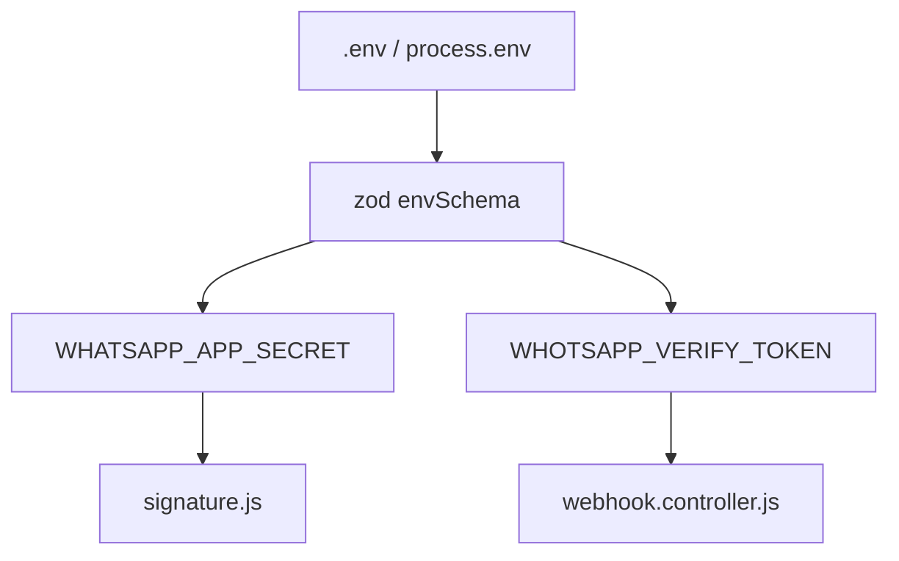
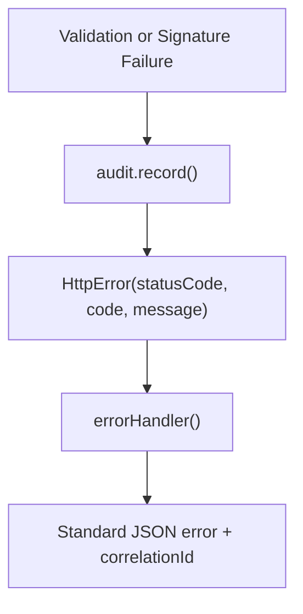
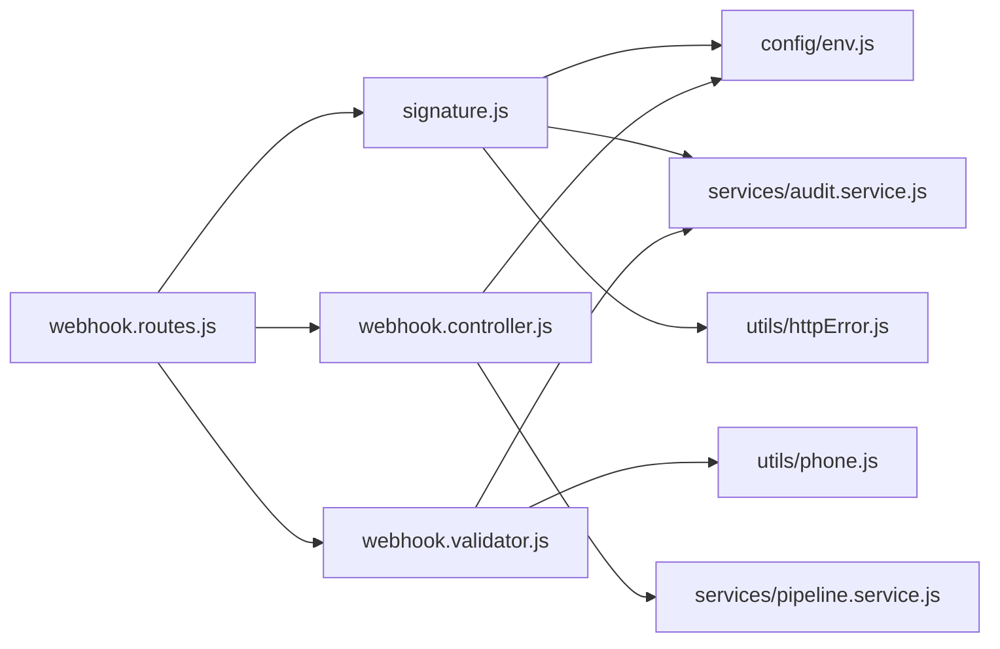

# Signature Verification and Security

<cite>
**Referenced Files in This Document**
- [signature.js](file://src/middleware/signature.js)
- [webhook.routes.js](file://src/routes/webhook.routes.js)
- [webhook.controller.js](file://src/controllers/webhook.controller.js)
- [webhook.validator.js](file://src/validators/webhook.validator.js)
- [env.js](file://src/config/env.js)
- [audit.service.js](file://src/services/audit.service.js)
- [httpError.js](file://src/utils/httpError.js)
- [errorHandler.js](file://src/middleware/errorHandler.js)
- [send-webhook.js](file://scripts/send-webhook.js)
- [webhook.test.js](file://tests/webhook.test.js)
- [webhook-sample.json](file://test_inputs/webhook-sample.json)
</cite>

## Table of Contents
1. [Introduction](#introduction)
2. [Project Structure](#project-structure)
3. [Core Components](#core-components)
4. [Architecture Overview](#architecture-overview)
5. [Detailed Component Analysis](#detailed-component-analysis)
6. [Dependency Analysis](#dependency-analysis)
7. [Performance Considerations](#performance-considerations)
8. [Troubleshooting Guide](#troubleshooting-guide)
9. [Conclusion](#conclusion)
10. [Appendices](#appendices)

## Introduction
This document explains the HMAC-SHA256 signature verification used to authenticate incoming webhooks from Meta’s WhatsApp Cloud API. It covers how signatures are generated, how the server verifies them, where the middleware is integrated, how request bodies are hashed, how invalid signatures are handled, and how to test and debug the implementation. It also outlines security best practices and protection against replay attacks.

## Project Structure
The webhook endpoint is defined under routes, secured by a signature verification middleware, validated by a payload validator, and processed by a controller that responds immediately and processes messages asynchronously.

**Diagram sources**
- [webhook.routes.js:8-13](file://src/routes/webhook.routes.js#L8-L13)
- [signature.js:19-49](file://src/middleware/signature.js#L19-L49)
- [webhook.validator.js:103-123](file://src/validators/webhook.validator.js#L103-L123)
- [webhook.controller.js:35-55](file://src/controllers/webhook.controller.js#L35-L55)
- [audit.service.js:22-36](file://src/services/audit.service.js#L22-L36)

**Section sources**
- [webhook.routes.js:1-16](file://src/routes/webhook.routes.js#L1-L16)
- [webhook.controller.js:1-56](file://src/controllers/webhook.controller.js#L1-L56)

## Core Components
- Signature verification middleware: validates the `x-hub-signature-256` header using HMAC-SHA256 with the app secret and timing-safe comparison.
- Webhook routes: register GET handshake and POST message endpoints; apply signature verification before payload validation.
- Payload validator: validates the Meta webhook shape and extracts inbound messages into a normalized structure.
- Controller: returns an immediate 200 response and processes messages asynchronously to avoid retry storms.
- Audit service: records rejected or invalid requests for observability.
- Error handling: centralizes error responses and maps errors to standard HTTP codes and codes.

**Section sources**
- [signature.js:1-51](file://src/middleware/signature.js#L1-L51)
- [webhook.routes.js:1-16](file://src/routes/webhook.routes.js#L1-L16)
- [webhook.validator.js:1-124](file://src/validators/webhook.validator.js#L1-L124)
- [webhook.controller.js:1-56](file://src/controllers/webhook.controller.js#L1-L56)
- [audit.service.js:1-116](file://src/services/audit.service.js#L1-L116)
- [errorHandler.js:1-80](file://src/middleware/errorHandler.js#L1-L80)

## Architecture Overview
The webhook flow enforces authentication at the middleware layer before any business logic runs. The GET handshake uses a verify token, while POST payloads require an HMAC-SHA256 signature computed over the raw body.

**Diagram sources**
- [webhook.controller.js:10-25](file://src/controllers/webhook.controller.js#L10-L25)
- [webhook.controller.js:35-55](file://src/controllers/webhook.controller.js#L35-L55)
- [webhook.routes.js:8-13](file://src/routes/webhook.routes.js#L8-L13)
- [signature.js:19-49](file://src/middleware/signature.js#L19-L49)
- [webhook.validator.js:103-123](file://src/validators/webhook.validator.js#L103-L123)
- [audit.service.js:22-36](file://src/services/audit.service.js#L22-L36)

## Detailed Component Analysis

### HMAC-SHA256 Signature Verification Middleware
The middleware authenticates incoming POST webhooks by verifying the `x-hub-signature-256` header against an HMAC-SHA256 digest of the raw request body using the configured app secret.

Key behaviors:
- Extracts the scheme and signature from the header.
- Requires the scheme to be `sha256` and the signature to be present.
- Uses the raw bytes Meta signed: prefers `req.rawBody`; otherwise serializes `req.body`.
- Computes the expected signature via HMAC-SHA256 and compares it using a constant-time function.
- Audits rejections and returns a 401 Unauthorized when invalid.

**Diagram sources**
- [signature.js:19-49](file://src/middleware/signature.js#L19-L49)

Security properties:
- Timing-safe comparison prevents side-channel leakage during signature comparison.
- Raw-body hashing ensures integrity of the exact bytes Meta signed.
- Rejections are audited for forensic analysis.

**Section sources**
- [signature.js:1-51](file://src/middleware/signature.js#L1-L51)
- [audit.service.js:22-36](file://src/services/audit.service.js#L22-L36)
- [httpError.js:6-20](file://src/utils/httpError.js#L6-L20)

### Webhook Routes and Middleware Integration
Routes define:
- GET `/webhook`: Meta verification handshake without signature.
- POST `/webhook`: applies signature verification, then payload validation, then controller processing.

**Diagram sources**
- [webhook.routes.js:8-13](file://src/routes/webhook.routes.js#L8-L13)

**Section sources**
- [webhook.routes.js:1-16](file://src/routes/webhook.routes.js#L1-L16)

### Payload Validation and Normalization
The validator:
- Validates the webhook envelope using a schema.
- Preserves unknown fields to remain compatible with future Meta changes.
- Extracts inbound messages into a normalized array attached to `req.webhook.messages`.
- Audits invalid payloads and returns a 400 error with details.

**Diagram sources**
- [webhook.validator.js:53-58](file://src/validators/webhook.validator.js#L53-L58)
- [webhook.validator.js:68-95](file://src/validators/webhook.validator.js#L68-L95)
- [webhook.validator.js:103-123](file://src/validators/webhook.validator.js#L103-L123)

**Section sources**
- [webhook.validator.js:1-124](file://src/validators/webhook.validator.js#L1-L124)

### Controller Response Strategy
The controller:
- Responds with 200 immediately to prevent Meta retries.
- Processes inbound messages asynchronously to isolate failures from the HTTP path.
- Logs and handles processing errors without affecting the response.

**Diagram sources**
- [webhook.controller.js:35-55](file://src/controllers/webhook.controller.js#L35-L55)

**Section sources**
- [webhook.controller.js:1-56](file://src/controllers/webhook.controller.js#L1-L56)

### Configuration and Secrets Management
Environment configuration:
- `WHATSAPP_APP_SECRET` is required for signature verification.
- `WHATSAPP_VERIFY_TOKEN` is required for the GET handshake.
- Production checks enforce non-default secrets.

**Diagram sources**
- [env.js:25-49](file://src/config/env.js#L25-L49)
- [env.js:65-88](file://src/config/env.js#L65-L88)

**Section sources**
- [env.js:1-130](file://src/config/env.js#L1-L130)

### Error Handling and Audit Trail
- Invalid signatures produce 401 UNAUTHORIZED and audit events of type `WEBHOOK_REJECTED`.
- Invalid payloads produce 400 VALIDATION_ERROR and audit events of type `PAYLOAD_INVALID`.
- Central error handler normalizes error responses and logs appropriately.

**Diagram sources**
- [signature.js:23-30](file://src/middleware/signature.js#L23-L30)
- [webhook.validator.js:103-123](file://src/validators/webhook.validator.js#L103-L123)
- [errorHandler.js:16-79](file://src/middleware/errorHandler.js#L16-L79)
- [httpError.js:6-20](file://src/utils/httpError.js#L6-L20)

**Section sources**
- [audit.service.js:1-116](file://src/services/audit.service.js#L1-L116)
- [errorHandler.js:1-80](file://src/middleware/errorHandler.js#L1-L80)
- [httpError.js:1-31](file://src/utils/httpError.js#L1-L31)

## Dependency Analysis
The following diagram shows how components depend on each other for secure webhook processing.

**Diagram sources**
- [webhook.routes.js:1-16](file://src/routes/webhook.routes.js#L1-L16)
- [signature.js:1-5](file://src/middleware/signature.js#L1-L5)
- [webhook.validator.js:1-5](file://src/validators/webhook.validator.js#L1-L5)
- [webhook.controller.js:1-3](file://src/controllers/webhook.controller.js#L1-L3)

**Section sources**
- [webhook.routes.js:1-16](file://src/routes/webhook.routes.js#L1-L16)
- [signature.js:1-51](file://src/middleware/signature.js#L1-L51)
- [webhook.validator.js:1-124](file://src/validators/webhook.validator.js#L1-L124)
- [webhook.controller.js:1-56](file://src/controllers/webhook.controller.js#L1-L56)

## Performance Considerations
- Immediate 200 response avoids retry storms and reduces latency exposure.
- Asynchronous message processing isolates slow downstream workloads from the HTTP path.
- Constant-time signature comparison mitigates timing side channels with negligible overhead.
- Using `req.rawBody` avoids double serialization costs when available.

[No sources needed since this section provides general guidance]

## Troubleshooting Guide
Common issues and resolutions:
- Missing or malformed signature header: ensure clients send `x-hub-signature-256: sha256=<hex>` and that the body is not transformed between signing and sending.
- Wrong app secret: verify `WHATSAPP_APP_SECRET` matches the value configured in Meta’s dashboard.
- Body mismatch: confirm the server receives the exact bytes Meta signed; do not modify content-type or compress the body after signing.
- Invalid payload shape: inspect validation errors returned in the 400 response and audit events of type `PAYLOAD_INVALID`.
- Audit trail gaps: check audit collection for `WEBHOOK_REJECTED` entries to diagnose signature failures.

Testing strategies:
- Use the provided script to sign and send sample payloads locally.
- Run unit tests covering valid signatures, wrong signatures, missing headers, invalid payloads, and status-only callbacks.
- Validate that audit events are recorded for rejections and invalid payloads.

**Section sources**
- [send-webhook.js:1-84](file://scripts/send-webhook.js#L1-L84)
- [webhook.test.js:1-168](file://tests/webhook.test.js#L1-L168)
- [webhook-sample.json:1-29](file://test_inputs/webhook-sample.json#L1-L29)

## Conclusion
The implementation secures incoming Meta webhooks through HMAC-SHA256 signature verification with timing-safe comparisons, strict environment-based secret management, structured payload validation, and comprehensive auditing. The route design ensures fast acknowledgment and resilient asynchronous processing. Following the testing and troubleshooting guidance helps maintain robust and secure webhook handling.

[No sources needed since this section summarizes without analyzing specific files]

## Appendices

### Security Best Practices
- Store `WHATSAPP_APP_SECRET` and `WHATSAPP_VERIFY_TOKEN` securely and never commit them to source control.
- Enforce production checks for default values to prevent accidental deployment with weak secrets.
- Keep the webhook endpoint behind TLS and restrict access where possible.
- Monitor audit events for `WEBHOOK_REJECTED` and `PAYLOAD_INVALID` to detect anomalies.
- Avoid logging sensitive parts of the request body or signature.

[No sources needed since this section provides general guidance]

### Replay Attack Protection
- Deduplicate messages by provider message ID in the pipeline to ignore repeated deliveries.
- Maintain idempotent processing so duplicate messages do not cause side effects.
- Optionally add timestamp checks and nonce tracking to reject stale or repeated requests beyond deduplication.

[No sources needed since this section provides general guidance]