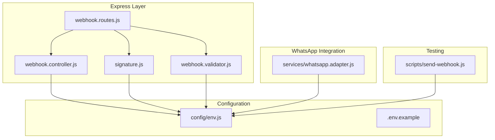
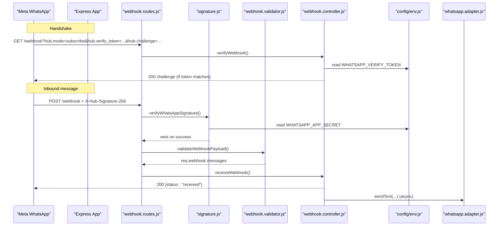
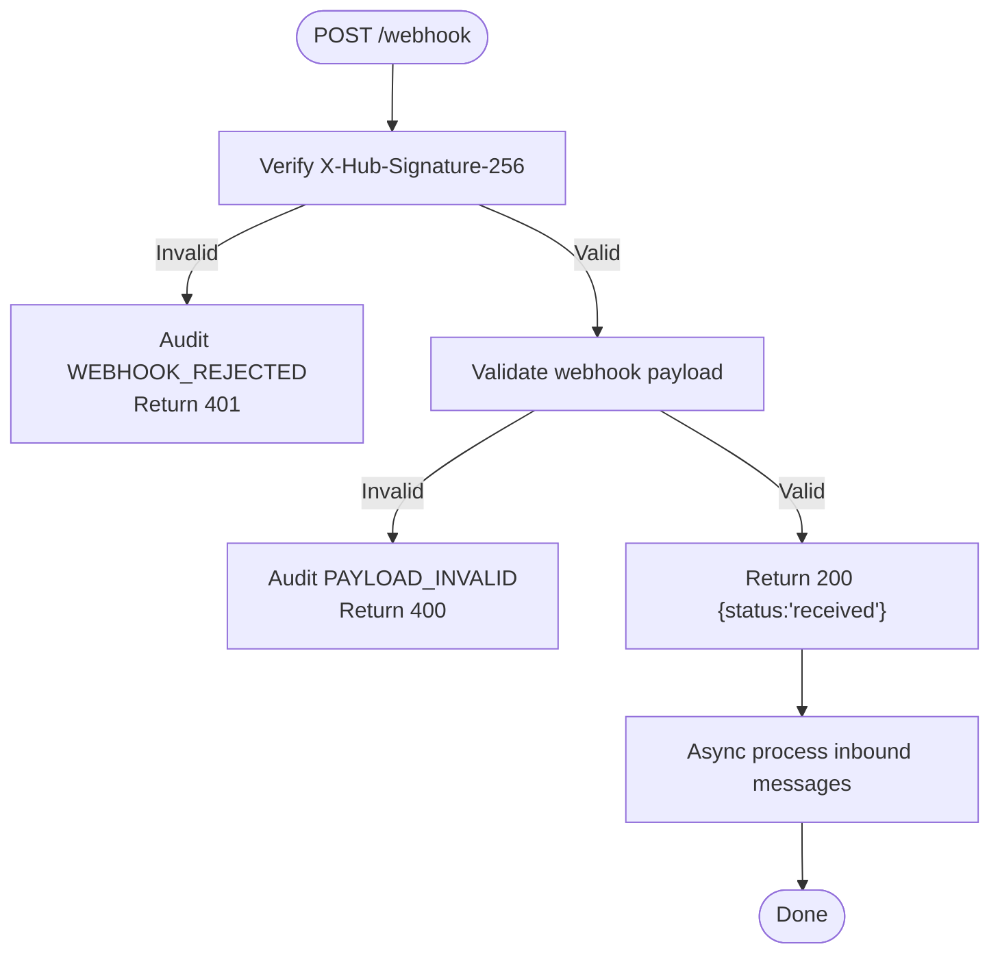
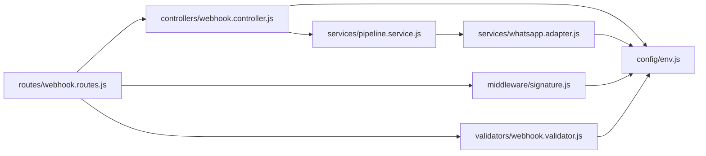

# Webhook Setup and Configuration

<cite>
**Referenced Files in This Document**   
- [README.md](file://README.md)
- [.env.example](file://.env.example)
- [package.json](file://package.json)
- [src/config/env.js](file://src/config/env.js)
- [src/routes/webhook.routes.js](file://src/routes/webhook.routes.js)
- [src/controllers/webhook.controller.js](file://src/controllers/webhook.controller.js)
- [src/middleware/signature.js](file://src/middleware/signature.js)
- [src/validators/webhook.validator.js](file://src/validators/webhook.validator.js)
- [src/services/whatsapp.adapter.js](file://src/services/whatsapp.adapter.js)
- [scripts/send-webhook.js](file://scripts/send-webhook.js)
</cite>

## Table of Contents
1. [Introduction](#introduction)
2. [Project Structure](#project-structure)
3. [Core Components](#core-components)
4. [Architecture Overview](#architecture-overview)
5. [Detailed Component Analysis](#detailed-component-analysis)
6. [Dependency Analysis](#dependency-analysis)
7. [Performance Considerations](#performance-considerations)
8. [Troubleshooting Guide](#troubleshooting-guide)
9. [Conclusion](#conclusion)
10. [Appendices](#appendices)

## Introduction
This document explains how to set up and configure WhatsApp webhooks for the Lead System Manager API. It covers:
- Creating a Meta Business Platform app and adding WhatsApp
- Setting up a WhatsApp Business Account and phone number verification
- Registering webhook callback URLs and verify tokens
- Configuring environment variables such as `WHATSAPP_VERIFY_TOKEN`, `WHATSAPP_API_VERSION`, and `WHATSAPP_PHONE_NUMBER_ID`
- Running local development with ngrok tunneling
- Production deployment considerations
- Managing webhook subscriptions
- Validating endpoints and troubleshooting common issues

The system supports two WhatsApp modes:
- Simulated mode: messages are logged instead of sent, so no Meta account is required for local development.
- Cloud mode: real outbound messages go through the Meta WhatsApp Cloud API.

## Project Structure
The webhook implementation is split across routes, controller, middleware, validators, configuration, and the WhatsApp adapter. The README also documents how to obtain Meta credentials and run the server locally.

**Diagram sources**
- [src/routes/webhook.routes.js:1-16](file://src/routes/webhook.routes.js#L1-L16)
- [src/controllers/webhook.controller.js:1-56](file://src/controllers/webhook.controller.js#L1-L56)
- [src/middleware/signature.js:1-51](file://src/middleware/signature.js#L1-L51)
- [src/validators/webhook.validator.js:1-124](file://src/validators/webhook.validator.js#L1-L124)
- [src/config/env.js:1-130](file://src/config/env.js#L1-L130)
- [src/services/whatsapp.adapter.js:1-136](file://src/services/whatsapp.adapter.js#L1-L136)
- [scripts/send-webhook.js:1-84](file://scripts/send-webhook.js#L1-L84)
- [.env.example:1-42](file://.env.example#L1-L42)

**Section sources**
- [README.md:163-243](file://README.md#L163-L243)
- [package.json:1-36](file://package.json#L1-L36)

## Core Components
- Webhook route: exposes GET `/webhook` for Meta’s handshake and POST `/webhook` for inbound messages.
- Controller: handles verification and immediate 200 responses before asynchronous processing.
- Signature middleware: verifies HMAC-SHA256 signatures using `WHATSAPP_APP_SECRET`.
- Payload validator: validates Meta payload shape and extracts inbound messages.
- Environment configuration: validates all environment variables at startup and enforces production rules.
- WhatsApp adapter: sends outbound messages either by logging (simulated) or via the Graph API (cloud).

Key responsibilities:
- GET `/webhook`: echo back `hub.challenge` when the verify token matches.
- POST `/webhook`: validate signature, validate payload, return 200 immediately, then process messages asynchronously.
- Outbound messaging: use simulated mode by default; switch to cloud mode for real Meta traffic.

**Section sources**
- [src/routes/webhook.routes.js:1-16](file://src/routes/webhook.routes.js#L1-L16)
- [src/controllers/webhook.controller.js:1-56](file://src/controllers/webhook.controller.js#L1-L56)
- [src/middleware/signature.js:1-51](file://src/middleware/signature.js#L1-L51)
- [src/validators/webhook.validator.js:1-124](file://src/validators/webhook.validator.js#L1-L124)
- [src/config/env.js:1-130](file://src/config/env.js#L1-L130)
- [src/services/whatsapp.adapter.js:1-136](file://src/services/whatsapp.adapter.js#L1-L136)

## Architecture Overview
The webhook flow consists of two main paths:
- Verification handshake: Meta calls GET `/webhook` once during registration.
- Message delivery: Meta calls POST `/webhook` for each incoming message.

**Diagram sources**
- [src/routes/webhook.routes.js:1-16](file://src/routes/webhook.routes.js#L1-L16)
- [src/controllers/webhook.controller.js:1-56](file://src/controllers/webhook.controller.js#L1-L56)
- [src/middleware/signature.js:1-51](file://src/middleware/signature.js#L1-L51)
- [src/validators/webhook.validator.js:1-124](file://src/validators/webhook.validator.js#L1-L124)
- [src/config/env.js:1-130](file://src/config/env.js#L1-L130)
- [src/services/whatsapp.adapter.js:1-136](file://src/services/whatsapp.adapter.js#L1-L136)

## Detailed Component Analysis

### Meta Business Platform App Creation and WhatsApp Setup
- Create a Meta app under your Meta Business account and add the WhatsApp product.
- Obtain:
  - Test phone number and Phone Number ID → `WHATSAPP_PHONE_NUMBER_ID`
  - Temporary access token → `WHATSAPP_ACCESS_TOKEN`
  - App Secret → `WHATSAPP_APP_SECRET`
- Set a Verify Token → `WHATSAPP_VERIFY_TOKEN`
- Expose your API publicly using HTTPS (ngrok works for local development).
- Subscribe to the `messages` field in the WhatsApp webhook configuration.

These steps are documented in the project README and align with the environment variables validated by the application.

**Section sources**
- [README.md:205-243](file://README.md#L205-L243)

### Webhook URL and Verify Token Registration
- Callback URL: point Meta to your public HTTPS endpoint, e.g., `https://your-ngrok-id.ngrok-free.app/webhook`.
- Verify Token: enter the exact value of `WHATSAPP_VERIFY_TOKEN` from your `.env` file into Meta’s webhook configuration.
- After saving, subscribe to the `messages` field.

The GET `/webhook` handler echoes back `hub.challenge` when the token matches, enabling Meta to complete the handshake.

**Section sources**
- [README.md:220-231](file://README.md#L220-L231)
- [src/controllers/webhook.controller.js:5-25](file://src/controllers/webhook.controller.js#L5-L25)

### Environment Variable Configuration
Required variables for webhook setup:
- `WHATSAPP_VERIFY_TOKEN`: secret string used during Meta’s webhook handshake.
- `WHATSAPP_APP_SECRET`: used to verify `x-hub-signature-256` on incoming webhooks.
- `WHATSAPP_API_VERSION`: Graph API version, e.g., `v19.0`.
- `WHATSAPP_PHONE_NUMBER_ID`: sender id required when `WHATSAPP_MODE=cloud`.
- `WHATSAPP_ACCESS_TOKEN`: bearer token required when `WHATSAPP_MODE=cloud`.
- `WHATSAPP_MODE`: `simulated` (default) or `cloud`.

Validation rules enforced at startup:
- Production rejects placeholder secrets like `change-me` for `STAFF_API_KEY`, `WHATSAPP_VERIFY_TOKEN`, and `WHATSAPP_APP_SECRET`.
- Cloud mode requires both `WHATSAPP_PHONE_NUMBER_ID` and `WHATSAPP_ACCESS_TOKEN`.

A ready-to-copy template is provided in `.env.example`.

**Section sources**
- [src/config/env.js:25-109](file://src/config/env.js#L25-L109)
- [.env.example:16-25](file://.env.example#L16-L25)
- [README.md:163-197](file://README.md#L163-L197)

### Local Development with ngrok Tunneling
- Start the API locally (default port `3000`).
- Run ngrok to expose the local server over HTTPS.
- Configure Meta’s webhook:
  - Callback URL: `https://your-ngrok-id.ngrok-free.app/webhook`
  - Verify token: same as `WHATSAPP_VERIFY_TOKEN` in `.env`
- Subscribe to the `messages` field.

The README includes an example command to start ngrok and points to the WhatsApp configuration page.

**Section sources**
- [README.md:224-231](file://README.md#L224-L231)
- [package.json:10-16](file://package.json#L10-L16)

### Production Deployment Considerations
- Use a stable public HTTPS endpoint (not ngrok).
- Set `WHATSAPP_MODE=cloud` and provide permanent credentials:
  - `WHATSAPP_PHONE_NUMBER_ID`
  - `WHATSAPP_ACCESS_TOKEN` (permanent token from a system user with messaging permission)
  - `WHATSAPP_APP_SECRET`
  - `WHATSAPP_VERIFY_TOKEN`
- Ensure `WHATSAPP_API_VERSION` matches the version shown in the Meta API Setup page.
- Validate that production mode rejects placeholder secrets at boot.

**Section sources**
- [README.md:234-243](file://README.md#L234-L243)
- [src/config/env.js:65-100](file://src/config/env.js#L65-L100)

### Webhook Subscription Management
- In the Meta app dashboard, after setting the Callback URL and Verify Token, subscribe to the `messages` field.
- Once subscribed, Meta will call POST `/webhook` for incoming messages.
- You can test webhook reception without Meta using the provided script that signs payloads with `WHATSAPP_APP_SECRET`.

**Section sources**
- [README.md:231-231](file://README.md#L231-L231)
- [scripts/send-webhook.js:1-84](file://scripts/send-webhook.js#L1-L84)

### Webhook Endpoint Validation
- Handshake validation:
  - GET `/webhook` returns the challenge if `hub.verify_token` matches `WHATSAPP_VERIFY_TOKEN`.
  - Otherwise returns 403 with an unauthorized error.
- Signature validation:
  - POST `/webhook` requires `X-Hub-Signature-256` header.
  - Middleware computes HMAC-SHA256 using `WHATSAPP_APP_SECRET` and compares it to the provided signature.
  - Invalid signatures return 401 and are audited.
- Payload validation:
  - Validator checks the Meta payload structure and extracts inbound messages.
  - Invalid payloads return 400 and are audited.

**Diagram sources**
- [src/middleware/signature.js:19-50](file://src/middleware/signature.js#L19-L50)
- [src/validators/webhook.validator.js:103-123](file://src/validators/webhook.validator.js#L103-L123)
- [src/controllers/webhook.controller.js:35-55](file://src/controllers/webhook.controller.js#L35-L55)

**Section sources**
- [src/controllers/webhook.controller.js:5-55](file://src/controllers/webhook.controller.js#L5-L55)
- [src/middleware/signature.js:1-51](file://src/middleware/signature.js#L1-L51)
- [src/validators/webhook.validator.js:1-124](file://src/validators/webhook.validator.js#L1-L124)

### Outbound Messaging Modes
- Simulated mode: logs outbound messages to stdout and a JSON log file; no external dependencies.
- Cloud mode: sends messages via the Meta Graph API using `WHATSAPP_ACCESS_TOKEN` and `WHATSAPP_PHONE_NUMBER_ID`.
- A test hook allows forcing send failures to exercise failure handling.

**Section sources**
- [src/services/whatsapp.adapter.js:9-24](file://src/services/whatsapp.adapter.js#L9-L24)
- [src/services/whatsapp.adapter.js:47-104](file://src/services/whatsapp.adapter.js#L47-L104)
- [src/services/whatsapp.adapter.js:113-135](file://src/services/whatsapp.adapter.js#L113-L135)

## Dependency Analysis
The following diagram shows how the webhook components depend on each other and on configuration.

**Diagram sources**
- [src/routes/webhook.routes.js:1-16](file://src/routes/webhook.routes.js#L1-L16)
- [src/controllers/webhook.controller.js:1-56](file://src/controllers/webhook.controller.js#L1-L56)
- [src/middleware/signature.js:1-51](file://src/middleware/signature.js#L1-L51)
- [src/validators/webhook.validator.js:1-124](file://src/validators/webhook.validator.js#L1-L124)
- [src/services/whatsapp.adapter.js:1-136](file://src/services/whatsapp.adapter.js#L1-L136)
- [src/config/env.js:1-130](file://src/config/env.js#L1-L130)

**Section sources**
- [src/routes/webhook.routes.js:1-16](file://src/routes/webhook.routes.js#L1-L16)
- [src/controllers/webhook.controller.js:1-56](file://src/controllers/webhook.controller.js#L1-L56)
- [src/middleware/signature.js:1-51](file://src/middleware/signature.js#L1-L51)
- [src/validators/webhook.validator.js:1-124](file://src/validators/webhook.validator.js#L1-L124)
- [src/services/whatsapp.adapter.js:1-136](file://src/services/whatsapp.adapter.js#L1-L136)
- [src/config/env.js:1-130](file://src/config/env.js#L1-L130)

## Performance Considerations
- Immediate 200 response: POST `/webhook` returns quickly to avoid Meta retry storms; actual processing happens asynchronously.
- Signature verification uses timing-safe comparison to prevent timing attacks.
- Outbound sends have a timeout to avoid hanging requests.
- Simulated mode avoids network latency and external dependencies during development.

[No sources needed since this section provides general guidance]

## Troubleshooting Guide
Common issues and resolutions:
- Startup errors about invalid environment variables: compare `.env` with `.env.example`; the error lists each offending variable.
- Health endpoint down due to MongoDB: ensure MongoDB is reachable or start the in-memory dev instance.
- Port conflicts: change `PORT` in `.env` if another process uses 3000.
- Webhook signature mismatch: ensure `WHATSAPP_APP_SECRET` matches the signer; use the provided script with the correct secret.
- Handshake fails: ensure `WHATSAPP_VERIFY_TOKEN` in `.env` matches the value entered in Meta’s webhook configuration.
- Force send failures for testing: enable `WHATSAPP_FORCE_SEND_FAILURE=true` or use the script’s bad-signature option.

For manual testing without Meta:
- Use the provided script to sign and POST sample payloads to `/webhook`.
- The script supports overriding the target URL and secret for local testing.

**Section sources**
- [README.md:409-419](file://README.md#L409-L419)
- [scripts/send-webhook.js:1-84](file://scripts/send-webhook.js#L1-L84)

## Conclusion
To successfully integrate WhatsApp webhooks:
- Create a Meta app and add WhatsApp, obtaining the Phone Number ID, Access Token, App Secret, and setting a Verify Token.
- Configure your environment variables according to the validated schema and README instructions.
- Expose your API over HTTPS (ngrok for local development), register the Callback URL and Verify Token in Meta, and subscribe to the `messages` field.
- Validate the handshake and signed webhook endpoints using the provided tools and tests.
- For production, use permanent credentials, a stable HTTPS endpoint, and ensure all required variables are set.

[No sources needed since this section summarizes without analyzing specific files]

## Appendices

### Quick Reference: Required Variables for Webhooks
- `WHATSAPP_VERIFY_TOKEN`: used for Meta’s webhook handshake.
- `WHATSAPP_APP_SECRET`: used to verify incoming webhook signatures.
- `WHATSAPP_API_VERSION`: Graph API version (e.g., `v19.0`).
- `WHATSAPP_PHONE_NUMBER_ID`: required when `WHATSAPP_MODE=cloud`.
- `WHATSAPP_ACCESS_TOKEN`: required when `WHATSAPP_MODE=cloud`.
- `WHATSAPP_MODE`: `simulated` (default) or `cloud`.

**Section sources**
- [.env.example:16-25](file://.env.example#L16-L25)
- [src/config/env.js:40-50](file://src/config/env.js#L40-L50)